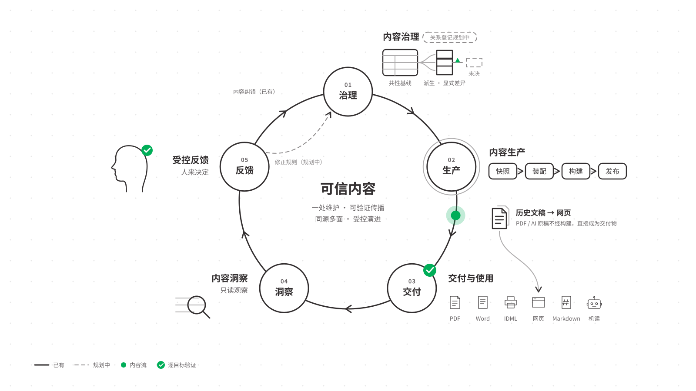

# Hello-Docs 工程面（auto-manual）

*让产品内容成为可信、可复用、持续演进的知识资产。*

Hello-Docs 以产品说明书为切入点，治理批准原稿、可复用模板与结构化内容，
支持资料编写、审核、发布、知识提取与查询。资料写作的主线在私有的资料开发工作台
Hello-Docs-Review：Agent 调用现有的基础设施、数据、模板和语料起草，由人审核。
基于数据和模板的自动构建保留为按需使用的生产能力。

本仓库是工程面：工作台和业务面用到的代码、模板、共享组件、Skill、契约与 CI 都在这里修改和验证，
合入 `main` 后单向同步到另外两个仓库。

## 三个仓库

| 仓库 | 角色 | 在那里做什么 |
| --- | --- | --- |
| **auto-manual**（本仓库，公开） | 工程面 | 修改代码、模板、共享组件、Skill 和文档，跑 CI；合入后同步到另外两个仓库 |
| [Hello-Docs](https://github.com/Bingboom/Hello-Docs)（公开） | 业务面 | 存放业务数据与语料资产，发布网页说明书，按需构建 Word、PDF、IDML 等格式 |
| [Hello-Docs-Review](https://github.com/Bingboom/Hello-Docs-Review)（私有） | 资料开发工作台 | Agent 调用全部基础设施、数据、模板和语料写作；审核稿在私有站点审阅 |

两个镜像只维护各自的内容目录，其余文件来自本仓库。它们的 README 也在这里维护，
原文在 [`mirrors/`](mirrors/)。分工、同步通道和飞书 base 见[双平面地图](user-guide/two_plane_map.md)。

## 资料怎样产出

1. **工作台写作：** Agent 在 Hello-Docs-Review 中继承参考说明书的结构与措辞，按目标规格书替换参数，
   复用模板、共享组件和翻译语料；规则见 [`us-jp-review-draft`](.agents/skills/us-jp-review-draft/SKILL.md) 等 Skill。
2. **审核：** 审核稿在私有站点阅读，每轮修改形成一个新版本，待确认的问题随稿记录。
3. **发布与追溯：** 审核通过的稿件作为批准原稿进入 Hello-Docs 发布与追溯。这一衔接尚在建设中，
   现有交付仍走下面的发布路径。

工具、模板或 Skill 需要改时，回到本仓库提 PR；稿件不进入本仓库。

## 按需构建与发布



需要构建或重建时，沿用现有主线：**治理 → 快照 → 装配 → 构建／渲染 → 发布／追溯**。
Web、Word、PDF、IDML、Markdown 和机器可读内容由各目标的批准来源派生；
交付与使用中发现的问题经责任人审核后返回对应编辑入口，形成可追溯的新版本。

| 路径 | 内容如何进入生产 |
| --- | --- |
| 结构化数据与共享模板（按需） | 飞书受控数据、仓库模板和配置冻结为快照，经装配、构建、评审后发布 |
| 批准原稿与冻结源包 | 已批准的 PDF / AI 原稿或 Git 原稿冻结为源包，声明权威版本和编辑入口，经构建、校验和封存后发布网页版 |

两条路径并存，已批准的原稿目标无需为统一形式迁入数据表。
已封存的版本不再改动；修订从声明的编辑入口生成新版本，并记录来源关系。

模板、骨架、共享组件、标准文案和翻译语料既服务自动构建，也为资料开发人员和 Agent
提供经验证的组织与表达参考；实际复用仍须核对适用条件、来源和审核状态。
长期原则与现有能力边界见[项目定位](code-as-doc/architecture/Hello_Docs_Positioning.md)。

## 视频演示

<!-- VIDEO_SLOT_START -->
> 视频位已预留。视频就绪后，可用一张封面图链接到 GitHub、Bilibili 或其他播放页。
<!-- VIDEO_SLOT_END -->

## 快速开始

先按[接手手册](ONBOARDING.md)配置本地环境。[`build.py`](build.py) 是统一入口；
以下使用仓库测试快照验证 US/EN 示例，不需要飞书凭据：

```bash
python build.py doctor --config configs/config.us-en.yaml --model JE-1000F --region US
python build.py check --config configs/config.us-en.yaml --model JE-1000F --region US --data-root tests/fixtures/phase2 --staging-root .tmp/readme-check
```

`doctor` 检查本机工具链，会列出 pandoc、xelatex 等缺口；`check` 只需 Python 依赖，
中间产物写入已忽略的 `.tmp/`，不改动工作树。

按需发起业务评审、构建与发布，从[快速开始指南](user-guide/quick_start_guide.md)进入；
命令、参数和故障处理见[构建指南](code-as-doc/build_doc_guide.md)。

## 维护原则

- **权威明确：** 每个目标声明权威来源和批准版本；网页、文档、机器语料和知识页面只消费批准内容，不另立权威。
- **反馈有人负责：** 观察结果先作为候选，由责任人决定后从对应编辑入口修订；批准、构建、发布和线上验证分别留证。
- **治理有轻重（原则）：** 警告、安全与合规文本、规格值要求逐项记录并由责任人审核，其他内容默认轻量元数据。
- **一处维护、可验证传播（规划中）：** 依据确认的内容关系共享维护、差异保留理由、修改后逐目标验证传播结果。
  内容关系登记（身份、适用性、基线与派生关系）和修正治理规则的反馈尚未实现，
  方向与已实现边界见[系统演进战略](code-as-doc/architecture/System%20Evolution%20Strategy.md)。

代码、模板和文档只在本仓库修改；队列构建、评审和发布在 Hello-Docs 运行，资料写作在 Hello-Docs-Review 进行。
具体编辑位置见[操作指南](user-guide/hello_auto-doc.md)。

## 文档入口

| 想做什么 | 从这里开始 |
| --- | --- |
| 配置环境、第一次接手 | [接手手册](ONBOARDING.md) |
| 在资料开发工作台写资料、改审核稿 | [工作台说明](mirrors/Hello-Docs-Review/README.md) |
| 按需发起评审、构建和发布 | [快速开始](user-guide/quick_start_guide.md) |
| 确认日常流程和编辑位置 | [操作指南](user-guide/hello_auto-doc.md) |
| 查命令、参数和排障方法 | [构建指南](code-as-doc/build_doc_guide.md) |
| 查 Web 发布与冻结快照流程 | [Web 发布指南](code-as-doc/dev/web_publish_pipeline.md) |
| 查说明书资料库、知识库与说明书工作台页 | [RTD 门户指南](code-as-doc/dev/rtd_manual_portal.md) |
| 复用样式和完整组件 | [样式与组件使用指南](code-as-doc/dev/style_component_usage_guide.md) |
| 区分仓库、飞书 Base 和运行位置 | [双平面地图](user-guide/two_plane_map.md) |
| 使用 AI Agent 协作开发 | [仓库操作规则](AGENTS.md) |

<!-- README maintenance: update only for project positioning, stable workflow,
quickstart or top-level navigation changes. Feature details, target acceptance,
contracts and temporary status belong in the owning topic pages. See AGENTS.md §5.
The two mirrors show their own README from mirrors/<repository>/README.md. -->
