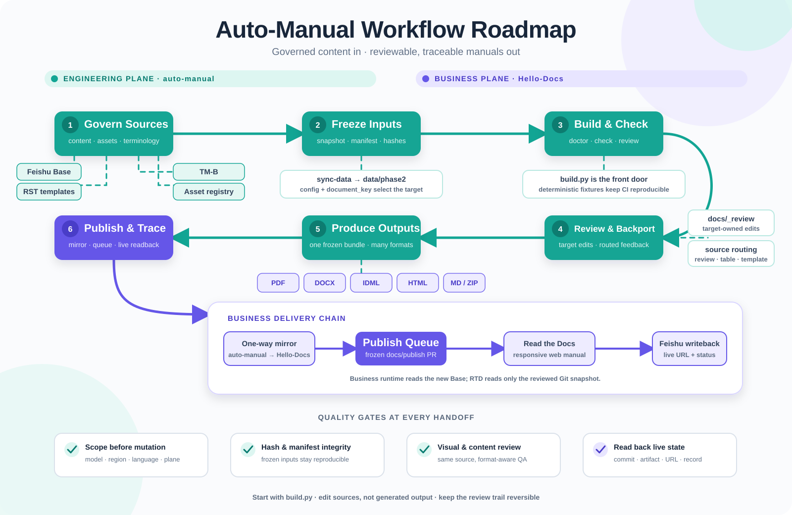

# Auto-Manual

<!-- 本文件只放工作流路线图、快速开始、编辑面和导航（AGENTS.md §5）。机制和契约写进权威页面，这里最多留一行指针，不追加功能说明。 -->

*One source of truth — every market's manual, in every format.*

Auto-Manual 将飞书结构化数据、RST 模板、翻译记忆和受控资产，转换为可评审、
可追溯的多语言说明书，并同源输出 PDF、DOCX、IDML、HTML、Markdown 和 ZIP。
不同格式可以采用不同排版，但同一冻结包不分叉文案、规格、法务内容、术语或资产身份。

本仓库是工程面：代码只在这里修改，合入 `main` 后单向同步到业务面 Hello-Docs；
队列构建、评审分支和网页说明书发布在业务面运行，不要直接修改 Hello-Docs 的工程树。
两个仓库、新旧飞书 base 与 TM-B 语料库的关系见[双平面地图](user-guide/two_plane_map.md)。

## 工作流路线图



1. **源表**：结构化数据在飞书 phase2 源表维护，`sync-data` 把它拉成本地快照 `data/phase2/`。见[数据层](user-guide/hello_auto-doc/data-layer.md)。
2. **模板**：共享页面、配方和 manifest 在 `docs/templates/`、`docs/manifests/`，由 config 族加 `--model`/`--region` 选定目标。见[页面与配方](code-as-doc/generated_page_authoring.md)、[config 与 manifest](code-as-doc/build_doc_guide/config-and-manifests.md)。
3. **构建与检查**：`build.py` 读取快照和 manifest 组装页面，`check` 在 Word/Web 导出前运行质量门禁。见[构建流水线](user-guide/hello_auto-doc/build-pipeline.md)、[check 门禁](code-as-doc/build_doc_guide/quality-gates.md)。
4. **评审与回写**：Start Review 开评审分支并生成 `docs/_review/` 评审包，Build Draft Package 把它出成飞书云文档，评审者的修改回写到评审包。见[Review、出包与 Publish](user-guide/quick_start_guide/review-and-publish.md)、[云文档回写](code-as-doc/build_doc_guide/backport.md)。
5. **发布**：Publish 从评审分支出印刷交付包、PDF 和 DOCX，Web Publish 独立发布网页说明书；验收读 `delivery_ready / delivery_url` 并回读飞书，触发不等于完成。见[队列与交付](user-guide/hello_auto-doc/queues-and-delivery.md)、[Web 发布契约](code-as-doc/dev/web_publish_pipeline.md)。
6. **发布追溯**：`release-manifest` 和快照归档把每个版本绑定到输入与产物，`diff-report` 给出版本差异。见[发布产物](code-as-doc/build_doc_guide/review-preview-and-release.md)、[版本追踪](user-guide/hello_auto-doc/version-tracking.md)。

## 快速开始

[`build.py`](build.py) 是统一入口。用 `scripts/setup_dev_env.sh`（Windows：`scripts/setup_dev_env.ps1`）
按锁定版本搭建环境，TeX、pandoc 和字体见[环境准备](user-guide/hello_auto-doc/environment-setup.md)；
`doctor` 会列出本机还缺什么。没有飞书凭据时，检查用 CI 同款测试夹具 `--data-root tests/fixtures/phase2`：

```bash
python build.py doctor --config configs/config.us-en.yaml --model JE-1000F --region US
python build.py check --config configs/config.us-en.yaml --model JE-1000F --region US --data-root tests/fixtures/phase2
python build.py check --config configs/config.ja.yaml --model JE-1000F --region JP --data-root tests/fixtures/phase2
```

正式出包需要 `sync-data` 拉下的真实快照（不要用测试夹具）和 `doctor` 无报错的 TeX、pandoc。
`publish` 从 `docs/_review/` 评审包构建，本地还没有评审包时先运行 `review`：

```bash
python build.py review --config configs/config.ja.yaml --model JE-1000F --region JP
python build.py publish --config configs/config.ja.yaml --model JE-1000F --region JP
python build.py diff-report --config configs/config.us.yaml --model JE-1000F --region US
python build.py release-manifest --config configs/config.ja.yaml --model JE-1000F --region JP
```

本地自测可改用 `python scripts/local_build.py <action> …`，把 `docs/_build` 和 `reports/` 生成物放到 `.tmp/staging/`。
更多动作、参数和 config 选择见[构建命令](user-guide/hello_auto-doc/build-commands.md)；
提交前的验证组合以 [AGENTS.md §8.5](AGENTS.md#85-local-validation-before-pr) 为准。

## 编辑面

- **共享内容**：模板、配方和 manifest 改 `docs/templates/`、`docs/manifests/`。
- **结构化数据**：改飞书 phase2 源表；`data/phase2/` 是 `sync-data` 写入的本地镜像（只有 `page_registry.csv` 入库），表结构变更先经操作者确认。
- **评审开始后**：目标专属修改改 `docs/_review/<model>/<region>/`，云文档回写也只写这里。
- **生成物**：`docs/_build/` 只由构建写入，不要手改；它和 `reports/` 下的验证产物也不要随手清理。
- **知识库页面**：新增或明显改动知识库页面时，在 [`tools/rtd_portal_assets/knowledge_updates.yaml`](tools/rtd_portal_assets/knowledge_updates.yaml) 加一条带合入日期的「最近更新」。

各层分工见[该改哪一层](user-guide/hello_auto-doc/source-of-truth.md)。

## 导航

### 网站：说明书资料库与知识库

网页说明书和知识库同在一个私有 Read the Docs 项目
（[`ht-docs-ht-manuals.readthedocs-hosted.com`](https://ht-docs-ht-manuals.readthedocs-hosted.com/en/latest/)，登录后访问）。
说明书资料库不链接知识库，知识库各页可以回到说明书资料库；「工作资料」只是站点名。

| 侧栏分组 | 页面 | 内容 | 权威页面 |
| --- | --- | --- | --- |
| 说明书 | 说明书资料库、搜索说明书正文 | 按型号、产品名称或关键词查找已发布的网页说明书，并搜索正文 | [`manual-center.md`](code-as-doc/dev/rtd_manual_portal/manual-center.md) · [`rtd_locale_navigation.md`](code-as-doc/dev/rtd_locale_navigation.md) · [`maintenance-and-checks.md`](code-as-doc/dev/rtd_manual_portal/maintenance-and-checks.md) |
| 知识库 | 首页 | 产品与市场、说明书生产两组入口，分享资料与「最近更新」 | [`knowledge-pages.md`](code-as-doc/dev/rtd_manual_portal/knowledge-pages.md#personal-workspace-entry) |
| 产品与市场 | 产品知识 | 参数、逆变、充电、扩容与备电的必要知识 | [`knowledge-pages.md`](code-as-doc/dev/rtd_manual_portal/knowledge-pages.md#产品知识) |
| 产品与市场 | 产品矩阵 | 按产品线、容量和市场排列的产品，附规格与功能对照 | [`knowledge-pages.md`](code-as-doc/dev/rtd_manual_portal/knowledge-pages.md#product-matrix-page) |
| 产品与市场 | 市场与政策 | 各地政策变化、背后原理和对产品的影响 | [`knowledge-pages.md`](code-as-doc/dev/rtd_manual_portal/knowledge-pages.md#市场与政策) |
| 说明书生产 | 说明书工作台 | 交付物矩阵、数据统计、工作入口、生产与资产 | [`knowledge-pages.md`](code-as-doc/dev/rtd_manual_portal/knowledge-pages.md#deliverables-page) |
| 说明书生产 | 系统建设 | 当前重点、已有能力、证据与阶段进度；工程规模在「工具与工程规模」 | [`system-workspace.md`](code-as-doc/dev/rtd_manual_portal/system-workspace.md#system-workspace-page) |
| 说明书生产 | 设计规范 | 网页说明书的颜色、字体与组件，图标和印刷规格 | [`knowledge-pages.md`](code-as-doc/dev/rtd_manual_portal/knowledge-pages.md#design-system-page) |
| 说明书生产 | 系统数据 | 指引页：统计已并入说明书工作台「数据统计」，工程规模并入系统建设「工具与工程规模」 | [`knowledge-pages.md`](code-as-doc/dev/rtd_manual_portal/knowledge-pages.md#system-data-page) |

### 文档与工具

| 读者 | 想了解什么 | 从这里开始 |
| --- | --- | --- |
| 操作者 | 第一次接手：第一小时与金路径 | [`ONBOARDING.md`](ONBOARDING.md) |
| 操作者 | 最短上手示例与平时该改哪里 | [`user-guide/quick_start_guide.md`](user-guide/quick_start_guide.md) |
| 操作者 | 当前工作流与编辑规则（按主题分页） | [`user-guide/hello_auto-doc.md`](user-guide/hello_auto-doc.md) |
| 操作者 | 仓库、飞书 base 与租户 | [`user-guide/two_plane_map.md`](user-guide/two_plane_map.md) |
| 操作者 | 回写、台账与仪表的日常操作 | [`user-guide/closed_loop_ops_guide.md`](user-guide/closed_loop_ops_guide.md) |
| 维护者 | 维护者文档地图 | [`code-as-doc/README.md`](code-as-doc/README.md) |
| 维护者 | 命令与运维语义（按主题分页） | [`code-as-doc/build_doc_guide.md`](code-as-doc/build_doc_guide.md) |
| 维护者 | Web 发布：队列与 Git-only 输入、冻结快照、RTD 部署与撤回 | [`code-as-doc/dev/web_publish_pipeline.md`](code-as-doc/dev/web_publish_pipeline.md) |
| 维护者 | 某个 Web 目标的接入与验收记录 | [构建指南](code-as-doc/build_doc_guide/web-target-notes.md) · [工作流指南](user-guide/hello_auto-doc/web-target-notes.md) · [`code-as-doc/reviews/`](code-as-doc/reviews) |
| 维护者 | 样式契约与可复用组件 | [`STYLE_DEFINITION.md`](docs/renderers/contracts/STYLE_DEFINITION.md) · [组件使用指南](code-as-doc/dev/style_component_usage_guide.md) |
| 维护者 | 整本 IR 与 Web 共享层设计 | [ManualIR v2](code-as-doc/dev/manual_ir_v2_neutral_flow_plan.md) · [Web presentation overlay](code-as-doc/dev/web_presentation_overlay_plan_2026-09.md) · [Shared-source plan](code-as-doc/dev/latex_indesign_same_source_plan.md) |
| 维护者 | 长期架构边界与执行路线 | [`System Evolution Strategy.md`](code-as-doc/architecture/System%20Evolution%20Strategy.md) · [`optimization_project.md`](code-as-doc/optimization_project.md) |
| 维护者 | 说明书产线盘活与运营规划 | [盘活与演进方案](code-as-doc/manual_production_revitalization_plan.md) · [逐项执行台账](code-as-doc/dev/manual_revitalization_execution.md) · [运营能力规划](code-as-doc/manual_operations_growth_plan.md) |
| AI agent | 操作规则、分支、提交与验证 | [`AGENTS.md`](AGENTS.md) |
| 工具 | 技能清单（Codex / Claude Code） | [`.agents/skills/README.md`](.agents/skills/README.md) · [`.claude/skills/README.md`](.claude/skills/README.md) |
| 工具 | 规格书结构化入库 | [`spec-sheet-structured-intake`](.agents/skills/spec-sheet-structured-intake/SKILL.md) |
| 工具 | OpenClaw/BlockClaw、飞书 IM、钉钉与悟空 MCP Bridge | [集成指南](user-guide/hello_auto-doc/integrations.md) · [`agent/wukong-bridge/README.md`](agent/wukong-bridge/README.md) |
| 工具 | 钉钉机器人查询已发布欧规产品信息 | [欧规说明书查询与启用](code-as-doc/dev/eu_manual_query.md) |
| 工具 | 产品改进建议：网页表单与飞书机器人代提交 | [VOC 接入](code-as-doc/dev/product_voc.md) |
