

## INSTRUCCIONES DE SEGURIDAD

### Descargo de Responsabilidad

Felicitaciones por su nuevo Jackery Smart Transfer Switch. Antes de utilizar el producto, lea cuidadosamente este manual, especialmente las precauciones relevantes para asegurar un uso adecuado. Mantenga este manual en un lugar accesible para futuras consultas. De acuerdo con las leyes y regulaciones, el derecho de interpretación final de este documento y todos los documentos relacionados con este producto corresponde a la Empresa. Tenga en cuenta que no se realizarán notificaciones adicionales en caso de actualizaciones, revisiones o terminaciones.

### Advertencia

<ol class="native-steps"><li>La instalación o el mantenimiento de este producto debe ser realizado únicamente por personal eléctrico cualificado.</li><li>Antes de la instalación, operación o mantenimiento de este producto, lea detenidamente el manual de instrucciones.</li><li>La instalación de este producto debe cumplir con las normas locales, normas nacionales de seguridad eléctrica e instrucciones del fabricante.</li><li>Las especificaciones de los cables proporcionados por el usuario deben cumplir con los requisitos de la Guía de Instalación y con las normativas locales.</li><li>Los cables de CA son cables de alta tensión. Riesgo de muerte o lesiones graves por descarga eléctrica.</li><li>Existe una alta posibilidad de descarga eléctrica o quemaduras graves debido a la alta tensión en el producto.</li><li>Utilice equipo de protección personal (PPE) adecuado y siga las prácticas seguras de trabajo eléctrico.</li><li>No toque los cables expuestos con las manos.</li><li>Tenga cuidado para evitar lesiones al mover objetos pesados. Use equipo de protección personal como guantes y zapatos protectores al mover manualmente el producto.</li><li>No instale ni opere el equipo en condiciones meteorológicas extremas como rayos, nieve, lluvia intensa, viento fuerte, etc.</li><li>No instale ni opere el producto en un área donde se almacenen materiales inflamables o explosivos.</li><li>Inspeccione el producto y los cables en busca de daños antes de la instalación. No instale el producto ni los cables si están dañados de alguna manera.</li><li>Apague toda la energía que suministra este producto antes de la instalación. Desconecte cada circuito individualmente antes del mantenimiento.</li><li>Siempre utilice un dispositivo de detección de voltaje correctamente calibrado para confirmar que la energía está apagada.</li><li>Durante el proceso de perforación, cubra el producto interior para evitar que los desechos caigan en el producto y limpie los desechos después de la perforación para evitar interferencias con el equipo.</li><li>No dañe, manche ni cubra las etiquetas de advertencia en el dispositivo. Todas las etiquetas deben ser visibles después de la instalación.</li><li>Antes de operar el producto, verifique las conexiones eléctricas para asegurar que el producto esté correctamente y permanentemente conectado a tierra.</li><li>No coloque ningún objeto sobre el producto durante su funcionamiento.</li><li>Para desenergizar completamente el producto, asegúrese de que todos los disyuntores principales y derivados estén apagados y desconecte físicamente todas las cargas. No hacerlo puede representar un riesgo de descarga eléctrica.</li><li>No coloque ni instale objetos inflamables o potencialmente explosivos cerca del producto o en atmósferas explosivas.</li><li>No inserte objetos extraños en ninguna parte del equipo.</li><li>No conecte a circuitos que puedan ser conmutados de forma remota los sistemas de soporte vital, equipos médicos, ni ningún otro equipo donde la falla del producto pueda causar lesiones a personas o pérdida de vidas.</li><li>Instale el producto en un lugar que evite daños por inundaciones. Asegúrese de que no haya fuentes de agua arriba o cerca del producto, incluidos bajantes, aspersores o grifos.</li><li>Si es necesario, reemplace todos los dispositivos, puertas y cubiertas antes de encender la alimentación.</li></ol>

### Precaución

<ol class="native-steps"><li>En caso de daños en el cable, debe ser reemplazado por el fabricante, servicio al cliente o personal calificado para evitar un riesgo de seguridad.</li><li>No utilice disolventes para limpiar el producto.</li><li>El producto debe ser desechado de acuerdo con los códigos y regulaciones locales.</li><li>Este producto no está destinado a ser utilizado como desconexión de servicio.</li><li>No utilice partes o accesorios que no sean los especificados para su uso con el producto.</li><li>Al instalar el producto, los tornillos deben ser apretados con una herramienta especial de acuerdo con el par especificado.</li><li>Mantenga el producto fuera del alcance de niños o animales.</li><li>Este producto está diseñado únicamente para uso residencial.</li></ol>

### Declaración de la FCC

Este dispositivo cumple con la parte 15 de las Reglas de la FCC. El funcionamiento está sujeto a las siguientes dos condiciones: (1) Este dispositivo no debe causar interferencias dañinas, y (2) este dispositivo debe aceptar cualquier interferencia recibida, incluidas las interferencias que puedan causar un funcionamiento no deseado. MODIFICACIÓN: Cualquier cambio o modificación no expresamente aprobado por el concesionario de este dispositivo podría anular la autoridad del usuario para operar el dispositivo. NOTA: Este equipo ha sido probado y se ha encontrado que cumple con los límites para un dispositivo digital Clase B, en virtud de la parte 15 de las Reglas de la FCC. Estos límites están diseñados para proporcionar una protección razonable contra interferencias perjudiciales en una instalación residencial. Este equipo genera, utiliza y puede irradiar energía de radiofrecuencia y, si no se instala y utiliza de acuerdo con las instrucciones, puede causar interferencias perjudiciales a las comunicaciones por radio. Sin embargo, no hay garantía de que no ocurran interferencias en una instalación particular. Si este equipo causa interferencias perjudiciales a la recepción de radio o televisión, lo cual puede determinarse apagando y encendiendo el equipo, se recomienda al usuario que intente corregir las interferencias mediante una o más de las siguientes medidas: -- Reorientar o reubicar la antena receptora. -- Aumentar la separación entre el equipo y el receptor. -- Conectar el equipo a una toma de corriente en un circuito diferente al que está conectado el receptor. -- Consultar al distribuidor o a un técnico experimentado en radio/TV para obtener ayuda.

### Advertencia IC

Este dispositivo cumple con el estándar RSS exento de licencia de la Industria de Canadá. El funcionamiento está sujeto a las siguientes dos condiciones: (1) este dispositivo no debe causar interferencias y (2) este dispositivo debe aceptar cualquier interferencia, incluidas las interferencias que puedan causar un funcionamiento no deseado del dispositivo. Este aparato digital de Clase B cumple con lCES-003 de Canadá.

Declaración de RF de IC: Al utilizar el producto, mantenga una distancia de 20 cm del cuerpo para cumplir con los requisitos de exposición a RF.

<ul class="native-bullets"><li>PELIGRO DE INGESTIÓN: Este producto contiene una pila de botón o batería tipo moneda.</li><li>La MUERTE o lesiones graves pueden ocurrir si se ingiere.</li><li>Una pila de botón o batería tipo moneda ingerida puede causar Quemaduras Químicas Internas en tan solo 2 horas.</li><li>MANTENGA las baterías nuevas y usadas FUERA DEL ALCANCE de los NIÑOS.</li><li>Busque atención médica inmediata si se sospecha que una batería fue ingerida o introducida en cualquier parte del cuerpo.</li></ul>

### Significado de símbolos

Las siguientes tablas explican el significado de los símbolos utilizados en el manual de instrucciones y su embalaje.

<table class="manual-table native-print-grid native-symbols native-fit"><thead><tr><th class="native-head-regular" scope="col">Símbolo</th><th class="native-head-regular" scope="col">Significado</th></tr></thead><tbody><tr><td class="native-symbol-cell"></td><td>La posición para conectar el cable de tierra de protección.</td></tr><tr><td class="native-symbol-cell"></td><td>Precaución, riesgo de peligro.</td></tr><tr><td class="native-symbol-cell"></td><td>Precaución, riesgo de descarga eléctrica.</td></tr><tr><td class="native-symbol-cell"></td><td>Consulte las instrucciones de operación.</td></tr></tbody></table>

## ESPECIFICACIONES

<table class="manual-table native-spec-rules native-fit"><tbody><tr><td>Nombre del producto</td><td>Jackery Smart Transfer Switch</td></tr><tr><td>Número de Modelo</td><td>JA-TS02A</td></tr><tr><td>Voltaje CA (Nominal)</td><td>120V/240V~ 60Hz</td></tr><tr><td>Tipo de Alimentación</td><td>Fase Dividida</td></tr><tr><td>Corriente de Entrada Máxima</td><td>Red de 100A / Estación de Energía de 60A</td></tr><tr><td>Corriente de Salida Máxima</td><td>Carga Doméstica de 60A / Estación de Energía de 33,4A</td></tr><tr><td>Corriente Máxima de Cortocircuito de Entrada</td><td>10KA</td></tr><tr><td>Categoría de Sobretensión</td><td>IV</td></tr><tr><td>UPS</td><td>≤20ms</td></tr><tr><td>Tipo de Caja (Panel de Distribución)</td><td>NEMA Tipo 1</td></tr><tr><td>Número de Ramas de Carga</td><td>12</td></tr><tr><td>Circuito Principal</td><td>2 AWG</td></tr><tr><td>Circuito Derivado</td><td>14 AWG 12 AWG 10 AWG</td></tr><tr><td>Comunicación</td><td>Wi-Fi y Bluetooth</td></tr><tr><td>Temperatura de Funcionamiento</td><td>-20°C~40°C (-4°F~104°F)</td></tr><tr><td>Dimensiones</td><td>22 x 14,7 x 7,87 pulgadas/ 56 x 37,4 x 20 cm</td></tr><tr><td>Peso</td><td>Aproximadamente 25,57 libras/11,6 kg</td></tr></tbody></table>

* Cuando utilice el producto, asegúrese de que esté conectado a una tensión de red de fase partida de 240 V.

## LISTA DE PAQUETES

<figure class="hb-reference-figure" data-component-id="HB-SPECIAL-REFERENCE-FIGURE" data-reference-id="package-list" data-source-fragment-sha256="e6b5adf6998ad1577c3b939e04a74588b6c061f91c3fd74288ebba8885465edb" data-step-captions="embedded">
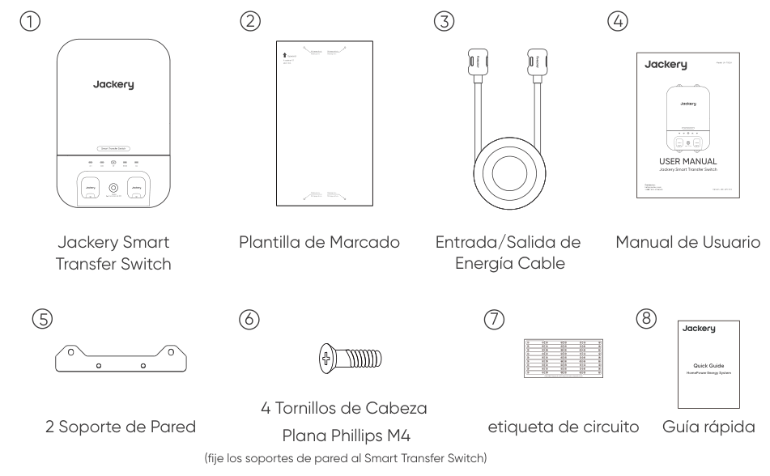
</figure>

## LO QUE NECESITAS

<figure class="hb-reference-figure" data-component-id="HB-SPECIAL-REFERENCE-FIGURE" data-reference-id="optional-tools" data-source-fragment-sha256="e4dc1b016278b4f47086fe1b57f04d032779ae5f2382e27de92caf4a83475bf5" data-step-captions="embedded">
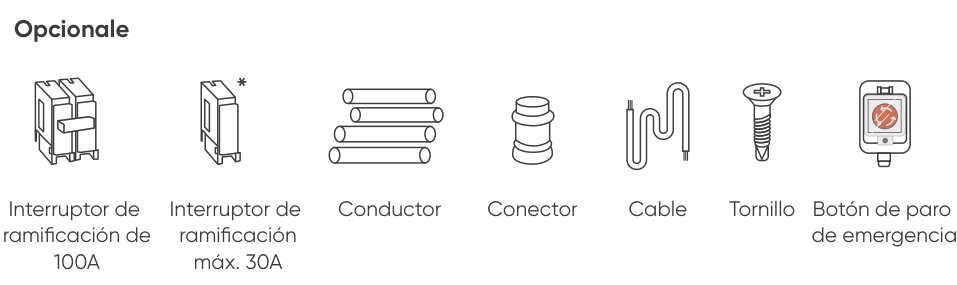
</figure>

### Opcionales

<table class="manual-table native-print-grid native-cables"><thead><tr><th class="native-head-regular" colspan="2" scope="col">Cable</th><th class="native-head-regular" scope="col">Color</th><th class="native-head-regular" scope="col">Corriente</th><th class="native-head-regular" scope="col">Calibre</th></tr></thead><tbody><tr><td class="native-cable-group" rowspan="4">Red (Conecte al Panel Principal)</td><td>L1</td><td class="native-wire native-wire-black">Negro</td><td rowspan="4">100A Máx</td><td>2 AWG</td></tr><tr><td>L2</td><td class="native-wire native-wire-red">Rojo</td><td>2 AWG</td></tr><tr><td>N</td><td class="native-wire native-wire-white">Blanco</td><td>2 AWG</td></tr><tr><td>GND</td><td class="native-wire native-wire-green">Verde</td><td>6 AWG</td></tr><tr><td class="native-cable-group" rowspan="4">Cargas Domésticas (Conecte a 12 Circuitos Derivados)</td><td>L1</td><td class="native-wire native-wire-black">Negro</td><td rowspan="4">30A Máx</td><td>14 AWG -10 AWG</td></tr><tr><td>L2</td><td class="native-wire native-wire-red">Rojo</td><td>14 AWG -10 AWG</td></tr><tr><td>N</td><td class="native-wire native-wire-white">Blanco</td><td>14 AWG -10 AWG</td></tr><tr><td>GND</td><td class="native-wire native-wire-green">Verde</td><td>14 AWG -10 AWG</td></tr><tr><td class="native-cable-group">Circuito de parada de emergencia (Conectar al botón de parada de emergencia)</td><td>/</td><td>/</td><td>2A Máx</td><td>24 AWG</td></tr></tbody></table>

*Prepare un disyuntor derivado de 100A y 2 polos para instalarlo en el cuadro de distribución de la vivienda. Este interruptor se utilizará para conectar con el Smart Transfer Switch (STS).

## DESCRIPCIÓN DEL PRODUCTO

### Dimensiones

<figure class="hb-reference-figure" data-component-id="HB-SPECIAL-REFERENCE-FIGURE" data-reference-id="dimensions" data-source-fragment-sha256="4b5c87d09252b3e3f720fd7044d439498e77f4c7f1081d3ae3450373e3cc75fe" data-step-captions="embedded">
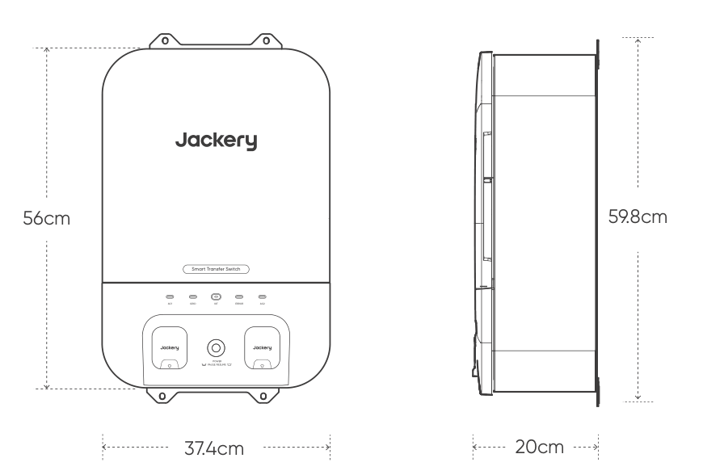
</figure>

*Las figuras son solo para referencia, consulte el producto real.

### Con Cubierta de Frente Muerto Instalada

<figure class="hb-reference-figure" data-component-id="HB-SPECIAL-REFERENCE-FIGURE" data-reference-id="covered-overview" data-source-fragment-sha256="6b88c7800c87d030127102501242bb423e197dd89acbd18e843c3fcb81206ff0" data-step-captions="embedded">
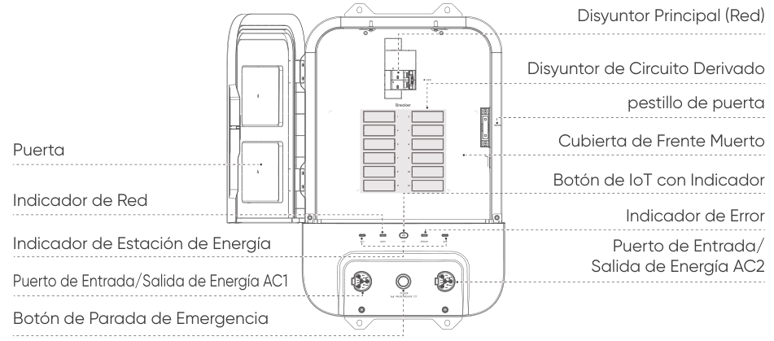
</figure>

#### Botón de IoT con Indicador

<ul class="native-bullets"><li>Pulse brevemente el botón para encender/apagar el Bluetooth y el Wi-Fi.</li><li>Mantenga pulsado el botón durante 5 segundos para reiniciar el Bluetooth y el Wi-Fi (el Interruptor de Transferencia Automática conservará la configuración anterior).</li></ul>

*Encienda el Wi-Fi y el Bluetooth. Si no se emparejan en dos horas, se apagarán automáticamente.

#### Botón de Parada de Emergencia

En caso de emergencia, este botón puede ser activado manualmente para apagar inmediatamente la salida de todo el sistema.

### Indicadores LED

<table class="manual-table native-print-grid native-led"><thead><tr><th scope="col">Indicador</th><th scope="col">Estado</th><th scope="col">Descripción</th></tr></thead><tbody><tr><td class="native-led-name" rowspan="3">Indicador de Red</td><td>Azul intermitente</td><td>Presencia de energía de la red, no suministra carga a los dispositivos del hogar.</td></tr><tr><td>Azul Sólido</td><td>La energía de la red suministra cargas al hogar</td></tr><tr><td>Apagado</td><td>Sin energía de la red.</td></tr><tr><td class="native-led-name" rowspan="3">Estación de Energía Indicador (AC1/AC2)</td><td>Verde intermitente</td><td>La estación de energía está conectada y en espera, no suministra energía a las cargas del hogar.</td></tr><tr><td>Verde Sólido</td><td>La estación de energía está conectada y suministrando energía a las cargas del hogar. En el STS, el suministro de energía a las cargas del hogar depende de la configuración de puesta en marcha.</td></tr><tr><td>Apagado</td><td>Estación de Energía No Conectada</td></tr><tr><td class="native-led-name" rowspan="3">Indicador de IoT</td><td>Verde intermitente</td><td>Wi-Fi y Bluetooth Encendidos, No Emparejados</td></tr><tr><td>Verde Sólido</td><td>Wi-Fi y Bluetooth Encendidos, Emparejados</td></tr><tr><td>Apagado</td><td>Wi-Fi y Bluetooth Apagados</td></tr><tr><td class="native-led-name" rowspan="2">Indicador de Error</td><td>Rojo Sólido</td><td>Mal Funcionamiento del Producto</td></tr><tr><td>Apagado</td><td>Operación Normal</td></tr></tbody></table>

### Con Cubierta de Frente Muerto Retirada

<figure class="hb-reference-figure" data-component-id="HB-SPECIAL-REFERENCE-FIGURE" data-reference-id="uncovered-overview" data-source-fragment-sha256="2ad1671437d09c327d7f1e6d3f53629035e380578dbb090df9814c9e6efae8e3" data-step-captions="embedded">
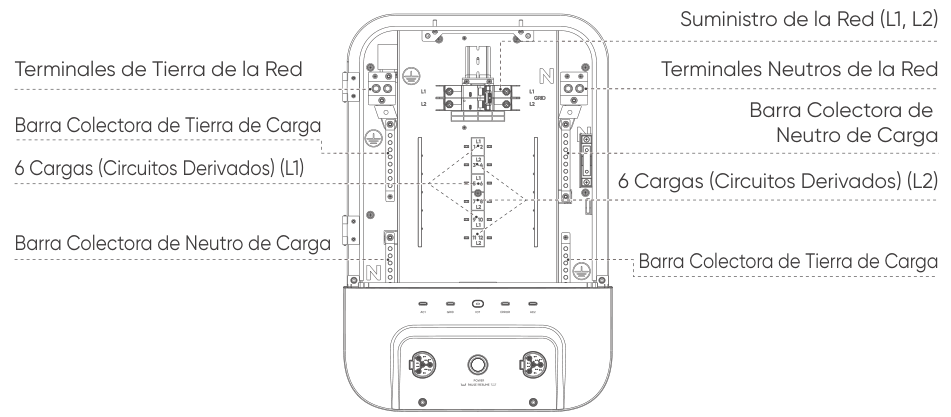
</figure>

#### Modo de respaldo normal

La función UPS está desactivada por defecto. En caso de un apagón, la estación de energía portátil alimentará automáticamente las cargas del hogar con la energía almacenada en 5 segundos. En caso de un apagón, la estación de energía portátil alimentará automáticamente las cargas del hogar con la energía almacenada entre 5 segundos.

<table class="manual-callout-table manual-callout-table hb-callout-label-shaded"><tbody><tr><td class="manual-callout-label">PRECAUCIÓN</td><td class="manual-callout-body">
La estación de energía debe permanecer encendida; de lo contrario, el STS no podrá cambiar a la energía de la batería después de un apagón.
</td></tr></tbody></table>

#### Modo UPS

En este modo, la función UPS está activada. Durante un apagón, el sistema cambia automáticamente a la energía de la batería en 20 milisegundos.

<ul class="native-bullets"><li>La estación de energía portátil permanece activa en todo momento y consume continuamente una pequeña cantidad de energía, incluso cuando no está en uso.</li><li>Si la estación de energía está siendo cargada por el STS, el tiempo de cambio puede exceder los 20 milisegundos.</li><li>Cuando se restablezca el suministro eléctrico de la red, el sistema cambiará automáticamente de vuelta a la alimentación por red.</li></ul>

<table class="manual-callout-table manual-callout-table hb-callout-label-shaded"><tbody><tr><td class="manual-callout-label">PRECAUCIÓN</td><td class="manual-callout-body">
La función UPS solo puede funcionar si el STS está conectado exitosamente al Jackery Explorer 5000 Plus o al Jackery HomePower 5000 Plus. Antes de usar el modo UPS, asegúrese de lo siguiente:
<ol class="native-steps"><li>La función UPS está habilitada en la aplicación Jackery.</li><li>La estación de energía portátil está encendida y no se está cargando.</li></ol></td></tr></tbody></table>

## PRE-INSTALACIÓN

### Descripción General del Sistema

<figure class="hb-reference-figure" data-component-id="HB-SPECIAL-REFERENCE-FIGURE" data-reference-id="system-overview" data-source-fragment-sha256="38c5bfef60cc10f9081f92882fdd26de1b32f3d36bc3525d0a2c4bbd3cf9ca58" data-step-captions="embedded">
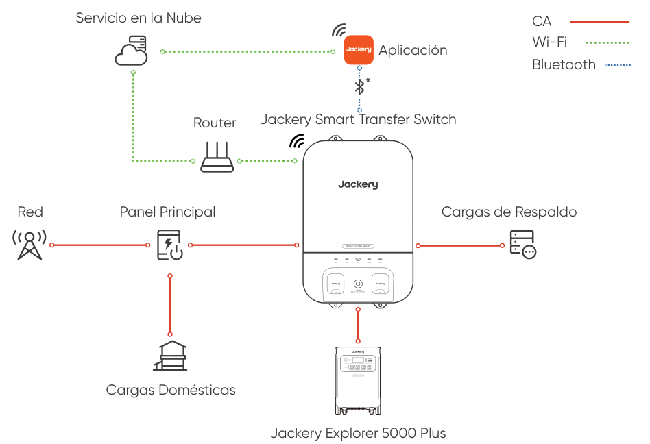
</figure>

* Si no hay Wi-Fi disponible, conecta tu dispositivo con Bluetooth. <strong>* Si el Wi-Fi y el Bluetooth del dispositivo están activados y no se han conectado a la aplicación Jackery en dos horas, ambos se apagarán automáticamente.</strong>

### Ubicación de Instalación

Instale el Jackery Smart Transfer Switch en interiores.

<table class="manual-callout-table manual-callout-table hb-source-warning-lockup native-lockup-open"><tbody><tr><td class="manual-callout-label">Advertencia</td><td class="manual-callout-body"><ul class="native-bullets"><li>Asegúrese de que el producto esté ubicado en un lugar seco y bien ventilado.</li><li>Asegúrese de que la puerta se abra a un ángulo de al menos 90 grados.</li><li>El personal de instalación debe usar guantes aislantes, gafas de seguridad y zapatos con suela de goma.</li><li>Antes de la instalación, asegúrese de que el disyuntor principal y todos los circuitos derivados estén apagados.</li></ul></td></tr></tbody></table>

## GUÍA DE INSTALACIÓN

Los detalles a continuación son pautas generales para el espacio de instalación y no se garantiza su aplicabilidad. Consulte con su AHJ local o su compañía de servicios públicos antes de usar.

### Montaje en Superficie

<table class="manual-callout-table manual-callout-table hb-source-warning-lockup native-lockup-open"><tbody><tr><td class="manual-callout-label">Advertencia</td><td class="manual-callout-body">
El producto no es impermeable y está diseñado específicamente para uso en interiores.
</td></tr></tbody></table>

<ol class="native-steps"><li>Instale los soportes de pared superiores e inferiores en la parte posterior del Smart Transfer Switch con 4 tornillos M4. Apriete todos los tornillos con un par de 0.8 N·m.</li></ol>

<figure class="hb-reference-figure" data-component-id="HB-SPECIAL-REFERENCE-FIGURE" data-reference-id="mounting-brackets" data-source-fragment-sha256="53d5b007ab864789866a3f4f5e9d6808af636cc2e718319b33a00b51b12e5aef">
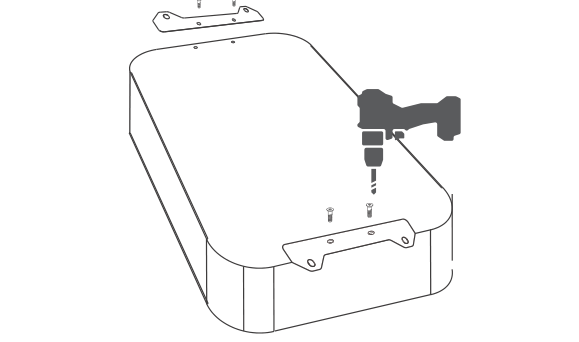
</figure>

<ol class="native-steps" start="2"><li>Fije la plantilla en la superficie de montaje y marque cuidadosamente cada ubicación del agujero con un lápiz.</li></ol>

<figure class="hb-reference-figure" data-component-id="HB-SPECIAL-REFERENCE-FIGURE" data-reference-id="mounting-template" data-source-fragment-sha256="0a441549a74e66d3baaf1b316aaa638523113f518663393f5c25de78f2cf5b08" data-step-captions="embedded">
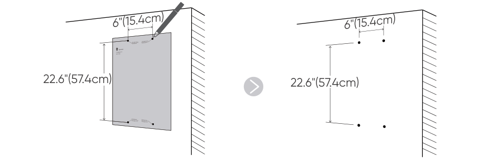
</figure>

<ol class="native-steps" start="3"><li>Fije el Smart Transfer Switch con 4 pernos de expansión M6 o tornillos M6.</li></ol>

<figure class="hb-reference-figure" data-component-id="HB-SPECIAL-REFERENCE-FIGURE" data-reference-id="mounting-fasteners" data-source-fragment-sha256="4c2ccff92cd4dbd601dc7a7c5e6e0dc71a3988c657c3dcafa6db951df6f7582c" data-step-captions="embedded">
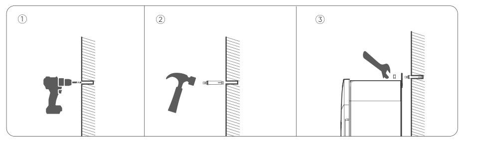
</figure>

### Selección de Entrada de Cables

<ul class="native-bullets"><li>Durante el proceso de perforación, cubra el equipo interior para evitar que los desechos caigan dentro del equipo.</li><li>Quite los desechos después de la perforación para evitar interferencias con el equipo.</li></ul>

<figure class="hb-reference-figure" data-component-id="HB-SPECIAL-REFERENCE-FIGURE" data-reference-id="cable-entry" data-source-fragment-sha256="f014dbad4c8a55809e40c1c50164e202bf5bc102bb43bdeb639bc56906de0a80" data-step-captions="embedded">
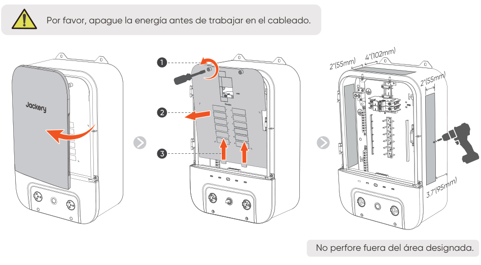
</figure>

### Conexiones Eléctricas

Advertencia

<ul class="native-bullets"><li>Riesgo de descarga eléctrica. Antes de realizar el cableado, asegúrese de que la energía esté apagada. Asegúrese de que los disyuntores principales y derivados estén apagados.</li><li>Asegúrese de que los conductos estén instalados antes de realizar el cableado entre el panel principal y el Jackery Smart Transfer Switch para mejorar la seguridad y proteger los cables de daños.</li></ul>

*Como se muestra en la imagen, puede mover los disyuntores del panel principal al Smart Transfer Switch. *La instalación del disyuntor derivado de 100A y 2 polos en el panel principal es como se muestra en la imagen. *Los disyuntores en el interruptor de transferencia no deben exceder los 30A.

<figure class="hb-reference-figure" data-component-id="HB-SPECIAL-REFERENCE-FIGURE" data-reference-id="grid-preparation" data-source-fragment-sha256="1c01943635e1742444ab63855ca2e5daa10549e532290d4b88ca606d3b840ad7" data-step-captions="embedded">
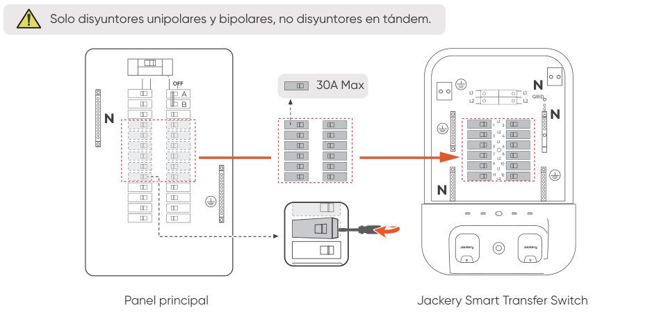
</figure>

#### Conexión de Conductores de la Red

<ol class="native-steps"><li>Asegúrese de que todos los disyuntores derivados y el disyuntor principal estén apagados.</li><li>Retire la cubierta tanto del panel principal como del Smart Transfer Switch.</li><li>Retire el orificio ciego del panel eléctrico y taladre los orificios de entrada de cables permitidos en el Smart Transfer Switch.</li><li>Instale un conducto(no incluido) entre el panel principal y el Smart Transfer Switch.</li><li>Tire de los cables precableados del panel principal agrupados a través del conducto.</li><li>Instale un disyuntor derivado compatible de 100A y 2 polos(no incluido) en el panel principal.</li><li>Ubique el cable de TIERRA del panel principal y conéctelo a los terminales de tierra de la red del Smart Transfer Switch.</li><li>Ubique el cable de NEUTRO del panel principal y conéctelo a los terminales neutros de la red del Smart Transfer Switch.</li><li>Ubique los cables VIVOS del disyuntor derivado de 100A agregado al panel principal y conéctelos al Smart Transfer Switch. Instale la cubierta de la fuente de alimentación del Smart Transfer Switch.</li></ol>

<figure class="hb-reference-figure" data-component-id="HB-SPECIAL-REFERENCE-FIGURE" data-reference-id="grid-wiring" data-source-fragment-sha256="f5fcfbdc1c39407ec629a2b12c8de4ef456d5056f36b0a509d1da4acc7db86bd" data-step-captions="embedded">
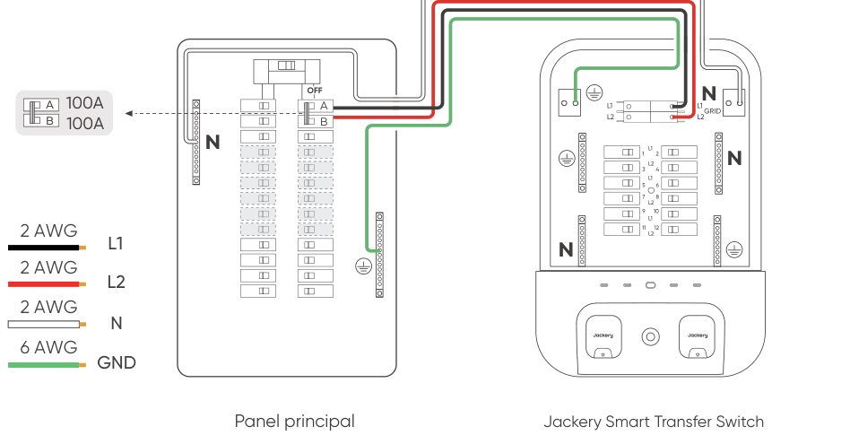
</figure>

#### Conexión de Conductores de Carga Doméstica

*La carga doméstica admite la conexión simultánea de circuitos de 120V y 240V, con un máximo de 12 circuitos para 120V y 6 circuitos para 240V.

<ol class="native-steps"><li>Seleccione un circuito derivado del panel principal para ser alimentado por el Smart Transfer Switch durante un corte de energía; cuando no haya corte de energía, los circuitos seleccionados serán alimentados por la red eléctrica.</li><li>Apague el disyuntor seleccionado en el panel principal.</li><li>Retire el cable VIVO del disyuntor seleccionado.</li><li>Retire el cable NEUTRO del circuito seleccionado de la barra colectora NEUTRO.</li><li>Retire el cable TIERRA del disyuntor seleccionado de la barra colectora de tierra.</li><li>Conecte el cable VIVO retirado del panel principal al disyuntor en el Smart Transfer Switch.</li><li>Conecte el cable NEUTRO retirado del panel principal a la barra colectora neutra en el Smart Transfer Switch.</li><li>El cable de tierra del panel eléctrico no necesita estar conectado al STS.</li><li>Etiquete el disyuntor en la cubierta del Smart Transfer Switch.</li><li>Repite el proceso para cada circuito.</li></ol>

<figure class="hb-reference-figure" data-component-id="HB-SPECIAL-REFERENCE-FIGURE" data-reference-id="load-wiring" data-source-fragment-sha256="3fadc6e772006777449e48adc3bcadb8af36118b773a7afd79fb589e7c5f6f8d" data-step-captions="embedded">
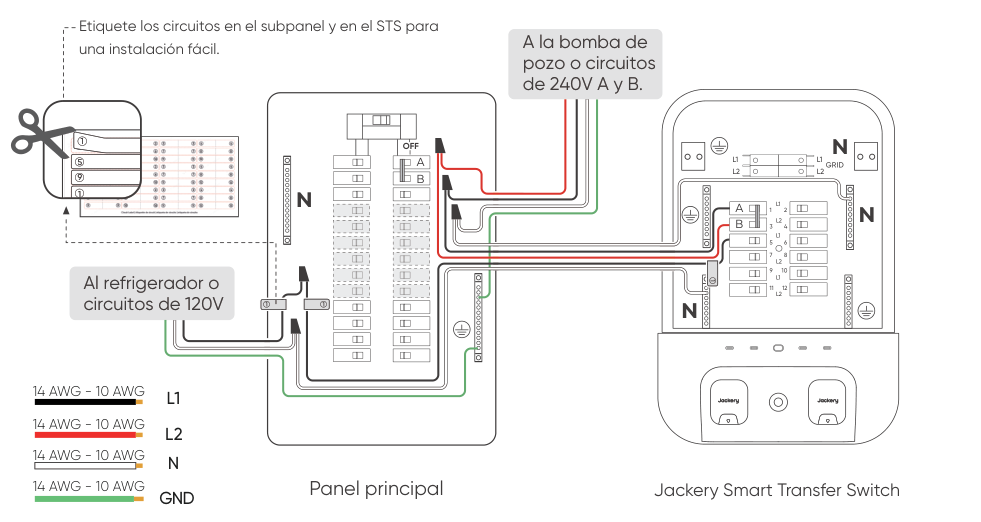
</figure>

<strong>Par de Apriete del Conductor</strong>

<table class="manual-table native-print-grid native-torque"><thead><tr><th class="native-head-regular" scope="col">Red</th><th class="native-head-regular" scope="col">Par</th><th class="native-head-regular" scope="col">Longitud de Desforre</th><th class="native-head-regular" scope="col">Carga Doméstica</th><th class="native-head-regular" scope="col">Par</th><th class="native-head-regular" scope="col">Longitud de Desforre</th></tr></thead><tbody><tr><td>L1</td><td>30.98 pulgadas-libra/3.5 N·m</td><td>0.47 pulgada (12 mm)</td><td>L1</td><td>20.36 pulgadas-libra/2.3 N·m</td><td>0.39 pulgada (10 mm)</td></tr><tr><td>L2</td><td>30.98 pulgadas-libra/3.5 N·m</td><td>0.47 pulgada (12 mm)</td><td>L2</td><td>20.36 pulgadas-libra/2.3 N·m</td><td>0.39 pulgada (10 mm)</td></tr><tr><td>N</td><td>46.02 pulgadas-libra/5.2 N·m</td><td>0.47 pulgada (12 mm)</td><td>N</td><td>17.7 pulgadas-libra/2.0 N·m</td><td>0.47 pulgada (12 mm)</td></tr><tr><td>GND</td><td>46.02 pulgadas-libra/5.2 N·m</td><td>0.79 pulgada (20 mm)</td><td>GND</td><td>17.7 pulgadas-libra/2.0 N·m</td><td>0.47 pulgada (12 mm)</td></tr></tbody></table>

#### Instalar el botón de parada de emergencia (opcional)

<strong>*Asegúrese de comprar un botón de parada de emergencia normalmente abierto.</strong> Instalar en un lugar externo de fácil acceso. Esto permite desconectar inmediatamente la alimentación de las cargas del STS en caso de emergencia.

<figure class="hb-reference-figure" data-component-id="HB-SPECIAL-REFERENCE-FIGURE" data-reference-id="external-emergency-stop" data-source-fragment-sha256="06394b7d8503f7291a5235ca2795fdc3d244b5e78f5aa4b712c7bc6c10377a84" data-step-captions="embedded">
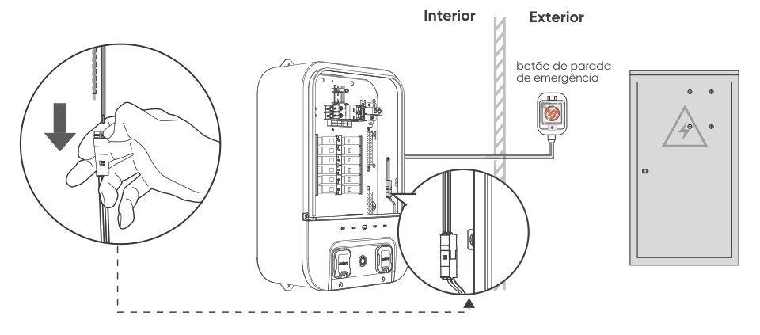
</figure>

#### Instalación de Cubierta de Frente Muerto

Advertencia *Confirme que todas las conexiones estén correctas, seguras y puestas a tierra. *Confirme que todos los tornillos estén apretados. *Utilice un multímetro en la configuración de continuidad para asegurarse de que el cable vivo no esté en cortocircuito con el neutro. *Utilice un multímetro en la configuración de continuidad para asegurarse de que el cable vivo no esté en cortocircuito con tierra.

Primero, retire los recortes para las cargas domésticas, llene cualquier espacio abierto no utilizado en la cubierta y luego apriete los tornillos para asegurar el frente muerto.

<figure class="hb-reference-figure" data-component-id="HB-SPECIAL-REFERENCE-FIGURE" data-reference-id="deadfront-installation" data-source-fragment-sha256="95ebba04f9e30f47d6e9042d1317eaa346b70ea74a52caa53f4464f2ce057237" data-step-captions="embedded">
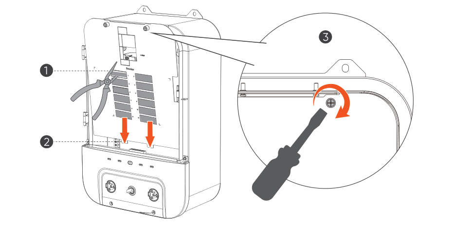
</figure>

#### Conexión con Estación de Energía

Para Jackery Explorer 5000 Plus(Máx. 2 unidades)

<figure class="hb-reference-figure" data-component-id="HB-SPECIAL-REFERENCE-FIGURE" data-reference-id="power-station-connections" data-source-fragment-sha256="d62e38b755b56133a1ef387acec411380f70688b94e74d2becfc61b27138a428" data-step-captions="embedded">
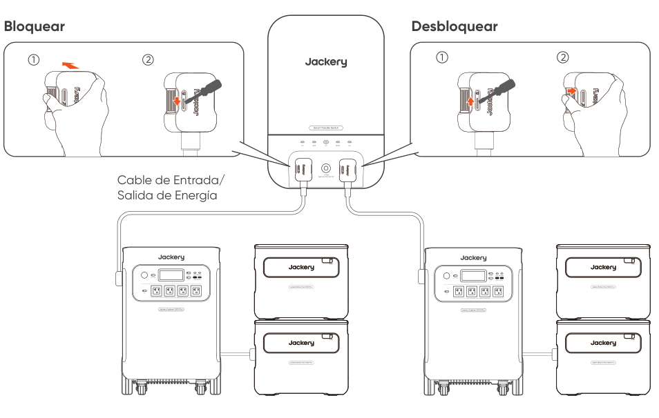
</figure>

#### Energizando

Antes de la energización, asegúrese de que los disyuntores principales y derivados estén en la posición APAGADO. Para energizar, enciende el disyuntor principal y luego enciende cada disyuntor derivado.

#### Bloqueo del Panel

<figure class="hb-reference-figure" data-component-id="HB-SPECIAL-REFERENCE-FIGURE" data-reference-id="locking-panel" data-source-fragment-sha256="ca9f15fb1d68bc3fe77f64763f81440a16f9a274dd88a08485b3c0ce9347d078">
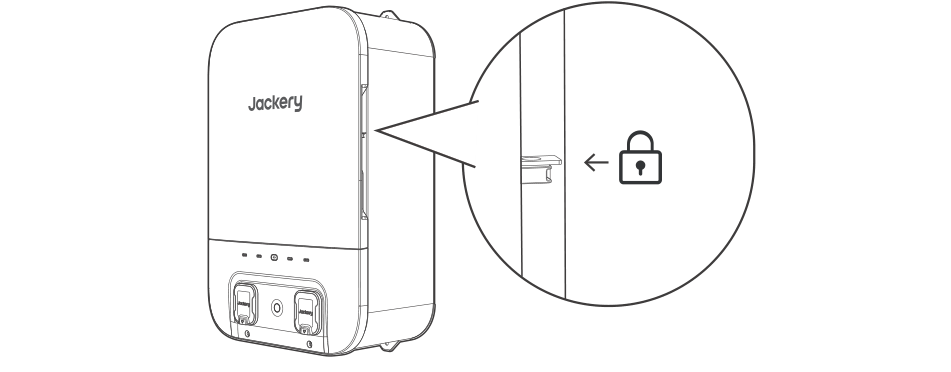
</figure>

## Disyuntores Recomendados

Disyuntores de 15A, disyuntores de 20A, disyuntores de 30A; no interruptores tandem ni cuádruples. Marcas y modelos de disyuntores compatibles: GE - THQL, Siemens - Tipo QP, Square D-HOM y HOMT, Eaton-BR El STS no es compatible con los interruptores automáticos de neutro enchufable.

## USO DE LA APLICACIÓN DE JACKERY

### Para descargar la aplicación e iniciar sesión

<figure aria-label="App Store y Google Play" class="hb-app-download-composition" data-component-id="HB-SPECIAL-APP">

Método 1: Busca "Jackery" en Google Play o App Store para instalar la aplicación. Después, podrá registrarte e iniciar sesión.

Alternativamente, escanee el código QR a continuación para descargar e instalar la aplicación.

</figure>

### Añadir un dispositivo

<ol class="native-steps"><li>Presiona el botón de IoT para activar el Wi-Fi y Bluetooth; la luz indicadora de IoT comenzará a parpadear.</li></ol>
Parpadeando - listo para conectar Fijo - conectado con éxito

<figure class="hb-reference-figure" data-component-id="HB-SPECIAL-REFERENCE-FIGURE" data-reference-id="iot-pairing" data-source-fragment-sha256="448715d8820222db7db464da9a99ec166e4509f61006bd5a9e5b586bcb918fd1" data-step-captions="embedded">
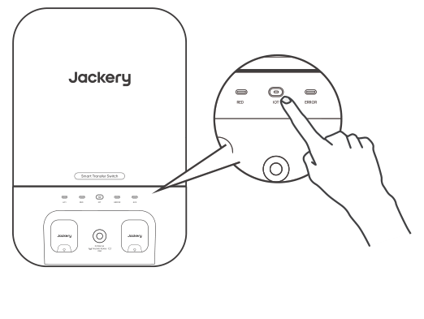
</figure>

<ol class="native-steps" start="2"><li>Pulsa  en la aplicación para agregar tu dispositivo. Esto permite que la aplicación se conecte a dispositivos cercanos y habilite los permisos de Bluetooth</li></ol>

<figure class="hb-reference-figure" data-component-id="HB-SPECIAL-REFERENCE-FIGURE" data-reference-id="app-add-device" data-source-fragment-sha256="b3735fed03368f9436ab06bac1587decb4e94c655ea41c4be1265dae33300227" data-step-captions="embedded">
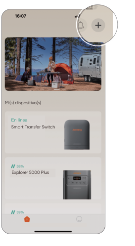
</figure>

<ol class="native-steps" start="3"><li>Pulsa el icono Smart Transfer Switch (STS) en la aplicación para entrar en la página principal de STS y conectar el dispositivo a la red Wi-Fi.</li></ol>

<figure class="hb-reference-figure" data-component-id="HB-SPECIAL-REFERENCE-FIGURE" data-reference-id="app-wifi" data-source-fragment-sha256="91f1ef9f0b6aa5248d869decfd589c65f51f8ef2856cb30c02af9e0afc6674e6" data-step-captions="embedded">
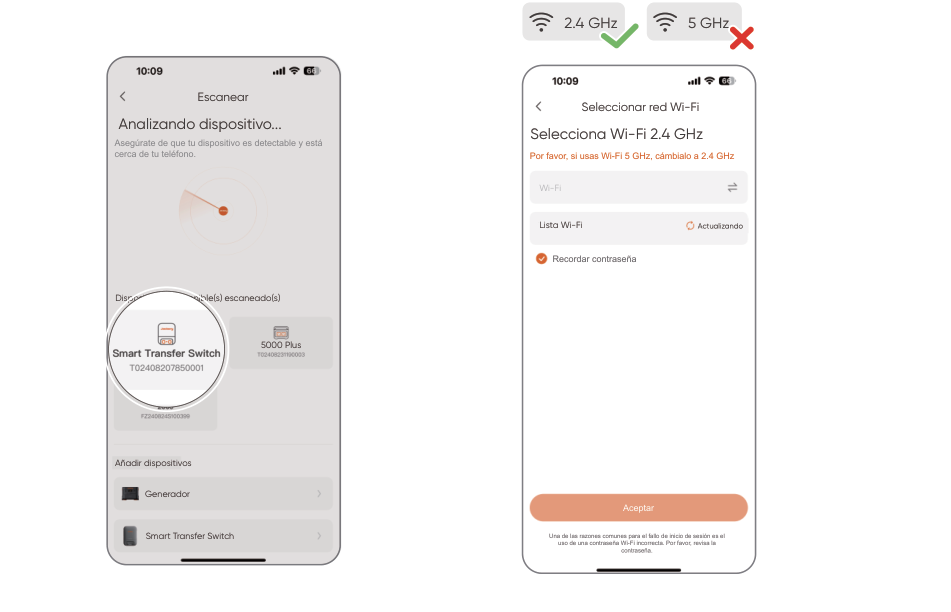
</figure>

### Configuración de voltaje

<ol class="native-steps"><li>Pulsa  en la página principal de STS.</li> <li>Seleccionar Configuración de voltaje </li></ol>

<figure class="hb-reference-figure" data-component-id="HB-SPECIAL-REFERENCE-FIGURE" data-reference-id="app-voltage-menu" data-source-fragment-sha256="8da997187d809258952e6d1711a9a49ee5e8007451961347b22a345807517eb6" data-step-captions="embedded">
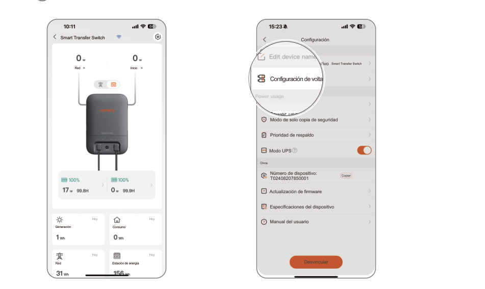
</figure>

<ol class="native-steps" start="3"><li>Pulsa  en la esquina superior derecha. Después, pulsa  para ajustar el voltaje a 240 V de acuerdo con la conexión real del circuito STS. Finalmente, pulsa  para guardar los ajustes.</li></ol>

<figure class="hb-reference-figure" data-component-id="HB-SPECIAL-REFERENCE-FIGURE" data-reference-id="app-voltage-settings" data-source-fragment-sha256="3b0a3650e97c4fd108a147860f561759846892783008ef22dbdb3b9efe690fa9" data-step-captions="embedded">
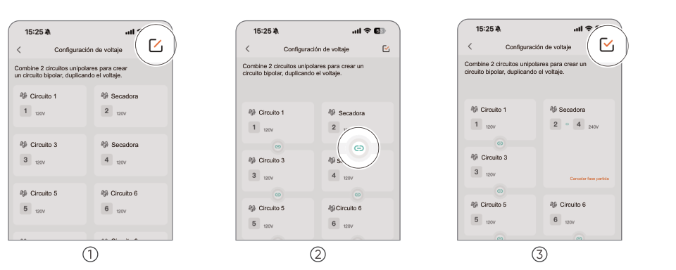
</figure>

### Editar el nombre del circuito

<ol class="native-steps"><li>Pulsa 'circuitos' en la página principal del STS para entrar en la página principal de circuitos.</li></ol>

<figure class="hb-reference-figure" data-component-id="HB-SPECIAL-REFERENCE-FIGURE" data-reference-id="app-circuit-list" data-source-fragment-sha256="3a13b01cdc1ddec134ec0501744c659aff5329526771faf0bb6d7925acb92e9e" data-step-captions="embedded">
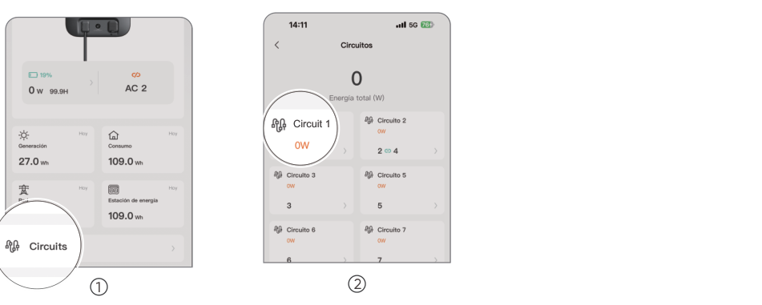
</figure>

<ol class="native-steps" start="2"><li>Selecciona el circuito deseado y pulsa  para editar su nombre.</li></ol>

<figure class="hb-reference-figure" data-component-id="HB-SPECIAL-REFERENCE-FIGURE" data-reference-id="app-circuit-name" data-source-fragment-sha256="bfb44f80e9e9aec68148bd2e63f43a35cf863a6572e0c0bca6fe3b5639546eaf" data-step-captions="embedded">
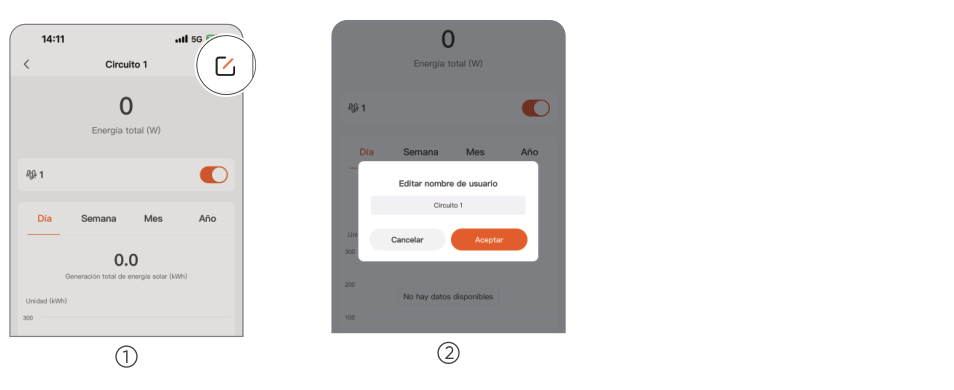
</figure>

## GUÍA DE INICIO RÁPIDO DE LA APLICACIÓN JACKERY

### Tablero

<figure class="hb-reference-figure" data-component-id="HB-SPECIAL-REFERENCE-FIGURE" data-reference-id="app-dashboard" data-source-fragment-sha256="488d7aa77a885de9908c8e9e65c6bcd210c9652e60b15d828acb5cffee8db5b0">
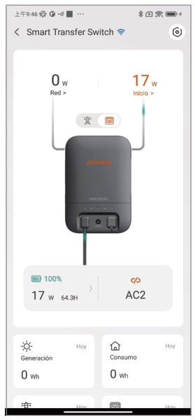
</figure>

Observe y monitoree el consumo eléctrico en tiempo real del hogar, la estación de energía y la red. Consulte la fuente de energía actual del hogar. Cambie manualmente la fuente de energía del hogar a la estación de energía bajo las siguientes condiciones:
<ol class="native-steps"><li>La batería de la estación de energía supera la reserva de respaldo.</li><li>El modo «Solo Respaldo» está desactivado. Generación de energía solar diaria y consumo eléctrico del hogar.</li></ol>

### Circuitos

<figure class="hb-reference-figure" data-component-id="HB-SPECIAL-REFERENCE-FIGURE" data-reference-id="app-circuits" data-source-fragment-sha256="10504f7e72b77c10ad0043e539cdfbedf873031b1b2f9abb04f7f4486a2502f4">
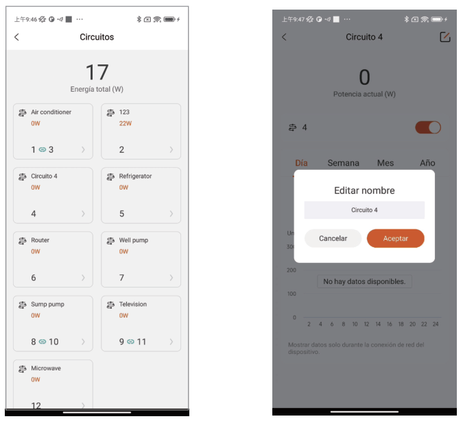
</figure>

Encienda o apague manualmente cada circuito doméstico, cámbieles el nombre y consulte el consumo histórico de energía de cada circuito.

### Modos de funcionamiento

<figure class="hb-reference-figure" data-component-id="HB-SPECIAL-REFERENCE-FIGURE" data-reference-id="app-working-modes" data-source-fragment-sha256="0b96c0bbe047fa5f20479623aa3fefe84879d8ebf3adf1e53856f739d0c241bd">
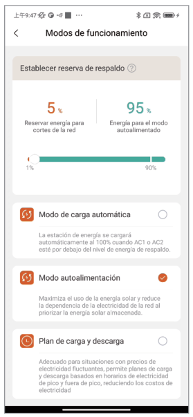
</figure>

<h3>Establecer la reserva de respaldo</h3>
Cuando la estación de energía se esté descargando, la batería se descargará hasta alcanzar la reserva de respaldo. Durante un corte de energía, se descargará hasta llegar al límite de descarga (0%). Puede modificar el nivel en Configuraciones &gt; Modos de funcionamiento. *La configuración de reserva de respaldo se puede activar en cualquier modo. *Durante un corte de energía, el nivel de la reserva de respaldo se descargará a 0% en cualquier modo.
<h3>Modo de carga automática</h3>
Se utiliza comúnmente para la energía de respaldo doméstica diaria. <strong>La estación de energía se recargará automáticamente al 100% cuando AC1 o AC2 estén por debajo de la reserva de respaldo.</strong>

#### Modo autoalimentación

Aproveche al máximo la energía solar para su hogar. En este modo, la estación de energía se carga exclusivamente con energía solar. Dos horas después de alcanzar la carga completa, empezará a suministrar energía al hogar. Si no está completamente cargada, solo suministrará energía al hogar durante la noche.

#### *Plan de carga y descarga

Idóneo para situaciones con tarifas eléctricas fluctuantes, ya que permite planes de carga y descarga según las horas de mayor y menor consumo eléctrico, lo que reduce los costes de electricidad. Función de carga: Establece el período de carga. Función de descarga: Establece el período de descargar. En este período, si las baterías exceden la reserva de respaldo, se descargarán. Cuando la estación de energía está conectada al Smart Transfer Switch, desactiva temporalmente el Modo de ahorro de batería, el Apagado automático, el Modo de ahorro de energía, el Modo de carga silenciosa y el Plan de carga.

### Modo respaldo

<figure class="hb-reference-figure" data-component-id="HB-SPECIAL-REFERENCE-FIGURE" data-reference-id="app-backup-only" data-source-fragment-sha256="b99732debf93e9ec9be402e32dfa82cb86eb4d56dd19eaa01a9797a750bfaeac">
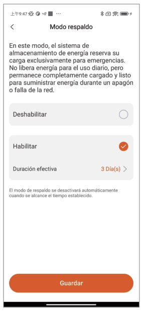
</figure>

Cuando se habilita el modo de solo respaldo, la red eléctrica suministrará energía al hogar mientras carga la estación de energía por completo, la cual solo suministrará energía durante un corte de energía. El plan de carga-descarga y el modo autoalimentación se desactivarán temporalmente. El cambio manual a la estación de energía no está disponible en modo de solo reserva.

### Prioridad de respaldo

<figure class="hb-reference-figure" data-component-id="HB-SPECIAL-REFERENCE-FIGURE" data-reference-id="app-backup-priority" data-source-fragment-sha256="260d312502c70d5cbb5d999936f0e770ba74234c4e5ad015e38af0b339428067">
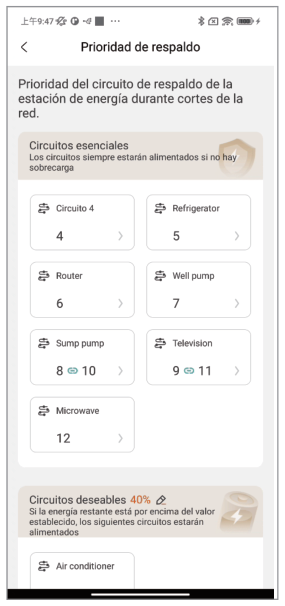
</figure>

Durante un corte de energía, el sistema prioriza el suministro de energía de batería a los circuitos domésticos. Clasifique sus circuitos domésticos en 3 niveles: necesarios, deseables, y sin suministro de energía. Prioridades de circuitos
<ol class="native-steps"><li>Circuitos esenciales: mientras haya energía en las baterías, se suministrará a estos circuitos.</li><li>Circuitos deseables: estos circuitos recibirán energía cuando el nivel de batería sea igual o superior al porcentaje que se haya establecido.</li><li>Circuitos no prioritarios: estos circuitos no recibirán energía cuando se utilice la batería durante un corte de energía.</li></ol>

### Modo UPS

<figure class="hb-reference-figure" data-component-id="HB-SPECIAL-REFERENCE-FIGURE" data-reference-id="app-ups-mode" data-source-fragment-sha256="3259b17bc956b714ce3a9830351b0f5a4475075b382279ba91f463f80b3e71a0">
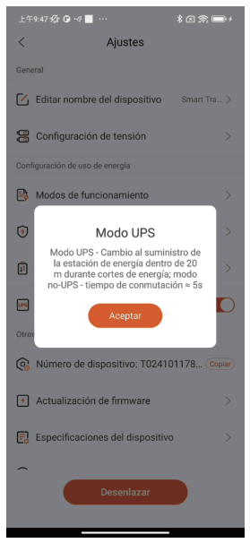
</figure>

Cuando el modo UPS está activado, si se produce un corte de energía, el STS cambiará automáticamente al suministro de la estación de energía dentro de 20 ms. Si el STS está cargando la estación de energía en ese momento, el tiempo de conmutación será superior a 20 ms y, una vez se restablezca la energía, cambiará automáticamente al suministro de la red eléctrica. En modo sin UPS, el tiempo de conmutación es de aproximadamente 5 segundos solo si la estación de energía está encendida. *El STS permanecerá encendido cuando esté conectado a la estación de energía, por lo que se recomienda no apagarla manualmente.

## GARANTÍA

<figure aria-label="GARANTÍA" class="hb-warranty-intro-composition" data-component-id="HB-WARRANTY-LEAD">
Solo ofrecemos nuestra garantía a clientes que compren a través del sitio web oficial de Jackery, plataformas de terceros de marca Jackery o distribuidores locales autorizados.

*El período de garantía y los detalles pueden variar según las leyes, regulaciones y distribuidores autorizados locales.
</figure>

### Garantía Limitada

<figure aria-label="Garantía Limitada" class="hb-warranty-card" data-component-id="HB-WARRANTY-SECTION" data-warranty-card-index="1">
Jackery Inc. garantiza al comprador consumidor original que el producto de Jackery estará libre de defectos de fabricación y material bajo uso normal durante el período de garantía aplicable identificado en la sección 'Período de Garantía' a continuación, sujeto a las exclusiones establecidas a continuación. Esta declaración de garantía establece la obligación total y exclusiva de garantía de Jackery. No asumiremos, ni autorizaremos a nadie a asumir por nosotros, ninguna otra responsabilidad en relación con la venta de nuestros productos.
</figure>

### Período de Garantía

<figure aria-label="Período de Garantía" class="hb-warranty-card" data-component-id="HB-WARRANTY-SECTION" data-warranty-card-index="2">
Garantía Estándar de 5 Años: El período de garantía estándar para Jackery Smart Transfer Switch es de 5 años. En cada caso, el período de garantía se mide a partir de la fecha de compra por el comprador consumidor original. Se requiere el recibo de venta de la primera compra del consumidor u otra prueba documental razonable para establecer la fecha de inicio del período de garantía.
</figure>

### Reparación o reemplazo

<figure aria-label="Reparación o reemplazo" class="hb-warranty-card" data-component-id="HB-WARRANTY-SECTION" data-warranty-card-index="3">
Jackery reparará o reemplazará (a expensas de Jackery) cualquier producto de Jackery que no funcione durante el período de garantía aplicable debido a un defecto de fabricación o material. El producto reparado/reemplazado asume la garantía restante de la fecha de compra original.
</figure>

### Limitada al Comprador Consumidor Original

<figure aria-label="Limitada al Comprador Consumidor Original" class="hb-warranty-card" data-component-id="HB-WARRANTY-SECTION" data-warranty-card-index="4">
La garantía del producto de Jackery está limitada al comprador consumidor original y no es transferible a ningún propietario posterior.
</figure>

### Exclusiones

<figure aria-label="Exclusiones" class="hb-warranty-card" data-component-id="HB-WARRANTY-SECTION" data-warranty-card-index="5">
La garantía de Jackery no se aplica a: Mal uso, abuso, modificaciones, daños por accidente o uso para algo diferente al uso normal del consumidor autorizado en la documentación actual del producto de Jackery. Reparaciones intentadas por alguien que no sea de una instalación autorizada. Cualquier producto comprado a través de una casa de subastas en línea. La garantía de Jackery no se aplica a la celda de batería a menos que la celda de batería esté completamente cargada por usted dentro de los siete días posteriores a la compra del producto y al menos una vez cada 6 meses a partir de entonces.
</figure>

### Derechos de Interpretación

<figure aria-label="Derechos de Interpretación" class="hb-warranty-card" data-component-id="HB-WARRANTY-SECTION" data-warranty-card-index="6">
Jackery Inc. se reserva el derecho de interpretación final de la política de postventa anterior.
</figure>
