

## CONSIGNES DE SÉCURITÉ

### Clause de non-responsabilité

Félicitations pour votre nouveau Jackery Smart Transfer Switch. Veuillez lire attentivement ce manuel avant d'utiliser le produit, en particulier les précautions à prendre pour garantir une utilisation correcte du produit. Conservez ce manuel dans un endroit accessible pour pouvoir vous y référer ultérieurement. Conformément aux lois et réglementations en vigueur, le droit d'interprétation final de ce document et de tous les documents associés à ce produit appartient à l'entreprise. Veuillez noter qu'aucune autre notification ne sera faite en cas de mise à jour, de révision ou de résiliation.

### Avertissement

<ol class="native-steps"><li>L'installation ou l'entretien de ce produit ne doit être effectué que par du personnel qualifié en électricité.</li><li>Avant d'installer, d'utiliser ou de réparer ce produit, lisez attentivement le manuel d'utilisation.</li><li>L'installation de ce produit doit être conforme aux normes locales, aux normes nationales de sécurité électrique et aux instructions du fabricant.</li><li>Les spécifications des câbles fournis par l'utilisateur doivent être conformes aux exigences du guide d'installation et aux réglementations locales.</li><li>Les câbles AC sont des câbles à haute tension. Risque de mort ou de blessure grave par électrocution.</li><li>Il existe un risque élevé d'électrocution ou de brûlures graves en raison de la haute tension du produit.</li><li>Utiliser un équipement de protection individuelle (EPI) approprié et suivre des pratiques de travail électrique sûres.</li><li>Ne pas toucher les fils exposés avec les mains.</li><li>Soyez prudent pour éviter les blessures lorsque vous déplacez des objets lourds. Portez des équipements de protection individuelle tels que des gants et des chaussures de protection lorsque vous déplacez manuellement le produit.</li><li>N'installez pas et n'utilisez pas l'équipement dans des conditions météorologiques extrêmes telles que la foudre, la neige, les fortes pluies, les vents violents, etc.</li><li>N'installez pas et ne faites pas fonctionner le produit dans une zone où des matériaux inflammables ou explosifs sont stockés.</li><li>Avant de procéder à l'installation, vérifiez que le produit et les câbles ne sont pas endommagés. N'installez pas le produit ou les câbles s'ils sont endommagés de quelque manière que ce soit.</li><li>Couper l'alimentation électrique de ce produit avant l'installation. Débranchez chaque circuit individuellement avant de procéder à l'entretien.</li><li>Utilisez toujours un dispositif de détection de tension correctement dimensionné pour confirmer que l'alimentation est coupée.</li><li>Pendant le processus de perçage, couvrez l'intérieur du produit pour éviter que des débris ne tombent à l'intérieur, et enlevez les débris après le perçage pour éviter toute interférence avec l'équipement.</li><li>N'endommagez pas, n'étalez pas et ne recouvrez pas les étiquettes d'avertissement sur l'appareil. Toutes les étiquettes doivent être visibles après l'installation.</li><li>Avant d'utiliser le produit, vérifiez les connexions électriques pour vous assurer que le produit est mis à la terre de manière fiable et permanente.</li><li>Ne placez aucun objet sur le produit pendant son fonctionnement.</li><li>Pour mettre le produit hors tension, il faut s'assurer que tous les disjoncteurs principaux et les disjoncteurs de dérivation sont éteints et débrancher physiquement toutes les charges. Le non-respect de cette consigne peut entraîner un risque d'électrocution.</li><li>Ne pas placer ou installer d'objets inflammables ou potentiellement explosifs à proximité du produit ou dans des atmosphères explosives.</li><li>N'insérez pas d'objets étrangers dans une quelconque partie de l'appareil.</li><li>Ne pas connecter les systèmes de survie, les équipements médicaux ou tout autre équipement utilisé lorsqu'une défaillance du produit peut entraîner des blessures ou des pertes de vie à des circuits qui peuvent être commutés à distance.</li><li>Installez le produit dans un endroit où il ne risque pas d'être endommagé par une inondation. Veillez à ce qu'aucune source d'eau ne se trouve au-dessus ou à proximité du produit, y compris les tuyaux de descente, les arroseurs ou les robinets.</li><li>Si nécessaire, remettez en place tous les dispositifs, portes et couvercles avant de remettre l'appareil sous tension.</li></ol>

### Attention

<ol class="native-steps"><li>Si le câble est endommagé, il doit être remplacé par le fabricant, le service après-vente ou du personnel qualifié afin d'éviter tout risque pour la sécurité.</li><li>Ne pas utiliser de solvants pour nettoyer le produit.</li><li>Le produit doit être éliminé conformément aux codes et règlements locaux.</li><li>Ce produit n'est pas destiné à être utilisé comme déconnexion de service.</li><li>N'utilisez pas de pièces ou d'accessoires autres que ceux spécifiés pour le produit.</li><li>Lors de l'installation du produit, les vis doivent être serrées selon le couple spécifié à l'aide d'un outil spécial.</li><li>Tenir hors de portée des enfants et des animaux.</li><li>Ce produit est conçu pour un usage résidentiel uniquement.</li></ol>

### Déclaration de la FCC

Cet appareil est conforme à la partie 15 du règlement de la FCC. Le fonctionnement dépend des deux conditions suivantes : (1) Cet appareil ne doit pas provoquer d'interférences dangereuses, et (2) cet appareil doit accepter toute interférence reçue, y compris les interférences pouvant provoquer un fonctionnement non désiré. MODIFICATION: Tout changement ou modification non expressément approuvé par le bénéficiaire de la présente peut annuler le droit de l'utilisateur à faire fonctionner l'appareil. REMARQUE : Cet équipement a été testé et déclaré conforme aux limites concernant les appareils numériques de classe B, conformément à la partie 15 du règlement de la FCC. Ces limites sont conçues pour offrir une protection raisonnable contre les interférences dangereuses dans le cadre d'une installation résidentielle. Cet équipement génère, utilise et émet des ondes radios qui peuvent, si cet équipement n'est pas installé et utilisé conformément aux instructions, perturber les communications radios. Toutefois, il n'y a aucune garantie qu'aucune interférence ne se produise lors d'une installation particulière. Si cet équipement trouble la réception de la radio ou de la télévision, ce qui peut être déterminé en éteignant et en allumant cet équipement, l'utilisateur est encouragé à tenter de corriger ces interférences en essayant une ou plusieurs des mesures suivantes : -- Réorientez ou déplacez l'antenne de réception. -- Éloignez l'équipement du récepteur. -- Connectez l'équipement à une prise d'un autre circuit que celui auquel le récepteur est connecté. -- Consultez le revendeur ou bien demandez de l'aide à un technicien de radio/télévision expérimenté.

### Avertissement IC

Cet appareil est conforme à la (aux) norme(s) RSS exemptée(s) de licence d'Industrie Canada. Le fonctionnement dépend des deux conditions suivantes : (1) cet appareil ne doit pas causer d'interférences, et (2) cet appareil doit accepter toute interférence, y compris les interférences susceptibles d'entraîner un fonctionnement indésirable de l'appareil. Cet appareil numérique de classe B est conforme à la norme canadienne lCES-003.

Déclaration IC RF : Lors de l'utilisation du produit, maintenez une distance de 20 cm par rapport au corps afin de garantir la conformité avec les exigences en matière d'exposition aux radiofréquences.

<ul class="native-bullets"><li>RISQUE D'INGESTION : Ce produit contient une pile bouton ou une pile de monnaie.</li><li>L'ingestion de ce produit peut entraîner la MORT ou des blessures graves.</li><li>Une pile bouton ou une pièce de monnaie avalée peut provoquer des brûlures chimiques internes en seulement 2 heures.</li><li>GARDER les piles neuves et usagées HORS DE LA PORTÉE DES ENFANTS.</li><li>Consulter immédiatement un médecin si l'on soupçonne qu'une pile a été avalée ou insérée à l'intérieur d'une partie du corps.</li></ul>

### Signification des symboles

Les tableaux suivants expliquent la signification des symboles utilisés dans le manuel d'utilisation et son emballage.

<table class="manual-table native-print-grid native-symbols native-fit"><thead><tr><th class="native-head-regular" scope="col">Symbol</th><th class="native-head-regular" scope="col">Signification</th></tr></thead><tbody><tr><td class="native-symbol-cell"></td><td>La position de connexion du câble de terre de protection.</td></tr><tr><td class="native-symbol-cell"></td><td>Attention, risque de danger.</td></tr><tr><td class="native-symbol-cell"></td><td>Attention, risque de choc électrique.</td></tr><tr><td class="native-symbol-cell"></td><td>Se référer au mode d'emploi.</td></tr></tbody></table>

## SPÉCIFICATIONS

<table class="manual-table native-spec-rules native-fit"><tbody><tr><td>Nom du produit</td><td>Jackery Smart Transfer Switch</td></tr><tr><td>N° modèle</td><td>JA-TS02A</td></tr><tr><td>Voltage AC (Nominal)</td><td>120V/ 240V~ 60Hz</td></tr><tr><td>Feed-In Type</td><td>Phase de Division</td></tr><tr><td>Courant maximal d'entrée</td><td>100A Grid/ 60A Power Station</td></tr><tr><td>Courant maximal de sortie</td><td>60A Home Load/ 33.4A Power Station</td></tr><tr><td>Courant de court-circuit d'entrée maximal</td><td>10KA</td></tr><tr><td>Catégorie de surtension</td><td>IV</td></tr><tr><td>UPS</td><td>≤ 20 ms</td></tr><tr><td>Type d'annexe (Panel de distribution)</td><td>NEMA Type 1</td></tr><tr><td>Nombre de branches de charge</td><td>12</td></tr><tr><td>Circuit principal</td><td>2 AWG</td></tr><tr><td>Circuit de branchement</td><td>14 AWG 12 AWG 10 AWG</td></tr><tr><td>Communication</td><td>Wi-Fi et Bluetooth</td></tr><tr><td>Température opérationnelle</td><td>-20°C~ 40°C(-4°F~ 104°F)</td></tr><tr><td>Dimensions</td><td>22 x 14,7 x 7,87 in/ 56 x 37,4 x 20 cm</td></tr><tr><td>Poids</td><td>Environ 25,57 lbs/11,6 kg</td></tr></tbody></table>

* Lorsque vous utilisez le produit, assurez-vous de vous connecter à une tension de secteur de 240 V en phase divisée.

## LISTE DES PAQUETS

<figure class="hb-reference-figure" data-component-id="HB-SPECIAL-REFERENCE-FIGURE" data-reference-id="package-list" data-source-fragment-sha256="ebb58b5147c5bc6ada364f56c272985d825271c031000ab9037c0e5751f5acaf" data-step-captions="embedded">
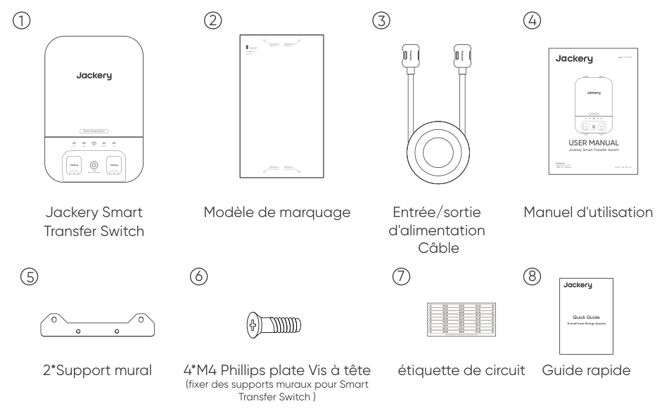
</figure>

## CE DONT VOUS AVEZ BESOIN

<figure class="hb-reference-figure" data-component-id="HB-SPECIAL-REFERENCE-FIGURE" data-reference-id="optional-tools" data-source-fragment-sha256="6155701adc72a35dbb11eb0d5ffbd73db0cc0993a81386d39ffcbdb832966fd4" data-step-captions="embedded">
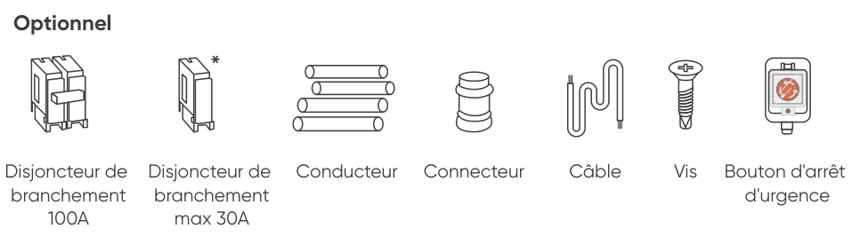
</figure>

### Optionnels

<table class="manual-table native-print-grid native-cables"><thead><tr><th class="native-head-regular" colspan="2" scope="col">Câble</th><th class="native-head-regular" scope="col">Couleur</th><th class="native-head-regular" scope="col">Courant</th><th class="native-head-regular" scope="col">Jauge</th></tr></thead><tbody><tr><td class="native-cable-group" rowspan="4">Grille (Connecter à la Panneau principal)</td><td>L1</td><td class="native-wire native-wire-black">Noir</td><td rowspan="4">100A Max</td><td>2 AWG</td></tr><tr><td>L2</td><td class="native-wire native-wire-red">Rouge</td><td>2 AWG</td></tr><tr><td>N</td><td class="native-wire native-wire-white">Blanc</td><td>2 AWG</td></tr><tr><td>GND</td><td class="native-wire native-wire-green">Vert</td><td>6 AWG</td></tr><tr><td class="native-cable-group" rowspan="4">Chargements à domicile (Connecter jusqu’à 12 Circuits de dérivation)</td><td>L1</td><td class="native-wire native-wire-black">Noir</td><td rowspan="4">30A Max</td><td>14 AWG -10 AWG</td></tr><tr><td>L2</td><td class="native-wire native-wire-red">Rouge</td><td>14 AWG -10 AWG</td></tr><tr><td>N</td><td class="native-wire native-wire-white">Blanc</td><td>14 AWG -10 AWG</td></tr><tr><td>GND</td><td class="native-wire native-wire-green">Vert</td><td>14 AWG -10 AWG</td></tr><tr><td class="native-cable-group">Circuit d'arrêt d'urgence (Connecter au bouton d'arrêt d'urgence)</td><td>/</td><td>/</td><td>2A Max</td><td>24 AWG</td></tr></tbody></table>

* Installez un disjoncteur de dérivation de 100A, 2 pôles dans le tableau de distribution domestique. Le disjoncteur servira à la connexion avec le Smart Transfer Switch (STS).

## APERÇU DU PRODUIT

### Dimensions

<figure class="hb-reference-figure" data-component-id="HB-SPECIAL-REFERENCE-FIGURE" data-reference-id="dimensions" data-source-fragment-sha256="e61f24ec2c339b1a7ae3acca2cb4cfcdfbfe58da791ecf748a988a18d7f62172" data-step-captions="embedded">
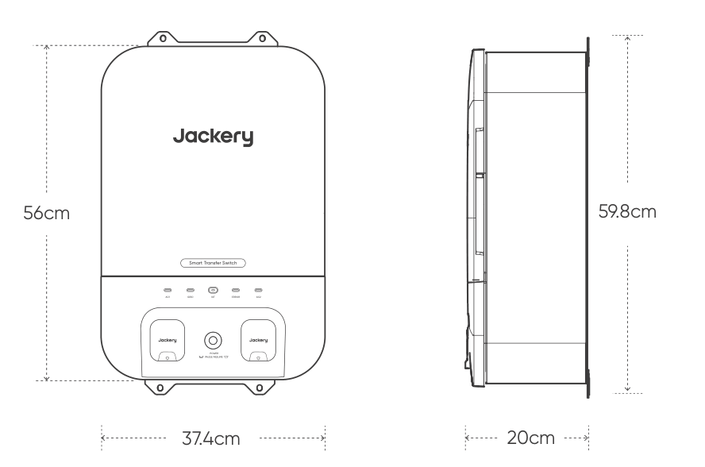
</figure>

* Les chiffres sont donnés à titre de référence uniquement, veuillez vous référer au produit réel.

### Avec le couvercle de la Façade installé

<figure class="hb-reference-figure" data-component-id="HB-SPECIAL-REFERENCE-FIGURE" data-reference-id="covered-overview" data-source-fragment-sha256="467b224b3bdcc414836bd6d772ca10582e3a1f2afd1f3ad77e45e6690a8d0305" data-step-captions="embedded">
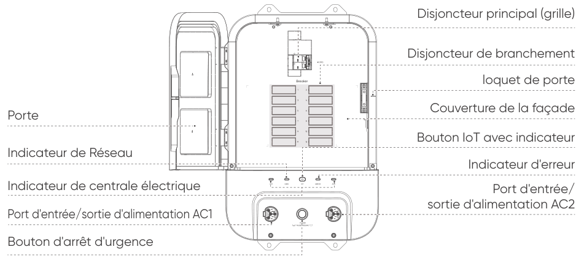
</figure>

#### Bouton IoT avec indicateur

<ul class="native-bullets"><li>Une pression courte sur le bouton permet d'activer/désactiver le Bluetooth et le Wi-Fi.</li><li>Appuyez longuement sur le bouton pendant 5S pour réinitialiser le Bluetooth et le Wi-Fi (le commutateur de transfert automatique conservera les paramètres précédents).</li></ul>

* Si le Wi-Fi et le Bluetooth ne sont pas couplés dans les deux heures, ils s'éteindront automatiquement.

#### Bouton d'arrêt d'urgence

En cas d'urgence, ce bouton peut être activé manuellement pour couper immédiatement la sortie de l'ensemble du système.

### Indicateurs LED

<table class="manual-table native-print-grid native-led"><thead><tr><th scope="col">Indicateur</th><th scope="col">Statut</th><th scope="col">Description</th></tr></thead><tbody><tr><td class="native-led-name" rowspan="3">Indicateur de Réseau</td><td>Clignotement bleu</td><td>Alimentation du réseau présente, ne fournissant pas d’énergie aux charges domestiques.</td></tr><tr><td>Bleu uni</td><td>Alimentation du réseau fournissant de l’énergie aux charges domestiques</td></tr><tr><td>Off</td><td>Pas d’alimentation du réseau</td></tr><tr><td class="native-led-name" rowspan="3">Centrale électrique Indicateur (AC1/AC2)</td><td>Clignotement vert</td><td>La station d’énergie est connectée et en mode veille, ne fournissant pas d’énergie aux charges domestiques.</td></tr><tr><td>Vert uni</td><td>La station d’énergie est connectée et fournit de l’énergie aux charges domestiques. Dans le système STS, l’alimentation des charges domestiques dépend des paramètres de mise en service.</td></tr><tr><td>Off</td><td>Centrale électrique non connectée</td></tr><tr><td class="native-led-name" rowspan="3">Indicateur IoT</td><td>Clignotement vert</td><td>Wi-Fi et Bluetooth activés, pas appariés</td></tr><tr><td>Vert uni</td><td>Wi-Fi et Bluetooth activés, appariés</td></tr><tr><td>Off</td><td>Wi-Fi et Bluetooth désactivés</td></tr><tr><td class="native-led-name" rowspan="2">Indicateur d'erreur</td><td>Rouge uni</td><td>Dysfonctionnement du produit</td></tr><tr><td>Off</td><td>Fonctionnement normal</td></tr></tbody></table>

### Avec la Couverture de la Façade Enlevée

<figure class="hb-reference-figure" data-component-id="HB-SPECIAL-REFERENCE-FIGURE" data-reference-id="uncovered-overview" data-source-fragment-sha256="200f580b33b458bacea75e2cb57a2e2ac124b0dc9a3d91a83553d160f88ae897" data-step-captions="embedded">
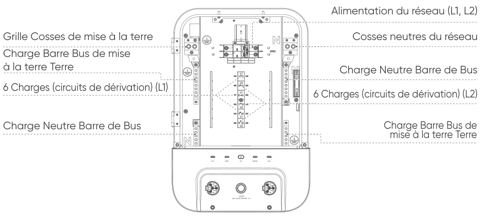
</figure>

#### Mode de secours normal

La fonction UPS est désactivée par défaut. En cas de panne de courant, la station d'énergie portable alimentera automatiquement vos charges domestiques avec l'énergie stockée dans un délai de 5 secondes. Une fois que l'énergie du réseau est rétablie, le système repasse automatiquement à l'alimentation par le réseau.

<table class="manual-callout-table manual-callout-table hb-callout-label-shaded"><tbody><tr><td class="manual-callout-label">AVERTISSEMENT</td><td class="manual-callout-body">
La station d'énergie doit rester allumée ; sinon, le STS ne peut pas passer à l'alimentation par batterie après une panne.
</td></tr></tbody></table>

#### Mode UPS

Dans ce mode, la fonction UPS est activée. Lors d'une panne de courant, le système passe automatiquement à l'alimentation par batterie en moins de 20 millisecondes.

<ul class="native-bullets"><li>La station d'énergie portable reste active en permanence et consomme continuellement une petite quantité d'énergie, même lorsqu'elle n'est pas utilisée.</li><li>Si la station d'énergie est en charge par le STS, le temps de commutation peut dépasser 20 millisecondes.</li><li>Une fois que l'énergie du réseau est rétablie, le système repasse automatiquement à l'alimentation par le réseau.</li></ul>

<table class="manual-callout-table manual-callout-table hb-callout-label-shaded"><tbody><tr><td class="manual-callout-label">AVERTISSEMENT</td><td class="manual-callout-body">
La fonction UPS ne peut fonctionner que si le STS est correctement connecté au Jackery Explorer 5000 Plus ou au Jackery HomePower 5000 Plus. Avant d'utiliser le mode UPS, assurez-vous que :
<ol class="native-steps"><li>La fonction UPS est activée dans l'application Jackery.</li><li>La station d'énergie portable est allumée et n'est pas en charge.</li></ol></td></tr></tbody></table>

## PRÉ-INSTALLATION

### Vue d'ensemble du système

<figure class="hb-reference-figure" data-component-id="HB-SPECIAL-REFERENCE-FIGURE" data-reference-id="system-overview" data-source-fragment-sha256="a1dcb94063008fe97c373335225b925eb077feb6e389a2c1e5cf87e518829b22" data-step-captions="embedded">
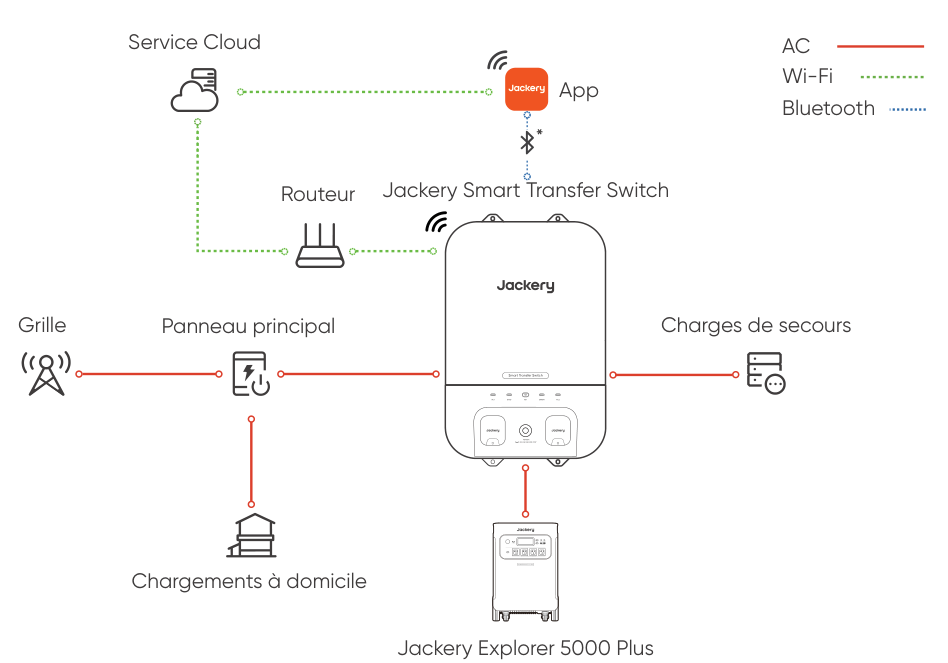
</figure>

* S'il n'y a pas de Wi-Fi disponible, veuillez connecter votre appareil via Bluetooth. <strong>* Si le Wi-Fi et le Bluetooth de l'appareil sont activés et qu'ils ne se connectent pas à l'application Jackery dans les deux heures, les deux s'éteindront automatiquement.</strong>

### Lieu d'installation

Installer le Jackery Smart Transfer Switch à l'intérieur.

<table class="manual-callout-table manual-callout-table hb-source-warning-lockup native-lockup-open"><tbody><tr><td class="manual-callout-label">Avertissement</td><td class="manual-callout-body"><ul class="native-bullets"><li>Veillez à ce que le produit soit placé dans un endroit sec et bien ventilé.</li><li>Veillez à ce que la porte s'ouvre à un angle d'au moins 90 degrés.</li><li>Le personnel chargé de l'installation doit porter des gants isolants, des lunettes de sécurité et des chaussures à semelle de caoutchouc.</li><li>Avant l'installation, assurez-vous que le disjoncteur principal et tous les circuits de dérivation sont éteints.</li></ul></td></tr></tbody></table>

## GUIDE D'INSTALLATION

Les détails ci-dessous sont des directives générales pour l'espace d'installation et ne sont pas garantis comme étant applicables. Veuillez consulter votre AHJ local ou votre fournisseur d'électricité avant utilisation.

### Montage en surface

<table class="manual-callout-table manual-callout-table hb-source-warning-lockup native-lockup-open"><tbody><tr><td class="manual-callout-label">Avertissement</td><td class="manual-callout-body">
Le produit n'est pas étanche et est conçu spécifiquement pour une utilisation à l'intérieur.
</td></tr></tbody></table>

<ol class="native-steps"><li>Installer les supports muraux supérieur et inférieur à l'arrière du Smart Transfer Switch à l'aide de 4 vis M4. Serrer toutes les vis avec un couple de 0,8 N-m.</li></ol>

<figure class="hb-reference-figure" data-component-id="HB-SPECIAL-REFERENCE-FIGURE" data-reference-id="mounting-brackets" data-source-fragment-sha256="71ef3b4c550ca7935258c6004e8ddb8b4b33739a8d624d0f2927b5ae28ec898a">
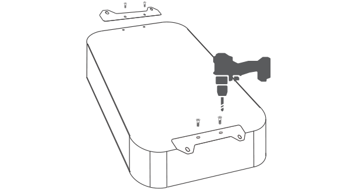
</figure>

<ol class="native-steps" start="2"><li>Fixez le gabarit sur la surface de montage et marquez soigneusement l'emplacement de chaque trou à l'aide d'un crayon.</li></ol>

<figure class="hb-reference-figure" data-component-id="HB-SPECIAL-REFERENCE-FIGURE" data-reference-id="mounting-template" data-source-fragment-sha256="0377c9d4a7cfc7aa92617f3574bee69dcf1b0e3f68a0a642ec6982d6808a6e4f" data-step-captions="embedded">
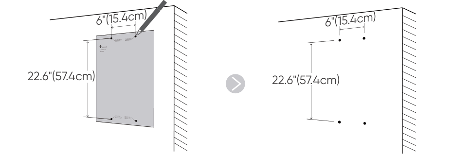
</figure>

<ol class="native-steps" start="3"><li>Fixez le Smart Transfer Switch avec 4 boulons d’expansion M6 ou des vis M6.</li></ol>

<figure class="hb-reference-figure" data-component-id="HB-SPECIAL-REFERENCE-FIGURE" data-reference-id="mounting-fasteners" data-source-fragment-sha256="1cb50a1455df935aca0ab4919d398482c750e0064992885176586130eab68b32" data-step-captions="embedded">
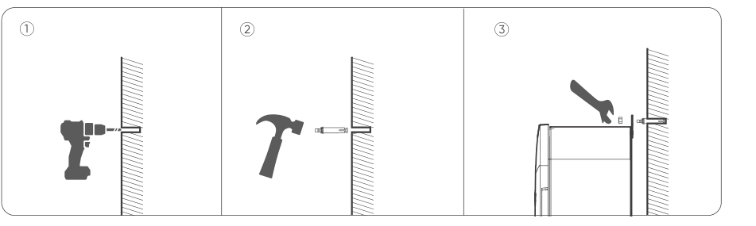
</figure>

### Choix de l'entrée de câble

<ul class="native-bullets"><li>Pendant le processus de forage, couvrez l'équipement intérieur pour éviter que des débris ne tombent à l'intérieur de l'équipement.</li><li>Enlever les débris après le forage pour éviter toute interférence avec l'équipement.</li></ul>

<figure class="hb-reference-figure" data-component-id="HB-SPECIAL-REFERENCE-FIGURE" data-reference-id="cable-entry" data-source-fragment-sha256="a0cd6988db722342e9edf56f4afc6aff519e32b538e60ed673f317eacd40355b" data-step-captions="embedded">
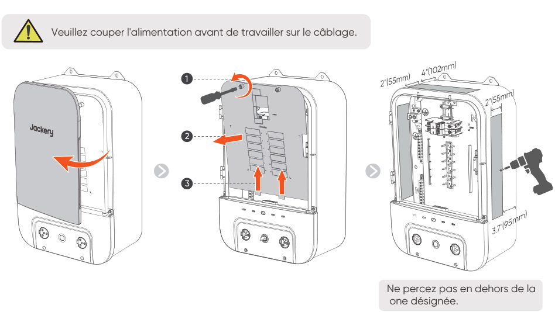
</figure>

### Connexions électriques

Avertissement

<ul class="native-bullets"><li>Risque d'électrocution, Avant de procéder au câblage, assurez-vous que l'appareil est hors tension. S'assurer que les disjoncteurs principaux et de dérivation sont éteints.</li><li>S'assurer que des conduits sont installés avant le câblage entre le panneau principal et le Jackery Smart Transfer Switch afin d'améliorer la sécurité et de protéger les câbles contre les dommages.</li></ul>

* Comme le montre l'image, vous pouvez déplacer les disjoncteurs du panneau principal vers le Smart Transfer Switch. * L'installation du disjoncteur de 100A dans le panneau principal se fait comme indiqué sur la photo. * Les disjoncteurs du commutateur de transfert ne doivent pas dépasser 30 A.

<figure class="hb-reference-figure" data-component-id="HB-SPECIAL-REFERENCE-FIGURE" data-reference-id="grid-preparation" data-source-fragment-sha256="09fd45a5fb1649f472a104cc383b4ba28235f4ec871223cddc7f7980bbe1c208" data-step-captions="embedded">
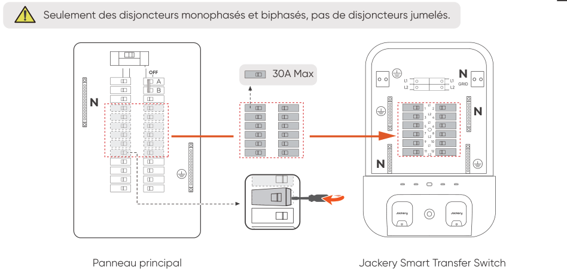
</figure>

#### Raccordement des conducteurs du réseau

<ol class="native-steps"><li>Assurez-vous que tous les disjoncteurs de branche et le disjoncteur principal sont éteints.</li><li>Retirez le couvercle du panneau principal et de l'Smart Transfer Switch.</li><li>Retirez le défonçable du panneau électrique et percez les trous d'entrée de câble autorisés sur le Smart Transfer Switch.</li><li>Installer un conduit (non inclus) entre le panneau principal et l'Smart Transfer Switch.</li><li>Tirer les fils pré-câblés du panneau principal en faisceau à travers le conduit.</li><li>Installer un disjoncteur de dérivation compatible de 100A, 2 pôles (non inclus) dans le panneau principal.</li><li>Localisez le fil de TERRE du panneau principal et connectez-le aux cosses de terre de l'Smart Transfer Switch.</li><li>Localisez le fil NEUTRE du panneau principal et connectez-le aux cosses neutres du réseau de l'Smart Transfer Switch.</li><li>Localiser les fils chauds du disjoncteur de 100 A ajouté au panneau principal et les connecter à l'Smart Transfer Switch, installer le couvercle d'alimentation de l'Smart Transfer Switch.</li></ol>

<figure class="hb-reference-figure" data-component-id="HB-SPECIAL-REFERENCE-FIGURE" data-reference-id="grid-wiring" data-source-fragment-sha256="7f53f9d96bf430404bd20b3affd1b35544d058e90b9e3814be0499ca605eff90" data-step-captions="embedded">
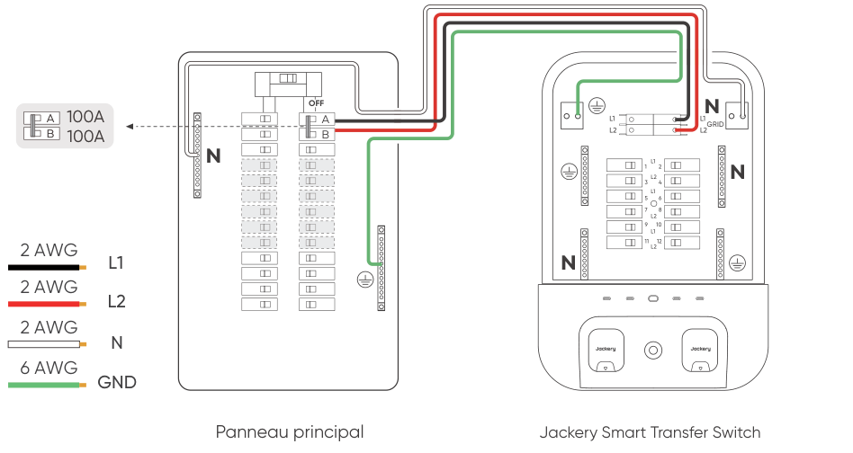
</figure>

#### Raccordement des Conducteurs de Charge de la Maison

* La charge domestique peut être connectée simultanément à des circuits de 120V et 240V, avec un maximum de 12 circuits pour 120V et 6 circuits pour 240V.

<ol class="native-steps"><li>À partir du panneau principal, sélectionnez un circuit de dérivation qui sera alimenté par l'Smart Transfer Switch pendant une panne de courant. En l'absence de panne de courant, les circuits sélectionnés seront alimentés par le service public.</li><li>Coupez le disjoncteur sélectionné dans le panneau principal.</li><li>Retirer le fil chaud du disjoncteur sélectionné.</li><li>Retirez le fil NEUTRE du circuit sélectionné de la barre omnibus NEUTRE.</li><li>Retirez le fil de TERRE du circuit sélectionné de la barre de terre.</li><li>Connectez le fil HOT retiré du panneau principal au disjoncteur de l'Smart Transfer Switch.</li><li>Connecter le fil NEUTRE retiré du panneau principal à la barre omnibus neutre de l'Smart Transfer Switch.</li><li>Le fil de terre du panneau électrique n’a pas besoin d’être connecté au STS.</li><li>Étiqueter le disjoncteur sur le couvercle de l'Smart Transfer Switch.</li><li>Répéter pour chaque circuit.</li></ol>

<figure class="hb-reference-figure" data-component-id="HB-SPECIAL-REFERENCE-FIGURE" data-reference-id="load-wiring" data-source-fragment-sha256="f6c721d6ab9db793ccaa252c6858d4d521e24080d4645c7b93f011d715ff0da2" data-step-captions="embedded">
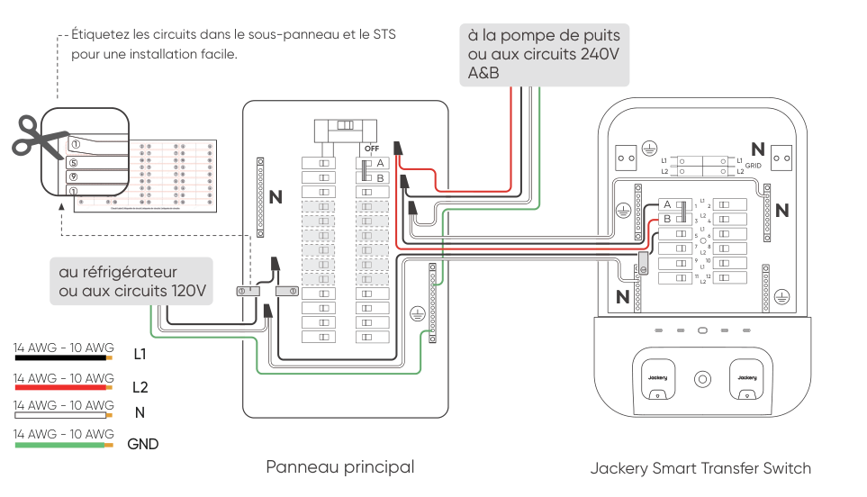
</figure>

<strong>Couple de Serrage du Conducteur</strong>

<table class="manual-table native-print-grid native-torque"><thead><tr><th class="native-head-regular" scope="col">Grille</th><th class="native-head-regular" scope="col">Couple</th><th class="native-head-regular" scope="col">Longueur de la bande</th><th class="native-head-regular" scope="col">Chargement à domicile</th><th class="native-head-regular" scope="col">Couple</th><th class="native-head-regular" scope="col">Longueur de la bande</th></tr></thead><tbody><tr><td>L1</td><td>30.98 In-lbs/3.5 N-m</td><td>0.47" (12 mm)</td><td>L1</td><td>20.36 In-lbs/2.3 N-m</td><td>0.39" (10 mm)</td></tr><tr><td>L2</td><td>30.98 In-lbs/3.5 N-m</td><td>0.47" (12 mm)</td><td>L2</td><td>20.36 In-lbs/2.3 N-m</td><td>0.39" (10 mm)</td></tr><tr><td>N</td><td>46.02 In-lbs/5.2 N-m</td><td>0.47" (12 mm)</td><td>N</td><td>17.7 In-lbs/2.0 N-m</td><td>0.47" (12 mm)</td></tr><tr><td>GND</td><td>46.02 In-lbs/5.2 N-m</td><td>0.79" (20 mm)</td><td>GND</td><td>17.7 In-lbs/2.0 N-m</td><td>0.47" (12 mm)</td></tr></tbody></table>

#### Installer le bouton d'arrêt d'urgence (optionnel)

<strong>* Assurez-vous d'acheter un bouton d'arrêt d'urgence normalement ouvert.</strong> Installez dans un endroit extérieur facilement accessible. Cela permet de déconnecter immédiatement l'alimentation du circuit de charge STS en cas d'urgence.

<figure class="hb-reference-figure" data-component-id="HB-SPECIAL-REFERENCE-FIGURE" data-reference-id="external-emergency-stop" data-source-fragment-sha256="7b9bb31bd97f3ecc8c0748b221fa57cb2972b1f1a72f431655f244e445c0d1c9" data-step-captions="embedded">
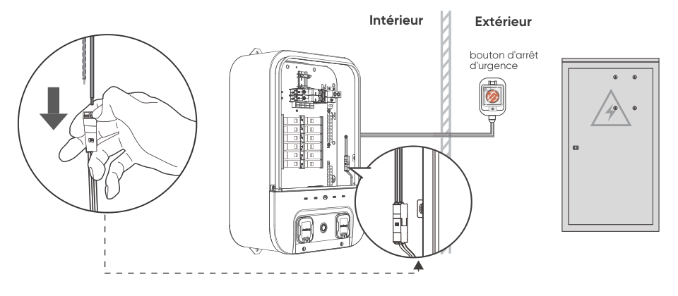
</figure>

#### Installation du Couvercle de la Façade

Avertissement * Vérifier que toutes les connexions sont correctes et sûres, et qu'elles sont correctement mises à la terre. * Vérifier que toutes les vis sont bien serrées. * Utilisez un multimètre en réglage de continuité pour vous assurer que le fil chaud n'est pas court-circuité au neutre. * Utilisez un multimètre en réglage de continuité pour vous assurer que le fil chaud n'est pas court-circuité à la terre.

Tout d'abord, retirez les torsades pour les charges domestiques, remplissez les espaces libres inutilisés sur le couvercle, puis serrez les vis pour fixer le front de taille.

<figure class="hb-reference-figure" data-component-id="HB-SPECIAL-REFERENCE-FIGURE" data-reference-id="deadfront-installation" data-source-fragment-sha256="829e139b22235846c0439a46721b39cffeb5620fd51a20f66ebe630342c58b84" data-step-captions="embedded">
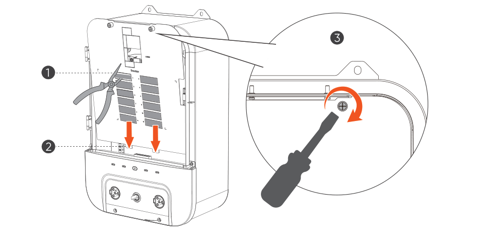
</figure>

#### Connexion avec la centrale électrique

Pour Jackery Explorer 5000 Plus (Max. 2 unités)

<figure class="hb-reference-figure" data-component-id="HB-SPECIAL-REFERENCE-FIGURE" data-reference-id="power-station-connections" data-source-fragment-sha256="4b5a3d2c649b32de9c62a7389bc72d6dcf7531752d2bb63deb91f7b2c48476c3" data-step-captions="embedded">
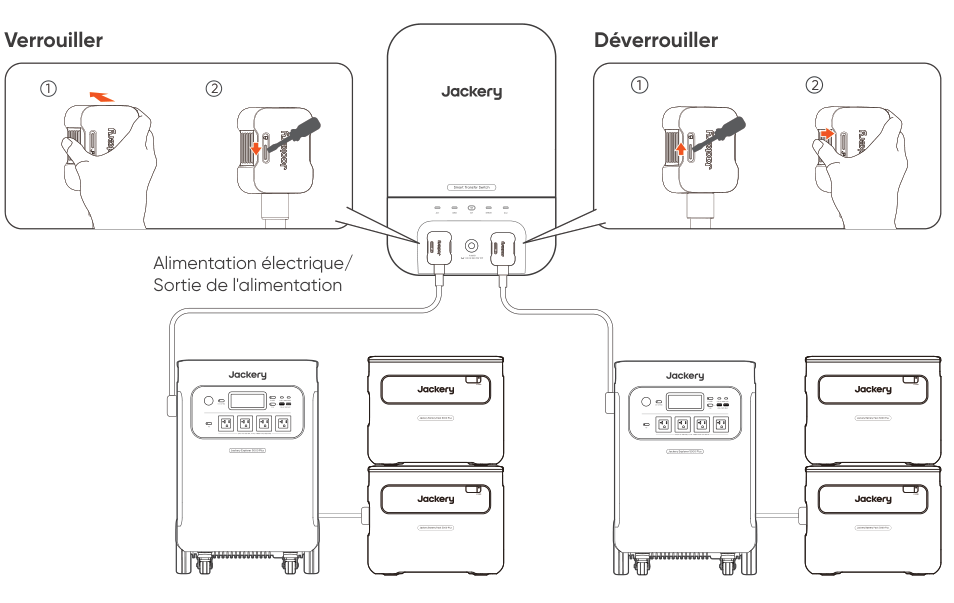
</figure>

#### Energiser

Avant la mise sous tension, assurez-vous que les disjoncteurs principaux et de dérivation sont en position d'arrêt. Pour mettre l'appareil sous tension, il faut enclencher le disjoncteur principal, puis le disjoncteur de chaque circuit de dérivation.

#### Verrouillage du panneau

<figure class="hb-reference-figure" data-component-id="HB-SPECIAL-REFERENCE-FIGURE" data-reference-id="locking-panel" data-source-fragment-sha256="b7a52d6231d49a5f34bfc8360d5fae174ad4bc160a53fed866fa3deb756091cd">
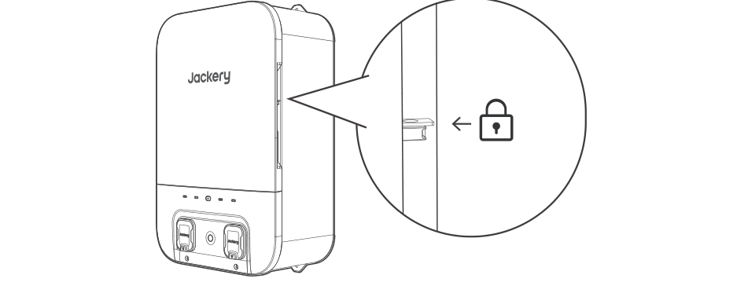
</figure>

## Briseurs recommandés

Disjoncteurs 15A, disjoncteurs 20A, disjoncteurs; pas de disjoncteurs tandem ou quadruples. Marques et modèles de disjoncteurs compatibles : GE - THQL, Siemens - Tipo QP, Square D-HOM, Eaton-BR Le STS n'est pas compatible avec les disjoncteurs à neutre enfichable.

## UTILISATION DE L’APPLICATION JACKERY

### Pour télécharger l’application et se connecter

<figure aria-label="App Store et Google Play" class="hb-app-download-composition" data-component-id="HB-SPECIAL-APP">

Méthode 1 : Recherchez « Jackery » dans Google Play ou dans l’App Store pour installer l’application. Une fois que c’est fait, vous pouvez vous inscrire et vous connecter.

Vous pouvez également scanner le code QR ci-dessous pour télécharger et installer l'application.

</figure>

### Pour ajouter un appareil

<ol class="native-steps"><li>Appuyez sur le bouton IoT pour activer le Wi-Fi et le Bluetooth. Le voyant IoT se mettra à clignoter.</li></ol>
Clignotant - prêt à se connecter Fixe - connecté avec succès

<figure class="hb-reference-figure" data-component-id="HB-SPECIAL-REFERENCE-FIGURE" data-reference-id="iot-pairing" data-source-fragment-sha256="546c9873b7bff3bfb9f3e94b2db33e055e2cdb20205d149f030d4569d921d437" data-step-captions="embedded">
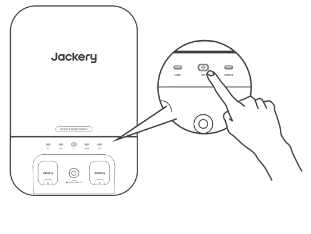
</figure>

<ol class="native-steps" start="2"><li>Appuyez sur  dans l'application pour ajouter votre appareil. L’application pourra ainsi se connecter aux appareils à proximité et activer les autorisations Bluetooth.</li></ol>

<figure class="hb-reference-figure" data-component-id="HB-SPECIAL-REFERENCE-FIGURE" data-reference-id="app-add-device" data-source-fragment-sha256="d00d1798950fe777672939b1d98d78a384ba30edab7f42c7cb29eb2a6112130b" data-step-captions="embedded">
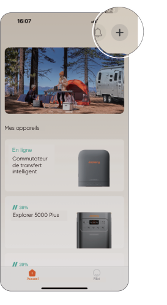
</figure>

<ol class="native-steps" start="3"><li>Appuyez sur l’icône du Smart Transfer Switch dans l’application pour accéder à la page principale et connecter l’appareil au réseau Wi-Fi.</li></ol>

<figure class="hb-reference-figure" data-component-id="HB-SPECIAL-REFERENCE-FIGURE" data-reference-id="app-wifi" data-source-fragment-sha256="fe2ec64c06992c2c3adce81cb308581080c67783a3c9642dcb100c9bd20d9ae8" data-step-captions="embedded">
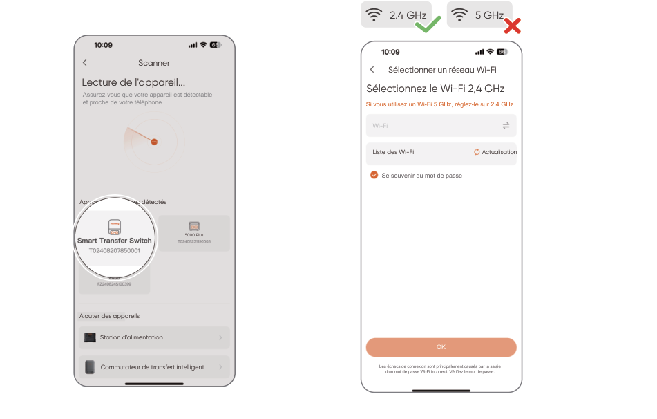
</figure>

### Configuration de tension

<ol class="native-steps"><li>Appuyez sur  sur la page principale du STS.</li> <li>Sélectionnez Configuration de tension </li></ol>

<figure class="hb-reference-figure" data-component-id="HB-SPECIAL-REFERENCE-FIGURE" data-reference-id="app-voltage-menu" data-source-fragment-sha256="c4f689d561f73cce4a5b11d32940701f6d27f87fda6026fe8df42628e832b373" data-step-captions="embedded">
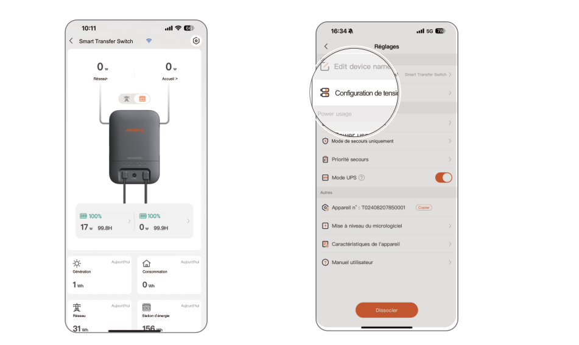
</figure>

<ol class="native-steps" start="3"><li>Appuyez sur  dans le coin supérieur droit, puis sur  pour régler la tension à 240 V selon la connexion réelle du circuit du STS. Enfin appuyez sur  pour enregistrer les paramètres.</li></ol>

<figure class="hb-reference-figure" data-component-id="HB-SPECIAL-REFERENCE-FIGURE" data-reference-id="app-voltage-settings" data-source-fragment-sha256="d8016e793e5cbd18de050d2668588850944c3b0202526873a323cfd859442032" data-step-captions="embedded">
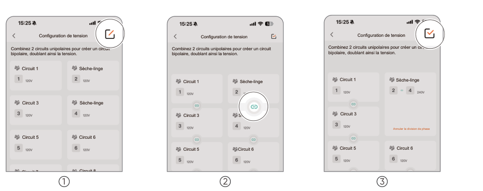
</figure>

### Modifier le nom du circuit

<ol class="native-steps"><li>Appuyez sur « circuits » sur la page principale du STS pour accéder à la page principale des circuits.</li></ol>

<figure class="hb-reference-figure" data-component-id="HB-SPECIAL-REFERENCE-FIGURE" data-reference-id="app-circuit-list" data-source-fragment-sha256="2133f2d19f2ab0de5f748c3f6fcf4c0195de972e1fbe2d59ddb768f1e3037b57" data-step-captions="embedded">
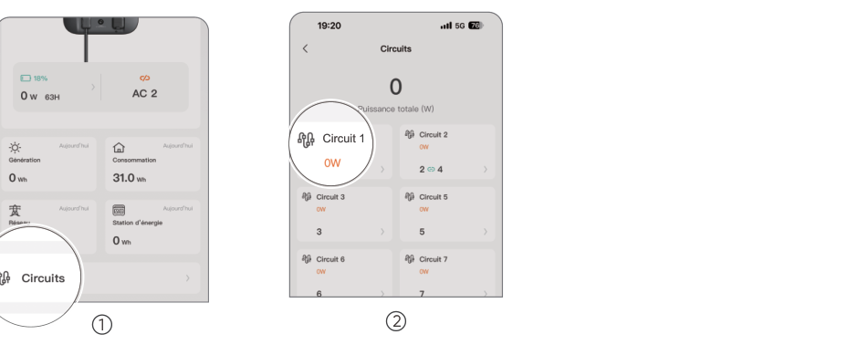
</figure>

<ol class="native-steps" start="2"><li>Sélectionnez le circuit souhaité et appuyez sur  pour modifier son nom.</li></ol>

<figure class="hb-reference-figure" data-component-id="HB-SPECIAL-REFERENCE-FIGURE" data-reference-id="app-circuit-name" data-source-fragment-sha256="bfc3772575f68539a5bb45ddbeb548a280a6c1f1a1548d2ec2461d623c197051" data-step-captions="embedded">
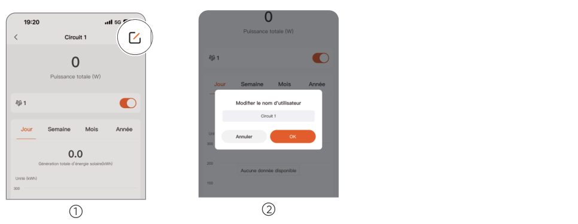
</figure>

## GUIDE DE DÉMARRAGE RAPIDE DE L'APPLICATION JACKERY

### Tableau de bord

<figure class="hb-reference-figure" data-component-id="HB-SPECIAL-REFERENCE-FIGURE" data-reference-id="app-dashboard" data-source-fragment-sha256="84a00af3ca2441e1c1639ba0f31531cad287439abf21dbdf0abef5a8dd326923">
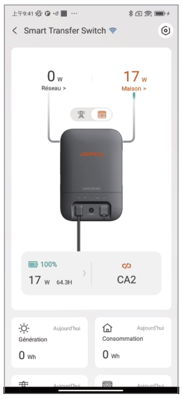
</figure>

<ul class="native-bullets"><li>Affichez et surveillez en temps réel la consommation d'énergie de la maison, de la station d'énergie et du réseau.</li><li>Affichez l'alimentation électrique actuelle de la maison.</li><li>Basculez manuellement l'alimentation de la maison vers la station d'énergie dans les conditions suivantes :</li></ul><ol class="native-steps"><li>La batterie de la station d'énergie dépasse la réserve de secours.</li><li>Le mode « alimentation de secours » est désactivé.</li></ol><ul class="native-bullets"><li>Production d'énergie solaire quotidienne et consommation d'électricité de la maison.</li></ul>

### Circuits

<figure class="hb-reference-figure" data-component-id="HB-SPECIAL-REFERENCE-FIGURE" data-reference-id="app-circuits" data-source-fragment-sha256="eac75e8a6e993ed29ba74633a0e2020dda2914c0a2dc2ce5834c645bb8f28110">
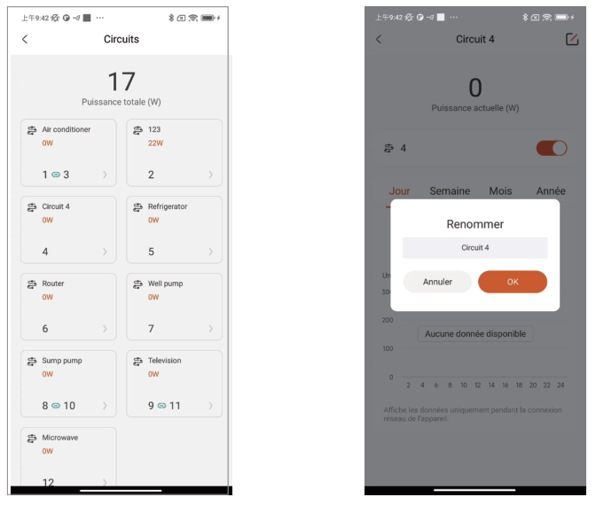
</figure>

Allumer ou éteindre manuellement chaque circuit domestique, les renommer et consulter l'historique de la consommation d'énergie de chaque circuit.

### Modes de fonctionnement

<figure class="hb-reference-figure" data-component-id="HB-SPECIAL-REFERENCE-FIGURE" data-reference-id="app-working-modes" data-source-fragment-sha256="804735a18176988f2feb1ab3b587cd84475967d8871520f9839cbf6cbc2fa225">
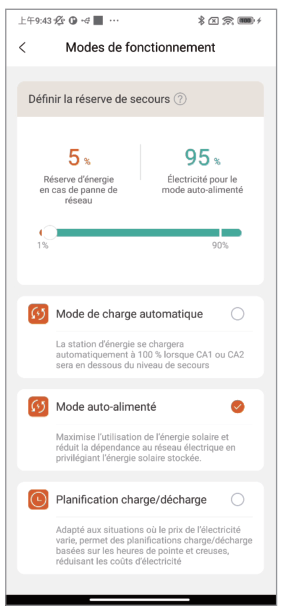
</figure>

<h3>Définir la réserve de secours</h3>
Lorsque la station d'énergie est en décharge, la batterie se déchargera jusqu'à ce qu'elle atteigne la réserve de secours. En cas de panne de courant, elle se déchargera jusqu'à ce qu'elle atteigne la limite de décharge (0 %). Vous pouvez modifier le niveau dans Paramètres &gt; Modes de fonctionnement. * La configuration de la réserve de secours prendra effet dans n'importe quel mode. * En cas de panne de courant, le niveau de réserve de secours se déchargera jusqu'à 0 % dans n'importe quel mode.
<h3>Mode de charge automatique</h3>
Il est couramment utilisé pour l'alimentation de secours quotidienne à domicile. <strong>La station d'énergie se rechargera automatiquement à 100 % lorsque AC1 ou AC2 est inférieur à la réserve de secours.</strong>

#### Mode auto-alimenté

Maximisez l'utilisation de l'énergie solaire pour votre maison. Dans ce mode, la station d'énergie se recharge exclusivement à l'aide de l'énergie solaire. Elle commencera à fournir de l'énergie à la maison deux heures après avoir atteint une charge complète. Si elle n'est pas complètement chargée, elle ne fournira de l'énergie à la maison que pendant la nuit.

#### Planification charge/décharge

Adapté aux situations avec des taux d'électricité fluctuants, permet des plans de charge-décharge basés sur les périodes de pointe et de creux, réduisant ainsi les coûts d'électricité. Tâche de charge : Définissez la période de charge. Tâche de décharge : Définissez la période de décharge. Dans cette période, si les batteries dépassent la réserve de secours, elles se déchargeront. Lorsque la station d'énergie est connectée à le Smart Transfer Switch, elle désactive temporairement les modes Économie de batterie, Arrêt automatique, Économie d'énergie, Charge silencieuse, et Plan de charge.

### Mode alimentation de secours

<figure class="hb-reference-figure" data-component-id="HB-SPECIAL-REFERENCE-FIGURE" data-reference-id="app-backup-only" data-source-fragment-sha256="6c19e5777e661916d54ab011bdd9bb152475c320aa4a59c07b74cc6bcb740734">
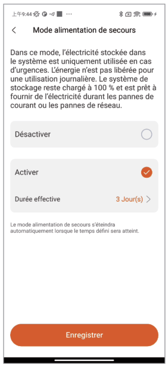
</figure>

Lorsque le mode alimentation de secours est activé, le réseau électrique alimentera la maison tout en chargeant complètement la station d'énergie, qui fournira de l'énergie uniquement lors d'une panne de courant. Le plan de charge-décharge et le mode auto-alimenté seront temporairement désactivés. La commutation manuelle vers la station d'alimentation n'est pas disponible en mode secours uniquement.

### Priorité secours

<figure class="hb-reference-figure" data-component-id="HB-SPECIAL-REFERENCE-FIGURE" data-reference-id="app-backup-priority" data-source-fragment-sha256="1cf6c296165f8200bc377aa108e0011c72b46eb127e45bea991d4ce18a25f273">
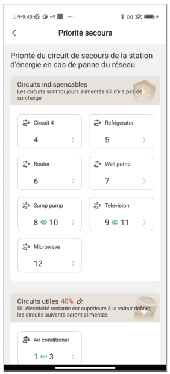
</figure>

En cas de panne de courant, le système priorise l'alimentation en énergie de la batterie pour les circuits domestiques. Classez vos circuits domestiques en 3 catégories : circuits indispensables, circuits utiles et sans alimentation. Priorités des circuits
<ol class="native-steps"><li>Circuits indispensables : Tant qu'il y a de l'énergie dans les batteries, elle sera fournie à ces circuits.</li><li>Circuits utiles : Ces circuits seront alimentés lorsque le niveau de la batterie sera égal ou supérieur au pourcentage que vous avez défini.</li><li>Circuits non indispensables : Ces circuits ne seront pas alimentés en utilisant l'énergie de la batterie lors d'une panne de courant.</li></ol>

### Mode UPS

<figure class="hb-reference-figure" data-component-id="HB-SPECIAL-REFERENCE-FIGURE" data-reference-id="app-ups-mode" data-source-fragment-sha256="dda1e72110d71b672258652ff290cda30d5adaea319e567cbb684ef02264088a">
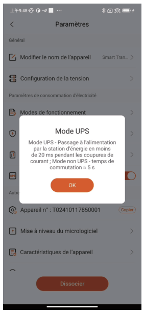
</figure>

Lorsque le mode UPS est activé, en cas de panne de courant, le STS basculera automatiquement sur l'alimentation de la station d'énergie dans un délai de 20 ms ; si le STS est en train de charger la station d'énergie à ce moment-là, le temps de commutation sera supérieur à 20 ms, et une fois le courant rétabli, il rebasculera automatiquement sur l'alimentation du réseau. En mode non-UPS, le temps de commutation est d'environ 5 secondes seulement si la station d'énergie est allumée. * Le STS restera allumé lorsqu'il est connecté à la station d'énergie, il est donc recommandé de ne pas éteindre manuellement la station d'énergie.

## GARANTIE

<figure aria-label="GARANTIE" class="hb-warranty-intro-composition" data-component-id="HB-WARRANTY-LEAD">
Nous ne fournissons notre garantie qu'aux clients qui achètent sur le site Web officiel de Jackery, sur des plateformes tierces portant la marque Jackery ou auprès de revendeurs locaux agréés.

* La période de garantie et les détails peuvent varier en fonction des lois et réglementations locales et des revendeurs agréés.
</figure>

### Garantie limitée

<figure aria-label="Garantie limitée" class="hb-warranty-card" data-component-id="HB-WARRANTY-SECTION" data-warranty-card-index="1">
Jackery Inc. garantit à l'acheteur et consommateur d'origine que le produit de Jackery sera exempt de tout défaut de fabrication et de matériaux dans le cadre d'une utilisation normale pendant toute la durée de la période de garantie applicable identifiée dans la section « Période de garantie » ci-dessous, sous réserve des exceptions énoncées ci-dessous. Cette déclaration de garantie énonce les obligations totales et exclusives de garantie de Jackery. Nous n'assumerons pas et nous n'autorisons personne à assumer pour nous toute autre responsabilité en lien avec la vente de nos produits.
</figure>

### Période de garantie

<figure aria-label="Période de garantie" class="hb-warranty-card" data-component-id="HB-WARRANTY-SECTION" data-warranty-card-index="2">
Garantie standard de 5 ans : La période de garantie standard pour le Jackery Smart Transfer Switch est de 5 ans. Dans tous les cas, la période de garantie commence à compter de la date d'achat par l'acheteur et consommateur d'origine. La facture du premier achat du consommateur ou toute autre preuve documentaire raisonnable est nécessaire afin d'établir la date de début de la période de garantie.
</figure>

### Réparation ou remplacement

<figure aria-label="Réparation ou remplacement" class="hb-warranty-card" data-component-id="HB-WARRANTY-SECTION" data-warranty-card-index="3">
Jackery réparera ou remplacera (aux frais de Jackery) tout produit Jackery qui ne fonctionne pas pendant la période de garantie applicable en raison d'un défaut de fabrication ou de matériau. Le produit réparé/remplacé bénéficie de la garantie restante de la date d'achat initiale.
</figure>

### Limitée à l'acheteur et consommateur d'origine

<figure aria-label="Limitée à l'acheteur et consommateur d'origine" class="hb-warranty-card" data-component-id="HB-WARRANTY-SECTION" data-warranty-card-index="4">
La garantie d'un produit Jackery est limitée à l'acheteur et consommateur d'origine, elle ne peut pas être transférée à un autre propriétaire.
</figure>

### Exclusions

<figure aria-label="Exclusions" class="hb-warranty-card" data-component-id="HB-WARRANTY-SECTION" data-warranty-card-index="5">
La garantie de Jackery ne s'applique pas à : Une utilisation incorrecte, abusée, modifiée, aux dégâts provoqués par un accident ou toute autre utilisation qui n'est pas une utilisation normale de ce produit et autorisée par la documentation actuelle du produit de Jackery. À une réparation tentée par quelqu'un d'autre qu'un établissement agréé. Tout autre produit acheté par l'intermédiaire d'une vente aux enchères en ligne. La garantie de Jackery ne s'applique pas aux cellules de la batterie, sauf si vous avez entièrement chargé les cellules de la batterie dans les sept jours suivant l'achat du produit et au moins une fois tous les 6 mois par la suite.
</figure>

### Droits d'interprétation

<figure aria-label="Droits d'interprétation" class="hb-warranty-card" data-component-id="HB-WARRANTY-SECTION" data-warranty-card-index="6">
Jackery Inc. se réserve le droit d'interprétation finale de la politique après-vente des clients susmentionnés.
</figure>
