

## SAFETY INSTRUCTIONS

### Disclaimer

Congratulations on your new Jackery Smart Transfer Switch. Please read this manual carefully before using the product, particularly the relevant precautions to ensure proper use. Keep this manual in an accessible place for further reference. In compliance with laws and regulations, the right of final interpretation of this document and all related documents of this product resides with the Company. Please kindly notice that no further notifications will be given in case of any update, revision, or termination.

### Warning

<ol class="native-steps"><li>The installation or servicing of this product should only be performed by qualified electrical personnel.</li><li>Prior to installation, operation, or servicing of this product, carefully read the instruction manual.</li><li>Installation of this product must conform to local standards, national electrical safety standards, and the manufacturer's instructions.</li><li>Specifications of self-provided cables should meet the requirements of the Installation Guide and comply with local regulations.</li><li>The AC cables are high-voltage cables. Risk of death or serious injury due to electric shock.</li><li>There is a high possibility of electric shock or serious burns due to the high voltage in the product.</li><li>Use appropriate personal protective equipment (PPE) and follow safe electrical work practices.</li><li>Do not touch exposed wires with your hands.</li><li>Be cautious to prevent injury when moving heavy objects. Wear personal protective equipment such as protective gloves and shoes when manually moving the product.</li><li>Do not install or operate the equipment in extreme weather events such as lightning, snow, heavy rain, strong wind, etc.</li><li>Do not install or operate the product in an area where flammable or explosive materials are stored.</li><li>Inspect the product and cables for damage before installing. Do not install the product or cables if damaged in any way.</li><li>Turn off all power supplying this product before installation. Disconnect each circuit individually before servicing.</li><li>Always use a properly rated voltage-sensing device to confirm the power is off.</li><li>During the drilling process, cover the interior product to prevent debris from falling into the product, and clear the debris after drilling to prevent interference with the equipment.</li><li>Do not damage, smear, or cover any warning labels on the device. All labels must be visible after installation.</li><li>Before operating the product, check the electrical connections to ensure that the product is reliably and permanently grounded.</li><li>Do not place any kind of objects on top of the product during operation.</li><li>To completely de-energize the product, ensure all main breakers and branch breakers are turned off and physically unplug all loads. Failure to do so may pose a risk of electric shock.</li><li>Do not place or install flammable or potentially explosive objects near the product or in explosive atmospheres.</li><li>Do not insert foreign objects into any part of the equipment.</li><li>Do not connect life-support systems, medical equipment, or any other equipment used where product failure could lead to injury to persons or loss of life to circuits that can be remotely switched.</li><li>Install the product in a location that prevents damage from flooding. Ensure that no water sources are above or near the product, including downspouts, sprinklers, or faucets.</li><li>If needed, replace all devices, doors, and covers before turning on the power.</li></ol>

### Caution

<ol class="native-steps"><li>In the case of cable damage, it must be replaced by the manufacturer, customer service, or qualified personnel to prevent a safety hazard.</li><li>Do not use solvents to clean the product.</li><li>The product must be disposed of according to local codes and regulations.</li><li>This product is not intended to be used as a service disconnect.</li><li>Do not use parts or accessories other than those specified for use with the product.</li><li>When installing the product, the screws need to be tightened according to the specification torque using a special tool.</li><li>Keep out of reach of children or animals.</li><li>This product is designed for residential use only.</li></ol>

### FCC Statement

This device complies with part 15 of the FCC Rules. Operation is subject to the following two conditions: (1) This device may not cause harmful interference, and (2) this device must accept any interference received, including interference that may cause undesired operation. MODIFICATION: Any changes or modifications not expressly approved by the grantee of this device could void the user’s authority to operate the device. NOTE: This equipment has been tested and found to comply with the limits for a Class B digital device, pursuant to part 15 of the FCC Rules. These limits are designed to provide reasonable protection against harmful interference in a residential installation. This equipment generates, uses and can radiate radio frequency energy and, if not installed and used in accordance with the instructions, may cause harmful interference to radio communications. However, there is no guarantee that interference will not occur in a particular installation. If this equipment does cause harmful interference to radio or television reception, which can be determined by turning the equipment off and on, the user is encouraged to try to correct the interference by one or more of the following measures: --Reorient or relocate the receiving antenna. --Increase the separation between the equipment and receiver. --Connect the equipment into an outlet on a circuit different from that to which the receiver is connected. --Consult the dealer or an experienced radio/TV technician for help.

### IC Warning

This device complies with Industry Canada licence-exempt RSS standard(s). Operation is subject to the following two conditions: (1) this device may not cause interference, and (2) this device must accept any interference, including interference that may cause undesired operation of the device. This Class B digital apparatus complies with Canadian lCES-003.

IC RF Statement: When using the product, maintain a distance of 20 cm from the body to ensure compliance with RF exposure requirements.

<ul class="native-bullets"><li>INGESTION HAZARD: This product contains a button cell or coin battery.</li><li>DEATH or serious injury can occur if ingested.</li><li>A swallowed button cell or coin battery can cause Internal Chemical Burns in as little as 2 hours.</li><li>KEEP new and used batteries OUT OF REACH of CHILDREN.</li><li>Seek immediate medical attention if a battery is suspected to be swallowed or inserted inside any part of the body.</li></ul>

### Meaning of symbols

The following tables explain the meaning of the symbols used in the instruction manual and its packaging.

<table class="manual-table native-print-grid native-symbols native-fit"><thead><tr><th scope="col">Symbol</th><th scope="col">Meaning</th></tr></thead><tbody><tr><td class="native-symbol-cell"></td><td>The position for connecting the protection ground cable.</td></tr><tr><td class="native-symbol-cell"></td><td>Caution, risk of danger.</td></tr><tr><td class="native-symbol-cell"></td><td>Caution, risk of electric shock.</td></tr><tr><td class="native-symbol-cell"></td><td>Refer to the operation instructions.</td></tr></tbody></table>

## SPECIFICATIONS

<table class="manual-table native-spec-rules native-fit"><tbody><tr><td>Product Name</td><td>Jackery Smart Transfer Switch</td></tr><tr><td>Model No.</td><td>JA-TS02A</td></tr><tr><td>AC Voltage (Nominal)</td><td>120V/240V~ 60Hz</td></tr><tr><td>Feed-In Type</td><td>Split Phase</td></tr><tr><td>Maximum Input Current</td><td>100A Grid / 60A Power Station</td></tr><tr><td>Maximum Output Current</td><td>60A Home Load / 33.4A Power Station</td></tr><tr><td>Maximum Input Short-Circuit Current</td><td>10KA</td></tr><tr><td>Overvoltage Category</td><td>IV</td></tr><tr><td>UPS</td><td>≤20ms</td></tr><tr><td>Enclosure Type (Distribution Panel)</td><td>NEMA Type 1</td></tr><tr><td>Number of Load Branches</td><td>12</td></tr><tr><td>Main Circuit</td><td>2 AWG</td></tr><tr><td>Branch Circuit</td><td>14 AWG 12 AWG 10 AWG</td></tr><tr><td>Communication</td><td>Wi-Fi and Bluetooth</td></tr><tr><td>Operating Temperature</td><td>-20°C~40°C (-4°F~104°F)</td></tr><tr><td>Dimensions</td><td>22 x 14.7 x 7.87 in/56 x 37.4 x 20 cm</td></tr><tr><td>Weight</td><td>About 25.57 lbs/11.6 kg</td></tr></tbody></table>

* When using the product, ensure it is connected to a 240V split phase mains voltage.

## PACKAGE LIST

<figure class="hb-reference-figure" data-component-id="HB-SPECIAL-REFERENCE-FIGURE" data-reference-id="package-list" data-source-fragment-sha256="e3a756e64227f70d159fa49ba746aa3ebdd3e3e8dce95ce4d5d70c01b8fdb08c" data-step-captions="embedded">
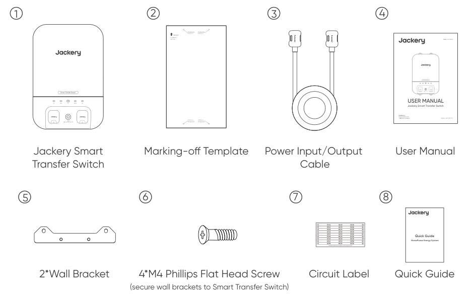
</figure>

## WHAT YOU NEED

<figure class="hb-reference-figure" data-component-id="HB-SPECIAL-REFERENCE-FIGURE" data-reference-id="optional-tools" data-source-fragment-sha256="e4abc777d194fa450fdd4bc40548ee6bbbba35e1ac4cd5940d03d1f1531a3be3" data-step-captions="embedded">
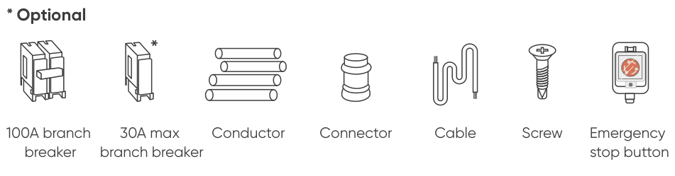
</figure>

### Optionals

<table class="manual-table native-print-grid native-cables"><thead><tr><th colspan="2" scope="col">Cables</th><th scope="col">Color</th><th scope="col">Current</th><th scope="col">Gauge</th></tr></thead><tbody><tr><td class="native-cable-group" rowspan="4">For Grid to Electrical Panel</td><td>L1</td><td class="native-wire native-wire-black">Black</td><td rowspan="4">100A Max</td><td>2 AWG</td></tr><tr><td>L2</td><td class="native-wire native-wire-red">Red</td><td>2 AWG</td></tr><tr><td>N</td><td class="native-wire native-wire-white">White</td><td>2 AWG</td></tr><tr><td>GND</td><td class="native-wire native-wire-green">Green</td><td>6 AWG</td></tr><tr><td class="native-cable-group" rowspan="4">For Home Loads to 12 Branch Circuits</td><td>L1</td><td class="native-wire native-wire-black">Black</td><td rowspan="4">30A Max</td><td>14 AWG -10 AWG</td></tr><tr><td>L2</td><td class="native-wire native-wire-red">Red</td><td>14 AWG -10 AWG</td></tr><tr><td>N</td><td class="native-wire native-wire-white">White</td><td>14 AWG -10 AWG</td></tr><tr><td>GND</td><td class="native-wire native-wire-green">Green</td><td>14 AWG -10 AWG</td></tr><tr><td class="native-cable-group">Emergency Stop Circuit (Connect to Emergency Stop Button)</td><td>/</td><td>/</td><td>2A Max</td><td>24 AWG</td></tr></tbody></table>

* An 100-amp, 2-pole branch breaker is needed for the home districution panel. * Max. 30-amp branch breakers for home loads.

## PRODUCT OVERVIEW

### Dimensions

<figure class="hb-reference-figure" data-component-id="HB-SPECIAL-REFERENCE-FIGURE" data-reference-id="dimensions" data-source-fragment-sha256="e61f24ec2c339b1a7ae3acca2cb4cfcdfbfe58da791ecf748a988a18d7f62172" data-step-captions="embedded">
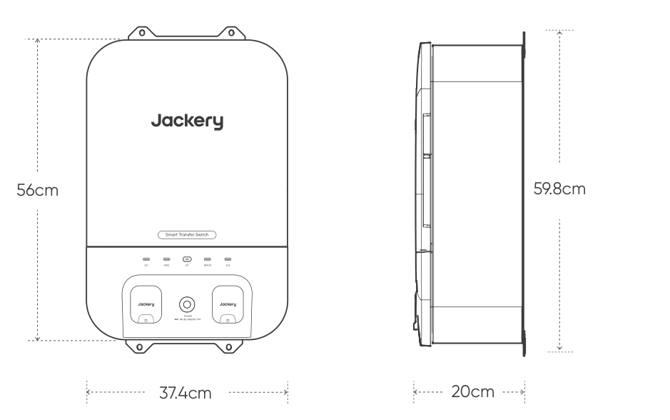
</figure>

* The figures are for reference purposes only, please refer to the actual product.

### With Deadfront Cover Installed

<figure class="hb-reference-figure" data-component-id="HB-SPECIAL-REFERENCE-FIGURE" data-reference-id="covered-overview" data-source-fragment-sha256="d9345d2ae845c89882a0b6eb32df5dfeb1eda899a807e3712ec2461541a24812" data-step-captions="embedded">
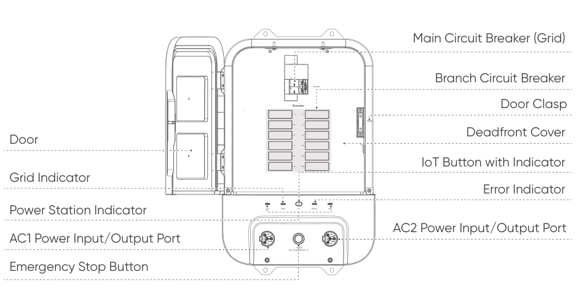
</figure>

#### IoT Button with Indicator

<ul class="native-bullets"><li>Short-press the button to turn on/off the Bluetooth and Wi-Fi.</li><li>Long press and hold the button for 5 sec to reset the Bluetooth and Wi-Fi (the Smart Transfer Switch will retain the previous settings).</li></ul>

*If Wi-Fi and Bluetooth are not paired within two hours, they will automatically turn off.

#### Emergency Stop Button

In case of emergency, this button can be manually activated to shut off output of the entire system immediately.

### LED Indicators

<table class="manual-table native-print-grid native-led"><thead><tr><th scope="col">Indicator</th><th scope="col">Status</th><th scope="col">Description</th></tr></thead><tbody><tr><td class="native-led-name" rowspan="3">Grid Indicator</td><td>Flashing Blue</td><td>Grid power present, not supplying home loads</td></tr><tr><td>Solid Blue</td><td>Grid power supplying home loads</td></tr><tr><td>Off</td><td>No grid power</td></tr><tr><td class="native-led-name" rowspan="3">Power Station Indicator (AC1/AC2)</td><td>Flashing Green</td><td>Power station connected &amp; on standby, not supplying power to home loads</td></tr><tr><td>Solid Green</td><td>power station connected and supplying power to home loads. In STS, power supply to home loads depends on commissioning settings.</td></tr><tr><td>Off</td><td>Power Station not connected</td></tr><tr><td class="native-led-name" rowspan="3">IoT Indicator</td><td>Flashing Green</td><td>Wi-Fi &amp; Bluetooth on, not paired</td></tr><tr><td>Solid Green</td><td>Wi-Fi &amp; Bluetooth on, paired</td></tr><tr><td>Off</td><td>Wi-Fi &amp; Bluetooth off</td></tr><tr><td class="native-led-name" rowspan="2">Error Indicator</td><td>Solid Red</td><td>Product malfunction</td></tr><tr><td>Off</td><td>Normal operation</td></tr></tbody></table>

### With Deadfront Cover Removed

<figure class="hb-reference-figure" data-component-id="HB-SPECIAL-REFERENCE-FIGURE" data-reference-id="uncovered-overview" data-source-fragment-sha256="82d034ad0a780b61e12ba881f466e40fe59252cae4c6a8a3f734a7c38e7c4f32" data-step-captions="embedded">
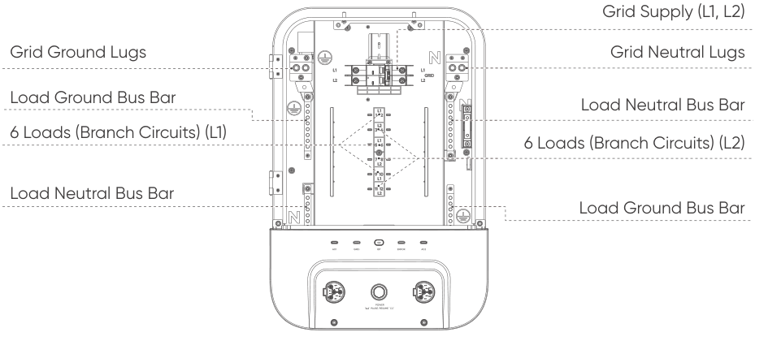
</figure>

#### Normal Backup Mode

The UPS function is disabled by default. In the event of a power outage, the portable power station will automatically power your home loads with the stored power within 5 seconds. Once grid power is restored, the system automatically switches back to grid supply.

<table class="manual-callout-table manual-callout-table hb-callout-label-shaded"><tbody><tr><td class="manual-callout-label">CAUTION</td><td class="manual-callout-body">
The power station must remain turned on; otherwise, the STS cannot switch to battery power after an outage.
</td></tr></tbody></table>

#### UPS Mode

In this mode, the UPS function is enabled. During a power outage, the system automatically switches to battery power within 20 milliseconds.

<ul class="native-bullets"><li>The portable power station remains active at all times and continuously consumes a small amount of power, even when not in use.</li><li>If the power station is being charged by the STS, the switch time may exceed 20 milliseconds.</li><li>Once grid power is restored, the system automatically switches back to grid supply.</li></ul>

<table class="manual-callout-table manual-callout-table hb-callout-label-shaded"><tbody><tr><td class="manual-callout-label">CAUTION</td><td class="manual-callout-body">
The UPS function can only work if the STS is successfully connected to the Jackery Explorer 5000 Plus or Jackery HomePower 5000 Plus.Before using the UPS mode, please ensure:
<ol class="native-steps"><li>The UPS function is enabled in the Jackery App.</li><li>The portable power station is turned on and not charging.</li></ol></td></tr></tbody></table>

## PRE-INSTALLATION

### System Overview

<figure class="hb-reference-figure" data-component-id="HB-SPECIAL-REFERENCE-FIGURE" data-reference-id="system-overview" data-source-fragment-sha256="485fb9304b1dc5b697c77d7e16b542b559051f380d48f87d5136b48cb2bd9b17" data-step-captions="embedded">
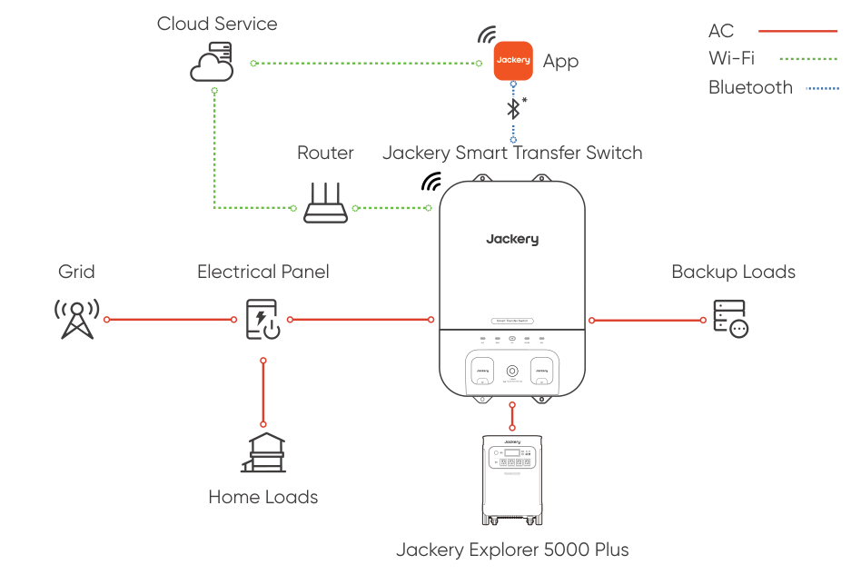
</figure>

* If there is no Wi-Fi available, please connect your device with Bluetooth. <strong>* If the device's Wi-Fi and Bluetooth are turned on and haven't connected to the Jackery App within two hours, both will automatically turn off.</strong>

### Installation Location

Install the Jackery Smart Transfer Switch indoors.

<table class="manual-callout-table manual-callout-table hb-source-warning-lockup native-lockup-open"><tbody><tr><td class="manual-callout-label">Warning</td><td class="manual-callout-body"><ul class="native-bullets"><li>Make sure the product is placed in a dry and well-ventilated location.</li><li>Ensure that the door opens to an angle of at least 90 degrees.</li><li>Installation personnel need to wear insulating gloves, safety glasses, and rubber-soled shoes.</li><li>Prior to installation, ensure the main circuit breaker and all branch circuits are turned off.</li></ul></td></tr></tbody></table>

## INSTALLATION GUIDE

<strong>Note: </strong>The details below are general guidelines for installing space and are not guaranteed to be applicable. Please consult your local AHJ or Utility before use.

### Surface Mounting

<table class="manual-callout-table manual-callout-table hb-source-warning-lockup native-lockup-open"><tbody><tr><td class="manual-callout-label">Warning</td><td class="manual-callout-body">
The product is not waterproof and is designed specifically for indoor use.
</td></tr></tbody></table>

<ol class="native-steps"><li>Install the upper and lower wall brackets on the back of the Smart Transfer Switch using 4 M4 screws. Tighten all screws with a torque of 0.8 N·m.</li></ol>

<figure class="hb-reference-figure" data-component-id="HB-SPECIAL-REFERENCE-FIGURE" data-reference-id="mounting-brackets" data-source-fragment-sha256="44308da080eeb91070c8f7fcce2dadbfaae7f6e894a25f157b548bd313cd8f75">
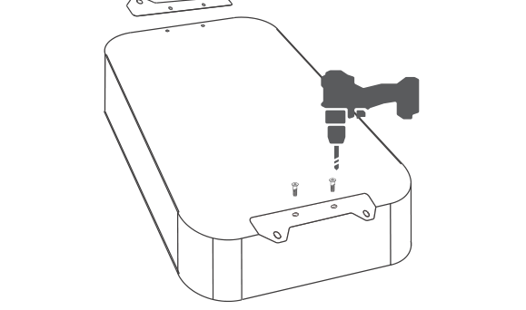
</figure>

<ol class="native-steps" start="2"><li>Secure the marking-off template on the mounting surface and carefully mark each hole location with a pencil.</li></ol>

<figure class="hb-reference-figure" data-component-id="HB-SPECIAL-REFERENCE-FIGURE" data-reference-id="mounting-template" data-source-fragment-sha256="fd3932763c2e63590d5ebf73d0c82f9b89c44de954ff83bc076d754d3483d2f3" data-step-captions="embedded">
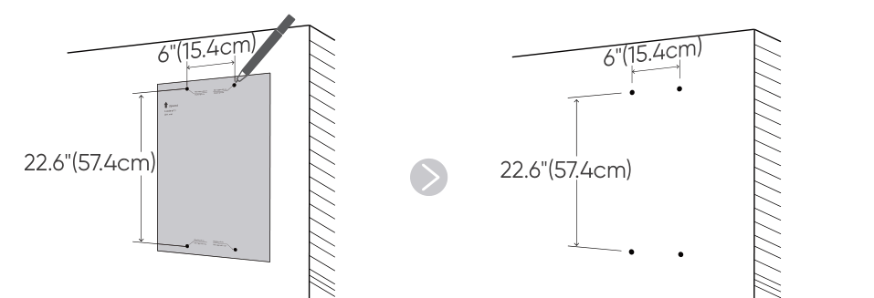
</figure>

<ol class="native-steps" start="3"><li>Fasten the Smart Transfer Switch with 4 M6 expansion bolts or M6 screws.</li></ol>

<figure class="hb-reference-figure" data-component-id="HB-SPECIAL-REFERENCE-FIGURE" data-reference-id="mounting-fasteners" data-source-fragment-sha256="49a3f853290ead0e444c6527cb3b8f08d08ec7becba75dbe6ecc4aa5aec6d9ad" data-step-captions="embedded">
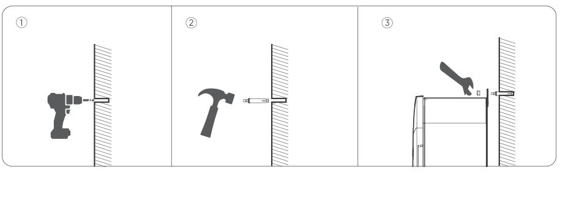
</figure>

### Locating STS Cable Entry

<ul class="native-bullets"><li>During the drilling process, cover the interior equipment to prevent debris from falling into the equipment.</li><li>Remove the debris after drilling to prevent interference with the equipment.</li></ul>

<figure class="hb-reference-figure" data-component-id="HB-SPECIAL-REFERENCE-FIGURE" data-reference-id="cable-entry" data-source-fragment-sha256="fd90b26fd89ed86fd37d7baa6c1019c51e5130b00866a214c3543d2982328bd9" data-step-captions="embedded">
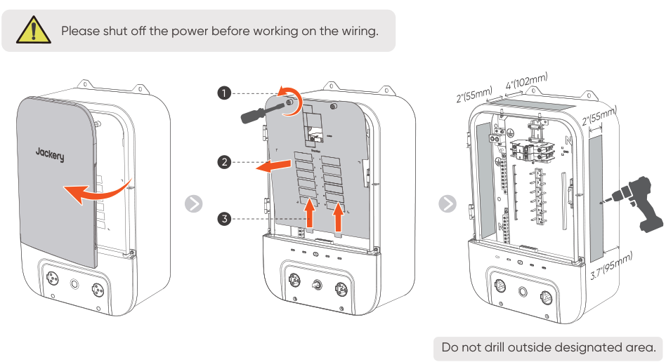
</figure>

### Electrical Connections

Warning

<ul class="native-bullets"><li>Risk of electric shock! Before wiring, make sure the power is off. Ensure that both the main and branch circuit breakers are turned off.</li><li>Ensure that conduits are installed before wiring between the electrical panel and the Jackery Smart Transfer Switch to enhance safety and protect wires from damage.</li><li>As shown in the picture, you can move the breakers from electrical panel to the Smart Transfer Switch.</li><li>The Installation of the 100A circuit breaker in the electrical panel is as shown in the picture.</li><li>The breakers in the transfer switch must NOT exceed 30A.</li></ul>

<figure class="hb-reference-figure" data-component-id="HB-SPECIAL-REFERENCE-FIGURE" data-reference-id="grid-preparation" data-source-fragment-sha256="8e1afb963ee02b145b809629b70296b998a4e73f7132075e81b7e63bda981ad0" data-step-captions="embedded">
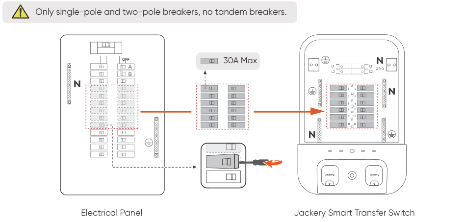
</figure>

#### Connecting the Grid Conductors

<ol class="native-steps"><li>Make sure all branch breakers and the main breaker are turned off.</li><li>Remove the covers from both the electrical panel and the Smart Transfer Switch.</li><li>Remove the knockout from the electrical panel and drill permissible cable entry hole(s) on the Smart Transfer Switch.</li><li>Install a conduit (not included) between the electrical panel and the Smart Transfer Switch.</li><li>Pull the pre-wired wires from the electrical panel bundled through the conduit.</li><li>Install a compatible 100A, 2-pole branch breaker (not included) in the electrical panel.</li><li>Locate the GROUND wire of the electrical panel and connect it to the grid ground lugs of the Smart Transfer Switch.</li><li>Locate the NEUTRAL wire in the electrical panel and connect it to the grid neutral lugs of the Smart Transfer Switch.</li><li>Locate the HOT wires of the 100-amp, 2-pole branch breaker added to the electrical panel and connect to the Smart Transfer Switch. Then, Install the power supply cover on the Smart Transfer Switch.</li></ol>

<figure class="hb-reference-figure" data-component-id="HB-SPECIAL-REFERENCE-FIGURE" data-reference-id="grid-wiring" data-source-fragment-sha256="9868eb207ab372756f23175451292e4edd4e6d39df6dddf65bd1f95370d850fe" data-step-captions="embedded">
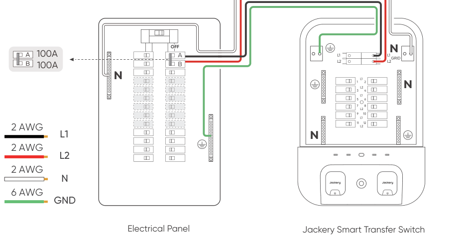
</figure>

#### Connecting the Home Load Conductors

* The home load supports simultaneous connection to both 120V and 240V circuits, with a maximum of 12 circuits for 120V and 6 circuits for 240V.

<ol class="native-steps"><li>From the electrical panel, select a branch circuit to be powered by the STS during a power outage. When there is no power outage, selected circuits will be powered by the utility.</li><li>Turn off the selected circuit breaker in the electrical panel.</li><li>Remove HOT wire from the selected circuit breaker.</li><li>Remove NEUTRAL wire of the selected circuit from the NEUTRAL bus bar.</li><li>Remove the GROUND wire of the selected circuit from the ground bus bar.</li><li>Connect the the HOT wire removed from the electrical panel to the breaker on the Smart Transfer Switch.</li><li>Connect the the NEUTRAL wire removed from the electrical panel to the neutral bus bar on the Smart Transfer Switch.</li><li>The GROUND wire of the electrical panel does not need to be connected to the STS.</li><li>Label the circuit breaker on the Smart Transfer Switch cover.</li><li>Repeat for each circuit.</li></ol>

<figure class="hb-reference-figure" data-component-id="HB-SPECIAL-REFERENCE-FIGURE" data-reference-id="load-wiring" data-source-fragment-sha256="8c85c43f7187b00811400c9a3df4e796b887e9baba3ea84db5b00dc6ecfaafb0" data-step-captions="embedded">
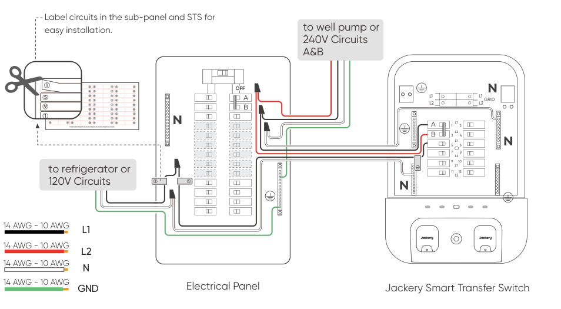
</figure>

Conductor Tightening Torque

<table class="manual-table native-print-grid native-torque"><thead><tr><th scope="col">Grid</th><th scope="col">Torque</th><th scope="col">Strip Length</th><th scope="col">Home Load</th><th scope="col">Torque</th><th scope="col">Strip Length</th></tr></thead><tbody><tr><td>L1</td><td>30.98 In-lbs/3.5 N·m</td><td>0.47" (12 mm)</td><td>L1</td><td>20.36 In-lbs/2.3 N·m</td><td>0.39" (10 mm)</td></tr><tr><td>L2</td><td>30.98 In-lbs/3.5 N·m</td><td>0.47" (12 mm)</td><td>L2</td><td>20.36 In-lbs/2.3 N·m</td><td>0.39" (10 mm)</td></tr><tr><td>N</td><td>46.02 In-lbs/5.2 N·m</td><td>0.47" (12 mm)</td><td>N</td><td>17.7 In-lbs/2.0 N·m</td><td>0.47" (12 mm)</td></tr><tr><td>GND</td><td>46.02 In-lbs/5.2 N·m</td><td>0.79" (20 mm)</td><td>GND</td><td>17.7 In-lbs/2.0 N·m</td><td>0.47" (12 mm)</td></tr></tbody></table>

#### Installing an Emergency Stop Button (Optional)

* <strong>Ensure that a normally open emergency stop button is purchased.</strong> Install in an easily accessible external location. This allows for the immediate disconnection of power to the STS load in case of an emergency.

<figure class="hb-reference-figure" data-component-id="HB-SPECIAL-REFERENCE-FIGURE" data-reference-id="external-emergency-stop" data-source-fragment-sha256="b9542596112a53bc7c45c991479aaa9e7f87814696c064fab7f719b12902040a" data-step-captions="embedded">
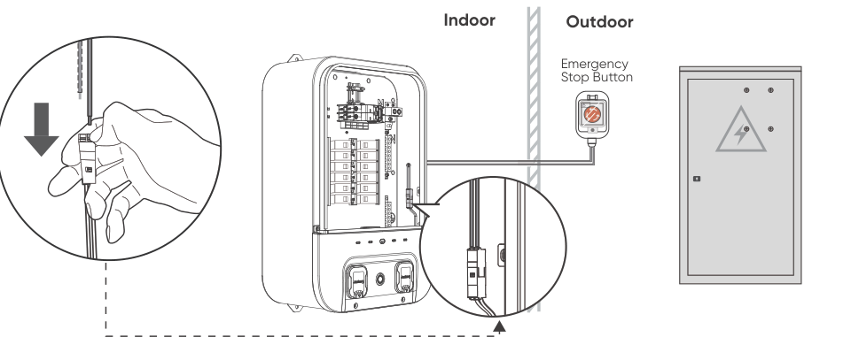
</figure>

#### Installing the Deadfront Cover

<table class="manual-callout-table manual-callout-table hb-source-warning-lockup native-lockup-open"><tbody><tr><td class="manual-callout-label">Warning</td><td class="manual-callout-body">
* Confirm that all connections are correct, secure, and properly grounded. * Confirm that all screws are tightened. * Use a multimeter in Continuity setting to ensure that the hot wire is not short circuited to neutral. * Use a multimeter in Continuity setting to ensure that the hot wire is not short circuited to ground.
</td></tr></tbody></table>

First, remove the twist-outs for home loads, fill any unused open spaces on the cover, and then tighten the screws to secure the deadfront.

<figure class="hb-reference-figure" data-component-id="HB-SPECIAL-REFERENCE-FIGURE" data-reference-id="deadfront-installation" data-source-fragment-sha256="0c4ed514450eaf72dda700fed0d70769e699f798dd92b8b41770cfd126c6ca03" data-step-captions="embedded">

</figure>

#### Connecting with Power Station

For Jackery Explorer 5000 Plus (Max. 2 units)

<figure class="hb-reference-figure" data-component-id="HB-SPECIAL-REFERENCE-FIGURE" data-reference-id="power-station-connections" data-source-fragment-sha256="057112e5fbbc3d1363455f5c121de7502dac1f77d03425c04260177e7a840135" data-step-captions="embedded">
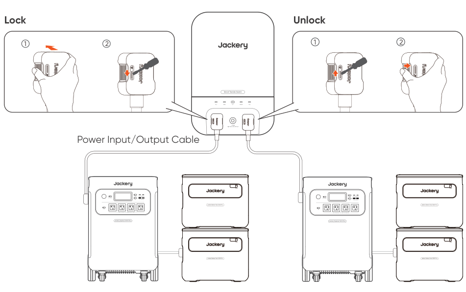
</figure>

#### Energizing

Before energizing, ensure that the main and branch circuit breakers are in the OFF position. To energize, turn on the main breaker first, followed by each branch circuit breaker.

#### Locking the Panel

<figure class="hb-reference-figure" data-component-id="HB-SPECIAL-REFERENCE-FIGURE" data-reference-id="locking-panel" data-source-fragment-sha256="211fbb0403073aab93a897986da188aa01988703395a35b1c64fb28a42567aea">
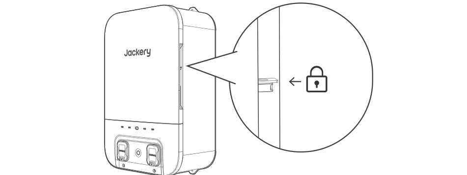
</figure>

## RECOMMENDED BREAKERS

15A breakers, 20A breakers, 30A breakers; no tandem or quad breakers. Brands and models of compatible circuit breakers: GE - THQL, Siemens - Tipo QP, Square D-HOM , Eaton-BR STS is not compatible with plug-in neutral circuit breakers.

## INTERNET AND INITIALIZATION SETUP

### To download the App and log in

<figure aria-label="App download" class="hb-app-download-composition" data-component-id="HB-SPECIAL-APP">

Search for "Jackery" in Google Play or App Store to install the App. After that, you can register and log in.

Alternatively, scan the QR code below to download and install the App.

</figure>

### To add device

<ol class="native-steps"><li>Press the IoT button to enable Wi-Fi and Bluetooth; the IoT indicator light will start flashing.</li></ol>
Flashing - ready to connect Solid - connected successfully

<figure class="hb-reference-figure" data-component-id="HB-SPECIAL-REFERENCE-FIGURE" data-reference-id="iot-pairing" data-source-fragment-sha256="ab1f87889c9dd0ea40afd68ffa8fc6c93b7c16f0aa755283b81fcc4d4bf7fb1f" data-step-captions="embedded">
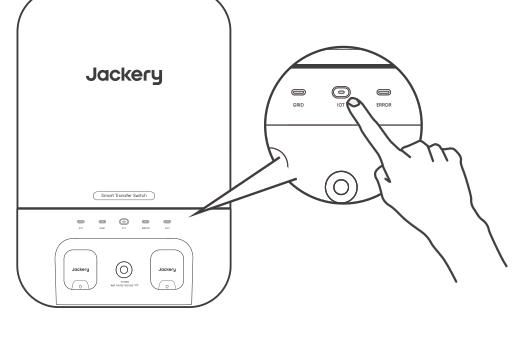
</figure>

<ol class="native-steps" start="2"><li>Tap  in the App to add your device, which allows the app to connect to nearby devices and enable Bluetooth permissions</li></ol>

<figure class="hb-reference-figure" data-component-id="HB-SPECIAL-REFERENCE-FIGURE" data-reference-id="app-add-device" data-source-fragment-sha256="50da1e4cca96ac3c2f23d05ea22b2abe67b0d36f0127f1373ec024cb699dec5b">
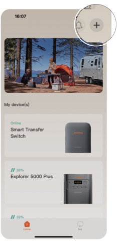
</figure>

<ol class="native-steps" start="3"><li>Tap the Smart Transfer Switch(STS) icon in the App to enter the STS main page and connect the device to the Wi-Fi network.</li></ol>

<figure class="hb-reference-figure" data-component-id="HB-SPECIAL-REFERENCE-FIGURE" data-reference-id="app-wifi" data-source-fragment-sha256="18c77581f5ece81a0fc657ed595e82d1424b600dcf2e3441510a2059cdd1cd37" data-step-captions="embedded">
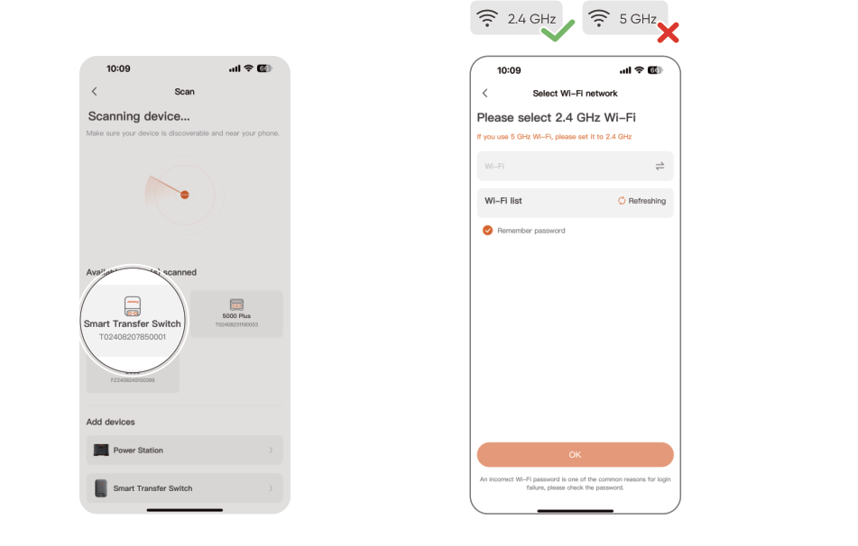
</figure>

### Voltage configuration

<ol class="native-steps"><li>Tap  in the STS main page.</li><li>Select Voltage configuration </li></ol>

<figure class="hb-reference-figure" data-component-id="HB-SPECIAL-REFERENCE-FIGURE" data-reference-id="app-voltage-menu" data-source-fragment-sha256="52ff5e55d99bfeec57cc091de6f854579b255acb75d75134fe563b12a8b8c74d" data-step-captions="embedded">
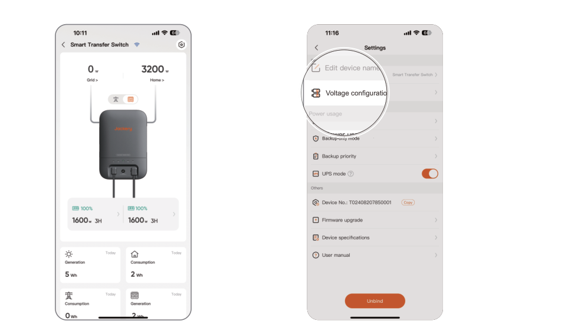
</figure>

<ol class="native-steps" start="3"><li>Tap  in the upper right corner, then tap the  to set the voltage to 240V according to the actual connection of the STS circuit, and finally tap  to save the settings.</li></ol>

<figure class="hb-reference-figure" data-component-id="HB-SPECIAL-REFERENCE-FIGURE" data-reference-id="app-voltage-settings" data-source-fragment-sha256="26a8aab6c8900742475680fe63398d89299beb4ac2d41c15cc5270554885c89d" data-step-captions="embedded">
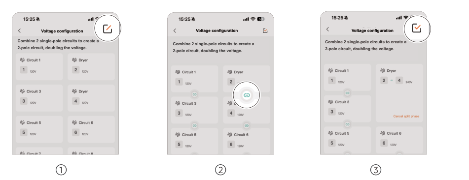
</figure>

### Edit circuit name

<ol class="native-steps"><li>Tap ‘Circuits’ in the STS main page to enter circuits main page.</li></ol>

<figure class="hb-reference-figure" data-component-id="HB-SPECIAL-REFERENCE-FIGURE" data-reference-id="app-circuit-list" data-source-fragment-sha256="35b8053a6d87712c1507733be750c75a35b9d953e61b8b824b15678e31975d71" data-step-captions="embedded">
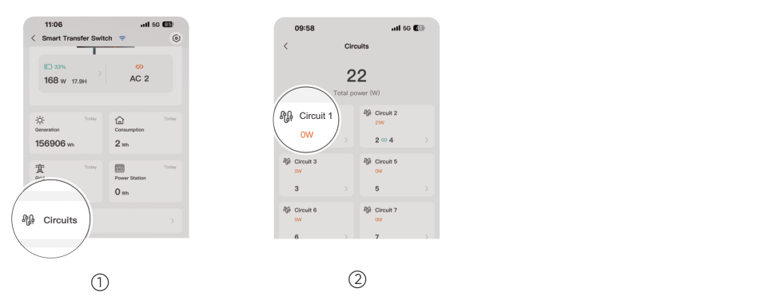
</figure>

<ol class="native-steps" start="2"><li>Select the desired circuit and tap  to edit its name.</li></ol>

<figure class="hb-reference-figure" data-component-id="HB-SPECIAL-REFERENCE-FIGURE" data-reference-id="app-circuit-name" data-source-fragment-sha256="ce1738b5f62dc174442d5aea2d71cb588a531b2df1efab524a7f088922e21e7f" data-step-captions="embedded">
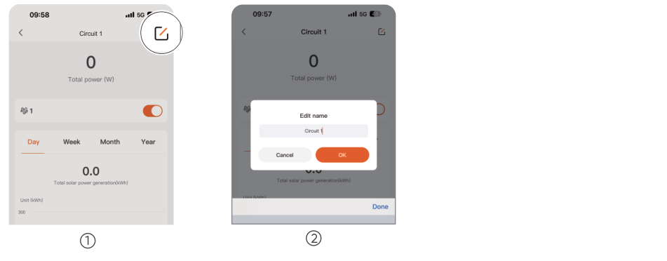
</figure>

## JACKERY APP QUICK START GUIDE

### Dashboard

<figure class="hb-reference-figure" data-component-id="HB-SPECIAL-REFERENCE-FIGURE" data-reference-id="app-dashboard" data-source-fragment-sha256="25ae3af4ce9d70d887ef5030bef629637803ce5e8dd91749ad51ebe52d12e69e">
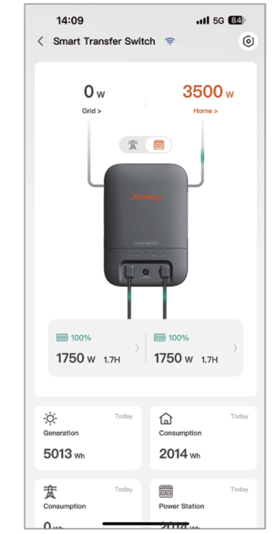
</figure>

View and monitor the real-time power consumption of the home, power station, and grid. View the current power supply for the home. Manually switch the home power supply to the power station under the following conditions:
<ol class="native-steps"><li>Power station battery exceeds the backup reserve.</li><li>Backup-only mode is off.</li></ol>
Daily solar power generation and home electricity consumption.

### Circuits

<figure class="hb-reference-figure" data-component-id="HB-SPECIAL-REFERENCE-FIGURE" data-reference-id="app-circuits" data-source-fragment-sha256="09f58dfe920864f8f3471930304bdd19509b259f57cf538c15a04ac324df741e">
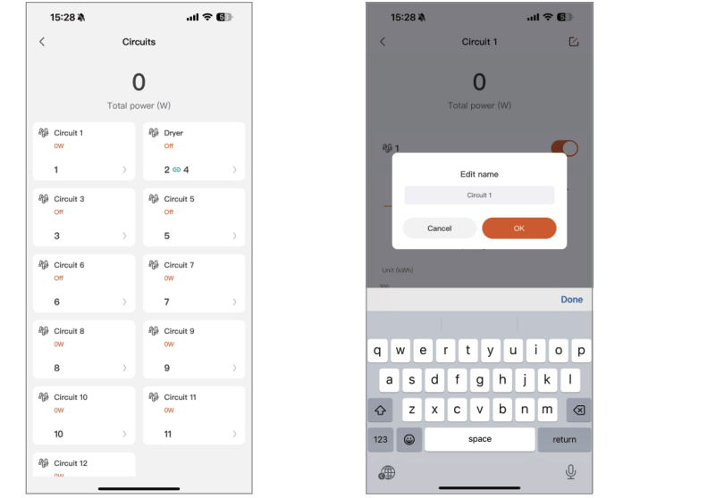
</figure>

Manually turn each home circuit on or off, rename them, and view the historical power consumption of each circuit.

### Working Modes

<figure class="hb-reference-figure" data-component-id="HB-SPECIAL-REFERENCE-FIGURE" data-reference-id="app-working-modes" data-source-fragment-sha256="9c38b4b83f21fa75c83c5ee39db763c721df1f8f233a61207a3b927205bd1b01">
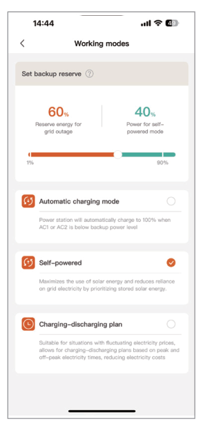
</figure>

<h3>Set backup reserve</h3>
When the power station is discharging, the battery will discharge until it reaches the backup reserve . During a power outage, it discharges until it hits the discharge limit (0%). You can modify the level in Settings &gt; Working Modes. * The setting of backup reserve will take effect in any mode. * During a power outage, the backup reserve level will discharge to 0% in any mode.
<h3>Automatic charging mode</h3>
It’s commonly used for daily home backup power. <strong>The power station will automatically recharge to 100% when AC1 or AC2 is below backup reserve.</strong>

#### Self-powered mode

Maximize the use of solar energy for your house. In this mode, the power station charges exclusively using solar energy. It will begin supplying power to the home two hours after reaching a full charge. If it is not fully charged, it will only provide power to the home during the night.

#### Charging-discharging plan

Suitable for situations with fluctuating electricity rate, allows for charging-discharging plans based on peak and off-peak electricity times, reducing electricity costs. Charging task: Set the period for charging. Discharging task: Set the period for discharging. In this period, if batteries exceed the backup reserve, they will discharge. When the power station is connected to Smart Transfer Switch, it temporarily disables Battery saving mode, Auto-off, Energy saving mode, Quiet charging mode, Charging plan.

### Backup-only mode

<figure class="hb-reference-figure" data-component-id="HB-SPECIAL-REFERENCE-FIGURE" data-reference-id="app-backup-only" data-source-fragment-sha256="02e67fbac799ef35dc3f7e7a3bc01baff344a5c01575d4b707c8e08d47dc2248">
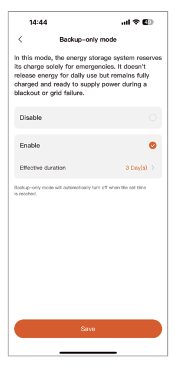
</figure>

When backup-only mode is enabled, the grid will supply power to the home while fully charging the power station, which will only supply power during an outage. The charging-discharging plan and self-powered mode will be temporarily disabled. Manual switching to the power station is unavailable in backup-only mode.

### Backup priority

<figure class="hb-reference-figure" data-component-id="HB-SPECIAL-REFERENCE-FIGURE" data-reference-id="app-backup-priority" data-source-fragment-sha256="f76ceaad17bf8b6fee4e6047a4cc30d50ebe8355835797fe9ba0bb7f377bc6ef">
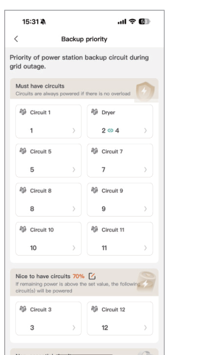
</figure>

During an outage, the system prioritizes the supply of battery power to home circuits. Categorize your home circuits into 3 levels: must have, nice to have, and no power supply. Circuit priorities
<ol class="native-steps"><li>Must have: As long as there's power in batteries, it will be supplied to these circuits.</li><li>Nice to have: These circuits will be powered when the battery level is equal to or higher than the percentage you set.</li><li>Non-priority circuits: These circuits won't be powered when using battery power during an outage.</li></ol>

### UPS mode

<figure class="hb-reference-figure" data-component-id="HB-SPECIAL-REFERENCE-FIGURE" data-reference-id="app-ups-mode" data-source-fragment-sha256="24a053bbf9e84eaca2e8333bfce1eb2fad4375caa1690ef723867af58f1b0fd7">
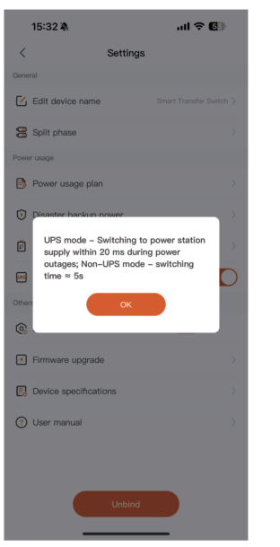
</figure>

When UPS mode is enabled, if there is a power outage, STS will automatically switch to power station supply within 20 ms; if STS is charging the power station at that time, the switch time will be longer than 20 ms, and after power is restored, it will automatically switch back to grid supply. In non-UPS mode, the switch time is approximately 5 seconds only if the power station is turned on. * The STS will remain on when connected to the power station, so it is recommended not to manually turn off the power station.

## WARRANTY

<figure aria-label="WARRANTY" class="hb-warranty-intro-composition" data-component-id="HB-WARRANTY-LEAD">
We only provide our warranty to customers who purchase from the official Jackery website, Jackery-branded third-party platforms, or local authorized dealers.

* Warranty period and details may vary according to local laws, regulations, and authorized dealers.
</figure>

### Limited Warranty

<figure aria-label="Limited Warranty" class="hb-warranty-card" data-component-id="HB-WARRANTY-SECTION" data-warranty-card-index="1">
Jackery Inc. warrants to the original consumer purchaser that the Jackery product will be free from defects in workmanship and material under normal consumer use during the applicable warranty period identified in the 'Warranty Period' section below, subject to the exclusions set forth below. This warranty statement sets forth Jackery's total and exclusive warranty obligation. We will not assume, nor authorize any person to assume for us, any other liability in connection with the sale of our products.
</figure>

### Warranty Period

<figure aria-label="Warranty Period" class="hb-warranty-card" data-component-id="HB-WARRANTY-SECTION" data-warranty-card-index="2">
5 Years Standard Warranty: The standard warranty period for Jackery Smart Transfer Switch is 5 years. In each case, the warranty period is measured starting on the date of purchase by the original consumer purchaser. The sales receipt from the first consumer purchase, or other reasonable documentary proof, is required in order to establish the start date of the warranty period.
</figure>

### Repair or replacement

<figure aria-label="Repair or replacement" class="hb-warranty-card" data-component-id="HB-WARRANTY-SECTION" data-warranty-card-index="3">
Jackery will repair or replace (at Jackery's expense) any Jackery product that fails to operate during the applicable warranty period due to a defect in workmanship or material. The repaired/replaced product assumes the remaining warranty of the original date of purchase.
</figure>

### Limited to Original Consumer Buyer

<figure aria-label="Limited to Original Consumer Buyer" class="hb-warranty-card" data-component-id="HB-WARRANTY-SECTION" data-warranty-card-index="4">
The warranty on Jackery's product is limited to the original consumer purchaser and is not transferable to any subsequent owner.
</figure>

### Exclusions

<figure aria-label="Exclusions" class="hb-warranty-card" data-component-id="HB-WARRANTY-SECTION" data-warranty-card-index="5">
Jackery's warranty does not apply to: Misused, abused, modified, damaged by accident, or used for anything other than normal consumer use as authorized in Jackery's current product literature. Attempted repair by anyone other than an authorized facility. Any product purchased through an online auction house. Jackery's warranty does not apply to the battery cell unless the battery cell is fully charged by you within seven days after you purchase the product and at least once every 6 months thereafter.
</figure>

### Interpretation Rights

<figure aria-label="Interpretation Rights" class="hb-warranty-card" data-component-id="HB-WARRANTY-SECTION" data-warranty-card-index="6">
Jackery Inc. reserves the right to final interpretation of the above customers' after-sales policy.
</figure>
