

## 安全上のご注意

<strong>本製品を使用する際、以下の注意事項を守ってください。</strong>

<ul class="native-bullets"><li>本製品を使用する前に取扱説明書をよくお読みください。</li><li>危険防止のため、お子様の近くで本製品を使用する時は、お子様から目を離さないようにしてください。</li><li>メーカーが保証していない推奨外の付属品を使用すると、感電の恐れがあります。</li><li>製品を使用しない場合は、プラグを抜いてください。</li><li>火災、爆発、感電などの予測できない危険が発生する恐れがありますので、本製品を解体しないでください。</li><li>感電の危険があるため、破損したコードやプラグ、またはケーブルを使用しないでください。</li><li>製品の充電は風通しの良い場所で行い、風通しの悪い場所での充電はおやめください。</li><li>雨に濡れないよう、風通しのよい乾燥した場所に保管してください。本製品は濡れると感電の危険があります。</li><li>火災、爆発などの事故の原因となるため、本製品を火気に近づけないでください。</li><li>高温の下 (直射日光や猛暑の車内) で使用したり放置しないでください。内蔵のバッテリーが過熱して発火したり、機能しなくなったり、寿命が短くなる可能性があります。</li><li>本製品を初めてご使用になる時は、十分に充電してからご使用ください。本製品を電池が切れた状態で長期間 (3 ヶ月～6 ヶ月) 放置すると、性能が低下し、過放電により充電ができなくなる場合があります。</li></ul>

### 絵表示について

製品を安全に正しくお使いいただき、お客様や他の方々への危害や財産への損害を未然に防止するための表示です。 内容をよく理解してから本文をお読みください。

<table class="manual-table native-print-grid native-signal native-fit"><tbody><tr><td class="native-signal-label"><strong>警告</strong></td><td>この表示を無視して、誤った取り扱いをすると、人が死亡または重傷を負う可能性が想定される内容を示しています。</td></tr><tr><td class="native-signal-label"><strong>注意</strong></td><td>この表示を無視して、誤った取り扱いをすると、人が傷害を負う可能性が想定される内容または物的損害の発生が想定される内容を示しています。</td></tr><tr><td class="native-signal-label"><strong>説明</strong></td><td>この表示を無視して誤った取り扱いをすると、機器の損傷、データの消失、性能の低下、または予期しない動作が発生する可能性があることを示しています。</td></tr><tr><td class="native-signal-label"><strong>ヒント</strong></td><td>文章内の重要な情報や操作のヒントを補足する内容を示しています。</td></tr></tbody></table>

### 絵表示の説明

<table class="manual-table native-print-grid native-symbols native-fit"><tbody><tr><td class="native-symbol-cell"></td><td>潜在的な危険やリスクについて注意喚起するために、必ずお読みください。</td></tr><tr><td class="native-symbol-cell"></td><td>操作の前に取扱説明書をお読みください。</td></tr><tr><td class="native-symbol-cell"></td><td>本製品を火気の近くに置かないでください。</td></tr><tr><td class="native-symbol-cell"></td><td>小さなお子様の手の届かない場所に保管してください。</td></tr><tr><td class="native-symbol-cell"></td><td>製品を分解、改造を禁止する記号</td></tr><tr><td class="native-symbol-cell"></td><td><strong>充電式電池のリサイクルについて</strong> 本機はリサイクル可能な充電池を内蔵しています。 この商品を廃棄する場合は、当社のカスタマーサポートにご連絡ください。 充電池の取りはずしはお客様自身では行わないでください。</td></tr><tr><td class="native-symbol-cell"></td><td>このシンボルは、本製品を一般家庭ごみとして廃棄せず、リサイクルのために指定の回収施設に持ち込む必要があることを示しています。 適切な廃棄およびリサイクルは、環境保護に役立ちます。 本製品の廃棄やリサイクルについての詳細は、お住まいの自治体、廃棄物処理業者、または販売店にお問い合わせください。</td></tr><tr><td class="native-symbol-cell"></td><td>電池および蓄電池は家庭ごみと一緒に廃棄してはいけません。 消費者の皆様は、有害物質の有無にかかわらず、すべての電池および蓄電池を指定された収集場所で廃棄することが法律で義務付けられています。 使用済みの電池および蓄電池は、お近くの収集拠点、リサイクルセンター、または購入した小売店にお持ちください。 適切な廃棄は環境に配慮したリサイクルを確保し、人間の健康と環境への潜在的な害を防ぎます。</td></tr></tbody></table>

## 同梱品

<figure aria-label="同梱品" class="hb-inbox-composition" data-card-count="3" data-component-id="HB-SPECIAL-INBOX" data-inbox-variant="three-card-responsive"><ol class="hb-inbox-grid"><li class="hb-inbox-card" data-item-number="1">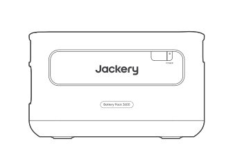

本体

</li><li class="hb-inbox-card" data-item-number="2">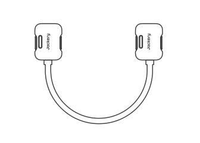

拡張ケーブル

</li><li class="hb-inbox-card" data-item-number="3">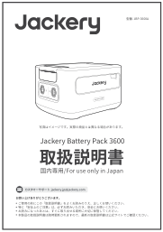

取扱説明書

</li></ol></figure>

※ 付属品を故障、紛失等してしまった場合はカスタマーサポートまでご連絡ください。 ※ 本拡張ケーブルは、同梱されている本体以外には使用しないでください。

<strong>■本機の仕様および外観は、改善のため予告なく変更することがあります。</strong>

## 各部の名称

<figure class="hb-reference-figure hb-base-art-live-copy" data-component-id="HB-SPECIAL-REFERENCE-FIGURE" data-reference-id="overview" data-source-fragment-sha256="8bacc47e5a44039555c25b3f9b2075aca36b45a04f11e917236195aee065c560" data-web-base-art-ref="assets/overview.png" data-web-presentation-mode="base-art-live-copy" data-web-replace-key="reference.overview">

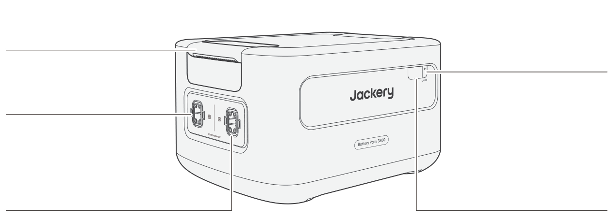<strong>ハンドル</strong><strong>DC 拡張ポート B</strong>接続拡張ケーブルのプラグBに接続<strong>DC 拡張ポート A</strong>接続拡張ケーブルのプラグAに接続<strong>主電源ボタン</strong><strong>ディスプレイ</strong>

</figure>

## 液晶画面

<figure class="hb-reference-figure hb-base-art-live-copy" data-component-id="HB-SPECIAL-REFERENCE-FIGURE" data-reference-id="lcd-map" data-source-fragment-sha256="3ddf9e499cbc0ef7f38b88edc6547136a680845b1a51e5ca7248e6cfc5459b4f" data-web-base-art-ref="assets/lcd-map.png" data-web-presentation-mode="base-art-live-copy" data-web-replace-key="reference.lcd-map">

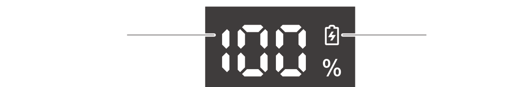<strong>バッテリー残量(%)/</strong><strong>エラーコード</strong><strong>充電マーク</strong>

</figure>

<table class="manual-table native-print-grid native-lcd native-fit"><tbody><tr><td class="native-key"><strong>バッテリー残量(%)/</strong> <strong>エラーコード</strong></td><td>バッテリー残量(%)のところに現在の電力値が表示されますが、システム障害が発生した場合、エラーコードの「F0-FF」と表示されます。しばらく本製品を放置した後、自動的に回復することができますが、回復しない場合は、カスタマーサービスにご連絡ください。他のエラーコードが表示された場合はカスタマーサービスにご連絡ください。</td></tr><tr><td class="native-key"><strong>充電マーク</strong></td><td>充電のための接続が行われると、このマークが表示され、満充電になると消えます。</td></tr></tbody></table>

## 製品の使用方法について

### オン/オフ

<figure class="hb-reference-figure hb-base-art-live-copy" data-component-id="HB-SPECIAL-REFERENCE-FIGURE" data-reference-id="power-on-off" data-source-fragment-sha256="96cec672dd0f1ce2ff388902d3771e75e186f4d4e3fb0b890f417bd16c25b153" data-web-base-art-ref="assets/power-on-off.png" data-web-presentation-mode="base-art-live-copy" data-web-replace-key="reference.power-on-off">

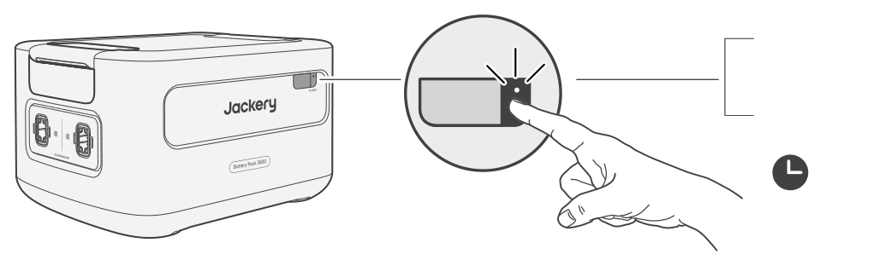<strong>オフ</strong>1回押す<strong>オン</strong>3秒3s

</figure>

<table class="manual-callout-table manual-callout-table hb-callout-label-shaded"><tbody><tr><td class="manual-callout-label">説明</td><td class="manual-callout-body"><ul class="native-bullets"><li>Jackery ポータブル電源 3600 Plusと併用する場合、Jackery ポータブル電源 3600 Plusの「主電源ボタン」からJackery Battery Pack 3600 の電源のオン/オフを制御できます。</li><li>充電されていないか、負荷が2時間接続されていないと、製品は自動的にシャットダウンします。</li></ul></td></tr></tbody></table>

### LCDディスプレイのオン/オフ

<figure class="hb-reference-figure" data-component-id="HB-SPECIAL-REFERENCE-FIGURE" data-reference-id="lcd-control" data-source-fragment-sha256="3142e336f08e03c43307942eea9cf9a85012ac2bfec6a4e1bb17fbc774d9c1de">

</figure>

「主電源ボタン」を押した時や充電中はLCDディスプレイが点灯し、もう一度押すとLCDディスプレイが消灯します。

## ポータブル電源との併用

これらの製品は、Jackery ポータブル電源 3600 Plusとともに最大5セットまで使用することができ、容量の増加に対応することができます。

<table class="manual-callout-table manual-callout-table hb-callout-label-shaded"><tbody><tr><td class="manual-callout-label">ご注意</td><td class="manual-callout-body"><ul class="native-bullets"><li>バッテリーパックをJackery ポータブル電源 3600 Plusに接続する前に、両方の電源がオフになっていることを確認してください。</li><li>製品が適切に動作するよう、両側の吸気口と排気口が遮られていないことを確認してください。適切な放熱を確保するため、通気口と物との間に少なくとも20cmの空間を空けてください。</li></ul></td></tr></tbody></table>

<figure class="hb-reference-figure hb-base-art-live-copy" data-component-id="HB-SPECIAL-REFERENCE-FIGURE" data-reference-id="clearance" data-source-fragment-sha256="4a1ba0c928d9bc392dc3bf7016df2b8436fe70690ee9387cdae82798c3a9dbae" data-web-base-art-ref="assets/clearance.png" data-web-presentation-mode="base-art-live-copy" data-web-replace-key="reference.clearance">

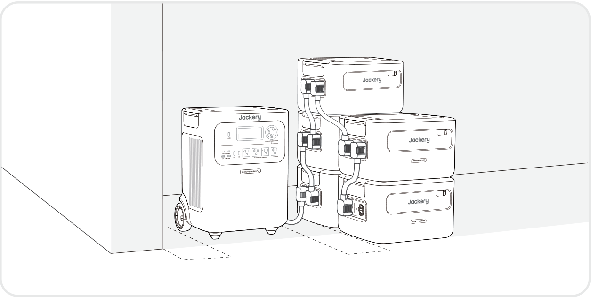≥ 20cm≥ 20cm

</figure>

<figure class="hb-reference-figure" data-component-id="HB-SPECIAL-REFERENCE-FIGURE" data-reference-id="stacking" data-source-fragment-sha256="8bf66e1720e75739dc9e08ae54834c074fb83a8237d5d78f262c3ffa169cec7e" data-step-captions="embedded">
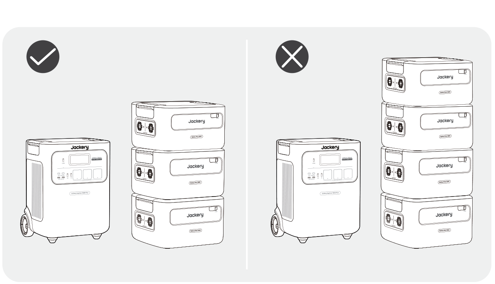
</figure>

<table class="manual-callout-table manual-callout-table hb-callout-label-shaded"><tbody><tr><td class="manual-callout-label">ご注意</td><td class="manual-callout-body"><ul class="native-bullets"><li>LCD 画面（Jackery ポータブル電源 3600 Plus）にアイコンが表示されたら、バッテリーパックと Jackery ポータブル電源 3600 Plus の接続が成功したことを示します。</li><li>本製品を使用する際は、バッテリーパックが落下して怪我をするのを防ぐため、バッテリーパックを3つ以上重ねないでください。</li><li>Jackery ポータブル電源 3600 Plusの上に本製品を積み重ねないでください。</li></ul></td></tr></tbody></table>

<figure class="hb-reference-figure hb-base-art-live-copy" data-component-id="HB-SPECIAL-REFERENCE-FIGURE" data-reference-id="locking" data-source-fragment-sha256="333af3e448e6a0bae35b5e23fb5c360f5ecef91fd568334faf56e16e3a22a13f" data-web-base-art-ref="assets/locking.png" data-web-presentation-mode="base-art-live-copy" data-web-replace-key="reference.locking">

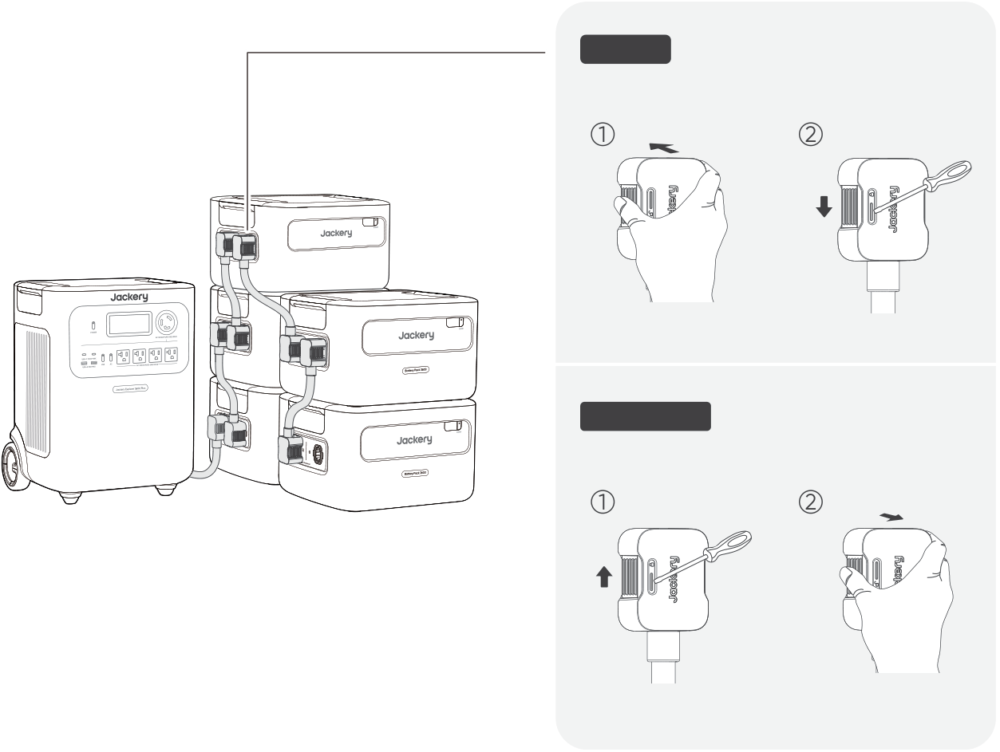<strong>ロック</strong><strong>ロック解除</strong>

</figure>

## 充電方法

### AC充電

AC充電の場合、本製品はJackery ポータブル電源 3600 Plusと一緒にお使いください。

<table class="manual-callout-table manual-callout-table hb-callout-label-shaded hb-source-warning-lockup"><tbody><tr><td class="manual-callout-label">警告</td><td class="manual-callout-body">
バッテリーパックをJackery ポータブル電源 3600 Plusに接続する前に、両方の電源がオフになっていることを確認してください。
</td></tr></tbody></table>

<figure class="hb-reference-figure hb-base-art-live-copy" data-component-id="HB-SPECIAL-REFERENCE-FIGURE" data-reference-id="ac-charging" data-source-fragment-sha256="784865e3b7ae57b18d36df7b6987b2588dec38bf2a8796b078759e88169d6de3" data-web-base-art-ref="assets/ac-charging.png" data-web-presentation-mode="base-art-live-copy" data-web-replace-key="reference.ac-charging">

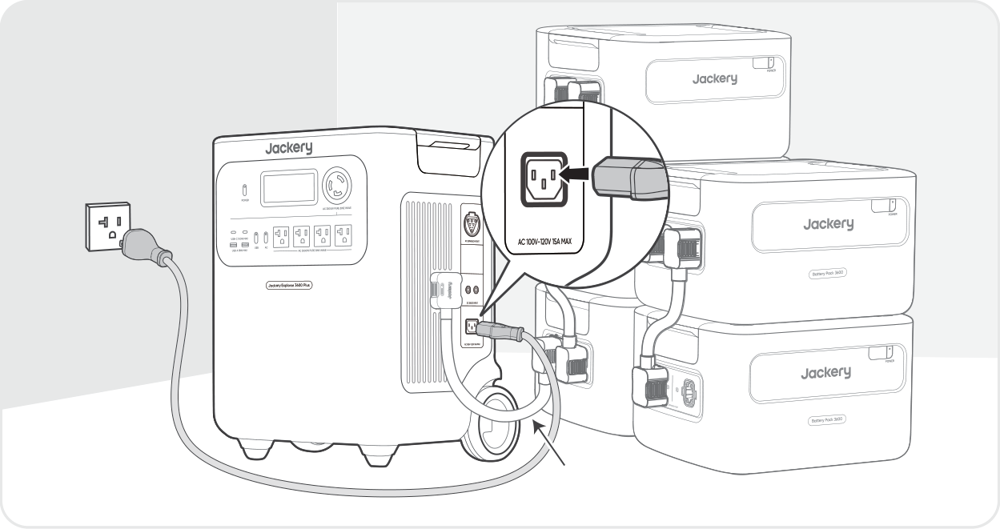ACケーブル拡張ケーブル

</figure>

### ソーラー充電（別売）

下図のように、ソーラーパネルとJackery ポータブル電源 3600 Plusを使って製品を充電します。詳細については、Jackery ポータブル電源 3600 Plusの取扱説明書を参照してください。

<figure class="hb-reference-figure hb-base-art-live-copy" data-component-id="HB-SPECIAL-REFERENCE-FIGURE" data-reference-id="solar-charging" data-source-fragment-sha256="cc437aacdb795f1821253ce51dbe148138f81fe8ac4165f31383c81bcac0d3ac" data-web-base-art-ref="assets/solar-charging.png" data-web-presentation-mode="base-art-live-copy" data-web-replace-key="reference.solar-charging">

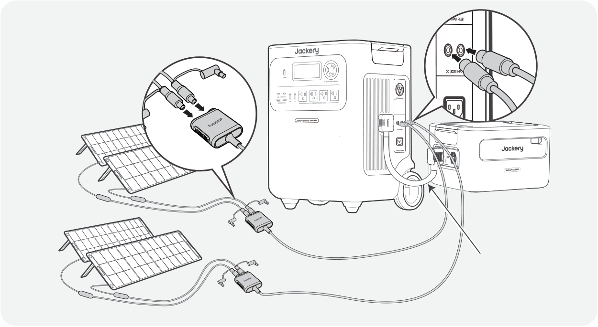SolarSaga 200拡張ケーブル

</figure>

## トラブルシューティング

次のいずれかのエラーコードが表示された場合は、記載されている対処方法に従って問題を解決してください。問題が解決しない場合は、Jackeryカスタマーサポートまでご連絡ください。

<figure aria-label="エラーコード / 対処方法" class="hb-troubleshooting-composition" data-component-id="HB-TABLE-TROUBLESHOOTING" tabindex="0"><table class="hb-troubleshooting-table"><colgroup><col class="hb-troubleshooting-col-code"/><col class="hb-troubleshooting-col-measures"/></colgroup><thead><tr><th class="hb-troubleshooting-code" scope="col">エラーコード</th><th class="hb-troubleshooting-measures" scope="col">対処方法</th></tr></thead><tbody><tr><td class="hb-troubleshooting-code">F0</td><td class="hb-troubleshooting-measures">製品を再起動してください。</td></tr><tr><td class="hb-troubleshooting-code">F1</td><td class="hb-troubleshooting-measures">Jackeryカスタマーサポートまでご連絡ください。</td></tr><tr><td class="hb-troubleshooting-code">F2</td><td class="hb-troubleshooting-measures">Jackeryカスタマーサポートまでご連絡ください。</td></tr><tr><td class="hb-troubleshooting-code">F3</td><td class="hb-troubleshooting-measures">製品を再起動してください。</td></tr><tr><td class="hb-troubleshooting-code">F4</td><td class="hb-troubleshooting-measures">製品に負荷を接続してバッテリーを放電し、エラーが消えるまで続けてください。</td></tr><tr><td class="hb-troubleshooting-code">F5</td><td class="hb-troubleshooting-measures">ソーラーパネルまたはAC電源コンセントを使用して、エラーが消えるまで製品を充電してください。</td></tr><tr><td class="hb-troubleshooting-code">F6</td><td class="hb-troubleshooting-measures">Jackeryカスタマーサポートまでご連絡ください。</td></tr><tr><td class="hb-troubleshooting-code">F7</td><td class="hb-troubleshooting-measures">Jackeryカスタマーサポートまでご連絡ください。</td></tr><tr><td class="hb-troubleshooting-code">F8</td><td class="hb-troubleshooting-measures">Jackeryカスタマーサポートまでご連絡ください。</td></tr><tr><td class="hb-troubleshooting-code">F9</td><td class="hb-troubleshooting-measures">Jackeryカスタマーサポートまでご連絡ください。</td></tr><tr><td class="hb-troubleshooting-code">FA</td><td class="hb-troubleshooting-measures">Jackeryカスタマーサポートまでご連絡ください。</td></tr><tr><td class="hb-troubleshooting-code">FC</td><td class="hb-troubleshooting-measures">Jackeryカスタマーサポートまでご連絡ください。</td></tr><tr><td class="hb-troubleshooting-code">FF</td><td class="hb-troubleshooting-measures">製品を適切な温度環境に置き、障害が解消するまで待機します。</td></tr></tbody></table></figure>

## 主な仕様

<table class="manual-table native-print-grid native-spec native-fit"><tbody><tr><td class="native-key">製品の名称</td><td>Jackery Battery Pack 3600</td></tr><tr><td class="native-key">型番</td><td>JBP-3600A</td></tr><tr><td class="native-key">定格容量</td><td>3584Wh (80Ah/44.8V DC)</td></tr><tr><td class="native-key">バッテリータイプ</td><td>LiFePO4 (リン酸鉄リチウムイオン電池)</td></tr><tr><td class="native-key">サイズ &amp; 重量</td><td>約 375 x 317 x 229 mm (約 25kg)</td></tr><tr><td class="native-key">DC 拡張ポート (入力)</td><td>36.4V-50.4V⎓最大 60A</td></tr><tr><td class="native-key">DC 拡張ポート (出力)</td><td>36.4V-50.4V⎓最大 100A</td></tr><tr><td class="native-key">充電温度</td><td>-20°C~45°C</td></tr><tr><td class="native-key">動作温度</td><td>-20°C~45°C</td></tr><tr><td class="native-key">保存温度</td><td>1 年間 0~25°C 3 ヶ月 0~45°C 1 ヶ月 - 20~45°C</td></tr></tbody></table>

認証： UN38.3

本製品はJackery ポータブル電源 3600 Plus専用となります。他の機器には接続しないでください。

## 保証について

このたびはJackery 製品をご購入いただき、誠にありがとうございます。 本保証書は、Jackery ポータブル電源製品に関する保証内容を明確にご案内するものです。 ご使用前に必ずご確認のうえ、大切に保管してください。

### 保証期間

<figure aria-label="保証期間" class="hb-warranty-card" data-component-id="HB-WARRANTY-SECTION" data-warranty-card-index="1"><ol class="native-steps"><li>保証期間はご購入日から3 年間です。</li><li>また、延長保証にご登録いただくと、さらに2 年間の保証が追加されます。詳しくはJackery公式サイトをご確認ください。</li></ol>
※ Jackery 公式オンラインストアまたは正規代理店以外での購入品は保証対象外となります。
</figure>

### 保証の適用範囲

<figure aria-label="保証の適用範囲" class="hb-warranty-card" data-component-id="HB-WARRANTY-SECTION" data-warranty-card-index="2"><ol class="native-steps"><li>購入チャネルについて 本保証は、Jackery公式オンラインストアまたは正規代理店で購入された製品に限り有効です。</li></ol>
※ Jackery 公式オンラインストアまたは正規代理店以外での購入品は保証対象外となります。
<ol class="native-steps" start="2"><li>保証提供地域 保証は、日本国内に在住の方が、日本国内で使用する場合に限り有効です。</li></ol></figure>

### 保証の適用条件

<figure aria-label="保証の適用条件" class="hb-warranty-card" data-component-id="HB-WARRANTY-SECTION" data-warranty-card-index="3">
以下のすべての条件を満たす場合に、保証の適用対象となります：
<ul class="native-bullets"><li>Jackery公式オンラインストアまたは正規代理店にてご購入されたこと</li><li>保証期間内であること</li><li>下記の「保証対象外」に該当しないこと</li></ul></figure>

### 保証対象外となる場合

<figure aria-label="保証対象外となる場合" class="hb-warranty-card" data-component-id="HB-WARRANTY-SECTION" data-warranty-card-index="4">
以下のいずれかに該当する場合、保証期間内であっても保証の対象外となります：
<ol class="native-steps"><li>故障・損傷が保証期間内に発生していても、保証期間終了後に申請された場合</li><li>使用上の誤り（取扱説明書や本体ラベルに記載の注意事項に従わなかった使用）による故障・損傷</li><li>他機器からの影響、不適切な修理または改造による故障・損傷</li><li>移設・輸送・落下などに起因する故障・損傷</li><li>火災・地震・風水害・落雷などの天災、または公害・塩害・異常電圧などによる故障・損傷</li><li>消耗部品の劣化や摩耗、または外観の汚損など</li></ol></figure>

### 購入証明について

<figure aria-label="購入証明について" class="hb-warranty-card" data-component-id="HB-WARRANTY-SECTION" data-warranty-card-index="5">
保証をご利用の際には、以下いずれかの購入証明書類をご提示いただく必要があります：
<ul class="native-bullets"><li>Jackery公式オンラインストアでの購入：注文番号（注文履歴画面または確認メール）</li><li>正規代理店での購入：購入日・販売店名の記載された領収書または納品書</li></ul>
※ ご提示がない場合、保証対応いたしかねます。
</figure>

### 保証内容

<figure aria-label="保証内容" class="hb-warranty-card" data-component-id="HB-WARRANTY-SECTION" data-warranty-card-index="6">
<strong>1. 初期不良による交換</strong>（ご購入日から30日以内）
<ul class="native-bullets"><li>取扱説明書に従った正常な使用中に不具合が発生した場合、同一製品の新品と交換いたします。</li><li>在庫切れや販売終了の場合は、同等品への交換または返金にて対応いたします。</li></ul>
<strong>2. 無償修理</strong>（ご購入日から30日以上～保証期間内）
<ul class="native-bullets"><li>保証条件を満たす自然故障については、無料で修理対応いたします。</li><li>修理が困難な場合は、同等品（同モデルまたは同等スペック品）への交換にて対応いたします。</li></ul>
<strong>3. 有償修理</strong> 以下に該当する場合は、有償での修理対応となります：
<ul class="native-bullets"><li>保証期間を超えた製品</li><li>保証対象外と判断された場合</li><li>Jackery公式オンラインストアまたは正規代理店以外で購入された製品</li></ul>
有償修理後の保証期間は、修理完了日より90日間です。

*無償修理の場合、残りの保証期間が90日未満であれば「90日間」、90日以上であれば「元の保証期間に準じます」。
</figure>

### 免責事項

<ol class="native-steps"><li>弊社では、いかなる場合においても、間接的損害または付随的損害（データの損失・逸失利益など）に対して責任を負いません。</li><li>本保証書は、お客様が法律上有する権利を制限するものではありません。</li><li>保証内容は、予告なく変更される場合がございます。あらかじめご了承ください。</li></ol>
Jackery 製品を安心してご使用いただくために、本保証書の内容をご確認のうえ、ご活用くださいますようお願いいたします。 ご不明点がございましたら、Jackery カスタマーサービスまでお問い合わせください。

公式サイト: http://www.jackery.jp

カスタマーサポート: jackery.jp@jackery.com

お問い合わせ電話番号: 050-3198-9007

<figure class="hb-reference-figure" data-component-id="HB-SPECIAL-REFERENCE-FIGURE" data-reference-id="contact-qr" data-source-fragment-sha256="24047bfe82837d2d928fe850d0a097007ddac49f03dad3edad0e052d1cd5409d">

</figure>

