

## IMPORTANT SAFETY INFORMATION

<strong>The basic safety precautions should be followed when using this product, including:</strong>

Please read all instructions before using this product. Close supervision is required when using this product near children to reduce the risk. Risk of electric shock may occur if using accessories recommended or sold by non-professional product manufacturers. When the product is not in use, please unplug the power plug from the product's socket. Do not dismantle the product, which may lead to unpredictable risks such as fire, explosion or electric shock. Do not use the product through damaged cords or plugs, or damaged output cables, which may cause electric shock. Charge the product in a well ventilated area and do not restrict ventilation in any way. Please put the product in a ventilated and dry place to avoid rain and water to cause electric shock. Do not expose the product to fire or high temperature (under direct sunlight or in vehicle under high heat), which may cause accidents such as fire and explosion.

## MEANING OF SYMBOLS

<figure aria-label="Signal words" class="hb-symbol-signal-composition" data-component-id="HB-TABLE-SYMBOL-SIGNAL"><table class="hb-symbol-signal-table"><colgroup><col class="hb-symbol-signal-col-label"/><col class="hb-symbol-signal-col-meaning"/></colgroup><thead><tr><th class="hb-symbol-signal-label-heading" scope="col">Symbol</th><th class="hb-symbol-signal-meaning-heading" scope="col">Meaning</th></tr></thead><tbody><tr><td class="hb-symbol-signal-label-cell">⚠WARNING</td><td class="hb-symbol-signal-meaning-cell">Hazardous practices that may result in severe injury, death, and/or property damage.</td></tr><tr><td class="hb-symbol-signal-label-cell">⚠CAUTION</td><td class="hb-symbol-signal-meaning-cell">Hazardous practices that may result in personal injury and/or property damage.</td></tr><tr><td class="hb-symbol-signal-label-cell">⚠NOTE</td><td class="hb-symbol-signal-meaning-cell">Hazardous practices that may result in equipment damage, data loss, performance deterioration, or unanticipated results.</td></tr><tr><td class="hb-symbol-signal-label-cell">⚠TIP</td><td class="hb-symbol-signal-meaning-cell">Supplements the important information or operation tips in the text.</td></tr></tbody></table></figure>

<figure aria-label="Meaning of symbols" class="hb-symbol-pair-composition" data-component-id="HB-TABLE-SYMBOL-ICON">

<table class="hb-symbol-panel-table"><colgroup><col class="hb-symbol-col-icon"/><col class="hb-symbol-col-meaning"/></colgroup><thead><tr><th class="hb-symbol-icon-heading" scope="col">Symbol</th><th class="hb-symbol-meaning-heading" scope="col">Meaning</th></tr></thead><tbody><tr><td class="hb-symbol-icon"></td><td class="hb-symbol-meaning">Warning and Caution Symbols. Must read to alert individuals to potential hazards or risks.</td></tr><tr><td class="hb-symbol-icon"></td><td class="hb-symbol-meaning">Read the user manual before operation.</td></tr><tr><td class="hb-symbol-icon"></td><td class="hb-symbol-meaning">Risk of electric shock</td></tr><tr><td class="hb-symbol-icon"></td><td class="hb-symbol-meaning">Battery charging</td></tr><tr><td class="hb-symbol-icon"></td><td class="hb-symbol-meaning">Explosive material</td></tr><tr><td class="hb-symbol-icon"></td><td class="hb-symbol-meaning">Heavy object</td></tr></tbody></table>

<table class="hb-symbol-panel-table"><colgroup><col class="hb-symbol-col-icon"/><col class="hb-symbol-col-meaning"/></colgroup><thead><tr><th class="hb-symbol-icon-heading" scope="col">Symbol</th><th class="hb-symbol-meaning-heading" scope="col">Meaning</th></tr></thead><tbody><tr><td class="hb-symbol-icon"></td><td class="hb-symbol-meaning">Do not dismantle the product.</td></tr><tr><td class="hb-symbol-icon"></td><td class="hb-symbol-meaning">Keep the product away from fire.</td></tr><tr><td class="hb-symbol-icon"></td><td class="hb-symbol-meaning">Keep away from children.</td></tr><tr><td class="hb-symbol-icon"></td><td class="hb-symbol-meaning">This symbol indicates that a lithium-ion (Li-ion) battery is inside the product and should be disposed of or recycled properly.</td></tr><tr><td class="hb-symbol-icon"></td><td class="hb-symbol-meaning">This symbol indicates that the product shall not be disposed of as household waste, and should be delivered to a designated collection facility for recycling. Proper disposal and recycling can help protect the environment. For more information about the disposal and recycling of this product, contact your local community, disposal service, or dealer.</td></tr></tbody></table>

</figure>

<figure aria-label="FCC" class="hb-fcc-composition" data-component-id="HB-SPECIAL-FCC">

<strong>NOTE:</strong> This equipment has been tested and found to comply with the limits for a Class B digital device, pursuant to part 15 of the FCC Rules. These limits are designed to provide reasonable protection against harmful interference in a residential installation. This equipment generates, uses and can radiate radio frequency energy and, if not installed and used in accordance with the instructions, may cause harmful interference to radio communications. However, there is no guarantee that radio interference will not occur in a particular installation. If this equipment does cause harmful interference to radio or television reception, which can be determined by turning the equipment off and on, the user is encouraged to try to correct the interference by one or more of the following measures:

<ul class="simple"><li>
Reorient or relocate the receiving antenna.
</li><li>
Increase the separation between the equipment and receiver.
</li><li>
Connect the equipment into an outlet on a circuit different from that to which the receiver is connected.
</li><li>
Consult the dealer or an experienced radio/TV technician for help.
</li></ul>
<strong>MODIFICATION:</strong> Any changes or modifications not expressly approved by the grantee of this device could void the user’s authority to operate the device.

</figure>

## WHAT'S IN THE BOX

<figure aria-label="WHAT'S IN THE BOX" class="hb-inbox-composition" data-card-count="3" data-component-id="HB-SPECIAL-INBOX" data-inbox-variant="responsive-card-grid"><ol class="hb-inbox-grid"><li class="hb-inbox-card" data-item-number="1">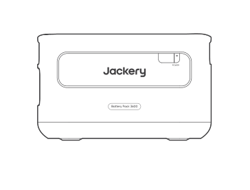

Jackery Battery Pack 3600

</li><li class="hb-inbox-card" data-item-number="2">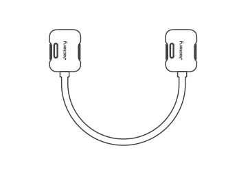

Expansion Cable

</li><li class="hb-inbox-card" data-item-number="3">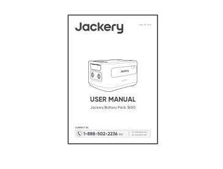

User Manual

</li></ol></figure>

## PRODUCT OVERVIEW

### FRONT VIEW

<figure class="hb-reference-figure" data-component-id="HB-SPECIAL-REFERENCE-FIGURE" data-reference-id="overview-front" data-source-fragment-sha256="3b8a386afe760754d905aeaf227db833f579ca615ea7ea8563a1e4fe907eeb37" data-step-captions="embedded">
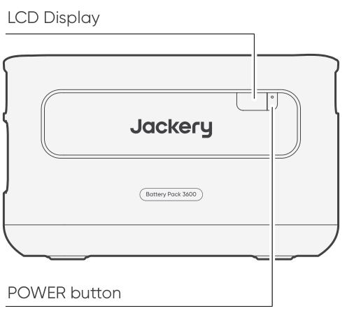
</figure>

### LEFT SIDE VIEW

<figure class="hb-reference-figure" data-component-id="HB-SPECIAL-REFERENCE-FIGURE" data-reference-id="overview-left" data-source-fragment-sha256="bfcc1c09df1ca41e5f77386db0c28da3ea8d4833398e80e819d1989aefe1fa5f" data-step-captions="embedded">
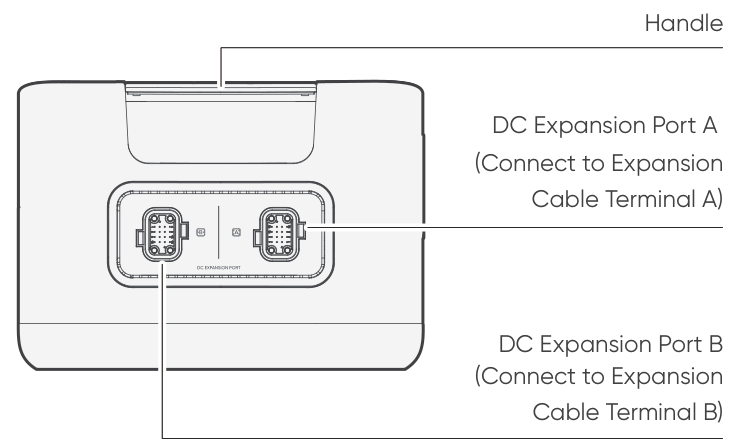
</figure>

## LCD DISPLAY

<figure class="hb-reference-figure" data-component-id="HB-SPECIAL-REFERENCE-FIGURE" data-reference-id="lcd-display" data-source-fragment-sha256="afbd65d1b59ea63a74a80c875eac7c6073098ecea14355586605cec61d9956d4" data-step-captions="embedded">
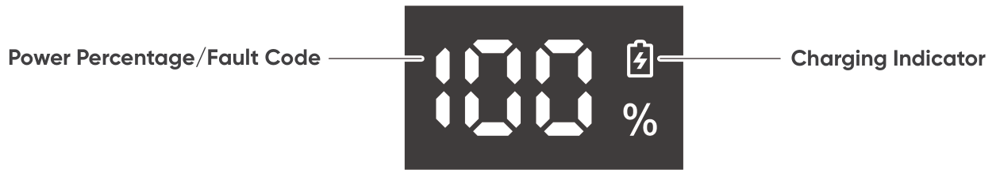
</figure>

<figure aria-label="LCD DISPLAY" class="hb-reference-composition hb-reference-lcd-descriptions" data-component-id="HB-TABLE-REFERENCE" data-component-variant="lcd-descriptions" tabindex="0"><table class="hb-reference-table"><tbody><tr><td><strong>Power Percentage/</strong> <strong>Fault Code</strong></td><td>The display shows the current power percentage. When the system fails, it will be displayed as the corresponding fault code F0-FF. If the FF code appears, please remove the loads and the product can recover by itself. If not, please contact Jackery Customer Support. In case of any other code appears, please contact our Customer Support.</td></tr><tr><td><strong>Charging Indicator</strong></td><td>The indicator is displayed when charging and disappears when it is fully charged.</td></tr></tbody></table></figure>

## OPERATIONS

### POWER ON/OFF

<figure class="hb-reference-figure" data-component-id="HB-SPECIAL-REFERENCE-FIGURE" data-reference-id="power-on-off" data-source-fragment-sha256="94ac08852423403f669617e9674b7d1adf0f60bd5d59012850c671571b6ebfe8" data-step-captions="embedded">
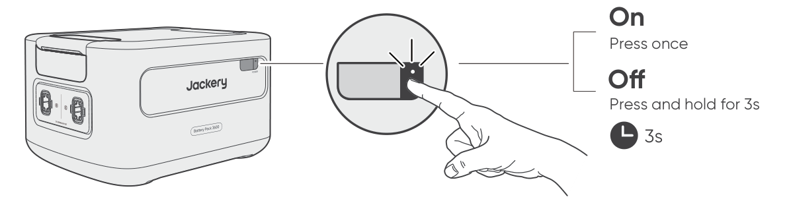
</figure>

<table class="manual-callout-table manual-callout-table"><tbody><tr><td class="manual-callout-label">NOTE</td><td class="manual-callout-body">
When using with Jackery HomePower 3600 Plus, you can control the power status (on or off) of Jackery Battery Pack 3600 through the main POWER button of Jackery HomePower 3600 Plus. The product will automatically shut down if it is not charged or no loads are connected for 2 hours.
</td></tr></tbody></table>

### LCD DISPLAY ON/OFF

<figure class="hb-reference-figure" data-component-id="HB-SPECIAL-REFERENCE-FIGURE" data-reference-id="lcd-on-off" data-source-fragment-sha256="4f07316fdbc9b269e3bb8ece6af3191e88e91b49d5d22c006339be020740bdca">

</figure>

When you press the main POWER button or when charging the product, the LCD display is illuminated. When you press it again, the LCD display will be switched off.

## TROUBLESHOOTING

If any of the following fault codes appear, follow the listed corrective actions to resolve the issue. If the fault persists, please contact Jackery Customer Support.

<figure aria-label="Error Code / Corrective Measures" class="hb-troubleshooting-composition" data-component-id="HB-TABLE-TROUBLESHOOTING" tabindex="0"><table class="hb-troubleshooting-table"><colgroup><col class="hb-troubleshooting-col-code"/><col class="hb-troubleshooting-col-measures"/></colgroup><thead><tr><th class="hb-troubleshooting-code" scope="col">Error Code</th><th class="hb-troubleshooting-measures" scope="col">Corrective Measures</th></tr></thead><tbody><tr><td class="hb-troubleshooting-code"><strong>F0</strong></td><td class="hb-troubleshooting-measures">Restart the product.</td></tr><tr><td class="hb-troubleshooting-code"><strong>F1, F2</strong></td><td class="hb-troubleshooting-measures">Contact Jackery Customer Support.</td></tr><tr><td class="hb-troubleshooting-code"><strong>F3</strong></td><td class="hb-troubleshooting-measures">Restart the product.</td></tr><tr><td class="hb-troubleshooting-code"><strong>F4</strong></td><td class="hb-troubleshooting-measures">Connect the product to loads to discharge its battery until the fault disappears.</td></tr><tr><td class="hb-troubleshooting-code"><strong>F5</strong></td><td class="hb-troubleshooting-measures">Charge the product via solar panels or AC wall outlet until the fault disappears.</td></tr><tr><td class="hb-troubleshooting-code"><strong>F6-F9,</strong> <strong>FA, FC, FE</strong></td><td class="hb-troubleshooting-measures">Contact Jackery Customer Support.</td></tr><tr><td class="hb-troubleshooting-code"><strong>FF</strong></td><td class="hb-troubleshooting-measures">Place the product in an environment with a proper temperature and wait till the fault disappears.</td></tr></tbody></table></figure>

## CONNECTIONS

Up to 5 sets of these products can be used along with Jackery HomePower 3600 Plus to meet the increased capacity needs.

<table class="manual-callout-table manual-callout-table"><tbody><tr><td class="manual-callout-label">CAUTION</td><td class="manual-callout-body">
Ensure all products are powered off before connecting the HomePower 3600 Plus to the Jackery Battery Pack 3600. To ensure proper operation of the product, make sure the air intake and exhaust vents on both sides are unobstructed. Leave at least 0.66 ft (≈200 mm) of space between the vents and any objects to allow for proper heat dissipation.
</td></tr></tbody></table>

<figure class="hb-reference-figure" data-component-id="HB-SPECIAL-REFERENCE-FIGURE" data-reference-id="clearance" data-source-fragment-sha256="f9ebd1504950935fee1743cd4fd3356ab515d08fee52d3c9317a47e2fe9e8806" data-step-captions="embedded">
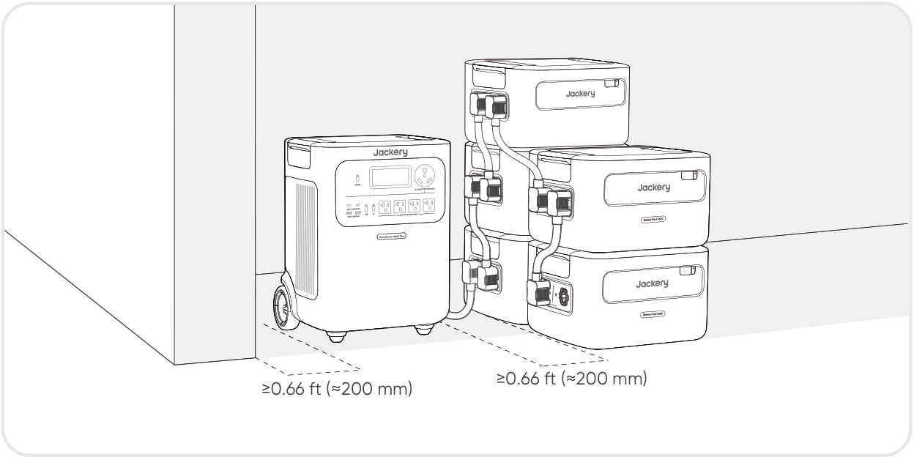
</figure>

<figure class="hb-reference-figure" data-component-id="HB-SPECIAL-REFERENCE-FIGURE" data-reference-id="stacking" data-source-fragment-sha256="cc6cfb4fceb0bb982ee2dc3cf920dd54ba485d6900ba0b9b6bd1e892bcb86bc9">

</figure>

<table class="manual-callout-table manual-callout-table"><tbody><tr><td class="manual-callout-label">NOTES</td><td class="manual-callout-body">
The display of theicon on the LCD screen (Jackery HomePower 3600 Plus) signifies a successful connection between the battery pack and the Jackery HomePower 3600 Plus. When using the product, do not stack more than three battery packs in one tower to prevent it from falling and causing injury. Please do not stack the product on the top of the Jackery HomePower 3600 Plus.
</td></tr></tbody></table>

<figure class="hb-reference-figure" data-component-id="HB-SPECIAL-REFERENCE-FIGURE" data-reference-id="locking" data-source-fragment-sha256="0920e155c9a022d8aa07133c7e0086b334a6fbdb474d063b7ef2938621dd6457" data-step-captions="embedded">
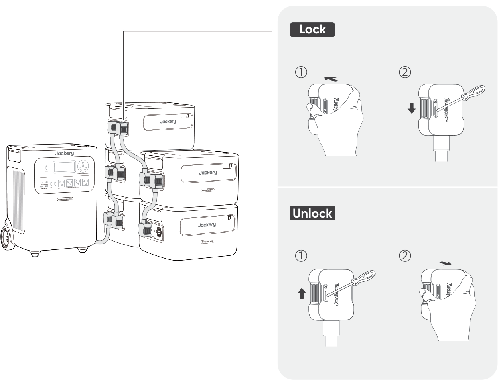
</figure>

## CHARGING

### CHARGING VIA AC WALL OUTLET

When charging from the wall, this product must be used with Jackery HomePower 3600 Plus.

<table class="manual-callout-table manual-callout-table"><tbody><tr><td class="manual-callout-label">Warning</td><td class="manual-callout-body">
Ensure all products are powered off before connecting the HomePower 3600 Plus to the Jackery Battery Pack 3600.
</td></tr></tbody></table>

<figure class="hb-reference-figure" data-component-id="HB-SPECIAL-REFERENCE-FIGURE" data-reference-id="ac-charging" data-source-fragment-sha256="4d3dbf0cc8876dcebd28f7539ac76e5057d9b92072665e48b4dd419d40965776" data-step-captions="embedded">
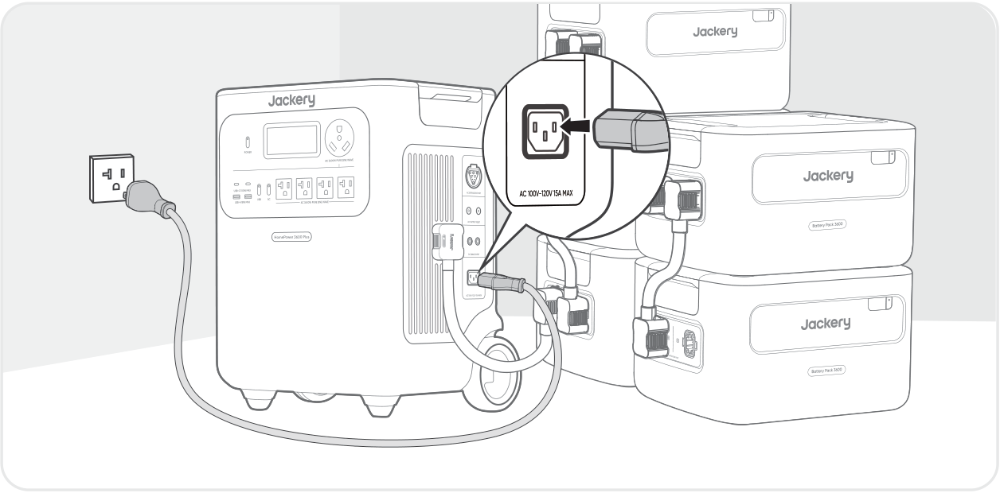
</figure>

### CHARGING VIA SOLAR PANELS SOLD SEPARATELY

Charge your product with solar panels and the Jackery HomePower 3600 Plus as shown in the figure below. Please refer to the Jackery HomePower 3600 Plus user manual for more information.

<figure class="hb-reference-figure" data-component-id="HB-SPECIAL-REFERENCE-FIGURE" data-reference-id="solar-charging" data-source-fragment-sha256="ae8652bbb44b687ec73b0ca6182bbbaab160d69087ff621c9e193f0e25b612b4" data-step-captions="embedded">
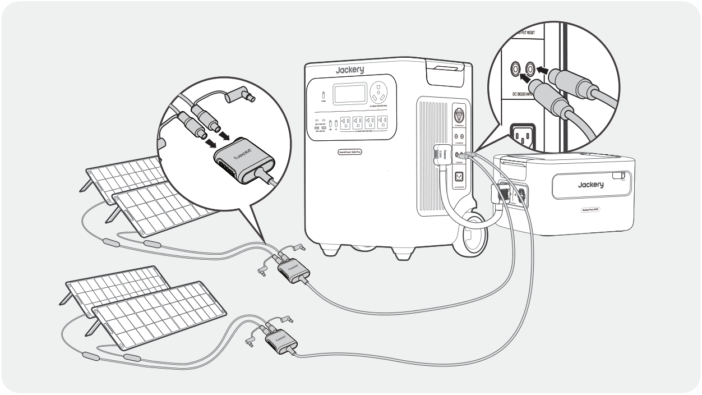
</figure>

## STORAGE

Store the product in a dry clean place with proper ventilation. Storage temperature and humidity:

<ul class="native-bullets"><li>1 month: -4°F to 113°F / -20°C to 45°C (0-60%RH)</li><li>3 months: 32°F to 113°F / 0°C to 45°C (0-60%RH)</li><li>12 months: 32°F to 77°F / 0°C to 25°C (0-60%RH)</li></ul>

If this product is stored for a long period of time (3 months - 6 months) with the power depleted, it may become unchargeable. To prevent this and maintain battery health, it is recommended to check and recharge the product every three months and perform a full charge and discharge cycle at least once every 6 to 12 months.

## SPECIFICATIONS

<h2 class="hb-spec-group">GENERAL INFO</h2>

<figure aria-label="GENERAL INFO" class="hb-spec-table-composition"><table class="manual-table manual-spec-table hb-spec-table"><colgroup><col class="hb-spec-col-label"/><col class="hb-spec-col-value"/></colgroup><tbody><tr><th class="manual-spec-label hb-spec-label" scope="row">Product Name</th><td class="manual-spec-value hb-spec-value">Jackery Battery Pack 3600</td></tr><tr><th class="manual-spec-label hb-spec-label" scope="row">Model No.</th><td class="manual-spec-value hb-spec-value">JBP-3600A</td></tr><tr><th class="manual-spec-label hb-spec-label" scope="row">Capacity</th><td class="manual-spec-value hb-spec-value">80Ah/44.8Vdc (3584Wh)</td></tr><tr><th class="manual-spec-label hb-spec-label" scope="row">Cell Chemistry</th><td class="manual-spec-value hb-spec-value">LiFePO₄</td></tr><tr><th class="manual-spec-label hb-spec-label" scope="row">Weight</th><td class="manual-spec-value hb-spec-value">About 55.1 lbs/25 kg</td></tr><tr><th class="manual-spec-label hb-spec-label" scope="row">Dimensions</th><td class="manual-spec-value hb-spec-value">14.8 x 12.5 x 9.0 in/37.5 x 31.7x 22.9 cm</td></tr><tr><th class="manual-spec-label hb-spec-label" scope="row">Cycle Life</th><td class="manual-spec-value hb-spec-value">6000 cycles to 70%+ capacity</td></tr></tbody></table></figure>

<h2 class="hb-spec-group">INPUT/OUTPUT PORTS</h2>

<figure aria-label="INPUT/OUTPUT PORTS" class="hb-spec-table-composition"><table class="manual-table manual-spec-table hb-spec-table"><colgroup><col class="hb-spec-col-label"/><col class="hb-spec-col-value"/></colgroup><tbody><tr><th class="manual-spec-label hb-spec-label" scope="row">DC Expansion Port (Input)</th><td class="manual-spec-value hb-spec-value">36.4V-50.4V⎓60A Max</td></tr><tr><th class="manual-spec-label hb-spec-label" scope="row">DC Expansion Port (Output)</th><td class="manual-spec-value hb-spec-value">36.4V-50.4V⎓100A Max</td></tr><tr><th class="manual-spec-label hb-spec-label" scope="row">Maximum Short Circuit Current and Duration</th><td class="manual-spec-value hb-spec-value">1160A/860μs</td></tr></tbody></table></figure>

<h2 class="hb-spec-group">ENVIRONMENTAL OPERATING TEMPERATURE</h2>

<figure aria-label="ENVIRONMENTAL OPERATING TEMPERATURE" class="hb-spec-table-composition"><table class="manual-table manual-spec-table hb-spec-table"><colgroup><col class="hb-spec-col-label"/><col class="hb-spec-col-value"/></colgroup><tbody><tr><th class="manual-spec-label hb-spec-label" scope="row">Charge Temperature</th><td class="manual-spec-value hb-spec-value">-4°F to 113°F / -20°C to 45°C</td></tr><tr><th class="manual-spec-label hb-spec-label" scope="row">Discharge Temperature</th><td class="manual-spec-value hb-spec-value">-4°F to 113°F / -20°C to 45°C</td></tr></tbody></table></figure>

## WARRANTY

<figure aria-label="WARRANTY" class="hb-warranty-intro-composition" data-component-id="HB-WARRANTY-LEAD">
<strong>We only provide our warranty to customers who purchase from the official Jackery website, Jackery-branded third-party platforms, or local authorized dealers.</strong>

*Warranty period and details may vary according to local laws, regulations, and authorized dealers.
</figure>

### Limited Warranty

<figure aria-label="Limited Warranty" class="hb-warranty-card" data-component-id="HB-WARRANTY-SECTION" data-warranty-card-index="1">
Jackery Inc. warrants to the original consumer purchaser that the Jackery product will be free from defects in workmanship and material under normal consumer use during the applicable warranty period identified in the 'Warranty Period' section below, subject to the exclusions set forth below.

This warranty statement sets forth Jackery's total and exclusive warranty obligation. We will not assume, nor authorize any person to assume for us, any other liability in connection with the sale of our products.
</figure>

### Warranty Period

<figure aria-label="Warranty Period" class="hb-warranty-period-card" data-component-id="HB-WARRANTY-YEARS">

3
<strong class="hb-warranty-years-unit">YEARS</strong><strong class="hb-warranty-period-label">Standard Warranty</strong>

The standard warranty period for Jackery Battery Pack 3600 is 36 months. In each case, the warranty period is measured starting on the date of purchase by the original consumer purchaser. The sales receipt from the first consumer purchase, or other reasonable documentary proof, is required in order to establish the start date of the warranty period.

2
<strong class="hb-warranty-years-unit">YEARS</strong><strong class="hb-warranty-period-label">Extended Warranty</strong>

To activate the Warranty Extension, you must register your product online or contact our customer service team at hello@jackery.com to extend the standard warranty runtime.

</figure>

### Repair or replacement

<figure aria-label="Repair or replacement" class="hb-warranty-card" data-component-id="HB-WARRANTY-SECTION" data-warranty-card-index="3">
Jackery will repair or replace (at Jackery's expense) any Jackery product that fails to operate during the applicable warranty period due to a defect in workmanship or material. The repaired/replaced product assumes the remaining warranty of the original date of purchase.
</figure>

### Limited to Original Consumer Buyer

<figure aria-label="Limited to Original Consumer Buyer" class="hb-warranty-card" data-component-id="HB-WARRANTY-SECTION" data-warranty-card-index="4">
The warranty on Jackery's product is limited to the original consumer purchaser and is not transferable to any subsequent owner.
</figure>

### Exclusions

<figure aria-label="Exclusions" class="hb-warranty-card" data-component-id="HB-WARRANTY-SECTION" data-warranty-card-index="5">
Jackery's warranty does not apply to: Misused, abused, modified, damaged by accident, or used for anything other than normal consumer use as authorized in Jackery's current product literature. Attempted repair by anyone other than an authorized facility. Any product purchased through an online auction house. Jackery's warranty does not apply to the battery cell unless the battery cell is fully charged by you within seven days after you purchase the product and at least once every 6 months thereafter.
</figure>

### Interpretation Rights

<figure aria-label="Interpretation Rights" class="hb-warranty-card" data-component-id="HB-WARRANTY-SECTION" data-warranty-card-index="6">
Jackery reserves the right to final interpretation of the above customer after-sales policy.
</figure>
