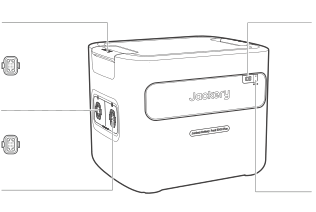
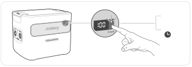
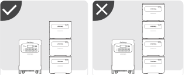
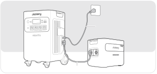
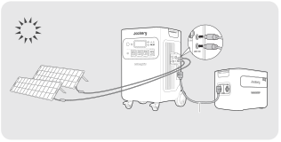

## 主な仕様

<h2 class="hb-spec-group">【Jackery Battery Pack 5000 Plus】</h2>

<figure aria-label="【Jackery Battery Pack 5000 Plus】" class="hb-spec-table-composition"><table class="manual-table manual-spec-table hb-spec-table"><colgroup><col class="hb-spec-col-label"/><col class="hb-spec-col-value"/></colgroup><tbody><tr><th class="manual-spec-label hb-spec-label" scope="row">製品の名称</th><td class="manual-spec-value hb-spec-value">Jackery Battery Pack 5000 Plus</td></tr><tr><th class="manual-spec-label hb-spec-label" scope="row">型番</th><td class="manual-spec-value hb-spec-value">JBP-5000A</td></tr><tr><th class="manual-spec-label hb-spec-label" scope="row">定格容量</th><td class="manual-spec-value hb-spec-value">45Ah/112Vdc (5040Wh)</td></tr><tr><th class="manual-spec-label hb-spec-label" scope="row">バッテリータイプ</th><td class="manual-spec-value hb-spec-value">LiFePO4（リン酸鉄リチウムイオン電池）</td></tr><tr><th class="manual-spec-label hb-spec-label" scope="row">サイズ＆重量</th><td class="manual-spec-value hb-spec-value">約418 x 344 x 336 mm (約37kg）</td></tr><tr><th class="manual-spec-label hb-spec-label" scope="row">DC拡張ポート（入力）</th><td class="manual-spec-value hb-spec-value">80.5V-126V⎓41A Max,電流制限41A</td></tr><tr><th class="manual-spec-label hb-spec-label" scope="row">DC拡張ポート（出力）</th><td class="manual-spec-value hb-spec-value">80.5V-126V⎓98A Max,電流制限98A</td></tr><tr><th class="manual-spec-label hb-spec-label" scope="row">充電温度</th><td class="manual-spec-value hb-spec-value">0°C~45°C (32°F~113°F)</td></tr><tr><th class="manual-spec-label hb-spec-label" scope="row">動作温度</th><td class="manual-spec-value hb-spec-value">-15°C~45°C (5°F~113°F)</td></tr><tr><th class="manual-spec-label hb-spec-label" rowspan="2" scope="row">保存温度</th><td class="manual-spec-value hb-spec-value">1年間 0~25℃ (32~77℉)；3ヶ月 0~45℃ (32~113℉)</td></tr><tr><td class="manual-spec-value hb-spec-value">1ヶ月 -20~45℃ (-4~113℉)</td></tr><tr><th class="manual-spec-label hb-spec-label" scope="row">認証</th><td class="manual-spec-value hb-spec-value">UN38.3</td></tr></tbody></table></figure>

本製品はJackery ポータブル電源 5000 Plus専用となります。他の機器には接続しないでください。

<strong>本機の仕様および外観は、改善のため予告なく変更することがあります。</strong>

### 充電式電池のリサイクルについて

本機はリサイクル可能な充電池を内蔵しています。この商品を廃棄する場合は、当社のカスタマーサポートにご連絡ください。充電池の取りはずしはお客様自身では行わないでください。

## 同梱品

<figure aria-label="同梱品" class="hb-inbox-composition" data-card-count="3" data-component-id="HB-SPECIAL-INBOX" data-inbox-variant="three-card-responsive"><ol class="hb-inbox-grid"><li class="hb-inbox-card" data-item-number="1">

本体

</li><li class="hb-inbox-card" data-item-number="2">

拡張ケーブル

</li><li class="hb-inbox-card" data-item-number="3">

取扱説明書

</li></ol></figure>

付属品を故障、紛失等してしまった場合はカスタマーサポートまでご連絡ください。

## 各部の名称

<figure class="hb-reference-figure hb-base-art-live-copy" data-component-id="HB-SPECIAL-REFERENCE-FIGURE" data-reference-id="overview" data-source-fragment-sha256="5cdc93745a922ff0b6c0755834701a3545cc685c06a005d91395d534a619f393" data-web-base-art-ref="overview" data-web-presentation-mode="base-art-live-copy">

<strong>ハンドル</strong><strong>ディスプレイ</strong><strong>DC 拡張ポート B</strong>バッテリーパック接続ケーブル のプラグBに接続<strong>DC 拡張ポート A</strong>バッテリーパック接続ケーブル のプラグAに接続<strong>主電源ボタン</strong>

</figure>

## 液晶画面

<figure class="hb-reference-figure hb-base-art-live-copy" data-component-id="HB-SPECIAL-REFERENCE-FIGURE" data-reference-id="lcd-map" data-source-fragment-sha256="228699c172c82197f1850966411f16b68b4fc9ff1063059df5c41fc297e3dc23" data-web-base-art-ref="lcd-map" data-web-presentation-mode="base-art-live-copy">

12

</figure>

<figure aria-label="液晶画面の表示" class="hb-lcd-table-composition" data-component-id="HB-TABLE-LCD-ICON" tabindex="0"><table class="hb-lcd-icon-table"><colgroup><col class="hb-lcd-col-number"/><col class="hb-lcd-col-icon"/><col class="hb-lcd-col-name"/><col class="hb-lcd-col-description"/></colgroup><tbody><tr><td class="hb-lcd-number">1</td><td class="hb-lcd-icon"></td><td class="hb-lcd-name">バッテリー残量(%)／エラーコード</td><td class="hb-lcd-description">バッテリー残量(%)のところに現在の電力値が表示されますが、システム障害が発生した場合、エラーコードの「F0-FF」と表示されます。しばらく本製品を放置した後、自動的に回復することができますが、回復しない場合は、カスタマーサービスにご連絡ください。他のエラーコードが表示された場合はカスタマーサービスにご連絡ください。</td></tr><tr><td class="hb-lcd-number">2</td><td class="hb-lcd-icon"></td><td class="hb-lcd-name">充電マーク</td><td class="hb-lcd-description">充電のための接続が行われると、このマークが表示され、満充電になると消えます。</td></tr></tbody></table></figure>

## 製品の使用方法について

### オン/オフ

「主電源ボタン」を短く押し、製品の電源を入れ、LCDを点灯させます。「主電源ボタン」を3秒間長押しして電源を切ります。

<figure class="hb-reference-figure hb-base-art-live-copy" data-component-id="HB-SPECIAL-REFERENCE-FIGURE" data-reference-id="power" data-source-fragment-sha256="6b9a9b2122e3d3021cc5b3d62ea65feeb8f05bcb5f8dafcf3d9d17db2cbb7c29" data-web-base-art-ref="power" data-web-presentation-mode="base-art-live-copy">

<strong>オン</strong>1回押す<strong>オフ</strong>3秒

</figure>

<table class="manual-callout-table manual-callout-table"><tbody><tr><td class="manual-callout-label">注釈</td><td class="manual-callout-body">
Jackery ポータブル電源 5000 Plusと併用する場合、Jackery ポータブル電源 5000 Plusの「主電源ボタン」からJackery Battery Pack 5000 Plusの電源の<strong>オン</strong>/<strong>オフ</strong>を制御できます。

充電されていないか、負荷が2時間接続されていないと、製品は自動的にシャットダウンします。
</td></tr></tbody></table>

### LCDディスプレイのオン/オフ

「主電源ボタン」を押した時や充電中はLCDディスプレイが点灯し、もう一度押すとLCDディスプレイが消灯します。

## ポータブル電源との併用

これらの製品は、Jackery ポータブル電源 5000 Plusとともに最大5セットまで使用することができ、容量の増加に対応することができます。  

<figure class="hb-reference-figure hb-base-art-live-copy" data-component-id="HB-SPECIAL-REFERENCE-FIGURE" data-reference-id="battery-packs" data-source-fragment-sha256="a0e467e4d4f123729e0000803843e327f8f16c0d3877f3466c09cedad5d1ba51" data-web-base-art-ref="battery-packs" data-web-presentation-mode="base-art-live-copy">

≥20cm≥20cm

</figure>

<table class="manual-callout-table manual-callout-table"><tbody><tr><td class="manual-callout-label">注釈</td><td class="manual-callout-body">
製品が適切に動作するよう、両側の吸気口と排気口が遮られていないことを確認してください。適切な放熱を確保するため、通気口と物との間に少なくとも20cmの空間を空けてください。
</td></tr></tbody></table>

<figure class="hb-reference-figure hb-base-art-live-copy" data-component-id="HB-SPECIAL-REFERENCE-FIGURE" data-reference-id="locking-connection" data-source-fragment-sha256="5cd0f0d942bf6e950c59b7bfb2b9a74d6fb0a332ede3021d0df17e14c299dd7b" data-web-base-art-ref="locking-connection" data-web-presentation-mode="base-art-live-copy">

<strong>ロック</strong><strong>ロック解除</strong>1212拡張ケーブル

</figure>

<figure class="hb-reference-figure" data-component-id="HB-SPECIAL-REFERENCE-FIGURE" data-reference-id="stack-limits" data-source-fragment-sha256="a8553cde7b43cdc66e2de2dbc5d7d2149572c7f857b3336020e6d750acc04aab">

</figure>

<table class="manual-callout-table manual-callout-table"><tbody><tr><td class="manual-callout-label">使用上のご注意</td><td class="manual-callout-body">
<strong>バッテリーパックをJackery ポータブル電源 5000 Plusに接続する前に、両方の電源</strong> <strong>が</strong><strong>オフ</strong><strong>になっていることを確認してください。 </strong>

LCD 画面(Jackery ポータブル電源 5000 Plus)にアイコンが表示されたら、バッテリーパックと Jackery ポータブル電源 5000 Plus の接続が成功したことを示します。

本製品を使用する際は、バッテリーパックが落下して怪我をするのを防ぐため、バッテリーパックを3つ以上重ねないでください。  

Jackery ポータブル電源 5000 Plusの上に本製品を積み重ねないでください。
</td></tr></tbody></table>

## 充電方法

### AC充電

AC充電の場合、本製品はJackery ポータブル電源 5000 Plusと一緒にお使いください。

<figure class="hb-reference-figure hb-base-art-live-copy" data-component-id="HB-SPECIAL-REFERENCE-FIGURE" data-reference-id="ac-charge" data-source-fragment-sha256="6c355bde99738f06744477312d027edbae6646efc33311fac1001aca8ddfe8ed" data-web-base-art-ref="ac-charge" data-web-presentation-mode="base-art-live-copy">

ACケーブル拡張ケーブル

</figure>

<table class="manual-callout-table manual-callout-table"><tbody><tr><td class="manual-callout-label">警告</td><td class="manual-callout-body">
バッテリーパックをJackery ポータブル電源 5000 Plusに接続する前に、両方の電源がオフになっていることを確認してください。
</td></tr></tbody></table>

### ソーラー充電

下図のように、ソーラーパネルとJackery ポータブル電源 5000 Plusを使って製品を充電します。詳細については、Jackery ポータブル電源 5000 Plusの取扱説明書を参照してください。

<figure class="hb-reference-figure hb-base-art-live-copy" data-component-id="HB-SPECIAL-REFERENCE-FIGURE" data-reference-id="solar-portable" data-source-fragment-sha256="e000f0afd55444076cbf672859209b8a3b861c79c9d3cd0587f1084e15e0f103" data-web-base-art-ref="solar-portable" data-web-presentation-mode="base-art-live-copy">

拡張ケーブルSolarSaga 200

</figure>

<figure class="hb-reference-figure hb-base-art-live-copy" data-component-id="HB-SPECIAL-REFERENCE-FIGURE" data-reference-id="solar-house" data-source-fragment-sha256="892af8b2a3239f9fd8922645e842bac9a6818cd8f6ab7b6828dd07723a3193aa" data-web-base-art-ref="solar-house" data-web-presentation-mode="base-art-live-copy">

拡張ケーブル

</figure>

<table class="manual-callout-table manual-callout-table"><tbody><tr><td class="manual-callout-label">警告</td><td class="manual-callout-body">
バッテリーパックを本体に接続する前に、High-PV入力を外すか、High-PVスイッチをOFFにする必要があります。
</td></tr></tbody></table>

## 保証サービス

本書は、株式会社 Jackery Japan（以下、当社）製品の交換・修理にかかる保証サービスの内容を説明するものです。

1. 当社は、当社が運営するJackery Japan 公式オンラインストア、当社もしくは正規販売代理店が販売元として販売した当社のポータブル電源・ソーラーパネル、その他の付属製品について保証期間中に、当社が定める条件に従って保証サービスを提供しております。

2. 当社は、保証期間中に、当社が定める「保証条件」に合致した場合、Jackery 製品を交換・無償修理するものとします。

保証期間内に当社に有効な請求が行われた場合、当社は、同じJackery 製品を交換もしくは価値の等しい製品と交換いたします。無償修理については、当社ポータブル電源の新品のご購入日から30 日以上5 年間以内の製品を対象といたします。

3. 取扱説明書、本体貼付ラベルなどの注意書に従った使用状態で、保証期間内に製品が故障した場合のみ無償交換· 無償修理をさせていただきます。

4. 当社は、日本国内に居住または滞在中のお客様のみを対象として、日本国内においてのみ本サービスを提供いたします。

5. 保証期間内でも次の場合には保証対象外となります。

(1) 保証期間中に発生した故障について、保証期間終了後に請求された場合

(2) 使用上の誤り( 取扱説明書、本体貼付ラベル等の注意書きに従った正常な使用をしなかった場合を含む) による故障· 損傷

(3) 他の機器から受けた障害または不当な修理、改造による故障· 損傷

(4) お買上げ後の移設、輸送、落下などによる故障· 損傷

(5) 火災や地震、風水害、落雷その他の天災地変、公害、塩害、異常電圧などによる故障· 損傷

(6) 業務用など一般家庭用以外での使用による故障損傷

(7) 消耗· 摩耗した部品の交換、汚損した部分の交換

6. 在庫切れや販売終了など当社都合で新品製品が調達できなかった場合返金にて対応することがあります。

7. 本書に基づく交換・修理製品については、最初のご購入時の保証期間、または交換日から90 日間のどちらか長い期間で保証されます。

8. お客様の修理依頼品の状態、故障部分あるいは当社の事情により、修理による対応が不可能、困難または合理的でないと判断した場合、かつ保証期間内と確認できた場合に、当社が選定する同等程度の機能・性能を有する製品（修理依頼品と類似の製品・異機種を含みます）と修理依頼品との交換をさせていただく場合がございます。

9. 当社は、保証期間が過ぎた製品及び保証対象外の製品について、修理すれば使用できる場合は、ご希望により有償修理にて承ります。　

10. 当社の製品または製品のご使用から起因して生じた障害・損傷により、直接または間接的に発生した製品以外への損失、その他の金銭的損害につきまして、弊社はその一切の責任は負わないものとします。

11. 本書は再発行いたしませんので紛失しないよう大切に保管してください。

※保証期間はお買い上げ日より5 年間となります。

※本書は、本書記載内容（上記記載）で無償製品交換・無償修理を行うことをお約束するものです。故障による保証サービスを受ける際は、当社もしくは当社製品正規取扱店が運営するショップでの購入が証明できるもの（インターネットでの購入は注文番号、それ以外はレシートや領収書など）をお手元にご用意の上、JackeryJapan カスタマーサービス、もしくは販売店へお問い合わせください。

※故障による保証サービスを受ける際は、当社もしくは当社製品正規取扱店が運営するショップでの購入が証明できるもの（インターネットでの購入は注文番号、それ以外はレシートや領収書など）が必須となりますのでご注意ください。当社製品正規取扱店につきましては、当社公式HP をご確認ください。

※本書によって保証責任者、及びそれ以外の事業者に対するお客様の法律上の権利を制限するものではありません。

※保証内容は都合により予告なく変更する場合がございますのでご了承ください。

<figure class="hb-reference-figure" data-component-id="HB-SPECIAL-REFERENCE-FIGURE" data-reference-id="service-logo" data-source-fragment-sha256="65f796594cc68c86dea0fcfc0e2810ec79cf1ee2d28d94270162f6e3f315a8e8">

</figure>

公式サイト

http://www.jackery.jp

カスタマーサービス

jackery.jp@jackery.com 

## 使用上のご注意

<strong>本製品を使用する際、以下の注意事項を守ってください。</strong>

<ul><li>
本製品を使用する前に取扱説明書をよくお読みください。
</li><li>
危険防止のため、お子様の近くで本製品を使用する時は、お子様から目を離さないようにしてください。
</li><li>
メーカーが保証していない推奨外の付属品を使用すると、感電の恐れがあります。
</li><li>
製品を使用しない場合は、プラグを抜いてください。
</li><li>
火災、爆発、感電などの予測できない危険が発生する恐れがありますので、本製品を解体しないでください。
</li><li>
感電の危険があるため、破損したコードやプラグ、またはケーブルを使用しないでください。
</li><li>
製品の充電は風通しの良い場所で行い、風通しの悪い場所での充電はおやめください。
</li><li>
雨に濡れないよう、風通しのよい乾燥した場所に保管してください。本製品は濡れると感電の危険があります。
</li><li>
火災、爆発などの事故の原因となるため、本製品を火気に近づけないでください。
</li><li>
高温の下（直射日光や猛暑の車内）で使用したり放置しないでください。内蔵のバッテリーが過熱して発火したり、機能しなくなったり、寿命が短くなる可能性があります。
</li><li>
本製品を初めてご使用になる時は、十分に充電してからご使用ください。本製品を電池が切れた状態で長期間（3ヶ月～6ヶ月）放置すると、性能が低下し、過放電により充電ができなくなる場合があります。
</li></ul>

本製品はJackeryアプリケーションによるスマートコントロールに対応しています。

ご利用いただくには、下記のアプリストアより「Jackery」で検索して「Jackery アプリ」をダウンロードしてください。

<figure class="hb-reference-figure" data-component-id="HB-SPECIAL-REFERENCE-FIGURE" data-reference-id="app-download" data-source-fragment-sha256="a3179ffeb93e642d99fdb499785db82c7c7502fe8845c0d89ca551d41bfef2b7">

</figure>

<figure class="hb-reference-figure" data-component-id="HB-SPECIAL-REFERENCE-FIGURE" data-reference-id="app-qr" data-source-fragment-sha256="5eb43642300c375dc4eec76824daccd3cad4d079b319cc9ab3b03081bd37e22a">

</figure>

