

## IMPORTANT

Congratulations on your new Jackery Explorer 300. Please read this manual carefully before using the product, particularly the relevant precautions to ensure proper use. Keep this manual in an accessible place for future reference. In compliance with laws and regulations, the right of final interpretation of this document and all related documents of this product resides with the Company. Although every effort has been made to ensure the accuracy of this manual, Jackery assumes no responsibility for any errors that may appear. Please note that no further notifications will be given in case of any update, revision, or termination. For the latest version of the product manuals, visit support.jackery.com. *The images are for reference purposes only. Please refer to the actual product.

## IMPORTANT SAFETY INFORMATION

<table class="manual-callout-table manual-callout-table"><tbody><tr><td class="manual-callout-label">WARNING</td><td class="manual-callout-body">
<strong>INSTRUCTIONS PERTAINING TO RISK OF FIRE, ELECTRIC SHOCK, OR INJURY TO PERSONS</strong>
</td></tr></tbody></table>

<strong>Always follow these basic precautions when using this product.</strong>

<ul><li>Read all the instructions before using the product.</li><li>Do not allow children to play with the product. Close supervision of children is necessary when the product is used near children.</li><li>Risk of electric shock may occur if using accessories that are not recommended or sold by professional product manufacturers.</li><li>When the product is not in use, unplug the power plug from the product's socket.</li><li>Do not dismantle the product, as this may lead to unpredictable risks such as fire, explosion, or electric shock.</li><li>Do not use the product with damaged cords, plugs, or output cables, as this may cause electric shock.</li><li>To ensure proper air circulation, keep the product vents uncovered. The area where the product is used must have adequate airflow in a cool, dry environment to prevent overheating.<ul><li>Charging in damp or poorly ventilated spaces may cause safety hazards.</li><li>Water can cause short circuits or damage to the charger, leading to safety risks.</li></ul></li><li>Do not expose the product to fire, high temperatures, direct sunlight, or high-heat environments such as inside a parked vehicle. Such exposure may result in fire or explosion.</li></ul>

### USER MAINTENANCE INSTRUCTIONS

During the lifecycle of energy storage products, a certain degree of capacity and energy degradation is expected. As the number of charge and discharge cycles increases and storage time extends, this degradation will gradually intensify, which is a normal phenomenon consistent with the natural aging of battery cells.

## MEANING OF SYMBOLS

<figure aria-label="Signal words" class="hb-symbol-signal-composition" data-component-id="HB-TABLE-SYMBOL-SIGNAL"><table class="hb-symbol-signal-table"><colgroup><col class="hb-symbol-signal-col-label"/><col class="hb-symbol-signal-col-meaning"/></colgroup><thead><tr><th class="hb-symbol-signal-label-heading" scope="col">Symbol</th><th class="hb-symbol-signal-meaning-heading" scope="col">Meaning</th></tr></thead><tbody><tr><td class="hb-symbol-signal-label-cell">⚠WARNING</td><td class="hb-symbol-signal-meaning-cell">Hazardous practices that may result in severe injury, death, and/or property damage.</td></tr><tr><td class="hb-symbol-signal-label-cell">⚠CAUTION</td><td class="hb-symbol-signal-meaning-cell">Hazardous practices that may result in personal injury and/or property damage.</td></tr><tr><td class="hb-symbol-signal-label-cell">⚠NOTE</td><td class="hb-symbol-signal-meaning-cell">Hazardous practices that may result in equipment damage, data loss, performance deterioration, or unanticipated results.</td></tr><tr><td class="hb-symbol-signal-label-cell">⚠TIP</td><td class="hb-symbol-signal-meaning-cell">Supplements the important information or operation tips in the text.</td></tr></tbody></table></figure>

<figure aria-label="MEANING OF SYMBOLS" class="hb-symbol-pair-composition" data-component-id="HB-TABLE-SYMBOL-ICON">

<table class="hb-symbol-panel-table"><colgroup><col class="hb-symbol-col-icon"/><col class="hb-symbol-col-meaning"/></colgroup><thead><tr><th class="hb-symbol-icon-heading" scope="col">Symbol</th><th class="hb-symbol-meaning-heading" scope="col">Meaning</th></tr></thead><tbody><tr><td class="hb-symbol-icon"></td><td class="hb-symbol-meaning">Warning and Caution Symbols. Must read to alert individuals to potential hazards or risks.</td></tr><tr><td class="hb-symbol-icon"></td><td class="hb-symbol-meaning">Read the user manual before operation.</td></tr><tr><td class="hb-symbol-icon"></td><td class="hb-symbol-meaning">Do not dismantle the product.</td></tr><tr><td class="hb-symbol-icon"></td><td class="hb-symbol-meaning">Keep the product away from fire.</td></tr></tbody></table>

<table class="hb-symbol-panel-table"><colgroup><col class="hb-symbol-col-icon"/><col class="hb-symbol-col-meaning"/></colgroup><thead><tr><th class="hb-symbol-icon-heading" scope="col">Symbol</th><th class="hb-symbol-meaning-heading" scope="col">Meaning</th></tr></thead><tbody><tr><td class="hb-symbol-icon"></td><td class="hb-symbol-meaning">Keep away from children.</td></tr><tr><td class="hb-symbol-icon"></td><td class="hb-symbol-meaning">This symbol indicates that a lithium-ion (Li-ion) battery is inside the product and should be disposed of or recycled properly.</td></tr><tr><td class="hb-symbol-icon"></td><td class="hb-symbol-meaning">This symbol indicates that the product shall not be disposed of as household waste, and should be delivered to a designated collection facility for recycling. Proper disposal and recycling can help protect the environment. For more information about the disposal and recycling of this product, contact your local community, disposal service, or dealer.</td></tr><tr><td class="hb-symbol-icon"></td><td class="hb-symbol-meaning">Batteries and accumulators must not be disposed of with household waste. As a consumer, you are legally required to dispose of all batteries and accumulators at designated collection points, regardless of whether they contain hazardous substances. Please return used batteries and accumulators to a local collection point, recycling center, or to the retailer where they were purchased. Proper disposal ensures environmentally responsible recycling and prevents potential harm to human health and the environment.</td></tr></tbody></table>

</figure>

## WHAT'S IN THE BOX

<figure aria-label="WHAT'S IN THE BOX" class="hb-inbox-composition" data-card-count="4" data-component-id="HB-SPECIAL-INBOX" data-inbox-variant="responsive-card-grid"><ol class="hb-inbox-grid"><li class="hb-inbox-card" data-item-number="1">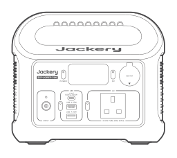

Jackery Explorer 300

</li><li class="hb-inbox-card" data-item-number="2">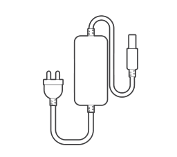

65W AC Adapter

</li><li class="hb-inbox-card" data-item-number="3">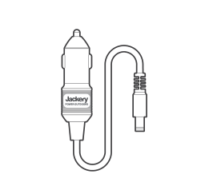

Car Charging Cable

</li><li class="hb-inbox-card" data-item-number="4">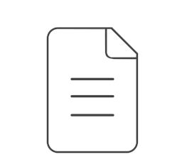

Doucuments

</li></ol></figure>

## PRODUCT OVERVIEW

### FRONT VIEW

<figure class="hb-reference-figure" data-component-id="HB-SPECIAL-REFERENCE-FIGURE" data-reference-id="overview-front" data-source-fragment-sha256="a388878c85dd56d5a6cf7af6d84527fdbd06af44d700c8649482db9f68be1f58" data-step-captions="embedded">
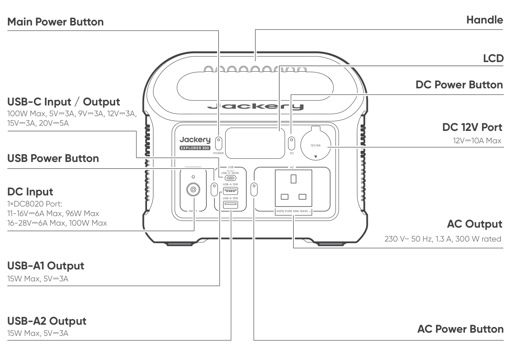
</figure>

## LCD DISPLAY

<figure class="hb-reference-figure" data-component-id="HB-SPECIAL-REFERENCE-FIGURE" data-reference-id="lcd-display" data-source-fragment-sha256="50c403a05e175493963b6a3545733adaa50f41022b593f4269d5bc59c2865ea5" data-step-captions="embedded">
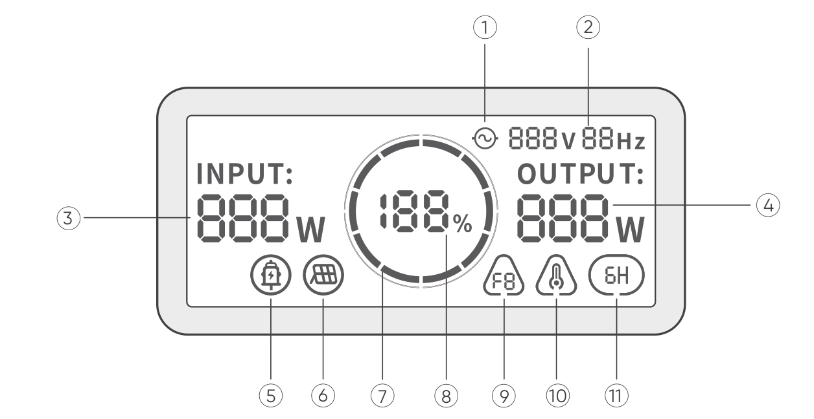
</figure>

<figure aria-label="LCD DISPLAY" class="hb-lcd-table-composition" data-component-id="HB-TABLE-LCD-ICON" tabindex="0"><table class="hb-lcd-icon-table"><colgroup><col class="hb-lcd-col-number"/><col class="hb-lcd-col-icon"/><col class="hb-lcd-col-name"/><col class="hb-lcd-col-description"/></colgroup><tbody><tr><td class="hb-lcd-number">1</td><td class="hb-lcd-icon"></td><td class="hb-lcd-name">AC Power Indicator</td><td class="hb-lcd-description">The AC output (pure sine wave) is on.</td></tr><tr><td class="hb-lcd-number">2</td><td class="hb-lcd-icon"></td><td class="hb-lcd-name">Output Voltage and Frequency</td><td class="hb-lcd-description">Displays the output voltage and frequency.</td></tr><tr><td class="hb-lcd-number">3</td><td class="hb-lcd-icon"></td><td class="hb-lcd-name">Input Power</td><td class="hb-lcd-description">Displays the input power in watts.</td></tr><tr><td class="hb-lcd-number">4</td><td class="hb-lcd-icon"></td><td class="hb-lcd-name">Output Power</td><td class="hb-lcd-description">Displays the output power in watts.</td></tr><tr><td class="hb-lcd-number">5</td><td class="hb-lcd-icon"></td><td class="hb-lcd-name">Car Charging Indicator</td><td class="hb-lcd-description">The product is charged via the DC Input (DC8020) using DC 12V (car charging).</td></tr><tr><td class="hb-lcd-number">6</td><td class="hb-lcd-icon"></td><td class="hb-lcd-name">Solar Charging Indicator</td><td class="hb-lcd-description">The product is charged via the DC Input (DC8020) using solar panel(s).</td></tr><tr><td class="hb-lcd-number">7</td><td class="hb-lcd-icon"></td><td class="hb-lcd-name">Battery Power Indicator</td><td class="hb-lcd-description">When the product is being charged, the orange circle around the battery percentage will light up in sequence. When charging other devices, the orange circle will stay on.</td></tr><tr><td class="hb-lcd-number">8</td><td class="hb-lcd-icon"></td><td class="hb-lcd-name">Remaining Battery Percentage</td><td class="hb-lcd-description">Displays the remaining battery percentage.</td></tr><tr><td class="hb-lcd-number">9</td><td class="hb-lcd-icon"></td><td class="hb-lcd-name">Fault Code</td><td class="hb-lcd-description">A product error has occurred. Please refer to the Troubleshooting section for details.</td></tr><tr><td class="hb-lcd-number">10</td><td class="hb-lcd-icon"></td><td class="hb-lcd-name">High Temperature Indicator</td><td class="hb-lcd-description">High temperature protection is triggered. The product may stop functioning until its temperature returns to the normal operating range.</td></tr><tr><td class="hb-lcd-number">10</td><td class="hb-lcd-icon"></td><td class="hb-lcd-name">Low Temperature Indicator</td><td class="hb-lcd-description">Low temperature protection is triggered. The product may stop functioning until its temperature returns to the normal operating range.</td></tr><tr><td class="hb-lcd-number">11</td><td class="hb-lcd-icon"></td><td class="hb-lcd-name">Energy Saving Mode</td><td class="hb-lcd-description">On: Energy Saving Mode is enabled. Off: Energy Saving Mode is disabled.</td></tr></tbody></table></figure>

## OPERATIONS

### POWER ON/OFF

<figure class="hb-reference-figure" data-component-id="HB-SPECIAL-REFERENCE-FIGURE" data-reference-id="power-on-off" data-source-fragment-sha256="0c49462bdcd8aff6fa75783bb500537f71c825688a91068609e6858358791b92" data-step-captions="embedded">
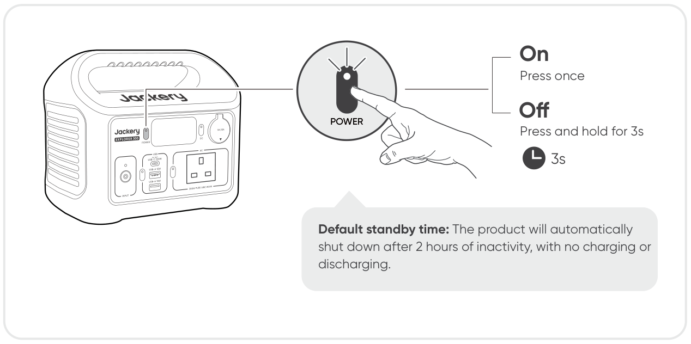
</figure>

### AC OUTPUT ON/OFF

<figure class="hb-reference-figure" data-component-id="HB-SPECIAL-REFERENCE-FIGURE" data-reference-id="ac-output" data-source-fragment-sha256="2d94ec4244573e507ebd81d9d3d7e34858bc706320b142a7809becc19069df8d" data-step-captions="embedded">
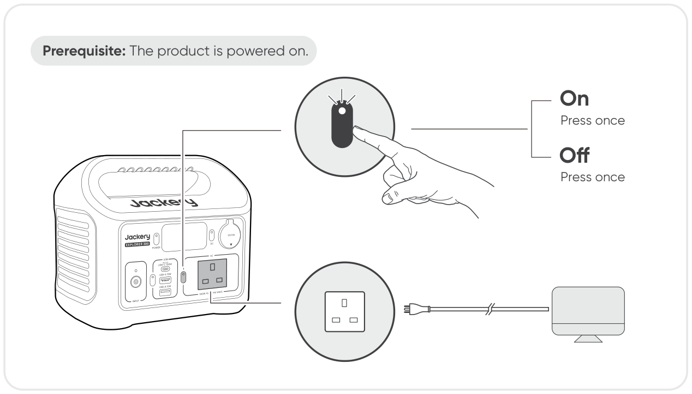
</figure>

### DC 12V OUTPUT ON/OFF

<figure class="hb-reference-figure" data-component-id="HB-SPECIAL-REFERENCE-FIGURE" data-reference-id="dc-output" data-source-fragment-sha256="b6c4c2620ae595d3438ba398cdac0002bd69321a2faabf7147514559e062d621" data-step-captions="embedded">
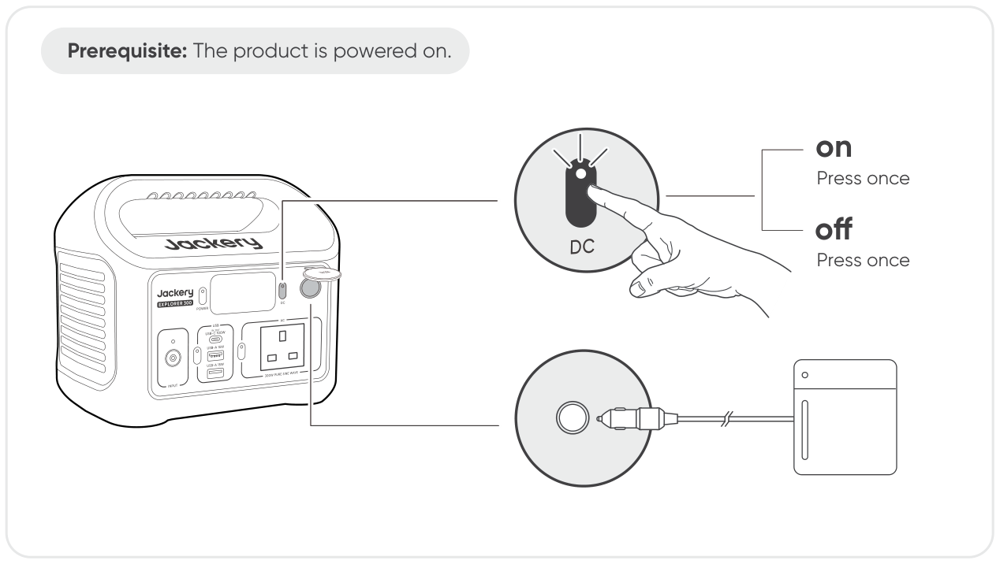
</figure>

The product can charge your car battery using the Jackery 12V automobile battery charging cable, which is sold separately and available on our website.

<table class="manual-callout-table manual-callout-table"><tbody><tr><td class="manual-callout-label">CAUTION</td><td class="manual-callout-body"><ul><li>USB-C 100W is a USB-PD Power Source 3 (PS3) high-power output port. If the connected user device or accessory does not meet safety requirements, there may be a fire risk. Before using these ports, ensure that the connected device or accessory has fire safety protection.</li><li>Only connect Jackery Explorer 300 to devices or accessories that comply with clauses 6.3, 6.4, and 6.5 of IEC/EN/UL 62368-1 (or other equivalent standards).</li><li>To obtain maximum output power, use the USB-C to USB-C 5A cable (20V DC/5A, 100W).</li></ul></td></tr></tbody></table>

<table class="manual-callout-table manual-callout-table"><tbody><tr><td class="manual-callout-label">CAUTION</td><td class="manual-callout-body"><ul><li>The DC 12V port is only compatible with 12V car batteries and not suitable for 24V systems.</li><li>Do not start the car while the product is charging the car battery through the DC 12V port, as this may damage the product.</li><li>This feature is intended for emergency use only and cannot charge a dead or damaged car battery.</li></ul></td></tr></tbody></table>

### USB OUTPUT ON/OFF

<figure class="hb-reference-figure" data-component-id="HB-SPECIAL-REFERENCE-FIGURE" data-reference-id="usb-output" data-source-fragment-sha256="3946d7dabcad3e2bd8673b34b4f046c38c42ebb0ac5b3e60975a35bd2112ad7c" data-step-captions="embedded">
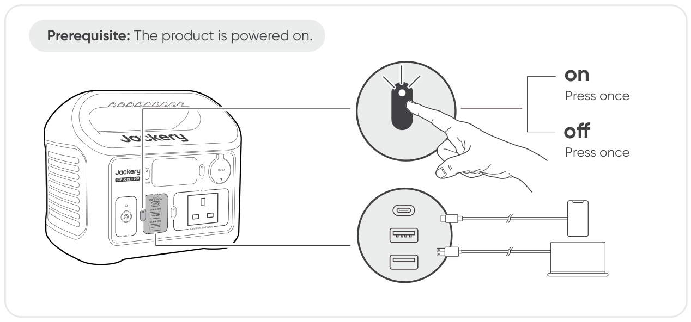
</figure>

### ENERGY SAVING MODE

To prevent unnecessary battery consumption caused by forgetting to turn off the output, Energy Saving Mode is enabled by default. If no device is connected or the connected device's power consumption is below a certain threshold (AC output ≤ 25W, USB + DC 12V port ≤ 2W ) for 6 hours, the product will automatically turn off the outputs.

To turn Energy Saving Mode on or off, press and hold both the AC power button and the main power button for 3 seconds.

<figure class="hb-reference-figure" data-component-id="HB-SPECIAL-REFERENCE-FIGURE" data-reference-id="energy-saving" data-source-fragment-sha256="17fe25de0a8d0cf1ce1b0fad32c7fb2cec87c7eb47786b6b8e367609ac71dc18" data-step-captions="embedded">
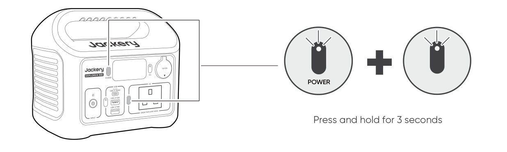
</figure>

<table class="manual-callout-table manual-callout-table"><tbody><tr><td class="manual-callout-label">Note</td><td class="manual-callout-body"><ul><li>When Energy Saving Mode is disabled, the product will not automatically turn off the AC or DC output.</li><li>Energy Saving Mode resumes previous state after power-on. Manual switching is required for mode changes.</li></ul></td></tr></tbody></table>

### LCD SCREEN ON/OFF

<figure aria-label="LCD SCREEN ON/OFF" class="hb-lcd-mode-composition" data-component-id="HB-TABLE-LCD-MODE">
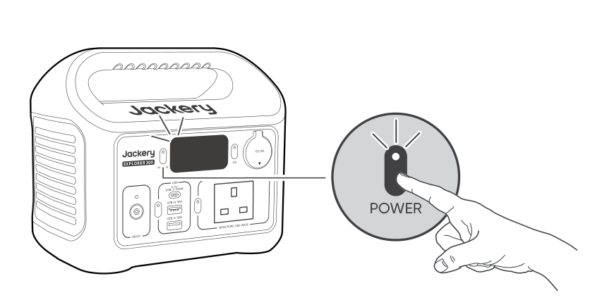

<table class="hb-lcd-mode-table"><colgroup><col class="hb-lcd-mode-col-state"/><col class="hb-lcd-mode-col-action"/><col class="hb-lcd-mode-col-copy"/></colgroup><tbody><tr><td class="hb-lcd-mode-state" rowspan="3">LCD Screen</td><td class="hb-lcd-mode-action">Turn on</td><td class="hb-lcd-mode-copy">Press the Main Power Button or when the product is charging.</td></tr><tr><td class="hb-lcd-mode-action">Turn off</td><td class="hb-lcd-mode-copy">Press the Main Power Button.</td></tr><tr><td class="hb-lcd-mode-action">Auto-off</td><td class="hb-lcd-mode-copy">The LCD screen turns off automatically after 2 minutes of inactivity.</td></tr><tr><td class="hb-lcd-mode-state" rowspan="3">Always-on Display Mode (under charging or discharging state)</td><td class="hb-lcd-mode-action">Turn on</td><td class="hb-lcd-mode-copy">Double-click the Main Power Button when the LCD screen is ON.</td></tr><tr><td class="hb-lcd-mode-action">Turn off</td><td class="hb-lcd-mode-copy">Press the Main Power Button.</td></tr><tr><td class="hb-lcd-mode-action">Auto-off</td><td class="hb-lcd-mode-copy">The Always-on Display Mode turns off automatically after 2 hours of inactivity.</td></tr></tbody></table>
</figure>

## CHARGING

<strong>Green energy first:</strong> We advocate to use the green energy first. This product supports two modes of charging at the same time: solar charging and AC wall charging. When AC wall charging and solar charging are turned on at the same time, the product will give priority to solar charging and both methods will be used to charge the battery at the maximum permissible power.

<strong>Fully charge the product before its first use.</strong>

<table class="manual-callout-table manual-callout-table"><tbody><tr><td class="manual-callout-label">Note</td><td class="manual-callout-body"><ul><li>The recommended charging temperature for the product ranges from 32°F to 113°F (0°C to 45°C), and the discharging temperature ranges from 5°F to 113°F (-15°C to 45°C). Operating the product beyond this temperature range may restrict its charging and discharging capabilities, or even prevent it from charging or discharging.</li><li>The charging power and battery capacity of the product may vary due to temperature fluctuations.</li></ul></td></tr></tbody></table>

<table class="manual-callout-table manual-callout-table"><tbody><tr><td class="manual-callout-label">Note</td><td class="manual-callout-body">
When the product is charged via the 65W AC Adapter or the USB-C port, the charging icon will not appear on the LCD screen. Please refer to the battery power indicator and input power displayed on the LCD to check the charging status.
</td></tr></tbody></table>

### CHARGING VIA 65W AC ADAPTER

Connect the included 65W AC adapter to the product’s DC8020 port and plug the adapter into a wall outlet.

<figure class="hb-reference-figure" data-component-id="HB-SPECIAL-REFERENCE-FIGURE" data-reference-id="charging-ac" data-source-fragment-sha256="2c261dbfb045fff96c530ea2b87ca95408fc8dae2ade5a7ab055062223b35f0a">
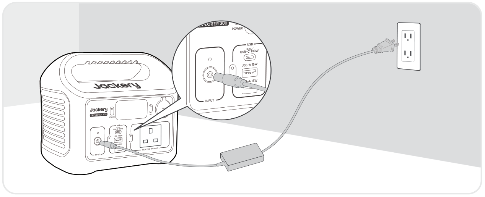
</figure>

### CHARGING VIA USB-C PORT (100W MAX)

Charge the product using the USB-C port.

<figure class="hb-reference-figure" data-component-id="HB-SPECIAL-REFERENCE-FIGURE" data-reference-id="charging-usbc" data-source-fragment-sha256="96591022ea4aa8968dacde549c054cca0d58e861d09a63ba1293d5f8d8bc9ca0" data-step-captions="embedded">
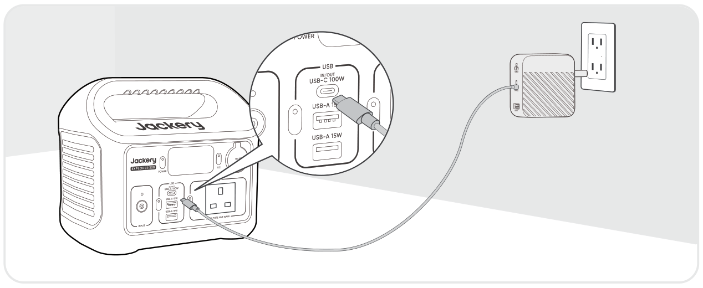
</figure>

<table class="manual-callout-table manual-callout-table"><tbody><tr><td class="manual-callout-label">Note</td><td class="manual-callout-body">
The USB-C port does not support solar panel input.
</td></tr></tbody></table>

### DC INPUT INDICATOR

<figure class="hb-reference-figure" data-component-id="HB-SPECIAL-REFERENCE-FIGURE" data-reference-id="dc-input-led" data-source-fragment-sha256="eb54a06bbaa93bbde5c0594b6883623cdfa9e46cad948476631cc08b5503347e">
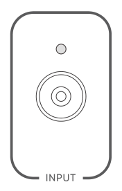
</figure>

<figure aria-label="DC INPUT INDICATOR" class="hb-reference-composition hb-reference-lcd-actions-compact" data-component-id="HB-TABLE-REFERENCE" data-component-variant="lcd-actions-compact" tabindex="0"><table class="hb-reference-table"><thead><tr><th scope="col"><strong>LED Status</strong></th><th scope="col"><strong>Description</strong></th></tr></thead><tbody><tr><td>Solid Red</td><td>Charging</td></tr><tr><td>Solid Green</td><td>Fully charged</td></tr><tr><td>Off</td><td>No power input</td></tr></tbody></table></figure>

<table class="manual-callout-table manual-callout-table"><tbody><tr><td class="manual-callout-label">Note</td><td class="manual-callout-body">
Observe the DC Input Indicator when charging with a solar panel or car charger.
</td></tr></tbody></table>

### CHARGING VIA SOLAR PANELS (100W MAX)

Jackery Explorer 300 has one DC8020 input port and is compatible with the Jackery solar panels.

<figure class="hb-reference-figure" data-component-id="HB-SPECIAL-REFERENCE-FIGURE" data-reference-id="charging-solar" data-source-fragment-sha256="c976793c16956e6e2fad2a9895523c8d7af0b9df1115405bae5219e54545d1a5" data-step-captions="embedded">
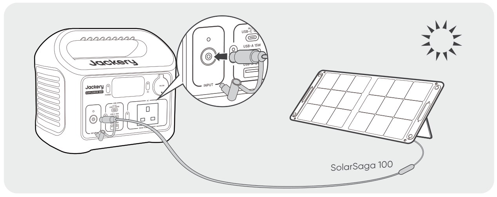
</figure>

It is recommended to use the Jackery Solar Panel to charge the Explorer 300. Ensure that the open-circuit voltage (Voc) of the solar panel falls within the Jackery Explorer 300's DC input voltage range (16V–28V).

<table class="manual-callout-table manual-callout-table"><tbody><tr><td class="manual-callout-label">CAUTION</td><td class="manual-callout-body"><ul><li>Only one solar panel can be connected to the DC8020 input port.</li><li>Jackery is not responsible for any damage or loss resulting from the use of third-party solar panels.</li></ul></td></tr></tbody></table>

### CHARGING WITH A CAR CHARGER

This product can be charged using a 12V car charger. Ensure that the car charger and the 12V car power outlet provide a good connection.

<figure class="hb-reference-figure" data-component-id="HB-SPECIAL-REFERENCE-FIGURE" data-reference-id="charging-car" data-source-fragment-sha256="c767df4458ee495b4d8034a6f0f339b98a2b2656856960eae294caa188620a45" data-step-captions="embedded">
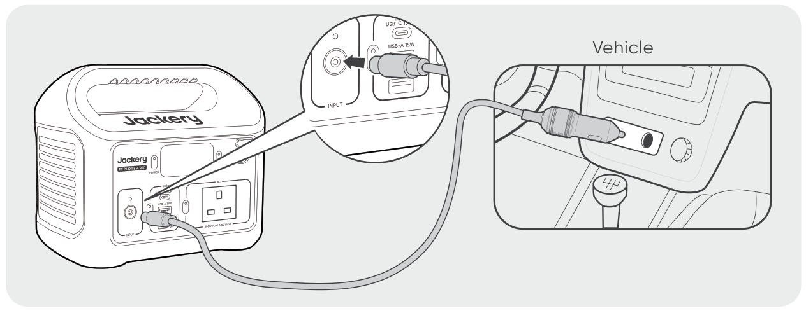
</figure>

<table class="manual-callout-table manual-callout-table"><tbody><tr><td class="manual-callout-label">CAUTION</td><td class="manual-callout-body"><ul><li>Please start the vehicle before charging your power station.</li><li>If the vehicle is running on bumpy roads, it is forbidden to use the car charger in case it causes non-standard operation. The Company will not be responsible for any loss caused by non-standard operation.</li><li>Vehicle charging is only applicable to vehicles with 12V DC, not 24V DC. Please do not charge this product in 24V vehicle to avoid personal injury and property loss.</li></ul></td></tr></tbody></table>

## STORAGE

Store the product in a dry clean place with proper ventilation. Storage temperature and humidity:

<ul><li>1 month: -4°F to 113°F / -20°C to 45°C (0-60%RH)</li><li>3 months: 32°F to 113°F / 0°C to 45°C (0-60%RH)</li><li>12 months: 32°F to 77°F / 0°C to 25°C (0-60%RH)</li></ul>

If this product is stored for a long period of time (3 months - 6 months) with the power depleted, it may become unchargeable. To prevent this and maintain battery health, it is recommended to check and recharge the product every three months and perform a full charge and discharge cycle at least once every 6 to 12 months.

## TROUBLESHOOTING

If any of the following fault codes appear, follow the listed corrective actions to resolve the issue. If fault persists, please contact Jackery Customer Support.

<figure aria-label="Error Code / Corrective Measures" class="hb-troubleshooting-composition" data-component-id="HB-TABLE-TROUBLESHOOTING" tabindex="0"><table class="hb-troubleshooting-table"><colgroup><col class="hb-troubleshooting-col-code"/><col class="hb-troubleshooting-col-measures"/></colgroup><thead><tr><th class="hb-troubleshooting-code" scope="col">Error Code</th><th class="hb-troubleshooting-measures" scope="col">Corrective Measures</th></tr></thead><tbody><tr><td class="hb-troubleshooting-code">F0</td><td class="hb-troubleshooting-measures">Restart the product.</td></tr><tr><td class="hb-troubleshooting-code">F1</td><td class="hb-troubleshooting-measures">Restart the product.</td></tr><tr><td class="hb-troubleshooting-code">F2</td><td class="hb-troubleshooting-measures">Restart the product.</td></tr><tr><td class="hb-troubleshooting-code">F3</td><td class="hb-troubleshooting-measures">Restart the product.</td></tr><tr><td class="hb-troubleshooting-code">F4</td><td class="hb-troubleshooting-measures">Connect the product to loads to discharge its battery until the fault disappears.</td></tr><tr><td class="hb-troubleshooting-code">F5</td><td class="hb-troubleshooting-measures">Charge the product via solar panels or AC wall outlet until the fault disappears.</td></tr><tr><td class="hb-troubleshooting-code">F6</td><td class="hb-troubleshooting-measures">1. Wait for the grid to normalize before charging the product via AC wall outlet. 2. Check whether the air intake and exhaust vents are blocked; ensure 20 cm clearance on both side of the product. 3. Place the product in a shaded, well-ventilated area where the ambient temperature is below 45°C. 4.Disconnect all loads from the product, keep it idle and wait until the fault disappears. 5. Restart the product.</td></tr><tr><td class="hb-troubleshooting-code">F7</td><td class="hb-troubleshooting-measures">1. Remove all DC inputs from the product. 2. If you charge the product via a solar panel, check the open-circuit voltage (Voc) of the connected solar panel. The product allows a maximum DC input voltage of 28V. 3. Restart the product and keep it idle. Wait until the fault disappears.</td></tr><tr><td class="hb-troubleshooting-code">F8</td><td class="hb-troubleshooting-measures">Contact Jackery Customer Support.</td></tr><tr><td class="hb-troubleshooting-code">F9</td><td class="hb-troubleshooting-measures">Remove the load connected to the USB/DC 12V ports of the product. Wait until the fault disappears.</td></tr></tbody></table></figure>

## SPECIFICATIONS

<h2 class="hb-spec-group">GENERAL INFO</h2>

<figure aria-label="GENERAL INFO" class="hb-spec-table-composition"><table class="manual-table manual-spec-table hb-spec-table"><colgroup><col class="hb-spec-col-label"/><col class="hb-spec-col-value"/></colgroup><tbody><tr><th class="manual-spec-label hb-spec-label" scope="row">Product Name</th><td class="manual-spec-value hb-spec-value">Jackery Explorer 300</td></tr><tr><th class="manual-spec-label hb-spec-label" scope="row">Model No.</th><td class="manual-spec-value hb-spec-value">JE-300E</td></tr><tr><th class="manual-spec-label hb-spec-label" scope="row">Capacity</th><td class="manual-spec-value hb-spec-value">15.2Ah / 19.2V DC (291.84 Wh)</td></tr><tr><th class="manual-spec-label hb-spec-label" scope="row">Cell Chemistry</th><td class="manual-spec-value hb-spec-value">Li-ion LFP</td></tr><tr><th class="manual-spec-label hb-spec-label" scope="row">Weight</th><td class="manual-spec-value hb-spec-value">About 3.4 kg</td></tr><tr><th class="manual-spec-label hb-spec-label" scope="row">Dimensions</th><td class="manual-spec-value hb-spec-value">23 × 15.3 × 19.9 cm</td></tr><tr><th class="manual-spec-label hb-spec-label" scope="row">Cycle Life</th><td class="manual-spec-value hb-spec-value">4000 cycles to 70%+ capacity</td></tr></tbody></table></figure>

<h2 class="hb-spec-group">INPUT PORTS</h2>

<figure aria-label="INPUT PORTS" class="hb-spec-table-composition"><table class="manual-table manual-spec-table hb-spec-table"><colgroup><col class="hb-spec-col-label"/><col class="hb-spec-col-value"/></colgroup><tbody><tr><th class="manual-spec-label hb-spec-label" scope="row">1 × USB-C Input</th><td class="manual-spec-value hb-spec-value">100W Max, 5V⎓3A, 9V⎓3A, 12V⎓3A, 15V⎓3A, 20V⎓5A</td></tr><tr><th class="manual-spec-label hb-spec-label" rowspan="2" scope="row">1 × DC8020 Input</th><td class="manual-spec-value hb-spec-value">Car: 11V-16V⎓6A Max, 96W Max</td></tr><tr><td class="manual-spec-value hb-spec-value">PV: 16V-28V⎓6A Max, 100W Max</td></tr></tbody></table></figure>

<h2 class="hb-spec-group">OUTPUT PORTS</h2>

<figure aria-label="OUTPUT PORTS" class="hb-spec-table-composition"><table class="manual-table manual-spec-table hb-spec-table"><colgroup><col class="hb-spec-col-label"/><col class="hb-spec-col-value"/></colgroup><tbody><tr><th class="manual-spec-label hb-spec-label" rowspan="2" scope="row">2 × AC Output</th><td class="manual-spec-value hb-spec-value">230 V~ 50 Hz, 1.3 A, 300 W rated (-10 °C to 45 °C)</td></tr><tr><td class="manual-spec-value hb-spec-value">230 V~ 50 Hz, 0.86 A, 200 W rated (-15 °C to -10 °C)</td></tr><tr><th class="manual-spec-label hb-spec-label" rowspan="2" scope="row">AC Total Output</th><td class="manual-spec-value hb-spec-value">300 W rated, 600 W surge peak (-10 °C to 45 °C)</td></tr><tr><td class="manual-spec-value hb-spec-value">200 W rated, 400 W surge peak (-15 °C to -10 °C)</td></tr><tr><th class="manual-spec-label hb-spec-label" scope="row">1 × USB-C Output</th><td class="manual-spec-value hb-spec-value">100W Max, 5V⎓3A, 9V⎓3A, 12V⎓3A, 15V⎓3A, 20V⎓5A</td></tr><tr><th class="manual-spec-label hb-spec-label" scope="row">1 × USB-A1 Output</th><td class="manual-spec-value hb-spec-value">15W Max, 5V⎓3A</td></tr><tr><th class="manual-spec-label hb-spec-label" scope="row">1 × USB-A2 Output</th><td class="manual-spec-value hb-spec-value">15W Max, 5V⎓3A</td></tr><tr><th class="manual-spec-label hb-spec-label" scope="row">1 × DC 12V Port</th><td class="manual-spec-value hb-spec-value">12 V⎓10A Max.</td></tr></tbody></table></figure>

<h2 class="hb-spec-group">ENVIRONMENTAL OPERATING TEMPERATURE</h2>

<figure aria-label="ENVIRONMENTAL OPERATING TEMPERATURE" class="hb-spec-table-composition"><table class="manual-table manual-spec-table hb-spec-table"><colgroup><col class="hb-spec-col-label"/><col class="hb-spec-col-value"/></colgroup><tbody><tr><th class="manual-spec-label hb-spec-label" scope="row">Charge Temperature</th><td class="manual-spec-value hb-spec-value">0°C to 45°C</td></tr><tr><th class="manual-spec-label hb-spec-label" scope="row">Discharge Temperature</th><td class="manual-spec-value hb-spec-value">-15°C to 45°C</td></tr></tbody></table></figure>

※ USB Type-C® and USB-C® are registered trademarks of USB Implementers Forum.

<table class="manual-callout-table manual-callout-table"><tbody><tr><td class="manual-callout-label">Note</td><td class="manual-callout-body">
The device's output power will adjust automatically under different ambient temperatures to ensure safe operation and extend battery life.
</td></tr></tbody></table>

## WARRANTY

<figure aria-label="WARRANTY" class="hb-warranty-intro-composition" data-component-id="HB-WARRANTY-LEAD">
<strong>We only provide our warranty to customers who purchase from the official Jackery website, Jackery-branded third-party platforms, or local authorized dealers.</strong>

*Warranty period and details may vary according to local laws, regulations, and authorized dealers.
</figure>

### Limited Warranty

<figure aria-label="Limited Warranty" class="hb-warranty-card" data-component-id="HB-WARRANTY-SECTION" data-warranty-card-index="1">
Jackery Inc. warrants to the original consumer purchaser that the Jackery product will be free from defects in workmanship and material under normal consumer use during the applicable warranty period identified in the 'Warranty Period' section below, subject to the exclusions set forth below.

This warranty statement sets forth Jackery's total and exclusive warranty obligation. We will not assume, nor authorize any person to assume for us, any other liability in connection with the sale of our products.
</figure>

### Warranty Period

<figure aria-label="Warranty Period" class="hb-warranty-period-card" data-component-id="HB-WARRANTY-YEARS">

3
<strong class="hb-warranty-years-unit">YEARS</strong><strong class="hb-warranty-period-label">Standard Warranty</strong>

The standard warranty period for Jackery Explorer 300 is 36 months. In each case, the warranty period is measured starting on the date of purchase by the original consumer purchaser. The sales receipt from the first consumer purchaser, or other reasonable documentary proof, is required in order to establish the start date of the warranty period.

2
<strong class="hb-warranty-years-unit">YEARS</strong><strong class="hb-warranty-period-label">Extended Warranty</strong>

To activate the Warranty Extension, you must register your product online or contact our customer service team at hello.eu@jackery.com to extend the standard warranty runtime.

</figure>

### Exchange

<figure aria-label="Exchange" class="hb-warranty-card" data-component-id="HB-WARRANTY-SECTION" data-warranty-card-index="3">
Jackery will replace (at Jackery's expense) any Jackery product that fails to operate during the applicable warranty period due to a defect in workmanship or material. A replacement product assumes the remaining warranty of the original product.
</figure>

### Limited to Original Consumer Buyer

<figure aria-label="Limited to Original Consumer Buyer" class="hb-warranty-card" data-component-id="HB-WARRANTY-SECTION" data-warranty-card-index="4">
The warranty on Jackery's product is limited to the original consumer purchaser and is not transferable to any subsequent owner.
</figure>

### Exclusions

<figure aria-label="Exclusions" class="hb-warranty-card" data-component-id="HB-WARRANTY-SECTION" data-warranty-card-index="5">
<strong>Jackery's warranty does not apply to:</strong>
<ul><li>Misused, abused, modified, damaged by accident, or used for anything other than normal consumer use as authorized in Jackery's current product literature.</li><li>Attempted repair by anyone other than an authorized facility.</li><li>Any product purchased through an online auction house.</li><li>Jackery's warranty does not apply to the battery cell unless the battery cell is fully charged by you within seven days after you purchase the product and at least once every 6 months thereafter.</li></ul></figure>

### Interpretation Rights

<figure aria-label="Interpretation Rights" class="hb-warranty-card" data-component-id="HB-WARRANTY-SECTION" data-warranty-card-index="6">
Jackery reserves the right to final interpretation of the above customers' after-sales policy.
</figure>

## RETURN FOR RECYCLING SERVICE

### Introduction and Compliance Statement

This Guide has been prepared in accordance with the <strong>EU Batteries Regulation (EU) 2023/1542</strong>. It is intended to clearly inform end users of their responsibilities regarding waste prevention, compliant disposal requirements, official recycling channels, safe handling procedures, and the potential risks associated with hazardous substances. Through this Guide, Jackery aims to fulfill its mandatory disclosure obligations under applicable regulations, promote battery recycling and resource recovery, and prevent environmental pollution and potential safety hazards. As part of our commitment to complying with <strong>Regulation (EU) 2023/1542 on batteries and waste batteries</strong>, we are committed to ensuring the safe handling and disposal of waste batteries. Choosing durable, repairable, and recyclable products can significantly reduce waste generation. Proper battery maintenance and care can also extend battery life and reduce the need for frequent replacement. When a battery approaches the end of its service life, proper disposal is essential. Batteries may contain hazardous substances that, if handled improperly, may harm the environment and pose risks to human health and safety.

### The Role of End Users in Waste Prevention

End users can help extend battery service life and reduce waste generation at the source by choosing durable, repairable, and recyclable Jackery products and properly maintaining their batteries.

#### Purchase products according to actual needs

Select an energy storage product with an appropriate capacity based on your actual usage scenarios. Avoid unnecessary purchases or excessive stockpiling, which may result in batteries being left unused for extended periods and prematurely reaching the end of their service life.

#### Use Jackery energy storage devices properly

Follow the charging and discharging instructions provided in the product manual. Avoid overcharging, deep discharge, exposure to high temperatures or direct sunlight, and physical impact to help extend battery service life and reduce the generation of waste batteries.

#### Perform regular maintenance

If the device will not be used for an extended period, maintain the battery charge level between 20% and 60%. Store the device in a cool, dry environment and recharge it periodically to help slow battery degradation. <strong>Extending battery life and reducing the generation of waste batteries is one of the most important environmental responsibilities of every end user.</strong>

### Separate Collection of Waste Batteries and Legal Obligations

Under applicable EU law, all Jackery waste lithium-ion batteries must be handled and disposed of in compliance with applicable requirements. End users are required to fulfill the following obligations:

#### Separate collection

You must dispose of waste batteries:

<ol><li><strong>Separately from other waste streams</strong>, including mixed municipal waste; and</li><li><strong>At designated separate collection points</strong> for waste batteries.</li></ol>

Waste batteries must not be disposed of together with household waste or other mixed waste. They must be collected separately and taken to officially designated and compliant collection points.

#### Disposal through compliant channels

At the end of their service life, batteries must only be returned through appropriate channels, including <strong>municipal recycling centers, authorized retailers, or official Jackery recycling channels</strong>. Do not disassemble, modify, or otherwise attempt to dispose of waste batteries yourself. Please cooperate with authorized recycling programs to ensure that waste batteries enter the appropriate recycling and recovery system.

#### Prevent improper disposal

Do not discard, landfill, or abandon waste batteries in open areas. Proper disposal helps reduce the risk of battery thermal runaway and prevents hazardous substances from contaminating soil and water. You can obtain information about the location of municipal collection centers from your local or municipal authorities. By recycling batteries, you help recover valuable materials and prevent environmental pollution.

### Recycling Channels and Collection Points

#### Offline Collection and Return Points

Jackery's authorized dealers and offline retail stores within the European Union provide <strong>free recycling services for waste batteries</strong> and can accept waste batteries from Jackery energy storage products. Municipal recycling centers also provide ongoing collection services for waste batteries. Please note that, under applicable law, distributors are required to <strong>accept waste industrial batteries from end users free of charge</strong> and may not require end users to purchase, or have previously purchased, a new battery, regardless of the battery's chemistry, brand, or origin. Distributors must accept such batteries at their retail locations or in their immediate vicinity. These obligations also apply to distributors supplying batteries to end users through distance contracts. Such distributors must provide a sufficient number of collection points covering the territory of the relevant Member State, taking into account population size and density, the expected quantity of waste industrial batteries, and accessibility and proximity for end users.

#### Jackery Online Recycling Service

Customers may use the recycling return service available through the Jackery official website and follow the instructions to safely package and ship used energy storage equipment for recycling. Jackery provides a recycling service that allows customers to return products that are used, no longer needed, or at the end of their service life for proper handling, recycling, or reuse. By ensuring that materials are handled responsibly, this service helps reduce environmental impact and prevent products from ultimately ending up in landfills. Jackery provides recycling services to all customers and verifies purchases of Jackery generators through authorized sales channels.

#### Recycling Service Fees

<ol><li><strong>The recycling service is free of charge</strong>. The applicable shipping policy is as follows:</li><li><strong>Returns during the warranty period</strong>: Jackery will cover the return shipping costs.</li><li><strong>Returns of products outside the warranty period</strong>: The customer is responsible for the return shipping costs.</li></ol>

#### Online Recycling Procedure

<ol><li>Safely place your device in a suitable shipping box and securely seal the package.</li><li>Clearly attach the return shipping label to the outside of the package.</li><li>Take the package to your nearest parcel drop-off location.</li><li>Cash on Delivery (COD) is not accepted.</li></ol>

### Safety Instructions for Handling Used Batteries

Handling lithium-ion batteries involves a risk of fire. Please strictly follow the safety instructions below. Compliance with these safety instructions is important for protecting yourself and the environment. When handling waste batteries, particularly lithium-ion batteries, it is essential to understand the potential risks. Improper handling may result in overheating, fire, or other serious hazards.

#### Do not physically damage batteries

<strong>Never crush, puncture, disassemble, or otherwise physically damage waste batteries.</strong> Damaged batteries may leak hazardous chemicals or catch fire.

#### Store batteries in an appropriate environment

Store batteries in a <strong>cool, dry, room-temperature, and well-ventilated area</strong>, away from high temperatures, water, and flammable or explosive materials to prevent short circuits and overheating. Do not expose batteries to excessive heat or water, as this may cause overheating or short circuits.

#### Take appropriate protective measures

If handling a damaged or leaking battery, wear protective gloves and safety goggles and avoid direct contact with the electrolyte. If you notice any <strong>swelling, leakage, or unusual odor</strong>, exercise extreme caution when handling the battery and seek professional assistance.

#### Handling abnormal conditions

If a battery shows signs of swelling, leakage, an unusual odor, or other abnormalities, immediately isolate it in a safe location and contact an official recycling channel. <strong>Do not attempt to handle or dispose of the battery yourself.</strong>

#### Emergency response in case of fire

If a battery catches fire, use an appropriate fire extinguisher or sand to extinguish the fire. <strong>Do not use water to extinguish a lithium-ion battery fire</strong>, as this may worsen the situation.

### Battery Contents and Environmental and Health Impacts

Jackery products are equipped with lithium-ion batteries, which may contain metals such as <strong>lithium, nickel, and cobalt</strong>, as well as organic electrolytes. Improper disposal may result in multiple risks.

#### Environmental impact

If waste batteries are discarded improperly and electrolyte leaks, hazardous substances may enter soil and groundwater, causing soil and water contamination and damaging ecosystems and wildlife.

#### Impact on human health

Battery electrolyte may be corrosive. Direct contact with skin or mucous membranes may cause irritation or chemical burns. Continued release of hazardous substances into the environment may also create long-term health risks.

#### Personal safety risks

Improper crushing, puncturing, or incineration of waste lithium-ion batteries may cause thermal runaway, fire, or other serious safety incidents, potentially resulting in burns and property damage.

### Official Explanation of Battery Symbols

#### Crossed-out wheeled bin symbol

The crossed-out wheeled bin symbol on a battery indicates that the battery <strong>must not be disposed of as unsorted household waste.</strong> At the end of its service life, the battery must be collected separately and handled through an appropriate recycling system. It must be taken to a designated municipal collection point or a dedicated collection system for recycling.

#### Heavy metal markings (Pb/Cd)

If <strong>Cd (cadmium)</strong> or <strong>Pb (lead)</strong> is indicated beneath the battery symbol, this means that the battery contains the corresponding heavy metal and must be subject to appropriate separate collection and recycling.

#### Product traceability information

Battery model numbers, serial numbers, and production dates are used by recycling organizations for sorting, inspection, grading, reuse, and material recovery.

### Subsequent Processing of Waste Batteries

All collected Jackery waste batteries are handled through <strong>qualified and compliant organizations in the European Union</strong> in accordance with applicable requirements. Unauthorized handling or disposal is prohibited. The subsequent processing of waste batteries may include the following three pathways:

#### Preparation for reuse

Retired batteries are inspected and, where appropriate, repaired. Batteries that remain in good condition may be returned to service for further use.

#### Preparation for second-life applications

Batteries whose capacity has degraded and which no longer meet the requirements for use in portable energy storage systems may, following appropriate assessment and screening, be used in lower-power energy storage applications.

#### Material recycling

Batteries that are no longer suitable for reuse are transferred to qualified and compliant recycling organizations in the European Union for the recovery of metal and other valuable materials, thereby supporting resource circularity. <strong>Individuals are prohibited from independently handling or disposing of waste lithium-ion batteries. All collected waste batteries are handled by qualified professional organizations in the European Union.</strong>

### Contact Us

For more information about battery safety, handling, and recycling, please contact our Customer Service Team:

 Email: hello.eu@jackery.com

## HOW TO READ YOUR SERIAL NUMBER

Each product carries a unique serial number (SN) barcode, structured as follows: Example:

<figure class="hb-reference-figure" data-component-id="HB-SPECIAL-REFERENCE-FIGURE" data-reference-id="serial-number" data-source-fragment-sha256="87e5d83e7468f0fb4099f12dfe1862f7b8fbaa0f3e026b0075e8eadcbc70a4be" data-step-captions="embedded">
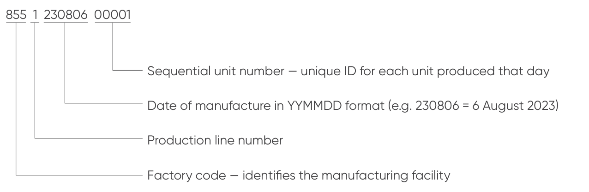
</figure>

## EU Regulations

<figure class="hb-reference-figure" data-component-id="HB-SPECIAL-REFERENCE-FIGURE" data-reference-id="ce-mark" data-source-fragment-sha256="f394e77c32d9554e4d3a2bf09249525793fd4b8903c0425fbd30f015f8ad0b7c">

</figure>

RED Declaration of Conformity Shenzhen Hello Tech Energy Co., Ltd. hereby declares that this: Jackery Explorer 300 AC with JE-300E is in compliance with the essential requirements and other relevant provisions of the LVD Directive 2014/35/EU , EMC Directive 2014/30/EU and ROHS Directive 2011/65/EU as amended by 2015/863/EU, The full text of the EU declaration of conformity is available at the following internet address: https://de.jackery.com/pages/user-guides

<strong>MANUFACTURER: SHENZHEN HELLO TECH ENERGY CO.,LTD.</strong>

Address: F2-3, Bldg. 7, Jiaanda Science and technology industrial park factory, the east side of Huafan Road, Tongsheng Community, Dalang Street, Longhua District, Shenzhen, Guangdong, China

 +86 400 668 9293  sales@hello-tech.com  www.hello-tech.com

<figure class="hb-reference-figure" data-component-id="HB-SPECIAL-REFERENCE-FIGURE" data-reference-id="manufacturer-qr" data-source-fragment-sha256="97a069471261049d6d2cc7e712fe1b9670f44dda2eaa55f4ff415a5f2dbebca9">

</figure>
