

感谢您选择购买电小二产品。在使用之前请您务必仔细阅读本用户指南，按照指引正确使用并妥善保管。 在遵从法律法规的情况下，本公司享有对本文档及本产品所有相关文档的最终解释权。如有更新改版或终止请以官方发布最新通知为准。 您现在可以通过微信注册您的产品，激活质保服务。注册过程轻松快速，注册后您将享有：

<figure class="hb-reference-figure hb-base-art-live-copy" data-component-id="HB-SPECIAL-REFERENCE-FIGURE" data-reference-id="registration-p2" data-source-fragment-sha256="f679f7884be717c78aab63bfd4d4f4bce6553dfcb2975a5c9687f7350c983912" data-web-base-art-ref="registration" data-web-presentation-mode="base-art-live-copy">

自购买日起享质保 3年 + 注册延保 2 年电小二售后专家技术支持真伪查询服务售后维修进度实时查看1.打开微信，点击“发现”中的“扫一扫”2.扫描右方的二维码3.按照提示完成注册激活

</figure>

如您未能成功注册，您可以联系电小二官方服务热线 <strong>400-668-9293 </strong>或联系在线客服进行注册，产品具体保修条款和注册细则，请登录 <strong>电小二户外电源服务小程序 </strong>查看。 以下情况不在保修范围内：产品使用后外观损坏；自行拆机或维修；因人为原因造成产品性能故障；由于自然灾害、雷电、事故等不可抗拒的因素造成的损害。

# 使用注意安全事项

<strong>使使用本产品时，应始终遵循基本注意事项，包括:</strong>
<ul><li>
使用本产品之前，请阅读所有说明。
</li><li>
为了降低风险，当在儿童附近使用本产品时，需要进行密切监督。
</li><li>
使用非专业产品制造商推荐或销售的配件可能会导致触电的风险。
</li><li>
产品在未使用时，请将电源插头拔出产品插座。
</li><li>
禁止对产品进行拆机，产品拆机后可能会导致火灾、爆炸或触电等不可预测的风险。
</li><li>
禁止使用损坏的电线或插头，或损坏的输出电缆来使用产品，有触电的危险。
</li><li>
请在通风良好的地方对产品进行充电，请勿以任何方式限制产品的通风。
</li><li>
请将产品放置在干燥的地方，不得淋雨，不得使产品进水，这会有触电风险（非预定仅在室外安装使用）。
</li><li>
禁止将产品撞击或投入火中，这可能导致产品发生起火，爆炸等安全事故。
</li><li>
禁止在高温下（直热的阳光下或很热的汽车车内）使用或放置产品，否则可能会引起内部电池过热，起火或功能失效，寿命减短等风险。
</li><li>
首次使用时，请在使用前将设备充满电。如果本产品在电量耗尽的情况下长时间（3 个月 - 6个月）存放，其性能会下降，甚至无法充电。
</li><li>
使用本产品时必须接地，接地可以在发生故障时减少触电风险，本产品配备带设备接地线和接地插头的电源线，必须根据当地法规和规范正确地安装和连接插头至接地插座。
</li></ul>

# 包装清单

<figure class="hb-reference-figure hb-base-art-live-copy" data-component-id="HB-SPECIAL-REFERENCE-FIGURE" data-reference-id="inbox-p3" data-source-fragment-sha256="ec5227c68401f8c80b90dc0094ef1e84f22fa959b7d82980bb7b28575d54c817" data-web-base-art-ref="inbox" data-web-presentation-mode="base-art-live-copy">

便携式储能电源3600 PlusAC电源线用户指南* 配套AC电源线仅用于本设备。* 车载充电线需单独购买，请前往电小二官网选购或联系电小二售后客服寻求帮助。<strong>1</strong><strong>3</strong><strong>2</strong>

</figure>

# 产品介绍

<figure class="hb-reference-figure hb-base-art-live-copy" data-component-id="HB-SPECIAL-REFERENCE-FIGURE" data-reference-id="overview-front-p3" data-source-fragment-sha256="34baf35471236eec24d8857a5a4e7f32d859fc22b6a30cc21cb678e7e7e04bd6" data-web-base-art-ref="overview-front" data-web-presentation-mode="base-art-live-copy">

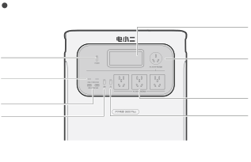<strong>正面</strong>5V⎓3A, 9V⎓3A, 12V⎓3A,  15V⎓3A, 20V⎓5A，最大100W5-6V⎓3A，6-9V⎓2A，9-12V⎓1.5A，最大18W<strong>AC输出按键</strong><strong>USB输出按键</strong><strong>USB-C 100W 输出端口</strong><strong>USB-A 18W 输出端口</strong><strong>LCD 显示屏</strong><strong>AC输出端口</strong><strong>总电源开关键</strong>220V ~ 50Hz，16A，额定3600W<strong>AC输出端口</strong>220V ~ 50Hz，10A，额定2200W

</figure>

<figure class="hb-reference-figure hb-base-art-live-copy" data-component-id="HB-SPECIAL-REFERENCE-FIGURE" data-reference-id="overview-side-p4" data-source-fragment-sha256="e68621082bec639c4f66f4f23deb84021c3aec99a72c8db4b6d7ddd8f7df09b2" data-web-base-art-ref="overview-side" data-web-presentation-mode="base-art-live-copy">

<strong>AC总输出</strong>4口合计3600W (瞬时最大7200W)<strong>右侧面</strong><strong>AC输入端口</strong><strong>DC输入端口（DC8020）</strong>220V-240V~ 50Hz， 最大10A光伏：16V-60V⎓12A，双路最大24A/最大1000W车充：12V-16V⎓最大8A，双路最大8A<strong>加电包连接端口</strong>输入：36.4V-50.4V，最大100A输出：36.4V-50.4V，最大60A输出：220V~50Hz，额定3500W<strong>并机端口</strong><strong>固定轮</strong><strong>可伸缩手柄</strong>

</figure>

# 显示屏界面

<figure class="hb-reference-figure hb-base-art-live-copy" data-component-id="HB-SPECIAL-REFERENCE-FIGURE" data-reference-id="lcd-map-p5" data-source-fragment-sha256="cd16cca359fbfc56deb1e30d702626b665632c955505dbbdeb758433334aff91" data-web-base-art-ref="lcd-map" data-web-presentation-mode="base-art-live-copy">

21229101112121314151618192034578 617

</figure>

<table class="manual-table ht-native-table ht-lcd-icons"><tbody><tr><td class="ht-cell ht-lcd-key ht-number ht-lcd-number">
1
</td><td class="ht-cell ht-lcd-key ht-lcd-icon"></td><td class="ht-cell ht-lcd-key ht-lcd-name">
<strong>Wi-Fi</strong>
</td><td class="ht-cell ht-lcd-desc">
点亮：Wi-Fi 已连接。 

闪烁：准备连接 Wi-Fi。 

熄灭：Wi-Fi 未连接。
</td></tr><tr><td class="ht-cell ht-lcd-key ht-number ht-lcd-number">
2
</td><td class="ht-cell ht-lcd-key ht-lcd-icon"></td><td class="ht-cell ht-lcd-key ht-lcd-name">
<strong>Bluetooth</strong>
</td><td class="ht-cell ht-lcd-desc">
点亮：蓝牙已连接。 

闪烁：准备连接蓝牙。 

熄灭：蓝牙未连接。
</td></tr><tr><td class="ht-cell ht-lcd-key ht-number ht-lcd-number">
3
</td><td class="ht-cell ht-lcd-key ht-lcd-icon"></td><td class="ht-cell ht-lcd-key ht-lcd-name">
<strong>静音充电模式</strong>
</td><td class="ht-cell ht-lcd-desc">
点亮：静音充电模式已开启。 充电功率降低，充电速度变慢，同时显著降低充电时的噪音。 

熄灭：静音充电模式未开启/已关闭。 （请在 APP 中开启/关闭该功能，关机可记忆保存）。
</td></tr><tr><td class="ht-cell ht-lcd-key ht-number ht-lcd-number" rowspan="2">
4
</td><td class="ht-cell ht-lcd-key ht-lcd-icon"></td><td class="ht-cell ht-lcd-key ht-lcd-name">
<strong>节省电池模式</strong>
</td><td class="ht-cell ht-lcd-desc">
点亮：节省电池模式已开启，通过限制电池的最大可用容量来延长电池使用寿命。 

熄灭：节省电池模式未开启/已关闭。 （请在 APP 中开启/关闭该功能，关机可记忆保存）。 注：开启后偶尔会满充满放，用于校准SOC。
</td></tr><tr><td class="ht-cell ht-lcd-key ht-lcd-icon"></td><td class="ht-cell ht-lcd-key ht-lcd-name">
<strong>自发自用模式</strong>
</td><td class="ht-cell ht-lcd-desc">
点亮：自发自用模式已开启，最大化利用太阳能，减少电网电力消耗，减少用电成本。 

熄灭：自发自用模式未开启/已关闭。 （请在 APP 中开启/关闭该功能，关机可记忆保存）。
</td></tr><tr><td class="ht-cell ht-lcd-key ht-number ht-lcd-number">
5
</td><td class="ht-cell ht-lcd-key ht-lcd-icon"></td><td class="ht-cell ht-lcd-key ht-lcd-name">
<strong>充电计划</strong>
</td><td class="ht-cell ht-lcd-desc">
自定义便携式储能电源 3600 Plus的充电计划，适用于电价有波动的情况，可根据电价峰谷时间段制定充电计划，减少用电成本。 （请在 APP 中开启/关闭该功能，关机可记忆保存）。
</td></tr><tr><td class="ht-cell ht-lcd-key ht-number ht-lcd-number">
6
</td><td class="ht-cell ht-lcd-key ht-lcd-icon"></td><td class="ht-cell ht-lcd-key ht-lcd-name">
<strong>并机模式</strong>
</td><td class="ht-cell ht-lcd-desc">
点亮：AC输出打开，设备已成功并机。 

闪烁：AC输出打开，设备未成功并机。
</td></tr><tr><td class="ht-cell ht-lcd-key ht-number ht-lcd-number">
7
</td><td class="ht-cell ht-lcd-key ht-lcd-icon"></td><td class="ht-cell ht-lcd-key ht-lcd-name">
<strong>交流输出符号</strong>
</td><td class="ht-cell ht-lcd-desc">
AC输出（纯正弦波）已开启。
</td></tr><tr><td class="ht-cell ht-lcd-key ht-number ht-lcd-number">
8
</td><td class="ht-cell ht-lcd-key ht-lcd-icon"></td><td class="ht-cell ht-lcd-key ht-lcd-name">
<strong>输出电压和频率</strong>
</td><td class="ht-cell ht-lcd-desc">
显示AC输出口的输出电压和频率。
</td></tr><tr><td class="ht-cell ht-lcd-key ht-number ht-lcd-number">
9
</td><td class="ht-cell ht-lcd-key ht-lcd-icon">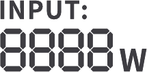</td><td class="ht-cell ht-lcd-key ht-lcd-name">
<strong>充电功率显示</strong>
</td><td class="ht-cell ht-lcd-desc">
显示当前充电功率。
</td></tr><tr><td class="ht-cell ht-lcd-key ht-number ht-lcd-number">
10
</td><td class="ht-cell ht-lcd-key ht-lcd-icon"></td><td class="ht-cell ht-lcd-key ht-lcd-name">
<strong>剩余充电时间</strong>
</td><td class="ht-cell ht-lcd-desc">
显示剩余充电时间。
</td></tr><tr><td class="ht-cell ht-lcd-key ht-number ht-lcd-number">
11
</td><td class="ht-cell ht-lcd-key ht-lcd-icon"></td><td class="ht-cell ht-lcd-key ht-lcd-name">
<strong>市电充电接入</strong>
</td><td class="ht-cell ht-lcd-desc">
产品通过市电进行充电。
</td></tr><tr><td class="ht-cell ht-lcd-key ht-number ht-lcd-number">
12
</td><td class="ht-cell ht-lcd-key ht-lcd-icon"></td><td class="ht-cell ht-lcd-key ht-lcd-name">
<strong>车充充电接入</strong>
</td><td class="ht-cell ht-lcd-desc">
产品通过 DC 输入端口（DC8020）连接 12V 车载充电线进行充电。
</td></tr><tr><td class="ht-cell ht-lcd-key ht-number ht-lcd-number">
13
</td><td class="ht-cell ht-lcd-key ht-lcd-icon"></td><td class="ht-cell ht-lcd-key ht-lcd-name">
<strong>太阳能（绿色能源）充电接入</strong>
</td><td class="ht-cell ht-lcd-desc">
产品通过 DC 输入端口（DC8020）连接太阳能板进行充电。
</td></tr><tr><td class="ht-cell ht-lcd-key ht-number ht-lcd-number">
14
</td><td class="ht-cell ht-lcd-key ht-lcd-icon"></td><td class="ht-cell ht-lcd-key ht-lcd-name">
<strong>电池电量图标</strong>
</td><td class="ht-cell ht-lcd-desc">
当本产品处于充电状态时，该图标顺时针转动； 当产品处于放电状态时，该图标显示当前电量。
</td></tr><tr><td class="ht-cell ht-lcd-key ht-number ht-lcd-number">
15
</td><td class="ht-cell ht-lcd-key ht-lcd-icon"></td><td class="ht-cell ht-lcd-key ht-lcd-name">
<strong>低电量提醒</strong>
</td><td class="ht-cell ht-lcd-desc">
点亮：当前电池电量低于 20%。 

闪烁：当前电池电量低于 5%。 

熄灭：设备正在充电中。
</td></tr><tr><td class="ht-cell ht-lcd-key ht-number ht-lcd-number">
16
</td><td class="ht-cell ht-lcd-key ht-lcd-icon"></td><td class="ht-cell ht-lcd-key ht-lcd-name">
<strong>电池电量百分比</strong>
</td><td class="ht-cell ht-lcd-desc">
显示当前电池电量。
</td></tr><tr><td class="ht-cell ht-lcd-key ht-number ht-lcd-number">
17
</td><td class="ht-cell ht-lcd-key ht-lcd-icon"></td><td class="ht-cell ht-lcd-key ht-lcd-name">
<strong>加电包接入及数量</strong>
</td><td class="ht-cell ht-lcd-desc">
显示加电包的接入状态及数量。
</td></tr><tr><td class="ht-cell ht-lcd-key ht-number ht-lcd-number">
18
</td><td class="ht-cell ht-lcd-key ht-lcd-icon"></td><td class="ht-cell ht-lcd-key ht-lcd-name">
<strong>故障代码</strong>
</td><td class="ht-cell ht-lcd-desc">
产品发生故障，请参考故障代码模块内容了解详情。
</td></tr><tr><td class="ht-cell ht-lcd-key ht-number ht-lcd-number" rowspan="2">
19
</td><td class="ht-cell ht-lcd-key ht-lcd-icon"></td><td class="ht-cell ht-lcd-key ht-lcd-name">
<strong>高温警告</strong>
</td><td class="ht-cell ht-lcd-desc">
如果屏幕上出现，请勿担心，电池降温后可自行恢复。
</td></tr><tr><td class="ht-cell ht-lcd-key ht-lcd-icon"></td><td class="ht-cell ht-lcd-key ht-lcd-name">
<strong>低温警告</strong>
</td><td class="ht-cell ht-lcd-desc">
如果屏幕上出现，请勿担心，环境温度恢复后自动恢复。
</td></tr><tr><td class="ht-cell ht-lcd-key ht-number ht-lcd-number">
20
</td><td class="ht-cell ht-lcd-key ht-lcd-icon"></td><td class="ht-cell ht-lcd-key ht-lcd-name">
<strong>节能模式</strong>
</td><td class="ht-cell ht-lcd-desc">
AC 输出按键 或USB 输出按键时打开时： 点亮：节能模式开启。 

熄灭：节能模式关闭。
</td></tr><tr><td class="ht-cell ht-lcd-key ht-number ht-lcd-number">
21
</td><td class="ht-cell ht-lcd-key ht-lcd-icon"></td><td class="ht-cell ht-lcd-key ht-lcd-name">
<strong>放电功率显示</strong>
</td><td class="ht-cell ht-lcd-desc">
显示当前放电功率。
</td></tr><tr><td class="ht-cell ht-lcd-key ht-number ht-lcd-number">
22
</td><td class="ht-cell ht-lcd-key ht-lcd-icon"></td><td class="ht-cell ht-lcd-key ht-lcd-name">
<strong>剩余放电时间</strong>
</td><td class="ht-cell ht-lcd-desc">
显示剩余放电时间。
</td></tr></tbody></table>

# 产品使用

<h2 id="native-p8-b10-l0-0">电源开机/关机</h2>

<figure class="hb-reference-figure hb-base-art-live-copy" data-component-id="HB-SPECIAL-REFERENCE-FIGURE" data-reference-id="power-p8" data-source-fragment-sha256="f064bf114a3bba48e8007b1ffebfd57bb867812d97418cd49b155174f9b4b3c9" data-web-base-art-ref="power" data-web-presentation-mode="base-art-live-copy">

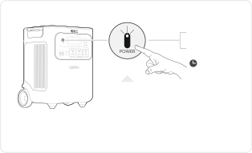* 本产品的默认待机时间为2小时，若产品无任何充电输入或放电输出，2小时后将自动关机，自动关机时间可以在App上设置。<strong>开机</strong><strong>关机</strong>短按一次长按3秒3s<strong>总电源开关键</strong>节能模式下，开启AC或USB输出，若产品无任何充电输入或放电输出，12小时后将关闭AC或USB输出（节能模式时间可以在App 上设置）。

</figure>

<h2 id="native-p8-b11-l0-0">AC输出开/关</h2>

<figure class="hb-reference-figure hb-base-art-live-copy" data-component-id="HB-SPECIAL-REFERENCE-FIGURE" data-reference-id="ac-output-p8" data-source-fragment-sha256="8ef402b321b48613a5c78e704a1ce5261e86de6328d8ae7101ab48afdd66e478" data-web-base-art-ref="ac-output" data-web-presentation-mode="base-art-live-copy">

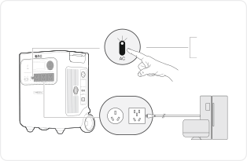确保总电源开关键已打开。<strong>开启</strong>短按一次<strong>关闭</strong>短按一次

</figure>

<h2 id="native-p9-b5-l0-0">USB输出开 / 关</h2>

<figure class="hb-reference-figure hb-base-art-live-copy" data-component-id="HB-SPECIAL-REFERENCE-FIGURE" data-reference-id="usb-output-p9" data-source-fragment-sha256="1a5ce1001558b32e5f23375d30aa76ce3b7ca5135dc1ea47056877fcb6b183dd" data-web-base-art-ref="usb-output" data-web-presentation-mode="base-art-live-copy">

确保总电源开关键已打开。<strong>开启</strong>短按一次<strong>关闭</strong>短按一次

</figure>

<table class="manual-callout-table ht-native-item-list"><tbody><tr><td class="manual-callout-label">注意</td><td class="manual-callout-body"><ul><li>
USB-C 100W输出端口属于 PS3 高功率端口，用户设备或配件连接到这些端口存在火灾风险；使用这些端口前，应确保所连接的设备或配件具备防火安全措施。 
</li><li>
仅将便携式电源连接到符合GB4943.1第 6.3、6.4 和 6.5 条款（或其它等效标准）的设备或配件。 
</li><li>
此外，为了实现最大输出功率，请使用电小二官方USB-C to USB-C 5A 数据线（20V  DC/5A，100W）。
</li></ul></td></tr></tbody></table>

<h2 id="native-p9-b4-l0-0">屏幕显示</h2>

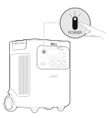

<table class="manual-table ht-native-table ht-lcd-modes"><tbody><tr><th class="ht-cell ht-number ht-lcd-mode">
分类
</th><th class="ht-cell ht-lcd-action">
操作
</th><th class="ht-cell">
说明
</th></tr><tr><td class="ht-cell ht-number ht-lcd-mode" rowspan="3">
<strong>屏幕</strong> <strong>短亮</strong>
</td><td class="ht-cell ht-lcd-action">
打开
</td><td class="ht-cell">
短按总电源开关键或有充电输入。
</td></tr><tr><td class="ht-cell ht-lcd-action">
关闭
</td><td class="ht-cell">
短按总电源开关键。
</td></tr><tr><td class="ht-cell ht-lcd-action">
自动关闭
</td><td class="ht-cell">
2分钟后显示屏将自动熄灭，进入休眠模式。
</td></tr><tr><td class="ht-cell ht-number ht-lcd-mode" rowspan="3">
<strong>屏幕</strong> <strong>常亮</strong>
</td><td class="ht-cell ht-lcd-action">
打开
</td><td class="ht-cell">
开机状态下，双击总电源开关键。
</td></tr><tr><td class="ht-cell ht-lcd-action">
关闭
</td><td class="ht-cell">
短按总电源开关键。
</td></tr><tr><td class="ht-cell ht-lcd-action">
自动关闭
</td><td class="ht-cell">
在常亮模式下，无充放电情况，屏幕将在 2 小时后自动熄灭。
</td></tr></tbody></table>

<h2 id="native-p10-b2-l0-0">节能模式</h2>
为防止因忘记关闭输出而造成电池电量的额外消耗，产品默认开启节能模式。当未连接设备，或已连接设备的功率低于设定值（AC 输出 25W；USB输出 2W）时，产品将在 12 小时后关闭输出。AC或DC输出开启状态下，屏幕将显示节能图标“12H”。该图标的显示时长将根据app设定的节能时间而变化。

<figure class="hb-reference-figure hb-base-art-live-copy" data-component-id="HB-SPECIAL-REFERENCE-FIGURE" data-reference-id="energy-saving-p10" data-source-fragment-sha256="1a50b211456e2f9b2f80b44aa3a4573cd6e2da46b684c4db41b78fb157301539" data-web-base-art-ref="energy-saving" data-web-presentation-mode="base-art-live-copy">

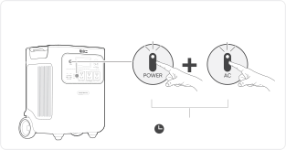在AC输出按键开启状态下，同时长按AC输出按键与总电源开关键，持续按压直至节能图标显示（开启）与隐藏（关闭）状态切换。3s长按3秒<strong>开启/关闭</strong>总电源开关键AC输出按键

</figure>

※ 使用交流25W及直流2W以下低功耗设备时，请关闭节能模式以避免输出中途自动关闭。关闭节能模式后，屏幕将不再显示“12H”图标。此时，输出不会自动关闭。

<table class="manual-callout-table manual-callout-table"><tbody><tr><td class="manual-callout-label">说明</td><td class="manual-callout-body">
节能模式在设备重新上电后会恢复至上次的状态。如需更改模式，需手动切换。
</td></tr></tbody></table>

<h2 id="native-p10-b0-l0-0">组合按键</h2>

<table class="manual-table ht-native-table ht-key-combinations"><tbody><tr><th class="ht-cell ht-number">
<strong>按键</strong>
</th><th class="ht-cell">
<strong>操作</strong>
</th><th class="ht-cell">
<strong>功能</strong>
</th></tr><tr><td class="ht-cell ht-number">

总电源开关键

+

  AC 输出按键

</td><td class="ht-cell">
3s

 长按3秒
</td><td class="ht-cell">
切换节能模式
</td></tr><tr><td class="ht-cell ht-number">

USB输出按键

+

  AC 输出按键

</td><td class="ht-cell">
1s

 长按1秒
</td><td class="ht-cell">
Wi-Fi＆蓝牙开关
</td></tr><tr><td class="ht-cell ht-number">

总电源开关键

+

 USB输出按键

</td><td class="ht-cell">
3s

 长按3秒
</td><td class="ht-cell">
Wi-Fi&amp;蓝牙重置
</td></tr></tbody></table>

# 不间断电源（UPS）

本产品通过AC电源线连接电网，电器可以使用本产品的交流输出端口工作（此时交流电来自电网，而不是电池），当电网突然断电后，本产品可以在10 ms内自动换为本产品电池供电模式。

<figure class="hb-reference-figure hb-base-art-live-copy" data-component-id="HB-SPECIAL-REFERENCE-FIGURE" data-reference-id="ups-p11" data-source-fragment-sha256="935f20cca1494d7cb5cbb88191f42dfd9cd6cb95a782b0af63fc345ceb5f694f" data-web-base-art-ref="ups" data-web-presentation-mode="base-art-live-copy">

* 确保总电源开关键已打开。

</figure>

<table class="manual-callout-table ht-native-item-list"><tbody><tr><td class="manual-callout-label">注意</td><td class="manual-callout-body"><ul><li>
本产品不支持0ms切换，请勿接到要求0ms切换供电的设备上，例如数据服务器或工作站，请充分测试确认兼容性后使用。 
</li><li>
使用UPS功能连接负载时，请勿超出设备最大输出功率，以防触发过载保护。 
</li><li>
因未按说明操作导致设备异常或数据丢失，本公司不承担相关责任。
</li></ul></td></tr></tbody></table>

# 连接

<h2 id="native-p12-b4-l0-0">与加电包连接（单独售卖）</h2>
本产品最多搭载5个加电包，可满足大容量的需求。 关于加电包的使用说明，详见加电包 3600说明书。

<figure class="hb-reference-figure hb-base-art-live-copy" data-component-id="HB-SPECIAL-REFERENCE-FIGURE" data-reference-id="battery-stack-p12" data-source-fragment-sha256="dcefbd85cb9067007d8ef67ba29fbf1e701fe30f6205f0fa095b270df3023f00" data-web-base-art-ref="battery-stack" data-web-presentation-mode="base-art-live-copy">

间隔至少200mm距离间隔至少200mm距离

</figure>

<table class="manual-callout-table ht-native-item-list"><tbody><tr><td class="manual-callout-label">注意</td><td class="manual-callout-body"><ul><li>
在便携式储能电源 3600 Plus连接加电包之前，请确保所有设备的电源处于关闭状态。 
</li><li>
为保证设备的正常运行，请勿堵塞设备两侧的进气口和排气口。建议进气口和排气口外部至少留出200mm的空间，以保证设备充分散热。
</li></ul></td></tr></tbody></table>

<figure class="hb-reference-figure hb-base-art-live-copy" data-component-id="HB-SPECIAL-REFERENCE-FIGURE" data-reference-id="battery-accessories-p12" data-source-fragment-sha256="1bb9e0a81cb0f2519d9cdc2cf5aba4bb898328da555f2500a5330fed0fd8c47c" data-web-base-art-ref="battery-accessories" data-web-presentation-mode="base-art-live-copy">

<strong>单独售卖</strong>加电包连接线加电包 3600用户指南

</figure>

# 并机连接

<table class="manual-callout-table ht-native-item-list"><tbody><tr><td class="manual-callout-label">说明</td><td class="manual-callout-body"><ul><li>
并机插排单独售卖，请到电小二官网进行购买。 
</li><li>
设备并机运行期间，仅支持太阳能充电，不支持市电充电。
</li></ul></td></tr></tbody></table>

<table class="manual-callout-table manual-callout-table"><tbody><tr><td class="manual-callout-label">提示</td><td class="manual-callout-body">
在连接并机插排前，请确保设备的AC输出已关闭（AC输出按键的指示灯熄灭），以防激活AC输出时损坏设备。
</td></tr></tbody></table>

<ol><li>
确保所有设备的电源处于关闭状态。
</li><li>
用并机连接器连接每个设备的并机端口。
</li><li>
按下主电源按钮，将设备开机。
</li><li>
1分钟内，依次按下每个设备的AC输出按键启动交流输出。
</li></ol><ul><li>
连接成功时，LCD屏幕图标点亮。
</li><li>
连接失败时，LCD显示屏显示对应的故障代码。再次按下每个设备上的AC输出按键可尝试解决此故障。
</li></ul>

<figure class="hb-reference-figure hb-base-art-live-copy" data-component-id="HB-SPECIAL-REFERENCE-FIGURE" data-reference-id="parallel-p13" data-source-fragment-sha256="a5ddbea45ae479029465ffc4da2d039f83adf0de6e10816c600f021f31716945" data-web-base-art-ref="parallel" data-web-presentation-mode="base-art-live-copy">

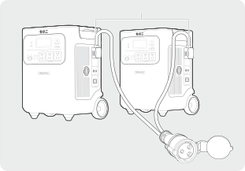便携式储能电源 3600 Plus电小二并机排插并机端口

</figure>

<table class="manual-callout-table ht-native-item-list"><tbody><tr><td class="manual-callout-label">注意</td><td class="manual-callout-body"><ul><li>
并机成功后，请勿在并机AC输出工作时断开并机连接线，否则其他设备可能触发过载保护。 
</li><li>
设备AC输出口工作（AC输出按钮指示灯亮），请勿触摸并机连接线端口。并机连接线端口电压为220V，有触电风险。
</li></ul></td></tr></tbody></table>

如果按下任一设备的交流输出按钮，或因故障中断AC输出，所有设备都将立即停止AC输出，系统自动退出并机模式。其他设备LCD显示屏上的并机图标闪烁，代表并机连接失败。 再次按下每个设备上的AC输出按键，恢复并机输出。

<figure class="hb-reference-figure hb-base-art-live-copy" data-component-id="HB-SPECIAL-REFERENCE-FIGURE" data-reference-id="parallel-interrupted-p14" data-source-fragment-sha256="656b785747d16be5ccc7fa751bc295162ef4667f6f92a8acfba77b8d0a9dec38" data-web-base-art-ref="parallel-interrupted" data-web-presentation-mode="base-art-live-copy">

电小二并机排插

</figure>

<h2 id="native-p14-b4-l0-0">退出并机模式</h2>

<figure class="hb-reference-figure hb-base-art-live-copy" data-component-id="HB-SPECIAL-REFERENCE-FIGURE" data-reference-id="parallel-exit-p14" data-source-fragment-sha256="b8dd4f0470792482e07b5033d297cb21ec9e8a1524de6d7c8d61e99f6d29b2a8" data-web-base-art-ref="parallel-exit" data-web-presentation-mode="base-art-live-copy">

1. 断开所有负载。2. 关闭所有设备的AC输出。3. 移除设备上的并机连接线。大功率设备

</figure>

# 充电方式

<strong>绿色能源优先模式：</strong>本产品倡导优先使用绿色能源，本产品支持太阳能充电与市电充电同时使用。当同时开启市电充电与太阳能充电时，产品会优先太阳能充电且太阳能充电与市电充电同时以电池最大允许功率充电。

<strong>首次使用前请先将本设备充满电！</strong>

<table class="manual-callout-table ht-native-item-list"><tbody><tr><td class="manual-callout-label">提示</td><td class="manual-callout-body"><ul><li>
产品充放电环境温度为 -20℃~45℃，超出此温度范围会限制产品充放电，甚至无法充放电。 
</li><li>
产品的充电功率和电池能量会因温度的变化有所差异。
</li></ul></td></tr></tbody></table>

<h2 id="native-p15-b8-l0-0">市电充电</h2>
请使用官方标配的AC电源线。

<table class="manual-callout-table manual-callout-table"><tbody><tr><td class="manual-callout-label">注意</td><td class="manual-callout-body">
请确保 AC 充电线插头牢固且完全插入产品的 AC 输入接口，避免因插入不完全引发电流不稳、发热或接触不良等问题，影响设备正常运行。
</td></tr></tbody></table>

<h2 id="native-p15-b9-l0-0">太阳能充电</h2>
本产品有两个DC8020 直流输入端口，最大支持1000W输入，可搭配电小二SolarSaga 系列太阳能板使用。

<figure class="hb-reference-figure hb-base-art-live-copy" data-component-id="HB-SPECIAL-REFERENCE-FIGURE" data-reference-id="charging-solar-p15" data-source-fragment-sha256="1f5bafe48834bd927ee58c3e2970755f920355e1525cac186796c86aaa032dfc" data-web-base-art-ref="charging-solar" data-web-presentation-mode="base-art-live-copy">

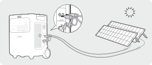SolarSaga 200 × 2

</figure>

如果单个DC8020直流输入端口需要同时连接两个太阳能板，请参考下图，需使用太阳能串联转接盒（单独售卖）。

<figure class="hb-reference-figure hb-base-art-live-copy" data-component-id="HB-SPECIAL-REFERENCE-FIGURE" data-reference-id="charging-solar-four-p16" data-source-fragment-sha256="f4d60b654f1605dac42ec42a1c5744f380499057b595e781834abecf2cf75792" data-web-base-art-ref="charging-solar-four" data-web-presentation-mode="base-art-live-copy">

太阳能串联转接盒（单独售卖）SolarSaga 200 × 4

</figure>

<table class="manual-callout-table manual-callout-table"><tbody><tr><td class="manual-callout-label">注意</td><td class="manual-callout-body">
单个DC8020输入端口请勿连接两个以上光伏板。
</td></tr></tbody></table>

<table class="manual-callout-table ht-native-item-list"><tbody><tr><td class="manual-callout-label">注意</td><td class="manual-callout-body">
同时连接到两个DC输入端口的电源，其电压必须保持一致，否则可能导致产品异常或损坏。例如： 
<ul><li>
连接太阳能板至两个DC8020输入端口时，请使用相同型号的太阳能板，并确保连接的数量一致。 
</li><li>
给产品充电时，请勿同时使用车载充电与光伏充电，否则可能烧坏车内保险丝或无法充电。
</li></ul></td></tr></tbody></table>

建议使用电小二的太阳能板为本产品充电。请确保所用太阳能板的开路电压（Voc）在3600 Plus的直流输入电压范围内（16V -60V）。因使用第三方太阳能板或配件而导致的任何损坏或损失，电小二概不负责。

<h2 id="native-p17-b11-l0-0">车充充电</h2>
本产品适用 12V 车型车充口对本产品进行充电，请确保汽车车充口和车充线的点烟器接触良好，确保点烟器完全插入到位。

<figure class="hb-reference-figure hb-base-art-live-copy" data-component-id="HB-SPECIAL-REFERENCE-FIGURE" data-reference-id="charging-car-p17" data-source-fragment-sha256="bfc425fc639acd86ef47d5425b98ff2612572dab2b5a2c08d0cdf3c7c4d9cfbf" data-web-base-art-ref="charging-car" data-web-presentation-mode="base-art-live-copy">

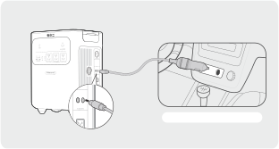车辆*车载充电线需单独购买。

</figure>

<table class="manual-callout-table ht-native-item-list"><tbody><tr><td class="manual-callout-label">注意</td><td class="manual-callout-body"><ul><li>
请在汽车点火启动后使用车充充电，以免造成汽车电瓶亏电无法启动。 
</li><li>
汽车在行驶过程中，路况颠簸，禁止使用车充充电，防止车充接触不良，引起接触点烧坏。若因不按规范操作而造成损失，本公司不予承担相应责任。 
</li><li>
车充充电只支持 12V 车型，不支持 24V 车型，请勿使用 24V 车型的车给本产品充电以免造成人身伤害及财产损失。
</li></ul></td></tr></tbody></table>

# 存储

请将产品存放在干燥、清洁、通风良好的环境中。存储温度和湿度要求如下：
<ul><li>
1 个月： -20℃ ～ 45℃（0 - 60%RH）
</li><li>
3 个月： 0℃ ～ 45℃（0 - 60%RH）
</li><li>
12 个月： 0℃ ～ 25℃（0 - 60%RH）
</li></ul>
若产品在电量耗尽的情况下长时间（3～6 个月）存放，可能会导致无法再次充电。为避免此情况并保持电池健康，建议每隔三个月检查并为产品充电一次，并在 <strong>6～12 个月内至少进行一次完整的充放电循环。</strong>

# 故障处理

如果出现以下任一故障代码，请按照所列的处理方法进行处理。如故障仍然存在，请联系电小二客户支持。

<table class="manual-table ht-native-table ht-troubleshooting"><tbody><tr><th class="ht-cell">
故障代码
</th><th class="ht-cell">
处理方法
</th></tr><tr><td class="ht-cell">
F0
</td><td class="ht-cell">
重启产品。
</td></tr><tr><td class="ht-cell">
F1
</td><td class="ht-cell">
重启产品。
</td></tr><tr><td class="ht-cell">
F2
</td><td class="ht-cell">
重启产品。
</td></tr><tr><td class="ht-cell">
F3
</td><td class="ht-cell">
重启产品。
</td></tr><tr><td class="ht-cell">
F4
</td><td class="ht-cell">
将产品连接负载，放电直至故障消失。
</td></tr><tr><td class="ht-cell">
F5
</td><td class="ht-cell">
通过太阳能板或交流墙充为产品充电，直至故障消失。
</td></tr><tr><td class="ht-cell">
F6
</td><td class="ht-cell"><ol><li>
待电网恢复正常后再通过交流墙插为产品充电。 
</li><li>
检查进风口和出风口是否堵塞；确保产品两侧有 20 厘米的间隙。 
</li><li>
将产品放置在避免阳光直射、环境温度低于45℃的地方。 
</li><li>
断开产品连接的所有负载，保持产品空闲待机，等待故障消失。检查负载的启动功率是否超出本产品的输出范围。 
</li><li>
重启产品。
</li></ol></td></tr><tr><td class="ht-cell">
F7
</td><td class="ht-cell"><ol><li>
移除连接到产品的所有太阳能板。 
</li><li>
检查连接到产品的太阳能板的开路电压（Voc）。产品允许的最大直流输入电压为 60V。 
</li><li>
重启产品，保持产品空闲待机，等待故障消失。
</li></ol></td></tr><tr><td class="ht-cell">
F8
</td><td class="ht-cell">
请联系经销商或电小二客户支持。
</td></tr><tr><td class="ht-cell">
F9
</td><td class="ht-cell">
移除连接到产品 USB 端口的负载，等待故障消失。
</td></tr><tr><td class="ht-cell">
FA
</td><td class="ht-cell"><ol><li>
关闭两台设备的交流输出。 
</li><li>
在 1 分钟内依次再次按下每台设备的交流电源按钮。
</li></ol></td></tr><tr><td class="ht-cell">
FC
</td><td class="ht-cell">
重启产品。
</td></tr></tbody></table>

# 技术参数

<h2 id="native-p19-b25-l0-0">基本规格</h2>

<table class="manual-table ht-native-table ht-spec-grid"><tbody><tr><td class="ht-cell ht-spec-label">
名称
</td><td class="ht-cell">
便携式储能电源
</td></tr><tr><td class="ht-cell ht-spec-label">
型号
</td><td class="ht-cell">
JE-3600A
</td></tr><tr><td class="ht-cell ht-spec-label">
电芯类型
</td><td class="ht-cell">
磷酸铁锂电芯
</td></tr><tr><td class="ht-cell ht-spec-label">
电池能量
</td><td class="ht-cell">
3584 Wh
</td></tr><tr><td class="ht-cell ht-spec-label">
AC 额定输出能量
</td><td class="ht-cell">
2795 Wh
</td></tr><tr><td class="ht-cell ht-spec-label">
尺寸
</td><td class="ht-cell">
约385×309×491 mm
</td></tr><tr><td class="ht-cell ht-spec-label">
重量
</td><td class="ht-cell">
约 35 kg
</td></tr><tr><td class="ht-cell ht-spec-label">
循环寿命
</td><td class="ht-cell">
6000 次循环，≥70%SOH
</td></tr></tbody></table>

<h2 id="native-p19-b26-l0-0">输入</h2>

<table class="manual-table ht-native-table ht-spec-grid"><tbody><tr><td class="ht-cell ht-spec-label">
1 × AC
</td><td class="ht-cell">
220V-240V~ 50Hz, 最大10A
</td></tr><tr><td class="ht-cell ht-spec-label">
2 × DC输入(8020端口)
</td><td class="ht-cell">
光伏：16V-60V⎓12A，双路最大24A/最大1000W 

车充：12V-16V⎓最大8A，双路最大8A
</td></tr><tr><td class="ht-cell ht-spec-label">
加电包连接端口
</td><td class="ht-cell">
36.4V-50.4V，最大100A
</td></tr></tbody></table>

<h2 id="native-p19-b27-l0-0">输出</h2>

<table class="manual-table ht-native-table ht-spec-grid"><tbody><tr><td class="ht-cell ht-spec-label">
4 × AC输出
</td><td class="ht-cell">
220V~ 50Hz，16.36A，额定3600W
</td></tr><tr><td class="ht-cell ht-spec-label">
AC总输出
</td><td class="ht-cell">
额定3600W，瞬时最大7200W
</td></tr><tr><td class="ht-cell ht-spec-label">
AC旁路输出①
</td><td class="ht-cell">
220V-240V~ 50Hz，最大10A
</td></tr><tr><td class="ht-cell ht-spec-label">
2 × USB-C 100W
</td><td class="ht-cell">
5V⎓3A, 9V⎓3A, 12V⎓3A, 15V⎓3A, 20V⎓5A, 最大100W
</td></tr><tr><td class="ht-cell ht-spec-label">
2 × USB-A 18W
</td><td class="ht-cell">
5-6V⎓3A, 6-9V⎓2A, 9-12V⎓1.5A, 最大18W
</td></tr><tr><td class="ht-cell ht-spec-label">
并机端口
</td><td class="ht-cell">
220V~ 50Hz，额定3500W
</td></tr><tr><td class="ht-cell ht-spec-label">
AC并机输出②
</td><td class="ht-cell">
220V~ 50Hz，32A，最大7000W，瞬时最大14000W
</td></tr><tr><td class="ht-cell ht-spec-label">
加电包连接端口
</td><td class="ht-cell">
36.4V-50.4V，最大60A
</td></tr></tbody></table>

<h2 id="native-p19-b28-l0-0">工作环境温度</h2>

<table class="manual-table ht-native-table ht-spec-grid"><tbody><tr><td class="ht-cell ht-spec-label">
充电温度
</td><td class="ht-cell">
-20°C ~ 45°C
</td></tr><tr><td class="ht-cell ht-spec-label">
放电温度
</td><td class="ht-cell">
-20°C ~ 45°C
</td></tr></tbody></table>

※USB Type-C® 和 USB-C® 是 USB Implementers Forum 的注册商标。

①：产品支持边充边放。

②：产品支持两台设备并机。

# APP操作说明书

<h2 id="native-p20-b0-l0-0">1. 下载并登录App</h2>

在App Store或者国内各大应用市场搜索

    “电小二”App安装并注册登录。

      或扫描右边二维码下载电小二App。

<h2 id="native-p20-b4-l0-0">2. 添加设备</h2>

2.1 在App内点击  添加设备。

2.2 长按设备上的“总电源开关键”开机，设备上的Wi-Fi和蓝牙图标闪烁后表示设备已进入配网模式，在App内点击“图标已快闪”按钮并允许应用连接附近的设备和打开蓝牙权限。

<figure class="hb-reference-figure hb-base-art-live-copy" data-component-id="HB-SPECIAL-REFERENCE-FIGURE" data-reference-id="app-add-p20" data-source-fragment-sha256="8694ea6318e6bc196f34233b50bdc7ae64b21c68e119610e6a14872dafada84e" data-web-base-art-ref="app-add" data-web-presentation-mode="base-art-live-copy">

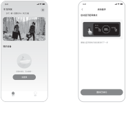2.12.2

</figure>

<table class="manual-callout-table ht-native-item-list"><tbody><tr><td class="manual-callout-label">备注</td><td class="manual-callout-body">
打开设备，如果两小时内未连接到APP，设备会自动关闭Wi-Fi和蓝牙。
</td></tr></tbody></table>

<figure class="hb-reference-figure hb-base-art-live-copy" data-component-id="HB-SPECIAL-REFERENCE-FIGURE" data-reference-id="app-controls-p20" data-source-fragment-sha256="49292654bf18c09248740b87df52e2c7c1ff25cf17d0aa3263dd12243b6e8433" data-web-base-art-ref="app-controls" data-web-presentation-mode="base-art-live-copy">

AC输出按键总电源开关键USB输出按键

</figure>

2.3 点击搜索到的设备图标后App通过蓝牙自动连接设备。
<table class="manual-callout-table ht-native-item-list"><tbody><tr><td class="manual-callout-label">备注</td><td class="manual-callout-body">
如果在绑定过程中提示“设备已被绑定”，可通过以下两种方式连接:
<ul><li>
设备拥有者通过App将此设备分享给其他用户；
</li><li>
同时长按“总电源开关按键”和“USB输出按键”重置设备Wi-Fi后可重新绑定设备。
</li></ul></td></tr></tbody></table>
2.4 设备连接成功后输入设备将要连接的Wi-Fi名称和密码，设备自动连接到Wi-Fi网络。
<table class="manual-callout-table ht-native-item-list"><tbody><tr><td class="manual-callout-label">备注</td><td class="manual-callout-body">
请选择2.4GHz频段的Wi-Fi网络，设备不支持5GHz频段的Wi-Fi网络。
</td></tr></tbody></table>
2.5 设备添加成功后进入设备主页面，设备上的Wi-Fi图标会常亮。

<figure class="hb-reference-figure hb-base-art-live-copy" data-component-id="HB-SPECIAL-REFERENCE-FIGURE" data-reference-id="app-connect-p21" data-source-fragment-sha256="cd38a01a05cdfc084e33ded8d3313b79fd1b0cca78a1b61bf78c3824f4ad47af" data-web-base-art-ref="app-connect" data-web-presentation-mode="base-art-live-copy">

2.52.32.43600 Plus<strong>800W</strong><strong>1000W</strong>1000 Lite

</figure>

图片仅供参考

<table class="manual-callout-table manual-callout-table"><tbody><tr><td class="manual-callout-label">注意</td><td class="manual-callout-body">
App 通过蓝牙与储能设备连接，每次仅支持一台设备。连接后返回设备列表时，蓝牙连接将自动断开。再次点击储能设备图标时，App 会自动重新连接。
</td></tr></tbody></table>

<h2 id="native-p21-b2-l0-0">3. 解绑设备</h2>
     点击设备主界面右上角的设置按钮进入设置页面，点击页面最下方的解除绑定按钮解绑设备。

<h2 id="native-p22-b4-l0-0">4. 其他说明</h2>
4.1 打开Wi-Fi&amp;蓝牙：

开机后自动打开Wi-Fi&amp;蓝牙，屏幕上的Wi-Fi&amp;蓝牙图标点亮表示Wi-Fi&amp;蓝牙已被打开。 同时长按“AC输出按键”和“USB输出按键”1秒手动打开Wi-Fi和蓝牙。

4.2 关闭Wi-Fi&amp;蓝牙：

两小时内未连接WiFi或蓝牙，设备上的Wi-Fi&amp;蓝牙会自动关闭。 同时长按“ AC输出按键”和“USB输出按键”1秒手动关闭Wi-Fi和蓝牙。

4.3 重置Wi-Fi&amp;蓝牙：

同时长按“总电源开关按键”和“USB输出按键”将重置 Wi-Fi和蓝牙，同时清除App中的自定义设置。

<h2>合格证</h2><table class="manual-table"><tbody><tr><td>检验员：</td><td class="ht-certificate-line">

QC

PASS

01

</td></tr><tr><td>检验日期：</td><td class="ht-certificate-line"></td></tr></tbody></table>
广东电小二科技有限公司

关注官方品牌公众号

获取更多资讯服务

制造商/生产厂：深圳市华宝新能源股份有限公司

地址：深圳市龙华区大浪街道同胜社区华繁路东侧嘉安达科技工业园

