

# IMPORTANTE

Felicidades por su nuevo Jackery HomePower 3600 Plus. Lea atentamente este manual  antes de utilizar el producto, en particular las precauciones pertinentes para garantizar un  uso correcto. Guarde este manual en un lugar accesible para consultarlo con frecuencia.

En cumplimiento de las leyes y reglamentos, el derecho de interpretación final de este  documento y de todos los documentos relacionados con este producto corresponde a la  Empresa.

Tenga en cuenta que no se realizarán más notificaciones en caso de actualización, revisión  o finalización.

# INFORMACIÓN IMPORTANTE DE SEGURIDAD

<figure class="hb-symbol-signal-composition hb-safety-instruction" id="safety-instruction-p44"><table class="hb-symbol-signal-table"><colgroup><col style="width:7%"/><col style="width:93%"/></colgroup><tbody><tr><td></td><td>
<strong>INSTRUCCIONES RELATIVAS AL RIESGO DE INCENDIO, DESCARGA  ELÉCTRICA O LESIONES PERSONALES</strong>
</td></tr></tbody></table></figure>

<table class="manual-two-col-table" style="width:100%;border-collapse:separate;border-spacing:0;margin:0;table-layout:fixed"><tbody><tr><td style="width:50%;border:none;padding:0 8px 0 0;vertical-align:top"><figure class="hb-symbol-signal-composition hb-safety-lead" id="native-p44-b27-l0-0"><table class="hb-symbol-signal-table"><colgroup><col style="width:28%"/><col style="width:72%"/></colgroup><tbody><tr><td class="hb-symbol-signal-label-cell"></td><td class="hb-symbol-signal-meaning-cell">
<strong>ADVERTENCIA</strong>

<strong>Sigue siempre estas precauciones  básicas al usar este producto. </strong>
</td></tr></tbody></table></figure><ul class="hb-list"><li>
Lee todas las instrucciones antes de usar el producto.
</li><li>
No permitas que los niños jueguen sobre del producto.  Se requiere la supervisión cercana de adultos cuando  se use cerca de niños.
</li><li>
Evita colocar las manos o los dedos dentro del  producto.
</li><li>
Deja de usar el producto de inmediato si ha sufrido  daños físicos o modificaciones. El uso inadecuado  puede causar un comportamiento impredecible,  provocando incendio, explosión o lesiones.
</li><li>
Si se observan los siguientes síntomas —(incluyendo  sobrecalentamiento, olores extraños o humo, fugas o  quemaduras)— deja de usar el producto de inmediato  y contacta al distribuidor o a nuestro servicio al cliente.
</li><li>
Nunca intentes abrir, reparar o modificar el producto.  Cualquier manipulación, re ensamblaje o modificación  puede resultar en descarga eléctrica, incendio o daños  a la batería.
</li></ul></td><td style="width:50%;border:none;padding:0 0 0 8px;vertical-align:top"><ul class="hb-list"><li>
Ten en cuenta que el líquido expulsado del producto  puede causar irritación o quemaduras. El uso  inapropiado o abusivo puede causar fugas en la  batería. Evita el contacto directo con líquidos que se  filtren. Si el líquido entra en contacto con los ojos,  busca atención médica de inmediato. Si entra en  contacto con otras partes del cuerpo, enjuaga con  agua corriente y consulta a un médico de inmediato.
</li><li>
No expongas el producto al fuego o a temperaturas  extremas. Hacerlo puede provocar una explosión si la  temperatura supera los 130°C (265°F).
</li><li>
El uso de materiales o piezas no recomendadas o no  suministradas puede implicar riesgo de incendio,  descarga eléctrica o lesiones personales.
</li><li>
No dejes la batería cargando sin supervisión durante  periodos prolongados. Supervisa siempre el proceso  de carga para garantizar un funcionamiento seguro.
</li><li>
Para reducir el riesgo de descarga eléctrica,  desconecta el producto de cualquier fuente de  energía antes de realizar servicio técnico o resolución  de problemas.
</li></ul></td></tr></tbody></table>

## INSTRUCCIONES DE USO

<table class="manual-two-col-table" style="width:100%;border-collapse:separate;border-spacing:0;margin:0;table-layout:fixed"><tbody><tr><td style="width:50%;border:none;padding:0 8px 0 0;vertical-align:top">
<strong>GUARDE ESTAS INSTRUCCIONES</strong>
<ul class="hb-list"><li>
Deja de usar el producto de inmediato si muestra signos de  daño. Suspende el uso y contacta al servicio al cliente para  recibir asistencia.
</li><li>
No cargues la batería en ambientes extremadamente  calientes o fríos y cumple estrictamente con los rangos de  temperatura especificados por el producto: -Temperatura de carga: -4 °F a 113°F (-20°C a 45°C); -Temperatura de descarga: -4 °F a 113°F (-20°C a 45°C). 
</li><li>
Para garantizar una circulación de aire adecuada, no  cubras las rejillas de ventilación del producto. El área  donde se use el producto debe tener un flujo de aire  adecuado en un entorno fresco y seco para evitar el  sobrecalentamiento. -Cargar en espacios húmedos o mal ventilados puede  representar riesgos para la seguridad. El agua puede provocar cortocircuitos o dañar el cargador,  generando riesgos de seguridad.
</li><li>
Desconecta el cable de alimentación de la toma de  corriente durante tormentas eléctricas.
</li><li>
Apaga el producto de inmediato presionando el botón de  encendido si se ha caído, golpeado o expuesto a  vibraciones.
</li></ul></td><td style="width:50%;border:none;padding:0 0 0 8px;vertical-align:top"><ul class="hb-list"><li>
Asegúrate de que los dispositivos estén apagados antes  de conectarlos al producto.
</li><li>
No cargues el producto con un cable o enchufe dañado o  roto. 
</li><li>
No uses el producto para cargar dispositivos con cable o  enchufe dañado o roto.
</li><li>
Siempre desconecta el cable de carga tirando del enchufe,  no del cable, para evitar daños.
</li><li>
Asegúrate de que el producto esté bien asegurado al  transportarlo en un vehículo en movimiento.
</li><li>
NO coloques la unidad boca abajo ni de lado durante el  uso o almacenamiento. 
</li><li>
NO coloques el producto en el suelo o a una altura menor  de 18 pulgadas (457 mm) sobre el suelo durante el  funcionamiento en un taller o centro de reparación.
</li><li>
NO uses los accesorios del producto con otros dispositivos  o equipos.
</li><li>
El tiempo de carga solar depende de las condiciones  meteorológicas. Coloque su panel solar donde reciba la  mayor cantidad posible de luz solar directa.
</li></ul></td></tr></tbody></table>

<table class="manual-callout-table manual-callout-table hb-source-warning-lockup ht-native-danger"><tbody><tr><td class="manual-callout-label">PELIGRO:</td><td class="manual-callout-body">
<strong>Este dispositivo está diseñado únicamente para uso en interiores (coloque este  dispositivo en un ambiente similar a interiores cuando lo use en exteriores, ej.  autocaravanas, tiendas de campaña, cabañas, etc.).</strong>

<strong>※ Este dispositivo no es resistente al agua ni al polvo.Manténgalo alejado de la  lluvia y ambientes húmedos durante su uso.</strong>
</td></tr></tbody></table>

<h2 class="hb-h1-pill ht-safety-subbar" id="native-p45-b0-l0-0">INSTRUCCIONES DE MANTENIMIENTO PARA EL USUARIO</h2>

Durante el ciclo de vida de los productos de almacenamiento de energía, se producirá cierto grado de  degradación de capacidad y energía. A medida que aumenta el número de ciclos de uso y se extiende el  tiempo de almacenamiento, esta degradación se intensificará gradualmente, lo cual es un fenómeno normal  acorde con el patrón de envejecimiento natural de las celdas de la batería. 

# SIGNIFICADO DE LOS SÍMBOLOS

<figure aria-label="Símbolo / Significados" class="hb-symbol-signal-composition" data-component-id="HB-TABLE-SYMBOL-SIGNAL"><table class="hb-symbol-signal-table"><colgroup><col class="hb-symbol-signal-col-label"/><col class="hb-symbol-signal-col-meaning"/></colgroup><thead><tr><th class="hb-symbol-signal-label-heading" scope="col">Símbolo</th><th class="hb-symbol-signal-meaning-heading" scope="col">Significados</th></tr></thead><tbody><tr><td class="hb-symbol-signal-label-cell">⚠ADVERTENCIA</td><td class="hb-symbol-signal-meaning-cell">Prácticas peligrosas que pueden resultar en lesiones graves, muerte  y/o daños a la propiedad.</td></tr><tr><td class="hb-symbol-signal-label-cell">⚠PRECAUCIÓN</td><td class="hb-symbol-signal-meaning-cell">Prácticas peligrosas que pueden resultar en lesiones personales y/o  daños a la propiedad.</td></tr><tr><td class="hb-symbol-signal-label-cell">⚠NOTA</td><td class="hb-symbol-signal-meaning-cell">Prácticas peligrosas que pueden resultar en daño al equipo, pérdida  de datos, deterioro del rendimiento o resultados inesperados.</td></tr><tr><td class="hb-symbol-signal-label-cell">⚠CONSEJOS</td><td class="hb-symbol-signal-meaning-cell">Complementa la información importante o consejos de operación  en el texto.</td></tr></tbody></table></figure>

<figure aria-label="Símbolo / Significados" class="hb-symbol-pair-composition" data-component-id="HB-TABLE-SYMBOL-ICON">

<table class="hb-symbol-panel-table"><colgroup><col class="hb-symbol-col-icon"/><col class="hb-symbol-col-meaning"/></colgroup><thead><tr><th class="hb-symbol-icon-heading" scope="col">Símbolo</th><th class="hb-symbol-meaning-heading" scope="col">Significados</th></tr></thead><tbody><tr><td class="hb-symbol-icon"></td><td class="hb-symbol-meaning">Precaución! El incumplimiento de los  mensajes de advertencia puede  provocar lesiones.</td></tr><tr><td class="hb-symbol-icon"></td><td class="hb-symbol-meaning">Lea el manual del operador</td></tr><tr><td class="hb-symbol-icon"></td><td class="hb-symbol-meaning">Riesgo de descarga eléctrica</td></tr><tr><td class="hb-symbol-icon"></td><td class="hb-symbol-meaning">Carga de batería</td></tr><tr><td class="hb-symbol-icon"></td><td class="hb-symbol-meaning">Material explosivo</td></tr><tr><td class="hb-symbol-icon"></td><td class="hb-symbol-meaning">Objeto pesado</td></tr></tbody></table>

<table class="hb-symbol-panel-table"><colgroup><col class="hb-symbol-col-icon"/><col class="hb-symbol-col-meaning"/></colgroup><thead><tr><th class="hb-symbol-icon-heading" scope="col">Símbolo</th><th class="hb-symbol-meaning-heading" scope="col">Significados</th></tr></thead><tbody><tr><td class="hb-symbol-icon"></td><td class="hb-symbol-meaning">No desarme el producto.</td></tr><tr><td class="hb-symbol-icon"></td><td class="hb-symbol-meaning">No fumar ni hacer llamas abiertas</td></tr><tr><td class="hb-symbol-icon"></td><td class="hb-symbol-meaning">No se permiten niños</td></tr><tr><td class="hb-symbol-icon"></td><td class="hb-symbol-meaning">Este símbolo indica que el producto  contiene una batería de iones de litio  (Li-ion), la cual debe desecharse o  reciclarse de forma adecuada.</td></tr><tr><td class="hb-symbol-icon"></td><td class="hb-symbol-meaning">Este símbolo indica que el producto no  debe desecharse con los residuos  domésticos. En su lugar, debe llevarse a un  punto de recogida designado para su  correcto reciclaje. El desecho y reciclaje adecuados ayudan  a proteger el medioambiente. Para más  información, póngase en contacto con su  autoridad local, el servicio de gestión de  residuos o el distribuidor del producto.</td></tr></tbody></table>

</figure>

<figure aria-label="FCC" class="hb-fcc-composition" data-component-id="HB-SPECIAL-FCC">

Este dispositivo cumple con la parte 15 de  las Reglas de la FCC. El funcionamiento está  sujeto a las siguientes dos condiciones :

(1) Este dispositivo no debe causar  interferencias dañinas, y

(2) Este dispositivo debe aceptar cualquier interferencia  recibida, incluidas las interferencias que puedan causar un  funcionamiento no deseado.

<strong>NOTA :</strong> Este equipo ha sido probado y cumple con los límites  para un dispositivo digital de Clase B, según la parte 15 de  las Reglas de la FCC.

Estos límites están diseñados para proporcionar una  protección razonable contra las interferencias perjudiciales  en una instalación residencial. Este equipo genera, utiliza y  puede emitir energía de radiofrecuencia y, si no se instala y  utiliza de acuerdo con las instrucciones, puede causar  interferencias perjudiciales en las comunicaciones. Sin  embargo, no hay garantía de que no se produzcan

interferencias en una instalación particular.
Si este  equipo causa interferencias perjudiciales en la  recepción de radio o televisión, lo que puede  determinarse encendiendo y apagando el equipo, se  recomienda al usuario intentar corregir las  interferencias mediante una o más de las siguientes  medidas :
<ul class="simple"><li>
Reorientar o reubicar la antena de recepción.
</li><li>
Aumentar la separación entre el equipo y el receptor.
</li><li>
Conectar el equipo a una toma de corriente en un  circuito diferente al que está conectado el receptor.
</li><li>
Consultar al distribuidor o a un técnico experimenta- do en radio/TV para obtener ayuda.
</li></ul>
<strong>MODIFICACIÓN :</strong> Cualquier cambio o modificación no  expresamente aprobada por la parte responsable de  la conformidad podría anular la autorización del  usuario para operar el dispositivo.

</figure>

# CONTENIDO DE LA CAJA

<figure class="hb-reference-figure hb-base-art-live-copy" data-component-id="HB-SPECIAL-REFERENCE-FIGURE" data-reference-id="inbox-p46" data-source-fragment-sha256="06fd461fef3282333447b113b69d75bd3c5a16f822ee163f037d81020341cbb0" data-web-base-art-ref="inbox" data-web-presentation-mode="base-art-live-copy">

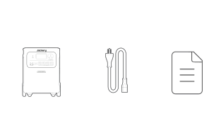12<strong>Cable de carga de CA</strong><strong>Jackery HomePower 3600 Plus</strong>3<strong>Documentos</strong>

</figure>

<table class="manual-callout-table manual-callout-table"><tbody><tr><td class="manual-callout-label">CONSEJOS</td><td class="manual-callout-body">
El cable de carga para automóvil no está incluido, pero está disponible para su  <strong>*</strong> compra por separado en nuestro sitio web. Para obtener asistencia, comunícate con  el servicio al cliente de Jackery.
</td></tr></tbody></table>

# DESCRIPCIÓN GENERAL DEL PRODUCTO

<figure class="hb-reference-figure hb-base-art-live-copy" data-component-id="HB-SPECIAL-REFERENCE-FIGURE" data-reference-id="overview-p47" data-source-fragment-sha256="6a2948e0e163dead9f96bdbeabb07ef9b9f43dace75cd2bc27ce1d584a1bd91f" data-web-base-art-ref="overview" data-web-presentation-mode="base-art-live-copy">

<strong>VISTA LATERAL DERECHA</strong><strong>VISTA FRONTAL</strong>100W Max, 5V⎓3A, 9V⎓3A, 12V⎓3A, 15V⎓3A, 20V⎓5A18W Max, 5-6V⎓3A, 6-9V⎓2A, 9-12V⎓1.5A<strong>Salidas de CA</strong><strong>Botón de energía CA</strong><strong>Botón de energía USB</strong><strong>Salida USB-C</strong><strong>Salida USB-A</strong><strong>LCD</strong><strong>Salidas de CA</strong><strong> (NEMA TT-30)</strong><strong>Botón principal de </strong><strong>encendido</strong>120V~ 60Hz, 30A Max, 3600W120V~ 60Hz, 20A Max, 2400W<strong>Botón de reinicio de salida CA</strong><strong>Entrada de CA</strong><strong>Entrada de CC</strong>100V-120V~ 60Hz, 15A Máx2 x Puertos DC8020: 12-16V⎓8A Máx, Doble a 8A Máx; 16-60V⎓12A Máx, Doble a 24A/1000W Máx<strong>Puerto de expansión CC</strong>Conectar al paquete de bateríasSalida: 240V~ 60Hz, 30A, 7200W Máx, Pico de sobretensión 14400W<strong>Puerto de expansión CA</strong>(Para conexión en paralelo)<strong>Ruedas</strong><strong>Manija retráctil</strong>pulse el botón de la manija retráctil y tire para extenderla

</figure>

# PANTALLA LCD

<figure class="hb-reference-figure hb-base-art-live-copy" data-component-id="HB-SPECIAL-REFERENCE-FIGURE" data-reference-id="lcd-map-p48" data-source-fragment-sha256="0a9454eb96c021f8a697bafba2dec287d9ed298c9cb5f553fbaebefc22f1f6e5" data-web-base-art-ref="lcd-map" data-web-presentation-mode="base-art-live-copy">

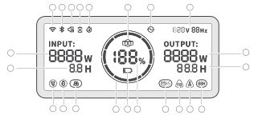21229101112121314151618192034578617

</figure>

<figure aria-label="Indicadores de la pantalla LCD" class="hb-lcd-table-composition" data-component-id="HB-TABLE-LCD-ICON" tabindex="0"><table class="hb-lcd-icon-table"><colgroup><col class="hb-lcd-col-number"/><col class="hb-lcd-col-icon"/><col class="hb-lcd-col-name"/><col class="hb-lcd-col-description"/></colgroup><tbody><tr><td class="hb-lcd-number">
1
</td><td class="hb-lcd-icon"></td><td class="hb-lcd-name">
<strong>Wi-Fi</strong>
</td><td class="hb-lcd-description">

<strong>Encendido: </strong>Wi-Fi conectado.

<strong>Parpadeo: </strong>listo para conectarse al Wi-Fi.

<strong>Apagado:</strong> Wi-Fi desconectado.

</td></tr><tr><td class="hb-lcd-number">
2
</td><td class="hb-lcd-icon"></td><td class="hb-lcd-name">
<strong>Bluetooth</strong>
</td><td class="hb-lcd-description">

<strong>Encendido: </strong>Bluetooth conectado.

<strong>Parpadeo: </strong>listo para conectarse al Bluetooth.

<strong>Apagado: </strong>Bluetooth desconectado.

</td></tr><tr><td class="hb-lcd-number">
3
</td><td class="hb-lcd-icon"></td><td class="hb-lcd-name">
<strong>Modo de Carga </strong> <strong>Silenciosa</strong>
</td><td class="hb-lcd-description">

<strong>Encendido: </strong>el ruido durante la carga se minimiza significativa- mente, mientras que la potencia de carga se reduce y la  velocidad de carga disminuye.

<strong>Apagado: </strong>El modo de carga silenciosa está desactivado.

Activar/desactivar esta función en la App Jackery. Cuando el dispositivo se apaga, se retiene la configuración.

</td></tr><tr><td class="hb-lcd-number" rowspan="2">
4
</td><td class="hb-lcd-icon"></td><td class="hb-lcd-name">
<strong>Modo de Ahorro de </strong> <strong>Batería</strong>
</td><td class="hb-lcd-description">

<strong>Encendido: </strong>limita la capacidad máxima utilizable de la batería  para prolongar su vida útil.

<strong>Apagado: </strong>el modo de ahorro de batería está desactivado.

Activar/desactivar esta función en la App Jackery. Cuando el  dispositivo se apaga, se retiene la configuración.

Esta función no está disponible cuando el producto está  conectado a paquetes de baterías.

Cuando esta función está habilitada, el producto ocasionalmente  realiza un ciclo completo de carga-descarga para calibrar el SOC.

</td></tr><tr><td class="hb-lcd-icon"></td><td class="hb-lcd-name">
<strong>Modo Autónomo</strong>
</td><td class="hb-lcd-description">

Maximiza el uso de la energía solar y reduce la dependencia de la  electricidad de la red al priorizar la energía solar almacenada,  reduciendo los costos eléctricos. La estación de energía debe  estar conectada simultáneamente a los paneles solares y a la red,  con la potencia de carga limitada por la potencia de derivación.

Por favor, active/desactive esta función en la aplicación. Cuando  el dispositivo se apaga, se retiene la configuración.

</td></tr><tr><td class="hb-lcd-number">
5
</td><td class="hb-lcd-icon"></td><td class="hb-lcd-name">
<strong>Plan de Carga</strong>
</td><td class="hb-lcd-description">

Personaliza el tiempo de carga del Jackery HomePower 3600  Plus. Adecuado para situaciones con tarifas eléctricas variables,  permite establecer planes de carga según las horas pico y valle,  reduciendo así los costos de electricidad.

Por favor, configure esta función en la aplicación Jackery.  Cuando el dispositivo se apaga, se retiene la configuración.

</td></tr><tr><td class="hb-lcd-number">
6
</td><td class="hb-lcd-icon"></td><td class="hb-lcd-name">
<strong>Paralelo</strong>
</td><td class="hb-lcd-description">

<strong>Parpadeo: </strong>la salida CA está habilitada y la conexión en  paralelo no está configurada.

<strong>Encendido: </strong>la salida CA está habilitada y la conexión en  paralelo se ha configurado correctamente.

</td></tr></tbody></table></figure>

<figure aria-label="Indicadores de la pantalla LCD" class="hb-lcd-table-composition" data-component-id="HB-TABLE-LCD-ICON" tabindex="0"><table class="hb-lcd-icon-table"><colgroup><col class="hb-lcd-col-number"/><col class="hb-lcd-col-icon"/><col class="hb-lcd-col-name"/><col class="hb-lcd-col-description"/></colgroup><tbody><tr><td class="hb-lcd-number">
7
</td><td class="hb-lcd-icon"></td><td class="hb-lcd-name">
<strong>Indicador de </strong> <strong>Energía de CA</strong>
</td><td class="hb-lcd-description">

La salida CA (onda sinusoidal pura) está activada.

</td></tr><tr><td class="hb-lcd-number">
8
</td><td class="hb-lcd-icon"></td><td class="hb-lcd-name">
<strong>Voltaje y frecuencia </strong> <strong>de salida</strong>
</td><td class="hb-lcd-description">

Muestra el voltaje y la frecuencia de salida cuando la  salida de CA está encendida.

</td></tr><tr><td class="hb-lcd-number">
9
</td><td class="hb-lcd-icon"></td><td class="hb-lcd-name">
<strong>Potencia de Entrada</strong>
</td><td class="hb-lcd-description">

Muestra la potencia de entrada en vatios.

</td></tr><tr><td class="hb-lcd-number">
10
</td><td class="hb-lcd-icon"></td><td class="hb-lcd-name">
<strong>Tiempo de Carga </strong> <strong>Restante</strong>
</td><td class="hb-lcd-description">

Muestra el tiempo de carga restante.

</td></tr><tr><td class="hb-lcd-number">
11
</td><td class="hb-lcd-icon"></td><td class="hb-lcd-name">
<strong>Indicador de Carga </strong> <strong>desde Toma de </strong> <strong>Corriente CA</strong>
</td><td class="hb-lcd-description">

El producto se carga a través de la entrada CA utilizando  energía de la red eléctrica.

</td></tr><tr><td class="hb-lcd-number">
12
</td><td class="hb-lcd-icon"></td><td class="hb-lcd-name">
<strong>Indicador de Carga </strong> <strong>desde Coche</strong>
</td><td class="hb-lcd-description">

El producto se carga a través de la entrada CC (DC8020)  utilizando CC 12V (carga desde el coche).

</td></tr><tr><td class="hb-lcd-number">
13
</td><td class="hb-lcd-icon"></td><td class="hb-lcd-name">
<strong>Indicador de </strong> <strong>Carga Solar</strong>
</td><td class="hb-lcd-description">

El producto se carga a través de la entrada CC (DC8020)  utilizando paneles solares.

</td></tr><tr><td class="hb-lcd-number">
14
</td><td class="hb-lcd-icon"></td><td class="hb-lcd-name">
<strong>Indicador de Potencia </strong> <strong>de la Batería</strong>
</td><td class="hb-lcd-description">

Cuando el producto se está cargando, el círculo naranja  alrededor del porcentaje de batería se ilumina  secuencialmente. Cuando está cargando otros dispositivos,  el círculo naranja permanece encendido.

</td></tr><tr><td class="hb-lcd-number">
15
</td><td class="hb-lcd-icon"></td><td class="hb-lcd-name">
<strong>Indicador de Batería </strong> <strong>Baja</strong>
</td><td class="hb-lcd-description">

<strong>Encendido: </strong>el nivel de la batería está por debajo del 20 %.

<strong>Parpadeo: </strong>el nivel de la batería está por debajo del 5 %.

<strong>Apagado: </strong>el nivel de la batería no está por debajo del 20 %  o el producto se está cargando.

</td></tr><tr><td class="hb-lcd-number">
16
</td><td class="hb-lcd-icon">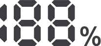</td><td class="hb-lcd-name">
<strong>Porcentaje de </strong> <strong>Batería Restante</strong>
</td><td class="hb-lcd-description">

Muestra el porcentaje de batería restante.

</td></tr><tr><td class="hb-lcd-number">
17
</td><td class="hb-lcd-icon"></td><td class="hb-lcd-name">
<strong>Indicador de paquete </strong> <strong>de baterías y número </strong> <strong>de baterías conectadas</strong>
</td><td class="hb-lcd-description">

Indica que el producto está conectado al número  especificado de baterías adicionales 3600.

</td></tr><tr><td class="hb-lcd-number">
18
</td><td class="hb-lcd-icon"></td><td class="hb-lcd-name">
<strong>Código de fallo</strong>
</td><td class="hb-lcd-description">

Se ha producido un error en el producto. Por favor, consulte  la sección de solución de problemas para más detalles.

</td></tr><tr><td class="hb-lcd-number" rowspan="2">
19
</td><td class="hb-lcd-icon"></td><td class="hb-lcd-name">
<strong>Indicador de Alta </strong> <strong>Temperatura</strong>
</td><td class="hb-lcd-description">

Se activó la protección por alta temperatura. El producto  puede dejar de funcionar hasta que su temperatura vuelva al  rango normal de operación.

</td></tr><tr><td class="hb-lcd-icon"></td><td class="hb-lcd-name">
<strong>Indicador de Baja </strong> <strong>Temperatura</strong>
</td><td class="hb-lcd-description">

Se activó la protección por baja temperatura.El producto  puede dejar de funcionar hasta que su temperatura vuelva al  rango normal de operación.

</td></tr><tr><td class="hb-lcd-number">
20
</td><td class="hb-lcd-icon"></td><td class="hb-lcd-name">
<strong>Modo de Ahorro de </strong> <strong>Energía</strong>
</td><td class="hb-lcd-description">

Cuando las salidas CA o USB se encienden presionando los  botones de encendido CA o USB:

<strong>Encendido:</strong> Modo de ahorro de energía activado.

<strong>Apagado:</strong> Modo de ahorro de energía desactivado.

</td></tr><tr><td class="hb-lcd-number">
21
</td><td class="hb-lcd-icon"></td><td class="hb-lcd-name">
<strong>Potencia de Salida</strong>
</td><td class="hb-lcd-description">

Muestra la potencia de salida en vatios.

</td></tr><tr><td class="hb-lcd-number">
22
</td><td class="hb-lcd-icon"></td><td class="hb-lcd-name">
<strong>Tiempo de Descarga </strong> <strong>Restante</strong>
</td><td class="hb-lcd-description">

Muestra el tiempo de descarga restante.

</td></tr></tbody></table></figure>

# OPERACIONES

<h2 class="ht-operation-heading" id="operations-power"><strong>ENCENDIDO/APAGADO</strong></h2>

<figure class="hb-reference-figure hb-base-art-live-copy" data-component-id="HB-SPECIAL-REFERENCE-FIGURE" data-reference-id="power-p50" data-source-fragment-sha256="fa292579594c18eebcdf10b1f1fc2c5876a7403085a65c2dffd0870781c74e48" data-web-base-art-ref="power" data-web-presentation-mode="base-art-live-copy">

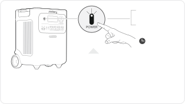Cuando el modo de ahorro de energía está activado, el producto se apagará automáticamente después de 12 horas si el botón de energía CA o USB está encendido, pero el producto no está cargando ni descargando.<strong>Tiempo de espera predeterminado:</strong> 2 horasEl producto se apagará automáticamente después de 2 horas de inactividad, sin carga ni descarga.*El tiempo en espera puede configurarse en la App de Jackery.3s<strong>Encendido</strong><strong>Apagado</strong>Presione una vezMantén presionado durante 3 segundos

</figure>

<h2 class="ht-operation-heading" id="operations-ac-output"><strong>ENCENDER/APAGAR SALIDA CA</strong></h2>

<figure class="hb-reference-figure hb-base-art-live-copy" data-component-id="HB-SPECIAL-REFERENCE-FIGURE" data-reference-id="ac-output-p50" data-source-fragment-sha256="69d7e895742f7e6b6477d6c8094c2a74250fbe1c5a342753ea0d52e2fcbc93ab" data-web-base-art-ref="ac-output" data-web-presentation-mode="base-art-live-copy">

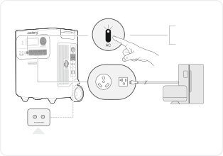<strong>Requisito previo:</strong> el producto está encendido.<strong>Botón de reinicio de salida CA:</strong>Cuando el botón de reinicio se levante, necesita remover la carga y presionar el botón de reinicio para reiniciar.<strong>Encendido</strong><strong>Apagado</strong>Presione una vezPresione una vez

</figure>

<h2 class="ht-operation-heading" id="operations-usb-output"><strong>ENCENDER/APAGAR SALIDA USB</strong></h2>

<figure class="hb-reference-figure hb-base-art-live-copy" data-component-id="HB-SPECIAL-REFERENCE-FIGURE" data-reference-id="usb-output-p51" data-source-fragment-sha256="ce845f39df361a491f42166cda1b66522548908eb6dbc5976dbe5101b4612c04" data-web-base-art-ref="usb-output" data-web-presentation-mode="base-art-live-copy">

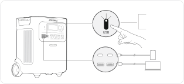<strong>Requisito previo: </strong> el producto está encendido.<strong>Encendido</strong><strong>Apagado</strong>Presione una vezPresione una vez

</figure>

<table class="manual-callout-table manual-callout-table ht-native-usb-caution"><tbody><tr><td class="manual-callout-label">PRECAUCIÓN</td><td class="manual-callout-body"><ul><li>
<strong>El puerto USB-C de 100 W es una salida de alta potencia de tipo Fuente de </strong> <strong>Alimentación 3 (PS3) según USB-PD.  </strong>Si el dispositivo del usuario o accesorio  conectado no cumple con los requisitos de seguridad, puede existir riesgo de  incendio. Antes de usar estos puertos, asegúrese de que el dispositivo o accesorio  conectado tenga protección contra incendios.  
</li><li>
Solo conecte el Jackery HomePower 3600 Plus a dispositivos o accesorios que  cumplan con las cláusulas 6.3, 6.4 y 6.5 de IEC/EN/UL 62368-1 (u otros estándares  equivalentes).  
</li><li>
Para obtener la potencia máxima de salida, utilice el cable oficial Jackery USB-C  a USB-C de 5 A (20 V CC/5 A, 100W). 
</li></ul></td></tr></tbody></table>

<h2 class="ht-operation-heading" id="operations-energy-saving"><strong>MODO DE AHORRO DE ENERGÍA</strong></h2>

<figure class="hb-reference-figure hb-base-art-live-copy" data-component-id="HB-SPECIAL-REFERENCE-FIGURE" data-reference-id="energy-saving-p51" data-source-fragment-sha256="b14849f9fd2bb30d1cc13f1796df5cc638564448e17f8d4f4a28b16cf53969bc" data-web-base-art-ref="energy-saving" data-web-presentation-mode="base-art-live-copy">

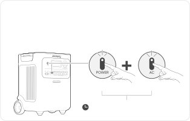Para evitar el consumo innecesario de batería al olvidar apagar la salida, el producto activa por defecto el Modo de Ahorro de Energía. Cuando la salida de CA o USB está encendida, el ícono del modo de Ahorro de Energía se mostrará en la pantalla LCD. Si no hay ningún dispositivo conectado o si el consumo del dispositivo conectado está por debajo de un cierto umbral (salida de CA de 25W o salida USB de 2W) durante 12 horas, el dispositivo apagará automáticamente todas las salidas. Configure la duración del modo de Ahorro de Energía en la aplicación Jackery. Para desactivar el modo de ahorro de energía, presione y mantenga presionados el botón de energía CA y el botón de encendido principal durante más de 3 segundos. El producto no apagará automáticamente la salida CA o CC.Botón de encendido principalBotón de energía CA3sMantenga pulsados ambos botones durante 3 segundos<strong>Encendido/Apagado</strong>

</figure>

<table class="manual-callout-table manual-callout-table"><tbody><tr><td class="manual-callout-label">NOTA</td><td class="manual-callout-body">

El modo de ahorro de energía reanuda el estado anterior después de encender. Se 

requiere un cambio manual para modificar el modo.

</td></tr></tbody></table>

<h2 class="ht-operation-heading" id="operations-lcd-screen"><strong>PANTALLA LCD</strong></h2>

<figure aria-label="PANTALLA LCD" class="hb-lcd-mode-composition" data-component-id="HB-TABLE-LCD-MODE">

<table class="hb-lcd-mode-table"><colgroup><col class="hb-lcd-mode-col-state"/><col class="hb-lcd-mode-col-action"/><col class="hb-lcd-mode-col-copy"/></colgroup><tbody><tr><td class="hb-lcd-mode-state" rowspan="3">
En breve
</td><td class="hb-lcd-mode-action">
Encender
</td><td class="hb-lcd-mode-copy">
Presione el botón de encendido principal o cuando el producto se esté cargando.
</td></tr><tr><td class="hb-lcd-mode-action">
Apagar
</td><td class="hb-lcd-mode-copy">
Presione el botón de encendido principal.
</td></tr><tr><td class="hb-lcd-mode-action">
Apagado automático
</td><td class="hb-lcd-mode-copy">
La pantalla LCD se apaga automáticamente y entra en modo de suspensión después de 2 minutos de inactividad.
</td></tr><tr><td class="hb-lcd-mode-state" rowspan="3">
Estable en (durante el estado de carga o descarga)
</td><td class="hb-lcd-mode-action">
Encender
</td><td class="hb-lcd-mode-copy">
Presione dos veces el botón de encendido principal cuando el producto esté encendida.
</td></tr><tr><td class="hb-lcd-mode-action">
Apagar
</td><td class="hb-lcd-mode-copy">
Presione el botón de energía principal.
</td></tr><tr><td class="hb-lcd-mode-action">
Apagado automático
</td><td class="hb-lcd-mode-copy">
La pantalla LCD se apaga automáticamente después de 2 horas de inactividad.
</td></tr></tbody></table>
</figure>

También puedes configurar el modo de visualización de la pantalla en la aplicación Jackery.
<h2 class="ht-operation-heading" id="operations-key-combination"><strong>COMBINACIONES DE TECLAS</strong></h2>

<figure aria-label="Botones / Operación / Función" class="hb-key-combination-composition" data-component-id="HB-TABLE-KEY-COMBINATIONS" tabindex="0"><table class="hb-key-combination-table"><colgroup><col class="hb-key-col-buttons"/><col class="hb-key-col-operation"/><col class="hb-key-col-function"/></colgroup><thead><tr><th class="hb-key-buttons" scope="col">Botones</th><th class="hb-key-operation" scope="col">Operación</th><th class="hb-key-function" scope="col">Función</th></tr></thead><tbody><tr><td class="hb-key-buttons">

Botón de encendidoprincipal
+
Botón de energía USB

</td><td class="hb-key-operation">
3s

Mantenga pulsados ambosbotones durante 3 segundos
</td><td class="hb-key-function">
Restablecer Wi-Fi y Bluetooth
</td></tr><tr><td class="hb-key-buttons">

Botón de encendidoprincipal
+
Botón de energía CA

</td><td class="hb-key-operation">
3s

Mantenga pulsados ambosbotones durante 3 segundos
</td><td class="hb-key-function">
Encender/apagar el modode ahorro de energía
</td></tr><tr><td class="hb-key-buttons">

Botón de energía USB
+
Botón de energía CA

</td><td class="hb-key-operation">
1s

Mantenga pulsados ambosbotones durante 1 segundo
</td><td class="hb-key-function">
Encender/apagarWi-Fi y Bluetooth
</td></tr></tbody></table></figure>

# FUENTE DE ALIMENTACIÓN ININTERRUMPIDA (UPS)

Conecte el producto a una toma de corriente con el cable de carga de CA, luego presione el botón de energía CA y cargue sus electrodomésticos al mismo tiempo.

<figure class="hb-reference-figure hb-base-art-live-copy" data-component-id="HB-SPECIAL-REFERENCE-FIGURE" data-reference-id="ups-p53" data-source-fragment-sha256="53def14db441e110daddafdde28e42995639b2c0538e433d33e2a356064e6549" data-web-base-art-ref="ups" data-web-presentation-mode="base-art-live-copy">

Un sistema de alimentación ininterrumpida (UPS) es un tipo de sistema de energía continua que proporciona energía eléctrica de respaldo automática a una carga cuando falla la energía de la red principal.En caso de una pérdida repentina de energía de la red, el HomePower 3600 Plus cambiará automáticamente a la energía almacenada en menos de 10 ms para mantener sus electrodomésticos en funcionamiento.

</figure>

En modo UPS, la potencia máxima de salida de la unidad alcanza 1440 W antes de los cortes de energía. Como  la carga y descarga simultáneas están habilitadas en el modo derivación, la potencia de salida real es menor  que la potencia nominal en este modo, pero vuelve a la potencia nominal durante los cortes.

<table class="manual-callout-table ht-native-ups-caution"><tbody><tr><td class="manual-callout-label">PRECAUCIÓN</td><td class="manual-callout-body"><ul><li>
Este producto no admite conmutación de 0 ms. No lo conecte a equipos que  requieran una fuente de alimentación con conmutación de 0 ms, como servidores de  datos o estaciones de trabajo. 
</li><li>
Antes de usar, pruebe la compatibilidad con su dispositivo varias veces. 
</li><li>
No conectes cargas que excedan la potencia máxima de salida del producto. De lo  contrario, se activará la protección contra sobrecarga.
</li></ul></td></tr></tbody></table>

# CONEXIONES

<h2 class="ht-availability-heading" id="connections-battery-packs"><strong> CONECTAR AL/LOS PAQUETE(S) DE BATERÍAS</strong> <strong>SE VENDE POR SEPARADO</strong></h2>
Este producto puede soportar hasta 5 paquetes de baterías para satisfacer la necesidad de una gran capacidad  de energía. Para detalles sobre su uso, consulte el manual de usuario del Jackery Battery Pack 3600.

<figure class="hb-reference-figure hb-base-art-live-copy" data-component-id="HB-SPECIAL-REFERENCE-FIGURE" data-reference-id="battery-stack-p54" data-source-fragment-sha256="f2f002030a76c39d8b004feefef85dc0f508f414cc71063e7f4a419bc3a3dadf" data-web-base-art-ref="battery-stack" data-web-presentation-mode="base-art-live-copy">

≥0,66 pies (≈200 mm)≥0,66 pies (≈200 mm)

</figure>

<table class="manual-callout-table ht-native-item-list" data-native-list="battery-connection"><tbody><tr><td class="manual-callout-label">PRECAUCIÓN</td><td class="manual-callout-body"><ul><li>
Asegúrese de que todos los productos estén apagados antes de conectar el  HomePower 3600 Plus al paquete de Jackery Battery Pack 3600. 
</li><li>
Para asegurar el funcionamiento adecuado del producto, asegúrese de que las  rejillas de entrada y salida de aire en ambos lados estén despejadas. Deje al menos  0,66 pies (≈200 mm) de espacio entre las rejillas y cualquier objeto para permitir una  disipación de calor adecuada.
</li></ul></td></tr></tbody></table>

<figure class="hb-reference-figure hb-base-art-live-copy" data-component-id="HB-SPECIAL-REFERENCE-FIGURE" data-reference-id="battery-accessories-p54" data-source-fragment-sha256="dcc4c2baaa85221d4ca0859931b6f77b9b092bd719167957aa81f4ecec29c95b" data-web-base-art-ref="battery-accessories" data-web-presentation-mode="base-art-live-copy">

<strong>Se vende por </strong><strong>separado</strong>Cable de expansión   Jackery Battery Pack 3600Manual de usuario

</figure>

<h2 id="connections-parallel"><strong> CONECTAR DOS UNIDADES EN PARALELO</strong></h2>

<table class="manual-callout-table ht-native-item-list" data-native-list="parallel-note"><tbody><tr><td class="manual-callout-label">NOTA</td><td class="manual-callout-body"><ul><li>
El conector Jackery para conexión en paralelo se vende por separado y está  disponible en nuestro sitio web oficial. 
</li><li>
Durante la operación en paralelo, las unidades solo pueden cargarse mediante  paneles solares.La carga mediante toma de corriente CA no es compatible en este  modo.
</li></ul></td></tr></tbody></table>

<table class="manual-callout-table manual-callout-table"><tbody><tr><td class="manual-callout-label">PRECAUCIÓN</td><td class="manual-callout-body">
Antes de conectar el cable paralelo, asegúrese de que la salida CA en ambas  unidades esté apagada (la luz indicadora del botón de alimentación CA debe estar  apagada).Conectar mientras la salida CA está activa puede dañar las unidades.
</td></tr></tbody></table>

<ol class="ht-native-prose-list" data-native-list="parallel-steps"><li>
Asegúrese de que ambas unidades HomePower 3600 Plus estén apagadas. 
</li><li>
Utilice un conector Jackery para conectar ambas unidades a través del PUERTO DE EXPANSIÓN CA. 
</li><li>
Encienda ambas unidades. 
</li><li>
En no más de 1 minuto, presione en secuencia el botón de energía CA en cada unidad para habilitar la salida CA.
</li></ol><ul class="ht-native-prose-list" data-native-list="parallel-result"><li>
Si la conexión es exitosa, la pantalla mostrará un ícono paralelo sólido. 
</li><li>
Si la configuración falla, la pantalla mostrará el código FA. Presione nuevamente en secuencia el botón de  energía CA en cada unidad.
</li></ul>

<figure class="hb-reference-figure hb-base-art-live-copy" data-component-id="HB-SPECIAL-REFERENCE-FIGURE" data-reference-id="parallel-p55" data-source-fragment-sha256="37b6fa47c7e62a5b140c1c801a4505e21561251d1fa32ee0c20e8a9454d895ec" data-web-base-art-ref="parallel" data-web-presentation-mode="base-art-live-copy">

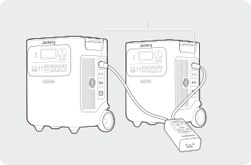Jackery ConnectorPuerto de expansión CA

</figure>

<table class="manual-callout-table ht-native-item-list" data-native-list="parallel-caution"><tbody><tr><td class="manual-callout-label">PRECAUCIÓN</td><td class="manual-callout-body"><ul><li>
Después de una conexión en paralelo exitosa, no desconecte el cable paralelo  mientras la salida CA aún esté activa, ya que esto puede activar la protección contra  sobrecarga en la otra unidad. 
</li><li>
No toque el puerto del cable paralelo cuando la salida de CA esté habilitada (cuando  la luz indicadora del botón de alimentación CA esté encendida).Este puerto maneja  un alto voltaje de 240 V y representa un riesgo de descarga eléctrica.
</li></ul></td></tr></tbody></table>

Si el botón de energía <strong>CA</strong> de cualquiera de las unidades se presiona o la salida CA se interrumpe debido a una  falla, ambas unidades detendrán inmediatamente la salida CA. El sistema sale automáticamente del modo  paralelo. La otra unidad mostrará un ícono paralelo parpadeante y el código <strong>FA</strong>, indicando una falla en la  conexión en paralelo. Para reanudar la salida en paralelo, resuelva la falla detectada y luego presione, en secuencia, el botón de  energía <strong>CA</strong> en cada unidad.

<figure class="hb-reference-figure hb-base-art-live-copy" data-component-id="HB-SPECIAL-REFERENCE-FIGURE" data-reference-id="parallel-interrupted-p56" data-source-fragment-sha256="5ec5792a178bb09aa5ed3bb6faec2b8f97f13644cfbbaa6edcdc4978c62d0593" data-web-base-art-ref="parallel-interrupted" data-web-presentation-mode="base-art-live-copy">

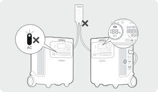Jackery Connector

</figure>

<h2 id="connections-exit-parallel"><strong> SALIR DEL MODO PARALELO</strong></h2>

<figure class="hb-reference-figure hb-base-art-live-copy" data-component-id="HB-SPECIAL-REFERENCE-FIGURE" data-reference-id="parallel-exit-p56" data-source-fragment-sha256="eb77adc7157c359c5449b567a8e75a1e441143ade55b279920ed00408cfd12e7" data-web-base-art-ref="parallel-exit" data-web-presentation-mode="base-art-live-copy">

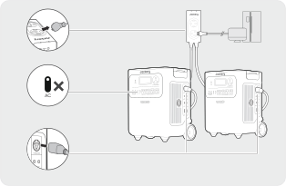1. Desconecte todas las cargas.2. Apague la salida CA en ambas unidades.3. Retire el cable paralelo de las unidades.

</figure>

# CARGANDO

<strong>Energía renovable primero:</strong> Abogamos por utilizar primero energía renovable. Este producto admite dos modos de  carga al mismo tiempo: carga solar y carga de pared de CA. Cuando la carga en la pared de CA y la carga solar están activadas al mismo tiempo, el producto dará prioridad  a la carga solar y se utilizarán ambos métodos para cargar la batería a la máxima potencia permitida.

<strong>Carga completamente el producto antes de usarlo por primera vez.</strong>
<table class="manual-callout-table ht-native-item-list" data-native-list="charging-temperature"><tbody><tr><td class="manual-callout-label">Nota</td><td class="manual-callout-body"><ul><li>
La temperatura de carga recomendada para el producto está entre -4 °F y 113 °F (-20 °C a  45 °C), y la temperatura de descarga está entre -4 °F y 113 °F (-20 °C a 45 °C). Operar el  producto fuera de este rango de temperatura puede limitar sus capacidades de carga y  descarga, e incluso impedir la carga o descarga. 
</li><li>
La potencia de carga y la capacidad de la batería del producto pueden variar debido a  fluctuaciones de temperatura.
</li></ul></td></tr></tbody></table><h2 id="charging-ac-wall-outlet"><strong>CARGA MEDIANTE UNA TOMA DE CORRIENTE DE PARED  ALTERNA</strong></h2>

<figure class="hb-reference-figure hb-base-art-live-copy" data-component-id="HB-SPECIAL-REFERENCE-FIGURE" data-reference-id="charging-ac-p57" data-source-fragment-sha256="f487f6c0156131e6d7898387a6d4581d2b110d48cc8bec38d3c77daf43d0ffae" data-web-base-art-ref="charging-ac" data-web-presentation-mode="base-art-live-copy">

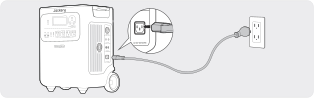Conecte el cable de carga de CA al puerto de entrada de CA del producto y a una toma de corriente.

</figure>

<table class="manual-callout-table manual-callout-table"><tbody><tr><td class="manual-callout-label">PRECAUCIÓN</td><td class="manual-callout-body">
Asegúrese de que el cable de carga de CA esté completamente y firmemente insertado  en el puerto de entrada de CA. Una conexión incompleta puede provocar corriente  inestable, sobrecalentamiento, mal contacto o fallos en el funcionamiento del producto.
</td></tr></tbody></table>

<h2 class="ht-availability-heading" id="charging-solar-panels"><strong>CARGA MEDIANTE PANELES SOLARES</strong>  <strong>SE VENDE POR SEPARADO</strong></h2>
El Jackery HomePower 3600 Plus cuenta con dos puertos de entrada DC8020 y es compatible con los paneles  solares de la Jackery. Si se necesita conectar dos paneles solares a un solo puerto de entrada DC8020 al mismo tiempo, consulte la figura  a continuación para la carga mediante el conector de panel solar (se vende por separado, no incluido de serie).

<figure class="hb-reference-figure hb-base-art-live-copy" data-component-id="HB-SPECIAL-REFERENCE-FIGURE" data-reference-id="charging-solar-p57" data-source-fragment-sha256="542bd20d5c6196b084f0a07fb9d80e9b13d3d958d136cf101322108a8a86c41c" data-web-base-art-ref="charging-solar" data-web-presentation-mode="base-art-live-copy">

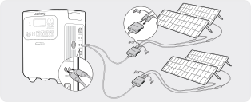SolarSaga 200 × 4

</figure>

<table class="manual-callout-table manual-callout-table"><tbody><tr><td class="manual-callout-label">PRECAUCIÓN</td><td class="manual-callout-body">
Un puerto de entrada DC8020 puede conectarse a un máximo de dos paneles solares.
</td></tr></tbody></table>

<table class="manual-callout-table ht-native-item-list" data-native-list="dc-input"><tbody><tr><td class="manual-callout-label">PRECAUCIÓN</td><td class="manual-callout-body">
Asegúrese de que el voltaje de entrada para ambos puertos de entrada CC sea el mismo.  De lo contrario, podría dañar el producto. Por ejemplo: 
<ul><li>
Utilizar paneles solares Jackery del mismo modelo y la misma cantidad de paneles al  conectar paneles solares a ambos puertos de entrada DC8020. 
</li><li>
No cargue el producto utilizando simultáneamente un cargador de automóvil y un panel  solar. Hacerlo podría quemar el fusible del automóvil o resultar en un fallo de carga.
</li></ul></td></tr></tbody></table>

Se recomienda usar el panel solar Jackery para cargar el HomePower 3600 Plus. Aasegúrese de que el voltaje en  circuito abierto (Voc) del rango de entrada CC (16 V-60 V) del HomePower 3600 Plus. Jackery no se hace respons- able de pérdidas causadas por el uso de paneles solares de otras marcas. 
<h2 class="ht-availability-heading" id="charging-car-charger"><strong>CARGA CON UN CARGADOR DE EN EL VEHÍCULO</strong>  <strong>SE VENDE POR SEPARADO</strong></h2>
Este producto puede cargarse usando un cargador para auto de 12V. Asegúrese de que el cargador de coche y  el encendedor de coche ofrecen una buena conexión.

<figure class="hb-reference-figure hb-base-art-live-copy" data-component-id="HB-SPECIAL-REFERENCE-FIGURE" data-reference-id="charging-car-p58" data-source-fragment-sha256="d7e996c1d6785d35e9ac5d3c960738dc4610d17875ea34552cd9be8e66fc0d0c" data-web-base-art-ref="charging-car" data-web-presentation-mode="base-art-live-copy">

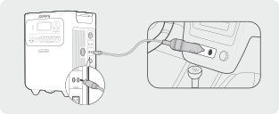※ El cable de carga para auto se vende por separado.Vehículo

</figure>

<table class="manual-callout-table ht-native-item-list" data-native-list="car-charging"><tbody><tr><td class="manual-callout-label">Importante</td><td class="manual-callout-body"><ul><li>
Por favor, encienda el vehículo antes de cargar su estación de energía. 
</li><li>
Si el vehículo circula por caminos accidentados, está prohibido usar el cargador de  coche para evitar que se queme debido a una mala conexión. La empresa no se  responsabiliza por pérdidas causadas por un uso incorrecto. 
</li><li>
La carga en vehículo solo es aplicable a vehículos con 12 V CC, no a 24 V CC. Por favor,  no cargue este producto en vehículos de 24 V para evitar lesiones personales y daños  materiales.
</li></ul></td></tr></tbody></table>

# ALMACENAMIENTO

Almacene el producto en un lugar seco y limpio con ventilación adecuada.Temperatura y humedad de  almacenamiento: 
<ul><li>
1 mes: -4°F a 113°F / -20 a 45 °C (0-60 % HR) 
</li><li>
3 meses: 32°F a 113°F / 0 a 45 °C (0-60 % HR) 
</li><li>
12 meses: 32°F a 77°F / 0 a 25 °C (0-60 % HR) 
</li></ul>
Si este producto se almacena durante un período prolongado (de 3 a 6 meses) con la batería descargada,  podría volverse imposible recargarlo. Para evitar esto y mantener la salud de la batería, se recomienda revisar  y recargar el producto cada tres meses, y realizar un ciclo completo de carga y descarga al menos una vez  cada 6 a 12 meses.

# RESOLUCIÓN DE PROBLEMAS

Si aparece alguno de los siguientes códigos de falla, siga las acciones correctivas listadas para resolver el  problema.Si la falla persiste, por favor contacte con atención al cliente de Jackery.

<figure aria-label="Código de  Error / Medidas correctivas" class="hb-troubleshooting-composition" data-component-id="HB-TABLE-TROUBLESHOOTING" tabindex="0"><table class="hb-troubleshooting-table"><colgroup><col class="hb-troubleshooting-col-code"/><col class="hb-troubleshooting-col-measures"/></colgroup><thead><tr><th class="hb-troubleshooting-code" scope="col">
<strong>Código de </strong> <strong>Error</strong>
</th><th class="hb-troubleshooting-measures" scope="col">
<strong>Medidas correctivas</strong>
</th></tr></thead><tbody><tr><td class="hb-troubleshooting-code">
F0/F1  F2/F3
</td><td class="hb-troubleshooting-measures">
Reiniciar el producto.
</td></tr><tr><td class="hb-troubleshooting-code">
F4
</td><td class="hb-troubleshooting-measures">
Conecte el producto a cargas para descargar su batería hasta que la falla desaparezca.
</td></tr><tr><td class="hb-troubleshooting-code">
F5
</td><td class="hb-troubleshooting-measures">
Cargue el producto mediante paneles solares o toma de corriente CA hasta que la falla desaparezca.
</td></tr><tr><td class="hb-troubleshooting-code">
F6
</td><td class="hb-troubleshooting-measures">
1.  Espere a que la red eléctrica se normalice antes de cargar el producto a través de una toma  de corriente CA. 

2. Verifique si las rejillas de entrada y salida de aire están obstruidas; asegure un espacio libre  de 0,66 pies (20 cm) a ambos lados del producto. 

3. Coloque el producto en un lugar que no esté expuesto a la luz solar directa o a altas  temperaturas ambientales. 

4. Desconecte todas las cargas del producto. Mantenga el producto inactivo y espere hasta  que la falla desaparezca. 

5. Reiniciar el producto.
</td></tr><tr><td class="hb-troubleshooting-code">
F7
</td><td class="hb-troubleshooting-measures">
1.  Retire todas las entradas CC del producto. 

2. Verifique el voltaje en circuito abierto (Voc) de los paneles solares conectados. El producto  permite un voltaje máximo de entrada CC de 60 V. 

3. Reinicie el producto y manténgalo inactivo. Espere hasta que la falla desaparezca.
</td></tr><tr><td class="hb-troubleshooting-code">
F8
</td><td class="hb-troubleshooting-measures">
Contacte con atención al cliente de Jackery.
</td></tr><tr><td class="hb-troubleshooting-code">
F9
</td><td class="hb-troubleshooting-measures">
Retire la carga conectada a los puertos USB del producto. Espere hasta que la falla desaparezca.
</td></tr><tr><td class="hb-troubleshooting-code">
FA
</td><td class="hb-troubleshooting-measures">
1.  Apague la salida CA de ambas unidades. 

2. Presione el botón de encendido de la CA en cada unidad nuevamente, pero en no más  de 1 minuto.
</td></tr><tr><td class="hb-troubleshooting-code">
FC
</td><td class="hb-troubleshooting-measures">
1.  Reinicie los paquetes de baterías y el HomePower 3600 Plus respectivamente. 

2. Si la falla persiste, desconecte el paquete de baterías del HomePower 3600 Plus y reconéctelos.
</td></tr></tbody></table></figure>

# ESPECIFICACIONES

<h2 class="ht-spec-heading" id="spec-general"><strong>INFORMACIÓN GENERAL</strong></h2><figure aria-label="INFORMACIÓN GENERAL" class="hb-spec-table-composition"><table class="manual-table manual-spec-table hb-spec-table"><colgroup><col class="hb-spec-col-label"/><col class="hb-spec-col-value"/></colgroup><tbody><tr><th class="ht-cell manual-spec-label hb-spec-label" scope="row">
Nombre del producto
</th><td class="ht-cell manual-spec-value hb-spec-value">
Jackery HomePower 3600 Plus
</td></tr><tr><th class="ht-cell manual-spec-label hb-spec-label" scope="row">
N de modelo
</th><td class="ht-cell manual-spec-value hb-spec-value">
JHP-3600A
</td></tr><tr><th class="ht-cell manual-spec-label hb-spec-label" scope="row">
Capacidad
</th><td class="ht-cell manual-spec-value hb-spec-value">
80Ah / 44,8V DC (3584 Wh) 
</td></tr><tr><th class="ht-cell manual-spec-label hb-spec-label" scope="row">
Química Celular
</th><td class="ht-cell manual-spec-value hb-spec-value">
LiFePO₄
</td></tr><tr><th class="ht-cell manual-spec-label hb-spec-label" scope="row">
Peso
</th><td class="ht-cell manual-spec-value hb-spec-value">
Aproximadamente 77,16 libras/35 kg
</td></tr><tr><th class="ht-cell manual-spec-label hb-spec-label" scope="row">
Dimensiones
</th><td class="ht-cell manual-spec-value hb-spec-value">
15,2×12,2×19,3 pulgadas / 38,5×30,9×49,1 cm
</td></tr><tr><th class="ht-cell manual-spec-label hb-spec-label" scope="row">
Ciclo de vida
</th><td class="ht-cell manual-spec-value hb-spec-value">
6000 ciclos de carga hasta 70 % + de capacidad
</td></tr></tbody></table></figure>

<h2 class="ht-spec-heading" id="spec-input"><strong>PUERTOS DE ENTRADA</strong></h2><figure aria-label="PUERTOS DE ENTRADA" class="hb-spec-table-composition"><table class="manual-table manual-spec-table hb-spec-table"><colgroup><col class="hb-spec-col-label"/><col class="hb-spec-col-value"/></colgroup><tbody><tr><th class="ht-cell manual-spec-label hb-spec-label" rowspan="2" scope="row">
1 × Entrada CA
</th><td class="ht-cell manual-spec-value hb-spec-value">
Modo de carga : 100-120V~ 60Hz, 15A Máx
</td></tr><tr><td class="ht-cell manual-spec-value hb-spec-value">
Modo bypass① : 120V~ 60Hz, 12A Máx, 1440W
</td></tr><tr><th class="ht-cell manual-spec-label hb-spec-label" scope="row">
2 × Puertos DC8020
</th><td class="ht-cell manual-spec-value hb-spec-value">12-16V⎓8A Máx, Double à 8A Máx  16-60V⎓12A Máx, Double à 24A/1000W Máx</td></tr><tr><th class="ht-cell manual-spec-label hb-spec-label" scope="row">
1 × Puerto de expansión CC
</th><td class="ht-cell manual-spec-value hb-spec-value">
36,4V-50,4V⎓100A Máx
</td></tr></tbody></table></figure>

<h2 class="ht-spec-heading" id="spec-output"><strong>PUERTOS DE SALIDA</strong></h2><figure aria-label="PUERTOS DE SALIDA" class="hb-spec-table-composition"><table class="manual-table manual-spec-table hb-spec-table"><colgroup><col class="hb-spec-col-label"/><col class="hb-spec-col-value"/></colgroup><tbody><tr><th class="ht-cell manual-spec-label hb-spec-label" scope="row">
4 × Salidas CA (NEMA 5-20R)
</th><td class="ht-cell manual-spec-value hb-spec-value">
120V~ 60Hz, 20A Máx, 2400W, 3600W en total
</td></tr><tr><th class="ht-cell manual-spec-label hb-spec-label" scope="row">
1 × Salidas CA (NEMA TT-30)
</th><td class="ht-cell manual-spec-value hb-spec-value">
120V~ 60Hz, 30A Máx, 3600W
</td></tr><tr><th class="ht-cell manual-spec-label hb-spec-label" scope="row">
CA Salida total②
</th><td class="ht-cell manual-spec-value hb-spec-value">
3600W nominales, 7200W pico de sobretensión
</td></tr><tr><th class="ht-cell manual-spec-label hb-spec-label" scope="row">
Salida de CA en modo bypass①
</th><td class="ht-cell manual-spec-value hb-spec-value">
120V~ 60Hz, 12A Máx, 1440W
</td></tr><tr><th class="ht-cell manual-spec-label hb-spec-label" scope="row">
2 × Salida USB-C
</th><td class="ht-cell manual-spec-value hb-spec-value">
100W Máx, 5V⎓3A, 9V⎓3A, 12V⎓3A, 15V⎓3A, 20V⎓5A
</td></tr><tr><th class="ht-cell manual-spec-label hb-spec-label" scope="row">
2 × Salida USB-A
</th><td class="ht-cell manual-spec-value hb-spec-value">
18W Máx, 5-6V⎓3A, 6-9V⎓2A, 9-12V⎓1.5A
</td></tr><tr><th class="ht-cell manual-spec-label hb-spec-label" scope="row">
1 × Puerto de expansión CA③
</th><td class="ht-cell manual-spec-value hb-spec-value">240V~ 60Hz, 30A, 7200W Máx,   14400W pico de sobretensión</td></tr><tr><th class="ht-cell manual-spec-label hb-spec-label" scope="row">
1 × Puerto de expansión CC
</th><td class="ht-cell manual-spec-value hb-spec-value">
36,4V-50,4V⎓60A Máx
</td></tr><tr><th class="ht-cell manual-spec-label hb-spec-label" scope="row">Corriente máxima de   cortocircuito y duración</th><td class="ht-cell manual-spec-value hb-spec-value">
1160A/860μs
</td></tr></tbody></table></figure>

<h2 class="ht-spec-heading" id="spec-temperature"><strong>TEMPERATURA DE FUNCIONAMIENTO</strong></h2><figure aria-label="TEMPERATURA DE FUNCIONAMIENTO" class="hb-spec-table-composition"><table class="manual-table manual-spec-table hb-spec-table"><colgroup><col class="hb-spec-col-label"/><col class="hb-spec-col-value"/></colgroup><tbody><tr><th class="ht-cell manual-spec-label hb-spec-label" scope="row">
Temperatura de carga
</th><td class="ht-cell manual-spec-value hb-spec-value">
- 4 °F a 113 °F / - 20 °C a 45 °C
</td></tr><tr><th class="ht-cell manual-spec-label hb-spec-label" scope="row">
Temperatura de descarga
</th><td class="ht-cell manual-spec-value hb-spec-value">
- 4 °F a 113 °F / - 20 °C a 45 °C
</td></tr></tbody></table></figure>

※ USB Type-C®  y USB-C®  son marcas registradas de USB Implementers Forum.
<ol class="manual-spec-footnote ht-spec-footnotes"><li>
① El producto puede cargar la batería desde una toma de corriente CA mientras suministra energía a través de los puertos de  salida CA.
</li><li>
② Indica que dos o más puertos de salida CA trabajan en conjunto.
</li><li>
③ Indica la salida CA durante la operación en paralelo de dos unidades.
</li></ol>

# GARANTÍA

<figure aria-label="GARANTÍA" class="hb-warranty-intro-composition" data-component-id="HB-WARRANTY-LEAD">

<strong>Solo ofrecemos nuestra garantía a clientes que compren en el sitio web oficial de Jackery, </strong> <strong>plataformas de terceros con la marca Jackery o distribuidores autorizados locales. </strong>

* El periodo de garantía y los detalles pueden variar según las leyes, regulaciones y distribuidores autorizados locales.

</figure>
<h2 class="ht-native-warranty-title" id="warranty-limited"><strong>Garantía limitada</strong></h2><figure aria-label="Garantía limitada" class="hb-warranty-card" data-component-id="HB-WARRANTY-SECTION" data-warranty-card-index="1">
Jackery Inc. garantiza al consumidor original que el producto Jackery estará libre de defectos relativos al  acabado y a los materiales en condiciones normales de uso por parte del consumidor durante el período de  garantía aplicable identificado en la sección "Período de garantía" que figura a continuación, sujeto a las  exclusiones que se establecen a continuación.

Esta declaración de garantía establece la obligación de garantía total y exclusiva de Jackery. No  asumiremos ni autorizaremos que ninguna persona asuma por nosotros ninguna otra responsabilidad en  relación con la venta de nuestros productos.
</figure>

<h2 class="ht-native-warranty-title" id="warranty-period"><strong>Período de garantía</strong></h2><figure aria-label="Período de garantía" class="hb-warranty-period-card" data-component-id="HB-WARRANTY-YEARS">

3
<strong class="hb-warranty-years-unit">AÑOS</strong><strong class="hb-warranty-period-label">Garantía Estándar</strong>

El periodo de garantía estándar de Jackery HomePower 3600  Plus es de 36 meses. En cada caso, el período de garantía se  mide a partir de la fecha de compra por parte del comprador  consumidor original. Para establecer la fecha de inicio del  período de garantía, se necesita el recibo de venta de la primera  compra del consumidor u otra prueba documental razonable.

2
<strong class="hb-warranty-years-unit">AÑOS</strong><strong class="hb-warranty-period-label">Garantía extendida</strong>

Para activar la extensión de  garantía,debe registrar su producto  en línea oponerse en contacto con  nuestro equipo de atención al cliente  en hello@jackery.com para ampliar  laduración de la garantia estándar.

</figure>

<h2 class="ht-native-warranty-title" id="warranty-repair"><strong>Reparación o reemplazo</strong></h2><figure aria-label="Reparación o reemplazo" class="hb-warranty-card" data-component-id="HB-WARRANTY-SECTION" data-warranty-card-index="2">
Jackery reparará o reemplazará (a cargo de Jackery) cualquier producto Jackery que no funcione  durante el periodo de garantía aplicable debido a defectos en la mano de obra o el material. El producto  reparado o reemplazado asumirá el periodo restante de la garantía desde la fecha original de compra.
</figure>

<h2 class="ht-native-warranty-title" id="warranty-original-buyer"><strong>Limitado al comprador consumidor original</strong></h2><figure aria-label="Limitado al comprador consumidor original" class="hb-warranty-card" data-component-id="HB-WARRANTY-SECTION" data-warranty-card-index="3">
La garantía del producto de Jackery se limita al consumidor original y no es transferible a ningún  propietario posterior.
</figure>

<h2 class="ht-native-warranty-title" id="warranty-exclusions"><strong>Exclusiones</strong></h2><figure aria-label="Exclusiones" class="hb-warranty-card" data-component-id="HB-WARRANTY-SECTION" data-warranty-card-index="4">
La garantía de Jackery no se aplica a:
<ul class="ht-native-prose-list" data-native-list="warranty-exclusions"><li>
Mal uso, abuso, modificación, daño por accidente, o uso para cualquier cosa que no sea el uso normal  del consumidor según lo autorizado en los folletos actuales del producto de Jackery.
</li><li>
Intento de reparación por cualquier persona que no sea un centro autorizado.
</li><li>
Cualquier producto adquirido a través de una casa de subastas en línea.
</li><li>
La garantía de Jackery no se aplica a la célula de la batería a menos que usted la cargue completa- mente en los siete días siguientes a la compra del producto y, a partir de entonces, al menos una vez  cada 6 meses.
</li></ul></figure>

<h2 class="ht-native-warranty-title" id="warranty-interpretation"><strong>Derechos de interpretación</strong></h2><figure aria-label="Derechos de interpretación" class="hb-warranty-card" data-component-id="HB-WARRANTY-SECTION" data-warranty-card-index="5">
Jackery se reserva el derecho a la interpretación final de la política posventa de los clientes anterior.
</figure>

# CONFIGURACIÓN DE LA APLICACIÓN

<h2 class="ht-native-app-title" id="native-p62-b4-l0-0">1. Descargar la aplicación e iniciar sesión</h2>

<figure aria-label="app-download" class="hb-app-download-composition" data-component-id="HB-SPECIAL-APP">

Buscar "Jackery" en Google Play o en la App Store para instalar la aplicación. Después, podrá registrarte e iniciar sesión.

Alternativamente, escanee el código QR a continuación para descargar e instalar la app.

</figure>

<h2 class="ht-native-app-title" id="native-p62-b2-l0-0">2. Añadir un dispositivo</h2>
2.1 Haga clic en el botón Añadir dispositivo ;

2.2 Presione una vez el botón de encendido principal del dispositivo para encenderlo. Los iconos del  wifi y del Bluetooth del dispositivo parpadearán para indicar que el dispositivo ha entrado en el modo  de configuración de red. A continuación, pulse el botón "icono parpadeante" y permita que la  aplicación se conecte a los dispositivos cercanos y abra los permisos de Bluetooth;

<figure class="hb-reference-figure hb-base-art-live-copy" data-component-id="HB-SPECIAL-REFERENCE-FIGURE" data-reference-id="app-add-p62" data-source-fragment-sha256="f2b258e4da11d85ac63ef8747a6528c13b9ea615713860c8bc351ab9705b4256" data-web-base-art-ref="app-add" data-web-presentation-mode="base-art-live-copy">

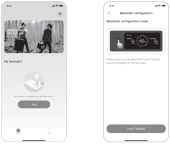2.12.2

</figure>

<figure class="hb-reference-figure hb-base-art-live-copy" data-component-id="HB-SPECIAL-REFERENCE-FIGURE" data-reference-id="app-controls-p62" data-source-fragment-sha256="f31ca780a801edc6d33bffee1467376101891f6c669388fc022ceca201a0a321" data-web-base-art-ref="app-controls" data-web-presentation-mode="base-art-live-copy">

Botón de encendido principalBotón de energía CABotón de energía USB

</figure>

<table class="manual-callout-table manual-callout-table"><tbody><tr><td class="manual-callout-label">NOTA</td><td class="manual-callout-body">
Después de estar encendido, si la APP no se conecta en 2 horas, el dispositivo  desactivará automáticamente el Wi-Fi y el Bluetooth.
</td></tr></tbody></table>

2.3 Tras hacer clic en el icono del dispositivo buscado, la aplicación conecta automáticamente el  dispositivo a través de Bluetooth.

<table class="manual-callout-table ht-native-item-list" data-native-list="app-bound"><tbody><tr><td class="manual-callout-label">NOTA</td><td class="manual-callout-body">
Si durante el proceso de vinculación se indica que "<strong>el dispositivo ha sido vinculado</strong>", se  pueden utilizar las dos formas siguientes para la conexión. 
<ul><li>
El propietario del dispositivo lo compartirá con otros usuarios a través de la App.  
</li><li>
Mantenga pulsados el botón POWER y el botón USB durante 3 segundos para reiniciar el  dispositivo y, a continuación, vuelva a vincularlo.
</li></ul></td></tr></tbody></table>

2.4 Una vez que el dispositivo se haya conectado correctamente, es necesario introducir el nombre y la  contraseña de la red Wi-Fi a la que se conectará el dispositivo. Una vez introducidos, el dispositivo se  conectará automáticamente a la red Wi-Fi.

<table class="manual-callout-table manual-callout-table"><tbody><tr><td class="manual-callout-label">NOTA</td><td class="manual-callout-body">
Selecciona una red Wi-Fi en la banda de 2,4 GHz. El dispositivo no admite una red Wi-Fi  en la banda de 5 GHz.
</td></tr></tbody></table>

2.5. Después de agregar exitosamente el dispositivo en la App, el icono del Wi-Fi en el dispositivo  permanecerá siempre encendido.

<figure class="hb-reference-figure hb-base-art-live-copy" data-component-id="HB-SPECIAL-REFERENCE-FIGURE" data-reference-id="app-connect-p63" data-source-fragment-sha256="dbc5feb9ceb42e919861b4ff7668524148dcfff302d4719ed69514668b719c10" data-web-base-art-ref="app-connect" data-web-presentation-mode="base-art-live-copy">

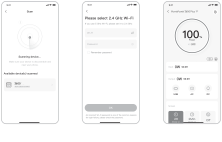Las capturas de pantalla anteriores sirven solo de referencia.2.52.32.4

</figure>

<table class="manual-callout-table manual-callout-table"><tbody><tr><td class="manual-callout-label">PRECAUCIÓN</td><td class="manual-callout-body">
La aplicación Jackery solo puede conectarse a una estación de energía a la vez mediante  Bluetooth. Regresar a la lista de dispositivos desconecta automáticamente Bluetooth.  Toque la estación de energía en la lista nuevamente para reconectarse automáticamente.
</td></tr></tbody></table>

<h2 class="ht-native-app-title" id="native-p63-b10-l0-0">3. Desvincular el dispositivo</h2>
Haga clic en el botón «Configuración» situado en la esquina superior derecha de la interfaz principal  del dispositivo para entrar en la página de configuración. Después, haga clic en el botón «Desvincular»  situado en la parte inferior de la página para desvincular el dispositivo.
<h2 class="ht-native-app-title" id="native-p63-b10-l4-0">4. Notas</h2>
<strong>4.1 Para activar Wi-Fi y Bluetooth:</strong>
<ul class="ht-native-prose-list" data-native-list="app-wireless-1"><li>
 El wifi y el Bluetooth se encienden automáticamente al encender el dispositivo y se iluminan los iconos  de wifi y Bluetooth de la pantalla; 
</li><li>
 Pulse el botón de energía USB y el botón de energía CA al mismo tiempo hasta que se enciendan los  iconos de wifi y Bluetooth en la pantalla;
</li></ul>
<strong>4.2 Para desactivar Wi-Fi y Bluetooth:</strong>
<ul class="ht-native-prose-list" data-native-list="app-wireless-2"><li>
 Pulse el botón de energía USB y el botón de energía CA al mismo tiempo hasta que se apaguen los  iconos de wifi y Bluetooth en la pantalla;
</li><li>
 El Wi-Fi y el Bluetooth se apagarán automáticamente si se conecta ningún dispositivo en 2 horas;
</li></ul>
<strong>4.3 Para restablecer Wi-Fi y Bluetooth:</strong>

Pulsa el botón de encendido principal y el botón de energía USB al mismo tiempo durante 3 segundos  para restablecer los ajustes de fábrica de Wi-Fi y Bluetooth y reiniciar el sistema. Se desvinculará la  cuenta de la aplicación conectada.

# JACKERY INC.

5310 Bunche Dr., Fremont, CA 94538-8301

<a href="tel:+18885022236"><strong>1-888-502-2236</strong> (US)</a>

<a href="mailto:hello@jackery.com">hello@jackery.com</a>

<a href="https://www.jackery.com">www.jackery.com </a>

