

# IMPORTANT

Félicitations d’avoir fait l’acquisition du nouveau Jackery HomePower 3600 Plus. Veuillez lire  attentivement ce manuel avant d’utiliser le dispositif, en particulier les précautions à prendre  afin de garantir une bonne utilisation. 

Conservez ce manuel dans un endroit accessible pour pouvoir vous y référer fréquemment.

Conformément aux lois et réglementations, le droit d’interprétation finale de ce document et  de tous les documents relatifs à ce produit appartient à l’entreprise.

Veuillez noter qu’aucune autre notification ne sera donnée en cas de mise à jour, de révision  ou de résiliation.

# INFORMATIONS DE SÉCURITÉ IMPORTANTES

<figure class="hb-symbol-signal-composition hb-safety-instruction" id="safety-instruction-p24"><table class="hb-symbol-signal-table"><colgroup><col style="width:7%"/><col style="width:93%"/></colgroup><tbody><tr><td></td><td>
<strong>INSTRUCTIONS CONCERNANT LES RISQUES D’INCENDIE, DE CHOC  ÉLECTRIQUE OU DE BLESSURES</strong>
</td></tr></tbody></table></figure>

<table class="manual-two-col-table" style="width:100%;border-collapse:separate;border-spacing:0;margin:0;table-layout:fixed"><tbody><tr><td style="width:50%;border:none;padding:0 8px 0 0;vertical-align:top"><figure class="hb-symbol-signal-composition hb-safety-lead" id="native-p24-b33-l0-0"><table class="hb-symbol-signal-table"><colgroup><col style="width:28%"/><col style="width:72%"/></colgroup><tbody><tr><td class="hb-symbol-signal-label-cell"></td><td class="hb-symbol-signal-meaning-cell">
<strong>AVERTISSEMENT</strong>

<strong>Respectez toujours les  précautions de base lors de  l’utilisation de ce produit.</strong>
</td></tr></tbody></table></figure><ul class="hb-list"><li>
Lisez toutes les instructions avant d’utiliser le produit.
</li><li>
Ne laissez pas les enfants jouer avec du produit. Une  surveillance étroite est nécessaire lorsque le produit est  utilisé à proximité d’enfants.
</li><li>
Évitez de placer les mains ou les doigts à l’intérieur du  produit.
</li><li>
Arrêtez immédiatement d’utiliser le produit s’il a été  endommagé physiquement ou modifié. Une mauvaise  utilisation peut entraîner un comportement imprévisible,  un incendie, une explosion ou des blessures.
</li><li>
Si vous constatez une surchauffe, une odeur  inhabituelle, de la fumée, des fuites ou des brûlures,  cessez immédiatement l’utilisation et contactez le  revendeur ou notre service client.
</li></ul></td><td style="width:50%;border:none;padding:0 0 0 8px;vertical-align:top"><ul class="hb-list"><li>
Ne tentez jamais d’ouvrir, de réparer ou de modifier le  produit. Toute altération ou réassemblage peut  entraîner un choc électrique, un incendie ou des  dommages à la batterie.
</li><li>
Soyez conscient que le liquide éjecté peut causer une  irritation ou des brûlures. Une mauvaise utilisation peut  provoquer des fuites. Évitez tout contact direct. En cas de  contact avec les yeux, consultez immédiatement un  médecin. En cas de contact avec la peau, rincez  abondamment à l’eau claire et consultez un professionnel  de santé sans tarder.
</li><li>
N’exposez pas le produit au feu ni à des températures  excessives. Une température supérieure à 130 °C peut  entraîner une explosion.
</li><li>
L’utilisation de pièces non recommandées ou non fournies  peut entraîner un risque d’incendie, de choc électrique ou  de blessures.
</li><li>
Ne laissez jamais la batterie en charge sans surveillance  pendant de longues périodes. Surveillez toujours la  charge pour assurer une utilisation sûre.
</li><li>
Pour réduire le risque de choc électrique, débranchez le  produit de toute source d’alimentation avant d’effectuer  un entretien technique ou un dépannage.
</li></ul></td></tr></tbody></table>

## INSTRUCTIONS D’UTILISATION

<table class="manual-two-col-table" style="width:100%;border-collapse:separate;border-spacing:0;margin:0;table-layout:fixed"><tbody><tr><td style="width:50%;border:none;padding:0 8px 0 0;vertical-align:top">
<strong>CONSERVEZ CES INSTRUCTIONS</strong>
<ul class="hb-list"><li>
Cessez immédiatement d’utiliser le produit s’il présente  des signes de dommage. Arrêtez l’utilisation et  contactez l’assistance clientèle pour obtenir de l’aide.
</li><li>
Ne rechargez pas la batterie dans un environnement  extrêmement chaud ou froid, et respectez strictement  les plages de températures d’utilisation spécifiées du  produit :

-Température de charge : -4°F à 113°F (-20 °C à 45 °C)

-Température de décharge : -4°F à 113°F (-20 °C à 45 °C)
</li><li>
Pour garantir une bonne circulation de l’air, gardez les  orifices de ventilation du produit dégagés. Utilisez-le  dans un endroit bien aéré, frais et sec pour éviter  toute surchauffe.

-La charge dans un environnement humide ou mal  ventilé peut présenter des risques pour la sécurité.

-L’eau peut provoquer des courts-circuits ou  endommager le chargeur, entraînant des risques.
</li><li>
Débranchez le cordon d’alimentation de la prise  secteur pendant un orage.
</li><li>
Éteignez immédiatement le produit à l’aide du bouton  d’alimentation s’il est tombé, a subi un choc ou des  vibrations.
</li></ul></td><td style="width:50%;border:none;padding:0 0 0 8px;vertical-align:top"><ul class="hb-list"><li>
Assurez-vous que les appareils sont éteints avant de les  connecter au produit.
</li><li>
Ne rechargez pas le produit avec un câble ou une fiche  endommagé(e). 
</li><li>
N’utilisez pas le produit pour charger un appareil équipé  d’un câble ou d’une fiche endommagé(e).
</li><li>
Débranchez toujours le cordon de charge en tirant sur la  fiche, jamais sur le câble, afin d’éviter tout dommage.
</li><li>
Veillez à ce que le produit soit correctement fixé lors du  transport dans un véhicule en mouvement.
</li><li>
NE placez PAS l’appareil à l’envers ou sur le côté pendant  l’utilisation ou le stockage.
</li><li>
NE placez PAS le produit sur le sol ou à une hauteur  inférieure à 457 mm (18 pouces) lors de son utilisation  dans un atelier ou un centre de réparation.
</li><li>
N’utilisez PAS les accessoires du produit avec d’autres  appareils ou équipements.
</li><li>
Le temps de charge solaire dépend des conditions  météorologiques. Placez le panneau solaire dans un  endroit exposé au soleil direct autant que possible.
</li></ul></td></tr></tbody></table>

<table class="manual-callout-table manual-callout-table hb-source-warning-lockup ht-native-danger"><tbody><tr><td class="manual-callout-label">AVERTISSEMENT</td><td class="manual-callout-body">
<strong>Cet appareil est destiné à un usage intérieur uniquement (veuillez  placer cet appareil dans un environnement intérieur similaire lors  de son utilisation à l'extérieur, par exemple dans des VR  résidentiels, des tentes, des chalets, etc.).</strong>

<strong>※ Cet appareil n'est pas étanche ni résistant à la poussière.  Éloignez-le de la pluie et des environnements humides pendant  son utilisation.</strong>
</td></tr></tbody></table>

<h2 class="hb-h1-pill ht-safety-subbar" id="native-p25-b1-l0-0">INSTRUCTIONS D’ENTRETIEN PAR L’UTILISATEUR</h2>

Au cours du cycle des produits de stockage d'énergie, une certaine dégradation de la capacité et de l'énergie se  produira. À mesure que le nombre de cycles d'utilisation augmente et que la durée de stockage s'allonge, cette  dégradation s'intensifiera progressivement, ce qui est un phénomène normal conforme au modèle de  vieillissement naturel des cellules de batterie.

# SIGNIFICATION DES SYMBOLES

<figure aria-label="Symbole / Signification" class="hb-symbol-signal-composition" data-component-id="HB-TABLE-SYMBOL-SIGNAL"><table class="hb-symbol-signal-table"><colgroup><col class="hb-symbol-signal-col-label"/><col class="hb-symbol-signal-col-meaning"/></colgroup><thead><tr><th class="hb-symbol-signal-label-heading" scope="col">Symbole</th><th class="hb-symbol-signal-meaning-heading" scope="col">Signification</th></tr></thead><tbody><tr><td class="hb-symbol-signal-label-cell">⚠AVERTISSEMENT</td><td class="hb-symbol-signal-meaning-cell">Pratiques dangereuses pouvant entraîner des blessures graves, la  mort et/ou des dommages matériels.</td></tr><tr><td class="hb-symbol-signal-label-cell">⚠ATTENTION</td><td class="hb-symbol-signal-meaning-cell">Pratiques dangereuses pouvant entraîner des blessures corporelles  et/ou des dommages matériels.</td></tr><tr><td class="hb-symbol-signal-label-cell">⚠REMARQUE</td><td class="hb-symbol-signal-meaning-cell">Pratiques dangereuses pouvant entraîner des dommages à  l'équipement, une perte de données, une détérioration des  performances ou des résultats inattendus.</td></tr><tr><td class="hb-symbol-signal-label-cell">⚠CONSEILS</td><td class="hb-symbol-signal-meaning-cell">Complémente les informations importantes ou les conseils d'utilisation  dans le texte.</td></tr></tbody></table></figure>

<figure aria-label="Symbole / Signification" class="hb-symbol-pair-composition" data-component-id="HB-TABLE-SYMBOL-ICON">

<table class="hb-symbol-panel-table"><colgroup><col class="hb-symbol-col-icon"/><col class="hb-symbol-col-meaning"/></colgroup><thead><tr><th class="hb-symbol-icon-heading" scope="col">Symbole</th><th class="hb-symbol-meaning-heading" scope="col">Signification</th></tr></thead><tbody><tr><td class="hb-symbol-icon"></td><td class="hb-symbol-meaning">Mlise en garde! Le non-respect des  messages d'avertissement peut  entraîner des blessures.</td></tr><tr><td class="hb-symbol-icon"></td><td class="hb-symbol-meaning">Lire le manuel de l'opérateur</td></tr><tr><td class="hb-symbol-icon"></td><td class="hb-symbol-meaning">Risque de choc électrique</td></tr><tr><td class="hb-symbol-icon"></td><td class="hb-symbol-meaning">Chargement de la batterie</td></tr><tr><td class="hb-symbol-icon"></td><td class="hb-symbol-meaning">Matière explosive</td></tr><tr><td class="hb-symbol-icon"></td><td class="hb-symbol-meaning">Objet lourd</td></tr></tbody></table>

<table class="hb-symbol-panel-table"><colgroup><col class="hb-symbol-col-icon"/><col class="hb-symbol-col-meaning"/></colgroup><thead><tr><th class="hb-symbol-icon-heading" scope="col">Symbole</th><th class="hb-symbol-meaning-heading" scope="col">Signification</th></tr></thead><tbody><tr><td class="hb-symbol-icon"></td><td class="hb-symbol-meaning">Ne démontez pas le produit.</td></tr><tr><td class="hb-symbol-icon"></td><td class="hb-symbol-meaning">Ne pas fumer ni utiliser de flamme nue</td></tr><tr><td class="hb-symbol-icon"></td><td class="hb-symbol-meaning">Les enfants ne sont pas admis</td></tr><tr><td class="hb-symbol-icon"></td><td class="hb-symbol-meaning">Ce symbole indique que le produit  contient une batterie lithium-ion (Li-ion),  qui doit être éliminée ou recyclée de  manière appropriée.</td></tr><tr><td class="hb-symbol-icon"></td><td class="hb-symbol-meaning">Ce symbole indique que le produit ne doit  pas être jeté avec les ordures ménagères.  Il doit être apporté à un point de collecte  désigné pour un recyclage approprié. Une élimination et un recyclage corrects  contribuent à la protection de  l’environnement. Pour plus d’informations,  veuillez contacter votre autorité locale, le  service de gestion des déchets ou le  revendeur du produit.</td></tr></tbody></table>

</figure>

<figure aria-label="FCC" class="hb-fcc-composition" data-component-id="HB-SPECIAL-FCC">

Cet appareil est conforme à la partie 15 du  règlement de la FCC. Le fonctionnement  dépend des deux conditions suivantes :

(1) Cet appareil ne doit pas provoquer  d'interférences dangereuses, et

(2) Cet appareil doit accepter toute interférence reçue, y  compris les interférences pouvant provoquer un  fonctionnement non désiré.

<strong>REMARQUE:</strong> Cet équipement a été testé et déclaré conforme  aux limites concernant les appareils numériques de classe B,  conformément à la partie 15 du règlement de la FCC.

Ces limites sont conçues pour offrir une protection  raisonnable contre les interférences dangereuses dans le  cadre d'une installation résidentielle. Cet équipement  génère, utilise et émet des ondes radios qui peuvent, si cet  équipement n'est pas installé et utilisé conformément aux  instructions, perturber les communications radios. Toutefois,  il n'y a aucune garantie qu'aucune interférence ne se

produise lors d'une installation particulière.
Si cet équipement trouble la réception de la radio ou  de la télévision, ce qui peut être déterminé en  éteignant et en allumant cet équipement, l'utilisateur  est encouragé à tenter de corriger ces interférences  en essayant une ou plusieurs des mesures suivantes :
<ul class="simple"><li>
Réorientez ou déplacez l'antenne de réception.
</li><li>
Éloignez l'équipement du récepteur.
</li><li>
Connectez l'équipement à une prise d'un autre  circuit que celui auquel le récepteur est connecté.
</li><li>
Consultez le revendeur ou bien demandez de l'aide  à un technicien de radio/télévision expérimenté.
</li></ul>
<strong>MODIFICATION :</strong> Tout changement ou modification  non expressément approuvé par le titulaire de cet  appareil pourrait annuler l'autorisation de l'utilisateur  à utiliser l'appareil.

</figure>

# CONTENU DE LA BOÎTE

<figure class="hb-reference-figure hb-base-art-live-copy" data-component-id="HB-SPECIAL-REFERENCE-FIGURE" data-reference-id="inbox-p26" data-source-fragment-sha256="2210816ecb6f4b79f3dbeecfaf0f67bf152a038c962bf8a7d60ba5a04335449d" data-web-base-art-ref="inbox" data-web-presentation-mode="base-art-live-copy">

12<strong>Câble de charge CA</strong><strong>Jackery HomePower 3600 Plus</strong>3<strong>Documents</strong>

</figure>

<table class="manual-callout-table manual-callout-table"><tbody><tr><td class="manual-callout-label">CONSEILS</td><td class="manual-callout-body">
Le câble de chargement pour voiture n’est pas inclus, mais peut être acheté  séparément sur notre site Web. Pour obtenir de l’aide, veuillez contacter le service à  la clientèle de Jackery.
</td></tr></tbody></table>

# APERÇU DU PRODUIT

<figure class="hb-reference-figure hb-base-art-live-copy" data-component-id="HB-SPECIAL-REFERENCE-FIGURE" data-reference-id="overview-p27" data-source-fragment-sha256="667683306c391ec3c790b4a40bfb1b3ca85dd06e4f3ae192862f8b757b200b7e" data-web-base-art-ref="overview" data-web-presentation-mode="base-art-live-copy">

<strong>VUE LATÉRALE DROITE</strong><strong>VUE DE FACE</strong>100W Max, 5V⎓3A, 9V⎓3A, 12V⎓3A, 15V⎓3A, 20V⎓5A18W Max, 5-6V⎓3A, 6-9V⎓2A, 9-12V⎓1.5A<strong>Sortie CA</strong><strong>Bouton </strong><strong>d'alimentation CA</strong><strong>Bouton </strong><strong>d'alimentation USB</strong><strong>Sortie USB-C</strong><strong>Sortie USB-A</strong><strong>LCD</strong><strong>Sortie CA</strong><strong>(NEMA TT-30)</strong><strong>Bouton d’alimentation </strong><strong>principale</strong>120V~ 60Hz, 30A Max, 3600W120V~ 60Hz, 20A Max, 2400W<strong>Bouton de réinitialisation de </strong><strong>la sortie CA</strong><strong>Entrée CA</strong><strong>Entrée CC</strong>100V-120V~ 60Hz, 15A Max2×Ports DC8020 :12-16V⎓8A Max, double à 8A Max;16-60V⎓12A Max, double à 24A/1000W Max<strong>Port d’extension CC</strong>Connecter au bloc-batterieSortie : 240V~ 60Hz, 30A, 7200W Max, 14400W crête<strong>Port d’extension CA</strong>(Pour connexion en parallèle)<strong>Roues</strong><strong>Poignée rétractable</strong>Appuyez sur le bouton de la poignée rétractable et tirez pour l'étendre.

</figure>

# AFFICHAGE LCD

<figure class="hb-reference-figure hb-base-art-live-copy" data-component-id="HB-SPECIAL-REFERENCE-FIGURE" data-reference-id="lcd-map-p28" data-source-fragment-sha256="29cc1fb4415caebfa3e866240fb412f0a93aae9eb6dec21f6a41dea9d0a5ea4d" data-web-base-art-ref="lcd-map" data-web-presentation-mode="base-art-live-copy">

21229101112121314151618192034578617

</figure>

<figure aria-label="Indicateurs de l’écran LCD" class="hb-lcd-table-composition" data-component-id="HB-TABLE-LCD-ICON" tabindex="0"><table class="hb-lcd-icon-table"><colgroup><col class="hb-lcd-col-number"/><col class="hb-lcd-col-icon"/><col class="hb-lcd-col-name"/><col class="hb-lcd-col-description"/></colgroup><tbody><tr><td class="hb-lcd-number">
1
</td><td class="hb-lcd-icon"></td><td class="hb-lcd-name">
<strong>Wi-Fi</strong>
</td><td class="hb-lcd-description">

<strong>Allumé : </strong>Wi-Fi connecté.

<strong>Clignotant : </strong>Prêt à se connecter au Wi-Fi.

<strong>Éteint : </strong>Wi-Fi déconnecté.

</td></tr><tr><td class="hb-lcd-number">
2
</td><td class="hb-lcd-icon"></td><td class="hb-lcd-name">
<strong>Bluetooth</strong>
</td><td class="hb-lcd-description">

<strong>Allumé : </strong>Bluetooth connecté.

<strong>Clignotant : </strong>Prêt à se connecter au Bluetooth.

<strong>Éteint : </strong>Bluetooth déconnecté.

</td></tr><tr><td class="hb-lcd-number">
3
</td><td class="hb-lcd-icon"></td><td class="hb-lcd-name">
<strong>Mode de Charge </strong> <strong>Silencieuse</strong>
</td><td class="hb-lcd-description">

<strong>Allumé : </strong>Le bruit pendant la charge est considérablement réduit,  tandis que la puissance de charge est diminuée et la vitesse de  charge ralentit.

<strong>Éteint : </strong>Le mode de charge silencieuse est désactivé.

Activez/désactivez cette fonction dans l'application Jackery. Le réglage est conservé lorsque l’appareil est mis hors tension.

</td></tr><tr><td class="hb-lcd-number" rowspan="2">
4
</td><td class="hb-lcd-icon"></td><td class="hb-lcd-name">
<strong>Mode d’Économie </strong> <strong>de Batterie</strong>
</td><td class="hb-lcd-description">

<strong>Allumé : </strong>Limite la capacité maximale utilisable de la batterie pour  prolonger sa durée de vie.

<strong>Éteint </strong>: Le mode d'économie de batterie est désactivé.

Activez/désactivez cette fonction dans l'application Jackery.  Le réglage est conservé lorsque l’appareil est mis hors tension.

<strong>Note 1:</strong> Cette fonction n'est pas disponible lorsque le produit est  connecté à des blocs-batteries.

<strong>Note 2:</strong> Lorsque cette fonction est activée, le produit effectue  occasionnellement un cycle de charge-décharge complet pour  calibrer le SOC.

</td></tr><tr><td class="hb-lcd-icon"></td><td class="hb-lcd-name">
<strong>Mode Autonome</strong>
</td><td class="hb-lcd-description">

Maximise l’utilisation de l’énergie solaire et réduit la dépendance  à l’électricité du réseau en donnant la priorité à l’énergie solaire  stockée, ce qui diminue les coûts d’électricité. La station d’énergie  doit être connectée simultanément aux panneaux solaires et au  réseau, la puissance de charge étant limitée par la puissance de  dérivation.

Veuillez activer/désactiver cette fonction dans l’application. Le  réglage est conservé lorsque l’appareil est mis hors tension.

</td></tr><tr><td class="hb-lcd-number">
5
</td><td class="hb-lcd-icon"></td><td class="hb-lcd-name">
<strong>Plan de Charge</strong>
</td><td class="hb-lcd-description">

Personnalisez le temps de charge du Jackery HomePower 3600  Plus. Adapté aux situations avec des tarifs d’électricité variables,  il permet d’établir des plans de charge en fonction des heures  pleines et creuses, afin de réduire les coûts d’électricité.

Veuillez configurer cette fonction dans l’application Jackery. Le  réglage est conservé lorsque l’appareil est mis hors tension.

</td></tr><tr><td class="hb-lcd-number">
6
</td><td class="hb-lcd-icon"></td><td class="hb-lcd-name">
<strong>Parallèle</strong>
</td><td class="hb-lcd-description">

<strong>Clignotant : </strong>La sortie CA est activée et la connexion parallèle  n'est pas configurée.

<strong>Allumé : </strong>La sortie CA est activée et la connexion parallèle est  configurée avec succès.

</td></tr></tbody></table></figure>

<figure aria-label="Indicateurs de l’écran LCD" class="hb-lcd-table-composition" data-component-id="HB-TABLE-LCD-ICON" tabindex="0"><table class="hb-lcd-icon-table"><colgroup><col class="hb-lcd-col-number"/><col class="hb-lcd-col-icon"/><col class="hb-lcd-col-name"/><col class="hb-lcd-col-description"/></colgroup><tbody><tr><td class="hb-lcd-number">
7
</td><td class="hb-lcd-icon"></td><td class="hb-lcd-name">
<strong>Indicateur </strong> <strong>d'alimentation CA</strong>
</td><td class="hb-lcd-description">

La sortie CA (onde sinusoïdale pure) est activée.

</td></tr><tr><td class="hb-lcd-number">
8
</td><td class="hb-lcd-icon"></td><td class="hb-lcd-name">
<strong>Tension et </strong> <strong>fréquence de sortie</strong>
</td><td class="hb-lcd-description">

Affiche la tension et la fréquence de sortie lorsque la sortie  CA est activée.

</td></tr><tr><td class="hb-lcd-number">
9
</td><td class="hb-lcd-icon"></td><td class="hb-lcd-name">
<strong>Puissance d’Entrée</strong>
</td><td class="hb-lcd-description">

Affiche la puissance d'entrée en watts.

</td></tr><tr><td class="hb-lcd-number">
10
</td><td class="hb-lcd-icon"></td><td class="hb-lcd-name">
<strong>Temps de Charge </strong> <strong>Restant</strong>
</td><td class="hb-lcd-description">

Affiche le temps de charge restant.

</td></tr><tr><td class="hb-lcd-number">
11
</td><td class="hb-lcd-icon"></td><td class="hb-lcd-name">
<strong>Indicateur de Charge </strong> <strong>sur Prise Murale CA</strong>
</td><td class="hb-lcd-description">

Le produit est chargé via l'entrée CA en utilisant l'énergie du  réseau.

</td></tr><tr><td class="hb-lcd-number">
12
</td><td class="hb-lcd-icon"></td><td class="hb-lcd-name">
<strong>Indicateur de </strong> <strong>Charge Voiture</strong>
</td><td class="hb-lcd-description">

Le produit est chargé via l’entrée CC (DC8020) en utilisant  du CC 12V (charge via voiture).

</td></tr><tr><td class="hb-lcd-number">
13
</td><td class="hb-lcd-icon"></td><td class="hb-lcd-name">
<strong>Indicateur de </strong> <strong>Charge Solaire</strong>
</td><td class="hb-lcd-description">

Le produit est chargé via l’entrée CC (DC8020) à l’aide de  panneaux solaires.

</td></tr><tr><td class="hb-lcd-number">
14
</td><td class="hb-lcd-icon"></td><td class="hb-lcd-name">
<strong>Indicateur de </strong> <strong>Puissance de la </strong> <strong>Batterie</strong>
</td><td class="hb-lcd-description">

Lorsque le produit est en charge, le cercle orange autour du  pourcentage de batterie s’allume en séquence. Lorsqu’il  charge d’autres appareils, le cercle orange reste allumé.

</td></tr><tr><td class="hb-lcd-number">
15
</td><td class="hb-lcd-icon"></td><td class="hb-lcd-name">
<strong>Indicateur de </strong> <strong>Batterie Faible</strong>
</td><td class="hb-lcd-description">

<strong>Allumé : </strong>Le niveau de la batterie est inférieur à 20 %.

<strong>Clignotant :</strong> Le niveau de la batterie est inférieur à 5 %.

<strong>Éteint :</strong> Le niveau de la batterie n'est pas inférieur à 20 %  ou le produit est en charge.

</td></tr><tr><td class="hb-lcd-number">
16
</td><td class="hb-lcd-icon"></td><td class="hb-lcd-name">
<strong>Pourcentage de </strong> <strong>Batterie Restant</strong>
</td><td class="hb-lcd-description">

Affiche le pourcentage de batterie restant.

</td></tr><tr><td class="hb-lcd-number">
17
</td><td class="hb-lcd-icon"></td><td class="hb-lcd-name">
<strong>Témoin d’état de </strong> <strong>batterie et nombre de </strong> <strong>batteries connectées</strong>
</td><td class="hb-lcd-description">

Indique que le produit est connecté au nombre spécifié de  blocs-batterie 3600.

</td></tr><tr><td class="hb-lcd-number">
18
</td><td class="hb-lcd-icon"></td><td class="hb-lcd-name">
<strong>Code d’erreur</strong>
</td><td class="hb-lcd-description">

Une erreur produit s’est produite. Veuillez consulter la section  « Dépannage » pour plus de détails.

</td></tr><tr><td class="hb-lcd-number" rowspan="2">
19
</td><td class="hb-lcd-icon"></td><td class="hb-lcd-name">
<strong>Indicateur de </strong> <strong>Température Élevée</strong>
</td><td class="hb-lcd-description">

La protection contre les températures élevées est déclenchée.  Le produit peut cesser de fonctionner jusqu'à ce que sa  température revienne dans la plage de fonctionnement  normale.

</td></tr><tr><td class="hb-lcd-icon"></td><td class="hb-lcd-name">
<strong>Indicateur de Basse </strong> <strong>Température</strong>
</td><td class="hb-lcd-description">

La protection contre les basses températures est déclenchée.  Le produit peut cesser de fonctionner jusqu'à ce que sa  température revienne dans la plage de fonctionnement  normale.

</td></tr><tr><td class="hb-lcd-number">
20
</td><td class="hb-lcd-icon"></td><td class="hb-lcd-name">
<strong>Mode d’Économie </strong> <strong>d’Énergie</strong>
</td><td class="hb-lcd-description">

Lorsque la sortie CA ou CC est activée en appuyant sur le  bouton d'alimentation CA ou USB :

<strong>Allumé :</strong> Mode d'économie d'énergie activé.

<strong>Éteint : </strong>Mode d'économie d'énergie désactivé.

</td></tr><tr><td class="hb-lcd-number">
21
</td><td class="hb-lcd-icon">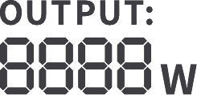</td><td class="hb-lcd-name">
<strong>Puissance de Sortie</strong>
</td><td class="hb-lcd-description">

Affiche la puissance de sortie en watts.

</td></tr><tr><td class="hb-lcd-number">
22
</td><td class="hb-lcd-icon"></td><td class="hb-lcd-name">
<strong>Temps de Décharge </strong> <strong>Restant</strong>
</td><td class="hb-lcd-description">

Affiche le temps de décharge restant.

</td></tr></tbody></table></figure>

# FONCTIONNEMENT

<h2 class="ht-operation-heading" id="operations-power"><strong>MARCHE/ARRÊT</strong></h2>

<figure class="hb-reference-figure hb-base-art-live-copy" data-component-id="HB-SPECIAL-REFERENCE-FIGURE" data-reference-id="power-p30" data-source-fragment-sha256="3d549ff64db4704977e4e1159535bb55828e4e2801acd65bbe66c3c5574fadb9" data-web-base-art-ref="power" data-web-presentation-mode="base-art-live-copy">

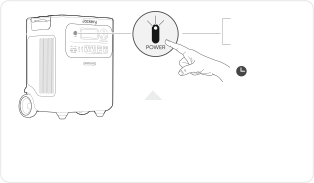<strong>Temps de veille par défaut :</strong> 2 heuresLe produit s’éteindra automatiquement après 2 heures d’inactivité, sans charge ni décharge.*Le temps de veille peut être réglé dans l'application Jackery.Lorsque le mode Économie d'énergie est activé, le produit s'éteindra automatiquement après 12 heures si le bouton d'alimentation CA ou USB est allumé mais que le produit ne charge ni ne décharge.3 secondes<strong>Marche</strong><strong>Arrêt</strong>Appuyez une foisAppuyez et maintenez pendant 3 secondes

</figure>

<h2 class="ht-operation-heading" id="operations-ac-output"><strong>SORTIE CA MARCHE/ARRÊT</strong></h2>

<figure class="hb-reference-figure hb-base-art-live-copy" data-component-id="HB-SPECIAL-REFERENCE-FIGURE" data-reference-id="ac-output-p30" data-source-fragment-sha256="4c65edc85fac9a4fc26c9a590f2143eb20160ef6502e530c2e929c0cfcd1bea6" data-web-base-art-ref="ac-output" data-web-presentation-mode="base-art-live-copy">

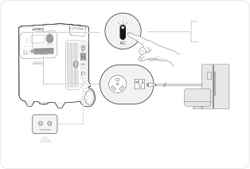<strong>Prérequis :</strong> Le produit est allumé.<strong>Bouton de réinitialisation de la sortie CA:</strong>Lorsque le bouton de réinitialisation sort, vous devez retirer la charge et appuyer sur le bouton de réinitialisation pour réinitialiser.<strong>Marche</strong><strong>Arrêt</strong>Appuyez une foisAppuyez une fois

</figure>

<h2 class="ht-operation-heading" id="operations-usb-output"><strong>SORTIE USB MARCHE/ARRÊT</strong></h2>

<figure class="hb-reference-figure hb-base-art-live-copy" data-component-id="HB-SPECIAL-REFERENCE-FIGURE" data-reference-id="usb-output-p31" data-source-fragment-sha256="46873bf4a0eb9d952164f83ee3bc85c13ab8e88c986010e0fdfde5bd75371999" data-web-base-art-ref="usb-output" data-web-presentation-mode="base-art-live-copy">

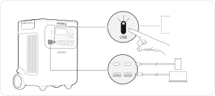<strong>Prérequis : </strong>Le produit est allumé.<strong>Marche</strong><strong>Arrêt </strong>Appuyez une foisAppuyez une fois

</figure>

<table class="manual-callout-table manual-callout-table ht-native-usb-caution"><tbody><tr><td class="manual-callout-label">ATTENTION</td><td class="manual-callout-body"><ul><li>
<strong>Les ports USB-C de 140 W sont des ports de sortie haute puissance de type Source </strong> <strong>d’alimentation 3 (PS3) selon USB-PD. </strong>Si l'appareil utilisateur ou l'accessoire connecté ne  répond pas aux exigences de sécurité, il peut présenter un risque d'incendie. Avant  d'utiliser ces ports, assurez-vous que l'appareil ou l'accessoire connecté dispose d'une  protection contre les incendies.  
</li><li>
Ne connectez le Jackery HomePower 3600 Plus qu'à des appareils ou accessoires  conformes aux clauses 6.3, 6.4 et 6.5 de la norme IEC/EN/UL 62368-1 (ou autres normes  équivalentes).  
</li><li>
Pour obtenir la puissance de sortie maximale, utilisez le câble officiel Jackery USB-C  vers USB-C 5A (20 V CC/5A, 100 W). 
</li></ul></td></tr></tbody></table>

<h2 class="ht-operation-heading" id="operations-energy-saving"><strong>MODE D’ÉCONOMIE D’ÉNERGIE</strong></h2>

<figure class="hb-reference-figure hb-base-art-live-copy" data-component-id="HB-SPECIAL-REFERENCE-FIGURE" data-reference-id="energy-saving-p31" data-source-fragment-sha256="40cfa54401fe1f32a1f80903ca52fc2fe539cb249eb2603d0f08de9fed4d61db" data-web-base-art-ref="energy-saving" data-web-presentation-mode="base-art-live-copy">

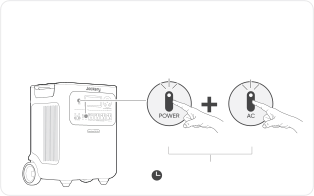Pour éviter une consommation inutile de la batterie due à l’oubli de désactiver la sortie, le produit active par défaut le Mode d’Économie d’Énergie.  Lorsque la sortie CA ou USB est activée, l'icône du mode Économie d'énergie s'affichera sur l'écran LCD. Si aucun appareil n’est connecté ou si la consommation de l’appareil connecté est inférieure à un certain seuil (Sortie CA de 25 W ou sortie USB de 2 W) pendant 12 heures, l’appareil désactivera automatiquement toutes les sorties. Veuillez configurer la durée du mode Économie d'énergie dans l'application Jackery.Pour désactiver le mode d'économie d'énergie, appuyez et maintenez enfoncé à la fois le bouton d'alimentation CA et le bouton d'alimentation principal pendant plus de 3 secondes. Le produit n'éteindra pas automatiquement la sortie CA ou CC.3sAppuyez et maintenez pendant 3 secondesBouton d’alimentation principalBouton d’alimentation CA<strong>Marche/Arrêt </strong>

</figure>

<table class="manual-callout-table manual-callout-table"><tbody><tr><td class="manual-callout-label">REMARQUE</td><td class="manual-callout-body">

Le mode d'économie d'énergie reprend l'état précédent après l'allumage. Un changement 

de mode nécessite un commutateur manuel.

</td></tr></tbody></table>

<h2 class="ht-operation-heading" id="operations-lcd-screen"><strong>AFFICHAGE LCD</strong></h2>

<figure aria-label="AFFICHAGE LCD" class="hb-lcd-mode-composition" data-component-id="HB-TABLE-LCD-MODE">
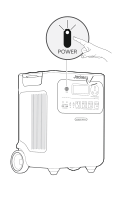

<table class="hb-lcd-mode-table"><colgroup><col class="hb-lcd-mode-col-state"/><col class="hb-lcd-mode-col-action"/><col class="hb-lcd-mode-col-copy"/></colgroup><tbody><tr><td class="hb-lcd-mode-state" rowspan="3">
Allumer en discontinu
</td><td class="hb-lcd-mode-action">
Allumer
</td><td class="hb-lcd-mode-copy">
Appuyez sur le bouton d'alimentation principal ou lorsque le produit est en charge.
</td></tr><tr><td class="hb-lcd-mode-action">
Éteindre
</td><td class="hb-lcd-mode-copy">
Appuyez sur le bouton d'alimentation principal.
</td></tr><tr><td class="hb-lcd-mode-action">
Arrêt automatique
</td><td class="hb-lcd-mode-copy">
L'écran LCD s'éteint automatiquement et entre en mode veille après 2 minutes d'inactivité.
</td></tr><tr><td class="hb-lcd-mode-state" rowspan="3">
Allumer en continu(en cours de charge ou de décharge)
</td><td class="hb-lcd-mode-action">
Allumer
</td><td class="hb-lcd-mode-copy">
Appuyez deux fois sur le bouton d'alimentation principal lorsque  le produit est allumé.
</td></tr><tr><td class="hb-lcd-mode-action">
Éteindre
</td><td class="hb-lcd-mode-copy">
Appuyez sur le bouton d'alimentation principal.
</td></tr><tr><td class="hb-lcd-mode-action">
Arrêt automatique
</td><td class="hb-lcd-mode-copy">
L'écran LCD s'éteint automatiquement après 2 heures d'inactivité.
</td></tr></tbody></table>
</figure>

Vous pouvez également définir le mode d'affichage de l'écran dans l'application Jackery.
<h2 class="ht-operation-heading" id="operations-key-combination"><strong>FONCTIONNEMENT DES BOUTONS</strong></h2>

<figure aria-label="Boutons / Utilisation / Fonction" class="hb-key-combination-composition" data-component-id="HB-TABLE-KEY-COMBINATIONS" tabindex="0"><table class="hb-key-combination-table"><colgroup><col class="hb-key-col-buttons"/><col class="hb-key-col-operation"/><col class="hb-key-col-function"/></colgroup><thead><tr><th class="hb-key-buttons" scope="col">Boutons</th><th class="hb-key-operation" scope="col">Utilisation</th><th class="hb-key-function" scope="col">Fonction</th></tr></thead><tbody><tr><td class="hb-key-buttons">

Bouton d’alimentationprincipal
+
Bouton d’alimentationUSB

</td><td class="hb-key-operation">
3s

Appuyer 3 secondes sur les deux
</td><td class="hb-key-function">
Réinitialiser le Wi-Fi et leBluetooth
</td></tr><tr><td class="hb-key-buttons">

Bouton d’alimentationprincipal
+
Bouton d’alimentationCA

</td><td class="hb-key-operation">
3s

Appuyer 3 secondes sur les deux
</td><td class="hb-key-function">
Activer/désactiver le modeéconomie d’énergie
</td></tr><tr><td class="hb-key-buttons">

Bouton d’alimentationUSB
+
Bouton d’alimentationCA

</td><td class="hb-key-operation">
1s

Appuyer 1 seconde sur les deux
</td><td class="hb-key-function">
Activer le Wi-Fi et le Bluetooth
</td></tr></tbody></table></figure>

# ALIMENTATION SANS INTERRUPTION (ASI)

Connectez le produit à une prise murale à l’aide du câble de charge CA, puis appuyez sur le bouton d'alimentation  CA pour alimenter vos appareils en même temps.

<figure class="hb-reference-figure hb-base-art-live-copy" data-component-id="HB-SPECIAL-REFERENCE-FIGURE" data-reference-id="ups-p33" data-source-fragment-sha256="651ae6ce5edbd4158f7a7dde5b5347834b730fe40818645cf64a4abf85beb914" data-web-base-art-ref="ups" data-web-presentation-mode="base-art-live-copy">

Une alimentation sans coupure (UPS) est un système d’alimentation continue qui fournit automatiquement une alimentation électrique de secours à une charge lorsque l’alimentation du réseau principal est interrompue.En cas de perte soudaine de l’alimentation du réseau, le HomePower 3600 Plus basculera automatiquement sur l’alimentation stockée en moins de 10 ms pour maintenir vos appareils en fonctionnement.

</figure>

En mode UPS, la puissance de crête de sortie de l’appareil atteint 1440 W avant les coupures de courant. Comme  la charge et la décharge simultanées sont activées en mode dérivation, la puissance de sortie réelle est inférieure  à la puissance nominale en mode dérivation, mais revient à la puissance nominale lors des coupures.

<table class="manual-callout-table ht-native-ups-caution"><tbody><tr><td class="manual-callout-label">ATTENTION</td><td class="manual-callout-body"><ul><li>
Ce produit ne prend pas en charge un basculement instantané (0 ms).  
</li><li>
Ne le connectez pas à des équipements nécessitant une alimentation vec commutation  en 0 ms, tels que des serveurs de données ou des stations de travail. 
</li><li>
Avant toute utilisation, testez plusieurs fois la compatibilité avec votre appareil. 
</li><li>
Ne connectez pas de charges dépassant la puissance de sortie maximale du produit.  Sinon, la protection contre les surcharges sera déclenchée.
</li></ul></td></tr></tbody></table>

# CONNEXIONS

<h2 class="ht-availability-heading" id="connections-battery-packs"><strong> CONNECTER AU(X) PACK(S) BATTERIE</strong> <strong>VENDU SÉPARÉMENT</strong></h2>
Ce produit peut prendre en charge jusqu’à 5 packs batterie pour répondre aux besoins d’une grande capacité  énergétique. Pour les détails sur son utilisation, veuillez vous référer au manuel d’utilisation du Jackery Battery  Pack 3600.

<figure class="hb-reference-figure hb-base-art-live-copy" data-component-id="HB-SPECIAL-REFERENCE-FIGURE" data-reference-id="battery-stack-p34" data-source-fragment-sha256="b38f0e0d432d69020fdaf8b56f3a4f6d7b6856b4565db2c954c45b681da44af4" data-web-base-art-ref="battery-stack" data-web-presentation-mode="base-art-live-copy">

≥0,66 pied (≈200 mm)≥0,66 pied (≈200 mm)

</figure>

<table class="manual-callout-table ht-native-item-list" data-native-list="battery-connection"><tbody><tr><td class="manual-callout-label">ATTENTION</td><td class="manual-callout-body"><ul><li>
Assurez-vous que tous les produits sont éteints avant de connecter le HomePower  3600 Plus au(x) Jackery Battery Pack 3600. 
</li><li>
Pour assurer le bon fonctionnement du produit, assurez-vous que les entrées et sorties  d'air sur les deux côtés ne sont pas obstruées. Laissez un espace d'au moins 0,66 pied  (≈200 mm) entre les ouvertures et tout objet pour permettre une dissipation thermique  adéquate.
</li></ul></td></tr></tbody></table>

<figure class="hb-reference-figure hb-base-art-live-copy" data-component-id="HB-SPECIAL-REFERENCE-FIGURE" data-reference-id="battery-accessories-p34" data-source-fragment-sha256="bc442c8685d793bcafac1959d5ee44a531334882c47ade36083dcc025fac08ef" data-web-base-art-ref="battery-accessories" data-web-presentation-mode="base-art-live-copy">

<strong>Vendu </strong><strong>séparément</strong>Câble de rallonge   Jackery Battery Pack 3600Manuel d’utilisation

</figure>

<h2 id="connections-parallel"><strong>CONNECTER DEUX UNITÉS EN PARALLÈLE</strong></h2>

<table class="manual-callout-table ht-native-item-list" data-native-list="parallel-note"><tbody><tr><td class="manual-callout-label">REMARQUE</td><td class="manual-callout-body"><ul><li>
Le connecteur Jackery pour la connexion en parallèle est vendu séparément et  disponible sur notre site web officiel. 
</li><li>
Pendant le fonctionnement en parallèle, les unités ne peuvent être chargées que via des  panneaux solaires.La charge murale CA n'est pas prise en charge dans ce mode.
</li></ul></td></tr></tbody></table>

<table class="manual-callout-table manual-callout-table"><tbody><tr><td class="manual-callout-label">ATTENTION</td><td class="manual-callout-body">
Avant de connecter le câble parallèle, assurez-vous que la sortie CA des deux unités est  éteinte (l'indicateur lumineux du bouton d'alimentation CA doit être éteint). La connexion  pendant que la sortie CA est active peut endommager les unités.
</td></tr></tbody></table>

<ol class="ht-native-prose-list" data-native-list="parallel-steps"><li>
Assurez-vous que les deux unités HomePower 3600 Plus sont éteintes. 
</li><li>
Utilisez un connecteur Jackery pour relier les deux unités via le Port d’extension CA. 
</li><li>
Allumez les deux unités. 
</li><li>
Dans un délai d'une minute, appuyez sur le bouton d'alimentation CA de chaque unité en séquence pour activer  la sortie CA.
</li></ol><ul class="ht-native-prose-list" data-native-list="parallel-result"><li>
Si la connexion est réussie, l'écran affichera une icône de mode parallèle fixe. 
</li><li>
Si la configuration échoue, l'écran affichera le code FA. Appuyez à nouveau sur le bouton d'alimentation CA  de chaque unité en séquence.
</li></ul>

<figure class="hb-reference-figure hb-base-art-live-copy" data-component-id="HB-SPECIAL-REFERENCE-FIGURE" data-reference-id="parallel-p35" data-source-fragment-sha256="65dd6a841d5838e4b69f648f1b2eab7c2acbb8e92a902bc2d7bad82df196e6b4" data-web-base-art-ref="parallel" data-web-presentation-mode="base-art-live-copy">

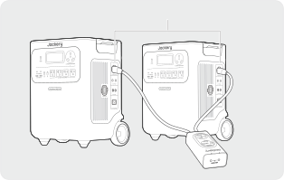Jackery ConnectorPort d’extension CA

</figure>

<table class="manual-callout-table ht-native-item-list" data-native-list="parallel-caution"><tbody><tr><td class="manual-callout-label">ATTENTION</td><td class="manual-callout-body"><ul><li>
Après une connexion en parallèle réussie, ne débranchez pas le câble parallèle tant que  la sortie CA est encore active, car cela peut déclencher la protection contre les  surcharges dans l'autre unité. 
</li><li>
Ne touchez pas le port du câble parallèle lorsque la sortie CA est activée (lorsque  l'indicateur lumineux du bouton d'alimentation CA est allumé).Ce port transporte une  haute tension de 240V et présente un risque d'électrocution.
</li></ul></td></tr></tbody></table>

Si le bouton d'alimentation <strong>CA</strong> d'une unité est actionné ou si la sortie CA est interrompue en raison d'un défaut, les  deux unités cesseront immédiatement leur sortie CA. Le système quitte automatiquement le mode parallèle.  L'autre unité affichera une icône parallèle clignotante et le code <strong>FA</strong>, indiquant un échec de la connexion parallèle. Pour reprendre la sortie parallèle, résolvez l'incident, appuyez à nouveau sur le bouton d'alimentation <strong>CA</strong> de  chaque unité en séquence.

<figure class="hb-reference-figure hb-base-art-live-copy" data-component-id="HB-SPECIAL-REFERENCE-FIGURE" data-reference-id="parallel-interrupted-p36" data-source-fragment-sha256="b5ca12a18fc96407d5250d3df3f8e495ebbafa0290eded3f4bf172e9f7ef9664" data-web-base-art-ref="parallel-interrupted" data-web-presentation-mode="base-art-live-copy">

Jackery Connector

</figure>

<h2 id="connections-exit-parallel"><strong> QUITTER LE MODE PARALLÈLE</strong></h2>

<figure class="hb-reference-figure hb-base-art-live-copy" data-component-id="HB-SPECIAL-REFERENCE-FIGURE" data-reference-id="parallel-exit-p36" data-source-fragment-sha256="fc0a44c6366d55cc02c502ebd243decec4ca3b2e014ad4dc96bc03653cb15ae8" data-web-base-art-ref="parallel-exit" data-web-presentation-mode="base-art-live-copy">

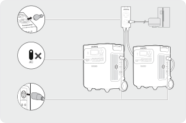1. Déconnectez toutes les charges.2. Éteignez la sortie CA des deux unités.3. Retirez le câble parallèle des unités.

</figure>

# CHARGE

<strong>L'énergie verte d'abord : </strong>nous préconisons l'utilisation de l'énergie verte en premier. Ce produit prend en charge  deux modes de recharge simultanés : la recharge solaire et la recharge par prise murale CA.

Quand la recharge par prise murale CA et la recharge solaire sont effectuées en même temps, le produit privilégie la 

recharge solaire. Les deux méthodes sont utilisées pour charger la batterie à la puissance maximalement autorisée.

<strong>Chargez complètement le produit avant sa première utilisation.</strong>
<table class="manual-callout-table ht-native-item-list" data-native-list="charging-temperature"><tbody><tr><td class="manual-callout-label">Remarque</td><td class="manual-callout-body"><ul><li>
La température de charge recommandée pour le produit est comprise entre -4°F et 113°F  (-20°C à 45°C), et la température de décharge est comprise entre -4°F et 113°F (-20°C à  45°C). Utiliser le produit en dehors de cette plage de températures peut limiter ses capacités  de charge et de décharge, voire empêcher la charge ou la décharge. 
</li><li>
La puissance de charge et la capacité de la batterie du produit peuvent varier en raison des  fluctuations de température.
</li></ul></td></tr></tbody></table><h2 id="charging-ac-wall-outlet"><strong>CHARGEMENT PAR PRISE MURALE CA</strong></h2>

<figure class="hb-reference-figure hb-base-art-live-copy" data-component-id="HB-SPECIAL-REFERENCE-FIGURE" data-reference-id="charging-ac-p37" data-source-fragment-sha256="40645c8b04c394e6c10ba84b2c7400c417569723eefa411e57b587dc9b134f20" data-web-base-art-ref="charging-ac" data-web-presentation-mode="base-art-live-copy">

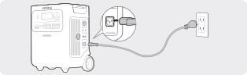Connectez le câble de charge CA au port d’entrée CA de l’appareil et à une prise murale.

</figure>

<table class="manual-callout-table manual-callout-table"><tbody><tr><td class="manual-callout-label">ATTENTION</td><td class="manual-callout-body">
Assurez-vous que le câble de charge CA est entièrement et solidement inséré dans le port  d’entrée CA. Une connexion incomplète peut entraîner un courant instable, une surchauffe,  un mauvais contact ou un dysfonctionnement de l’appareil.
</td></tr></tbody></table>

<h2 class="ht-availability-heading" id="charging-solar-panels"><strong>CHARGEMENT PAR PANNEAUX SOLAIRES </strong>  <strong>VENDU SÉPARÉMENT</strong></h2>
Le Jackery HomePower 3600 Plus dispose de deux ports d’entrée DC8020 et est compatible avec les panneaux  solaires de la Jackery. Si un seul port d’entrée DC8020 doit être connecté à deux panneaux solaires simultanément, veuillez vous référer  au schéma ci-dessous pour le branchement via le connecteur de panneau solaire (vendu séparément, non inclus  en standard).

<figure class="hb-reference-figure hb-base-art-live-copy" data-component-id="HB-SPECIAL-REFERENCE-FIGURE" data-reference-id="charging-solar-p37" data-source-fragment-sha256="b88b6557698cfdd734432815a0716024ce70424fc47ed4ebb11bb434025c61c1" data-web-base-art-ref="charging-solar" data-web-presentation-mode="base-art-live-copy">

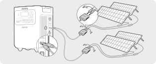SolarSaga 200 × 4

</figure>

<table class="manual-callout-table manual-callout-table"><tbody><tr><td class="manual-callout-label">ATTENTION</td><td class="manual-callout-body">
Un port d'entrée DC8020 peut être connecté à un maximum de deux panneaux solaires.
</td></tr></tbody></table>

<table class="manual-callout-table ht-native-item-list" data-native-list="dc-input"><tbody><tr><td class="manual-callout-label">ATTENTION</td><td class="manual-callout-body">
Assurez-vous que la tension d'entrée pour les deux ports d'entrée CC est la même. Sinon,  le produit pourrait être endommagé. Par exemple: 
<ul><li>
Utiliser le même modèle de panneaux solaires Jackery et le même nombre de panneaux  lors de la connexion des panneaux solaires aux deux ports d'entrée DC8020. 
</li><li>
Ne chargez pas le produit à la fois avec un chargeur de voiture et un panneau solaire  simultanément. Cela pourrait faire sauter le fusible de la voiture ou entraîner un échec  de la charge.
</li></ul></td></tr></tbody></table>

Il est recommandé d’utiliser le panneau solaire Jackery pour charger le HomePower 3600 Plus. Si vous choisissez  des panneaux solaires d'autres marques, assurez-vous que leur tension en circuit ouvert (Voc) est comprise dans la  plage d'entrée CC (16V-60V) du HomePower 3600 Plus. Jackery décline toute responsabilité en cas de pertes  causées par l’utilisation de panneaux solaires d’autres marques.
<h2 class="ht-availability-heading" id="charging-car-charger"><strong>CHARGEMENT PAR PRISE DE VOITURE</strong> <strong>VENDU SÉPARÉMENT</strong></h2>
Ce produit peut être chargé à l’aide d’un chargeur de voiture 12 V. Assurez-vous que le chargeur allume-cigare et  l’allume-cigare de la voiture sont bien branchés.

<figure class="hb-reference-figure hb-base-art-live-copy" data-component-id="HB-SPECIAL-REFERENCE-FIGURE" data-reference-id="charging-car-p38" data-source-fragment-sha256="df0513dc86b2fdb3ca8ab6ebe16edf50975a154b9e71435ae259139d79e8b6c2" data-web-base-art-ref="charging-car" data-web-presentation-mode="base-art-live-copy">

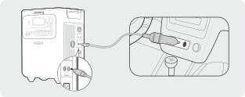※Le câble de chargement de voiture est vendu séparément.vehícule 

</figure>

<table class="manual-callout-table ht-native-item-list" data-native-list="car-charging"><tbody><tr><td class="manual-callout-label">ATTENTION</td><td class="manual-callout-body"><ul><li>
Veuillez démarrer le véhicule avant de charger votre station d’alimentation. 
</li><li>
Si le véhicule roule sur des routes accidentées, il est interdit d’utiliser le chargeur de voiture  afin d’éviter tout risque de surchauffe dû à une mauvaise connexion. La société ne sera  pas responsable des pertes causées par une utilisation non conforme. 
</li><li>
La charge par véhicule est uniquement applicable aux véhicules en 12 V CC, pas en 24 V  CC. Veuillez ne pas charger ce produit dans un véhicule 24 V afin d’éviter tout risque de  blessure ou de dommage matériel.
</li></ul></td></tr></tbody></table>

# STOCKAGE

Conservez le produit dans un endroit propre et sec avec une ventilation adéquate.Température et humidité de  stockage : 
<ul><li>
1 mois : -4°F à 113°F / -20°C à 45°C (0-60% HR) 
</li><li>
3 mois : 32°F à 113°F / 0°C à 45°C (0-60% HR) 
</li><li>
12 mois : 32°F à 77°F / 0°C à 25°C (0-60% HR) 
</li></ul>
Si ce produit est stocké pendant une longue période (3 à 6 mois) avec la batterie déchargée, il peut devenir  impossible de le recharger. Pour éviter cela et préserver la santé de la batterie, il est recommandé de vérifier et  de recharger le produit tous les trois mois, et d'effectuer un cycle de charge et de décharge complet au moins  une fois tous les 6 à 12 mois.

# DÉPANNAGE

Si l'un des codes d'erreur suivants apparaît, suivez les actions correctives indiquées pour résoudre le problème.Si  l'erreur persiste, veuillez contacter le service à la clientèle de Jackery.

<figure aria-label="Code  d'erreur / Mesures correctives" class="hb-troubleshooting-composition" data-component-id="HB-TABLE-TROUBLESHOOTING" tabindex="0"><table class="hb-troubleshooting-table"><colgroup><col class="hb-troubleshooting-col-code"/><col class="hb-troubleshooting-col-measures"/></colgroup><thead><tr><th class="hb-troubleshooting-code" scope="col">
<strong>Code </strong> <strong>d'erreur</strong>
</th><th class="hb-troubleshooting-measures" scope="col">
<strong>Mesures correctives</strong>
</th></tr></thead><tbody><tr><td class="hb-troubleshooting-code">
F0/F1  F2/F3
</td><td class="hb-troubleshooting-measures">
Redémarrez le produit.
</td></tr><tr><td class="hb-troubleshooting-code">
F4
</td><td class="hb-troubleshooting-measures">
Connectez le produit à des charges pour décharger sa batterie jusqu'à ce que l'erreur disparaisse.
</td></tr><tr><td class="hb-troubleshooting-code">
F5
</td><td class="hb-troubleshooting-measures">
Chargez le produit via des panneaux solaires ou une prise murale CA jusqu'à ce que l'erreur disparaisse.
</td></tr><tr><td class="hb-troubleshooting-code">
F6
</td><td class="hb-troubleshooting-measures">
1.  Attendez que le réseau se normalise avant de charger le produit via une prise murale CA. 

2. Vérifiez si les entrées et sorties d'air sont obstruées; assurez un espace de 0,66 pied (20 cm) de chaque côté du produit. 

3. Placez le produit dans un endroit qui n'est pas exposé à la lumière directe du soleil ou à des  températures ambiantes élevées. 

4. Déconnectez toutes les charges du produit. Laissez le produit inactif et attendez que l'erreur  disparaisse. 

5. Redémarrez le produit.
</td></tr><tr><td class="hb-troubleshooting-code">
F7
</td><td class="hb-troubleshooting-measures">
1.  Retirez toutes les entrées CC du produit. 

2. Vérifiez la tension en circuit ouvert (Voc) des panneaux solaires connectés. Le produit autorise  une tension d'entrée CC maximale de 60V. 

3. Redémarrez le produit et laissez-le inactif. Attendez que l'erreur disparaisse.
</td></tr><tr><td class="hb-troubleshooting-code">
F8
</td><td class="hb-troubleshooting-measures">
Contacter le service à la clientèle de Jackery.
</td></tr><tr><td class="hb-troubleshooting-code">
F9
</td><td class="hb-troubleshooting-measures">
Retirez la charge connectée aux ports USB du produit.Attendez que l'erreur disparaisse.
</td></tr><tr><td class="hb-troubleshooting-code">
FA
</td><td class="hb-troubleshooting-measures">
1.  Éteignez la sortie CA des deux unités. 

2. Appuyez à nouveau sur le bouton d'alimentation CA de chaque unité dans un délai d'une minute.
</td></tr><tr><td class="hb-troubleshooting-code">
FC
</td><td class="hb-troubleshooting-measures">
1.  Redémarrez respectivement les batteries et le HomePower 3600 Plus. 

2. Si l'erreur persiste, déconnectez la batterie du HomePower 3600 Plus et reconnectez-les.
</td></tr></tbody></table></figure>

# SPÉCIFICATIONS

<h2 class="ht-spec-heading" id="spec-general"><strong>INFORMATIONS GÉNÉRALES</strong></h2><figure aria-label="INFORMATIONS GÉNÉRALES" class="hb-spec-table-composition"><table class="manual-table manual-spec-table hb-spec-table"><colgroup><col class="hb-spec-col-label"/><col class="hb-spec-col-value"/></colgroup><tbody><tr><th class="ht-cell manual-spec-label hb-spec-label" scope="row">
Nom du produit
</th><td class="ht-cell manual-spec-value hb-spec-value">
Jackery HomePower 3600 Plus
</td></tr><tr><th class="ht-cell manual-spec-label hb-spec-label" scope="row">
N° modèle
</th><td class="ht-cell manual-spec-value hb-spec-value">
JHP-3600A
</td></tr><tr><th class="ht-cell manual-spec-label hb-spec-label" scope="row">
Capacité
</th><td class="ht-cell manual-spec-value hb-spec-value">
80Ah / 44.8V DC (3584 Wh)
</td></tr><tr><th class="ht-cell manual-spec-label hb-spec-label" scope="row">
Cellule Chimique
</th><td class="ht-cell manual-spec-value hb-spec-value">
LiFePO₄
</td></tr><tr><th class="ht-cell manual-spec-label hb-spec-label" scope="row">
Poids
</th><td class="ht-cell manual-spec-value hb-spec-value">
Environ 77,16 lbs / 35 kg
</td></tr><tr><th class="ht-cell manual-spec-label hb-spec-label" scope="row">
Dimensions
</th><td class="ht-cell manual-spec-value hb-spec-value">
15,2×12,2×19,3 po / 38,5×30,9×49,1 cm
</td></tr><tr><th class="ht-cell manual-spec-label hb-spec-label" scope="row">
Durée de vie
</th><td class="ht-cell manual-spec-value hb-spec-value">
Capacité de 6000 cycles à 70 % ou plus
</td></tr></tbody></table></figure>

<h2 class="ht-spec-heading" id="spec-input"><strong>PORTS D’ENTRÉE</strong></h2><figure aria-label="PORTS D’ENTRÉE" class="hb-spec-table-composition"><table class="manual-table manual-spec-table hb-spec-table"><colgroup><col class="hb-spec-col-label"/><col class="hb-spec-col-value"/></colgroup><tbody><tr><th class="ht-cell manual-spec-label hb-spec-label" rowspan="2" scope="row">
1 × Entrée CA
</th><td class="ht-cell manual-spec-value hb-spec-value">
Mode charge : 100-120V~ 60Hz, 15A Max
</td></tr><tr><td class="ht-cell manual-spec-value hb-spec-value">
Mode dérivation① : 120V~ 60Hz, 12A Max, 1440W
</td></tr><tr><th class="ht-cell manual-spec-label hb-spec-label" scope="row">
2 × Ports DC8020
</th><td class="ht-cell manual-spec-value hb-spec-value">12-16V⎓8A Max, double à 8A Max  16-60V⎓12A Max, double à 24A/1000W Max</td></tr><tr><th class="ht-cell manual-spec-label hb-spec-label" scope="row">
1 × Port d’extension CC
</th><td class="ht-cell manual-spec-value hb-spec-value">
36,4V-50,4V⎓100A Max
</td></tr></tbody></table></figure>

<h2 class="ht-spec-heading" id="spec-output"><strong>PORTS DE SORTIE</strong></h2><figure aria-label="PORTS DE SORTIE" class="hb-spec-table-composition"><table class="manual-table manual-spec-table hb-spec-table"><colgroup><col class="hb-spec-col-label"/><col class="hb-spec-col-value"/></colgroup><tbody><tr><th class="ht-cell manual-spec-label hb-spec-label" scope="row">
4 × Sortie CA (NEMA 5-20R)
</th><td class="ht-cell manual-spec-value hb-spec-value">
120V~ 60Hz, 20A Max, 2400W, 3600W au total
</td></tr><tr><th class="ht-cell manual-spec-label hb-spec-label" scope="row">
1 × Sortie CA (NEMA TT-30)
</th><td class="ht-cell manual-spec-value hb-spec-value">
120V~ 60Hz, 30A Max, 3600W
</td></tr><tr><th class="ht-cell manual-spec-label hb-spec-label" scope="row">
Sortie totale CA②
</th><td class="ht-cell manual-spec-value hb-spec-value">
3600W Rated, 7200W crête
</td></tr><tr><th class="ht-cell manual-spec-label hb-spec-label" scope="row">
Sortie CA en mode dérivation①
</th><td class="ht-cell manual-spec-value hb-spec-value">
120V~ 60Hz, 12A Max, 1440W
</td></tr><tr><th class="ht-cell manual-spec-label hb-spec-label" scope="row">
2 × Sortie USB-C
</th><td class="ht-cell manual-spec-value hb-spec-value">
100W Max, 5V⎓3A, 9V⎓3A, 12V⎓3A, 15V⎓3A, 20V⎓5A
</td></tr><tr><th class="ht-cell manual-spec-label hb-spec-label" scope="row">
2 × Sortie USB-A
</th><td class="ht-cell manual-spec-value hb-spec-value">
18W Max, 5-6V⎓3A, 6-9V⎓2A, 9-12V⎓1,5A
</td></tr><tr><th class="ht-cell manual-spec-label hb-spec-label" scope="row">
1 × Port d’extension CA③
</th><td class="ht-cell manual-spec-value hb-spec-value">
240V~ 60Hz, 30A, 7200W Max, 14400W crête
</td></tr><tr><th class="ht-cell manual-spec-label hb-spec-label" scope="row">
1 × Port d’extension CC
</th><td class="ht-cell manual-spec-value hb-spec-value">
36,4V-50,4V⎓60A Max
</td></tr><tr><th class="ht-cell manual-spec-label hb-spec-label" scope="row">Courant et durée maximum   du court-circuit</th><td class="ht-cell manual-spec-value hb-spec-value">
1160A/860μs
</td></tr></tbody></table></figure>

<h2 class="ht-spec-heading" id="spec-temperature"><strong>TEMPÉRATURE DE FONCTIONNEMENT</strong></h2><figure aria-label="TEMPÉRATURE DE FONCTIONNEMENT" class="hb-spec-table-composition"><table class="manual-table manual-spec-table hb-spec-table"><colgroup><col class="hb-spec-col-label"/><col class="hb-spec-col-value"/></colgroup><tbody><tr><th class="ht-cell manual-spec-label hb-spec-label" scope="row">
Température de charge
</th><td class="ht-cell manual-spec-value hb-spec-value">
- 4 °F à 113 °F / - 20 °C à 45 °C
</td></tr><tr><th class="ht-cell manual-spec-label hb-spec-label" scope="row">
Température de décharge
</th><td class="ht-cell manual-spec-value hb-spec-value">
- 4 °F à 113 °F / - 20 °C à 45 °C
</td></tr></tbody></table></figure>

※ USB Type-C®   and USB-C®   are registered trademarks of USB Implementers Forum.
<ol class="manual-spec-footnote ht-spec-footnotes"><li>
① Le produit peut charger la batterie à partir d'une prise murale CA tout en fournissant de l'énergie via les ports de sortie CA.
</li><li>
② Indique que deux ports de sortie CA ou plus fonctionnent ensemble.
</li><li>
③ Indique la sortie CA lors du fonctionnement en parallèle de deux unités.
</li></ol>

# GARANTIE

<figure aria-label="GARANTIE" class="hb-warranty-intro-composition" data-component-id="HB-WARRANTY-LEAD">

<strong>Nous ne fournissons notre garantie qu'aux clients qui achètent sur le site officiel de </strong> <strong>Jackery, sur des plateformes tierces portant la marque Jackery, ou auprès de revendeurs </strong> <strong>autorisés locaux.</strong>

*La durée et les détails de la garantie peuvent varier en fonction des lois, réglementations et revendeurs autorisés locaux.

</figure>
<h2 class="ht-native-warranty-title" id="warranty-limited"><strong>Garantie limitée</strong></h2><figure aria-label="Garantie limitée" class="hb-warranty-card" data-component-id="HB-WARRANTY-SECTION" data-warranty-card-index="1">
Jackery Inc. garantit à l'acheteur et consommateur d'origine que le produit de Jackery sera exempt de tout  défaut de fabrication et de matériaux dans le cadre d'une utilisation normale pendant toute la durée de la  période de garantie applicable identifiée dans la section « Période de garantie » ci-dessous, sous réserve  des exceptions énoncées ci-dessous.

Cette déclaration de garantie énonce les obligations totales et exclusives de garantie de Jackery. Nous  n'assumerons pas et nous n'autorisons personne à assumer pour nous toute autre responsabilité en lien avec  la vente de nos produits.
</figure>

<h2 class="ht-native-warranty-title" id="warranty-period"><strong>Période de garantie</strong></h2><figure aria-label="Période de garantie" class="hb-warranty-period-card" data-component-id="HB-WARRANTY-YEARS">

3
<strong class="hb-warranty-years-unit">ANS</strong><strong class="hb-warranty-period-label">Garantie standard</strong>

La période de garantie standard du Jackery HomePower 3600 Plus  est de 36 mois. Dans tous les cas, la période de garantie commence  à compter de la date d'achat par l'acheteur et consommateur  d'origine. La facture du premier achat du consommateur ou toute  autre preuve documentaire raisonnable est nécessaire afin d'établir  la date de début de la période de garantie.

2
<strong class="hb-warranty-years-unit">ANS</strong><strong class="hb-warranty-period-label">Garantie prolongée</strong>

Pour activer l'extension de garantie,  vous devez enregistrer votre produit  en ligne ou bien contacter notre  service client à hello@jackery.com  afin de prolonger la durée de la  garantie standard.

</figure>

<h2 class="ht-native-warranty-title" id="warranty-repair"><strong>Échange</strong></h2><figure aria-label="Échange" class="hb-warranty-card" data-component-id="HB-WARRANTY-SECTION" data-warranty-card-index="2">
Jackery remplacera (aux frais de Jackery) tout produit de Jackery qui ne fonctionne plus en raison d'un  défaut de fabrication ou de matériau pendant la période de garantie applicable. Un produit remplacé  reprend la garantie restante du produit d'origine.
</figure>

<h2 class="ht-native-warranty-title" id="warranty-original-buyer"><strong>Limitée à l'acheteur et consommateur d'origine</strong></h2><figure aria-label="Limitée à l'acheteur et consommateur d'origine" class="hb-warranty-card" data-component-id="HB-WARRANTY-SECTION" data-warranty-card-index="3">
La garantie d'un produit Jackery est limitée à l'acheteur et consommateur d'origine, elle ne peut pas être  transférée à un autre propriétaire.
</figure>

<h2 class="ht-native-warranty-title" id="warranty-exclusions"><strong>Exclusions</strong></h2><figure aria-label="Exclusions" class="hb-warranty-card" data-component-id="HB-WARRANTY-SECTION" data-warranty-card-index="4">
La garantie de Jackery ne s'applique pas à :
<ul class="ht-native-prose-list" data-native-list="warranty-exclusions"><li>
Une utilisation incorrecte, abusée, modifiée, aux dégâts provoqués par un accident ou toute autre  utilisation qui n'est pas une utilisation normale de ce produit et autorisée par la documentation actuelle  du produit de Jackery.
</li><li>
À une réparation tentée par quelqu'un d'autre qu'un établissement agréé.
</li><li>
Tout autre produit acheté par l'intermédiaire d'une vente aux enchères en ligne.
</li><li>
La garantie de Jackery ne s'applique pas aux cellules de la batterie, sauf si vous avez entièrement chargé  les cellules de la batterie dans les sept jours suivant l'achat du produit et au moins une fois tous les 6 mois  par la suite.
</li></ul></figure>

<h2 class="ht-native-warranty-title" id="warranty-interpretation"><strong>Droits d'interprétation</strong></h2><figure aria-label="Droits d'interprétation" class="hb-warranty-card" data-component-id="HB-WARRANTY-SECTION" data-warranty-card-index="5">
Jackery se réserve le droit d’interprétation finale de la politique de service après-vente ci-dessus.
</figure>

# CONFIGURATION DE L’APPLICATION

<h2 class="ht-native-app-title" id="native-p42-b5-l0-0">1. Télécharger l’application et se connecter</h2>

<figure aria-label="app-download" class="hb-app-download-composition" data-component-id="HB-SPECIAL-APP">

Recherchez « Jackery » dans Google Play ou dans l’App Store pour installer l’application. Une fois que c’est fait, vous pouvez vous inscrire et vous connecter.

Vous pouvez également scanner le code QR ci-dessous pour télécharger et installer l'application.

</figure>

<h2 class="ht-native-app-title" id="native-p42-b8-l0-0">2. Ajouter un appareil</h2>
2.1 Cliquez sur le bouton  pour ajouter un appareil.

2.2 Maintenez enfoncé le bouton d'alimentation principal sur l’appareil pour l’allumer. Les icônes Wi-Fi  et Bluetooth clignotent sur l’appareil afin d’indiquer qu’il est entré dans le mode Configuration réseau.  Cliquez sur le bouton «icône qui clignotante» et autorisez l’application à se connecter aux appareils  alentour, puis ouvrez les autorisations Bluetooth.

<figure class="hb-reference-figure hb-base-art-live-copy" data-component-id="HB-SPECIAL-REFERENCE-FIGURE" data-reference-id="app-add-p42" data-source-fragment-sha256="24fd3aeb3ba90fe2880090b4ef83d744f1ffc2793357fe5bac6419538b9a0339" data-web-base-art-ref="app-add" data-web-presentation-mode="base-art-live-copy">

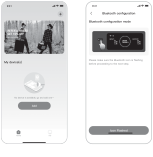2.12.2

</figure>

<figure class="hb-reference-figure hb-base-art-live-copy" data-component-id="HB-SPECIAL-REFERENCE-FIGURE" data-reference-id="app-controls-p42" data-source-fragment-sha256="035518afdae28b8e9165f472a76488853081c6d41c9a231d6d64f26e173a4b3d" data-web-base-art-ref="app-controls" data-web-presentation-mode="base-art-live-copy">

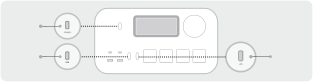Bouton d'alimentation principalBouton d’alimentation CABouton d'alimentation USB

</figure>

<table class="manual-callout-table" data-native-notice="app-timeout"><tbody><tr><td class="manual-callout-label">Remarque</td><td class="manual-callout-body">
Une fois allumé, si l’application n’est pas connectée dans un délai de 2 heures, l’appareil éteindra automatiquement le Wi-Fi et le Bluetooth. 
</td></tr></tbody></table>

2.3. Une fois que vous avez appuyé sur l’icône de recherche d’appareils, l’appareil est automatique- ment associé à l’application via le Bluetooth.
<table class="manual-callout-table ht-native-item-list" data-native-list="app-bound"><tbody><tr><td class="manual-callout-label">Remarque</td><td class="manual-callout-body">
Si le message «l’appareil a été associé» s’affiche pendant l’appairage, vous pouvez suivre  l’une de ces deux étapes pour procéder à la connexion. 
<ul><li>
Le propriétaire de l’appareil peut partager ce dernier avec d’autres utilisateurs dans  l’application.  
</li><li>
Maintenez le bouton d’alimentation principal et le bouton d’alimentation USB enfoncés  pendant 3 secondes pour réinitialiser l’appareil et l’associer de nouveau.
</li></ul></td></tr></tbody></table>
2.4 Une fois l’appairage réalisé avec succès, vous devrez saisir le nom et le mot de passe du Wi-Fi pour  que l’appareil se connecte automatiquement au réseau Wi-Fi.

Veuillez choisir un réseau Wi-Fi 2,4 GHz. L’appareil ne prend pas en charge le réseau Wi-Fi 

<strong>Remarque</strong>

5 GHz.

2.5. Une fois l’appareil ajouté à la page d’accueil, l’icône Wi-Fi de l’appareil restera allumée.

<figure class="hb-reference-figure hb-base-art-live-copy" data-component-id="HB-SPECIAL-REFERENCE-FIGURE" data-reference-id="app-connect-p43" data-source-fragment-sha256="57a57c381157d780e2dbb86f7494852e15ba23b8ea9a186b3652de6d84d8b5e6" data-web-base-art-ref="app-connect" data-web-presentation-mode="base-art-live-copy">

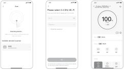The above screenshots are for reference only.2.52.32.4

</figure>

<table class="manual-callout-table manual-callout-table"><tbody><tr><td class="manual-callout-label">ATTENTION</td><td class="manual-callout-body">
L’application Jackery ne peut se connecter qu’à une seule station d’énergie à la fois via  Bluetooth. Revenir à la liste des appareils déconnecte automatiquement le Bluetooth.  Touchez à nouveau la station d’énergie dans la liste pour vous reconnecter automatiquement.
</td></tr></tbody></table>

<h2 class="ht-native-app-title" id="native-p43-b5-l0-0">3. Dissocier l’appareil</h2>
Cliquez sur le bouton des paramètres en haut à droite de l’interface principale pour accéder à la page  des paramètres. Cliquez sur le bouton de dissociation en bas de la page pour dissocier l’appareil.
<h2 class="ht-native-app-title" id="native-p43-b5-l3-0">4. Remarques</h2>
<strong>4.1. Pour activer le Wi-Fi et le Bluetooth :</strong>
<ul class="ht-native-prose-list" data-native-list="app-wireless-1"><li>
Le Wi-Fi et le Bluetooth sont automatiquement activés, une fois l’appareil allumé. Leurs icônes  s’allument sur l’écran. 
</li><li>
Appuyez simultanément sur le bouton d’alimentation USB et le bouton d’alimentation CA jusqu’à ce  que les icônes Wi-Fi et Bluetooth s’allument sur l’écran.
</li></ul>
<strong>4.2. Pour désactiver le Wi-Fi et le Bluetooth :</strong>
<ul class="ht-native-prose-list" data-native-list="app-wireless-2"><li>
Appuyez simultanément sur le bouton d’alimentation USB et le bouton d’alimentation CA jusqu’à ce  que les icônes Wi-Fi et Bluetooth s’éteignent de l’écran. 
</li><li>
Le Wi-Fi et le Bluetooth sont automatiquement désactivés si aucun appareil n'est connecté dans les  2 heures.
</li></ul>
<strong>4.3. Pour réinitialiser le Wi-Fi et le Bluetooth :</strong>

Maintenez le bouton d’alimentation principal et le bouton d’alimentation USB enfoncés simultané- ment pendant 3 secondes pour réinitialiser le Wi-Fi et le Bluetooth aux paramètres d’usine et  redémarrer le système. Le compte connecté dans l’application sera dissocié.

# JACKERY INC.

5310 Bunche Dr., Fremont, CA 94538-8301

<a href="tel:+18885022236"><strong>1-888-502-2236</strong> (US)</a>

<a href="mailto:hello@jackery.com">hello@jackery.com</a>

<a href="https://www.jackery.com">www.jackery.com </a>

