# お買い上げありがとうございます

保証書付き

ご使用の前に、この取扱説明書をよくお読みのうえ、正しくお使いください。また、この取扱説明書は大切に保管してください。

本機は日本国内専用モデルのため、外国で使用することはできません。

<table class="manual-callout-table manual-callout-table"><tbody><tr><td class="manual-callout-label">補足</td><td class="manual-callout-body">
本製品はJIS C61000-3-2適合品です。
</td></tr></tbody></table>

## FAQ（よくあるご質問）

本機についてご不明な点はこちらをご確認ください。

 <a href="https://www3.jvckenwood.com/support/qa/accessory.html">https://www3.jvckenwood.com/support/qa/accessory.html</a>

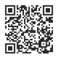

## ユーザー登録のおすすめ

末永く当社製品をご愛用いただくため、ユーザー登録をお願いいたします。

ご登録頂きますと、ポータブル電源の長持ちする使い方のご提案、充電忘れを防ぐお知らせ等のサポート情報、周辺機器のご紹介などのお得な情報を受け取ることができます。

 <a href="https://www32.jvckenwood.com/jvc/system/cons/">https://www32.jvckenwood.com/jvc/system/cons/</a>

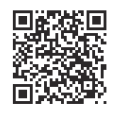

# 基本的な使い方

## 電池残量を確認する（→P.7）

［ディスプレイ］ボタンを押すと液晶画面に電池残量が表示されます。60%以下のときは充電をしてください。

## 充電する（→P.8）

付属のACアダプター等で充電してください。80～100%になったらACアダプター等を取り外してください。

## 給電する（→P.10）

使用する機器を接続して、対応する［入／切］ボタンを押すと給電がはじまります。給電中に［入／切］ボタンを押すと給電がとまります。

## 使い終わったら充電

保管するときは…保管の前に60%以上の充電をしてください。

・電池残量が少ない状態で保管をすると、過放電のために充電ができなくなることがあります。

・長期保管の場合は60～80%の充電をおすすめします。保管中に自然放電をしますので、6か月に1度程度、電池残量を確認してください。

# 本書の見かた

<table class="manual-table"><tbody><tr><th>表記</th><th>説明</th></tr><tr><td>（→P.8）</td><td>本書の参照するページを表しています。</td></tr><tr><td>［ディスプレイ］</td><td>本機のボタン名を表しています。</td></tr><tr><td>補足説明</td><td>手順の補足説明や制限事項について説明しています。</td></tr></tbody></table>

・本書の画面や操作例は操作説明用に作成したものです。実際の画面と異なる画面や、実際には行えない例が記載されている場合があります。

・最新の取扱説明書や情報などについては、当社ホームページ <a href="https://www.jvc.com/jp/portable-power-supply/">https://www.jvc.com/jp/portable-power-supply/</a>

をご覧ください。

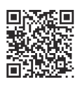

# 付属品について

<figure aria-label="付属品について" class="hb-inbox-composition" data-card-count="5" data-component-id="HB-SPECIAL-INBOX" data-inbox-variant="responsive-card-grid"><ol class="hb-inbox-grid"><li class="hb-inbox-card" data-item-number="1">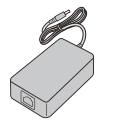

ACアダプター×1（コード長 約1.1m）型番：JD1058-000A

</li><li class="hb-inbox-card" data-item-number="2">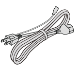

電源コード×1（コード長 約1.1m）

</li><li class="hb-inbox-card" data-item-number="3">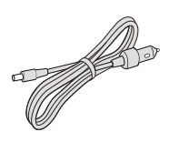

シガーアダプター×1（コード長 約2m）

</li><li class="hb-inbox-card" data-item-number="4">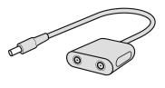

ポータブルソーラーパネル用アダプター×2

</li><li class="hb-inbox-card" data-item-number="5">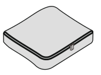

付属品ポーチ×1

</li></ol></figure>

# 別売アクセサリーのご案内

（2022年12月現在）

<table class="manual-table"><tbody><tr><th>品名</th><th>ブランド</th><th>型名</th><th>説明</th></tr><tr><td>ACアダプター</td><td>JVC</td><td>BH-AD15</td><td>付属のACアダプターと同時にお使いになることで、充電時間を短縮できます。</td></tr><tr><td>ポータブルソーラーパネル</td><td>JVC</td><td>BH-SP100A-H／BH-SP68A-H</td><td>コンセントが使えない環境でも、太陽光を利用してクリーンに本機やスマートフォンの充電、USB機器への給電が可能です。</td></tr><tr><td>延長ケーブル</td><td>JVC</td><td>BH-SC5</td><td>ポータブルソーラーパネル用の延長ケーブル（5m）です。</td></tr></tbody></table>

・別売アクセサリーのご購入はお買い上げの販売店にご相談ください。

・別売アクセサリーの最新情報はJVCケンウッドのホームページ <a href="https://www.jvc.com/jp/portable-power-supply/">https://www.jvc.com/jp/portable-power-supply/</a>

をご覧ください。

# 安全上のご注意（必ずお読みください）

本機の操作を始める前に、「安全上のご注意」を必ずお読みください。

お使いになる人や他の人への危害、財産への損害を未然に防止するため、必ずお守りいただくことを説明しています。

誤った使い方をした場合に生じる危険と損害の程度を、次の区別で説明しています。

<figure aria-label="絵表示について" class="hb-symbol-signal-composition" data-component-id="HB-TABLE-SYMBOL-SIGNAL"><table class="hb-symbol-signal-table"><colgroup><col class="hb-symbol-signal-col-label"/><col class="hb-symbol-signal-col-meaning"/></colgroup><thead><tr><th class="hb-symbol-signal-label-heading" scope="col">表示</th><th class="hb-symbol-signal-meaning-heading" scope="col">意味</th></tr></thead><tbody><tr><td class="hb-symbol-signal-label-cell">⚠警告</td><td class="hb-symbol-signal-meaning-cell">この表示を無視して誤った取扱いをすると、死亡または重傷を負う可能性が想定される内容を示しています。</td></tr><tr><td class="hb-symbol-signal-label-cell">⚠注意</td><td class="hb-symbol-signal-meaning-cell">この表示を無視して誤った取扱いをすると、傷害を負ったり、物的損害の発生が想定される内容を示しています。</td></tr></tbody></table></figure>

## 絵表示の説明

<figure aria-label="絵表示の説明" class="hb-symbol-pair-composition" data-component-id="HB-TABLE-SYMBOL-ICON">

<table class="hb-symbol-panel-table"><colgroup><col class="hb-symbol-col-icon"/><col class="hb-symbol-col-meaning"/></colgroup><thead><tr><th class="hb-symbol-icon-heading" scope="col">図記号</th><th class="hb-symbol-meaning-heading" scope="col">説明</th></tr></thead><tbody><tr><td class="hb-symbol-icon"></td><td class="hb-symbol-meaning">禁止（してはいけない）の内容です。</td></tr></tbody></table>

<table class="hb-symbol-panel-table"><colgroup><col class="hb-symbol-col-icon"/><col class="hb-symbol-col-meaning"/></colgroup><thead><tr><th class="hb-symbol-icon-heading" scope="col">図記号</th><th class="hb-symbol-meaning-heading" scope="col">説明</th></tr></thead><tbody><tr><td class="hb-symbol-icon"></td><td class="hb-symbol-meaning">実行（必ず行っていただく）の内容です。</td></tr></tbody></table>

</figure>

## 免責事項について

お客様または第三者が、この製品の誤使用、使用中に生じた故障、その他の不具合またはこの製品の使用によって受けられた損害については法令上の賠償責任が認められる場合を除き、当社は一切その責任を負いませんので、あらかじめご了承ください。

<table class="manual-callout-table manual-callout-table"><tbody><tr><td class="manual-callout-label">警告</td><td class="manual-callout-body">
次のような異常が発生したときは、ただちに使用を中止する
・煙が出ている、へんなにおいや音がするとき。
・内部に水や金属物が入ってしまったとき。
・落としたり本体が破損したりしたとき。
・電源コードやプラグが異常に熱いとき。
・電源コードが傷んだとき（芯線の露出、断線など）。

このようなときは、ACアダプターの電源プラグをコンセントから抜いてください。本機に接続されている機器のケーブルも抜いてください。そのまま使用を続けると火災や感電の原因になります。

煙が出ているときは、煙が消えるまで大量の水を掛けてください。ただし炎が出ている場合は、爆発の危険がありますので、すぐ離れてください。

煙や炎が止まったのを確かめてから販売店に修理を依頼してください。お客様ご自身が修理することは危険です。絶対にやめてください。

表示された電源電圧以外で使用しない
火災、感電、故障の原因になります。本機を使用できるのは日本国内だけです。
This product is designed for use in Japan only and cannot be used in other countries.

本機の内部や端子に、水や異物を入れない
金属物や燃えやすいものなどが入ると、動作不良やショートによる火災、感電、故障の原因になります。

水のかかる場所や湿気・ほこり・油煙の多い場所で使用・保管しない
水や油煙などが入ると、火災や故障の原因になることがあります。

分解、改造はしない
火災、感電、故障の原因になります。

雷が鳴り出したら、本機や接続ケーブルにふれない
落雷による感電の原因になります。

ぬれた手で本機や電源プラグ、接続ケーブルにふれない
感電の原因になります。

火や熱器具の周辺、炎天下の車内で使用・放置しない
火災や故障の原因になります。

強い衝撃や振動を与えたり、投げつけたりしない
火災や故障、ケガの原因になります。

ACアダプター（電源コード）は付属品（または別売の専用品）以外を使用しない
付属のACアダプター（電源コード）を他の機器に使用しない
火災や故障の原因になります。

電源プラグは根元まで確実に差し込む
差し込みが不十分な場合、ショートや発熱により火災の原因になります。

ACアダプターの電源プラグが容易に抜き差しできる空間を設ける
ACアダプターの電源を遮断するには、電源プラグを抜いてください。本機はコンセントに容易に手が届く位置に設置し、異常が起きた場合すぐに電源プラグをコンセントから抜いてください。
</td></tr></tbody></table>

<table class="manual-callout-table manual-callout-table"><tbody><tr><td class="manual-callout-label">注意</td><td class="manual-callout-body">
不安定な場所に置かない
天面に物を置かない
天面に乗らない
落下によるケガや故障の原因になります。

本機の通風口をふさがない
本機の内部に熱がこもり、故障の原因になることがあります。また、本機の周囲5cmに物を置かないでください。

本機やACアダプターを布や布団などで覆わない
熱がこもり、故障の原因になることがあります。

ACアダプターを長時間ふれない
充電中高温になるため、低温やけどの原因になることがあります。

次のような機器に使用しない
・医療機器や動植物の生命に関わる機器
・重要な事業用もしくは公共用機器
本機に異常が発生したとき以外でも、動作条件により給電が停止することがあります。
</td></tr></tbody></table>

# 各部の名称とはたらき

<figure class="hb-reference-figure hb-has-composite-art" data-component-id="HB-SPECIAL-REFERENCE-FIGURE" data-reference-id="overview" data-source-fragment-sha256="3d605e3f1d2cf417a648ede6a23267ef35fddd3fb3d84d4905c9c04498ffb77d" data-step-captions="embedded" data-web-composite-asset-key="frozen-source/overview" data-web-composite-locale="ja" data-web-composite-sha256="7a825b657227ad63dc4a0e040c169f815047e037b2bd99bbad29f857afe7831f" data-web-replace-key="reference.overview">
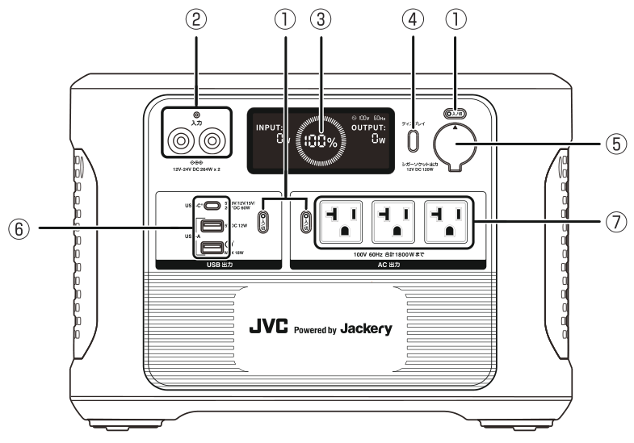

</figure>

## 本体

<table class="manual-table"><tbody><tr><th>番号</th><th>名称</th><th>はたらき</th></tr><tr><td>①</td><td>入／切ボタン</td><td>各出力をオン／オフします。（→P.10）</td></tr><tr><td>②</td><td>DC入力</td><td>付属のACアダプターとシガーアダプターを接続します。（→P.8～9）
別売のソーラーパネルを接続します。（→P.9）</td></tr><tr><td>③</td><td>液晶画面</td><td>入出力電力や電池残量、各種警告を表示します。（→P.7）</td></tr><tr><td>④</td><td>ディスプレイボタン</td><td>液晶画面が消灯しているときに点灯にします。</td></tr><tr><td>⑤</td><td>シガーソケット</td><td>車載機器用のDC12Vを出力します。（→P.10）</td></tr><tr><td>⑥</td><td>USB出力</td><td>USB機器用のDC出力をします。（→P.10）</td></tr><tr><td>⑦</td><td>AC出力</td><td>一般家電用のAC100V 60Hzを出力します。（→P.10）</td></tr></tbody></table>

本機の定格等は底面のラベルに、製造番号は底面の印刷で表示しています。

<figure class="hb-reference-figure hb-has-composite-art" data-component-id="HB-SPECIAL-REFERENCE-FIGURE" data-reference-id="rating-label" data-source-fragment-sha256="9fe724d93523511b9ec0a78bd79831ac44327452b720d64148950cefabb03459" data-step-captions="embedded" data-web-composite-asset-key="frozen-source/rating-label" data-web-composite-locale="ja" data-web-composite-sha256="df63ee427bdba05e30ca1f8c8ff63783af1de7968555fff707505e9b9665d615" data-web-replace-key="reference.rating-label">
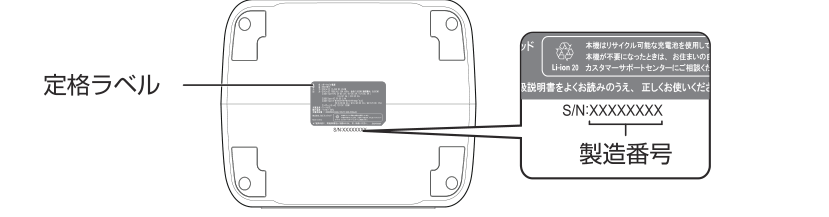

</figure>

# 液晶画面表示

<figure class="hb-reference-figure hb-has-composite-art" data-component-id="HB-SPECIAL-REFERENCE-FIGURE" data-reference-id="lcd-map" data-source-fragment-sha256="962718bb96531c007dd9363048c64439288f472fbc8a126e50a96ba4f0768051" data-step-captions="embedded" data-web-composite-asset-key="frozen-source/lcd-map" data-web-composite-locale="ja" data-web-composite-sha256="c03043906085a594eed8b3f5350938abcfb057b007422e4928e1d4b06eab5e29" data-web-replace-key="reference.lcd-map">
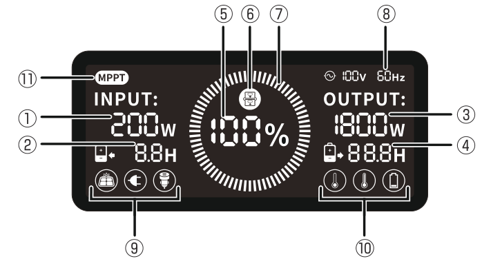

</figure>

<figure aria-label="液晶画面表示" class="hb-reference-composition hb-reference-lcd-legend" data-component-id="HB-TABLE-REFERENCE" data-component-variant="lcd-legend" tabindex="0"><table class="hb-reference-table"><thead><tr><th scope="col">番号</th><th scope="col">名称</th><th scope="col">はたらき</th></tr></thead><tbody><tr><td>①</td><td>入力電力</td><td>充電の入力電力を表示します。</td></tr><tr><td>②</td><td>充電完了時間</td><td>入力電力から計算した、充電完了時間の目安を表示します。</td></tr><tr><td>③</td><td>出力電力</td><td>出力中の電力を表示します。</td></tr><tr><td>④</td><td>給電可能時間</td><td>出力電力から計算した、給電可能時間の目安を表示します。</td></tr><tr><td>⑤</td><td>電池残量</td><td>電池残量を0～100%で表示します。残量が20%以下になった場合は給電を停止して充電をしてください。</td></tr><tr><td>⑥</td><td>省エネ設定解除</td><td>省エネ設定が解除されている事を示します。（→P.10）</td></tr><tr><td>⑦</td><td>サークル表示</td><td>充電中に表示が回転します。</td></tr><tr><td>⑧</td><td>AC出力周波数</td><td>AC出力の電圧と周波数を表示します。（設定はできません）</td></tr><tr><td>⑨</td><td>入力の種類</td><td>ソーラーパネル、ACアダプター、シガーアダプターの入力の種類を表示します。</td></tr><tr><td>⑩</td><td>低温警告</td><td>本体の内部温度が低下して動作を停止したときに表示します。温度が低くない場所にしばらく置いて、表示が消えてからご使用ください。</td></tr><tr><td>⑩</td><td>高温警告</td><td>本体の内部温度が上昇して動作を停止したときに表示します。温度が高くない場所にしばらく置いて、表示が消えてからご使用ください。</td></tr><tr><td>⑩</td><td>残量警告</td><td>電池残量が20%以下になったときに表示します。給電を停止して充電をしてください。</td></tr><tr><td>⑪</td><td>MPPT</td><td>ソーラーパネルの接続時にMPPT方式で充電されていることを示します。MPPTは高い効率で充電できる制御方式です。</td></tr></tbody></table></figure>

※入出力電力と電池残量、充電完了時間、給電可能時間は、実際の電力や残量、時間と若干の違いがあります。

# 充電する

充電を開始すると液晶画面に充電残量を表示します。充電残量が100%になると充電が自動で停止します。

・充電完了後はACアダプター等をDC入力端子からはずしてください。

・液晶画面は30秒後に自動消灯します。液晶画面を点灯させる場合は、［ディスプレイ］ボタンを押してください。

・充電中に液晶画面を点灯したままにしたいときは、液晶画面の点灯中に［ディスプレイ］ボタンを2回押してください。

・充電中に給電をすることが可能ですが、バッテリーの劣化を早めることがあります。

・内部温度が高い、もしくは低いために保護回路が働き、充電が停止することがあります。そのような場合には、充電温度範囲内（0℃～40℃）の環境にしばらく置いてから充電を行ってください。

## ACアダプターで充電する

電源コードをACアダプターに取付けて、DC入力端子にACアダプターのプラグを接続します。

<figure class="hb-reference-figure hb-has-composite-art" data-component-id="HB-SPECIAL-REFERENCE-FIGURE" data-reference-id="charging-ac" data-source-fragment-sha256="1d527d2971b9cbcff91c75f7a7831a8876c1315c2406d4a678aba0ce74dc08e4" data-step-captions="embedded" data-web-composite-asset-key="frozen-source/charging-ac" data-web-composite-locale="ja" data-web-composite-sha256="5ce739984f60f81ca4c01a861853f5cc14d7227c90bb5f253d910691d216bcae" data-web-replace-key="reference.charging-ac">
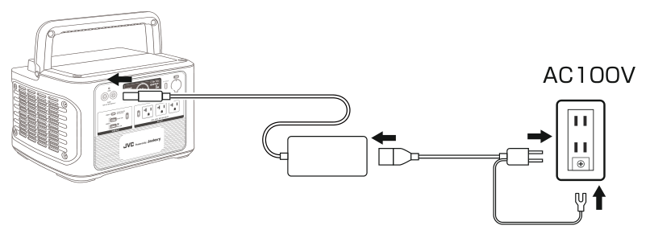

</figure>

<table class="manual-callout-table manual-callout-table"><tbody><tr><td class="manual-callout-label">補足</td><td class="manual-callout-body">
・2個のDC入力端子はどちらでも使用可能です。また別売のACアダプター（→P.3）を同時に接続することで、充電時間を短くすることができます。

・ACアダプターのプラグのアース線は、必ずコンセントのアース端子に接続（接地接続）してください。接地接続しないで使用すると、万が一、漏電した場合に感電の原因となります。

・コンセントにアース端子がない場合は、家電量販店、電気工事店など専門業者に取り付けについてご相談ください。
</td></tr></tbody></table>

## シガーアダプターで充電する

12Vマイナスアース車に適合します。シガープラグをお車のシガーソケット（アクセサリーソケット）に接続し、DC入力端子にシガーアダプターのプラグを接続します。

<figure class="hb-reference-figure hb-has-composite-art" data-component-id="HB-SPECIAL-REFERENCE-FIGURE" data-reference-id="charging-car" data-source-fragment-sha256="414e1bf8f9aa6e1418b273ff091f5dbaafcad6d083f5ca6beea7a9cad4ea1c9d" data-step-captions="embedded" data-web-composite-asset-key="frozen-source/charging-car" data-web-composite-locale="ja" data-web-composite-sha256="b3dcca66dd132b40698038301e922c10e38677616a7349d4def777757100ef00" data-web-replace-key="reference.charging-car">
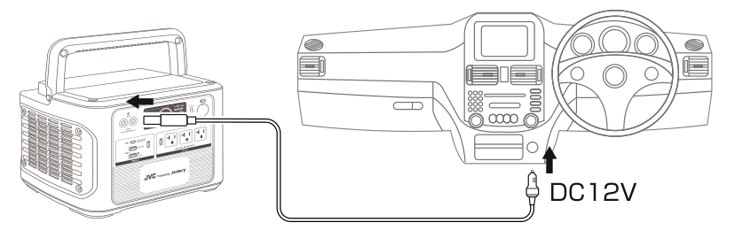

</figure>

<table class="manual-callout-table manual-callout-table"><tbody><tr><td class="manual-callout-label">補足</td><td class="manual-callout-body">
・2個のDC入力端子はどちらでも使用可能です。

・お車のバッテリーあがりを防止するために、エンジンを掛けた状態で充電してください。

・定格24Vのシガーソケット（アクセサリーソケット）には対応していません。
</td></tr></tbody></table>

## 別売のソーラーパネルで充電する

ソーラーパネルのケーブルを付属のアダプターに接続し、アダプターのケーブルをDC入力端子に接続します。

・ソーラーパネルの取扱説明書もあわせてご覧ください。

・本機は2個のアダプターを使って、4台までソーラーパネルの接続が可能です。

<figure class="hb-reference-figure hb-has-composite-art" data-component-id="HB-SPECIAL-REFERENCE-FIGURE" data-reference-id="charging-solar" data-source-fragment-sha256="731f768343cada83ebfa53073db3a6df2f5c9f9b5787c08be7a182e4f2f74d94" data-step-captions="embedded" data-web-composite-asset-key="frozen-source/charging-solar" data-web-composite-locale="ja" data-web-composite-sha256="c33c5f1904b783095ab77222a6c7d19e4d15b1aa88497e150b20117e5dab9d56" data-web-replace-key="reference.charging-solar">
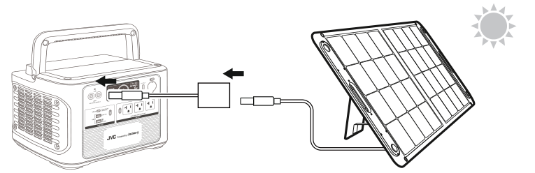

</figure>

<table class="manual-callout-table manual-callout-table"><tbody><tr><td class="manual-callout-label">補足</td><td class="manual-callout-body">
・2個のDC入力端子はどちらでも使用可能です。

・ソーラーパネルの発電量は、実際の日射や設置場所、気温などの環境により大きく変化します。

・別売のアクセサリー（→P.3）以外のソーラーパネルは当社では動作確認しておりません。
</td></tr></tbody></table>

# 接続機器に給電する

本機に機器を接続し、［入／切］ボタンを押すと給電を開始します。給電中に［入／切］ボタンを押すと給電を停止します。

<table class="manual-callout-table manual-callout-table"><tbody><tr><td class="manual-callout-label">補足</td><td class="manual-callout-body">
本機の充電残量が20%以下になると、残量警告マークが表示され、液晶画面の電池残量が点滅します。このようなときは接続機器への給電を停止して本機を充電してください。
</td></tr></tbody></table>

・本機のシガーソケットは、シガーライターには対応していません。

・本機のAC出力は60Hz固定です。50Hz専用の機器は使用できません。

・接続した機器の消費電力が本機の最大供給電力を超えた場合、給電は停止します。

・接続した機器の定格消費電力が本機の定格出力電力以下であっても、動力の起動や熱源の投入時に大きな電力が必要となり、給電が停止することがあります。

・液晶画面は30秒後に自動消灯します。液晶画面を点灯させる場合は、［ディスプレイ］ボタンを押してください。

・給電中に液晶画面を点灯したままにしたいときは、液晶画面の点灯中に［ディスプレイ］ボタンを2回押してください。

・AC出力の電力が25W未満、またはシガーソケット出力の電力が2W未満の場合、12時間で給電が自動停止します。この機能を解除するときは、［ディスプレイ］ボタンとACの［入／切］ボタンを同時に2秒以上押してください。設定を解除し、［省エネ設定解除］マーク（→P.7）を液晶画面に表示します。（出力の停止忘れにご注意ください）

・充電中に給電をすることが可能ですが、バッテリーの劣化を早めることがあります。

・内部温度の上昇によって保護回路がはたらき、給電が停止することがあります。そのような場合には、動作温度範囲内（-10℃～40℃）にしばらく置いてから再度、［入／切］ボタンを押して給電を行ってください。

・アース付きの3Pプラグを差し込むことができますが、本機ではアース線は接続されません。市販の3P→2P変換アダプターを使用して、アース線を接地することをおすすめします。

<table class="manual-callout-table manual-callout-table"><tbody><tr><td class="manual-callout-label">補足</td><td class="manual-callout-body">
・接続したUSB機器の状態により、充電ができない、または急速充電にならないことがあります。
</td></tr></tbody></table>

※計算上の数値です。使用する機器の状態や使用状況により変わります。

## 給電の目安

<figure aria-label="給電の目安" class="hb-spec-table-composition"><table class="manual-table manual-spec-table hb-spec-table"><colgroup><col class="hb-spec-col-label"/><col class="hb-spec-col-value"/></colgroup><tbody><tr><th class="manual-spec-label hb-spec-label" scope="row">LEDライト（9W）</th><td class="manual-spec-value hb-spec-value">約129時間</td></tr><tr><th class="manual-spec-label hb-spec-label" scope="row">スマートフォン（15W）（充電回数）</th><td class="manual-spec-value hb-spec-value">約81回＊1</td></tr><tr><th class="manual-spec-label hb-spec-label" scope="row">扇風機、サーキュレーター（35W）</th><td class="manual-spec-value hb-spec-value">約33時間</td></tr><tr><th class="manual-spec-label hb-spec-label" scope="row">ノートパソコン（50W）</th><td class="manual-spec-value hb-spec-value">約23時間</td></tr><tr><th class="manual-spec-label hb-spec-label" scope="row">電気毛布（60W）</th><td class="manual-spec-value hb-spec-value">約21時間</td></tr><tr><th class="manual-spec-label hb-spec-label" scope="row">冷蔵庫（197W）</th><td class="manual-spec-value hb-spec-value">約33時間</td></tr><tr><th class="manual-spec-label hb-spec-label" scope="row">電動工具（400W）</th><td class="manual-spec-value hb-spec-value">約2.9時間</td></tr><tr><th class="manual-spec-label hb-spec-label" scope="row">炊飯器（430W）（使用回数）</th><td class="manual-spec-value hb-spec-value">約11回</td></tr><tr><th class="manual-spec-label hb-spec-label" scope="row">電気ポット（910W）（使用回数）</th><td class="manual-spec-value hb-spec-value">約4.4回</td></tr><tr><th class="manual-spec-label hb-spec-label" scope="row">ホットプレート、卓上IH調理器（1,300W）</th><td class="manual-spec-value hb-spec-value">約53分</td></tr><tr><th class="manual-spec-label hb-spec-label" scope="row">ドライヤー（1,300W）</th><td class="manual-spec-value hb-spec-value">約53分</td></tr><tr><th class="manual-spec-label hb-spec-label" scope="row">電子レンジ（1,400W）（使用回数）</th><td class="manual-spec-value hb-spec-value">約9.7回</td></tr></tbody></table></figure>

＊1 USB出力を使用した場合

# 使用上のご注意

・本機を充電するときは、付属のACアダプター、シガーアダプターまたは別売のソーラーパネル、専用のACアダプターをお使いください。また、本機用のACアダプターやシガーアダプターを他の機器で使用しないでください。

・本機を使用するときは底面を下側にしてください。それ以外の状態で使用すると、故障の原因になります。

・ハンドルにがたつきがあるときは、ハンドルを使用しないでください。

・電子機器を本機のごく近くで使用した場合、電磁波の影響により電子機器に動作の不具合が起きることがあります。そのようなときは、本機と電子機器の距離を離してお使いください。

・本機が汚れたときは、柔らかい布でから拭きしてください。汚れがひどいときは、水や中性のクリーナーを付けた布で汚れを落とし、その後クリーナーを拭き取ってください。固い布やシンナー、アルコールなどの揮発性のもので拭くと、傷が付いたり変形や変質、破損の原因になります。

# 故障かな？と思ったら

次の一覧から該当する症状を見つけて対処してください。次ページの「FAQ（よくあるご質問）」も合わせてご覧ください。

<figure aria-label="症状 / 原因・対処方法" class="hb-troubleshooting-composition" data-component-id="HB-TABLE-TROUBLESHOOTING" tabindex="0"><table class="hb-troubleshooting-table"><colgroup><col class="hb-troubleshooting-col-code"/><col class="hb-troubleshooting-col-measures"/></colgroup><thead><tr><th class="hb-troubleshooting-code" scope="col">症状</th><th class="hb-troubleshooting-measures" scope="col">原因・対処方法</th></tr></thead><tbody><tr><td class="hb-troubleshooting-code">充電できない</td><td class="hb-troubleshooting-measures">原因：ACアダプター等DC入力が正しく接続されていない。
対処方法：接続を確認してください。</td></tr><tr><td class="hb-troubleshooting-code">充電できない</td><td class="hb-troubleshooting-measures">原因：内部温度が高い、もしくは低いため充電を停止している。
対処方法：本機の充電温度範囲内（0℃～40℃）の場所で充電してください。警告マークが消えてから使用してください。</td></tr><tr><td class="hb-troubleshooting-code">給電できない</td><td class="hb-troubleshooting-measures">原因：充電残量が0%になっている。
対処方法：本機の充電をしてから使用してください。</td></tr><tr><td class="hb-troubleshooting-code">給電できない</td><td class="hb-troubleshooting-measures">原因：定格の電力を超えている。
対処方法：本機の定格出力電力以下の機器を接続してください。（→P.10）接続機器の定格消費電力が本機の定格出力電力以下であっても、動力の起動や熱源の投入時に大きな電力が必要となり、給電が停止することがあります。本機の定格に対して十分余裕のある機器を使用してください。</td></tr><tr><td class="hb-troubleshooting-code">給電できない</td><td class="hb-troubleshooting-measures">原因：内部温度が高い、もしくは低いため給電を停止している。
対処方法：本機の動作温度範囲内（-10℃～40℃）の場所で使用してください。警告マークが消えてから使用してください。</td></tr><tr><td class="hb-troubleshooting-code">ACアダプターが熱くなる</td><td class="hb-troubleshooting-measures">原因：充電中の電力が大きい。
対処方法：異常ではありません。ACアダプターが熱い時は手を触れない、また、布などをかぶせないようにご注意ください。</td></tr></tbody></table></figure>

# FAQ（よくあるご質問）

本機についてのお客様のお問い合わせが多い内容です。より詳しい内容や最新の情報を当社のホームページに掲載しています。

FAQ（よくあるご質問） <a href="https://www3.jvckenwood.com/support/qa/accessory.html">https://www3.jvckenwood.com/support/qa/accessory.html</a>

<table class="manual-table"><tbody><tr><th>Q：質問</th><th>A：回答</th></tr><tr><td>防塵、防水仕様ですか？</td><td>本機は防塵、防水仕様ではありませんので、ほこりや水、海水などがかからないように注意してください。また火災や感電の原因となりますので、ぬれた手で本機をさわらないでください。</td></tr><tr><td>AC出力の波形は正弦波ですか？</td><td>家庭用コンセントと同じ正弦波です。さまざまな電気製品に安心してご使用になれます。ただし、本機はオーディオ用としての音質向上を目的とした設計はされておりません。</td></tr><tr><td>バッテリーがあがった車の始動に使えますか？</td><td>本機にはエンジン始動に対応した機能（ジャンプスターター機能）はありません。</td></tr><tr><td>使える電気器具を調べるには？</td><td>電気器具の定格消費電力を製品の表示などで確認してください。AC出力に接続する機器の合計が1,800W以下であれば使用できます。</td></tr><tr><td>AC出力の「瞬間最大3,600W」とはどのような意味ですか？</td><td>接続した機器の動力の起動や熱源の投入時に、大きな電力が必要となることがあるため、ごく短い時間であれば本機の定格出力1,800Wを超えた3,600Wまでの出力をすることができます。</td></tr><tr><td>99%～100%の充電に時間がかかる</td><td>正常な動作です。充電残量に応じて充電の電流を調整しています。</td></tr></tbody></table>

## 正常に動作しないときは

USB出力の［入／切］ボタンと［ディスプレイ］ボタンを同時に10秒以上押してから放すと、本機が再起動します。

## 保管をするときは

・本機を保管するときは低温や高温、高湿度の場所を避けてください。0～40℃、湿度65%以下がおすすめです。

・本機を長期保管するときは60～80%の充電をしてから保存してください。長期保管の場合は6か月に1度程度、充電残量を確認してください。

# 主な仕様

## BN-RB15

<figure aria-label="BN-RB15" class="hb-spec-table-composition"><table class="manual-table manual-spec-table hb-spec-table"><colgroup><col class="hb-spec-col-label"/><col class="hb-spec-col-value"/></colgroup><tbody><tr><th class="manual-spec-label hb-spec-label" scope="row">充電池タイプ</th><td class="manual-spec-value hb-spec-value">リチウムイオン充電池（三元系）</td></tr><tr><th class="manual-spec-label hb-spec-label" scope="row">充電池容量</th><td class="manual-spec-value hb-spec-value">1,534Wh（60.9Ah/25.2V）426,300mAh</td></tr><tr><th class="manual-spec-label hb-spec-label" scope="row">入力</th><td class="manual-spec-value hb-spec-value">【DC×2】12-24V DC 264W</td></tr><tr><th class="manual-spec-label hb-spec-label" scope="row">AC出力</th><td class="manual-spec-value hb-spec-value">【AC×3】100V AC 18A 60Hz 合計1,800W（瞬間最大3,600W）</td></tr><tr><th class="manual-spec-label hb-spec-label" scope="row">USB出力</th><td class="manual-spec-value hb-spec-value">【USB Type-C™】5V DC 3A／9V DC 3A／12V DC 3A／15V DC 3A／20V DC 3A 【USB Type-A】5V DC 2.4A 【USB Type-A Qualcomm® Quick Charge™3.0】5V-6.5V DC 3A／6.5V-9V DC 2A／9V-12V DC 1.5A</td></tr><tr><th class="manual-spec-label hb-spec-label" scope="row">DC出力</th><td class="manual-spec-value hb-spec-value">【シガーソケット】12V DC 120W</td></tr><tr><th class="manual-spec-label hb-spec-label" scope="row">充電時間</th><td class="manual-spec-value hb-spec-value">ACアダプター使用時：約6.5時間 シガーアダプター使用時：約13時間</td></tr><tr><th class="manual-spec-label hb-spec-label" scope="row">充電温度</th><td class="manual-spec-value hb-spec-value">0℃～40℃</td></tr><tr><th class="manual-spec-label hb-spec-label" scope="row">動作温度</th><td class="manual-spec-value hb-spec-value">-10℃～40℃</td></tr><tr><th class="manual-spec-label hb-spec-label" scope="row">最大外形寸法（ハンドル収納時）</th><td class="manual-spec-value hb-spec-value">幅355mm×高さ265mm×奥行253mm</td></tr><tr><th class="manual-spec-label hb-spec-label" scope="row">質量</th><td class="manual-spec-value hb-spec-value">16kg</td></tr></tbody></table></figure>

これらの仕様およびデザインは、技術開発にともない予告なく変更になる場合があります。

## 本書の内容をオンラインでご覧いただけます

本機をアウトドアに持ち出す際などにご活用ください。

 <a href="http://www32.jvckenwood.com/jvc/System/Manual/Search/">http://www32.jvckenwood.com/jvc/System/Manual/Search/</a>

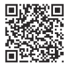

## 商標について

・USB Type-C™およびUSB-C™は、USB Implementers Forumの商標または登録商標です。

・Qualcomm®は、米国およびその他の国で登録されたQualcomm® Technologies, Inc.の商標です。

・Qualcomm® Quick Charge™は、Qualcomm® Technologies, Inc.および／またはその子会社の製品であり、米国およびその他の国々で登録されたQualcomm® Technologies, Inc.の商標です。

・その他、記載している会社名、製品名は各社の商標または登録商標です。なお、本文中では、TMマークと®マークを明記していません。

# 保証とアフターサービス

## 製品についてお困りのことがありましたら・・・

## ホームページ情報

<figure aria-label="ホームページ情報" class="hb-warranty-card" data-component-id="HB-WARRANTY-SECTION" data-warranty-card-index="2">
製品に関するQ&amp;A、メールによるお問い合わせなどはポータブル電源サポート情報
</figure>

 <a href="https://www.jvc.com/jp/support/">https://www.jvc.com/jp/support/</a>

## 取扱い方法などのご相談

<figure aria-label="取扱い方法などのご相談" class="hb-warranty-card" data-component-id="HB-WARRANTY-SECTION" data-warranty-card-index="4">
JVCケンウッドカスタマーサポートセンターにご相談ください。
</figure>

## アフターサービスのご相談

<figure aria-label="アフターサービスのご相談" class="hb-warranty-card" data-component-id="HB-WARRANTY-SECTION" data-warranty-card-index="5">
お買い上げの販売店、またはJVCケンウッドカスタマーサポートセンターにご相談ください。
</figure>

## JVCケンウッドカスタマーサポートセンター

<figure aria-label="JVCケンウッドカスタマーサポートセンター" class="hb-warranty-card" data-component-id="HB-WARRANTY-SECTION" data-warranty-card-index="6">
固定電話からは、フリーダイヤル　0120-2727-87

携帯・PHSからは、ナビダイヤル　0570-010-114

一部のIP電話などフリーダイヤル、ナビダイヤルがご利用になれない場合　045-450-8950

月曜～金曜　9:30～18:00／土曜　9:30～12:00、13:00～17:30

・日曜祝日、弊社休業日を除く

・電話番号および受付時間が変更になる場合があります。

電話番号を良くお確かめの上、おかけ間違いのないようご注意ください。
</figure>

## ご相談窓口における個人情報のお取り扱い

<figure aria-label="ご相談窓口における個人情報のお取り扱い" class="hb-warranty-card" data-component-id="HB-WARRANTY-SECTION" data-warranty-card-index="7">
株式会社JVCケンウッドおよびその関係会社は、お客様の個人情報やご相談内容を、ご相談への対応や修理、その確認などのために利用し、その記録を残すことがあります。また、個人情報を適切に管理し、修理業務等を委託する場合や正当な理由がある場合を除き、第三者に提供しません。お問い合わせは、ご相談された窓口にご連絡ください。
</figure>

## 充電式電池のリサイクルについて

本機はリサイクル可能な充電池を内蔵しています。本機が不要になったときは、お住まいの自治体、またはJVCケンウッドカスタマーサポートセンターにご相談ください。

※電池の取り外しは、お客様自身では行わないでください。また、本機を家庭ゴミと一緒に処分しないでください。ゴミ収集車内や処理場での発煙、発火の原因になります。

株式会社JVCケンウッド

〒221-0022 神奈川県横浜市神奈川区守屋町3-12

©2022 JVCKENWOOD Corporation

## 保証書

<figure aria-label="保証書" class="hb-warranty-card" data-component-id="HB-WARRANTY-SECTION" data-warranty-card-index="15">
この保証書は、本書に明示した期間、条件のもとにおいて無料修理をお約束するものです。故障およびその他の状況により、修理ではなく製品交換になる場合があります。その際に同型ではなく同等品と交換になる場合がありますので、ご了承願います。

お客様からご提供いただいた個人情報は、保証期間中、およびその後の点検・サービス活動のために記載内容を利用させていただく場合がありますので、ご了承ください。

1. 保証期間中、取扱説明書および本体貼付ラベルなどの注意書に従った正常な使用状態で故障した場合は、無料修理をさせていただきます。商品と本書をお買い上げの販売店にご持参ご提示のうえ、修理をご依頼ください。

2. 保証期間中の修理などアフターサービスについてご不明の場合はお買い上げの販売店、またはJVCケンウッドカスタマーサポートセンターにご相談ください。

3. 次のような場合は保証期間内でも有料修理にさせていただきます。

（1）本書のご提示がない場合。

（2）本書に型名、製造番号、お買い上げ年月日、お客様名、お買い上げ販売店名の記載がない場合、または字句が書き換えられた場合。

（3）ご使用上の誤り、および不当な修理や改造による故障および損傷。

（4）お買い上げ後の輸送、移動、落下などによる故障および損傷。

（5）火災、地震、風水害、雷その他の天災地変、虫害、塩害、公害、ガス害（硫化ガスなど）や異常電圧、指定以外の使用電源（電圧・周波数）などによる故障および損傷。

（6）不具合の原因が本製品以外（外部要因）による場合。

（7）一般家庭用以外（例えば業務用などへの長時間使用および車輌、船舶への搭載）に使用された場合の故障および損傷。

（8）消耗品（電池など）の消耗。

（9）持込修理の対象商品を直接当社へ送付した場合の送料はお客様負担とさせていただきます。また、出張修理を行った場合には、出張料はお客様負担とさせていただきます。

4. この保証書によって株式会社JVCケンウッドおよびそれ以外の事業者に対するお客様の法律上の権利を制限するものではありません。保証期間経過後の修理などについてご不明の場合は、お買い上げの販売店またはJVCケンウッドカスタマーサポートセンターにお問い合わせください。

5. 本書は日本国内においてのみ有効です。
This warranty is valid only in Japan.
</figure>

## 補修用性能部品の最低保有期間

製造打ち切り後3年です。補修用性能部品とはその製品の機能を維持するために必要な部品です。

## サービス窓口

下記URLをご覧ください。 <a href="https://www.jvc.com/jp/support/hrepair/">https://www.jvc.com/jp/support/hrepair/</a>

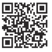

# 保証書（持込修理）

<table class="manual-table"><tbody><tr><td>品名</td><td>ポータブル電源</td></tr><tr><td>型名</td><td>BN-RB15</td></tr><tr><td>製造番号</td><td></td></tr><tr><td>お客様 お名前（ふりがな）</td><td></td></tr><tr><td>ご住所</td><td></td></tr><tr><td>電話</td><td>（　　　）－</td></tr><tr><td>お買い上げ年月日</td><td>年　月　日</td></tr><tr><td>保証期間</td><td>お買い上げ日から 本体2年</td></tr><tr><td>お買い上げ店</td><td>住所・店名・電話</td></tr></tbody></table>

## お客様へのお願い

1. 本書にお買い上げ年月日、お客様名、お買い上げ販売店名が記載されているかお確かめください。万一記入がない場合は、直ちにお買い上げ販売店にお申し出ください。購入日の確認できる書類（シールやレシートなど）の添付でもかまいませんので、大切に保管してください。

2. 本書をご提示いただく場合は、お手数ですが、お買い上げ商品の製造番号（本機底面に印刷されています→P.6）、お客様のお名前、ご住所の記入をお願いします。

3. ご贈答品などで、本書記載のお買い上げ販売店に修理がご依頼になれない場合は、JVCケンウッドカスタマーサポートセンターにご相談ください。

4. ご転居の場合は、事前にお買い上げの販売店にご相談ください。

5. 本書は再発行いたしませんので、紛失しないように大切に保管してください。

株式会社JVCケンウッド

〒221-0022 神奈川県横浜市神奈川区守屋町3-12

