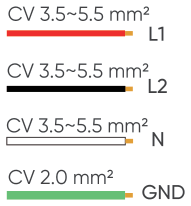
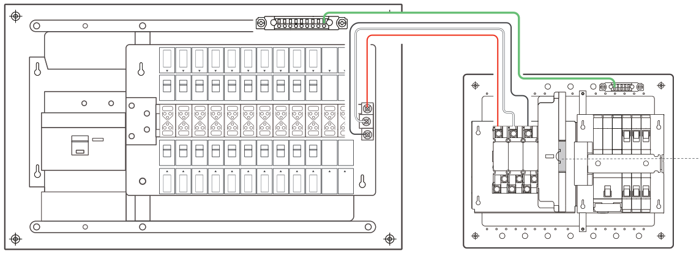
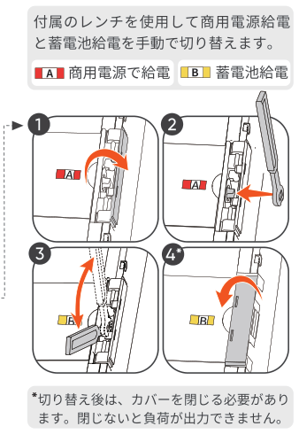

2 配線
==============================

① ATS入力ポートA（商用電源側）に商用電源を接続
---------------------------------------------------

商用電源による給電を優先にする

② バックアップ負荷ラインをATSに接続する
---------------------------------------------------

.. image:: ../../assets/step2-backup-legend.png
   :alt: VVF 2.0 mm² L、VVF 2.0 mm² N

.. raw:: html

   

100v サーキット

.. container:: hb-text-panel

   3つの予備設置位置を確保しており、必要に応じてブレーカを追加できます。
