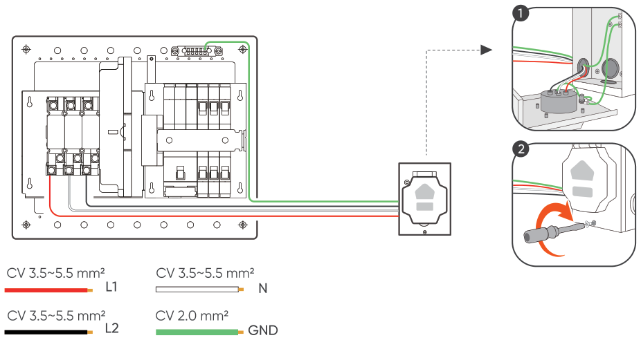

3 蓄電池に接続する
==============================

① インレットボックスを取り付ける
---------------------------------------------------

.. image:: ../../assets/step3-inlet.png
   :alt: インレットボックスを取り付ける

② ATS入力ポートB（自立電源側）はジャンクションボックスに接続します
------------------------------------------------------------------------

③ 蓄電池に接続する
---------------------------------------------------

.. image:: ../../assets/step3-battery.png
   :alt: 蓄電池に接続する
