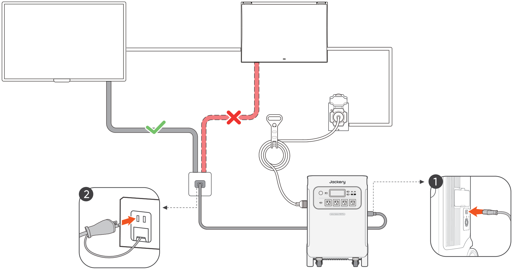

4 蓄電池に充電する
==============================

.. container:: hb-source-safety-heading

   .. image:: ../../assets/warning-triangle-yellow.svg
      :alt: ⚠

   蓄電用のコンセントは分電盤に接続する必要があり、ATSに直接接続することは禁止されています
