

# サイトスペース要件

<figure class="hb-reference-figure hb-base-art-live-copy" data-component-id="HB-SPECIAL-REFERENCE-FIGURE" data-reference-id="site-space" data-source-fragment-sha256="b44dfb458653b57804a69adbeeeb76f0d9e1b44c80817df7729aaa6f4d9210f4" data-web-base-art-ref="../../assets/site-space.png" data-web-presentation-mode="base-art-live-copy" data-web-replace-key="reference.site-space">

分電盤自動切替機能付ホーム分電盤≥ 20cm≥ 20cm

</figure>

<section id="section-2">
<h2>パッキングリスト</h2>
<section id="section-3">
<h3>パッキングリスト 1</h3>

<ul class="hb-package-grid hb-package-grid--five"><li class="hb-package-item">
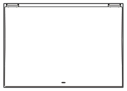

自動切替機能付ホーム分電盤 *1
</li><li class="hb-package-item">
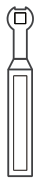

手動ハンドル *1
</li><li class="hb-package-item">
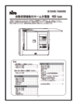

施工説明書/取扱説明書 *1
</li><li class="hb-package-item">
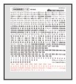

切替表示シール *1
</li><li class="hb-package-item">
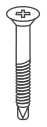

取付ねじ *4
</li></ul>
</section>
<section id="section-4">
<h3>パッキングリスト 2</h3>

<ul class="hb-package-grid"><li class="hb-package-item">
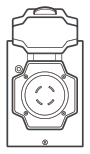

インレットボックス *1
</li><li class="hb-package-item">
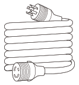

充電ケーブル *1
</li><li class="hb-package-item">
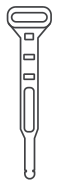

ケーブル・ハンガー *1
</li><li class="hb-package-item">
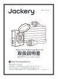

取扱説明書 *1
</li><li class="hb-package-item">
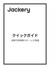

クイックガイド *1
</li><li class="hb-package-item">
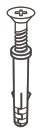

アンカーボルト *3
</li></ul>
</section>
</section>

<section id="section-5">
<h2>必要品</h2>

<ul class="hb-package-grid"><li class="hb-package-item">
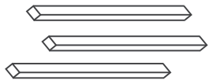

配線管
</li><li class="hb-package-item">
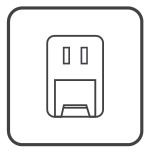

コンセント
</li><li class="hb-package-item">
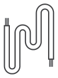

ワイヤー
</li><li class="hb-package-item">
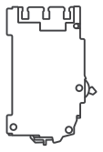

ブレーカ（オプション）
</li></ul>
</section>

# 1 表面取り付け

<section id="section-2">
<h2>① パネルを開く</h2>
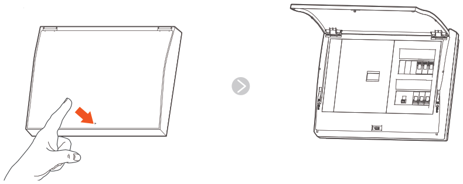
</section>

<section id="section-3">
<h2>② 前面パネルを取り外す</h2>
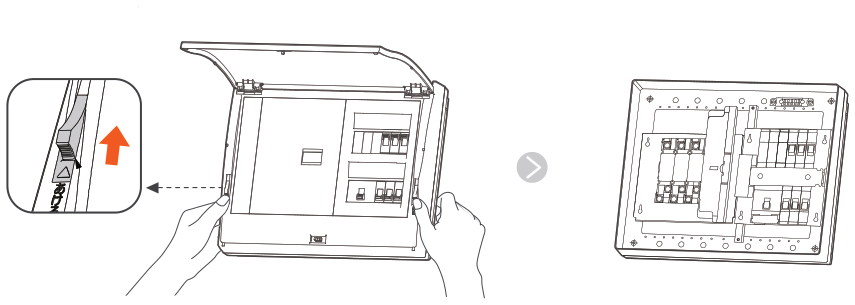
</section>

<section id="section-4">
<h2>③ 壁に固定する</h2>
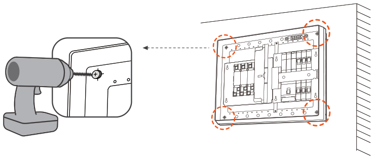
</section>

# 2 配線

<section id="atsa">
<h2>① ATS入力ポートA（商用電源側）に商用電源を接続</h2>

商用電源による給電を優先にする

</section>

<section id="ats">
<h2>② バックアップ負荷ラインをATSに接続する</h2>
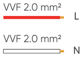
<figure class="hb-reference-figure hb-base-art-live-copy" data-component-id="HB-SPECIAL-REFERENCE-FIGURE" data-reference-id="step2-backup" data-source-fragment-sha256="842c9504aa7aa5d1fb82df08b3834c534be55adaf0a281617eedaaadbcdc488b" data-web-base-art-ref="../../assets/step2-backup.png" data-web-presentation-mode="base-art-live-copy" data-web-replace-key="reference.step2-backup">

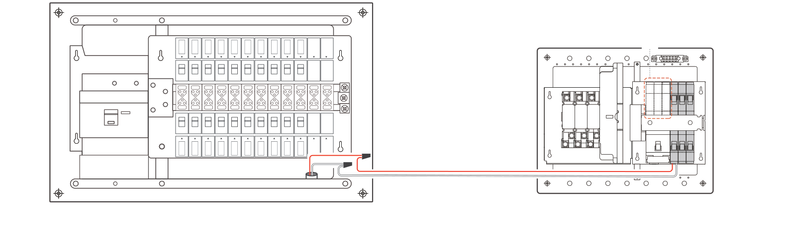100v サーキット

</figure>

3つの予備設置位置を確保しており、必要に応じてブレーカを追加できます。

</section>

# 3 蓄電池に接続する

<section id="section-2">
<h2>① インレットボックスを取り付ける</h2>
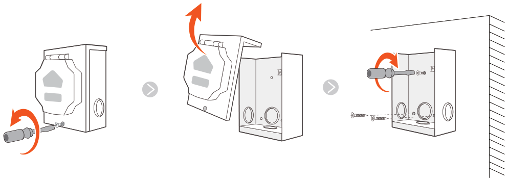
</section>

<section id="atsb">
<h2>② ATS入力ポートB（自立電源側）はジャンクションボックスに接続します</h2>

</section>

<section id="section-3">
<h2>③ 蓄電池に接続する</h2>
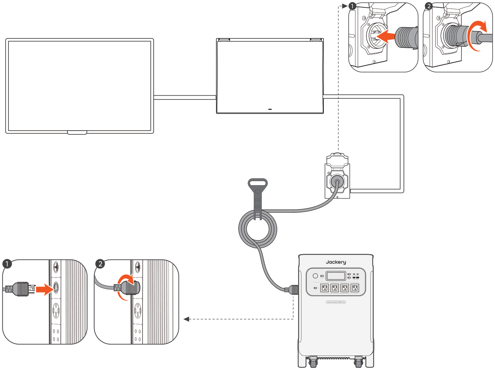
</section>

# 4 蓄電池に充電する

蓄電用のコンセントは分電盤に接続する必要があり、ATSに直接接続することは禁止されています

# 5 アプリ設定

<section id="section-2">
<h2>① アプリをダウンロードしてログインするには</h2>

</section>

<section id="section-3">
<h2>② アプリ設定</h2>

ジャクリアプリ内で静音充電モードを有効にして、デバイスの動作音を低減してください

<figure class="hb-reference-figure hb-base-art-live-copy" data-component-id="HB-SPECIAL-REFERENCE-FIGURE" data-reference-id="app-settings-1" data-source-fragment-sha256="0e3ddd06ec1c7c18f3875ade1a8df7f0f5eb5b141a69449c8b69b3971914b86d" data-web-base-art-ref="../../assets/app-settings-1.png" data-web-presentation-mode="base-art-live-copy" data-web-replace-key="reference.app-settings-1">

設備を追加する蓄電池アイコンをクリックする「設定」をクリックする

</figure><figure class="hb-reference-figure hb-base-art-live-copy" data-component-id="HB-SPECIAL-REFERENCE-FIGURE" data-reference-id="app-settings-2" data-source-fragment-sha256="fa2bd3550a7474ea1d75c34ae270f150be59b60d0bb4fcca8d41b048df09f2d9" data-web-base-art-ref="../../assets/app-settings-2.png" data-web-presentation-mode="base-art-live-copy" data-web-replace-key="reference.app-settings-2">

・蓄電池の省エネモードをクリックする; ・自動オフ時間をクリックしてくださいオフにしないしない

</figure></section>
