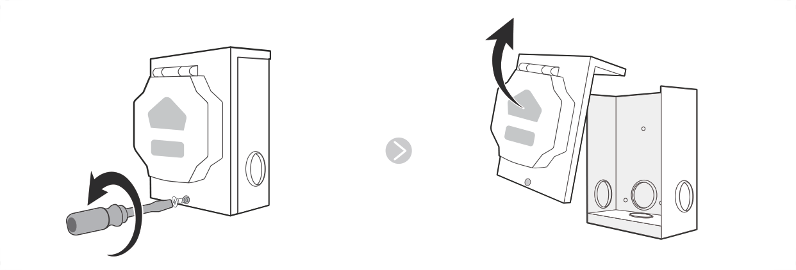
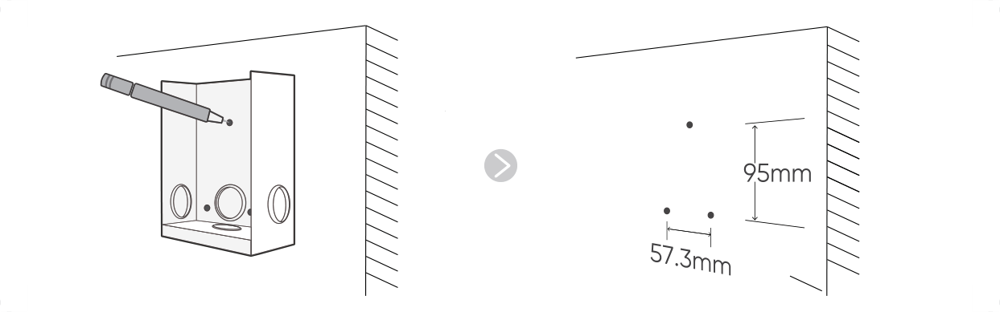
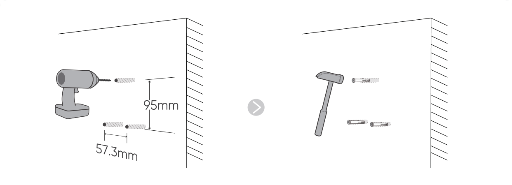
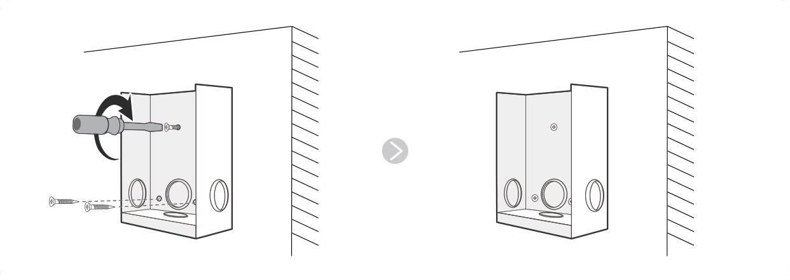

インレットボックスの取り付け
==============================

.. raw:: html

   

   
<strong>設置場所の選択</strong>

   
* インレットボックスは、建物内の便利な場所に設置してください。

   
* 製品は、乾燥した換気の良い場所に設置してください。

   

1.インレットボックスの前面カバーをねじって取り外します。

2.インレットボックスを所定の位置に保持し、鉛筆を使用して壁に穴の位置をマークします。

3\. マークした位置にドリルで穴を開け、壁アンカーを挿入します。

.. raw:: html

   

   
* プラスチック製の壁アンカーのサイズに基づいて、適切なドリルビットを選択してください。

   
* 穴の深さが壁アンカーの長さに一致していることを確認してください。

   
* 壁アンカーの損傷を防ぐため、過度の力を加えないでください。

   
* 穴あけ後、穴から破片を取り除きます。

   

4\. インレットボックスの背面にある取り付け穴にセルフタッピングネジを挿入し、壁アンカーにねじ込んでインレットボックスを固定します。

| 5\. インレットボックスの配線用穴の1つから、自動切換スイッチまで配線を通します。
| 次のようにインレットボックス内のワイヤを接続します。

.. raw:: html

   

各ワイヤから3/5インチ（15 mm）の絶縁体を剥がし。

Green

White

Black

Red

Groud Screw Terminal

Green

Black

White

Red

.. raw:: html

   

   
* 銅線のみを使用し、許可された配線方法に従ってください。

   
* 電線管を使用する場合は、少なくとも4色の異なる色のワイヤーを通してください。

   
* 電線ゲージ：8 AWG～10 AWG。

   

.. raw:: html

   

   
* 導体にすずメッキをしないでください。

   
* 端子内にワイヤー絶縁体がないことを確認してください。

   
* 電動マイナスドライバーを使用して、ネジを4.0 Nmで締めます。

   

