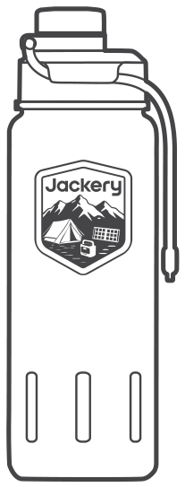

# USER MANUAL

Jackery Explorer Insulated Bottle 24oz/710ml

Model: JA-IB07A-SO

## CONTACT US:

hello@jackery.com (US) · jackery.jp@jackery.com (JP)

# BEFORE USE

<ul><li>
Please wash your bottle with mild detergent and rinse. To remove stubborn stains, use two teaspoons of baking soda mixed with warm water.
</li><li>
Allow all parts to air dry completely before assembly or storage.
</li><li>
For better insulation, it is recommended to pre-heat or pre-cool your bottle before use.
</li></ul>

# PRECAUTIONS

<ul><li>
Keep away from children when filled with hot beverages.
</li><li>
Do not place the bottle in the microwave.
</li><li>
Avoid strong impacts or drops to prevent damage.
</li><li>
Consume perishable drinks (e.g., milk) promptly and clean the bottle immediately after.
</li><li>
Ensure the lid and stopper are securely fastened to prevent leaks.
</li></ul>

## GENERAL INFORMATION

<figure aria-label="GENERAL INFORMATION" class="hb-spec-table-composition"><table class="manual-table manual-spec-table hb-spec-table"><colgroup><col class="hb-spec-col-label"/><col class="hb-spec-col-value"/></colgroup><tbody><tr><th class="manual-spec-label hb-spec-label" scope="row">Product Name</th><td class="manual-spec-value hb-spec-value">Jackery Explorer Insulated Bottle 24oz/710ml</td></tr><tr><th class="manual-spec-label hb-spec-label" scope="row">Model No.</th><td class="manual-spec-value hb-spec-value">JA-IB07A-SO</td></tr><tr><th class="manual-spec-label hb-spec-label" scope="row">Capacity</th><td class="manual-spec-value hb-spec-value">24 Fluid Ounces</td></tr><tr><th class="manual-spec-label hb-spec-label" scope="row">Material</th><td class="manual-spec-value hb-spec-value">18/8 Stainless Steel</td></tr><tr><th class="manual-spec-label hb-spec-label" scope="row">Dimensions</th><td class="manual-spec-value hb-spec-value">3.15"W x 10"H</td></tr><tr><th class="manual-spec-label hb-spec-label" scope="row">Special Feature</th><td class="manual-spec-value hb-spec-value">Vacuum Insulated</td></tr></tbody></table></figure>

# WARRANTY

<figure aria-label="Warranty Period" class="hb-warranty-period-card" data-component-id="HB-WARRANTY-YEARS">

1
<strong class="hb-warranty-years-unit">YEARS</strong><strong class="hb-warranty-period-label">general warranty</strong>

1-year general warranty against defects in workmanship and materials

5
<strong class="hb-warranty-years-unit">YEARS</strong><strong class="hb-warranty-period-label">warranty for insulation failure of the stainless steel vacuum layer</strong>

5-year warranty against insulation failure of the stainless steel vacuum layer

</figure>

## Warranty coverage

<figure aria-label="Warranty coverage" class="hb-warranty-card" data-component-id="HB-WARRANTY-SECTION" data-warranty-card-index="2">
The product is covered by a limited warranty from Jackery for the original purchaser. It includes a 1-year general warranty against defects in workmanship and materials, and a 5-year warranty against insulation failure of the stainless steel vacuum layer, both starting from the date of purchase. Damages from normal wear and tear, alteration, misuse, neglect, accident, service by anyone other than an authorized service center, or act of God are not included.

During the warranty period and upon verification of defects, this product will be replaced when returned with proper proof of purchase.
</figure>

## Contact Us

<figure aria-label="Contact Us" class="hb-warranty-card" data-component-id="HB-WARRANTY-SECTION" data-warranty-card-index="3">
For any inquiries or comments concerning our products, please send an email to hello@jackery.com, and we will respond to you as soon as possible. If there is any quality-related issue with the product, you may request a replacement or refund by submitting a request form at www.jackery.com.
</figure>

## Customer Service

<figure aria-label="Customer Service" class="hb-warranty-card" data-component-id="HB-WARRANTY-SECTION" data-warranty-card-index="4">
hello@jackery.com

Lifetime technical support
</figure>

# CONTACT INFORMATION

## JACKERY INC.

5310 Bunche Dr., Fremont, CA 94538-8301

## 株式会社 JACKERY JAPAN

郵便番号:〒104-6003

住所:東京都中央区晴海1-8-10トリトンスクエア X棟 3階

