# USER MANUAL

Jackery Battery Pack 2000 Plus

Model: JBP-2000A

Version: JAK-UM-V1.0

Congratulations on your new Jackery Battery Pack 2000 Plus. Please read this manual carefully before using the product, particularly the relevant precautions to ensure proper use. Keep this manual in an accessible place for frequent reference.

In compliance with laws and regulations, the right of final interpretation of this document and all related documents of this product resides with the Company.

Please kindly notice that no further notifications will be given in case of any update, revision or termination.

# TECHNICAL SPECIFICATIONS

## GENERAL INFO

<figure aria-label="GENERAL INFO" class="hb-spec-table-composition"><table class="manual-table manual-spec-table hb-spec-table"><colgroup><col class="hb-spec-col-label"/><col class="hb-spec-col-value"/></colgroup><tbody><tr><th class="manual-spec-label hb-spec-label" scope="row">Product Name</th><td class="manual-spec-value hb-spec-value">Jackery Battery Pack 2000 Plus</td></tr><tr><th class="manual-spec-label hb-spec-label" scope="row">Model No.</th><td class="manual-spec-value hb-spec-value">JBP-2000A</td></tr><tr><th class="manual-spec-label hb-spec-label" scope="row">Capacity</th><td class="manual-spec-value hb-spec-value">Lithium-ion 45.6Ah / 44.8V DC (2042.8Wh)</td></tr><tr><th class="manual-spec-label hb-spec-label" scope="row">Cell Chemistry</th><td class="manual-spec-value hb-spec-value">LiFePO4</td></tr><tr><th class="manual-spec-label hb-spec-label" scope="row">Weight</th><td class="manual-spec-value hb-spec-value">About 41.9 lbs / About 19 kg</td></tr><tr><th class="manual-spec-label hb-spec-label" scope="row">Dimensions</th><td class="manual-spec-value hb-spec-value">18.5 x 13 x 9.1 in / 47 x 33.1 x 23.1 cm</td></tr><tr><th class="manual-spec-label hb-spec-label" scope="row">Cycle Life</th><td class="manual-spec-value hb-spec-value">4000 cycles to 70%+ capacity</td></tr></tbody></table></figure>

## INPUT PORTS

<figure aria-label="INPUT PORTS" class="hb-spec-table-composition"><table class="manual-table manual-spec-table hb-spec-table"><colgroup><col class="hb-spec-col-label"/><col class="hb-spec-col-value"/></colgroup><tbody><tr><th class="manual-spec-label hb-spec-label" scope="row">DC input</th><td class="manual-spec-value hb-spec-value">2 x DC 8mm Ports: 11-17.5V (Working Voltage)⎓8A Max, Double to 8A Max; 17.5-60V (Working Voltage)⎓12A Max, Double to 24A/1400W Max</td></tr><tr><th class="manual-spec-label hb-spec-label" scope="row">2 x DC Expansion Port</th><td class="manual-spec-value hb-spec-value">32.2V-50.4V⎓97A Max</td></tr></tbody></table></figure>

## ENVIRONMENTAL OPERATING TEMPERATURE

<figure aria-label="ENVIRONMENTAL OPERATING TEMPERATURE" class="hb-spec-table-composition"><table class="manual-table manual-spec-table hb-spec-table"><colgroup><col class="hb-spec-col-label"/><col class="hb-spec-col-value"/></colgroup><tbody><tr><th class="manual-spec-label hb-spec-label" scope="row">Charge Temperature</th><td class="manual-spec-value hb-spec-value">0°C~45°C (32°F~113°F)</td></tr><tr><th class="manual-spec-label hb-spec-label" scope="row">Discharge Temperature</th><td class="manual-spec-value hb-spec-value">-10°C~45°C (14°F~113°F)</td></tr></tbody></table></figure>

## CERTIFICATIONS

<figure class="hb-reference-figure hb-has-composite-art" data-component-id="HB-SPECIAL-REFERENCE-FIGURE" data-reference-id="certifications" data-source-fragment-sha256="bb81a879106f5512d85d3b9cf4904d8b1140b1bca01f5f480f2109f75e76b2ae" data-step-captions="embedded" data-web-composite-asset-key="frozen-source/certifications" data-web-composite-locale="en" data-web-composite-sha256="1576ec1e513916121669bbdaae6fbe5fb97f2c7728cae6c5010beeebfd568c46" data-web-replace-key="reference.certifications">

</figure>

CAN ICES-003(B)/NMB-003(B)

# PACKAGE LIST

<figure aria-label="PACKAGE LIST" class="hb-inbox-composition" data-card-count="3" data-component-id="HB-SPECIAL-INBOX" data-inbox-columns="3" data-inbox-variant="three-card-responsive"><ol class="hb-inbox-grid"><li class="hb-inbox-card" data-item-number="1">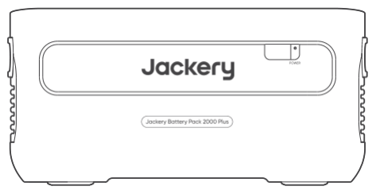

Jackery Battery Pack 2000 Plus

</li><li class="hb-inbox-card" data-item-number="2">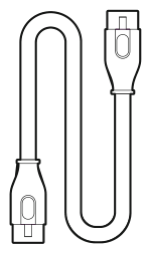

Expansion Cable

</li><li class="hb-inbox-card" data-item-number="3">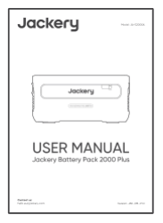

User Manual

</li></ol></figure>

# GET TO KNOW YOUR GEAR

## Product Appearance

<figure class="hb-reference-figure hb-has-composite-art" data-component-id="HB-SPECIAL-REFERENCE-FIGURE" data-reference-id="overview-front" data-source-fragment-sha256="419f6b97df52cb8112b6c79dab713d0bf6875290d1d13b81a137f00140284e57" data-step-captions="embedded" data-web-composite-asset-key="frozen-source/overview-front" data-web-composite-locale="en" data-web-composite-sha256="6a5f4007480dd116f187852e068e1f57b22872512b8e500551ed4e0e45b8185a" data-web-replace-key="reference.overview-front">
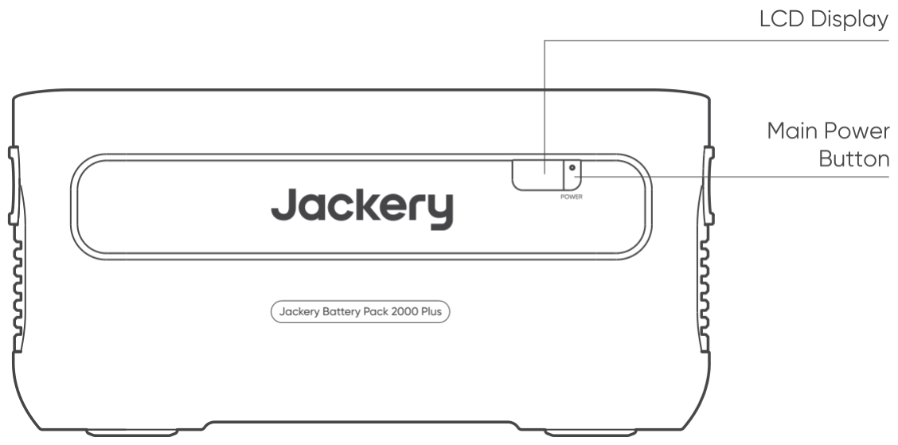

</figure>

<figure class="hb-reference-figure hb-has-composite-art" data-component-id="HB-SPECIAL-REFERENCE-FIGURE" data-reference-id="overview-rear" data-source-fragment-sha256="54fffe35510ca366fa89cb14bf9cfef5be639343798b5b4220e7a8a016ea92d1" data-step-captions="embedded" data-web-composite-asset-key="frozen-source/overview-rear" data-web-composite-locale="en" data-web-composite-sha256="7f380e6f7662c4ca1bfef1c7f28191e41294035cd7e6bacb4b8766fd42e303dd" data-web-replace-key="reference.overview-rear">
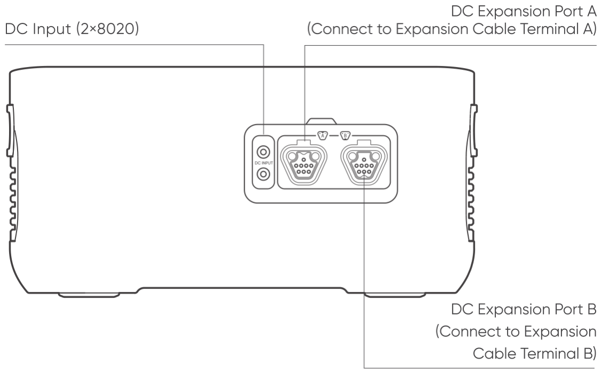

</figure>

# LCD DISPLAY

<figure class="hb-reference-figure hb-has-composite-art" data-component-id="HB-SPECIAL-REFERENCE-FIGURE" data-reference-id="lcd" data-source-fragment-sha256="cee85529a830775f366c111ab0604a4150941ed0714bad3ac9ce0fdab2888cdf" data-step-captions="embedded" data-web-composite-asset-key="frozen-source/lcd" data-web-composite-locale="en" data-web-composite-sha256="b545cc2cc7797853066a45ec1a252f1c44b61a027a2256715bf396fe719cb401" data-web-replace-key="reference.lcd">
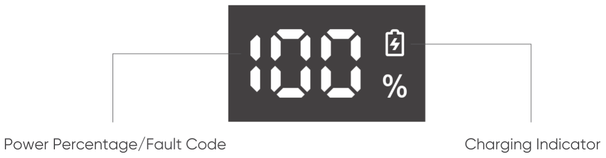

</figure>

<figure aria-label="LCD DISPLAY" class="hb-reference-composition hb-reference-lcd-descriptions" data-component-id="HB-TABLE-REFERENCE" data-component-variant="lcd-descriptions" tabindex="0"><table class="hb-reference-table"><tbody><tr><td>Power Percentage/Fault Code:</td><td>The power display percentage of the current power value. When the system fails, it will be displayed as the corresponding fault code F0-FF. If the FF code appears, please remove the load and the product can recover by itself, if not, please contact after-sales service. In case of any other code appears, please contact our after-sales service.</td></tr><tr><td>Charging Indicator:</td><td>The indicator is displayed when charging and disappears when it is fully charged.</td></tr></tbody></table></figure>

# BASIC OPERATIONS

## Power on/off

Press the "Main Power Button" and the LCD display is illuminated. If you want to turn off the main power, please press and hold the "Main Power Button" until it turns off.

<figure class="hb-reference-figure hb-has-composite-art" data-component-id="HB-SPECIAL-REFERENCE-FIGURE" data-reference-id="power-on-off" data-source-fragment-sha256="57c4359607b2b33c9f86db1a7c296135fcfc58b32afd4d88a76430e6b4b25a00" data-step-captions="embedded" data-web-composite-asset-key="frozen-source/power-on-off" data-web-composite-locale="en" data-web-composite-sha256="a979b9ebf3a984619d5f5fbd1a527a8092c58b25d29e59036f5660f54fa6263f" data-web-replace-key="reference.power-on-off">
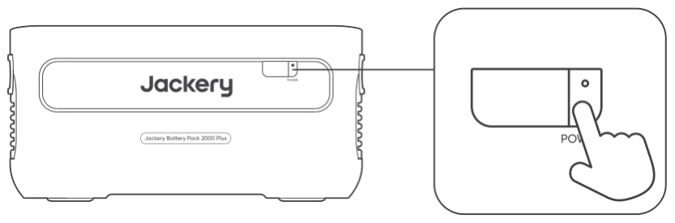

</figure>

<table class="manual-callout-table manual-callout-table"><tbody><tr><td class="manual-callout-label">Notes</td><td class="manual-callout-body">
1. When using with Jackery Explorer 2000 Plus, you can control the power on or off of Jackery Battery Pack 2000 Plus through the "Main Power Button" of Jackery Explorer 2000 Plus.

2. If there is no discharge output or charging input, the product will automatically shut down after 2 hours.
</td></tr></tbody></table>

## LCD Display On/Off

When you press the "Main Power Button" or when charging the product, the LCD display is illuminated, and when you press it again, the display will turn off.

# USAGE MODE

## USED TOGETHER WITH THE JACKERY EXPLORER 2000 PLUS

Jackery Explorer 2000 Plus Up to 10 sets of these products can be used together to meet the capacity needs of larger users.

<figure class="hb-reference-figure hb-has-composite-art" data-component-id="HB-SPECIAL-REFERENCE-FIGURE" data-reference-id="usage-chain" data-source-fragment-sha256="dd160a2cb6ce91eaf39f4049f79e22720bf7f77bfde0ac058df6ee922af84265" data-step-captions="embedded" data-web-composite-asset-key="frozen-source/usage-chain" data-web-composite-locale="en" data-web-composite-sha256="386885dfc160a7551e29fc2c64a695f2ffb9ec30f68650ae08f6fcbe2db6b178" data-web-replace-key="reference.usage-chain">
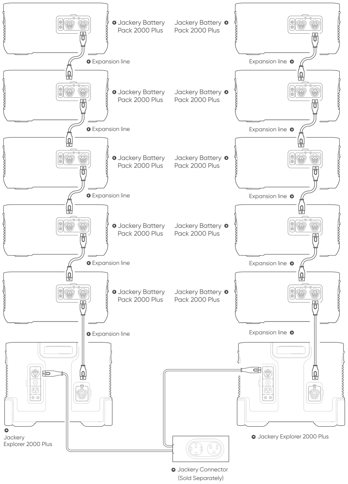

</figure>

<figure class="hb-reference-figure hb-has-composite-art" data-component-id="HB-SPECIAL-REFERENCE-FIGURE" data-reference-id="usage-tree" data-source-fragment-sha256="a01a95d508d54f5d79c03575acb52298e6d81c955e2465abffebcbf590612c80" data-step-captions="embedded" data-web-composite-asset-key="frozen-source/usage-tree" data-web-composite-locale="en" data-web-composite-sha256="88adaf01479a42a58b937823f2908af51bf3ecdc278ab1814ebce568dbe1ce28" data-web-replace-key="reference.usage-tree">
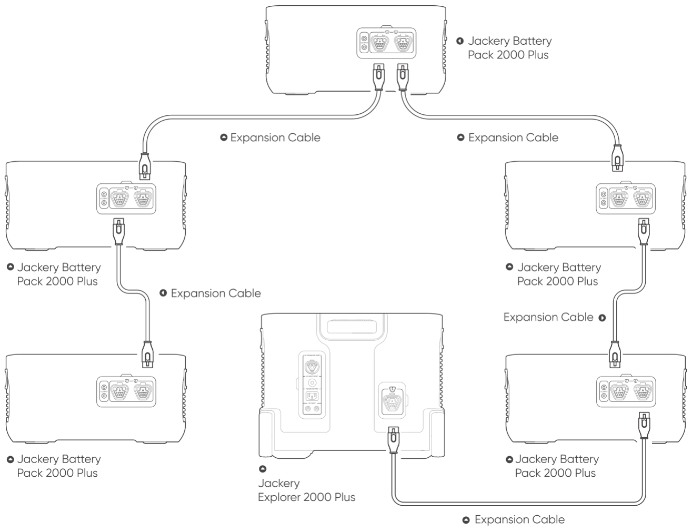

</figure>

## SAFETY PRECAUTIONS WHEN USING

1. When this product is connected to the power station for AC discharge, it will switch to AC wall charging to charge the product and supply power to the connected equipment when it is connected to the grid.

2. Make sure Jackery Explorer 2000 Plus and Jackery Battery Pack 2000 Plus are not in operation when connecting or disconnecting them.After the product is connected to the power station, the LCD display  of the power station will light up before you can start charging or discharging.

3. When using the battery pack, please do not stack more than two battery packs on top of the Jackery Explorer 2000 Plus to prevent it from falling off and causing injury.

# CHARGING YOUR JACKERY BATTERY PACK 2000 PLUS

## CHARGING FROM THE WALL

When charging from the wall, this product must be used with Jackery Explorer 2000 Plus.

<figure class="hb-reference-figure hb-has-composite-art" data-component-id="HB-SPECIAL-REFERENCE-FIGURE" data-reference-id="wall-charging" data-source-fragment-sha256="d996724683376a340052504a716c9c182cd4cba64f70e5c172e57f45c40afa8e" data-step-captions="embedded" data-web-composite-asset-key="frozen-source/wall-charging" data-web-composite-locale="en" data-web-composite-sha256="5059e4d3ca9efcc7298dabd3bd4cd0a86bc5f1f2aa072b3bc1c183080d72b19d" data-web-replace-key="reference.wall-charging">
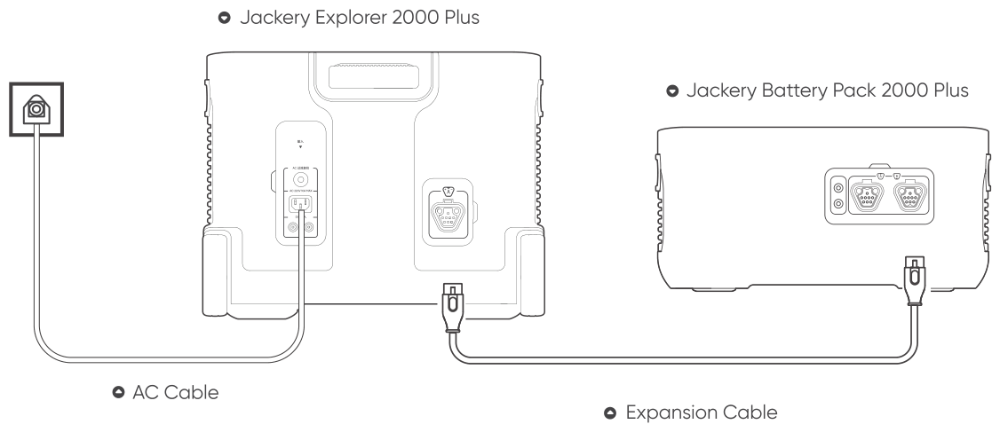

</figure>

## SAFETY PRECAUTIONS WHEN USING

Make sure Jackery Explorer 2000 Plus and Jackery Battery Pack 2000 Plus are not in operation when connecting or disconnecting them.

## SOLAR CHARGING

This product supports solar charging. You can refer to the user manual of Jackery Explorer 2000 Plus to know how to connect the solar panel.

## CHARGING IN THE CAR

This product can be charged with a 12V car charger. The car charger cable of Jackery Explorer 2000 Plus should be used for connection when charging. Please refer to the Jackery Explorer 2000 Plus user manual for precautions.

<figure class="hb-reference-figure hb-has-composite-art" data-component-id="HB-SPECIAL-REFERENCE-FIGURE" data-reference-id="car-charging" data-source-fragment-sha256="f23dbece3bb2e560f6d92cfa6ee9aa3643a596a5218ebd63ba8a6fcea7c4d132" data-step-captions="embedded" data-web-composite-asset-key="frozen-source/car-charging" data-web-composite-locale="en" data-web-composite-sha256="9f9434c2dc45f9ad0a09f89710726675ba238f58c1c676449912724202c2a9d9" data-web-replace-key="reference.car-charging">
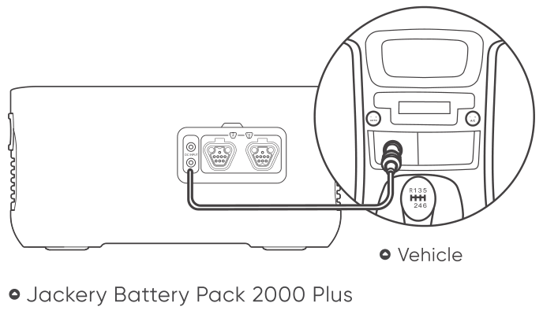

</figure>

# SAFETY PRECAUTIONS WHEN USING

The basic safety precautions should be followed when using this product, including:

a. Please read all instructions before using this product.

b. Close supervision is required when using this product near children to reduce the risk.

c. Risk of electric shock may occur if using accessories recommended or sold by non-professional product manufacturers.

d. When the product is not in use, please unplug the power plug from the product's socket.

e. Do not dismantle the product, which may lead to unpredictable risks such as fire, explosion or electric shock.

f. Do not use the product through damaged cords or plugs, or damaged output cables, which may cause electric shock.

g. Charge the product in a well ventilated area and do not restrict ventilation in any way.

h. Please put the product in a ventilated and dry place to avoid rain and water to cause electric shock.

i. Do not expose the product to fire or high temperature (under direct sunlight or in vehicle under high heat), which may cause accidents such as fire and explosion.

j. When using it for the first time, please fully charge the device before use. If this product is stored for a long period of time (3 months - 6 months) with the power depleted, its performance will deteriorate and may even become unchargeable.

<figure aria-label="FCC" class="hb-fcc-composition" data-component-id="HB-SPECIAL-FCC">

<strong>NOTE:</strong> This equipment has been tested and found to comply with the limits for a Class B digital device, pursuant to part 15 of the FCC Rules. These limits are designed to provide reasonable protection against harmful interference in a residential installation. This equipment generates, uses and can radiate radio frequency energy and, if not installed and used in accordance with the instructions, may cause harmful interference to radio communications. However, there is no guarantee that interference will not occur in a particular installation. If this equipment does cause harmful interference to radio or television reception, which can be determined by turning the equipment off and on, the user is encouraged to try to correct the interference by one or more of the following measures:

<ul class="simple"><li>
Reorient or relocate the receiving antenna.
</li><li>
Increase the separation between the equipment and receiver.
</li><li>
Connect the equipment into an outlet on a circuit different from that to which the receiver is connected.
</li><li>
Consult the dealer or an experienced radio/TV technician for help.
</li></ul>

</figure>

# WARRANTY

We only provide our warranty to customers who purchase from the official Jackery website, Jackery-branded third-party platforms, or local authorized dealers.

*Warranty period and details may vary according to local laws, regulations, and authorized dealers.

## Limited Warranty

<figure aria-label="Limited Warranty" class="hb-warranty-card" data-component-id="HB-WARRANTY-SECTION" data-warranty-card-index="3">
Jackery Inc. warrants to the original consumer purchaser that the Jackery product will be free from defects in workmanship and material under normal consumer use during the applicable warranty period identified in the 'Warranty Period' section below, subject to the exclusions set forth below.

This warranty statement sets forth Jackery's total and exclusive warranty obligation. We will not assume, nor authorize any person to assume for us, any other liability in connection with the sale of our products.
</figure>

## Warranty Period

<figure aria-label="Warranty Period" class="hb-warranty-period-card" data-component-id="HB-WARRANTY-YEARS">

3
<strong class="hb-warranty-years-unit">Years</strong><strong class="hb-warranty-period-label">Standard Warranty</strong>

The standard warranty period for Jackery Battery Pack 2000 Plus is 36 months. In each case, the warranty period is measured starting on the date of purchase by the original consumer purchaser. The sales receipt from the first consumer purchase, or other reasonable documentary proof, is required in order to establish the start date of the warranty period.

2
<strong class="hb-warranty-years-unit">Years</strong><strong class="hb-warranty-period-label">Extended Warranty</strong>

To activate the Warranty Extension, you must register your product online or contact our customer service team at hello@jackery.com to extend the standard warranty runtime.

</figure>

## Exchange

<figure aria-label="Exchange" class="hb-warranty-card" data-component-id="HB-WARRANTY-SECTION" data-warranty-card-index="6">
Jackery will replace (at Jackery's expense) any Jackery product that fails to operate during the applicable warranty period due to defect in workmanship or material. A replacement product assumes the remaining warranty of the original product.
</figure>

## Limited to Original Consumer Buyer

<figure aria-label="Limited to Original Consumer Buyer" class="hb-warranty-card" data-component-id="HB-WARRANTY-SECTION" data-warranty-card-index="7">
The warranty on Jackery's product is limited to the original consumer purchaser and is not transferable to any subsequent owner.
</figure>

## Exclusions

<figure aria-label="Exclusions" class="hb-warranty-card" data-component-id="HB-WARRANTY-SECTION" data-warranty-card-index="8">
Jackery's warranty does not apply to:

Misused, abused, modified, damaged by accident, or used for anything other than normal consumer use as authorized in Jackery's current product literature.

Attempted repair by anyone other than an authorized facility.

Any product purchased through an online auction house.

Jackery's warranty does not apply to the battery cell unless the battery cell is fully charged by you within seven days after you purchase the product and at least once every 6 months thereafter.
</figure>

## Interpretation Rights

<figure aria-label="Interpretation Rights" class="hb-warranty-card" data-component-id="HB-WARRANTY-SECTION" data-warranty-card-index="9">
Jackery Inc. reserves the right to final interpretation of the above customers' after-sales policy.
</figure>

## Download the Jackery Mobile App

<figure class="hb-reference-figure hb-has-composite-art" data-component-id="HB-SPECIAL-REFERENCE-FIGURE" data-reference-id="app-badges" data-source-fragment-sha256="d332fa9aa8a14f84beb61842ab52b963aea84e64b6765c98a7011ce6c83dfcd8" data-step-captions="embedded" data-web-composite-asset-key="frozen-source/app-badges" data-web-composite-locale="en" data-web-composite-sha256="c5f18a1d4ecb7856287b4ba5b3433e4cd1082eb1ba7a7ce0528fbe4a47d3d7b7" data-web-replace-key="reference.app-badges">

</figure>

# JACKERY MEXICO S.A. DE C.V.

Calle Poseidón 18 PB, Crédito Constructor, Benito Juárez,

C.P. 03940, Ciudad de México, México

# JACKERY INC.

5310 Bunche Dr, Fremont, CA 94538

Tel:1-888-502-2236(US)

E-mail:hello@jackery.com

Website:www.jackery.com

Contact us:

hello@jackery.com

1-888-502-2236(US)

