

## 1.主な仕様

## 【Jackery ポータブル電源 1000 】

<figure aria-label="【Jackery ポータブル電源 1000 】" class="hb-spec-table-composition"><table class="manual-table manual-spec-table hb-spec-table"><colgroup><col class="hb-spec-col-label"/><col class="hb-spec-col-value"/></colgroup><tbody><tr><th class="manual-spec-label hb-spec-label" scope="row">製品の名称 :</th><td class="manual-spec-value hb-spec-value">Jackery ポータブル電源 1000</td></tr><tr><th class="manual-spec-label hb-spec-label" scope="row">型番 :</th><td class="manual-spec-value hb-spec-value">JE-1000D</td></tr><tr><th class="manual-spec-label hb-spec-label" scope="row">バッテリータイプ :</th><td class="manual-spec-value hb-spec-value">LiFePO4（リン酸鉄リチウムイオン電池）</td></tr><tr><th class="manual-spec-label hb-spec-label" scope="row">定格容量 :</th><td class="manual-spec-value hb-spec-value">30.4Ah/35.2V DC (1070Wh)</td></tr><tr><th class="manual-spec-label hb-spec-label" scope="row">サイズ＆重量 :</th><td class="manual-spec-value hb-spec-value">約327 x 224 x 247 mm (約10.8 kg)</td></tr><tr><th class="manual-spec-label hb-spec-label" scope="row">AC入力 :</th><td class="manual-spec-value hb-spec-value">100-120V~ 50/60Hz, 最大15A 最大1350W±50W①(緊急充電モード); 最大950W±50W①(高速充電モード)</td></tr><tr><th class="manual-spec-label hb-spec-label" scope="row">DC入力ポート:</th><td class="manual-spec-value hb-spec-value">PV 16-60V(電圧範囲)⎓10.5A, 2ポート 電流制限21A, 最大400W ｼｶﾞｰｿｹｯﾄ 12-16V(電圧範囲)⎓電流制限8A, 2ポート 電流制限8A</td></tr><tr><th class="manual-spec-label hb-spec-label" scope="row">3×AC出力 :</th><td class="manual-spec-value hb-spec-value">100V~ 50/60Hz, 3ポート合計1500W (瞬間最大3000W)</td></tr><tr><th class="manual-spec-label hb-spec-label" scope="row">USB-A出力 :</th><td class="manual-spec-value hb-spec-value">5-6V⎓3A, 6-9V⎓2A, 9-12V⎓1.5A, 最大18W</td></tr><tr><th class="manual-spec-label hb-spec-label" scope="row">USB-C1出力 :</th><td class="manual-spec-value hb-spec-value">5V⎓3A, 9V⎓3A, 12V⎓2.5A, 15V⎓2A, 20V⎓1.5A, 最大30W</td></tr><tr><th class="manual-spec-label hb-spec-label" scope="row">USB-C2出力 :</th><td class="manual-spec-value hb-spec-value">5V⎓3A, 9V⎓3A, 12V⎓3A, 15V⎓3A, 20V⎓5A, 最大100W</td></tr><tr><th class="manual-spec-label hb-spec-label" scope="row">シガーソケット出力 :</th><td class="manual-spec-value hb-spec-value">12V⎓10A</td></tr><tr><th class="manual-spec-label hb-spec-label" scope="row">充電温度 :</th><td class="manual-spec-value hb-spec-value">0 °C~45 °C (32 °F~113 °F)</td></tr><tr><th class="manual-spec-label hb-spec-label" scope="row">動作温度 :</th><td class="manual-spec-value hb-spec-value">-10 °C~45 °C (14 °F~113 °F)</td></tr><tr><th class="manual-spec-label hb-spec-label" scope="row">保存温度 :</th><td class="manual-spec-value hb-spec-value">1ヶ月 -20~45°C (-4~113°F); 3ヶ月 0~45°C (32~113°F); 12ヶ月 0~25°C (32~77°F)</td></tr><tr><th class="manual-spec-label hb-spec-label" scope="row">認証：</th><td class="manual-spec-value hb-spec-value">UN38.3</td></tr></tbody></table></figure>

※USB Type-C® and USB-C® are registered trademarks of USB Implementers Forum.

① この数値は最大充電電力のみを示しています。実際の充電電力は、温度、バッテリー残量(SOC)、アプリの設定により変動する場合があります。

<strong>■本機の仕様および外観は、改善のため予告なく変更することがあります。</strong>

<table class="manual-table"><tbody><tr><td></td><td>
<strong>充電式電池のリサイクルについて</strong>

本機はリサイクル可能な充電池を内蔵しています。

この商品を廃棄する場合は、当社のカスタマーサポートにご連絡ください。

充電池の取りはずしはお客様自身では行わないでください。
</td></tr></tbody></table>

## 2.各部の名称

<figure class="hb-reference-figure" data-component-id="HB-SPECIAL-REFERENCE-FIGURE" data-reference-id="overview" data-source-fragment-sha256="cd745bbdfddfe878b979d5149f1f84b1e42cce31b4542e57012b448584553b38" data-step-captions="embedded">
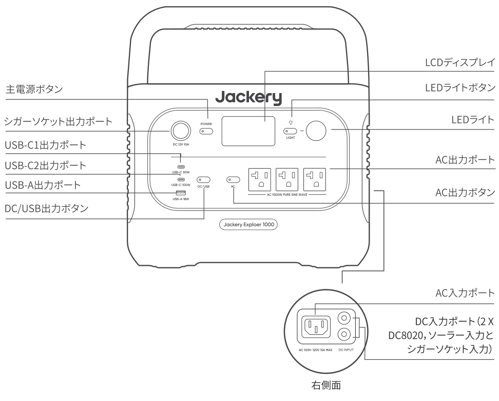
</figure>

## 3.液晶画面

<figure class="hb-reference-figure" data-component-id="HB-SPECIAL-REFERENCE-FIGURE" data-reference-id="lcd-map" data-source-fragment-sha256="05f156db50e840e5673f42f2b05d69f2246ddace6a388f8b5dbd69fc4daabdea" data-step-captions="embedded">
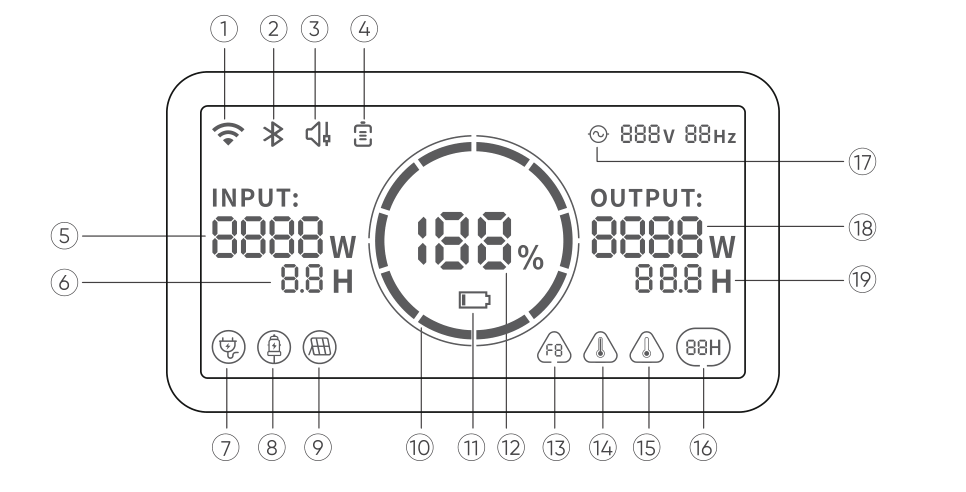
</figure>

<figure aria-label="3.液晶画面" class="hb-reference-composition hb-reference-lcd-descriptions" data-component-id="HB-TABLE-REFERENCE" data-component-variant="lcd-descriptions" tabindex="0"><table class="hb-reference-table"><tbody><tr><td>①</td><td>Wi-Fi</td></tr><tr><td>②</td><td>Bluetooth</td></tr><tr><td>③</td><td>静音充電モード</td></tr><tr><td>④</td><td>バッテリー節約モード</td></tr><tr><td>⑤</td><td>入力電力表示</td></tr><tr><td>⑥</td><td>充電残り時間</td></tr><tr><td>⑦</td><td>AC入力電力表示</td></tr><tr><td>⑧</td><td>シガーソケット入力電力表示</td></tr><tr><td>⑨</td><td>ソーラー(グリーンエネルギー)充電接続</td></tr><tr><td>⑩</td><td>バッテリーアイコン</td></tr><tr><td>⑪</td><td>バッテリー残量警告灯</td></tr><tr><td>⑫</td><td>バッテリーレベルパーセントタグ</td></tr><tr><td>⑬</td><td>エラーコード</td></tr><tr><td>⑭</td><td>高温インジケーター</td></tr><tr><td>⑮</td><td>低温インジケーター</td></tr><tr><td>⑯</td><td>省エネモード</td></tr><tr><td>⑰</td><td>交流電源による出力マーク</td></tr><tr><td>⑱</td><td>消費電力パワー</td></tr><tr><td>⑲</td><td>バッテリー使用可能時間</td></tr></tbody></table></figure>

<figure aria-label="バッテリーアイコン" class="hb-lcd-table-composition" data-component-id="HB-TABLE-LCD-ICON" tabindex="0"><table class="hb-lcd-icon-table"><colgroup><col class="hb-lcd-col-icon"/><col class="hb-lcd-col-name"/><col class="hb-lcd-col-description"/></colgroup><tbody><tr><td class="hb-lcd-icon"></td><td class="hb-lcd-name">バッテリーアイコン</td><td class="hb-lcd-description">本製品の充電時、アイコンは時計回りに回転します。本製品の放電時、アイコンは現在の電力を表示します。</td></tr><tr><td class="hb-lcd-icon"></td><td class="hb-lcd-name">バッテリー残量警告灯</td><td class="hb-lcd-description">バッテリー残量が20%未満の場合は、ローバッテリーランプが表示されます。バッテリー残量が5%未満の場合は、ローバッテリーランプが点滅します。バッテリー充電中は、ランプは表示されません。</td></tr><tr><td class="hb-lcd-icon"></td><td class="hb-lcd-name">省エネモード</td><td class="hb-lcd-description">電池の消費につながる出力の切り忘れを防ぐため、本製品は、初期設定で省エネモードをオンにします。これは接続しているデバイスがない場合、または接続しているデバイスがある値以下の場合に起動します。（詳しくは以下の表をご参照ください）、設定時間たつと本デバイスは自動的にすべての出力をオフにします。</td></tr></tbody></table></figure>

<table class="manual-table"><thead><tr><th>出力ポートタイプ</th><th>電力設定値</th><th>デフォルト設定</th><th>
省エネモード 
</th></tr></thead><tbody><tr><td>AC出力ポート</td><td>≤25W</td><td>設定時間後に自動的にシャットダウンします</td><td>
ON（displayにがある）
</td></tr><tr><td>USB出力ポート</td><td>≤2W</td><td>設定時間後に自動的にシャットダウンします</td><td>
ON（displayにがある）
</td></tr><tr><td>シガーソケット出力ポート</td><td>≤2W</td><td>設定時間後に自動的にシャットダウンします</td><td>
ON（displayにがある）
</td></tr></tbody></table>

<strong>省エネモードをOFFにするため:</strong> ACまたはDCいずれかの出力ボタンがオンになっている状態で、画面に省エネモードのアイコンが消えるまで、「AC出力ボタン+主電源ボタン」を長押しします。」省エネモードがOFFの場合、出力の切り忘れによる電力不足を防ぐため、製品を使用しない時は電源を切るよう注意してください。

<strong>省エネモードをONにするため:</strong> ACまたはDCいずれかの出力ボタンをオンの状態で、画面に省エネモードのアイコンが表示されるまで「AC出力ボタン+主電源ボタン」を長押ししてください。

<strong>50Hz/60Hz周波数の切り替え:</strong>

<strong>自動識別:</strong> お客様のお住まいの地域に応じて周波数を自動的に識別し、対応する出力に自動調整されます。

<strong>手動調整:</strong> AC出力ボタンを長押しすることで周波数を切り替えることができ、対応する周波数が画面に表示されます。なお、工場出荷時のデフォルト設定は60Hzに設定されています。

<figure aria-label="故障コード" class="hb-lcd-table-composition" data-component-id="HB-TABLE-LCD-ICON" tabindex="0"><table class="hb-lcd-icon-table"><colgroup><col class="hb-lcd-col-icon"/><col class="hb-lcd-col-name"/><col class="hb-lcd-col-description"/></colgroup><tbody><tr><td class="hb-lcd-icon">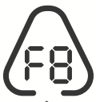</td><td class="hb-lcd-name">故障コード</td><td class="hb-lcd-description">フィードバックに迅速に対応するため、システムに一般的な障害コード F0-FE を設定しています。 F8コード: 給電を停止するか、充電プラグを抜いてください。本製品は自動的に回復します。 F9コード: 給電を停止してください。製品は自動的に回復します。 F8とF9コードにつき、上記の処理で回復しない場合、またはその他のコードが表示された場合は、カスタマーサポートにご連絡ください。</td></tr><tr><td class="hb-lcd-icon"></td><td class="hb-lcd-name">高温警告</td><td class="hb-lcd-description">環境温度が高温時に表示されます。直射日光などが当たっている場合は移動してください。電池が冷めたら、自動的に表示がオフになります。</td></tr><tr><td class="hb-lcd-icon"></td><td class="hb-lcd-name">低温警告</td><td class="hb-lcd-description">環境温度が低い場合に表示されます。温度が通常になれば自動的に回復します。</td></tr><tr><td class="hb-lcd-icon"></td><td class="hb-lcd-name">静音充電モード</td><td class="hb-lcd-description">静音充電モード下、inputワット数が低下し、充電所要時間が長くなる一方、稼動音は著しく静かになります。（アプリで設定可能）</td></tr><tr><td class="hb-lcd-icon"></td><td class="hb-lcd-name">バッテリー節約モード</td><td class="hb-lcd-description">バッテリー節約モード設定時は、バッテリー残量が既定値に設定されるため、バッテリーの寿命を延ばすことが可能です。（アプリで設定可能）</td></tr></tbody></table></figure>

## 4.使用について

### 出力オン/オフ

<strong>主電源ボタン/オフ:</strong> 「主電源ボタン」を押すと、作動インジケータが点灯し、LCD ディスプレイの明かりがつきます。 本製品は 2 分間操作しない場合、休止状態に入り、ディスプレイが自動的にオフになります。主電源を切る必要がある場合は、作動インジケータが消灯するまで「主電源ボタン」を長押ししてください。この製品の初期設定の待機時間は2時間です。他の出力スイッチがオンになっていない、または製品に充電入力がない場合、本製品は 2 時間後に自動的にシャットダウンします。 自動シャットダウン時間は、Jackery アプリで設定できます。

省エネモード設置後、DC／AC出力ボタンがオンの状態であるとしても、以下の場合12時間後電源が自動オフになります。

1.電源本体が無充電、無放電

2.充放電の出力が既定値以下(詳細は省エネモードの説明をご参照)

<strong>AC出力のオン/オフ:</strong> 主電源ボタンがオンになっていることを確認します。 AC ボタンを押すと、AC 出力作動インジケータが点灯します。この後、AC充電が必要な機器を接続できます。再度ACボタンを押すと、AC 出力がオフになります。

<strong>USB/カーポート出力オン/オフ:</strong>

主電源がオンになっていることを確認します。DC/USBボタンを押すと、DC出力作動インジケータが点灯します。この後、USB/カーポート出力ポートを外部負荷デバイスに接続できます。再度DC/USBボタンを押すと、USB/カーポート出力がオフになります。

電源ボタンまたは任意出力ボタンを押す、あるいは充電が入力されれば、ディスプレイが点灯します。再び押せば、ディスプレイが消灯します。2分間操作しないと、製品はスリープ状態に入り、ディスプレイも自動的に消灯します。充電時及び放電時に、ディスプレイの常時点灯が必要な場合の操作手順は以下の通り:ディスプレイが点灯した後、「主電源ボタン」を2回押せば常時点灯になります。ディスプレイの常時点灯をOFFにする操作手順は以下の通り：「主電源ボタン」を押せば、ディスプレイが消灯します。

注意: ディスプレイの常時点灯モードにおいて、充電または設備への接続をしない場合、2時間後にディスプレイが自動的に消灯します。

<strong>UPS機能:</strong> 電気製品のコンセントをポータブル電源のAC出力ポートに接続し、ポータブル電源のAC入力ポートを家庭のコンセントにつなぐことで、停電時などにポータブル電源を予備電源として活用できます。電気系統の電気が突然切れた場合、本製品は20ms(0.020秒)以内に自動的にバッテリー給電モードに切り替わります。この機能は非専門レベルのUPS機能のため、0msで切り替えることができません。そのため、データサーバーまたはワークステーションのような無停止充電が必要な要求の高い設備に接続しないようにしてください。あるいは、複数回のテストを実施し、コンパチビリティを確認してから使用してください。ただし、複数の設備への同時接続によって過負荷保護になる可能性があるため、使用時には一台だけの設備に接続することをお勧めします。指示通りに操作しなかったことにより、設備が正常に作動できなかったり、データが消失した場合、当社は責任を負いかねます。

UPSとして使用している際はパススルー機能により充電と出力が同時に行われている状態のため、ポータブル電源の最大出力は1500Wに制限され、停電時には定格出力に戻ります。

<strong>LEDライト:</strong> LEDライトには、微光モード、強光モード、SOSモードの3つのモードがあります。

LEDスイッチを短く押すと、LEDライトが点灯し、デフォルトの微光モードになります。もう一度LEDスイッチを短く押すと、強光モード→SOSモード→LED消灯の順に切り替わります。また、いずれのモードでも、LEDスイッチを長押しすることで、LEDライトを消灯できます。

## 5.アプリの接続

本製品は、Jackeryアプリのリモート接続に対応します。ユーザーは、App Storeまたはgoogle playからJackeryアプリをダウンロードできます。接続手順の詳細については、Jackery アプリのユーザー マニュアルをご参照ください。

## 6.充電方法

グリーンエネルギー優先モード:

本製品はグリーンエネルギー優先モードを搭載していますが、ソーラーパネルとAC充電ケーブルを使って同時に充電できます。同時に充電すると、ソーラーが優先されますが、バッテリーの最大許容電力で同時に充電されます。

<strong>ご注意</strong>

1.製品の充電動作温度範囲は0°C～45°C、放電動作温度範囲は-10°C～45°Cです。上限・下限温度を超えた場合、充放電が制限され、または充放電不可の可能性があります。

2.温度によって、製品の充電効率と実際の容量は異なります。

<table class="manual-callout-table manual-callout-table"><tbody><tr><td class="manual-callout-label">ご注意</td><td class="manual-callout-body"><ul><li>はじめてお使いになるときは、本製品をフル充電してからご使用ください。</li><li>充電池は空の状態で長期保管(3カ月～6カ月）すると、性能が劣化したり、充電できなくなる場合があります。</li><li>本機を長期保管する場合には、3ヵ月に１度を目安に本体にACアダプターやソーラーパネルを通して蓄電が可能か、他製品に給電可能かなど動作確認をお願い致します。長期保管の際は満充電(電池残量100%)で保管することを推奨します。</li></ul></td></tr></tbody></table>

### AC充電ケーブル

付属のAC充電ケーブルをご使用ください。

緊急充電モード：ACコンセントからの充電時、お急ぎの場合には緊急充電モードを使って充電することができます。<strong>使用するには「Jackery　App」でこの機能を「有効」または「無効」に設定してください。</strong>緊急充電モードでは、バッテリーの残量(SOC)を示す円形のライトの点滅速度が速くなります。

※バッテリーは通常の速度で充電することでバッテリーを最大限に保護できるよう設計されているため、緊急充電は必要な場合にのみ使用し、常時使用することはお勧めしません。

ご注意:

AC充電ケーブルのプラグが製品のAC入力ポートにしっかりと、かつ完全に差し込まれていることを確認してください。差し込みが不完全な場合、電流の不安定、発熱、接触不良などが発生し、機器の正常な動作に支障をきたす恐れがあります。

<figure class="hb-reference-figure" data-component-id="HB-SPECIAL-REFERENCE-FIGURE" data-reference-id="ac-charge" data-source-fragment-sha256="c8f9a0c8fe4be6bd5cb29280ec1faa44291ecbdde383841a4ab4f02ac11eacf4" data-step-captions="embedded">
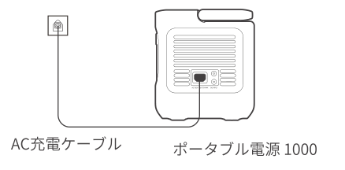
</figure>

コンセントよりJackery ポータブル電源 1000 本体に充電する場合、電流容量が大きいため、他機器と併用したり途中接続をすると、コンセントの電流上限値を超え充電停止したり、配線やコンセント・接続部が発熱し、火災の原因となる恐れがあります。必ず電源タップなどを介して他の電気製品と併用しないでください。

### ソーラー充電

本製品には2つのDC8020入力ポートがあり、それぞれが100Wまたは200Wソーラーパネルへの直接接続に対応しています。1つのDC8020入力ポートを2つの100Wソーラーパネルに同時に接続する必要がある場合は、Jackery SolarSaga アダプター(Pro/Plus専用)（別売）と組み合わせて使用する必要があります。

ご注意:

DC入力ポートの電圧を一致させてください2つのDC入力ポートに接続する電源の電圧は必ず一致させてください。電圧が異なると、製品の異常動作や故障の原因となる可能性があります。

例：

<ul><li>
2つのDC8020入力ポートにソーラーパネルを接続する際は、同じ型番のJackery製ソーラーパネルを使用し、接続する枚数も揃えることをおすすめします。異なる型番や接続枚数で接続すると、電圧が不均一になり、製品が故障するおそれがあります。
</li><li>
車載充電器とソーラーパネルを同時に使用して製品を充電しないでください。車のヒューズが切れたり、充電が正常に行われなかったりする可能性があります。
</li></ul>

<figure class="hb-reference-figure" data-component-id="HB-SPECIAL-REFERENCE-FIGURE" data-reference-id="solar-direct" data-source-fragment-sha256="183dec3b0287c3693062735b34b959ff2cb298b3a2d8ee9a0c795a2ef4062ea8" data-step-captions="embedded">
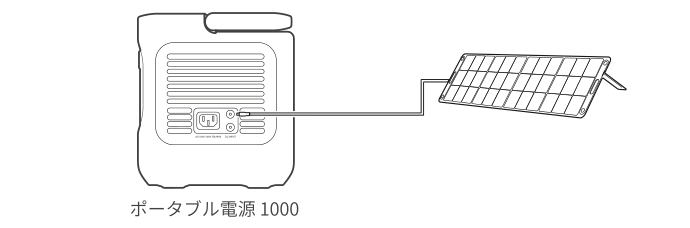
</figure>

<figure class="hb-reference-figure" data-component-id="HB-SPECIAL-REFERENCE-FIGURE" data-reference-id="solar-adapter" data-source-fragment-sha256="51238c0b9d4cc3164cff9e320321b472b0f8bd012ad01cd28e540e1bfae2c83b" data-step-captions="embedded">
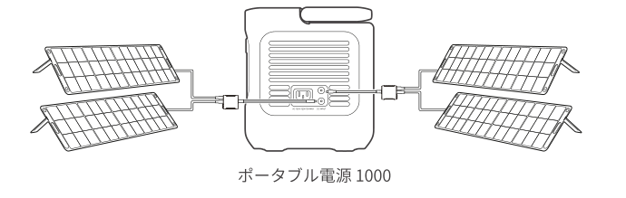
</figure>

### シガーソケット充電

本製品は12V,10Aの車のシガーソケットに対応し、充電ができます。車のバッテリーが上がってしまわないように、エンジンを始動してから、シガーソケットを使用してください。使用の際は車の充電ポートと入力ケーブルのシガーライターの接触に問題がないことを確認し、シガーソケットの所定の場所に差し込めることを確認してください。道路状況が悪くて、車の振動が多い場合は、充電が接触不良になりますので、接触部分が焼損するのを防ぐために、シガーソケット充電を中止してください。本製品の誤った取り扱いによる損害が発生した場合も当社は一切の責任を負いかねます。

<figure class="hb-reference-figure" data-component-id="HB-SPECIAL-REFERENCE-FIGURE" data-reference-id="car-charge" data-source-fragment-sha256="f4bfff2c8d1466b825d381bed8e2ad7fe4aadfd1796f15f4503a046a2af32355" data-step-captions="embedded">
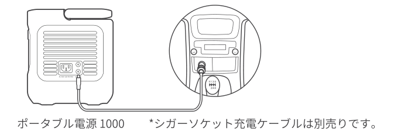
</figure>

### 充電に関する安全上のご注意

1)シガーソケット充電とソーラー充電を同時に使用しないでください。同時に使用すると、車のヒューズが損傷する可能性があります。

2)シガーソケット充電は12V,10A車専用で、24V車は充電できません。人身傷害や物的損害を避けるため、本製品の充電に24V車を使用しないでください。

3)Jackeryブランド以外の付属品を使用して充電しないでください。特に、ソーラーパネルで充電する際は、Jackeryのソーラーパネルを使用することをお勧めします。他社ソーラーパネルで充電することによる損失について、当社は一切の責任を負いません。

## 7.安全上のご注意

<strong>ご使用の前にこの「安全上のご注意」をよくお読みのうえ、正しくお使いください。</strong>

### 絵表示について

製品を安全に正しくお使いいただき、お客様や他の方々への危害や財産への損害を未然に防止するための表示です。

内容をよく理解してから本文をお読みください。

<figure aria-label="絵表示について" class="hb-symbol-signal-composition" data-component-id="HB-TABLE-SYMBOL-SIGNAL"><table class="hb-symbol-signal-table"><colgroup><col class="hb-symbol-signal-col-label"/><col class="hb-symbol-signal-col-meaning"/></colgroup><thead><tr><th class="hb-symbol-signal-label-heading" scope="col">表示</th><th class="hb-symbol-signal-meaning-heading" scope="col">意味</th></tr></thead><tbody><tr><td class="hb-symbol-signal-label-cell">⚠警告</td><td class="hb-symbol-signal-meaning-cell">この表示を無視して、誤った取り扱いをすると、人が死亡または重傷を負う可能性が想定される内容を示しています。</td></tr><tr><td class="hb-symbol-signal-label-cell">⚠注意</td><td class="hb-symbol-signal-meaning-cell">この表示を無視して、誤った取り扱いをすると、人が傷害を負う可能性が想定される内容または物的損害の発生が想定される内容を示しています。</td></tr></tbody></table></figure>

### 絵表示の説明

<figure aria-label="絵表示の説明" class="hb-symbol-pair-composition" data-component-id="HB-TABLE-SYMBOL-ICON">

<table class="hb-symbol-panel-table"><colgroup><col class="hb-symbol-col-icon"/><col class="hb-symbol-col-meaning"/></colgroup><thead><tr><th class="hb-symbol-icon-heading" scope="col">記号</th><th class="hb-symbol-meaning-heading" scope="col">意味</th></tr></thead><tbody><tr><td class="hb-symbol-icon"></td><td class="hb-symbol-meaning">コンセントから電源プラグを抜く記号</td></tr><tr><td class="hb-symbol-icon"></td><td class="hb-symbol-meaning">製品を分解、改造を禁止する記号</td></tr><tr><td class="hb-symbol-icon"></td><td class="hb-symbol-meaning">製品に濡れた手で触れることを禁止する記号</td></tr></tbody></table>

<table class="hb-symbol-panel-table"><colgroup><col class="hb-symbol-col-icon"/><col class="hb-symbol-col-meaning"/></colgroup><thead><tr><th class="hb-symbol-icon-heading" scope="col">記号</th><th class="hb-symbol-meaning-heading" scope="col">意味</th></tr></thead><tbody><tr><td class="hb-symbol-icon"></td><td class="hb-symbol-meaning">行為を指示する記号</td></tr><tr><td class="hb-symbol-icon"></td><td class="hb-symbol-meaning">製品を濡らすことを禁止する記号</td></tr><tr><td class="hb-symbol-icon"></td><td class="hb-symbol-meaning">行為を禁止する記号</td></tr></tbody></table>

</figure>

<table class="manual-callout-table manual-callout-table"><tbody><tr><td class="manual-callout-label">警告</td><td class="manual-callout-body">
<strong>万が一、次のような異常が発生したときはすぐに使用をやめる</strong>
<ul><li>煙が出ている、異臭がする</li><li>落としたり、破損したとき</li><li>異音がする</li><li>内部に水や異物が入ったとき</li><li>電源コード (ACアダプター) が傷んだとき</li></ul>
このような異常が発生したまま使用していると、火災や感電の原因になります。

すぐにACアダプターをコンセントから抜いてください。また、本製品に接続されている機器もすべて外してください。

<strong>万が一発煙や発火したら、大量の水で消火して煙が見えなくなるまで本製品を水浸しにしてください。</strong>

煙が出なくなることを確認してからカスタマーサポートにご連絡ください。

お客様による修理は危険ですので絶対におやめください。
</td></tr></tbody></table>

<table class="manual-callout-table manual-callout-table"><tbody><tr><td class="manual-callout-label">警告</td><td class="manual-callout-body">
<strong>分解、改造しない</strong>

故障、発熱、火災･感電の原因になります。
</td></tr></tbody></table>

<table class="manual-callout-table manual-callout-table"><tbody><tr><td class="manual-callout-label">警告</td><td class="manual-callout-body">
<strong>表示された電源電圧以外で使用しない</strong>

故障、発熱、火災･感電の原因になります。また、本製品を使用できるのは日本国内のみです。
</td></tr></tbody></table>

<table class="manual-callout-table manual-callout-table"><tbody><tr><td class="manual-callout-label">警告</td><td class="manual-callout-body">
<strong>付属品と本製品が破損した場合は、ご自身で修理をしない</strong>
</td></tr></tbody></table>

<table class="manual-callout-table manual-callout-table"><tbody><tr><td class="manual-callout-label">警告</td><td class="manual-callout-body">
<strong>火のそばや炎天下の車内、熱器具の周辺など高温（45°C以上）になる場所で使用したり、放置しない</strong>

発熱や発火、破裂する原因になります。
</td></tr></tbody></table>

<table class="manual-callout-table manual-callout-table"><tbody><tr><td class="manual-callout-label">警告</td><td class="manual-callout-body">
<strong>強い衝撃を与えたり、投げつけたりしない</strong>

発熱や発火、破裂する原因になります。
</td></tr></tbody></table>

<table class="manual-callout-table manual-callout-table"><tbody><tr><td class="manual-callout-label">警告</td><td class="manual-callout-body">
<strong>水など、液体を入れたり、濡らしたりしない</strong>

発熱や発火の原因になります。
</td></tr></tbody></table>

<table class="manual-callout-table manual-callout-table"><tbody><tr><td class="manual-callout-label">警告</td><td class="manual-callout-body">
<strong>濡れた手で本体や接続するケーブルを触らない</strong>

火災や感電の原因になります。
</td></tr></tbody></table>

<table class="manual-callout-table manual-callout-table"><tbody><tr><td class="manual-callout-label">警告</td><td class="manual-callout-body">
<strong>端子部にケーブル以外の金属類を差し込まない</strong>

発熱や発火の原因になります。
</td></tr></tbody></table>

<table class="manual-callout-table manual-callout-table"><tbody><tr><td class="manual-callout-label">警告</td><td class="manual-callout-body">
<strong>雷が鳴りだしたら、電源プラグにふれない (充電をしない)</strong>

感電の原因になります。
</td></tr></tbody></table>

<table class="manual-callout-table manual-callout-table"><tbody><tr><td class="manual-callout-label">警告</td><td class="manual-callout-body">
<strong>各接続端子には確実に差し込む</strong>

差し込みが不十分だと、発熱したりほこりが付着して火災や感電の原因になります。
</td></tr></tbody></table>

<table class="manual-callout-table manual-callout-table"><tbody><tr><td class="manual-callout-label">警告</td><td class="manual-callout-body">
<strong>接地接続は必ず、電源プラグを電源につなぐ前に行って下さいまた、接地接続を外す場合は、</strong>

必ず電源プラグを切り離してから行って下さい。
</td></tr></tbody></table>

<table class="manual-callout-table manual-callout-table"><tbody><tr><td class="manual-callout-label">注意</td><td class="manual-callout-body">
<strong>本製品の上に物を載せたり、不安定な場所に置かない</strong>

倒れたり、落ちたりしてけがの原因になります。
</td></tr></tbody></table>

<table class="manual-callout-table manual-callout-table"><tbody><tr><td class="manual-callout-label">注意</td><td class="manual-callout-body">
<strong>データサーバや医療機器など、非常時に不具合が起こると人命 / 財産に重大な危険を及ぼしうる用途でのご使用はお控えください。次のようなような機器では、万が一使用中に給電ができなくなった場合、人命 / 財産にかかわる被害が想定されます。</strong>
<ul><li>医療機器や使用上、生命に関わるような機器</li><li>社会的、公共的に重要な機器など</li><li>重要な事業用機器など</li></ul></td></tr></tbody></table>

<table class="manual-callout-table manual-callout-table"><tbody><tr><td class="manual-callout-label">注意</td><td class="manual-callout-body">
<strong>心臓にペースメーカーを装着している方は使用しない</strong>

ペースメーカーが、本製品の影響を受ける恐れがあります。
</td></tr></tbody></table>

<table class="manual-callout-table manual-callout-table"><tbody><tr><td class="manual-callout-label">注意</td><td class="manual-callout-body">
<strong>格納式ハンドルを使用してJackery ポータブル電源 1000 を移動するときは、積み重ねたり、上に他の物を置いたりしないでください。落下して怪我をする場合があります。</strong>
</td></tr></tbody></table>

## 8.使用上のご注意

Jackery ポータブル電源 1000は、定格出力1500Wです。通常時で消費電力が1500Wまでの機器に給電ができるため、多くの電化製品や端末に対応可能です。ただし、電気モーターを搭載している製品については、例(掃除機、ポンプ、冷蔵庫、電動丸ノコ、エアコン、洗濯機、電子レンジ、ドライヤーなど)起動時に「誘導負荷」が発生し、公称電力の3～7倍の電力が必要となります。

定格出力1500Wは、一定の電力で動く機器への出力可能範囲を指しています。

1500Wの出力を超えた場合は、電気回路が自動的に調整され、電力が低減、または保護機能が作動し自動で遮断することがあります。

またAC出力ポート3つ搭載されておりますが、3つ同時にご利用頂く場合、合計して1500W以内であることをご確認の上ご利用ください。

ご注意：始動電力が出力上限値(定格出力)を大幅に超える可能性のある製品のご利用や、定格出力を超え給電がストップした製品を繰り返し利用することはポータブル電源のバッテリーが損傷するリスクがありますのでお控えください。

<ul><li>
出力上限値を超えた電化製品を利用しない（始動電力が公称電力3倍～7倍の誘導負荷の掃除機、冷蔵庫、エアコン、電子レンジ、洗濯機、電気丸ノコ、ポンプなどは特にご注意下さい）。
</li><li>
本製品は、充電ケーブル、DCケーブル、USBケーブルの差し込みが緩い状態で使用した場合、発火や発煙などの恐れがあります。確実に奥まで差し込んでから、ご使用ください。
</li><li>
本製品は防塵･防水仕様ではありませんので、ほこりや水、海水などがかからないように注意してください。
</li><li>
ほこりが多い場所や高温多湿の場所での充電および使用、放置をしないでください。
</li><li>
本製品を不安定な場所に置かないでください。必ず、平坦で安定した場所に置いて使用してください。
</li><li>
本製品の通風孔は、安全上絶対にふさがないでください。また、本製品の各面から5cm以上スペースを空けてください。
</li><li>
充電または給電中は本製品が温かくなります(故障ではありません)、周囲には物を置かないでください。
</li><li>
本製品接続機器のケーブルを差すときは、真っすぐな向きに差してください。
</li><li>
接続機器のケーブルを抜くときは、必ずプラグ部分を持って抜いてください。ケーブルを引っ張ったり折り曲げると、断線などの原因となります。
</li><li>
給電する機器の充電制御や充電状況、環境などにより給電できない、または急速充電にならない場合があります。
</li><li>
充電または給電中はラジオやチューナー、テレビなどに雑音が入る場合があります。雑音が入る場合には、それらの製品から離れた場所でお使いください。
</li><li>
本体が汚れたらコンセントから電源プラグを抜き、柔らかい布で乾拭きしてください。汚れがひどいときは、水または薄めた中性洗剤でふきとってください。シンナーやベンジンなどは絶対に使わないでください。
</li><li>
入出力の電力(W)

接続機器の入力仕様が本製品の出力値の上限を超えている場合、電源を自動的に遮断します。消費電力が仕様以下であることを確認してから出力ボタンを押してください。
</li><li>
低/高温警報

本機は-10°C～45°C(14～113°F)の温度範囲でお使いの機器に電力供給が可能となり、本機への蓄電は0°C～45°C°C(32～113°F)で行えます。

動作温度が上記範囲外にある場合、本製品が温度異常マークが表示され動作しない可能性がございます。

温度異常マークを解除するには、動作温度範囲内の環境に2時間以上置くようにお願い致します。
</li><li>
容量表示に関しては、あくまで参考値となり、電圧により電力が算出され、表示数値にズレが発生することがあります。
</li></ul>

## 9.同梱品

<figure aria-label="9.同梱品" class="hb-inbox-composition" data-card-count="3" data-component-id="HB-SPECIAL-INBOX" data-inbox-variant="three-card-responsive"><ol class="hb-inbox-grid"><li class="hb-inbox-card" data-item-number="1">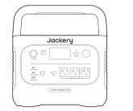

本体

</li><li class="hb-inbox-card" data-item-number="2">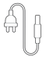

AC充電ケーブル

</li><li class="hb-inbox-card" data-item-number="3">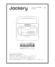

取扱説明書

</li></ol></figure>

<strong>※付属品を故障、紛失等してしまった場合はカスタマーサポートまでご連絡ください。</strong>

<strong>※シガーソケット充電ケーブルは別売りです。Jackery公式サイトよりご購入いただけます。</strong>

<strong>サポートが必要な場合は、Jackeryカスタマーサポートまでお問い合わせください。</strong>

## 10.免責事項

<ul><li>
火災、地震、第三者による行為、その他の事故、お客様の故意または過失誤用・誤動作・その他の異常な条件下での使用により生じた損害に関して、当社は一切責任を負いません。
</li><li>
付属品と本製品が破損した場合は、ご自身で修理を行わないでください。

ご自身で分解・修理したことにより生じた損害に関し、当社は一切責任を負いません。
</li><li>
保証範囲は利用規約に適用され、記載されていない内容は当社の保証範囲外となります。
</li><li>
取扱説明書の記載事項が遵守されないことにより生じた不適合について当社は責任を負いかねます。
</li><li>
本製品の使用、または使用不能から発生する付随的な損害(事業利益損失含む)、当社が関与しない接続機器との組み合わせによる誤動作などから生じた損害に関して、当社は一切の責任を負いません。
</li><li>
本製品は病院仕様のシーパップ（CPAP）、エクモ（ECMO）、ペースメーカなど、身の安全に関わる医療救急機械の電源としての使用、または、消費電力の大きいな設備、例えば核施設設備、スペースシャトル製造などの使用は推薦されません。上記設備の使用後、火災、機器故障など個人安全を脅かす事故の責任を取りません。
</li></ul>

## Jackeryアプリ ユーザーマニュアル

### 1. アプリをダウンロードしてログインするには

<figure aria-label="Jackery App" class="hb-app-download-composition" data-component-id="HB-SPECIAL-APP">

Google PlayまたはApp Storeで「Jackery」と検索し、アプリをインストールしてください。その後、登録とログインを行ってください。

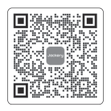

または、下の QR コードをスキャンしてアプリをダウンロードし、インストールしてください。

</figure>

### 2. デバイスを追加するには

2.1 APPの右上にあるデバイス追加ボタン + をクリックします；

2.2 デバイスの主電源ボタンを長押しして電源をいれると、ディスプレー画面にWi-FiとBluetoothのアイコンが点滅し、デバイスがネットワーク設定モードに入ったことを示します。アイコン点滅中ボタンをクリックし、アプリが近くのデバイスに接続し、Bluetoothのアクセス許可を開くことを許可します；

<figure class="hb-reference-figure" data-component-id="HB-SPECIAL-REFERENCE-FIGURE" data-reference-id="app-add" data-source-fragment-sha256="fc9a8ec1c41a893e5ea613e9ee6f459ca7796785ed4cbdb2064c8846b6d2578e" data-step-captions="embedded">
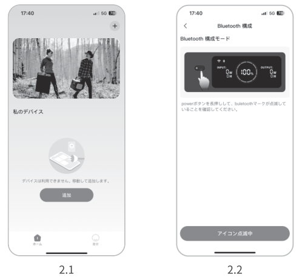
</figure>

<table class="manual-callout-table manual-callout-table"><tbody><tr><td class="manual-callout-label">備考</td><td class="manual-callout-body">
電源を入れた後、アプリが2時間以内接続されていないと、デバイスは自動的にWi-FiとBluetoothをオフにします。再度Wi-FiとBluetoothをオンにするには、「DC/USBボタン」と「ACボタン」を同時長押しする必要があります。
</td></tr></tbody></table>

<figure class="hb-reference-figure" data-component-id="HB-SPECIAL-REFERENCE-FIGURE" data-reference-id="app-control" data-source-fragment-sha256="a677e28ba9b092385f952125243daaac5d06b87354b7d98439618b5a50bac67a" data-step-captions="embedded">
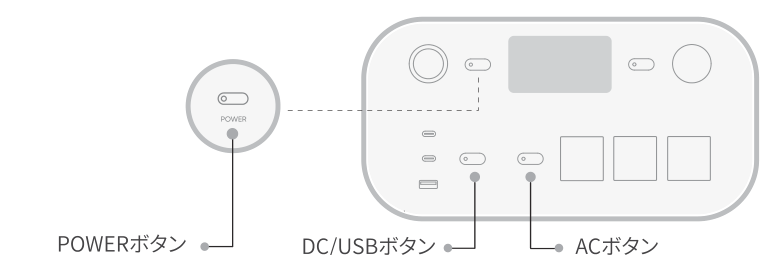
</figure>

2.3 検出されたデバイスアイコンをクリックすると、アプリは自動的にBluetoothでデバイスを接続します。

<table class="manual-callout-table manual-callout-table"><tbody><tr><td class="manual-callout-label">備考</td><td class="manual-callout-body">
バインド処理中に「デバイスがバインドされました」と表示された場合は、以下の2つの方法で接続できます：
<ul><li>デバイス所有者は、アプリを通じてこのデバイスを他のユーザーと共有します。</li><li>「POWERボタン」と「DC/USBボタン」を3秒間長押ししてデバイスをリセットし、再度バインドしてくだい。</li></ul></td></tr></tbody></table>

2.4 デバイスが正常に接続されると、デバイスが接続するWi-Fiの名前とパスワードを入力する必要があり、デバイスは自動的にWi-Fiネットワークに接続します。

<table class="manual-callout-table manual-callout-table"><tbody><tr><td class="manual-callout-label">備考</td><td class="manual-callout-body">
2.4GHz帯のWi-Fiネットワークを選択してください。デバイスは、5GHz帯のWi-Fiネットワークには対応していません。
</td></tr></tbody></table>

2.5 デバイスのホーム画面でデバイスが正常に追加されると、デバイスのWi-Fi アイコンは常にオンになります。

<figure class="hb-reference-figure" data-component-id="HB-SPECIAL-REFERENCE-FIGURE" data-reference-id="app-results" data-source-fragment-sha256="4f2bb27855c86e943cf90e140f630ebe15469a57d97108e29ac9c6ddf4e2c3fd" data-step-captions="embedded">
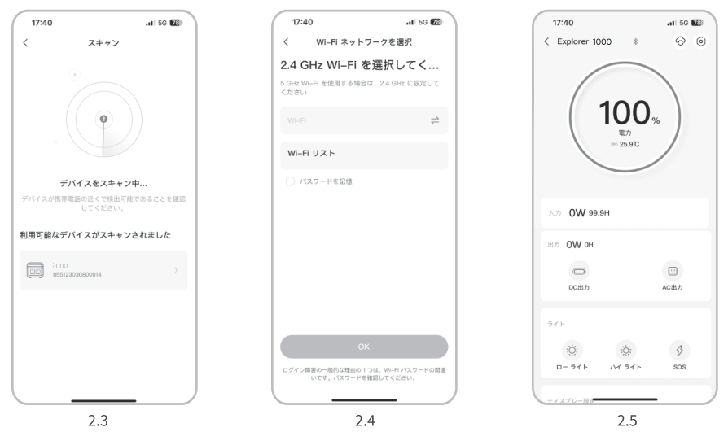
</figure>

上記のスクリーンショットはご参考まで。

### 3. デバイスのバインドを解除するには

デバイスのメインインターフェースの右上隅にある「設定」ボタンをクリックして設定ページに入り、ページの下部にある「バインド解除」ボタンをクリックしてデバイスのバインドを解除します。

### 4. ご確認

#### 4.1 Wi-FiとBluetoothをオンにするには（ディスプレーにWi-FiとBluetoothのアイコンが点灯）：

<ul><li>
デバイスがオンになれば自動的にオンになり、ディスプレーにWi-FiとBluetoothのアイコンが点灯します；
</li><li>
上記アイコンが点灯しない場合、ディスプレーにWi-FiとBluetoothのアイコンが点灯するまで、DC/USB出力ボタンとAC出力ボタンを同時長押しします。
</li></ul>

#### 4.2 Wi-FiとBluetoothをオフにするには（ディスプレーにWi-FiとBluetoothのアイコンが消える）：

<ul><li>
ディスプレーにWi-FiとBluetoothのアイコンが消えるまで、DC/USB出力ボタンとAC出力ボタンを同時長押しします；
</li><li>
2 時間以内にデバイスが接続されない場合、Wi-FiとBluetooth は自動的にオフになります。
</li></ul>

#### 4.3 Wi-FiとBluetoothをリセットするには：

<ul><li>
主電源ボタンとDC/USBボタンを同時に3秒間押すと、Wi-FiとBluetoothが初期化され、システムが再起動します。接続されているアプリアカウントはバインド解除されます。
</li></ul>

## 保証について

このたびは Jackery 製品をご購入いただき、誠にありがとうございます。

本保証書は、Jackery ポータブル電源製品に関する保証内容を明確にご案内するものです。

ご使用前に必ずご確認のうえ、大切に保管してください。

### 保証期間

<figure aria-label="保証期間" class="hb-warranty-card" data-component-id="HB-WARRANTY-SECTION" data-warranty-card-index="1">
1. 保証期間はご購入日から 3 年間です。

2. また、延長保証にご登録いただくと、さらに 2 年間の保証が追加されます。詳しくは Jackery 公式サイトをご確認ください。

※ Jackery 公式オンラインストアまたは正規代理店以外での購入品は保証対象外となります。
</figure>

### 保証の適用範囲

<figure aria-label="保証の適用範囲" class="hb-warranty-card" data-component-id="HB-WARRANTY-SECTION" data-warranty-card-index="2">
1. 購入チャネルについて 本保証は、Jackery公式オンラインストアまたは正規代理店で購入された製品に限り有効です。

※ Jackery 公式オンラインストアまたは正規代理店以外での購入品は保証対象外となります。

2. 保証提供地域 保証は、日本国内に在住の方が、日本国内で使用する場合に限り有効です。
</figure>

### 保証の適用条件

<figure aria-label="保証の適用条件" class="hb-warranty-card" data-component-id="HB-WARRANTY-SECTION" data-warranty-card-index="3">
以下のすべての条件を満たす場合に、保証の適用対象となります：
<ul><li>Jackery公式オンラインストアまたは正規代理店にてご購入されたこと</li><li>保証期間内であること</li><li>下記の「保証対象外」に該当しないこと</li></ul></figure>

### 保証対象外となる場合

<figure aria-label="保証対象外となる場合" class="hb-warranty-card" data-component-id="HB-WARRANTY-SECTION" data-warranty-card-index="4">
以下のいずれかに該当する場合、保証期間内であっても保証の対象外となります： 1.故障・損傷が保証期間内に発生していても、保証期間終了後に申請された場合 2.使用上の誤り（取扱説明書や本体ラベルに記載の注意事項に従わなかった使用）による故障・損傷 3.他機器からの影響、不適切な修理または改造による故障・損傷 4.移設・輸送・落下などに起因する故障・損傷 5.火災・地震・風水害・落雷などの天災、または公害・塩害・異常電圧などによる故障・損傷 6.消耗部品の劣化や摩耗、または外観の汚損など
</figure>

### 購入証明について

<figure aria-label="購入証明について" class="hb-warranty-card" data-component-id="HB-WARRANTY-SECTION" data-warranty-card-index="5">
保証をご利用の際には、以下いずれかの購入証明書類をご提示いただく必要があります：
<ul><li>Jackery公式オンラインストアでの購入：注文番号（注文履歴画面または確認メール）</li><li>正規代理店での購入：購入日・販売店名の記載された領収書または納品書</li></ul>
※ ご提示がない場合、保証対応いたしかねます。
</figure>

### 保証内容

<figure aria-label="保証内容" class="hb-warranty-card" data-component-id="HB-WARRANTY-SECTION" data-warranty-card-index="6">
<strong>1. 初期不良による交換</strong>（ご購入日から30日以内）
<ul><li>取扱説明書に従った正常な使用中に不具合が発生した場合、同一製品の新品と交換いたします。</li><li>在庫切れや販売終了の場合は、同等品への交換または返金にて対応いたします。</li></ul>
<strong>2. 無償修理</strong>（ご購入日から30日以上～保証期間内）
<ul><li>保証条件を満たす自然故障については、無料で修理対応いたします。</li><li>修理が困難な場合は、同等品（同モデルまたは同等スペック品）への交換にて対応いたします。</li></ul>
<strong>3. 有償修理</strong> 以下に該当する場合は、有償での修理対応となります：
<ul><li>保証期間を超えた製品</li><li>保証対象外と判断された場合</li><li>Jackery公式オンラインストアまたは正規代理店以外で購入された製品</li></ul>
有償修理後の保証期間は、修理完了日より90日間です。

*無償修理の場合、残りの保証期間が90日未満であれば「90日間」、90日以上であれば「元の保証期間に準じます」。
</figure>

<strong>免責事項</strong>

1. 弊社では、いかなる場合においても、間接的損害または付随的損害（データの損失・逸失利益など）に対して責任を負いません。

2. 本保証書は、お客様が法律上有する権利を制限するものではありません。

3. 保証内容は、予告なく変更される場合がございます。あらかじめご了承ください。

Jackery 製品を安心してご使用いただくために、本保証書の内容をご確認のうえ、ご活用くださいますようお願いいたします。

ご不明点がございましたら、Jackery カスタマーサービスまでお問い合わせください。

公式サイト: http://www.jackery.jp

カスタマーサポート: jackery.jp@jackery.com

お問い合わせ電話番号: 050-3198-9007

