

<strong>US</strong> English

Model: JE-1000D

Congratulations on your new Jackery Explorer 1000. Please read this manual carefully before using the product, particularly the relevant precautions to ensure proper use. Keep this manual in an accessible place for frequent reference.

In compliance with laws and regulations, the right of final interpretation of this document and all related documents of this product resides with the Company.

Please kindly notice that no further notifications will be given in case of any update, revision or termination.

## TECHNICAL SPECIFICATIONS

<figure aria-label="TECHNICAL SPECIFICATIONS" class="hb-spec-table-composition"><table class="manual-table manual-spec-table hb-spec-table"><colgroup><col class="hb-spec-col-label"/><col class="hb-spec-col-value"/></colgroup><tbody><tr><th class="manual-spec-label hb-spec-label" scope="row">Product Name</th><td class="manual-spec-value hb-spec-value">Jackery Explorer 1000</td></tr><tr><th class="manual-spec-label hb-spec-label" scope="row">Model No.</th><td class="manual-spec-value hb-spec-value">JE-1000D</td></tr><tr><th class="manual-spec-label hb-spec-label" scope="row">Capacity</th><td class="manual-spec-value hb-spec-value">30.4Ah/35.2V DC (1070Wh)</td></tr><tr><th class="manual-spec-label hb-spec-label" scope="row">Cell Chemistry</th><td class="manual-spec-value hb-spec-value">LiFePO4</td></tr><tr><th class="manual-spec-label hb-spec-label" scope="row">Weight</th><td class="manual-spec-value hb-spec-value">Around 23.8 lbs / 10.8 kg</td></tr><tr><th class="manual-spec-label hb-spec-label" scope="row">Dimensions</th><td class="manual-spec-value hb-spec-value">12.87 × 8.82 × 9.72in / 32.7 × 22.4 × 24.7cm</td></tr><tr><th class="manual-spec-label hb-spec-label" scope="row">Cycle Life</th><td class="manual-spec-value hb-spec-value">4000 cycles to 70%+ capacity</td></tr><tr><th class="manual-spec-label hb-spec-label" scope="row">Total Output</th><td class="manual-spec-value hb-spec-value">1500W Rated, 3000W Surge peak</td></tr><tr><th class="manual-spec-label hb-spec-label" scope="row">3 × AC Output</th><td class="manual-spec-value hb-spec-value">120V ~ 60Hz</td></tr><tr><th class="manual-spec-label hb-spec-label" scope="row">USB-A Output</th><td class="manual-spec-value hb-spec-value">18W Max, 5-6V⎓3A, 6-9V⎓2A, 9-12V⎓1.5A</td></tr><tr><th class="manual-spec-label hb-spec-label" scope="row">USB-C1 Output</th><td class="manual-spec-value hb-spec-value">30W Max, 5V⎓3A, 9V⎓3A, 12V⎓2.5A, 15V⎓2A, 20V⎓1.5A</td></tr><tr><th class="manual-spec-label hb-spec-label" scope="row">USB-C2 Output</th><td class="manual-spec-value hb-spec-value">100W Max, 5V⎓3A, 9V⎓3A, 12V⎓3A, 15V⎓3A, 20V⎓5A</td></tr><tr><th class="manual-spec-label hb-spec-label" scope="row">Car Port</th><td class="manual-spec-value hb-spec-value">12V⎓10A</td></tr><tr><th class="manual-spec-label hb-spec-label" scope="row">Charge Mode AC Input</th><td class="manual-spec-value hb-spec-value">100-120V~ 60Hz, 15A Max</td></tr><tr><th class="manual-spec-label hb-spec-label" scope="row">Bypass Mode AC Input/Output</th><td class="manual-spec-value hb-spec-value">100-120V~ 60Hz, 1500W</td></tr><tr><th class="manual-spec-label hb-spec-label" scope="row">DC Input</th><td class="manual-spec-value hb-spec-value">2 x DC 8mm Ports: 12-16V(Working Voltage)⎓8A Max, Double to 8A Max; 16-60V(Working Voltage)⎓10.5A Max, Double to 21A/400W Max</td></tr><tr><th class="manual-spec-label hb-spec-label" scope="row">Charge Temperature</th><td class="manual-spec-value hb-spec-value">0°C~45°C (32℉~113℉)</td></tr><tr><th class="manual-spec-label hb-spec-label" scope="row">Discharge Temperature</th><td class="manual-spec-value hb-spec-value">-10°C~45°C (14℉~113℉)</td></tr></tbody></table></figure>

### CERTIFICATIONS

  

※ USB Type-C®and USB-C®are registered trademarks of USB Implementers Forum.

## PACKAGE LIST

<figure aria-label="PACKAGE LIST" class="hb-inbox-composition" data-card-count="3" data-component-id="HB-SPECIAL-INBOX" data-inbox-variant="three-card-responsive"><ol class="hb-inbox-grid"><li class="hb-inbox-card" data-item-number="1">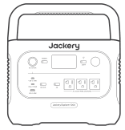

Jackery Explorer 1000

</li><li class="hb-inbox-card" data-item-number="2">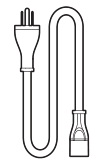

AC Charging Cable

</li><li class="hb-inbox-card" data-item-number="3">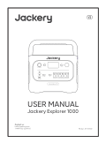

User Manual

</li></ol></figure>

## GET TO KNOW YOUR GEAR

### Product Appearance

<figure class="hb-reference-figure" data-component-id="HB-SPECIAL-REFERENCE-FIGURE" data-reference-id="overview" data-source-fragment-sha256="ae0aaa7c1295e5f9aa5d872a7f08e9c9a9f9d2028d1ba5a59baa29366dcc9761" data-step-captions="embedded">
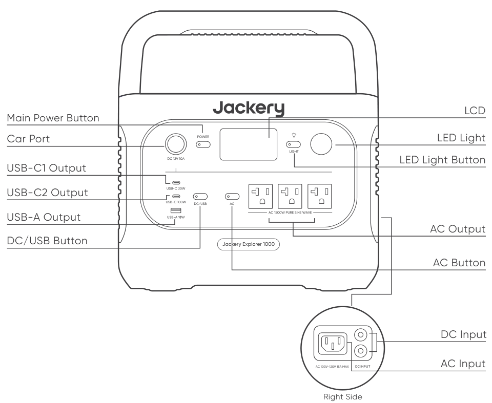
</figure>

## LCD DISPLAY

<figure class="hb-reference-figure" data-component-id="HB-SPECIAL-REFERENCE-FIGURE" data-reference-id="lcd-map" data-source-fragment-sha256="a25f42291a3413b4760c64566a59c112b3d0229d4763b1cb81a59c86b6d5830e" data-step-captions="embedded">
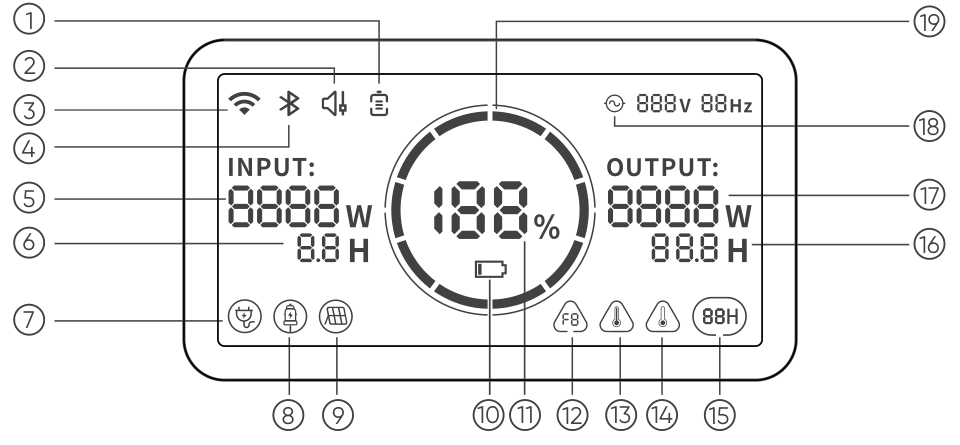
</figure>

<figure aria-label="LCD DISPLAY" class="hb-reference-composition hb-reference-lcd-descriptions" data-component-id="HB-TABLE-REFERENCE" data-component-variant="lcd-descriptions" tabindex="0"><table class="hb-reference-table"><tbody><tr><td>①</td><td>Battery Saving Mode</td></tr><tr><td>②</td><td>Quiet Charging Mode</td></tr><tr><td>③</td><td>Wi-Fi</td></tr><tr><td>④</td><td>Bluetooth</td></tr><tr><td>⑤</td><td>Input Power</td></tr><tr><td>⑥</td><td>Remaining Charge Time</td></tr><tr><td>⑦</td><td>AC Wall Charging Indicator</td></tr><tr><td>⑧</td><td>Car Charging Indicator</td></tr><tr><td>⑨</td><td>Solar Charging Indicator</td></tr><tr><td>⑩</td><td>Low Battery Indicator</td></tr><tr><td>⑪</td><td>Remaining Battery Percentage</td></tr><tr><td>⑫</td><td>Fault Code</td></tr><tr><td>⑬</td><td>High Temperature Warning</td></tr><tr><td>⑭</td><td>Low Temperature Warning</td></tr><tr><td>⑮</td><td>Energy Saving Mode</td></tr><tr><td>⑯</td><td>Remaining Discharge Time</td></tr><tr><td>⑰</td><td>Output Power</td></tr><tr><td>⑱</td><td>AC Power Indicator</td></tr><tr><td>⑲</td><td>Battery Power Indicator</td></tr></tbody></table></figure>

<strong>UPS:</strong>

Once you have connected the mains and the AC input port of the product via the AC charging cable, you can use the AC output port of the product to power your unit (at this point the AC power comes from the mains, not the battery of the product). In the event of a sudden loss of mains power, the product can automatically switch to battery mode within 20ms. This product does not support 0ms switching. Do not connect to equipment with high uninterruptible power requirements such as data servers and workstations. Please test several times to confirm compatibility before use and it is recommended to connect to only one device. Do not use more than one unit at a time to avoid triggering the overload protection. Failure to follow these instructions may result in equipment failure or loss of data for which we cannot be held responsible.

In UPS mode, the unit's peak output reaches 1500W before power outages, as simultaneous charging/discharging is enabled in Bypass Mode. The actual output power is lower than the rated 1500W in this mode, but returns to 1500W during outages.

<figure aria-label="Battery Power Indicator" class="hb-lcd-table-composition" data-component-id="HB-TABLE-LCD-ICON" tabindex="0"><table class="hb-lcd-icon-table"><colgroup><col class="hb-lcd-col-icon"/><col class="hb-lcd-col-name"/><col class="hb-lcd-col-description"/></colgroup><tbody><tr><td class="hb-lcd-icon"></td><td class="hb-lcd-name">Battery Power Indicator</td><td class="hb-lcd-description">When the product is being charged, the orange circle around the battery percentage will light up in sequence. When charging other devices, the orange circle will stay on.</td></tr><tr><td class="hb-lcd-icon"></td><td class="hb-lcd-name">Low Battery Indicator</td><td class="hb-lcd-description">When the battery is less than 20%, the Low Battery Indicator will stay on. When less than 5%, the Low Battery Indicator will flash. When it is being charged, this Indicator will be off.</td></tr><tr><td class="hb-lcd-icon"></td><td class="hb-lcd-name">Energy Saving Mode</td><td class="hb-lcd-description">To avoid forgetting to turn off the output which results in battery consumption, the product turns the Energy Saving Mode on by default. This occurs when no device is connected or the connected device is less than or equal to a certain value. (Refer to the table below for more details), the device will automatically turn off all outputs after 12 hours.</td></tr></tbody></table></figure>

<table class="manual-table"><thead><tr><th>Output</th><th>Output Power</th><th>Defaults</th></tr></thead><tbody><tr><td>AC Output</td><td>≤25W</td><td rowspan="3">All outputs turned off automatically after 12 hours</td></tr><tr><td>USB Output</td><td>≤2W</td></tr><tr><td>Car Output</td><td>≤2W</td></tr></tbody></table>

<strong>To turn off the Energy Saving Mode</strong>

Long press the AC Button and Main Power Button until the Energy Saving Mode icon disappears. In Non-Energy Saving Mode, please remember to turn off the products to avoid battery consumption.

<strong>To turn on the Energy Saving Mode</strong>

Long press the AC Button and Main Power Button until the Energy Saving Mode icon lights up on the screen.

<figure aria-label="Fault code" class="hb-lcd-table-composition" data-component-id="HB-TABLE-LCD-ICON" tabindex="0"><table class="hb-lcd-icon-table"><colgroup><col class="hb-lcd-col-icon"/><col class="hb-lcd-col-name"/><col class="hb-lcd-col-description"/></colgroup><tbody><tr><td class="hb-lcd-icon"></td><td class="hb-lcd-name">Fault code</td><td class="hb-lcd-description">In order to respond to the feedback quickly, we set up common fault codes F0-FE in the system: If the F8 code appears, please remove the load or unplug the charging plug, the product can restore by itself, if not, please contact after-sales service; If the F9 code appears, please remove the load and the product can recover by itself, if not, please contact after-sales service. In case of any other code appears, please contact our after-sales service.</td></tr><tr><td class="hb-lcd-icon"></td><td class="hb-lcd-name">High-temperature warning</td><td class="hb-lcd-description">If it appears on the screen, do not worry, the battery will restore automatically after cooling.</td></tr><tr><td class="hb-lcd-icon"></td><td class="hb-lcd-name">Low-temperature Warning</td><td class="hb-lcd-description">If it is displayed on the screen, do not worry. It will automatically restore after the ambient temperature is restored.</td></tr><tr><td class="hb-lcd-icon"></td><td class="hb-lcd-name">Quiet Charging Mode</td><td class="hb-lcd-description">When Quiet Charging Mode is activated, the charging power is reduced, charging speed is slowed down, and noise during charging is significantly reduced (please enable/disable this feature in the app).</td></tr><tr><td class="hb-lcd-icon"></td><td class="hb-lcd-name">Battery Saving Mode</td><td class="hb-lcd-description">When Battery Saving Mode is activated, the available battery capacity of the product decreases, extending the lifespan of the battery cells (please enable/disable this feature in the app).</td></tr></tbody></table></figure>

## BASIC OPERATIONS

### Main Power On/Off

Press the "Main Power Button" and the working indicator lights up and the LCD display is illuminated. If you need to turn off the main power, please press and hold the "Main Power Button" until the working indicator turns off. The default standby time of this product is 2 hours. (the product will automatically shut down after 2 hours without charging or discharging) The automatic shutdown time can be set on the Jackery App.

*In Energy Saving mode, turn on DC output or AC output, or it will automatically shut down after 12 hours if there is no charging input or discharging output.

<strong>AC Output On/Off:</strong> Ensure that the main power supply is turned on. Press the AC Button, the AC Output Power indicator lights up. Then you can connect the equipment that needs AC charging. Press the AC Button again to turn off the AC Output.

<strong>DC Output On/Off:</strong> Ensure that the main power supply is turned on. Press the DC/USB Button, the DC Output Power indicator lights up. Then USB/Car Port Output Ports can be connected to external load devices. Press the DC/USB Button again to turn off the USB/ Car Port Output.

The product can charge your car battery using the Jackery 12V automobile battery charging cable, which is sold separately and available on our website.

<table class="manual-callout-table manual-callout-table"><tbody><tr><td class="manual-callout-label">CAUTION</td><td class="manual-callout-body"><ul><li>The cigarette lighter port is only compatible with 12V car batteries and not suitable for 24V systems.</li><li>Do not start the car while the product is charging the car battery through the 12V DC output port (cigarette lighter port), as this may damage the product.</li><li>This feature is intended for emergency use only and cannot charge a dead or damaged car battery.battery.</li></ul></td></tr></tbody></table>

<strong>LCD Screen On/Off</strong>

To turn on, press the Main Power Button or when there's a charging input, the screen display will light up automatically. To turn off, press the Main Power Button again and the screen display will turn off.

<strong>LCD is off automatically</strong>

If there is no operation in 2 minutes, the product will enter a sleep state and the screen display will automatically turn off.

<strong>Turn on/ off the Always-on Display</strong> (under charging or discharging state), follow these steps:

After the display screen lights up, double-click the Main Power Button and the Always-on display mode will be on, then press it again to turn off the screen.

Tip: During Always-On Display mode, the screen automatically turns off after 2 hours without charging or discharging.

### LED Light

The LED light has three modes: Low Light mode, High Light mode, and SOS mode.

Press the LED light button and the LED light will turn on. The default mode is Low Light mode. Press the LED button again to switch it to high light mode, SOS mode, or turn off the LED light in sequence. In any of such modes, you can press and hold the LED button to turn off the LED light.

<figure class="hb-reference-figure" data-component-id="HB-SPECIAL-REFERENCE-FIGURE" data-reference-id="led-modes" data-source-fragment-sha256="031f532188d7370268b34f699d9cd2d042690a859fa924ac66fdadbd6030aa9f" data-step-captions="embedded">
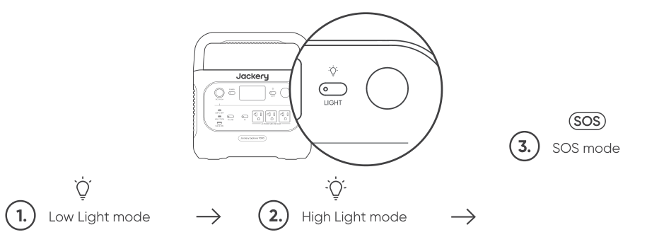
</figure>

## APP CONNECTION

This product supports the connection of Jackery App for intelligent control and operation. Users can download the Jackery App through App Store or Google Play. For more information, please refer to Jackery App User Manual.

## CHARGING YOUR JACKERY EXPLORER 1000

Fully charge the device before its first use.

<strong>Note:</strong> 1. The recommended charging temperature for the product is between 0°C to 45°C (32°F to 113°F), and the discharging temperature is between -10°C to 45°C (14°F to 113°F). Operating the product outside this temperature range may restrict its charging and discharging capabilities, or even render it unable to charge or discharge.

2. The charging power and battery capacity of the product may vary due to temperature fluctuations.

### Charging via AC Wall Outlet

Connect the AC charging cable to the input port of the power station and plug it into the wall outlet.

<strong>Emergency Charging Mode</strong>

Under this mode, you can rapidly power up the portable power station using the AC charging method. <strong>This emergency charge function can be activated or deactivated through the Jackery app</strong>. When in emergency charging mode, the circular light indicating the state of charge (SOC) will blink at an increased pace.

* To maximize battery life, it is best to charge at normal speed. We recommend using emergency charging mode only when necessary. It’s not recommended for regular, long-term use.

<figure class="hb-reference-figure" data-component-id="HB-SPECIAL-REFERENCE-FIGURE" data-reference-id="ac-charge" data-source-fragment-sha256="d0ab49dc65e7e8b59d336b144b16a6e700ac69742fd1b1b20169759242eb75db" data-step-captions="embedded">
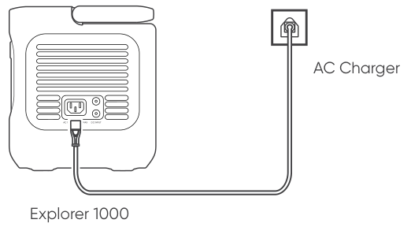
</figure>

### Charging via Solar Panel

The product has two DC8020 input ports, each of which supports direct connection of a 100W or 200W solar panel. If one DC8020 input port needs to connect two 100W solar panels at the same time, a solar panel connector (sold separately) is required.

<figure class="hb-reference-figure" data-component-id="HB-SPECIAL-REFERENCE-FIGURE" data-reference-id="solar-direct" data-source-fragment-sha256="86d23cc4cf6f81520816d433d37b56eb5eaf6f0ea139b155d0c1dcae414a242b" data-step-captions="embedded">
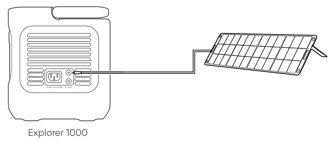
</figure>

<figure class="hb-reference-figure" data-component-id="HB-SPECIAL-REFERENCE-FIGURE" data-reference-id="solar-adapter" data-source-fragment-sha256="b9e2dffc248ed1046b2e5abdd5562928e1e015b519eb0161adeb301c53ba73ad" data-step-captions="embedded">
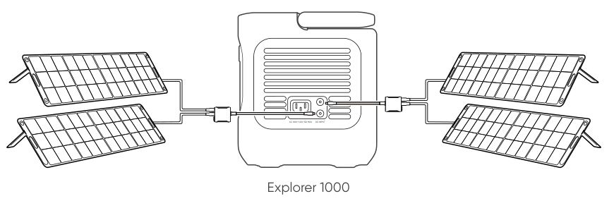
</figure>

<table class="manual-callout-table manual-callout-table"><tbody><tr><td class="manual-callout-label">CAUTION</td><td class="manual-callout-body">
Ensure that the input voltage for both DC input ports is the same. Failure to do so may damage the product. For example:
<ul><li>It is recommended to use the same model of Jackery solar panels and the same number of panels when connecting solar panels to both DC8020 Input ports.</li><li>Do not charge the product using both a car charger and a solar panel simultaneously. Doing so may blow the car fuse or result in charging failure.</li></ul></td></tr></tbody></table>

### Charging via Car Charger

This product can be charged with a 12V car charger. Ensure that the car charger and the car cigarette lighter provide a good connection.

*Please start the vehicle before charging your power station.

*If the vehicle is running on bumpy roads, it is forbidden to use the car charger in case it burns due to a poor connection. The Company will not be responsible for any loss caused by non-standard operation.

<figure class="hb-reference-figure" data-component-id="HB-SPECIAL-REFERENCE-FIGURE" data-reference-id="car-charge" data-source-fragment-sha256="d3a460e5508d6557d6db671fb0ace3d049007737930ae475e301d41afe5c6bbd" data-step-captions="embedded">
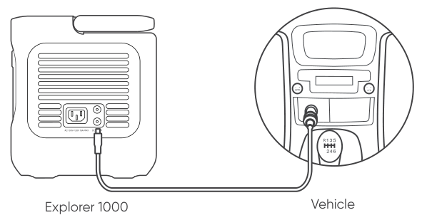
</figure>

## INSTRUCTIONS PERTAINING TO RISK OF FIRE, ELECTRIC SHOCK, OR INJURY TO PERSONS

### IMPORTANT SAFETY INSTRUCTIONS

WARNING–When using this product, basic precautions should always be followed, including the following:

a) Read all the instructions before using the product.

b) To reduce the risk of injury, close supervision is necessary when the product is used near children.

c) Do not put fingers or hands into the product.

d) Use of an attachment not recommended or sold by power pack manufacturer may result in a risk of fire, electric shock, or injury to persons.

e) To reduce risk of damage to the electric plug and cord, pull the plug rather than the cord when disconnecting the power pack.

f) Do not use a battery pack or appliance that is damaged or modified. Damaged or modified batteries may exhibit unpredictable behavior resulting in fire, explosion or risk of injury.

g) Do not operate the power pack with a damaged cord or plug, or a damaged output cable.

h) Do not disassemble the power pack, take it to a qualified service person when service or repair is required. Incorrect reassembly may result in a risk of fire or electric shock.

i) To reduce the risk of electric shock, unplug the power pack form the outlet before attempting any instructed servicing.

j) When charging the internal battery, work in a well ventilated area and do not restrict ventilationin any way.) Under abusive conditions, liquid may be ejected from the battery; avoid contact. If contact accidentally occurs, flush with water. If liquid contacts eyes, additionally seek medical help. Liquid ejected from the battery may cause irritation or burns.

k) Under abusive conditions, liquid may be ejected from the battery; avoid contact. If contact accidentally occurs, flush with water. If liquid contacts eyes, additionally seek medical help. Liquid ejected from the battery may cause irritation or burns.

l) Do not expose a power pack to fire or excessive temperature. Exposure to fire or temperature above 130°C may cause explosion. The temperature of 130°C can be replaced by the temperature of 265°F.

m) Have servicing performed by a qualified repair person using only identical replacement parts. This will ensure that the safety of the product is maintained.

<strong>SAVE THESE INSTRUCTIONS</strong>

### OPERATING INSTRUCTIONS

<ul><li>
Use and store the unit only in a clean and dry environment. DO NOT use and store in dusty and wet environment.
</li><li>
Check the unit prior to every use. DO NOT use the unit if it is damaged, broken.
</li><li>
If rust, peculiar odors, overheating or other abnormal circumstances are observed, stop using the unit immediately and contact the dealer or our customer service center.
</li><li>
Make sure that the unit is properly secured when transporting it in a motor vehicle.
</li><li>
Only charge the Explorer 1000 within a ambient temperature 0°C~45°C (32°F~113°F),discharge temperature is -10°C~45°C (14°F~113°F) and Storage temperature is 1 year: 0°C~25°C (32°F~77°F).
</li><li>
Switch the unit off immediately if it has accidentally fallen, was dropped or was exposed to vibrations.
</li><li>
DO NOT use the unit if the power cord is damaged or broken.
</li><li>
Keep the unit away from children. DO NOT let children use the power supply unit. Keep this product away from pets.
</li><li>
DO NOT use  the unit in an area or environment with high temperature.
</li><li>
Should fluid from inside of the unit come in contact with your skin or clothing, wash the affected areas with tap water.
</li><li>
In a storm, unplug the power cord from the socket.
</li><li>
DO NOT place the unit on its side or upside down while in use or storage.
</li><li>
DO NOT use accessories for other usage.
</li><li>
Make sure that the device you are connecting is switched off before you connect it.
</li><li>
DO NOT expose a power pack to fire or excessive temperature. Exposure to fire or temperature above 130°C may cause explosion.
</li><li>
Solar charge times depend on weather conditions, place your solar panel where it will get as much direct sunlight as possible.
</li><li>
DO NOT place the power pack on the floor, or at a height less than 457 mm (18 inches) above the floor, during use in a repair facility.
</li></ul>

<table class="manual-callout-table manual-callout-table"><tbody><tr><td class="manual-callout-label">WARNING</td><td class="manual-callout-body">
Do not remove the battery pack without permission,If you need to repair the battery pack, contact your local manufacturer as soon as possible.
</td></tr></tbody></table>

<table class="manual-callout-table manual-callout-table"><tbody><tr><td class="manual-callout-label">DANGER</td><td class="manual-callout-body">
This device is for indoor use only (e.g. RV/tent/off-grid cabin, etc.). Do not use outdoors under any circumstances (e.g. where exposed to rain or snow or use it in wet environments by the sea or waterways).
</td></tr></tbody></table>

### MOVING AND STORAGE INSTRUCTIONS

<ul><li>
DO NOT move the unit if it is recharging or in use.
</li><li>
DO NOT dispose the unit together with household waste.
</li><li>
DO NOT place the unit close to or in a fire or expose it to heat. Keep out of direct sunlight.
</li><li>
DO NOT store the unit in a bathroom or in an area exposed to rain or moisture.
</li><li>
DO NOT disassemble the power pack, take it to a qualified service person when service or repair is required. Incorrect reassembly may result in a risk of fire or electric shock.
</li><li>
DO NOT store the unit in an area or environment with high temperature.
</li></ul>

### USER MAINTENANCE INSTRUCTIONS

When using it for the first time, please fully charge the device before use. If this product is stored for a long period of time (3 months - 6 months) with the power depleted, its performance will deteriorate and may even become unchargeable.

NOTE: This equipment has been tested and found to comply with the limits for a Class B digital device, pursuant to part 15 of the FCC Rules. These limits are designed to provide reasonable protection against harmful interference in a residential installation. This equipment generates, uses and can radiate radio frequency energy and, if not installed and used in accordance with the instructions, may cause harmful interference to radio communications. However, there is no guarantee that interference will not occur in a particular installation. If this equipment does cause harmful interference to radio or television reception, which can be determined by turning the equipment off and on, the user is encouraged to try to correct the interference by one or more of the following measures:

<ul><li>
Reorient or relocate the receiving antenna.
</li><li>
Increase the separation between the equipment and receiver.
</li><li>
Connect the equipment into an outlet on a circuit different from that to which the receiver is connected.
</li><li>
Consult the dealer or an experienced radio/TV technician for help.
</li></ul>

MODIFICATION: Any changes or modifications not expressly approved by the grantee of this device could void the user’s authority to operate the device.

## WARRANTY

We only provide our warranty to customers who purchase from the official Jackery website, Jackery-branded third-party platforms, or local authorized dealers.

*Warranty period and details may vary according to local laws, regulations, and authorized dealers.

### Limited Warranty

Jackery Inc. warrants to the original consumer purchaser that the Jackery product will be free from defects in workmanship and material under normal consumer use during the applicable warranty period identified in the 'Warranty Period' section below, subject to the exclusions set forth below.

This warranty statement sets forth Jackery's total and exclusive warranty obligation. We will not assume, nor authorize any person to assume for us, any other liability in connection with the sale of our products.

### Warranty Period

3 Years Standard Warranty: The standard warranty period for Jackery Explorer 1000 is 36 months. In each case, the warranty period is measured starting on the date of purchase by the original consumer purchaser. The sales receipt from the first consumer purchase, or other reasonable documentary proof, is required in order to establish the start date of the warranty period.

2 Years Extended Warranty: To activate the Warranty Extension, you must register your product online  or contact our customer service team at hello@jackery.com to extend the standard warranty runtime.

### Exchange

Jackery will replace (at Jackery's expense) any Jackery product that fails to operate during the applicable warranty period due to defect in workmanship or material. A replacement product assumes the remaining warranty of the original product.

### Limited to Original Consumer Buyer

The warranty on Jackery's product is limited to the original consumer purchaser and is not transferable to any subsequent owner.

### Exclusions

Jackery's warranty does not apply to:

Misused, abused, modified, damaged by accident, or used for anything other than normal consumer use as authorized in Jackery's current product literature.

Attempted repair by anyone other than an authorized facility.

Any product purchased through an online auction house.

Jackery's warranty does not apply to the battery cell unless the battery cell is fully charged by you within seven days after you purchase the product and at least once every 6 months thereafter.

### Download the Jackery  Mobile App

<figure class="hb-reference-figure" data-component-id="HB-SPECIAL-REFERENCE-FIGURE" data-reference-id="app-store" data-source-fragment-sha256="bd07e34882b832f4a88beee8e0fff1f77973569182d2987abfbaa9e37c515095" data-step-captions="embedded">

</figure>

## User Manual for Jackery App

### 1. To download the App and log in

Search for “Jackery” in Google Play or App Store to install the App. After that, you can register and log in.

### 2. To add device

2.1 Click the button + to add your device;

2.2 Long press the “POWER” button on the device to turn on, the Wi-Fi and Bluetooth icons on the device flash to indicate that the device has entered the network configuring mode, click the “Icon Flashed” button and allow the App to connect to nearby devices and open Bluetooth permissions;

<figure class="hb-reference-figure" data-component-id="HB-SPECIAL-REFERENCE-FIGURE" data-reference-id="app-add" data-source-fragment-sha256="fc9a8ec1c41a893e5ea613e9ee6f459ca7796785ed4cbdb2064c8846b6d2578e" data-step-captions="embedded">
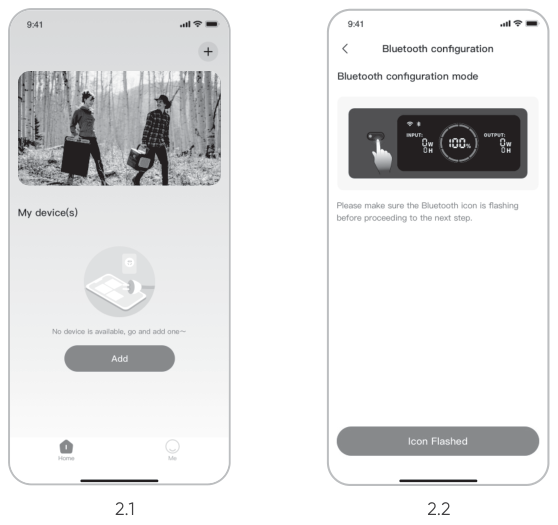
</figure>

<table class="manual-callout-table manual-callout-table"><tbody><tr><td class="manual-callout-label">Remarks</td><td class="manual-callout-body">
After being turned on, if the APP is not connected within 5 minutes, the device will automatically turn off Wi-Fi and Bluetooth. Now, it is required to press and hold “DC/USB Button” and “AC Button” to turn on Wi-Fi and Bluetooth again.
</td></tr></tbody></table>

<figure class="hb-reference-figure" data-component-id="HB-SPECIAL-REFERENCE-FIGURE" data-reference-id="app-control" data-source-fragment-sha256="2ed5451c5924514ac2e4f79587d48dfdea79702d99f44f2dc45c81d852298ec1" data-step-captions="embedded">
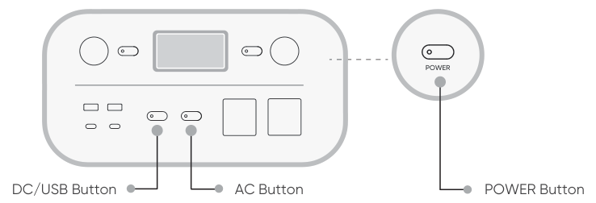
</figure>

2.3 After clicking the searched device icon, the App automatically connects the device via Bluetooth.

<table class="manual-callout-table manual-callout-table"><tbody><tr><td class="manual-callout-label">Remarks</td><td class="manual-callout-body">
If “the device has been bound” is prompted during the binding process, the following two ways can be used for connection:
<ul><li>The device owner will share this device with other users through the App.</li><li>Press and hold the “POWER Button” and “DC/USB Button” for 3 seconds to reset the device, and then re-bind the device.</li></ul></td></tr></tbody></table>

2.4 After the device is successfully connected, it is necessary to enter your Wi-Fi password and tap the OK button;

<table class="manual-callout-table manual-callout-table"><tbody><tr><td class="manual-callout-label">Remarks</td><td class="manual-callout-body">
Please select a Wi-Fi network in 2.4GHz band. The device does not support a Wi-Fi network in 5GHz band.
</td></tr></tbody></table>

2.5 After the device is successfully added on the home page of the device, the Wi-Fi icon on the device will be always on;

<figure class="hb-reference-figure" data-component-id="HB-SPECIAL-REFERENCE-FIGURE" data-reference-id="app-results" data-source-fragment-sha256="4f2bb27855c86e943cf90e140f630ebe15469a57d97108e29ac9c6ddf4e2c3fd" data-step-captions="embedded">
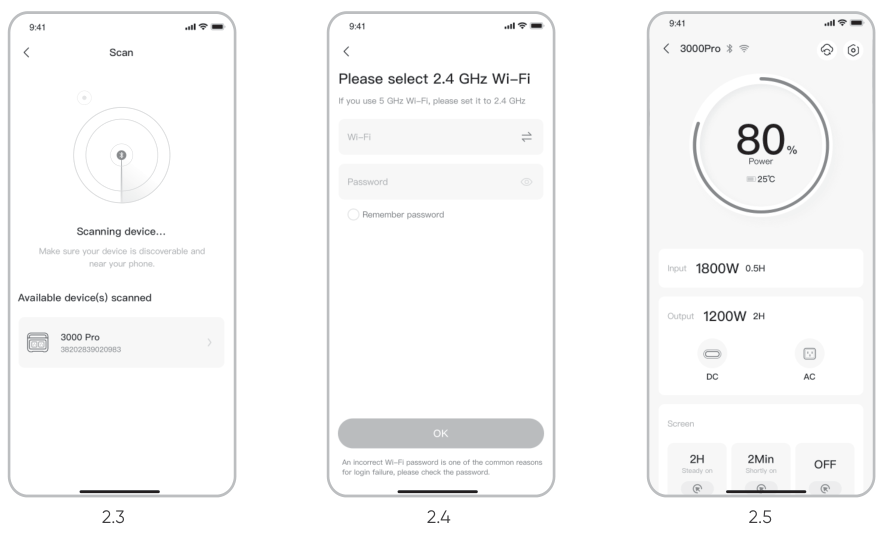
</figure>

The above screenshots are for reference only.

### 3. To unbind the device

Click the Settings button in the upper right corner of the main interface of the device to enter the settings page, and click the Unbind button at the bottom of the page to unbind the device.

### 4. Notes

#### 4.1 To turn on Wi-Fi & Bluetooth:

<ul><li>
Wi-Fi &amp; Bluetooth are automatically turned on after the device is on, and the Wi-Fi &amp; Bluetooth icons on the screen light up;
</li><li>
Press the DC/USB button and the AC button at the same time until the Wi-Fi &amp; Bluetooth icons on the screen light up;
</li></ul>

#### 4.2 To turn off Wi-Fi & Bluetooth:

<ul><li>
Press the DC/USB button and AC button at the same time until the Wi-Fi &amp; Bluetooth icons on the screen are off;
</li><li>
Wi-Fi &amp; Bluetooth will be automatically turned off if no device is connected within 5 minutes;
</li></ul>

#### 4.3 To reset Wi-Fi & Bluetooth：

<ul><li>
Press the POWER button and DC/USB button at the same time for 3 seconds to reset Wi-Fi &amp; Bluetooth to factory settings and reboot the system. The connected App account will be unbound.
</li></ul>
