

## 1. 技術仕様

<figure aria-label="1. 技術仕様" class="hb-spec-table-composition"><table class="manual-table manual-spec-table hb-spec-table"><colgroup><col class="hb-spec-col-label"/><col class="hb-spec-col-value"/></colgroup><tbody><tr><th class="manual-spec-label hb-spec-label" scope="row">製品名：</th><td class="manual-spec-value hb-spec-value">Jackery Explorer 100 Plus</td></tr><tr><th class="manual-spec-label hb-spec-label" scope="row">型番：</th><td class="manual-spec-value hb-spec-value">JE-100A</td></tr><tr><th class="manual-spec-label hb-spec-label" scope="row">バッテリータイプ：</th><td class="manual-spec-value hb-spec-value">LiFePO4 (リン酸鉄リチウムイオン電池)</td></tr><tr><th class="manual-spec-label hb-spec-label" scope="row">容量：</th><td class="manual-spec-value hb-spec-value">6.2Ah / 16V DC 99.2Wh(31000mAh 3.2V)</td></tr><tr><th class="manual-spec-label hb-spec-label" scope="row">重量：</th><td class="manual-spec-value hb-spec-value">965 g</td></tr><tr><th class="manual-spec-label hb-spec-label" scope="row">外形寸法：</th><td class="manual-spec-value hb-spec-value">126 x 86.5 x 87 mm</td></tr><tr><th class="manual-spec-label hb-spec-label" scope="row">サイクル寿命：</th><td class="manual-spec-value hb-spec-value">充放電サイクル2000回後も初期容量の80%以上を維持</td></tr><tr><th class="manual-spec-label hb-spec-label" scope="row">USB－A 出力：</th><td class="manual-spec-value hb-spec-value">最大18W, 5V⎓3A, 9V⎓2A, 12V⎓1.5A,</td></tr><tr><th class="manual-spec-label hb-spec-label" scope="row">USB-C1/C2 出力：</th><td class="manual-spec-value hb-spec-value">最大100W, 4.5V⎓5A, 5V⎓3A, 5V⎓4.5A, 9V⎓3A, 12V⎓3A, 15V⎓3A, 20V⎓5A</td></tr><tr><th class="manual-spec-label hb-spec-label" scope="row">PPS：</th><td class="manual-spec-value hb-spec-value">5-21V⎓5A, 最大100W</td></tr><tr><th class="manual-spec-label hb-spec-label" scope="row">USB-C1+USB-C2 出力：</th><td class="manual-spec-value hb-spec-value">最大110W</td></tr><tr><th class="manual-spec-label hb-spec-label" scope="row">USB-C1/C2+USB-A 出力：</th><td class="manual-spec-value hb-spec-value">最大118W</td></tr><tr><th class="manual-spec-label hb-spec-label" scope="row">USB-C1+USB-C2+USB-A 出力：</th><td class="manual-spec-value hb-spec-value">最大128W</td></tr><tr><th class="manual-spec-label hb-spec-label" scope="row">USB-C1/C2 入力 (PD 入力)：</th><td class="manual-spec-value hb-spec-value">最大100W, 5V⎓3A, 9V⎓3A, 12V⎓3A,15V⎓3A, 20V⎓5A</td></tr><tr><th class="manual-spec-label hb-spec-label" scope="row">USB-C1/C2 入力 (車載入力)：</th><td class="manual-spec-value hb-spec-value">最大60W, 11-17.5V⎓5A</td></tr><tr><th class="manual-spec-label hb-spec-label" scope="row">USB-C1/C2 入力 (ソーラー入力)：</th><td class="manual-spec-value hb-spec-value">最大100W, 18-27.2V⎓5A</td></tr><tr><th class="manual-spec-label hb-spec-label" scope="row">充電温度：</th><td class="manual-spec-value hb-spec-value">0°C～40°C(32°F～104°F)</td></tr><tr><th class="manual-spec-label hb-spec-label" scope="row">動作温度：</th><td class="manual-spec-value hb-spec-value">-10°C～40°C(14°F～104°F)</td></tr><tr><th class="manual-spec-label hb-spec-label" scope="row">認証</th><td class="manual-spec-value hb-spec-value">UN38.3</td></tr></tbody></table></figure>

※ USB Type-C® およびUSB-C®は、USB Implementers Forumの登録商標です。

<strong>■本機の仕様および外観は、改善のため予告なく変更することがあります。</strong>

<table class="manual-table"><tbody><tr><td></td><td>
<strong>充電式電池のリサイクルについて</strong>

本機はリサイクル可能な充電池を内蔵しています。

この商品を廃棄する場合は、当社のカスタマーサポートにご連絡ください。

充電池の取りはずしはお客様自身では行わないでください。
</td></tr></tbody></table>

## 2. 同梱物

<figure aria-label="2. 同梱物" class="hb-inbox-composition" data-card-count="3" data-component-id="HB-SPECIAL-INBOX" data-inbox-variant="three-card-responsive"><ol class="hb-inbox-grid"><li class="hb-inbox-card" data-item-number="1">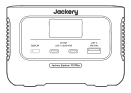

Jackery Explorer 100 Plus

</li><li class="hb-inbox-card" data-item-number="2">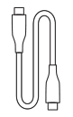

USB-C充電ケーブル

</li><li class="hb-inbox-card" data-item-number="3">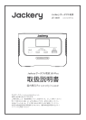

取扱説明書

</li></ol></figure>

## 3. Jackery本体

### 製品外観

<figure class="hb-reference-figure" data-component-id="HB-SPECIAL-REFERENCE-FIGURE" data-reference-id="overview" data-source-fragment-sha256="c1f567c112616a7c77c1d5879ac7c8f72e90363b84b3c7dbf1fb8a8a2e69ebcc" data-step-captions="embedded">
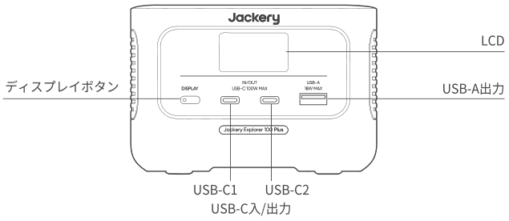
</figure>

## 4. LCDディスプレイ

<figure class="hb-reference-figure" data-component-id="HB-SPECIAL-REFERENCE-FIGURE" data-reference-id="lcd-map" data-source-fragment-sha256="0abe0cc145c6109eecf8da339a723b4e0dfba705246b345e9841a8aef99a6302" data-step-captions="embedded">
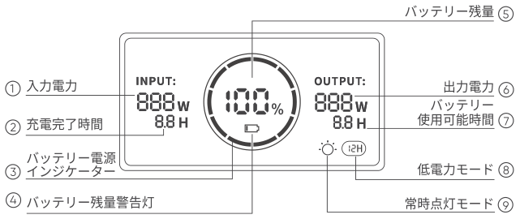
</figure>

<figure aria-label="バッテリーインジケーター" class="hb-lcd-table-composition" data-component-id="HB-TABLE-LCD-ICON" tabindex="0"><table class="hb-lcd-icon-table"><colgroup><col class="hb-lcd-col-icon"/><col class="hb-lcd-col-name"/><col class="hb-lcd-col-description"/></colgroup><tbody><tr><td class="hb-lcd-icon"></td><td class="hb-lcd-name">バッテリーインジケーター</td><td class="hb-lcd-description">充電中は、バッテリー残量を示すオレンジ色の丸が順番に点灯します。他のデバイスを充電しているときは、オレンジ色の丸は点灯したままになります。</td></tr><tr><td class="hb-lcd-icon"></td><td class="hb-lcd-name">ローバッテリーインジケーター</td><td class="hb-lcd-description">バッテリー残量が20%以下の場合、ローバッテリーインジケーターが点灯したままになります。5%以下の場合、ローバッテリーインジケーターが点滅します。充電中は、インジケーターは消灯します。</td></tr><tr><td class="hb-lcd-icon"></td><td class="hb-lcd-name">常時点灯モードでは</td><td class="hb-lcd-description">表示画面が点灯した後、ディスプレイボタンをダブルクリックすると、常時表示モードがオンになり、もう一度押すと画面がオフになります。</td></tr><tr><td class="hb-lcd-icon"></td><td class="hb-lcd-name">低電力モード</td><td class="hb-lcd-description">低電力モードデフォルトでは、低電力モードOFFに設置にしています。イヤフォン、ウォッチなど消費電力2W以下のデバイスへ充電する際には、低電力モードをONの状態に設定してからご利用ください。 ご注意：低電力モードをONの状態で、デバイスを接続しない、またはUSB出力が2W以下のデバイスを接続した場合、12時間後には低電力モード自動OFFになります。再度低電力モードを利用する場合には、再度低電力モードをONの状態に切り替える必要があります。</td></tr></tbody></table></figure>

低電力モードをONにするにはディスプレー画面に低電力モードが表示されるまで、ディスプレーボタンを長押ししてください。

低電力モードをOFFにするにはディスプレー画面の低電力モード表示が消えるまで、ディスプレーボタンを長押ししてください。

<figure aria-label="故障コード" class="hb-lcd-table-composition" data-component-id="HB-TABLE-LCD-ICON" tabindex="0"><table class="hb-lcd-icon-table"><colgroup><col class="hb-lcd-col-icon"/><col class="hb-lcd-col-name"/><col class="hb-lcd-col-description"/></colgroup><tbody><tr><td class="hb-lcd-icon">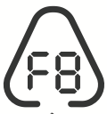</td><td class="hb-lcd-name">故障コード</td><td class="hb-lcd-description">フィードバックに迅速に対応するため、システムに共通故障コードF1、F2、F3を設定しました：何らかのコードが表示された場合は、一度充電プラグを抜き、再度差し込んでください。それでも解決できない場合は、カスタマーサポートにご連絡ください。</td></tr><tr><td class="hb-lcd-icon"></td><td class="hb-lcd-name">高温警告</td><td class="hb-lcd-description">高温時に表示されます。直射日光に当たっている場合は日陰に移動してください。バッテリー冷却後は自動的に回復します。</td></tr><tr><td class="hb-lcd-icon"></td><td class="hb-lcd-name">低温警告</td><td class="hb-lcd-description">低温時に表示され、温度が上がると回復します。使用する場合は動作温度内の環境に移動して使用してください。</td></tr></tbody></table></figure>

## 5. 基本操作

### LCDスクリーンのオン/オフ

ディスプレイボタンを押すか、充電入力や放電出力があると、画面表示が自動的に点灯します。もう一度ディスプレイボタンを押すと、画面表示が消灯します。または、30秒間操作がない場合、製品はスリープ状態に入り、画面表示は自動的に消灯します。

ディスプレイ常時点灯モードON/OFFに設定方法：

ディスプレイが点灯後、「ディスプレイボタン」を2回押せば常時点灯モードになります、再度ディスプレイボタン」お押せば、ディスプレが消灯します。

ヒント：常時点灯モードでは、充電または放電を行わずに2時間経過すると、画面は自動的に消灯します。

## 6. Jackery Explorer 100 Plusの充電

### 充電時の注意事項

<table class="manual-callout-table manual-callout-table"><tbody><tr><td class="manual-callout-label">ご注意</td><td class="manual-callout-body"><ul><li>初めてお使いになるときは、本製品をフル充電してからご使用ください。</li><li>充電池は空の状態で長期保管（3ヶ月～6ヶ月）すると、性能が劣化したり、充電ができなくなる場合があります。</li><li>本機を長期保管する場合には、3ヶ月に一度を目安に本体にACアダプターやソーラーパネルを通して蓄電が可能か、他製品に給電可能かなど動作確認をお願い致します。</li><li>保管時の残量につてきましては、常に60%~80%程度を目安に保管を推奨致します。</li></ul></td></tr></tbody></table>

### AC充電

USB-CをACコンセントで充電するための機器は同梱されておりません。ご自身でご用意ください。

<figure class="hb-reference-figure" data-component-id="HB-SPECIAL-REFERENCE-FIGURE" data-reference-id="ac-charge" data-source-fragment-sha256="65e5108ca11b8dee83da671e4b8164fa6a27d5dc247d395df2cfbbda5512a094" data-step-captions="embedded">
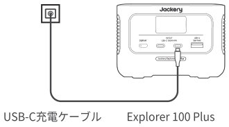
</figure>

### ソーラーパネル充電

#### Jackery SolarSaga 100 ソーラーパネル接続ガイド

Jackery Explorer 100 Plusは、ソーラー充電入力としてUSB-Cタイプを採用しています。以下の接続方式を参考にして、Explorer 100 Plusを充電することができます。

<figure class="hb-reference-figure" data-component-id="HB-SPECIAL-REFERENCE-FIGURE" data-reference-id="solar-100" data-source-fragment-sha256="1bd6c9c3c9881293f4c1971f0d957744ae4fe3efb34cb45f7d3d35719dcb0b21" data-step-captions="embedded">
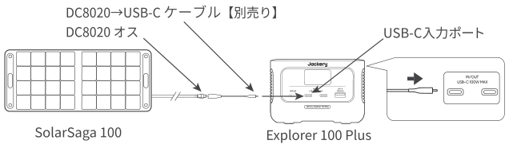
</figure>

#### Jackery SolarSaga 80 ソーラーパネル接続ガイド

* Jackeryソーラーパネル80wとExplorer 100 Plusの接続方法

<figure class="hb-reference-figure" data-component-id="HB-SPECIAL-REFERENCE-FIGURE" data-reference-id="solar-80" data-source-fragment-sha256="7806a4e75a391286e3c8cb48543d2d4a67776253cfdcab377e7585a94ff435e4" data-step-captions="embedded">
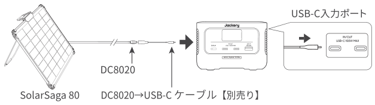
</figure>

* Jackeryソーラーパネル40wとExplorer 100 Plusの接続方法

<figure class="hb-reference-figure" data-component-id="HB-SPECIAL-REFERENCE-FIGURE" data-reference-id="solar-40" data-source-fragment-sha256="d7dce9c700f18344e1d3beef2f48364b678e4c17140ec6f9abffcc509e2dca2e" data-step-captions="embedded">
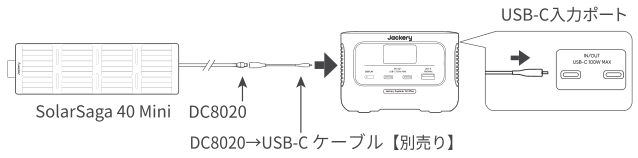
</figure>

### シガーソケット充電

本製品は12Vの車のシガーソケットに対応し、充電ができます（接続ケーブルは付属していません）。車のバッテリーが上がってしまわないように、エンジンを始動してから、シガーソケットを使用してください。使用の際は車の充電ポートと入力ケーブルのシガーライターの接触に問題がないことを確認し、シガーソケットの所定の場所に差し込めることを確認してください。道路状況が悪くて、車の振動が多い場合は、充電が接触不良になりますので、接触部分が焼損するのを防ぐために、シガーソケット充電を中止してください。本製品の誤った取り扱いによる損害が発生した場合も当社は一切の責任を負いかねます。

<figure class="hb-reference-figure" data-component-id="HB-SPECIAL-REFERENCE-FIGURE" data-reference-id="car-charge" data-source-fragment-sha256="0d4d9031cd8311a5e4d4fc473c95c9ec8e6e88693cfb4572275ac200cdbe5f78" data-step-captions="embedded">
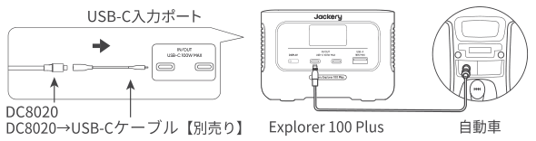
</figure>

## 7. 安全上のご注意

ご使用の前にこの「安全上のご注意」をよくお読みのうえ、正しくお使いください。

### 絵表示について

製品を安全に正しくお使いいただき、お客様や他の方々への危害や財産への損害を未然に防止するための表示です。

内容をよく理解してから本機をご使用ください。

<figure aria-label="絵表示について" class="hb-symbol-signal-composition" data-component-id="HB-TABLE-SYMBOL-SIGNAL"><table class="hb-symbol-signal-table"><colgroup><col class="hb-symbol-signal-col-label"/><col class="hb-symbol-signal-col-meaning"/></colgroup><thead><tr><th class="hb-symbol-signal-label-heading" scope="col">表示</th><th class="hb-symbol-signal-meaning-heading" scope="col">意味</th></tr></thead><tbody><tr><td class="hb-symbol-signal-label-cell">⚠警告</td><td class="hb-symbol-signal-meaning-cell">この表示を無視して、誤った取り扱いをすると、人が死亡または重傷を負う可能性が想定される内容を示しています。</td></tr><tr><td class="hb-symbol-signal-label-cell">⚠注意</td><td class="hb-symbol-signal-meaning-cell">この表示を無視して、誤った取り扱いをすると、人が傷害を負う可能性が想定される内容または物的損害の発生が想定される内容を示しています。</td></tr></tbody></table></figure>

### 絵表示の説明

<figure aria-label="絵表示の説明" class="hb-symbol-pair-composition" data-component-id="HB-TABLE-SYMBOL-ICON">

<table class="hb-symbol-panel-table"><colgroup><col class="hb-symbol-col-icon"/><col class="hb-symbol-col-meaning"/></colgroup><thead><tr><th class="hb-symbol-icon-heading" scope="col">記号</th><th class="hb-symbol-meaning-heading" scope="col">意味</th></tr></thead><tbody><tr><td class="hb-symbol-icon"></td><td class="hb-symbol-meaning">コンセントから電源プラグを抜く記号</td></tr><tr><td class="hb-symbol-icon"></td><td class="hb-symbol-meaning">製品を分解、改造を禁止する記号</td></tr><tr><td class="hb-symbol-icon"></td><td class="hb-symbol-meaning">製品に濡れた手で触れることを禁止する記号</td></tr></tbody></table>

<table class="hb-symbol-panel-table"><colgroup><col class="hb-symbol-col-icon"/><col class="hb-symbol-col-meaning"/></colgroup><thead><tr><th class="hb-symbol-icon-heading" scope="col">記号</th><th class="hb-symbol-meaning-heading" scope="col">意味</th></tr></thead><tbody><tr><td class="hb-symbol-icon"></td><td class="hb-symbol-meaning">行為を指示する記号</td></tr><tr><td class="hb-symbol-icon"></td><td class="hb-symbol-meaning">製品を濡らすことを禁止する記号</td></tr><tr><td class="hb-symbol-icon"></td><td class="hb-symbol-meaning">行為を禁止する記号</td></tr></tbody></table>

</figure>

<table class="manual-callout-table manual-callout-table"><tbody><tr><td class="manual-callout-label">警告</td><td class="manual-callout-body">
<strong>万が一、次のような異常が発生したときはすぐに使用をやめる</strong>
<ul><li>煙が出ている、異臭がする</li><li>落としたり、破損したとき</li><li>異音がする</li><li>内部に水や異物が入ったとき</li><li>電源コード (ACアダプター) が傷んだとき</li></ul>
このような異常が発生したまま使用していると、火災や感電の原因になります。

すぐに充電ケーブルから抜いてください。また、本製品に接続されている機器もすべて外してください。

<strong>万が一発煙や発火したら、大量の水で消火して煙が見えなくなるまで本製品を水浸しにしてください。</strong>

煙が出なくなることを確認してからカスタマーサポートにご連絡ください。

お客様による修理は危険ですので絶対におやめください。
</td></tr></tbody></table>

<table class="manual-callout-table manual-callout-table"><tbody><tr><td class="manual-callout-label">警告</td><td class="manual-callout-body">
<strong>分解、改造しない</strong>

故障、発熱、火災･感電の原因になります。
</td></tr></tbody></table>

<table class="manual-callout-table manual-callout-table"><tbody><tr><td class="manual-callout-label">警告</td><td class="manual-callout-body">
<strong>表示された電源電圧以外で使用しない</strong>

故障、発熱、火災･感電の原因になります。また、本製品を使用できるのは日本国内のみです。
</td></tr></tbody></table>

<table class="manual-callout-table manual-callout-table"><tbody><tr><td class="manual-callout-label">警告</td><td class="manual-callout-body">
<strong>付属品と本製品が破損した場合は、ご自身で修理をしない</strong>
</td></tr></tbody></table>

<table class="manual-callout-table manual-callout-table"><tbody><tr><td class="manual-callout-label">警告</td><td class="manual-callout-body">
<strong>火のそばや炎天下の車内、熱器具の周辺など高温（40°C以上）になる場所で使用したり、放置しない</strong>

発熱や発火、破裂する原因になります。
</td></tr></tbody></table>

<table class="manual-callout-table manual-callout-table"><tbody><tr><td class="manual-callout-label">警告</td><td class="manual-callout-body">
<strong>強い衝撃を与えたり、投げつけたりしない</strong>

発熱や発火、破裂する原因になります。
</td></tr></tbody></table>

<table class="manual-callout-table manual-callout-table"><tbody><tr><td class="manual-callout-label">警告</td><td class="manual-callout-body">
<strong>水など、液体を入れたり、濡らしたりしない</strong>

発熱や発火の原因になります。
</td></tr></tbody></table>

<table class="manual-callout-table manual-callout-table"><tbody><tr><td class="manual-callout-label">警告</td><td class="manual-callout-body">
<strong>濡れた手で本体や接続するケーブルを触らない</strong>

火災や感電の原因になります。
</td></tr></tbody></table>

<table class="manual-callout-table manual-callout-table"><tbody><tr><td class="manual-callout-label">警告</td><td class="manual-callout-body">
<strong>端子部にケーブル以外の金属類を差し込まない</strong>

発熱や発火の原因になります。
</td></tr></tbody></table>

<table class="manual-callout-table manual-callout-table"><tbody><tr><td class="manual-callout-label">警告</td><td class="manual-callout-body">
<strong>雷が鳴りだしたら、電源プラグにふれない (充電をしない)</strong>

感電の原因になります。
</td></tr></tbody></table>

<table class="manual-callout-table manual-callout-table"><tbody><tr><td class="manual-callout-label">警告</td><td class="manual-callout-body">
<strong>各接続端子には確実に差し込む</strong>

差し込みが不十分だと、発熱したりほこりが付着して火災や感電の原因になります。
</td></tr></tbody></table>

<table class="manual-callout-table manual-callout-table"><tbody><tr><td class="manual-callout-label">注意</td><td class="manual-callout-body">
<strong>本製品の上に物を載せたり、不安定な場所に置かない</strong>

倒れたり、落ちたりしてけがの原因になります。
</td></tr></tbody></table>

<table class="manual-callout-table manual-callout-table"><tbody><tr><td class="manual-callout-label">注意</td><td class="manual-callout-body">
<strong>・本製品は病院仕様のCPAP（シーバップ）、ECMO（エクモ）、ペースメーカなど、身の安全に関わる医療救急機械の電源として使用することは推薦されません。使用上の制限については、医師の指示に従うとともに、メーカーにご相談ください。</strong>
</td></tr></tbody></table>

## 8. 使用上のご注意

Jackery Explorer 100 Plusは、最大電力128Wまでの機器に給電可能です。最大出力128Wは、一定の電力で動く機器への出力可能範囲を指しています。128Wの出力を超えた場合は、電気回路が自動的に調整され、電力が低減、または保護機能が作動し自動で遮断することがあります。始動電力が128wの出力上限値を超える場合、ご利用できませんのでご了承ください。

<ul><li>
電気モーターを搭載している製品については、例(掃除機、ポンプ、冷蔵庫、電動丸ノコ、エアコン、洗濯機、電子レンジ、ドライヤーなど)起動時に「誘導負荷」が発生し、公称電力の3～7倍の電力が必要となります。
</li><li>
始動電力が出力上限値(定格出力)を大幅に超える可能性のある製品のご利用や、定格出力を超え給電がストップした製品を繰り返し利用することはポータブル電源が損傷するリスクがありますのでお控えください。
</li><li>
本製品は防塵･防水仕様ではありませんので、ほこりや水、海水などがかからないように注意してください。
</li><li>
ほこりが多い場所や高温多湿の場所での充電および使用、放置をしないでください。
</li><li>
本製品を不安定な場所に置かないでください。必ず、平坦で安定した場所に置いて使用してください。
</li><li>
本製品の通風孔は、安全上絶対にふさがないでください。また、本製品の各面から5cm以上スペースを空けてください。
</li><li>
充電または給電中は本製品が温かくなります(故障ではありません)、周囲には物を置かないでください。
</li><li>
本製品接続機器のケーブルを差すときは、真っすぐな向きに差してください。
</li><li>
接続機器のケーブルを抜くときは、必ずプラグ部分を持って抜いてください。ケーブルを引っ張ったり折り曲げると、断線などの原因となります。
</li><li>
給電する機器の充電制御や充電状況、環境などにより給電できない、または急速充電にならない場合があります。
</li><li>
充電または給電中はラジオやチューナー、テレビなどに雑音が入る場合があります。雑音が入る場合には、それらの製品から離れた場所でお使いください。
</li><li>
本体が汚れたらコンセントから電源プラグを抜き、柔らかい布で乾拭きしてください。汚れがひどいときは、水または薄めた中性洗剤でふきとってください。シンナーやベンジンなどは絶対に使わないでください。
</li><li>
付属のACアダプターは、電源コードの抜き差しで電源が入ったり切れたりするため、異常時に電源コードを容易に抜き差しできるスペースを空けておいてください。
</li><li>
入出力の電力(W)

接続機器の入力仕様が本製品の出力値の上限を超えている場合、電源を自動的に遮断します。消費電力が仕様以下であることを確認してから出力ボタンを押してください。
</li><li>
低/高温警報

本製品は、-10°C ~ 40°C (14°F ~ 104°F)の温度範囲でお使いの機器に電力を供給できます。動作温度が上記範囲外にある場合、本製品が動作しないことがあります。

この製品は、0°C ~ 40°C (32°F ~ 104°F) の温度範囲内で充電してください。

充電温度が上記範囲を超えると、正常に充電できない場合があります。

過低温および過高温の表示があれば保護装置が動作し充電又は出力が停止します。

復旧は本機が規定温度になれば自然復旧します。
</li><li>
容量表示に関しては、あくまで参考値となり、電圧により電力が算出され、表示数値にズレが発生することがあります。

保存温度：-20°C ~ 25°C (-4°F ~ 77°F)で6ヶ月；-20°C ~ 45°C (-4°F ~ 113°F)で3ヶ月

ご確認：-20°C ~ 25°C (-4°F ~ 77°F)で長期保管する場合、6ヶ月に１度を目安に、

-20°C~45°C (-4°F~113°F) で長期保管をする場合、3ヵ月に１度を目安に、本体にACアダプターやソーラーパネルを通して蓄電が可能か、他製品に給電可能かなど動作確認をお願い致します。また長期保管の場合、電池残量は60-80%程度で保管を行ってください。
</li></ul>

## 9. 免責事項

<ul><li>
火災、地震、第三者による行為、その他の事故、お客様の故意または過失誤用・誤動作・その他の異常な条件下での使用により生じた損害に関して、当社は一切責任を負いません。
</li><li>
付属品と本製品が破損した場合は、ご自身で修理を行わないでください。

ご自身で分解・修理したことにより生じた損害に関し、当社は一切責任を負いません。
</li><li>
保証範囲は利用規約に適用され、記載されていない内容は当社の保証範囲外となります。
</li><li>
取扱説明書の記載事項が遵守されないことにより生じた不適合について当社は責任を負いかねます。
</li><li>
本製品の使用、または使用不能から発生する付随的な損害(事業利益損失含む)、当社が関与しない接続機器との組み合わせによる誤動作などから生じた損害に関して、当社は一切の責任を負いません。
</li><li>
本製品は病院仕様のCPAP（シーバップ）、ECMO（エクモ）、ペースメーカなど、身の安全に関わる医療救急機械の電源としての使用、または、消費電力の大きいな設備、例えば核施設設備、スペースシャトル製造などの使用は推薦されません。上記設備の使用後、火災、機器故障など個人安全を脅かす事故の責任を取りません。
</li></ul>
