

## US English Model: JE-100A

Congratulations on your new Jackery Explorer 100 Plus. Please read this manual carefully before using the product, particularly the relevant precautions to ensure proper use. Keep this manual in an accessible place for frequent reference.

In compliance with laws and regulations, the right of final interpretation of this document and all related documents of this product resides with the Company.

Please kindly notice that no further notifications will be given in case of any update, revision or termination.

<h2 class="hb-spec-group">TECHNICAL SPECIFICATIONS</h2>

<figure aria-label="TECHNICAL SPECIFICATIONS" class="hb-spec-table-composition"><table class="manual-table manual-spec-table hb-spec-table"><colgroup><col class="hb-spec-col-label"/><col class="hb-spec-col-value"/></colgroup><tbody><tr><th class="manual-spec-label hb-spec-label" scope="row">Product Name:</th><td class="manual-spec-value hb-spec-value">Jackery Explorer 100 Plus</td></tr><tr><th class="manual-spec-label hb-spec-label" scope="row">Model No.:</th><td class="manual-spec-value hb-spec-value">JE-100A</td></tr><tr><th class="manual-spec-label hb-spec-label" scope="row">Cell Chemistry:</th><td class="manual-spec-value hb-spec-value">LiFePO4</td></tr><tr><th class="manual-spec-label hb-spec-label" scope="row">Internal Battery :</th><td class="manual-spec-value hb-spec-value">6.2Ah/16V 99.2Wh equal to 31000mAh 3.2V</td></tr><tr><th class="manual-spec-label hb-spec-label" scope="row">Weight:</th><td class="manual-spec-value hb-spec-value">Around 2.13 lbs / 965 g</td></tr><tr><th class="manual-spec-label hb-spec-label" scope="row">Dimensions:</th><td class="manual-spec-value hb-spec-value">4.96 x 3.41 x 3.43 in / 12.6 x 8.65 x 8.7 cm</td></tr><tr><th class="manual-spec-label hb-spec-label" scope="row">Cycle Life:</th><td class="manual-spec-value hb-spec-value">2000 cycles to 80%+ capacity</td></tr><tr><th class="manual-spec-label hb-spec-label" scope="row">USB-A Output:</th><td class="manual-spec-value hb-spec-value">18W Max, 5V⎓3A, 9V⎓2A, 12V⎓1.5A</td></tr><tr><th class="manual-spec-label hb-spec-label" scope="row">USB-C1/C2 Output:</th><td class="manual-spec-value hb-spec-value">100W Max, 4.5V⎓5A, 5V⎓3A, 5V⎓4.5A, 9V⎓3A, 12V⎓3A, 15V⎓3A, 20V⎓5A</td></tr><tr><th class="manual-spec-label hb-spec-label" scope="row">PPS:</th><td class="manual-spec-value hb-spec-value">5-21V⎓5A, 100W Max</td></tr><tr><th class="manual-spec-label hb-spec-label" scope="row">USB-C1+USB-C2 Output:</th><td class="manual-spec-value hb-spec-value">110W Max</td></tr><tr><th class="manual-spec-label hb-spec-label" scope="row">USB-C1/C2+USB-A Output:</th><td class="manual-spec-value hb-spec-value">118W Max</td></tr><tr><th class="manual-spec-label hb-spec-label" scope="row">USB-C1+USB-C2+USB-A Output:</th><td class="manual-spec-value hb-spec-value">128W Max</td></tr><tr><th class="manual-spec-label hb-spec-label" scope="row">USB-C1/C2 Input (PD Input):</th><td class="manual-spec-value hb-spec-value">100W Max, 5V⎓3A, 9V⎓3A, 12V⎓3A, 15V⎓3A, 20V⎓5A</td></tr><tr><th class="manual-spec-label hb-spec-label" scope="row">USB-C1/C2 Input (Car Input):</th><td class="manual-spec-value hb-spec-value">60W Max, 11-17.5V⎓5A</td></tr><tr><th class="manual-spec-label hb-spec-label" scope="row">USB-C1/C2 Input (Solar Input):</th><td class="manual-spec-value hb-spec-value">100W Max, 18-27.2V⎓5A</td></tr><tr><th class="manual-spec-label hb-spec-label" scope="row">Charge Temperature:</th><td class="manual-spec-value hb-spec-value">32°F~104°F(0°C~40°C)</td></tr><tr><th class="manual-spec-label hb-spec-label" scope="row">Discharge Temperature:</th><td class="manual-spec-value hb-spec-value">14°F~104°F(-10°C~40°C)</td></tr></tbody></table></figure>

### CERTIFICATIONS

<figure class="hb-reference-figure" data-component-id="HB-SPECIAL-REFERENCE-FIGURE" data-reference-id="certifications" data-source-fragment-sha256="d5aab92117947633f2f2403f700b669ae0188c8669487a6c79e896b1c9291ee7" data-step-captions="embedded">
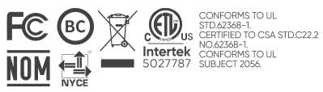
</figure>

USB Type-C® and USB-C® are registered trademarks of USB Implementers Forum.

## PACKAGE LIST

<figure aria-label="PACKAGE LIST" class="hb-inbox-composition" data-card-count="3" data-component-id="HB-SPECIAL-INBOX" data-inbox-variant="responsive-card-grid"><ol class="hb-inbox-grid"><li class="hb-inbox-card" data-item-number="1">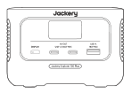

Jackery Explorer 100 Plus

</li><li class="hb-inbox-card" data-item-number="2">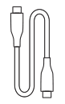

USB-C Charging Cable

</li><li class="hb-inbox-card" data-item-number="3">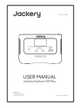

User Manual

</li></ol></figure>

## GET TO KNOW YOUR GEAR

### Product Appearance

<figure class="hb-reference-figure" data-component-id="HB-SPECIAL-REFERENCE-FIGURE" data-reference-id="overview" data-source-fragment-sha256="048c4b39cc39d03205768b6280bd17aec6521f5b740acbe57ea1b76caae0665c" data-step-captions="embedded">
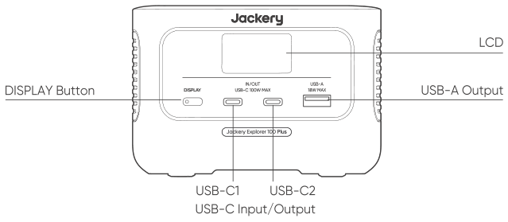
</figure>

## LCD DISPLAY

<figure class="hb-reference-figure" data-component-id="HB-SPECIAL-REFERENCE-FIGURE" data-reference-id="lcd-map" data-source-fragment-sha256="042bd4f417c9497664ae0c0e21a854da97c732cff82c25bd0ab3050ef07fa846" data-step-captions="embedded">
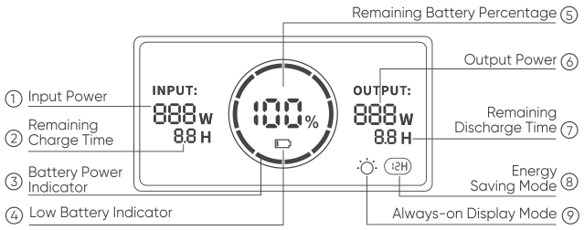
</figure>

<figure aria-label="LCD DISPLAY" class="hb-lcd-table-composition" data-component-id="HB-TABLE-LCD-ICON" tabindex="0"><table class="hb-lcd-icon-table"><colgroup><col class="hb-lcd-col-icon"/><col class="hb-lcd-col-name"/><col class="hb-lcd-col-description"/></colgroup><tbody><tr><td class="hb-lcd-icon"></td><td class="hb-lcd-name">Battery Power Indicator</td><td class="hb-lcd-description">When the product is being charged, the orange circle around the battery percentage will light up in sequence. When charging other devices, the orange circle will stay on.</td></tr><tr><td class="hb-lcd-icon"></td><td class="hb-lcd-name">Low Battery Indicator</td><td class="hb-lcd-description">When the battery is less than 20%, the Low Battery Indicator will stay on. When less than 5%, the Low Battery Indicator will flash. When it is being charged, the Indicator will be off.</td></tr><tr><td class="hb-lcd-icon"></td><td class="hb-lcd-name">Always-on Display Mode</td><td class="hb-lcd-description">After the display screen lights up, double-click the DISPLAY Button and the mode of Always-on display will be on, then press it again to turn off the screen.</td></tr><tr><td class="hb-lcd-icon"></td><td class="hb-lcd-name">Energy Saving Mode</td><td class="hb-lcd-description">The Energy Saving Mode is disabled by default. When the Energy Saving Mode is enabled, this occurs if the product is not connected to any device or the USB output power is less than or equal to 2W, the product will automatically turn off all outputs after 12 hours.</td></tr></tbody></table></figure>

### To turn on the Energy Saving Mode

Long press the DISPLAY Button until the Energy Saving Mode icon lights up on the screen. Switching on the Energy Saving Mode enables the product to continuously charge devices less than or equal to 2W.

### To turn off the Energy Saving Mode

Long press the Display Button until the Energy Saving Mode icon disappears.

<figure aria-label="LCD DISPLAY" class="hb-lcd-table-composition" data-component-id="HB-TABLE-LCD-ICON" tabindex="0"><table class="hb-lcd-icon-table"><colgroup><col class="hb-lcd-col-icon"/><col class="hb-lcd-col-name"/><col class="hb-lcd-col-description"/></colgroup><tbody><tr><td class="hb-lcd-icon"></td><td class="hb-lcd-name">Fault code</td><td class="hb-lcd-description">In order to respond to the feedback quickly, we set up common fault codes F1, F2, F3 in the system: If any codes appear, please remove the load or unplug the charging plug, the product can restore by itself, if not, please contact after-sales service.</td></tr><tr><td class="hb-lcd-icon"></td><td class="hb-lcd-name">High-temperature warning</td><td class="hb-lcd-description">If it appears on the screen, do not worry, the battery will restore automatically after cooling.</td></tr><tr><td class="hb-lcd-icon"></td><td class="hb-lcd-name">Low-temperature Warning</td><td class="hb-lcd-description">If it is displayed on the screen, do not worry. It will automatically restore after the ambient temperature is restored.</td></tr></tbody></table></figure>

## BASIC OPERATIONS

### LCD Screen On/Off

To turn on, press the Display Button or when there's a charging input or discharging output, the screen display will light up automatically. To turn off, press the Display Button again and the screen display will turn off. Or, if there is no operation in 30 seconds, the product will enter a sleep state and the screen display will automatically turn off.

To turn on/off the Always-on Display (under charging or discharging state), follow these steps:

After the display screen lights up, double-click the DISPLAY Button and the mode of Always-on display will be on, then press it again to turn off the screen.

<strong>Tip:</strong> During Always-on Display mode, the screen automatically turns off after 2 hours without charging or discharging.

## CHARGING YOUR JACKERY EXPLORER 100 PLUS

### Charging from the wall

The USB-C wall charger is not included in the package.

<figure class="hb-reference-figure" data-component-id="HB-SPECIAL-REFERENCE-FIGURE" data-reference-id="charging-wall" data-source-fragment-sha256="4813348457459a14ae40a6acc842d725a589d2780a910351144bba57ecc52aca" data-step-captions="embedded">
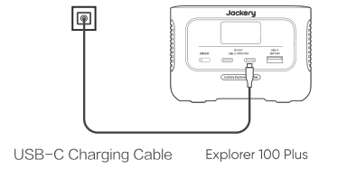
</figure>

### Solar charging

#### Jackery SolarSaga 100 or 60 Solar Panel Connection Guide

The Jackery Explorer 100 Plus adopts USB-C input as the solar charging input. You can refer to the following connection scheme to charge your Explorer 100 Plus.

<figure class="hb-reference-figure" data-component-id="HB-SPECIAL-REFERENCE-FIGURE" data-reference-id="solar-100" data-source-fragment-sha256="02a01d6fa1704ab3b95bee60b5ce25c3805753abff725f78183bf84d49a16f57" data-step-captions="embedded">
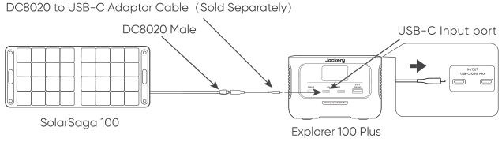
</figure>

#### Jackery New SolarSaga 40 Mini or 80 Solar Panel Connection Guide

* For users who have already purchased the 80W solar panel, the following scheme shows how to connect it to the Explorer 100 Plus.

<figure class="hb-reference-figure" data-component-id="HB-SPECIAL-REFERENCE-FIGURE" data-reference-id="solar-80" data-source-fragment-sha256="0c7f78ecdcb678be4a2e05e63fcb7bdb7b277ea68c27afaaea9582c91b50792d" data-step-captions="embedded">
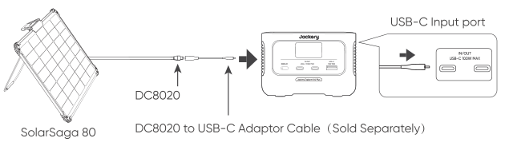
</figure>

* For users who have already purchased the 40W solar panel, the following scheme shows how to connect it to the Explorer 100 Plus.

<figure class="hb-reference-figure" data-component-id="HB-SPECIAL-REFERENCE-FIGURE" data-reference-id="solar-40" data-source-fragment-sha256="b872d51b31f8904fe837fae0b7da9a1961f4b5404dd78b08b607afb9fac65216" data-step-captions="embedded">
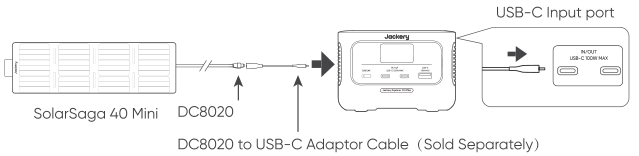
</figure>

### Charging in the Car

This product can be charged with a 12V car charger. Please start the vehicle before charging to prevent draining the car battery and prevent your vehicle from being unable to start.

Meanwhile, please ensure that the car charger and the car cigarette lighter provide a good connection, and ensure that the car charger is fully inserted. In addition, if the vehicle is running on bumpy roads, it is forbidden to use the car charger in case it burns due to a poor connection. The Company will not be responsible for any loss caused by non-standard operation.

<figure class="hb-reference-figure" data-component-id="HB-SPECIAL-REFERENCE-FIGURE" data-reference-id="charging-car" data-source-fragment-sha256="6bb3b7bdb1f4b5b7f9920b79dee399fd632f55f011641acc4b4977e687ac6927" data-step-captions="embedded">
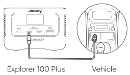
</figure>

## SAFETY PRECAUTIONS WHEN CHARGING

1) Vehicle charging is only applicable in 12V vehicles, not in 24V ones. Please do not charge this product in 24V vehicle to avoid personal injury and property loss.

2) It is recommended to use Jackery accessories - solar panels for solar charging. We will not be responsible for the losses caused by using other brands’ solar panels.

## SAFETY PRECAUTIONS WHEN USING

<strong>The basic safety precautions should be followed when using this product, including:</strong>

a. Please read all instructions before using this product.

b. Close supervision is required when using this product near children to reduce the risk.

c. Risk of electric shock may occur if using accessories recommended or sold by non-professional product manufacturers.

d. When the product is not in use, please unplug the power plug from the product's socket.

e. Do not dismantle the product, which may lead to unpredictable risks such as fire, explosion or electric shock.

f. Do not use the product through damaged cords or plugs, or damaged output cables, which may cause electric shock.

g. Charge the product in a well ventilated area and do not restrict ventilation in any way.

h. Please put the product in a ventilated and dry place to avoid rain and water to cause electric shock.

i. Do not expose the product to fire or high temperature (under direct sunlight or in vehicle under high heat), which may cause accidents such as fire and explosion.

j. The product should not be exposed to rain, water, etc.

<figure aria-label="FCC" class="hb-fcc-composition" data-component-id="HB-SPECIAL-FCC">

<strong>NOTE:</strong> This equipment has been tested and found to comply with the limits for a Class B digital device, pursuant to part 15 of the FCC Rules. These limits are designed to provide reasonable protection against harmful interference in a residential installation. This equipment generates, uses and can radiate radio frequency energy and, if not installed and used in accordance with the instructions, may cause harmful interference to radio communications. However, there is no guarantee that interference will not occur in a particular installation. If this equipment does cause harmful interference to radio or television reception, which can be determined by turning the equipment off and on, the user is encouraged to try to correct the interference by one or more of the following measures:

<ul class="simple"><li>
--Reorient or relocate the receiving antenna.
</li><li>
--Increase the separation between the equipment and receiver.
</li><li>
--Connect the equipment into an outlet on a circuit different from that to which the receiver is connected.
</li><li>
--Consult the dealer or an experienced radio/TV technician for help.
</li></ul>
<strong>MODIFICATION:</strong> Any changes or modifications not expressly approved by the grantee of this device could void the user’s authority to operate the device.

</figure>

## INSTRUCTIONS PERTAINING TO RISK OF FIRE, ELECTRIC SHOCK, OR INJURY TO PERSONS

### IMPORTANT SAFETY INSTRUCTIONS

WARNING–When using this product, basic precautions should always be followed, including the following:

a) Read all the instructions before using the product.

b) To reduce the risk of injury, close supervision is necessary when the product is used near children.

c) Do not put fingers or hands into the product.

d) Do not expose power bank to rain or snow.

e) Use of a power supply or charger not recommended or sold by power pack manufacturer may result in a risk of fire or injury to persons.

f) Do not use the power bank in excess of its output rating. Overload outputs above rating may result in a risk of fire or injury to persons.

g) Do not use the power bank that is damaged or modified. Damaged or modified batteries may exhibit unpredictable behavior resulting in fire, explosion or risk of injury.

h) Do not disassemble the power bank. Take it to a qualified service person when service or repair is required. Incorrect reassembly may result in a risk of fire or injury to persons.

i) Do not expose a power pack to fire or excessive temperature. Exposure to fire or temperature above 100°C may cause explosion. The temperature of 100°C can be replaced by the temperature of 212°F.

j) Have servicing performed by a qualified repair person using only identical replacement parts. This will ensure that the safety of the product is maintained.

k) Switch off the power bank when not in use.

### SAVE THESE INSTRUCTIONS

<strong>CAUTION:</strong> Risk of fire during connection of additional equipment, safeguards against fire of the connected equipment or accessory should be considered.

Risk of Fire and Burns. Do Not Open, Crush, Heat Above (manufacturer's specified maximum temperature) or Incinerate. Follow Manufacturer's Instructions.

### SAVE THESE INSTRUCTIONS OPERATING INSTRUCTIONS

<ul><li>
Use and store the unit only in a clean and dry environment. DO NOT use and store in dusty and wet environment.
</li><li>
Check the unit prior to every use. DO NOT use the unit if it is damaged, broken.
</li><li>
If rust, peculiar odors, overheating or other abnormal circumstances are observed, stop using the unit immediately and contact the dealer or our customer service center.
</li><li>
Make sure that the unit is properly secured when transporting it in a motor vehicle.
</li><li>
Only charge the Explorer 100 Plus within a ambient temperature 32°F~104°F (0°C ~40°C),discharge temperature is 14°F~104°F (-10°C~40°C) and Storage temperature is 6 months: 14°F~77°F (-10°C~25°C).
</li><li>
Switch the unit off immediately if it has accidentally fallen, was dropped or was exposed to vibrations.
</li><li>
DO NOT use the unit if the power cord is damaged or broken.
</li><li>
Keep the unit away from children. DO NOT let children use the power supply unit. Keep this product away from pets.
</li></ul>

## WARRANTY

We only provide our warranty to customers who purchase from the official Jackery website, Jackery-branded third-party platforms, or local authorized dealers.

*Warranty period and details may vary according to local laws, regulations, and authorized dealers.

### Limited Warranty

<figure aria-label="Limited Warranty" class="hb-warranty-card" data-component-id="HB-WARRANTY-SECTION" data-warranty-card-index="1">
Jackery Inc. warrants to the original consumer purchaser that the Jackery product will be free from defects in workmanship and material under normal consumer use during the applicable warranty period identified in the 'Warranty Period' section below, subject to the exclusions set forth below.

This warranty statement sets forth Jackery's total and exclusive warranty obligation. We will not assume, nor authorize any person to assume for us, any other liability in connection with the sale of our products.
</figure>

### Warranty Period

<figure aria-label="Warranty Period" class="hb-warranty-card" data-component-id="HB-WARRANTY-SECTION" data-warranty-card-index="2">
2 Years Standard Warranty: The standard warranty period for Jackery Explorer 100 Plus is 24 months. In each case, the warranty period is measured starting on the date of purchase by the original consumer purchaser. The sales receipt from the first consumer purchase, or other reasonable documentary proof, is required in order to establish the start date of the warranty period.
</figure>

### Exchange

<figure aria-label="Exchange" class="hb-warranty-card" data-component-id="HB-WARRANTY-SECTION" data-warranty-card-index="3">
Jackery will replace (at Jackery's expense) any Jackery product that fails to operate during the applicable warranty period due to defect in workmanship or material. A replacement product assumes the remaining warranty of the original product.
</figure>

### Limited to Original Consumer Buyer

<figure aria-label="Limited to Original Consumer Buyer" class="hb-warranty-card" data-component-id="HB-WARRANTY-SECTION" data-warranty-card-index="4">
The warranty on Jackery's product is limited to the original consumer purchaser and is not transferable to any subsequent owner.
</figure>

### Exclusions

<figure aria-label="Exclusions" class="hb-warranty-card" data-component-id="HB-WARRANTY-SECTION" data-warranty-card-index="5">
Jackery's warranty does not apply to:

Misused, abused, modified, damaged by accident, or used for anything other than normal consumer use as authorized in Jackery's current product literature.

Attempted repair by anyone other than an authorized facility.

Any product purchased through an online auction house.

Jackery's warranty does not apply to the battery cell unless the battery cell is fully charged by you within seven days after you purchase the product and at least once every 6 months thereafter.
</figure>

<strong>JACKERY INC.</strong>

5310 Bunche Dr, Fremont, CA 94538

Tel: 1-888-502-2236(US)

E-mail: hello@jackery.com

Website: www.jackery.com

<strong>JACKERY MEXICO S.A. DE C.V.</strong>

Calle Poseidón 18 , Crédito Constructor, Benito Juárez, C.P. 03940, Cludad De México, México

