

## 安全上のご注意

<strong>ご使用の前にこの「安全上のご注意」をよくお読みのうえ、正しくお使いください。</strong>

### 絵表示について

製品を安全に正しくお使いいただき、お客様や他の方々への危害や財産への損害を未然に防止するための表示です。

内容をよく理解してから本文をお読みください。

<figure aria-label="絵表示について" class="hb-symbol-signal-composition" data-component-id="HB-TABLE-SYMBOL-SIGNAL"><table class="hb-symbol-signal-table"><colgroup><col class="hb-symbol-signal-col-label"/><col class="hb-symbol-signal-col-meaning"/></colgroup><thead><tr><th class="hb-symbol-signal-label-heading" scope="col">表示</th><th class="hb-symbol-signal-meaning-heading" scope="col">意味</th></tr></thead><tbody><tr><td class="hb-symbol-signal-label-cell">⚠警告</td><td class="hb-symbol-signal-meaning-cell">この表示を無視して、誤った取り扱いをすると、人が死亡または重傷を負う可能性が想定される内容を示しています。</td></tr><tr><td class="hb-symbol-signal-label-cell">⚠ご注意</td><td class="hb-symbol-signal-meaning-cell">この表示を無視して、誤った取り扱いをすると、人が傷害を負う可能性が想定される内容または物的損害の発生が想定される内容を示しています。</td></tr><tr><td class="hb-symbol-signal-label-cell">⚠説明</td><td class="hb-symbol-signal-meaning-cell">この表示を無視して誤った取り扱いをすると、機器の損傷、データの消失、性能の低下、または予期しない動作が発生する可能性があることを示しています。</td></tr><tr><td class="hb-symbol-signal-label-cell">⚠ヒント</td><td class="hb-symbol-signal-meaning-cell">文章内の重要な情報や操作のヒントを補足する内容を示しています。</td></tr></tbody></table></figure>

### 絵表示の説明

<figure aria-label="絵表示の説明" class="hb-symbol-pair-composition" data-component-id="HB-TABLE-SYMBOL-ICON">

<table class="hb-symbol-panel-table"><colgroup><col class="hb-symbol-col-icon"/><col class="hb-symbol-col-meaning"/></colgroup><thead><tr><th class="hb-symbol-icon-heading" scope="col">記号</th><th class="hb-symbol-meaning-heading" scope="col">意味</th></tr></thead><tbody><tr><td class="hb-symbol-icon"></td><td class="hb-symbol-meaning">潜在的な危険やリスクについて注意喚起するために、必ずお読みください。</td></tr><tr><td class="hb-symbol-icon"></td><td class="hb-symbol-meaning">操作の前に取扱説明書をお読みください。</td></tr><tr><td class="hb-symbol-icon"></td><td class="hb-symbol-meaning">本製品を火気の近くに置かないでください。</td></tr><tr><td class="hb-symbol-icon"></td><td class="hb-symbol-meaning">小さなお子様の手の届かない場所に保管してください。</td></tr><tr><td class="hb-symbol-icon"></td><td class="hb-symbol-meaning">製品を分解、改造を禁止する記号</td></tr><tr><td class="hb-symbol-icon"></td><td class="hb-symbol-meaning">製品に濡れた手で触れることを禁止する記号</td></tr><tr><td class="hb-symbol-icon"></td><td class="hb-symbol-meaning">行為を指示する記号</td></tr></tbody></table>

<table class="hb-symbol-panel-table"><colgroup><col class="hb-symbol-col-icon"/><col class="hb-symbol-col-meaning"/></colgroup><thead><tr><th class="hb-symbol-icon-heading" scope="col">記号</th><th class="hb-symbol-meaning-heading" scope="col">意味</th></tr></thead><tbody><tr><td class="hb-symbol-icon"></td><td class="hb-symbol-meaning">充電式電池のリサイクルについて 本機はリサイクル可能な充電池を内蔵しています。 この商品を廃棄する場合は、当社のカスタマーサポートにご連絡ください。 充電池の取りはずしはお客様自身では行わないでください。</td></tr><tr><td class="hb-symbol-icon"></td><td class="hb-symbol-meaning">このシンボルは、本製品を一般家庭ごみとして廃棄せず、リサイクルのために指定の回収施設に持ち込む必要があることを示しています。 適切な廃棄およびリサイクルは、環境保護に役立ちます。 本製品の廃棄やリサイクルについての詳細は、お住まいの自治体、廃棄物処理業者、または販売店にお問い合わせください。</td></tr><tr><td class="hb-symbol-icon"></td><td class="hb-symbol-meaning">製品を濡らすことを禁止する記号</td></tr><tr><td class="hb-symbol-icon"></td><td class="hb-symbol-meaning">行為を禁止する記号</td></tr></tbody></table>

</figure>

<table class="manual-callout-table manual-callout-table"><tbody><tr><td class="manual-callout-label">警告</td><td class="manual-callout-body">
<strong>火のそばや炎天下の車内、熱器具の周辺など高温（45°C以上）になる場所で使用したり、放置しない</strong>

発熱や発火、破裂する原因になります。
</td></tr></tbody></table>

<table class="manual-callout-table manual-callout-table"><tbody><tr><td class="manual-callout-label">警告</td><td class="manual-callout-body">
<strong>強い衝撃を与えたり、投げつけたりしない</strong>

発熱や発火、破裂する原因になります。
</td></tr></tbody></table>

<table class="manual-callout-table manual-callout-table"><tbody><tr><td class="manual-callout-label">警告</td><td class="manual-callout-body">
<strong>各接続端子には確実に差し込む</strong>

差し込みが不十分だと、発熱したりほこりが付着して火災や感電の原因になります。
</td></tr></tbody></table>

<table class="manual-callout-table manual-callout-table"><tbody><tr><td class="manual-callout-label">警告</td><td class="manual-callout-body">
<strong>濡れた手で本体や接続するケーブルを触らない</strong>

火災や感電の原因になります。
</td></tr></tbody></table>

<table class="manual-callout-table manual-callout-table"><tbody><tr><td class="manual-callout-label">警告</td><td class="manual-callout-body">
<strong>端子部にケーブル以外の金属類を差し込まない</strong>

発熱や発火の原因になります。
</td></tr></tbody></table>

<table class="manual-callout-table manual-callout-table"><tbody><tr><td class="manual-callout-label">警告</td><td class="manual-callout-body">
<strong>雷が鳴りだしたら、電源プラグにふれない (充電をしない)</strong>

感電の原因になります。
</td></tr></tbody></table>

<table class="manual-callout-table manual-callout-table"><tbody><tr><td class="manual-callout-label">警告</td><td class="manual-callout-body">
<strong>水など、液体を入れたり、濡らしたりしない</strong>

発熱や発火の原因になります。
</td></tr></tbody></table>

<table class="manual-callout-table manual-callout-table"><tbody><tr><td class="manual-callout-label">警告</td><td class="manual-callout-body">
<strong>接地接続は必ず、電源プラグを電源につなぐ前に行って下さい</strong>

また、接地接続を外す場合は、必ず電源プラグを切り離してから行って下さい。
</td></tr></tbody></table>

<table class="manual-callout-table manual-callout-table"><tbody><tr><td class="manual-callout-label">警告</td><td class="manual-callout-body">
万が一、次のような異常が発生したときはすぐに使用をやめる
<ul><li>
煙が出ている、異臭がする
</li><li>
落としたり、破損したとき
</li><li>
異音がする
</li><li>
内部に水や異物が入ったとき
</li></ul>
このような異常が発生したまま使用していると、火災や感電の原因になります。

<strong>万が一発煙や発火したら、大量の水で消火して煙が見えなくなるまで本製品を水浸しにしてください。</strong>

煙が出なくなることを確認してからカスタマーサポートにご連絡ください。

お客様による修理は危険ですので絶対におやめください。
</td></tr></tbody></table>

<table class="manual-callout-table manual-callout-table"><tbody><tr><td class="manual-callout-label">警告</td><td class="manual-callout-body">
<strong>分解、改造しない</strong>

故障、発熱、火災･感電の原因になります。
</td></tr></tbody></table>

<table class="manual-callout-table manual-callout-table"><tbody><tr><td class="manual-callout-label">警告</td><td class="manual-callout-body">
<strong>表示された電源電圧以外で使用しない</strong>

故障、発熱、火災･感電の原因になります。また、本製品を使用できるのは日本国内のみです。
</td></tr></tbody></table>

<table class="manual-callout-table manual-callout-table"><tbody><tr><td class="manual-callout-label">警告</td><td class="manual-callout-body">
<strong>付属品と本製品が破損した場合は、ご自身で修理をしない</strong>
</td></tr></tbody></table>

<table class="manual-callout-table manual-callout-table"><tbody><tr><td class="manual-callout-label">注意</td><td class="manual-callout-body">
<strong>本製品の上に物を載せたり、不安定な場所に置かない</strong>

倒れたり、落ちたりしてけがの原因になります。
</td></tr></tbody></table>

<table class="manual-callout-table manual-callout-table"><tbody><tr><td class="manual-callout-label">注意</td><td class="manual-callout-body">
<strong>データサーバや医療機器など、非常時に不具合が起こると人命 / 財産に重大な危険を及ぼしうる用途でのご使用はお控えください。次のようなような機器では、万が一使用中に給電ができなくなった場合、人命 / 財産にかかわる被害が想定されます。</strong>
<ul><li>
医療機器や使用上、生命に関わるような機器
</li><li>
社会的、公共的に重要な機器など
</li><li>
重要な事業用機器など
</li></ul></td></tr></tbody></table>

<table class="manual-callout-table manual-callout-table"><tbody><tr><td class="manual-callout-label">注意</td><td class="manual-callout-body">
<strong>心臓にペースメーカーを装着している方は使用しない</strong>

ペースメーカーが、本製品の影響を受ける恐れがあります。
</td></tr></tbody></table>

<table class="manual-callout-table manual-callout-table"><tbody><tr><td class="manual-callout-label">注意</td><td class="manual-callout-body">
<strong>格納式ハンドルを使用してJackery Explorer 100Dを移動するときは、積み重ねたり、上に他の物を置いたりしないでください。落下して怪我をする場合があります。</strong>
</td></tr></tbody></table>

## 使用上のご注意

Jackery Explorer 100Dは、定格出力158Wです。

定格出力158Wは、一定の電力で動く機器への出力可能範囲を指しています。

158Wの出力を超えた場合は、電気回路が自動的に調整され、電力が低減、または保護機能が作動し自動で遮断することがあります。

<table class="manual-callout-table manual-callout-table"><tbody><tr><td class="manual-callout-label">ご注意</td><td class="manual-callout-body">
始動電力が出力上限値(定格出力)を大幅に超える可能性のある製品のご利用や、定格出力を超え給電がストップした製品を繰り返し利用することはポータブル電源のバッテリーが損傷するリスクがありますのでお控えください。
</td></tr></tbody></table>

<strong>■ 給電に関する注意事項</strong>

出力上限値を超える電化製品は使用しないでください。
<ul><li>
給電中、機器の制御や環境により、急速充電にならない・給電できない場合があります。
</li><li>
充電または給電中、ラジオ・チューナー・テレビなどに雑音が入る場合があります。その際は、それらの機器から離してご使用ください。
</li></ul>

<strong>■ 使用環境について</strong>
<ul><li>
本製品は防塵・防水仕様ではありません。ほこり、水、海水などがかからないようご注意ください。
</li><li>
ほこりの多い場所や高温多湿の場所での充電・使用・放置は避けてください。
</li><li>
平坦で安定した場所に設置し、不安定な場所に置かないでください。
</li><li>
充電・給電中は本体が温かくなります。周囲に物を置かないでください。
</li></ul>

<strong>■ 接続時の注意事項</strong>
<ul><li>
ケーブルを接続する際は、まっすぐに差し込んでください。
</li><li>
抜く際は必ずプラグ部分を持って抜いてください。ケーブルを引っ張ったり折り曲げたりしないでください。
</li></ul>

<strong>■ お手入れについて</strong>
<ul><li>
本体が汚れた場合は、電源プラグを抜いた状態で、柔らかい布で乾拭きしてください。
</li><li>
汚れがひどい場合は、水または薄めた中性洗剤で拭き取ってください。
</li><li>
シンナーやベンジンなどの使用は絶対に使わないでください。
</li></ul>

<strong>■ 入出力・温度・表示に関するご注意</strong>
<ul><li>
接続機器の入力が本製品の出力上限を超えている場合、自動で電源が遮断されます。
</li><li>
本機は -20°C~45°C の温度範囲でお使いの機器に電力供給が可能となり、本機の蓄電は 0°C~45°C で行えます。
<ul><li>
動作温度が上記範囲外にある場合、本製品が温度異常マークが表示され、動作しない可能性があります。
</li><li>
温度異常マークが表示された場合は、本製品を 2 時間以上、動作温度範囲内の環境に置いてください。
</li></ul></li><li>
容量表示は参考値であり、電圧により表示数値と実際の容量に差異が出る場合があります。
</li></ul>

## 免責事項

<ul><li>
火災、地震、第三者による行為、その他の事故、お客様の故意または過失誤用・誤動作・その他の異常な条件下での使用により生じた損害に関して、当社は一切責任を負いません。
</li><li>
付属品と本製品が破損した場合は、ご自身で修理を行わないでください。ご自身で分解・修理したことにより生じた損害に関し、当社は一切責任を負いません。
</li><li>
保証範囲は利用規約に適用され、記載されていない内容は当社の保証範囲外となります。
</li><li>
取扱説明書の記載事項が遵守されないことにより生じた不適合について当社は責任を負いかねます。
</li><li>
本製品の使用、または使用不能から発生する付随的な損害 ( 事業利益損失含む )、当社が関与しない接続機器との組み合わせによる誤動作などから生じた損害に関して、当社は一切の責任を負いません。
</li></ul>

## 同梱品

<figure aria-label="同梱品" class="hb-inbox-composition" data-card-count="3" data-component-id="HB-SPECIAL-INBOX" data-inbox-variant="responsive-card-grid"><ol class="hb-inbox-grid"><li class="hb-inbox-card" data-item-number="1">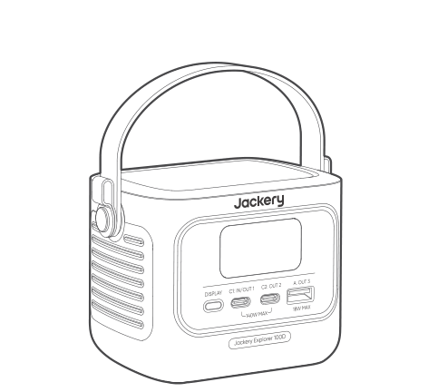

本体

</li><li class="hb-inbox-card" data-item-number="2">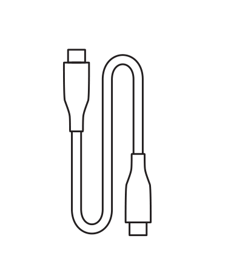

USB-Cケーブル

</li><li class="hb-inbox-card" data-item-number="3">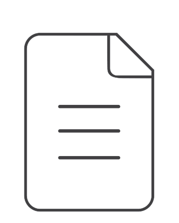

取扱説明書

</li></ol></figure>

※ 付属品を故障、紛失等してしまった場合はカスタマーサポートまでご連絡ください。

※ 本充電ケーブルユニットは、同梱されている電気機器以外には使用しないでください。

※ シガーソケット充電ケーブルは別売りです。Jackery公式サイトよりご購入いただけます。

サポートが必要な場合は、Jackeryカスタマーサポートまでお問い合わせください。

<strong>■本機の仕様および外観は、改善のため予告なく変更することがあります。</strong>

## 各部の名称

### 製品の外観

<figure class="hb-reference-figure" data-component-id="HB-SPECIAL-REFERENCE-FIGURE" data-reference-id="overview" data-source-fragment-sha256="df2ec121d17dcbac1a7f35c5681961bcc140dbe8236fd515a224793b21ccedba" data-step-captions="embedded">
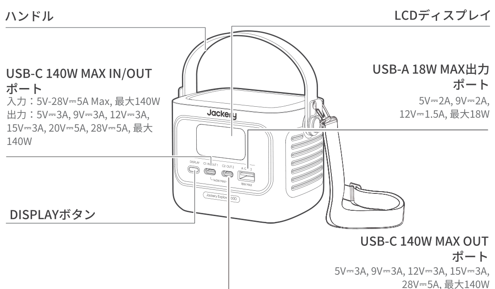
</figure>

※ 追加ストラップは別売りで購入でき、製品の側面に取り付けることができます。

## 液晶画面

### インターフェース1

<figure class="hb-reference-figure" data-component-id="HB-SPECIAL-REFERENCE-FIGURE" data-reference-id="lcd-interface-1" data-source-fragment-sha256="03d55404c45a97c0a8726cf40685a1066c852d002a85908b6c149d7dff9c857d" data-step-captions="embedded">
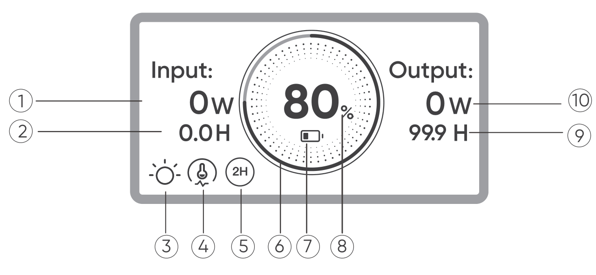
</figure>

<figure aria-label="インターフェース1" class="hb-lcd-table-composition" data-component-id="HB-TABLE-LCD-ICON" tabindex="0"><table class="hb-lcd-icon-table"><colgroup><col class="hb-lcd-col-number"/><col class="hb-lcd-col-icon"/><col class="hb-lcd-col-name"/><col class="hb-lcd-col-description"/></colgroup><tbody><tr><td class="hb-lcd-number">1</td><td class="hb-lcd-icon"></td><td class="hb-lcd-name">入力電力表示</td><td class="hb-lcd-description">入力電力をワットで表示します。</td></tr><tr><td class="hb-lcd-number">2</td><td class="hb-lcd-icon"></td><td class="hb-lcd-name">充電残り時間</td><td class="hb-lcd-description">充電残り時間を表示します。</td></tr><tr><td class="hb-lcd-number">3</td><td class="hb-lcd-icon"></td><td class="hb-lcd-name">常時点灯モード</td><td class="hb-lcd-description"><strong>オン:</strong>常時点灯モードが有効になっています。 <strong>オフ:</strong>常時点灯モードが無効になっています。</td></tr><tr><td class="hb-lcd-number">4</td><td class="hb-lcd-icon">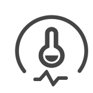</td><td class="hb-lcd-name">温度制御による出力制限</td><td class="hb-lcd-description"><strong>オン:</strong>バッテリー温度が高い状態です。　放電出力制限が有効になっています。 <strong>オフ:</strong>放電出力制限が無効になっています。</td></tr><tr><td class="hb-lcd-number">5</td><td class="hb-lcd-icon"></td><td class="hb-lcd-name">省エネモード</td><td class="hb-lcd-description">アイコン表示:省エネモードがオンになっています。 アイコン無表示:省エネモードがオフになっています。</td></tr><tr><td class="hb-lcd-number">6</td><td class="hb-lcd-icon">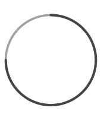</td><td class="hb-lcd-name">バッテリーアイコン</td><td class="hb-lcd-description">製品の充電中は、バッテリーのパーセンテージを囲むオレンジ色の円が順番に点灯します。他のデバイスの充電時には、オレンジ色の円は点灯したままになります。</td></tr><tr><td class="hb-lcd-number">7</td><td class="hb-lcd-icon">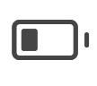</td><td class="hb-lcd-name">バッテリー残量警告灯</td><td class="hb-lcd-description"><strong>オン:</strong>バッテリー残量が20%未満です。 <strong>点滅:</strong>バッテリー残量が5%未満です。 <strong>オフ:</strong>製品は充電中です。</td></tr><tr><td class="hb-lcd-number">8</td><td class="hb-lcd-icon"></td><td class="hb-lcd-name">バッテリーレベルパーセントタグ</td><td class="hb-lcd-description">バッテリー残量を表示します。</td></tr><tr><td class="hb-lcd-number">9</td><td class="hb-lcd-icon"></td><td class="hb-lcd-name">バッテリー使用可能時間</td><td class="hb-lcd-description">接続した機器の使用可能な時間を表示します。</td></tr><tr><td class="hb-lcd-number">10</td><td class="hb-lcd-icon"></td><td class="hb-lcd-name">消費電力</td><td class="hb-lcd-description">出力電力をワットで表示します。</td></tr></tbody></table></figure>

<figure aria-label="インターフェース1" class="hb-lcd-table-composition" data-component-id="HB-TABLE-LCD-ICON" tabindex="0"><table class="hb-lcd-icon-table"><colgroup><col class="hb-lcd-col-icon"/><col class="hb-lcd-col-name"/><col class="hb-lcd-col-description"/></colgroup><tbody><tr><td class="hb-lcd-icon"></td><td class="hb-lcd-name">故障コード</td><td class="hb-lcd-description">負荷を取り外すか、充電プラグを抜いてください。問題が解決しない場合は、Jackeryカスタマーサポートまでお問い合わせください。</td></tr><tr><td class="hb-lcd-icon"></td><td class="hb-lcd-name">高温インジケーター</td><td class="hb-lcd-description">高温保護が作動しました。製品の温度が通常の動作範囲に戻るまで、製品の機能が停止する場合があります。</td></tr><tr><td class="hb-lcd-icon"></td><td class="hb-lcd-name">低温インジケーター</td><td class="hb-lcd-description">低温保護が作動しました。製品の温度が通常の動作範囲に戻るまで、製品の機能が停止する場合があります。</td></tr></tbody></table></figure>

### インターフェース2

<figure class="hb-reference-figure" data-component-id="HB-SPECIAL-REFERENCE-FIGURE" data-reference-id="lcd-interface-2" data-source-fragment-sha256="e8a6ddf48d2292bdb0f58ccaf8e18a5a7f4ac205dc55fd56f8c262fe2aa40cd4" data-step-captions="embedded">
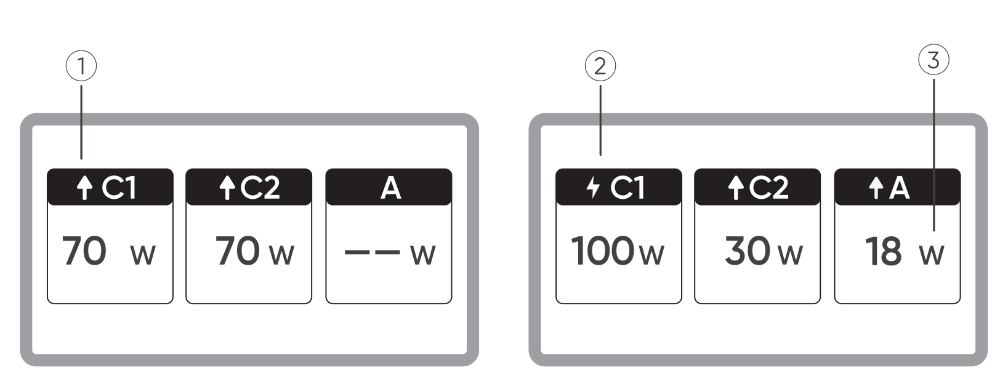
</figure>

<figure aria-label="インターフェース2" class="hb-lcd-table-composition" data-component-id="HB-TABLE-LCD-ICON" tabindex="0"><table class="hb-lcd-icon-table"><colgroup><col class="hb-lcd-col-number"/><col class="hb-lcd-col-icon"/><col class="hb-lcd-col-name"/><col class="hb-lcd-col-description"/></colgroup><tbody><tr><td class="hb-lcd-number">1</td><td class="hb-lcd-icon"></td><td class="hb-lcd-name">放電インジケーター</td><td class="hb-lcd-description">このUSBポートは放電中です。</td></tr><tr><td class="hb-lcd-number">2</td><td class="hb-lcd-icon"></td><td class="hb-lcd-name">充電インジケーター</td><td class="hb-lcd-description">このUSBポートは充電中です。</td></tr><tr><td class="hb-lcd-number">3</td><td class="hb-lcd-icon"></td><td class="hb-lcd-name">充電または放電出力</td><td class="hb-lcd-description">対応するポートの充電または放電出力を表示します。</td></tr></tbody></table></figure>

### インターフェース3

<figure class="hb-reference-figure" data-component-id="HB-SPECIAL-REFERENCE-FIGURE" data-reference-id="lcd-interface-3" data-source-fragment-sha256="0f76517f09909c6155e894230a0ee043c1fc4e41620618961da3539b699e02f1" data-step-captions="embedded">
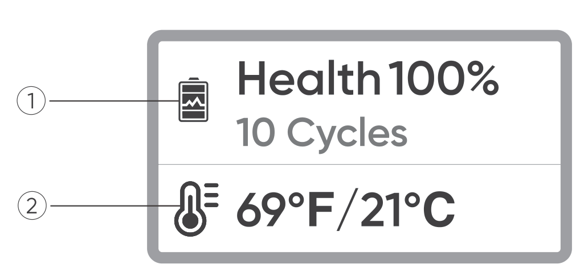
</figure>

<figure aria-label="インターフェース3" class="hb-lcd-table-composition" data-component-id="HB-TABLE-LCD-ICON" tabindex="0"><table class="hb-lcd-icon-table"><colgroup><col class="hb-lcd-col-number"/><col class="hb-lcd-col-icon"/><col class="hb-lcd-col-name"/><col class="hb-lcd-col-description"/></colgroup><tbody><tr><td class="hb-lcd-number">1</td><td class="hb-lcd-icon"></td><td class="hb-lcd-name">バッテリーの健全性とサイクル回数</td><td class="hb-lcd-description">現在のバッテリーの健全性（%）と充放電サイクル回数を表示します。<ul><li>緑:健全な状態です。</li><li>黄:健全性がやや低下しています。</li><li>赤:健全性が低下しています。</li></ul></td></tr><tr><td class="hb-lcd-number">2</td><td class="hb-lcd-icon"></td><td class="hb-lcd-name">バッテリー温度</td><td class="hb-lcd-description">現在のバッテリー温度を表示します。</td></tr></tbody></table></figure>

## 使い方

### 出力オン/オフ

機器を接続すると給電を開始します。

<figure class="hb-reference-figure" data-component-id="HB-SPECIAL-REFERENCE-FIGURE" data-reference-id="operation-output" data-source-fragment-sha256="98ccb8b4f42fd080de6b89d2305e8895e48c974e2abe842addb522050ae162f1" data-step-captions="embedded">
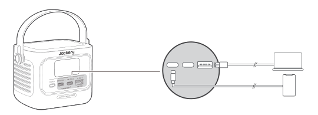
</figure>

<table class="manual-callout-table manual-callout-table"><tbody><tr><td class="manual-callout-label">注意</td><td class="manual-callout-body"><ul><li>
USB-C 140W MAXは、USB-PD Power Source 3 (PS3) の高出力ポートです。接続されたユーザーデバイスまたはアクセサリーが安全基準を満たしていない場合、火災の危険性があります。これらのポートを使用する前に、接続するデバイスまたはアクセサリーに耐火安全保護が備わっていることを確認してください。
</li><li>
Jackery Explorer 100Dは、IEC/EN/UL 62368-1（または同等の規格）の6.3、6.4、6.5条に準拠したデバイスまたはアクセサリーのみに接続してください。
</li><li>
最大出力を得るためには、公式のJackery USB-C to USB-C 5Aケーブル（20V DC/5A、100W；28V DC/5A、140W）を使用してください。
</li></ul></td></tr></tbody></table>

### 省エネモード

省エネモードはデフォルトで無効になっています。出力の消し忘れによる不要なバッテリー消耗を防ぐため、DISPLAYボタンを長押しして省エネモードを有効にします。

デバイスが接続されていない場合、または接続されたデバイスの消費電力が2時間にわたり2W未満の場合、製品は自動的に出力をオフにします。

出力がオンのとき、画面に「2H」アイコンが表示されます。

<figure class="hb-reference-figure" data-component-id="HB-SPECIAL-REFERENCE-FIGURE" data-reference-id="operation-energy" data-source-fragment-sha256="35869bae7e2163b47eccf2f07709db88ebbd185149442bc2d76f2a0c6178f4b0" data-step-captions="embedded">
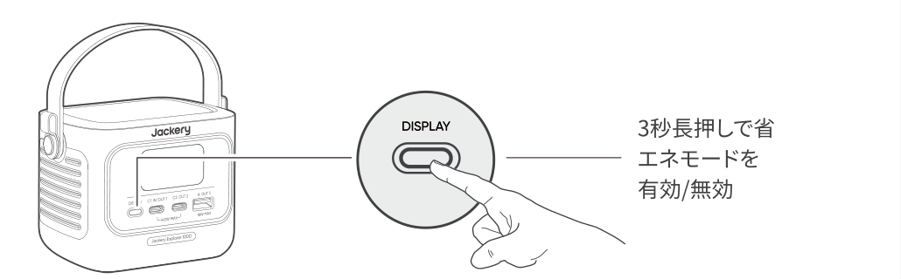
</figure>

<table class="manual-callout-table manual-callout-table"><tbody><tr><td class="manual-callout-label">注意</td><td class="manual-callout-body">
省エネモードは電源投入後に以前の状態に戻ります。モードの変更には手動での切り替えが必要です。
</td></tr></tbody></table>

### LCDスクリーン

<figure class="hb-reference-figure" data-component-id="HB-SPECIAL-REFERENCE-FIGURE" data-reference-id="operation-lcd" data-source-fragment-sha256="f8c82e8e37f8358d5ca3710af1d33898158b78b7c9354297345083e39f9e67a4" data-step-captions="embedded">
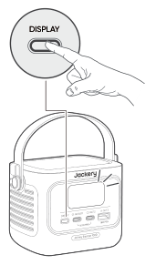
</figure>

<figure aria-label="LCDスクリーン" class="hb-reference-composition hb-reference-lcd-actions-compact" data-component-id="HB-TABLE-REFERENCE" data-component-variant="lcd-actions-compact" tabindex="0"><table class="hb-reference-table"><thead><tr><th scope="col">機能</th><th scope="col">説明</th></tr></thead><tbody><tr><td>画面点灯</td><td>DISPLAYボタンを短く押したとき、または充電中・放電中に自動的に点灯します。</td></tr><tr><td>画面常時点灯</td><td>画面が点灯している状態で、DISPLAYボタンを2回押します。</td></tr><tr><td>画面切替</td><td>画面が点灯した後、DISPLAYボタンを短く押すとページが切り替わります。</td></tr><tr><td>画面常時点灯をオフ</td><td>もう一度 DISPLAYボタンを2回押します。</td></tr><tr><td>自動画面消灯</td><td>操作がない場合、2時間後にLCDは自動的に消灯します。</td></tr></tbody></table></figure>

## 充電方法

<table class="manual-callout-table manual-callout-table"><tbody><tr><td class="manual-callout-label">注意</td><td class="manual-callout-body"><ul><li>
製品の充電動作温度範囲は0°C~45°C、放電動作温度範囲は-20°C~45°Cです。上限・下限温度を超えた場合、充放電が制限され、または充放電不可の可能性があります。
</li><li>
温度によって、製品の充電効率と実際の容量は異なります。
</li><li>
はじめてお使いになるときは、本製品をフル充電してからご使用ください。
</li><li>
充電池は空の状態で長期保管(3カ月~6カ月）すると、性能が劣化したり、充電できなくなる場合があります。
</li><li>
長期保管中は、電池残量が0%にならないよう、3か月に一度の充電をおすすめします。
</li></ul></td></tr></tbody></table>

### USB-C充電器での充電

<figure class="hb-reference-figure" data-component-id="HB-SPECIAL-REFERENCE-FIGURE" data-reference-id="charging-usbc" data-source-fragment-sha256="f8f39b6971a73db3bddc7629e2b0b8a38396405da0add111bf6f9f16691beb4e" data-step-captions="embedded">
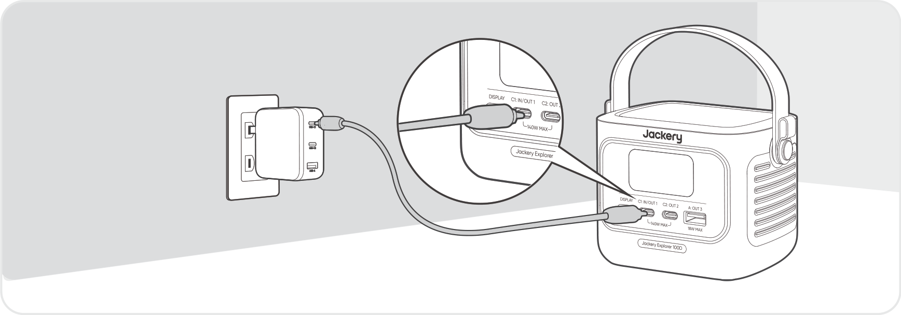
</figure>

※ USB-C充電器は別売りです。

### ソーラーパネルでの充電（別売り）

<strong>40Wまたは100Wソーラーパネルで充電する場合：</strong>

<figure class="hb-reference-figure" data-component-id="HB-SPECIAL-REFERENCE-FIGURE" data-reference-id="charging-solar" data-source-fragment-sha256="42afe15ed91c6f21b397c2d53debf971305359de19c939a57938aa2b429a7dad" data-step-captions="embedded">
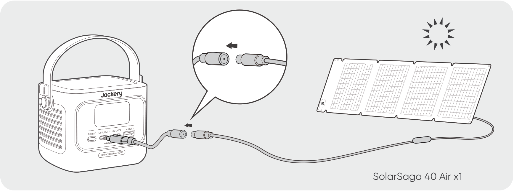
</figure>

※ DC8020からUSB-Cへのケーブルは別売りです。

本製品は最大100Wのソーラー充電に対応しており、Jackery SolarSagaシリーズのソーラーパネルが使用できます。

Jackeryブランド以外の付属品を使用して充電しないでください。特に、ソーラーパネルで充電する際は、Jackeryのソーラーパネルを使用することをお勧めします。ソーラーパネルの開放電圧（Voc）が、Jackery Explorer 100DのDC入力電圧範囲（10V〜30V）内に収まっていることを確認してください。他社ソーラーパネルで充電することによる損失について、当社は一切の責任を負いません。

<table class="manual-callout-table manual-callout-table"><tbody><tr><td class="manual-callout-label">ご注意</td><td class="manual-callout-body">
本製品は、日照が弱く、バッテリー残量が少ない状態でソーラーパネルを接続をした場合、バッテリーが過放電によって劣化する可能性があります。この場合はソーラーパネルの接続を外し、早めにACコンセント等を使って、充電するようにしてください。
</td></tr></tbody></table>

### シガーソケット充電

<strong>本製品は車載シガーソケットからの充電に対応しています。</strong>

ご使用の際は、以下にご注意ください。

<ul><li>
必ず車のエンジンを始動させてから接続してください。エンジン停止状態で使用すると、車両のバッテリーが上がる恐れがあります。
</li><li>
車の充電ポートとシガーソケット充電ケーブルの接触状態をご確認ください。
</li><li>
ケーブルが確実に奥まで差し込まれていることをご確認ください。
</li><li>
悪路などで車両の振動が激しい場合は、接触不良や発熱・焼損の恐れがあるため、充電を中止してください。
</li><li>
誤使用による故障・損傷については、弊社では責任を負いかねます。あらかじめご了承ください。
</li></ul>

<figure class="hb-reference-figure" data-component-id="HB-SPECIAL-REFERENCE-FIGURE" data-reference-id="charging-car" data-source-fragment-sha256="4fea0f7a22a02f069048eeb03c6abd44807ed71d3f01b46d9f7f2adae97fdd0b" data-step-captions="embedded">
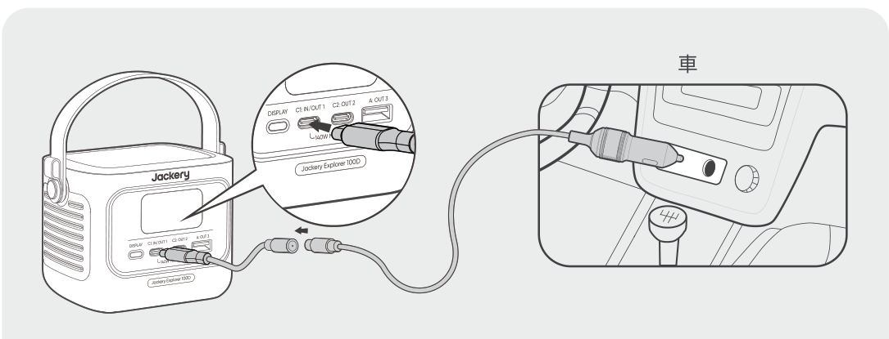
</figure>

※ シガーソケット充電ケーブルは別売りです。

## 主な仕様

<h2 class="hb-spec-group">基本情報</h2>

<figure aria-label="基本情報" class="hb-spec-table-composition"><table class="manual-table manual-spec-table hb-spec-table"><colgroup><col class="hb-spec-col-label"/><col class="hb-spec-col-value"/></colgroup><tbody><tr><th class="manual-spec-label hb-spec-label" scope="row">製品の名称</th><td class="manual-spec-value hb-spec-value">Jackery Explorer 100D</td></tr><tr><th class="manual-spec-label hb-spec-label" scope="row">型番</th><td class="manual-spec-value hb-spec-value">JE-100C/ JE-100C-SG</td></tr><tr><th class="manual-spec-label hb-spec-label" scope="row">定格容量</th><td class="manual-spec-value hb-spec-value">96Wh (5Ah/19.2V DC)</td></tr><tr><th class="manual-spec-label hb-spec-label" scope="row">バッテリータイプ</th><td class="manual-spec-value hb-spec-value">LiFePO₄（リン酸鉄リチウムイオン電池）</td></tr><tr><th class="manual-spec-label hb-spec-label" scope="row">サイズ&amp;重量</th><td class="manual-spec-value hb-spec-value">(118.7±1)×(82.6±0.5)×(85.68±0.8) mm/ (855g±10g)</td></tr><tr><th class="manual-spec-label hb-spec-label" scope="row">サイクル寿命</th><td class="manual-spec-value hb-spec-value">3,000回の充放電後も容量の80%以上を維持</td></tr></tbody></table></figure>

<h2 class="hb-spec-group">入力ポート</h2>

<figure aria-label="入力ポート" class="hb-spec-table-composition"><table class="manual-table manual-spec-table hb-spec-table"><colgroup><col class="hb-spec-col-label"/><col class="hb-spec-col-value"/></colgroup><tbody><tr><th class="manual-spec-label hb-spec-label" rowspan="3" scope="row">USB-C1</th><td class="manual-spec-value hb-spec-value">5V⎓3A, 9V⎓3A, 12V⎓3A, 15V⎓3A, 20V⎓5A, 28V⎓5A, 最大140W</td></tr><tr><td class="manual-spec-value hb-spec-value">ｼｶﾞｰｿｹｯﾄ: 12V⎓最大5A , 24V⎓最大5A</td></tr><tr><td class="manual-spec-value hb-spec-value">PV: 10V-30V⎓, 最大5A, 最大100W</td></tr></tbody></table></figure>

<h2 class="hb-spec-group">出力ポート</h2>

<figure aria-label="出力ポート" class="hb-spec-table-composition"><table class="manual-table manual-spec-table hb-spec-table"><colgroup><col class="hb-spec-col-label"/><col class="hb-spec-col-value"/></colgroup><tbody><tr><th class="manual-spec-label hb-spec-label" scope="row">USB-A</th><td class="manual-spec-value hb-spec-value">5V⎓2A, 9V⎓2A, 12V⎓1.5A, 最大18W</td></tr><tr><th class="manual-spec-label hb-spec-label" scope="row">USB-C1/USB-C2</th><td class="manual-spec-value hb-spec-value">5V⎓3A, 9V⎓3A, 12V⎓3A, 15V⎓3A, 20V⎓5A, 28V⎓5A, 最大140W</td></tr></tbody></table></figure>

<h2 class="hb-spec-group">出力合計</h2>

<figure aria-label="出力合計" class="hb-spec-table-composition"><table class="manual-table manual-spec-table hb-spec-table"><colgroup><col class="hb-spec-col-label"/><col class="hb-spec-col-value"/></colgroup><tbody><tr><th class="manual-spec-label hb-spec-label" scope="row">USB-C1 + USB-C2</th><td class="manual-spec-value hb-spec-value">最大（70W + 70W）</td></tr><tr><th class="manual-spec-label hb-spec-label" scope="row">USB-C1 + USB-A / USB-C2 + USB-A</th><td class="manual-spec-value hb-spec-value">最大（140W +  18W）</td></tr><tr><th class="manual-spec-label hb-spec-label" scope="row">USB-C1 + USB-C2 + USB-A</th><td class="manual-spec-value hb-spec-value">最大（70W + 70W + 18W）</td></tr></tbody></table></figure>

<h2 class="hb-spec-group">温度範囲</h2>

<figure aria-label="温度範囲" class="hb-spec-table-composition"><table class="manual-table manual-spec-table hb-spec-table"><colgroup><col class="hb-spec-col-label"/><col class="hb-spec-col-value"/></colgroup><tbody><tr><th class="manual-spec-label hb-spec-label" scope="row">充電温度</th><td class="manual-spec-value hb-spec-value">0°C ～ 45°C</td></tr><tr><th class="manual-spec-label hb-spec-label" scope="row">動作温度</th><td class="manual-spec-value hb-spec-value">-20°C ～ 45°C</td></tr><tr><th class="manual-spec-label hb-spec-label" scope="row">保存温度</th><td class="manual-spec-value hb-spec-value">-20°C ～ 60°C</td></tr></tbody></table></figure>

※ USB Type-C® and USB-C® are registered trademarks of USB Implementers Forum.

## 保証について

### お問い合わせ

<figure aria-label="お問い合わせ" class="hb-warranty-card" data-component-id="HB-WARRANTY-SECTION" data-warranty-card-index="1">
製品に関するご質問やご相談、不具合が発生した場合は、電話またはメールにてお問い合わせください。

電話:050-3198-9007 メール:jackery.jp@jackery.com
</figure>

### カスタマーサービス

<figure aria-label="カスタマーサービス" class="hb-warranty-card" data-component-id="HB-WARRANTY-SECTION" data-warranty-card-index="2"><ul><li>2年間限定保証</li><li>製品のご使用期間中のテクニカルサポート</li></ul></figure>

公式サイト: http://www.jackery.jp

カスタマーサポート: jackery.jp@jackery.com

お問い合わせ電話番号: 050-3198-9007

