

感谢您选择购买电小二产品。在使用之前请您务必仔细阅读本用户指南，按照指引正确使用并妥善保管。

在遵从法律法规的情况下，本公司享有对本文档及本产品所有相关文档的最终解释权。如有更新改版或终止请以官方发布最新通知为准。

您现在可以通过微信注册您的产品，激活质保服务。注册过程轻松快速，注册后您将享有：

自购买日起享质保3年+注册延保2年

电小二售后专家技术支持

真伪查询服务

售后维修进度实时查看

<ol><li>打开微信，点击“发现”中的“扫一扫”</li><li>扫描右方的二维码</li><li>按照提示完成注册激活</li></ol>

如您未能成功注册，您可以联系电小二官方服务热线 <strong>400-668-9293</strong> 或联系在线客服进行注册，产品具体保修条款和注册细则，请登录 <strong>电小二户外电源服务小程序</strong> 查看。

以下情况不在保修范围内：产品使用后外观损坏；自行拆机或维修；因人为原因造成产品性能故障；由于自然灾害、雷电、事故等不可抗拒的因素造成的损害。

## 1.技术参数

<h2 class="hb-spec-group">技术参数</h2>

<figure aria-label="技术参数" class="hb-spec-table-composition"><table class="manual-table manual-spec-table hb-spec-table"><colgroup><col class="hb-spec-col-label"/><col class="hb-spec-col-value"/></colgroup><tbody><tr><th class="manual-spec-label hb-spec-label" scope="row">名称</th><td class="manual-spec-value hb-spec-value">户外电源1100 Pro 2</td></tr><tr><th class="manual-spec-label hb-spec-label" scope="row">型号</th><td class="manual-spec-value hb-spec-value">JE-1100B</td></tr><tr><th class="manual-spec-label hb-spec-label" scope="row">电芯类型</th><td class="manual-spec-value hb-spec-value">磷酸铁锂电芯</td></tr><tr><th class="manual-spec-label hb-spec-label" scope="row">电池组能量</th><td class="manual-spec-value hb-spec-value">30.4Ah / 35.2V DC (1070Wh)</td></tr><tr><th class="manual-spec-label hb-spec-label" scope="row">AC 额定输出能量</th><td class="manual-spec-value hb-spec-value">835Wh（220V~，6.81A）</td></tr><tr><th class="manual-spec-label hb-spec-label" scope="row">尺寸&amp;重量</th><td class="manual-spec-value hb-spec-value">约32.7 × 22.4 × 24.7 cm（约10.8kg）</td></tr><tr><th class="manual-spec-label hb-spec-label" scope="row">循环寿命</th><td class="manual-spec-value hb-spec-value">4000次循环（70%+）</td></tr><tr><th class="manual-spec-label hb-spec-label" scope="row">AC 输入</th><td class="manual-spec-value hb-spec-value">220V–240V~ 50Hz，10A Max</td></tr><tr><th class="manual-spec-label hb-spec-label" scope="row">DC 输入(8020端口)</th><td class="manual-spec-value hb-spec-value">光伏 16V–60V/10.5A，双路21A/400W Max
车充12V–16V/8A Max，双路8A Max</td></tr><tr><th class="manual-spec-label hb-spec-label" scope="row">2 × AC 输出</th><td class="manual-spec-value hb-spec-value">220V~ 50Hz</td></tr><tr><th class="manual-spec-label hb-spec-label" scope="row">AC 总输出</th><td class="manual-spec-value hb-spec-value">额定1500W，峰值3000W
并机模式下，单口额定2200W，两个口合计额定3000W，峰值6000W</td></tr><tr><th class="manual-spec-label hb-spec-label" scope="row">USB-C1 输出</th><td class="manual-spec-value hb-spec-value">30W Max，5V⎓3A，9V⎓3A，12V⎓2.5A，15V⎓2A，20V⎓1.5A</td></tr><tr><th class="manual-spec-label hb-spec-label" scope="row">USB-C2 输出</th><td class="manual-spec-value hb-spec-value">100W Max，5V⎓3A，9V⎓3A，12V⎓3A，15V⎓3A，20V⎓5A</td></tr><tr><th class="manual-spec-label hb-spec-label" scope="row">USB-A 输出</th><td class="manual-spec-value hb-spec-value">18W Max，5–6V⎓3A，6–9V⎓2A，9–12V⎓1.5A</td></tr><tr><th class="manual-spec-label hb-spec-label" scope="row">车充输出</th><td class="manual-spec-value hb-spec-value">12V⎓10A</td></tr><tr><th class="manual-spec-label hb-spec-label" scope="row">充电温度</th><td class="manual-spec-value hb-spec-value">0°C – 45°C</td></tr><tr><th class="manual-spec-label hb-spec-label" scope="row">放电温度</th><td class="manual-spec-value hb-spec-value">−10°C – 45°C</td></tr><tr><th class="manual-spec-label hb-spec-label" scope="row">认证</th><td class="manual-spec-value hb-spec-value">UN38.3</td></tr></tbody></table></figure>

※USB Type-C® and USB-C® are registered trademarks of USB Implementers Forum.

## 2.产品介绍

### 2.1产品外观介绍

<figure class="hb-reference-figure" data-component-id="HB-SPECIAL-REFERENCE-FIGURE" data-reference-id="overview" data-source-fragment-sha256="dd44d99525c828fcdf3961cd4fc8f075fab73a2058db0ec4ddc1750f0cfed48b" data-step-captions="embedded">
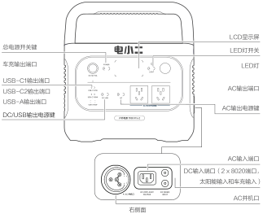
</figure>

### 2.2显示屏界面介绍

<figure class="hb-reference-figure" data-component-id="HB-SPECIAL-REFERENCE-FIGURE" data-reference-id="lcd-display" data-source-fragment-sha256="9e3947c3d268791bac37d6e6f02e55ad0dcd693013e9def37c92e817257d3199">
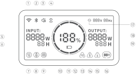
</figure>

<table class="manual-table"><tbody><tr><th>序号</th><th>图标</th><th>名称</th></tr><tr><td>1</td><td></td><td>Wi-Fi</td></tr><tr><td>2</td><td>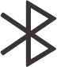</td><td>蓝牙</td></tr><tr><td>3</td><td></td><td>静音充电模式</td></tr><tr><td>4</td><td></td><td>浅充浅放模式</td></tr><tr><td>5</td><td>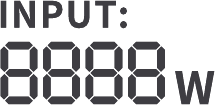</td><td>充电功率显示</td></tr><tr><td>6</td><td></td><td>剩余充电时间</td></tr><tr><td>7</td><td></td><td>市电充电接入</td></tr><tr><td>8</td><td></td><td>车充充电接入</td></tr><tr><td>9</td><td></td><td>太阳能（绿色能源）充电接入</td></tr><tr><td>10</td><td>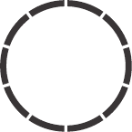</td><td>电池电量图标</td></tr><tr><td>11</td><td></td><td>低电量提醒</td></tr><tr><td>12</td><td>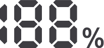</td><td>电池电量百分比</td></tr><tr><td>13</td><td>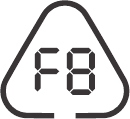</td><td>故障代码</td></tr><tr><td>14</td><td></td><td>高温警告</td></tr><tr><td>15</td><td></td><td>低温警告</td></tr><tr><td>16</td><td></td><td>节能模式</td></tr><tr><td>17</td><td></td><td>交流输出符号</td></tr><tr><td>18</td><td>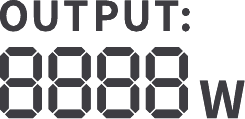</td><td>放电功率显示</td></tr><tr><td>19</td><td></td><td>剩余放电时间</td></tr></tbody></table>

<strong>电池电量图标：</strong> 当本产品处于充电状态时，该图标顺时针转动；当产品处于放电状态时，该图标显示当前电量。

<strong>低电量提醒：</strong> 当电池容量低于20%时，低电量图标显示；当电池容量低于5%时，低电量图标闪烁；充电状态时，该图标不显示。

<strong>节能模式：</strong> 为避免使用过程中忘记关闭输出，导致电池电量耗完，产品默认是开启节能模式，即不连接任何设备或者连接的设备小于等于某个值时（详情参考下表），12H后系统自动关闭输出。

<figure aria-label="节能模式默认关闭阈值" class="hb-reference-composition hb-reference-lcd-actions" data-component-id="HB-TABLE-REFERENCE" data-component-variant="lcd-actions" tabindex="0"><table class="hb-reference-table"><thead><tr><th scope="col">放电方式</th><th scope="col">功率设定值</th><th scope="col">默认设置</th></tr></thead><tbody><tr><td>AC输出</td><td>≤25W</td><td>12H后自动关闭输出</td></tr><tr><td>USB输出</td><td>≤2W</td><td>12H后自动关闭输出</td></tr><tr><td>车充输出</td><td>≤2W</td><td>12H后自动关闭输出</td></tr></tbody></table></figure>

<strong>关闭“节能模式”：</strong> 任意输出打开时，长按“AC输出电源键+总电源开关键”直至节能模式图标消失。在非节能模式状态下，不使用本产品时请注意关闭电源，避免因为忘记关闭输出导致电量耗尽。

<strong>开启“节能模式”：</strong> 任意输出打开时，长按“AC输出电源键+总电源开关键”直至节能模式图标在屏幕出现。

<strong>故障代码：</strong> 为了快速解决用户反馈，我们在系统中设置故障代码F0–FE：如果出现F8代码，请移除负载或者拔掉充电插头，产品可以自行恢复，如果不能，请联系售后处理；如果出现F9故障代码，请移除负载，产品可以自行恢复，如果不能，请联系售后处理。如果出现其他故障代码，请联系我们售后处理。

<strong>高温警告：</strong> 如果屏幕上出现高温警告图标，请勿担心，电池降温后可自行恢复。

<strong>低温警告：</strong> 如果屏幕上出现低温警告图标，请勿担心，环境温度恢复后自动恢复。

<strong>静音充电：</strong> 静音充电模式开启后，充电功率降低，充电速度减缓，同时显著降低充电时的噪音（请在APP中开启/关闭该功能）。

<strong>浅充浅放：</strong> 浅充浅放模式开启后，产品的可用电量减少，电芯使用寿命延长（请在APP中开启/关闭该功能）。

### 2.3产品使用介绍

#### 2.3.1电源开机/关机

<strong>总电源开机/关机：</strong> 短按“总电源开关键”同时工作指示灯亮起，LCD显示屏被点亮。当本产品持续2分钟没有任何操作时，产品进入休眠状态，显示屏自动熄灭。如需关闭总电源，请长按“总电源开关键”直至工作指示灯熄灭。本产品的默认待机时间为2小时，若产品无任何充电输入或放电输出，2小时后将自动关机，自动关机时间可以在APP上设置。

*节能模式下，开启DC输出或AC输出，若产品无任何充电输入或放电输出，12小时后将自动关机，请在APP中设置节能模式的自动关闭时间。

<strong>AC输出开/关：</strong> 确保总电源开启后，短按AC输出电源键，AC输出工作指示灯亮起，此时可连接需要交流电的设备使用。再次短按AC输出电源键可关闭AC输出。

<strong>DC输出开/关：</strong> 短按DC/USB输出电源键打开直流电源，此时USB-A、USB-C和车充输出端口可以连接负载设备使用。再次短按DC/USB输出电源键关闭输出。

<table class="manual-callout-table manual-callout-table"><tbody><tr><td class="manual-callout-label">注意</td><td class="manual-callout-body">
本产品可通过电小二12V汽车电池充电线为汽车电池充电。该充电线需单独购买，可前往电小二官网选购。设备通过12V DC输出（车充口）为汽车电池补电时，请勿启动汽车，否则可能造成产品损坏。
</td></tr></tbody></table>

#### UPS

本产品通过AC电源线连接电网，电器可以使用本产品的交流输出端口工作（此时交流电来自电网，而不是电池），当电网突然断电后，产品可以在20ms内自动切换为本产品电池供电模式。由于本产品不支持0ms的切换，请勿接到需要不间断供电要求高的设备上，例如数据服务器和工作站，或者请多次测试后确认是否兼容后再使用，且使用过程中建议只使用一台设备，不要同时使用多台设备以免引发本产品过载保护，如果没有按照指示操作造成设备不能正常运行或者数据丢失，本公司不承担相应的责任。

停电前，储能的最高输出功率是1500W，因为这边应用下采用的是旁路功率，虽然额定功率是1500W，但在这种特定模式下，实际输出功率会低于额定功率；停电时，储能的输出功率为额定功率1500W。

#### 2.3.2显示屏亮起/熄灭

短按总电源开关键或者有充电输入时，屏幕都会亮起，再按一下，屏幕会熄灭，或者持续2分钟无任何操作后，产品进入休眠状态，显示屏也会自动熄灭。在充电或者放电状态下如需要屏幕常亮，操作步骤如下：在显示屏亮起后，双击“总电源开关键”，屏幕进入常亮模式。如需关闭屏幕的常亮模式，操作步骤如下：短按“总电源开关键”，屏幕将自动熄灭。

<table class="manual-callout-table manual-callout-table"><tbody><tr><td class="manual-callout-label">注意</td><td class="manual-callout-body">
在屏幕常亮模式下，不进行任何充电输入或连接负载的放电操作，持续2H后屏幕自动熄灭。
</td></tr></tbody></table>

#### 2.3.3 LED照明灯开启及关闭

<strong>LED照明灯共有三种模式：</strong> 低亮模式、高亮模式和SOS模式。

短按LED开关键同时LED灯亮起，默认为低亮模式，再次短按LED开关键依次切换为高亮、SOS模式及关闭LED灯。在其中任何一种模式开启期间，长按LED开关键都可以关闭LED灯。

## 3.并机操作说明

<table class="manual-callout-table manual-callout-table"><tbody><tr><td class="manual-callout-label">警告</td><td class="manual-callout-body"><ul><li>并机模式下无法进行AC充电，可进行DC充电。</li><li>请勿在AC输出开启时（AC按键指示灯亮起时）用手触摸并机线插入口，此处为220V高压，存在触电风险！</li></ul></td></tr></tbody></table>

### 3.1 并机

<figure class="hb-reference-figure" data-component-id="HB-SPECIAL-REFERENCE-FIGURE" data-reference-id="parallel" data-source-fragment-sha256="c0dbcfff1dd82b457a19069f3579b0e171c730ae4a71e1d261ef3bb8bc2ba58c" data-step-captions="embedded">

</figure>

### 3.2 退出并机

退出并机前，先移除所有负载设备，关闭两台户外电源的AC输出，然后依次拔出并机线。

### 3.3 注意事项

<ul><li><strong>并机线需单独购买，</strong> 请访问电小二官方网站购买，或联系电小二官方客服获取帮助。</li><li>连接并机线前，请确保两台设备的AC输出已关闭（AC按键指示灯熄灭），否则可能损坏设备。并机成功后，如未关闭AC输出就拔掉并机线，可能会触发过载保护。</li><li>插入并机线后，两台设备会默认进入并机准备模式。此时，需两台设备的AC输出均打开后，才能进行并机输出；仅打开其中一台设备的AC输出无法进行并机输出。</li><li>若插上并机线且并机失败，显示屏将显示故障代码FA。</li><li>并机过程中，如任意一台设备的AC输出被关闭或出现故障，系统将自动退出并机模式，另一台设备也会自动关闭AC输出，并显示故障代码FA。此过程不会影响DC输出。如需重新并机，请再次按下两台设备的AC按键。</li><li>关闭AC输出后，如需重新开启，必须等待5秒，以确保正常输出电压。若未按此操作，AC输出可能无法正常工作。</li></ul>

## 4.充电方式

<strong>绿色能源优先模式：</strong> 本产品倡导优先使用绿色能源，本产品支持太阳能充电与市电充电同时使用。当同时开启市电充电与太阳能充电时，产品会优先太阳能充电且太阳能充电与市电充电同时以电池最大允许功率充电。

<strong>温馨提示：</strong>

<ol><li>产品充电环境温度为0°C–45°C，放电环境温度为−10°C–45°C，超出此温度范围会限制产品充放电，甚至无法充放电。</li><li>产品的充电功率和电池能量会因温度的变化有所差异。</li></ol>

<table class="manual-callout-table manual-callout-table"><tbody><tr><td class="manual-callout-label">提示</td><td class="manual-callout-body">
<strong>首次使用前请先将本设备充满电！</strong>
</td></tr></tbody></table>

### 4.1市电充电

请使用官方标配的AC电源线。

#### 应急闪充模式

储能可以通过AC充电方式实现超速充电，<strong>请在电小二App上激活或关闭此功能。</strong> 应急闪充模式下，显示剩余电量的环形灯闪烁速度加快。

*以正常充电速度充电能最大程度保护电池。我们建议仅在必要时使用应急充电，不建议长期使用此功能。

<figure class="hb-reference-figure" data-component-id="HB-SPECIAL-REFERENCE-FIGURE" data-reference-id="ac-charge" data-source-fragment-sha256="25a71d80808d2c3b86e142fc43b68b2cb871e893987c1b095904ab4e6a03f775" data-step-captions="embedded">
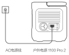
</figure>

### 4.2太阳能充电

本产品有两个DC8020直流输入端口，每个DC8020直流输入口支持一块100W或一块200W太阳能板直接接入使用，当一个DC8020输入口需要同时接入两块100W太阳能板时，需要搭配太阳能串联转接盒（单独售卖）使用。

<figure class="hb-reference-figure" data-component-id="HB-SPECIAL-REFERENCE-FIGURE" data-reference-id="solar-direct" data-source-fragment-sha256="00c8983164fb1b9b3defaf51986fb1073fcd6dc9c80c9f127c37c5f311b90831" data-step-captions="embedded">
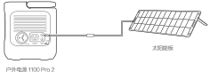
</figure>

<figure class="hb-reference-figure" data-component-id="HB-SPECIAL-REFERENCE-FIGURE" data-reference-id="solar-four" data-source-fragment-sha256="2fd9eeb7610beed9311cbe288101e14029ace748c19c3a090c75646b3f484d69" data-step-captions="embedded">
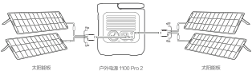
</figure>

<table class="manual-callout-table manual-callout-table"><tbody><tr><td class="manual-callout-label">注意</td><td class="manual-callout-body">
请确保DC输入端口的电压一致，连接到两个DC输入端口的电源，其电压必须保持一致，否则可能导致产品异常或损坏。

例如：
<ol><li>连接太阳能板至两个DC8020输入端口时，必须使用相同型号的Jackery太阳能板，并确保连接的数量一致。否则，不同型号或数量不匹配可能导致电压不一致，从而损坏产品。</li><li>给产品充电时，请勿同时使用车充充电与光伏充电，否则可能烧坏车内保险丝或导致充电失败。</li></ol></td></tr></tbody></table>

<figure class="hb-reference-figure" data-component-id="HB-SPECIAL-REFERENCE-FIGURE" data-reference-id="solar-mismatch" data-source-fragment-sha256="51bdca4b51f0a876adb9084d9cf5baf7846fb90ce448c63c9b38d44e7eb468b8" data-step-captions="embedded">
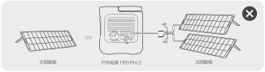
</figure>

<figure class="hb-reference-figure" data-component-id="HB-SPECIAL-REFERENCE-FIGURE" data-reference-id="solar-car-mixed" data-source-fragment-sha256="825999bde34c106737c51dd6a8a61716273801238db5808caeb3f49439286938" data-step-captions="embedded">
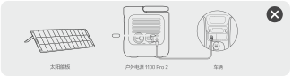
</figure>

### 4.3车充充电

本产品适用12V车型车充口对本产品进行充电，请在汽车点火启动后使用车充充电，以免造成汽车电瓶亏电无法启动。同时请确保汽车车充口和车充线的点烟器接触良好，确保点烟器完全插入到位，如汽车在行驶过程中，路况颠簸，禁止使用车充充电，防止车充接触不良，引起接触点烧坏。若因不按规范操作而造成损失，本公司不予承担相应责任。

<figure class="hb-reference-figure" data-component-id="HB-SPECIAL-REFERENCE-FIGURE" data-reference-id="car-charge" data-source-fragment-sha256="05911036c0d09768c64e3b7a990c3d2077a0a9f25076d3492bc48a29ac8b9dde" data-step-captions="embedded">

</figure>

### 4.4充电注意安全事项

<ol><li>请勿同时使用车充与太阳能充电，否则，会损坏车内保险丝。</li><li>车充充电只支持12V车型，不支持24V车型，请勿用24V车型的车给本产品充电以免造成人身伤害及财产损失。</li><li>请勿使用非电小二品牌的配件进行充电，尤其在使用太阳能板充电时，建议使用电小二品牌的太阳能板进行充电，对于使用其他品牌的太阳能板充电造成的损失，本司概不负责。</li></ol>

## 5.使用注意安全事项

<strong>使用本产品时，应始终遵循基本注意事项，包括：</strong>

<ol><li>使用本产品之前，请阅读所有说明。</li><li>为了降低风险，当在儿童附近使用本产品时，需要进行密切监督。</li><li>使用非专业产品制造商推荐或销售的配件可能会导致触电的风险。</li><li>产品在未使用时，请将电源插头拔出产品插座。</li><li>禁止对产品进行拆机，产品拆机后可能会导致火灾、爆炸或触电等不可预测的风险。</li><li>禁止使用损坏的电线或插头，或损坏的输出电缆来使用产品，有触电的危险。</li><li>请在通风良好的地方对产品进行充电，请勿以任何方式限制产品的通风。</li><li>请将产品放置在干燥的地方，不得淋雨，不得使产品进水，这会有触电风险（非预定仅在室外安装使用）。</li><li>禁止将产品撞击或投入火中，这可能导致产品发生起火，爆炸等安全事故。</li><li>禁止在高温下（直热的阳光下或很热的汽车车内）使用或放置产品，否则可能会引起内部电池过热、起火或功能失效，寿命减短等风险。</li><li>首次使用时，请在使用前将设备充满电。如果本产品在电量耗尽的情况下长时间（3个月–6个月）存放，其性能会下降，甚至无法充电。</li></ol>

## 6.包装清单

<figure aria-label="包装清单" class="hb-inbox-composition" data-card-count="3" data-component-id="HB-SPECIAL-INBOX" data-inbox-variant="three-card-responsive"><ol class="hb-inbox-grid"><li class="hb-inbox-card" data-item-number="1">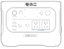

户外电源1100 Pro 2

</li><li class="hb-inbox-card" data-item-number="2">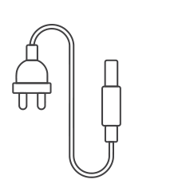

AC电源线

</li><li class="hb-inbox-card" data-item-number="3">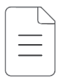

用户指南

</li></ol>

说明

车载充电线需单独购买，请前往电小二官网购买或联系电小二售后客服寻求帮助。

</figure>

## APP操作说明书

### 1. 下载并登录App

<figure aria-label="下载电小二App" class="hb-app-download-composition hb-app-download-qr-only" data-component-id="HB-SPECIAL-APP">
在App Store或者国内各大应用市场搜索“电小二”App安装并注册登录。或扫描下图二维码下载安装。
</figure>

### 2. 添加设备

<strong>2.1 在App内点击 ＋ 添加设备。</strong>

<strong>2.2 短按设备上的“POWER”键开机，设备上的WiFi和蓝牙图标闪烁后表示设备已进入配网模式，在App内点击“图标已快闪”按钮并允许应用连接附近的设备和打开蓝牙权限。</strong>

<figure class="hb-reference-figure hb-has-reference-captions" data-component-id="HB-SPECIAL-REFERENCE-FIGURE" data-reference-id="app-phones" data-source-fragment-sha256="e86eb7f3ba383c0d925641d2bb7256ae6fed6e6d54d33f8ffd552e84b3c03698">
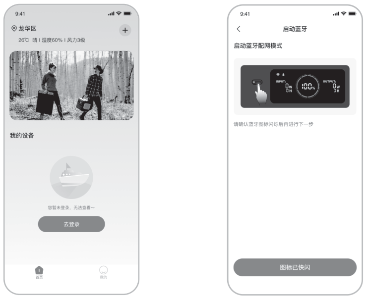
<figcaption class="hb-reference-caption-grid" data-caption-count="2" data-caption-layout="equal" style="--hb-caption-count:2">2.12.2</figcaption></figure>

<table class="manual-callout-table manual-callout-table"><tbody><tr><td class="manual-callout-label">备注</td><td class="manual-callout-body">
打开设备，如果两小时内未连接到APP，设备会自动关闭Wi-Fi和蓝牙，长按“DC/USB输出电源键”和“AC输出电源键”重新打开Wi-Fi和蓝牙。
</td></tr></tbody></table>

<figure class="hb-reference-figure" data-component-id="HB-SPECIAL-REFERENCE-FIGURE" data-reference-id="app-controls" data-source-fragment-sha256="0f1c8a80bf5125916025af02db886e6c235ebae395b28886cedcea3dbe399d87" data-step-captions="embedded">
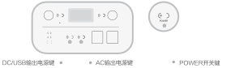
</figure>

<strong>2.3 点击搜索到的设备图标后App通过蓝牙自动连接设备。</strong>

<table class="manual-callout-table manual-callout-table"><tbody><tr><td class="manual-callout-label">备注</td><td class="manual-callout-body">
如果在绑定过程中提示“设备已被绑定”，可通过以下两种方式连接：
<ul><li>设备拥有者通过App将此设备分享给其他用户；</li><li>长按“POWER开关键”和“DC/USB输出电源键”3秒重置设备后可重新绑定设备。</li></ul></td></tr></tbody></table>

<strong>2.4 设备连接成功后输入设备将要连接的WiFi名称和密码，设备自动连接到WiFi网络。</strong>

<table class="manual-callout-table manual-callout-table"><tbody><tr><td class="manual-callout-label">备注</td><td class="manual-callout-body">
请选择2.4GHz频段的Wi-Fi网络，设备不支持5GHz频段的Wi-Fi网络。
</td></tr></tbody></table>

<strong>2.5 设备添加成功后进入设备主页面，设备上的Wi-Fi图标会常亮。</strong>

<figure class="hb-reference-figure hb-has-reference-captions" data-component-id="HB-SPECIAL-REFERENCE-FIGURE" data-reference-id="app-results" data-source-fragment-sha256="47ea371aa7ab63c3e254e72623b8aefda8c1dce563091031b3fb2a4d3dbd8ab9">
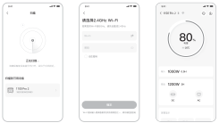
<figcaption class="hb-reference-caption-grid" data-caption-count="3" data-caption-layout="equal" style="--hb-caption-count:3">2.32.42.5</figcaption></figure>

图片仅供参考

### 3. 解绑设备

点击设备主界面右上角的设置按钮进入设置页面，点击页面最下方的解除绑定按钮解绑设备。

### 4. 其他说明

#### 4.1 打开WiFi&蓝牙：

<ul><li>开机后自动打开WiFi&amp;蓝牙，屏幕上的WiFi&amp;蓝牙图标点亮表示WiFi&amp;蓝牙已被打开。</li><li>同时按DC/USB输出电源按键和AC输出电源按键，直到屏幕上的WiFi&amp;蓝牙图标点亮表示WiFi&amp;蓝牙已被打开。</li></ul>

#### 4.2 关闭WiFi&蓝牙：

<ul><li>同时按DC/USB输出电源按键和AC输出电源按键，直到屏幕上的WiFi&amp;蓝牙图标熄灭表示WiFi&amp;蓝牙已被关闭。</li><li>两小时内未连接WiFi或蓝牙，设备上的WiFi&amp;蓝牙图标会自动关闭。</li></ul>

#### 4.3 重置WiFi&蓝牙：

<ul><li>同时按下“POWER开关键”和“DC/USB输出电源按键”3秒，已连接的APP账号会被解绑，系统会重置Wi-Fi和蓝牙，同时清除所有数据。</li></ul>

## 制造商与服务信息

<figure class="hb-reference-figure" data-component-id="HB-SPECIAL-REFERENCE-FIGURE" data-reference-id="certificate" data-source-fragment-sha256="869cd79a2619b91dcb181244e6ae52fa9df3e91605249e7baa231f37917f8f2a" data-step-captions="embedded">
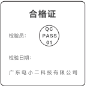
</figure>

<figure id="native-contact-code"><figcaption><small>关注官方品牌公众号， 获取更多资讯服务。</small></figcaption></figure>

制造商/生产厂：深圳市华宝新能源股份有限公司 地址：深圳市龙华区大浪街道同胜社区华繁路东侧嘉安达科技工业园

www.dx2.cn

