

## 1.主な仕様

## 【Jackery ポータブル電源 1500 Pro】

<figure aria-label="【Jackery ポータブル電源 1500 Pro】" class="hb-spec-table-composition"><table class="manual-table manual-spec-table hb-spec-table"><colgroup><col class="hb-spec-col-label"/><col class="hb-spec-col-value"/></colgroup><tbody><tr><th class="manual-spec-label hb-spec-label" scope="row">製品の名称 :</th><td class="manual-spec-value hb-spec-value">Jackery ポータブル電源 1500 Pro</td></tr><tr><th class="manual-spec-label hb-spec-label" scope="row">型番 :</th><td class="manual-spec-value hb-spec-value">JE-1500B</td></tr><tr><th class="manual-spec-label hb-spec-label" scope="row">サイズ＆重量 :</th><td class="manual-spec-value hb-spec-value">約384x269x307.5mm (約17kg)</td></tr><tr><th class="manual-spec-label hb-spec-label" scope="row">定格容量 :</th><td class="manual-spec-value hb-spec-value">リチウムイオン電池35Ah/43.2V DC (1512Wh)</td></tr><tr><th class="manual-spec-label hb-spec-label" scope="row">AC入力 :</th><td class="manual-spec-value hb-spec-value">100V~ 50Hz/60Hz, 最大15A</td></tr><tr><th class="manual-spec-label hb-spec-label" scope="row">DC入力ポート:</th><td class="manual-spec-value hb-spec-value">11-17.5V(動作電圧)⎓8A, 2ポート電流制限8A; 17.5-60V(動作電圧)⎓12A, 2ポート電流制限24A, 合計1400W</td></tr><tr><th class="manual-spec-label hb-spec-label" scope="row">3 x AC出力 :</th><td class="manual-spec-value hb-spec-value">100V~ 50Hz/60Hz, 1ポート最大18A/1800W, 3ポート合計1800W (瞬間最大3600W)</td></tr><tr><th class="manual-spec-label hb-spec-label" scope="row">2 x USB-A出力 :</th><td class="manual-spec-value hb-spec-value">Quick Charge 3.0, 5-6V⎓3A, 6-9V⎓2A, 9-12V⎓1.5A, 各ポート最大18W</td></tr><tr><th class="manual-spec-label hb-spec-label" scope="row">2 x USB-C出力 :</th><td class="manual-spec-value hb-spec-value">5V⎓3A, 9V⎓3A, 12V⎓3A, 15V⎓3A, 20V⎓5A, 各ポート最大100W</td></tr><tr><th class="manual-spec-label hb-spec-label" scope="row">シガーソケット出力 :</th><td class="manual-spec-value hb-spec-value">12V⎓10A</td></tr><tr><th class="manual-spec-label hb-spec-label" scope="row">充電温度 :</th><td class="manual-spec-value hb-spec-value">0~40 °C (32~104 °F)</td></tr><tr><th class="manual-spec-label hb-spec-label" scope="row">動作温度 :</th><td class="manual-spec-value hb-spec-value">-10~40 °C (14~104 °F)</td></tr><tr><th class="manual-spec-label hb-spec-label" scope="row">認証：</th><td class="manual-spec-value hb-spec-value">UN38.3</td></tr></tbody></table></figure>

<figure class="hb-reference-figure" data-component-id="HB-SPECIAL-REFERENCE-FIGURE" data-reference-id="qc-mark" data-source-fragment-sha256="016ca37ac4f2f2f89979984498c728cc693ca27834f52589f3cf55e9bbd09ae2" data-step-captions="embedded">

</figure>

※USB Type-C® and USB-C® are registered trademarks of USB Implementers Forum.

※Qualcomm Quick Charge is a product of Qualcomm Technologies,Inc. and/or its subsidiaries.

Qualcomm and Quick Charge are trademarks or registered trademarks of Qualcomm Incorporated.

<strong>■本機の仕様および外観は、改善のため予告なく変更することがあります。</strong>

<table class="manual-table"><tbody><tr><td></td><td>
<strong>充電式電池のリサイクルについて</strong>

本機はリサイクル可能な充電池を内蔵しています。

この商品を廃棄する場合は、当社のカスタマーサポートにご連絡ください。

充電池の取りはずしはお客様自身では行わないでください。
</td></tr></tbody></table>

## 2.各部の名称

<figure class="hb-reference-figure" data-component-id="HB-SPECIAL-REFERENCE-FIGURE" data-reference-id="overview" data-source-fragment-sha256="37ba552f088efb9357732ee7c87b88db4fcf0095b567143f7b67cccad360a06d" data-step-captions="embedded">
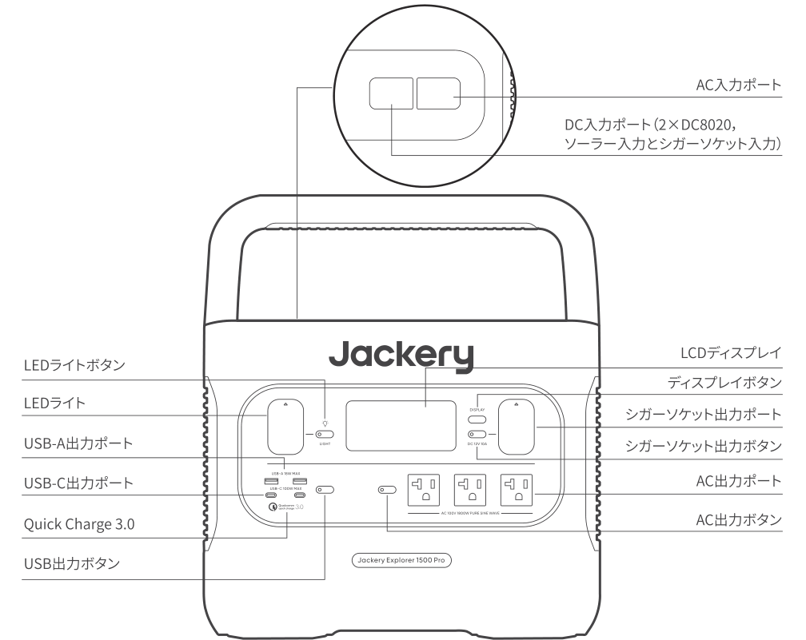
</figure>

## 3.液晶画面

<figure class="hb-reference-figure" data-component-id="HB-SPECIAL-REFERENCE-FIGURE" data-reference-id="lcd-map" data-source-fragment-sha256="05f156db50e840e5673f42f2b05d69f2246ddace6a388f8b5dbd69fc4daabdea" data-step-captions="embedded">
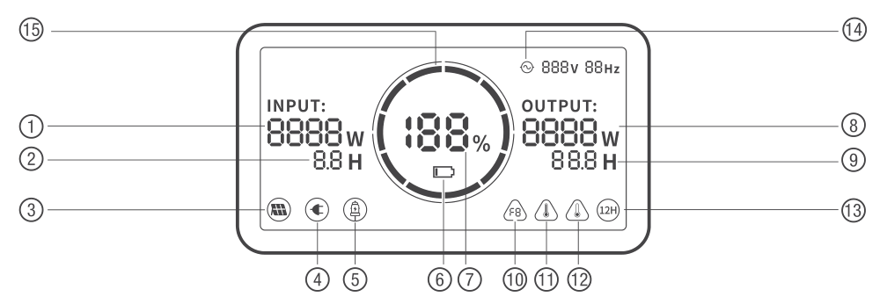
</figure>

<figure aria-label="3.液晶画面" class="hb-reference-composition hb-reference-lcd-descriptions" data-component-id="HB-TABLE-REFERENCE" data-component-variant="lcd-descriptions" tabindex="0"><table class="hb-reference-table"><tbody><tr><td>①</td><td>入力電力表示</td></tr><tr><td>②</td><td>充電残り時間</td></tr><tr><td>③</td><td>ソーラー(グリーンエネルギー)充電接続</td></tr><tr><td>④</td><td>AC入力電力表示</td></tr><tr><td>⑤</td><td>シガーソケット入力電力表示</td></tr><tr><td>⑥</td><td>バッテリー残量警告灯</td></tr><tr><td>⑦</td><td>バッテリーレベルパーセントタグ</td></tr><tr><td>⑧</td><td>消費電力パワー</td></tr><tr><td>⑨</td><td>バッテリー使用可能時間</td></tr><tr><td>⑩</td><td>エラーコード</td></tr><tr><td>⑪</td><td>高温インジケーター</td></tr><tr><td>⑫</td><td>低温インジケーター</td></tr><tr><td>⑬</td><td>低電力モード</td></tr><tr><td>⑭</td><td>交流電源による出力マーク</td></tr><tr><td>⑮</td><td>バッテリーアイコン</td></tr></tbody></table></figure>

<figure aria-label="バッテリーアイコン" class="hb-lcd-table-composition" data-component-id="HB-TABLE-LCD-ICON" tabindex="0"><table class="hb-lcd-icon-table"><colgroup><col class="hb-lcd-col-icon"/><col class="hb-lcd-col-name"/><col class="hb-lcd-col-description"/></colgroup><tbody><tr><td class="hb-lcd-icon"></td><td class="hb-lcd-name">バッテリーアイコン</td><td class="hb-lcd-description">本製品の充電時、アイコンは時計回りに回転します。本製品の放電時、アイコンは現在の電力を表示します。</td></tr><tr><td class="hb-lcd-icon"></td><td class="hb-lcd-name">バッテリー残量警告灯</td><td class="hb-lcd-description">バッテリー残量が20%未満の場合は、ローバッテリーランプが表示されます。バッテリー残量が5%未満の場合は、ローバッテリーランプが点滅します。バッテリー充電中は、ランプは表示されません。</td></tr><tr><td class="hb-lcd-icon"></td><td class="hb-lcd-name">低電力モード</td><td class="hb-lcd-description">使用中に、出力をOFFにするのを忘れてバッテリーがなくなるのを防ぐために、本製品は出荷時、低電力モードをOFFに設定しています。接続品がない、または接続されているものが特定の値以下の場合（詳細は下の表を参照）、本製品は12時間後に自動的にシャットダウンします。</td></tr></tbody></table></figure>

<table class="manual-table"><thead><tr><th>出力ポートタイプ</th><th>電力設定値</th><th>デフォルト設定</th></tr></thead><tbody><tr><td>AC出力ポート</td><td>≤25W</td><td>12時間後に自動的にシャットダウンします</td></tr><tr><td>USB出力ポート</td><td>≤2W</td><td>12時間後に自動的にシャットダウンします</td></tr><tr><td>シガーソケット出力ポート</td><td>≤2W</td><td>12時間後に自動的にシャットダウンします</td></tr></tbody></table>

<strong>低電力モードをONにする手順は次のとおりです:</strong>画面に低電力モードのアイコンが表示されるまで、「AC出力ボタン+DISPLAY」を長押しします。低電力モードでは、出力を切るのを忘れて電力が不足しないように、本製品を使用しないときは電源を切ってください。

低電力モードをOFFにする手順は次のとおりです:画面に低電力モードのアイコンが消えるまで、「AC出力ボタン+DISPLAY」を長押しします。

<strong>50Hz/60Hz周波数の切り替え:</strong>

2つの方法があります。一つは自動識別です。初めてACで充電する時、本体はお客様のお住まいの地域に応じて周波数を自動的に識別し、対応する出力に自動調整されます。もう一つは手動による調整です。AC出力ボタンを長押しすることで周波数を切り替えることができ、対応する周波数が画面に表示されます。なお、工場出荷時のデフォルト設定は60Hzに設定されています。

<figure aria-label="故障コード" class="hb-lcd-table-composition" data-component-id="HB-TABLE-LCD-ICON" tabindex="0"><table class="hb-lcd-icon-table"><colgroup><col class="hb-lcd-col-icon"/><col class="hb-lcd-col-name"/><col class="hb-lcd-col-description"/></colgroup><tbody><tr><td class="hb-lcd-icon"></td><td class="hb-lcd-name">故障コード</td><td class="hb-lcd-description">ユーザーのフィードバックを迅速に解決するために、システムに一般的な故障コードF0-F9を設定しました。ディスプレイにF0、F1、F2、F3、F4、F5、F6、F7のいずれかの故障コードが表示されたら、カスタマーサポートに連絡してください。F8コードが発生した場合は、接続機器を外すか、充電プラグを抜けば、製品は自動的に回復します。もしできない場合は、カスタマーサポートに連絡してください。F9障害コードが発生した場合は、接続機器を外せば、製品は自動的に回復します。もしも回復しない場合は、カスタマーサポートに連絡してください。</td></tr></tbody></table></figure>

## 4.使用について

### 電源ON/OFF

<strong>AC出力のON/OFF:</strong>

AC出力ボタンを短く押すと、AC出力インジケーターが点灯し、AC電源が必要な機器に給電ができます。AC出力電源ボタンをもう一度短く押すと、AC出力がOFFになります。

<strong>USB出力のON/OFF:</strong>

USB出力ボタンを短く押すと、USB出力インジケーターが点灯し、USB Type-AおよびUSB Type-C出力ポートで外部機器に給電ができます。USB出力ボタンをもう一度短く押すと、出力がOFFになります。

<strong>シガーソケット出力のON/OFF:</strong>

シガーソケット出力ボタンを短く押すと、シガーソケット出力インジケーターが点灯し、シガーソケット出力ポートが外部機器に給電ができます。シガーソケット出力ボタンをもう一度短く押すと、出力がOFFになります。

### LCDディスプレイのON/OFF

デジタルディスプレイは、任意の出力ボタンまたはディスプレイボタンを短く押すことで、画面が点灯します。また充電時も画面は点灯します。もう一度ボタンを押すと画面は消灯します。また30秒間操作をしない状態が続くと、スリープ状態となり、表示は自動的に消灯します。充電状態または放電状態で画面を常にONにする必要がある場合の操作手順は次のとおりです:ディスプレイがONになったら、デジタルディスプレイボタンをダブルクリックすると、画面がコンスタントライトモードになります。コンスタントライトモードをオフにする操作手順は次のとおりです: デジタルディスプレイボタンを短く押すと、30秒後に画面が自動的にオフになります。

<strong>※コンスタントライトモードで充電または給電しない場合、2時間後にディスプレイは自動的に消灯します。</strong>

### LEDライトのON/OFF

LEDライトには、ローライトモード、ハイライトモード、SOSモードの三つのモードがあります。操作手順は次のとおりです: LEDライトスイッチを短く押すと、LEDライトがオンになります。デフォルトはローライトモードに設定されており、画面には1Wの出力電力が表示され、もう一度押すとハイライトモードになり、画面には3Wの出力電力が表示されます。もう一度押すと、SOSモードになり、画面に出力電力3Wが表示され、もう一度押すと、LEDライトがオフになります。いずれかのモードで、LEDライトスイッチを長押しすればLEDライトをオフにすることができます。

## 5.充電方法

<strong>グリーンエネルギー優先モード:</strong>本製品はグリーンエネルギー優先モードを搭載していますが、ソーラーACアダプターを使って同時に充電できます。同時に充電すると、ソーラーが優先されますが、バッテリーの最大許容電力で同時に充電されます。

<figure aria-label="高温警告" class="hb-lcd-table-composition" data-component-id="HB-TABLE-LCD-ICON" tabindex="0"><table class="hb-lcd-icon-table"><colgroup><col class="hb-lcd-col-icon"/><col class="hb-lcd-col-name"/><col class="hb-lcd-col-description"/></colgroup><tbody><tr><td class="hb-lcd-icon"></td><td class="hb-lcd-name">高温警告</td><td class="hb-lcd-description">環境温度が高温時に表示されます。直射日光などが当たっている場合は移動してください。電池が冷めたら、自動的に表示がオフになります。</td></tr><tr><td class="hb-lcd-icon"></td><td class="hb-lcd-name">低温警告</td><td class="hb-lcd-description">環境温度が低い場合に表示されます。温度が通常になれば自動的に回復します。</td></tr></tbody></table></figure>

<table class="manual-callout-table manual-callout-table"><tbody><tr><td class="manual-callout-label">ご注意</td><td class="manual-callout-body"><ul><li>初めてお使いになるときは、本製品をフル充電してからご使用ください。</li><li>充電池は空の状態で長期保管(3ヶ月－6ヶ月）すると、性能が劣化したり、充電できなくなる場合があります。</li><li>本機を長期保管する場合には、3ヵ月に1度を目安に本体にAC充電ケーブルやソーラーパネルを通して蓄電が可能か、他製品に給電可能かなど動作確認をお願い致します。</li></ul>
保管時の残量につきましては、60%-80%ほどを目安に保管を推奨致します。
</td></tr></tbody></table>

### AC充電ケーブル

付属のAC充電ケーブルをご使用ください。

<figure class="hb-reference-figure" data-component-id="HB-SPECIAL-REFERENCE-FIGURE" data-reference-id="ac-charge" data-source-fragment-sha256="a49b0b2012c79ddf402e6d712e27b3eb9732fa11feda3e665b156324aea5ccd8" data-step-captions="embedded">
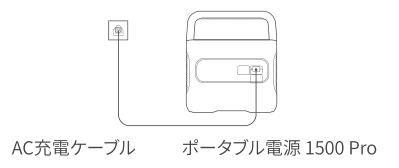
</figure>

### ソーラー充電

#### Jackery SolarSaga 60、100、200 の接続操作説明

1枚または2枚のソーラーパネルを接続する場合は、ソーラーパネルDC 8020ポートをJackeryポータブル電源 1500 Pro のDC 8020ポートに接続して充電することができます。

3枚または4枚のソーラーパネルを接続する場合は、下の図のようにソーラーパネル直列アダプターを使って充電してください（注意：ソーラーパネル直列アダプターは標準付属品ではなく、別途購入する必要があります。使用前にソーラーパネル直列アダプターの詳細な操作説明を参照してください）

<figure class="hb-reference-figure" data-component-id="HB-SPECIAL-REFERENCE-FIGURE" data-reference-id="solar-three" data-source-fragment-sha256="e40a545d272b6fb671d593a48c5608f69e88cfbc7ecc3cf0adf2719a27445d71" data-step-captions="embedded">
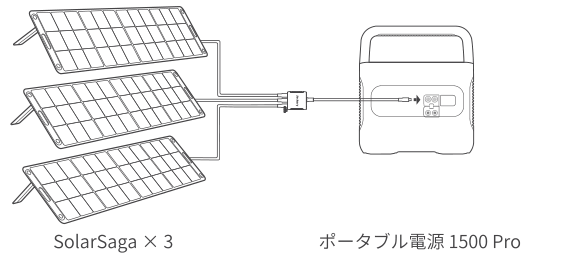
</figure>

<figure class="hb-reference-figure" data-component-id="HB-SPECIAL-REFERENCE-FIGURE" data-reference-id="solar-two-two" data-source-fragment-sha256="a79da9f963b4bed3f16eeedbe4e8dd92bdb66613a3b68ef333bf116789fe331e" data-step-captions="embedded">
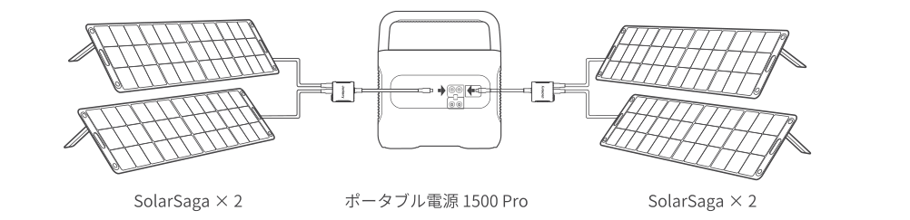
</figure>

<figure class="hb-reference-figure" data-component-id="HB-SPECIAL-REFERENCE-FIGURE" data-reference-id="solar-three-three" data-source-fragment-sha256="25a0a9637225b1da0e8ced4f9195832505740e49ad28aef0c9a9786941e2a5bd" data-step-captions="embedded">
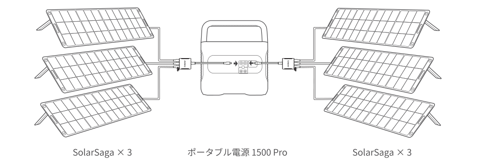
</figure>

<table class="manual-callout-table manual-callout-table"><tbody><tr><td class="manual-callout-label">ご注意</td><td class="manual-callout-body">
Jackery ポータブル電源 1500 Proで2つのDC入力ポートを使って同時に充電する場合は、接続するソーラーパネルの最大出力と数を各ポートで揃えてお使いください。

下記のような接続方法を行った場合、本体が故障する恐れがあります。ご注意ください。
</td></tr></tbody></table>

<figure class="hb-reference-figure" data-component-id="HB-SPECIAL-REFERENCE-FIGURE" data-reference-id="solar-prohibited" data-source-fragment-sha256="5d4a1ed582090a3c09d7067e97e254fb97e8180abd5cfc5f90952ba99b1d4c53" data-step-captions="embedded">
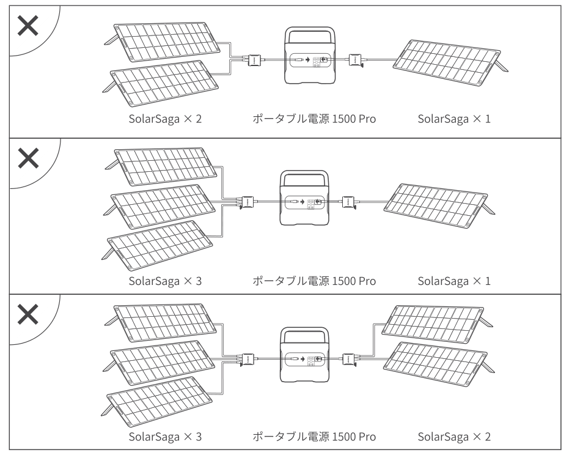
</figure>

#### Jackery SolarSaga 80 接続説明

Jackery  SolarSaga  80を購入したユーザーは、下の図のような接続方法を参照して本製品を充電することができます。Jackery  SolarSaga  80は並列に接続、または並列に接続後に直列に接続することによって本製品を充電することができます。Jackery  ポータブル電源 1500 Pro は1つの入力ポートで最大6枚のJackery SolarSaga 80 の入力をサポートします。６枚で接続する時は2組に分け、1組3枚のJackery SolarSaga 80を並列に接続してからソーラーパネル直列アダプター（別売り）を通じてポータブル電源を充電してください。

Jackery  SolarSaga  80の並列接続の詳細な操作説明は、ソーラーパネルの説明書を参照してください。

<figure class="hb-reference-figure" data-component-id="HB-SPECIAL-REFERENCE-FIGURE" data-reference-id="solar-saga80" data-source-fragment-sha256="c4f5d4a3cd06db166b1eda19fe41472c2538738520eab479de8b5fc9ed063639" data-step-captions="embedded">
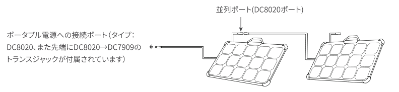
</figure>

#### DC7909-DC8020トランスジャックの取扱説明

現在販売中のJackery ソーラーパネルにはDC7909-DC8020トランスジャックを付属していますが、お買い上げ頂いたJackery ソーラーパネルにDC7909-DC8020トランスジャックが付属していない場合、本機にトラスジャックを同梱しいてるので、ご利用ください。トランスジャックを差し込んだままポータブル電源1500proに接続するようにしてください。

<figure class="hb-reference-figure" data-component-id="HB-SPECIAL-REFERENCE-FIGURE" data-reference-id="adaptor" data-source-fragment-sha256="f228f5a9c2a88fc36810ba9898a15c9cb28824946f69c34311f9d8184a90ea44" data-step-captions="embedded">
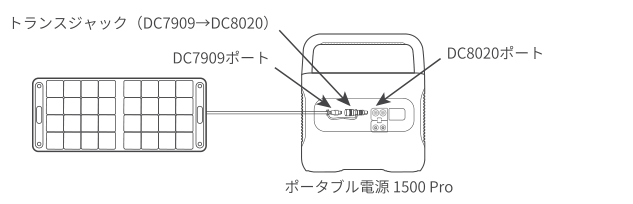
</figure>

<table class="manual-callout-table manual-callout-table"><tbody><tr><td class="manual-callout-label">注意</td><td class="manual-callout-body">
Jackeryポータブル電源1500 Pro でアダプターを使わずに、3枚の100Wまたは200Wのソーラーパネルの直列入力をしないでください。過電圧保護が作動し、充電ができなくなります。
</td></tr></tbody></table>

### シガーソケット充電

本製品は12Vの車のシガーソケットに対応し、充電ができます。車のバッテリーが上がってしまわないように、エンジンを始動してから、シガーソケットを使用してください。使用の際は車の充電ポートと入力ケーブルのシガーライターの接触に問題がないことを確認し、シガーソケットの所定の場所に差し込めることを確認してください。道路状況が悪くて、車の振動が多い場合は、充電が接触不良になりますので、接触部分が焼損するのを防ぐために、シガーソケット充電を中止してください。本製品の誤った取り扱いによる損害が発生しましても当社は一切の責任を負いかねます。

<figure class="hb-reference-figure" data-component-id="HB-SPECIAL-REFERENCE-FIGURE" data-reference-id="car-charge" data-source-fragment-sha256="25ac17c80fd4c9a9d9348983715c64b4285a91fbbe109bd58453dfd82d7be1ac" data-step-captions="embedded">
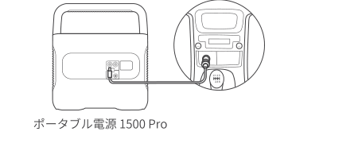
</figure>

### 充電に関する安全上のご注意

1) シガーソケット充電は12Vの車専用であり、24Vの車では充電できません。人身傷害や物的損害を避けるため、本製品の充電に24Vを使用しないでください。

2) Jackeryブランド以外の付属品を使用して充電しないでください。特に、ソーラーパネルで充電する際は、Jackeryのソーラーパネルを使用することをお勧めします。他社ソーラーパネルで充電することによる損失について、当社は一切の責任を負いません。

## 6.安全上のご注意

<strong>ご使用の前にこの「安全上のご注意」をよくお読みのうえ、正しくお使いください。</strong>

### 絵表示について

製品を安全に正しくお使いいただき、お客様や他の方々への危害や財産への損害を未然に防止するための表示です。

内容をよく理解してから本文をお読みください。

<figure aria-label="絵表示について" class="hb-symbol-signal-composition" data-component-id="HB-TABLE-SYMBOL-SIGNAL"><table class="hb-symbol-signal-table"><colgroup><col class="hb-symbol-signal-col-label"/><col class="hb-symbol-signal-col-meaning"/></colgroup><thead><tr><th class="hb-symbol-signal-label-heading" scope="col">表示</th><th class="hb-symbol-signal-meaning-heading" scope="col">意味</th></tr></thead><tbody><tr><td class="hb-symbol-signal-label-cell">⚠警告</td><td class="hb-symbol-signal-meaning-cell">この表示を無視して、誤った取り扱いをすると、人が死亡または重傷を負う可能性が想定される内容を示しています。</td></tr><tr><td class="hb-symbol-signal-label-cell">⚠注意</td><td class="hb-symbol-signal-meaning-cell">この表示を無視して、誤った取り扱いをすると、人が傷害を負う可能性が想定される内容または物的損害の発生が想定される内容を示しています。</td></tr></tbody></table></figure>

### 絵表示の説明

<figure aria-label="絵表示の説明" class="hb-symbol-pair-composition" data-component-id="HB-TABLE-SYMBOL-ICON">

<table class="hb-symbol-panel-table"><colgroup><col class="hb-symbol-col-icon"/><col class="hb-symbol-col-meaning"/></colgroup><thead><tr><th class="hb-symbol-icon-heading" scope="col">記号</th><th class="hb-symbol-meaning-heading" scope="col">意味</th></tr></thead><tbody><tr><td class="hb-symbol-icon"></td><td class="hb-symbol-meaning">コンセントから電源プラグを抜く記号</td></tr><tr><td class="hb-symbol-icon"></td><td class="hb-symbol-meaning">製品を分解、改造を禁止する記号</td></tr><tr><td class="hb-symbol-icon"></td><td class="hb-symbol-meaning">製品に濡れた手で触れることを禁止する記号</td></tr></tbody></table>

<table class="hb-symbol-panel-table"><colgroup><col class="hb-symbol-col-icon"/><col class="hb-symbol-col-meaning"/></colgroup><thead><tr><th class="hb-symbol-icon-heading" scope="col">記号</th><th class="hb-symbol-meaning-heading" scope="col">意味</th></tr></thead><tbody><tr><td class="hb-symbol-icon"></td><td class="hb-symbol-meaning">行為を指示する記号</td></tr><tr><td class="hb-symbol-icon"></td><td class="hb-symbol-meaning">製品を濡らすことを禁止する記号</td></tr><tr><td class="hb-symbol-icon"></td><td class="hb-symbol-meaning">行為を禁止する記号</td></tr></tbody></table>

</figure>

<table class="manual-callout-table manual-callout-table"><tbody><tr><td class="manual-callout-label">警告</td><td class="manual-callout-body">
<strong>万が一、次のような異常が発生したときはすぐに使用をやめる</strong>
<ul><li>煙が出ている、異臭がする</li><li>落としたり、破損したとき</li><li>異音がする</li><li>内部に水や異物が入ったとき</li><li>電源コード (ACアダプター) が傷んだとき</li></ul>
このような異常が発生したまま使用していると、火災や感電の原因になります。

すぐにACアダプターをコンセントから抜いてください。また、本製品に接続されている機器もすべて外してください。

<strong>万が一発煙や発火したら、大量の水で消火して煙が見えなくなるまで本製品を水浸しにしてください。</strong>

煙が出なくなることを確認してからカスタマーサポートにご連絡ください。

お客様による修理は危険ですので絶対におやめください。
</td></tr></tbody></table>

<table class="manual-callout-table manual-callout-table"><tbody><tr><td class="manual-callout-label">警告</td><td class="manual-callout-body">
<strong>分解、改造しない</strong>

故障、発熱、火災･感電の原因になります。
</td></tr></tbody></table>

<table class="manual-callout-table manual-callout-table"><tbody><tr><td class="manual-callout-label">警告</td><td class="manual-callout-body">
<strong>表示された電源電圧以外で使用しない</strong>

故障、発熱、火災･感電の原因になります。7また、本製品を使用できるのは日本国内のみです。
</td></tr></tbody></table>

<table class="manual-callout-table manual-callout-table"><tbody><tr><td class="manual-callout-label">警告</td><td class="manual-callout-body">
<strong>付属品と本製品が破損した場合は、ご自身で修理をしない</strong>
</td></tr></tbody></table>

<table class="manual-callout-table manual-callout-table"><tbody><tr><td class="manual-callout-label">警告</td><td class="manual-callout-body">
<strong>火のそばや炎天下の車内、熱器具の周辺など高温（40°C以上）になる場所で使用したり、放置しない</strong>

発熱や発火、破裂する原因になります。
</td></tr></tbody></table>

<table class="manual-callout-table manual-callout-table"><tbody><tr><td class="manual-callout-label">警告</td><td class="manual-callout-body">
<strong>強い衝撃を与えたり、投げつけたりしない</strong>

発熱や発火、破裂する原因になります。
</td></tr></tbody></table>

<table class="manual-callout-table manual-callout-table"><tbody><tr><td class="manual-callout-label">警告</td><td class="manual-callout-body">
<strong>水など、液体を入れたり、濡らしたりしない</strong>

発熱や発火の原因になります。
</td></tr></tbody></table>

<table class="manual-callout-table manual-callout-table"><tbody><tr><td class="manual-callout-label">警告</td><td class="manual-callout-body">
<strong>濡れた手で本体や接続するケーブルを触らない</strong>

火災や感電の原因になります。
</td></tr></tbody></table>

<table class="manual-callout-table manual-callout-table"><tbody><tr><td class="manual-callout-label">警告</td><td class="manual-callout-body">
<strong>端子部にケーブル以外の金属類を差し込まない</strong>

発熱や発火の原因になります。
</td></tr></tbody></table>

<table class="manual-callout-table manual-callout-table"><tbody><tr><td class="manual-callout-label">警告</td><td class="manual-callout-body">
<strong>雷が鳴りだしたら、電源プラグにふれない (充電をしない)</strong>

感電の原因になります。
</td></tr></tbody></table>

<table class="manual-callout-table manual-callout-table"><tbody><tr><td class="manual-callout-label">警告</td><td class="manual-callout-body">
<strong>各接続端子には確実に差し込む</strong>

差し込みが不十分だと、発熱したりほこりが付着して火災や感電の原因になります。
</td></tr></tbody></table>

<table class="manual-callout-table manual-callout-table"><tbody><tr><td class="manual-callout-label">注意</td><td class="manual-callout-body">
<strong>本製品の上に物を載せたり、不安定な場所に置かない</strong>

倒れたり、落ちたりしてけがの原因になります。
</td></tr></tbody></table>

<table class="manual-callout-table manual-callout-table"><tbody><tr><td class="manual-callout-label">注意</td><td class="manual-callout-body">
<strong>次のような機器では、絶対に使用しないでください。万が一使用中に給電ができなくなった場合、命にかかわる被害が想定されます。</strong>
<ul><li>医療機器や使用上、生命に関わるような機器</li><li>社会的、公共的に重要な機器など</li><li>重要な事業用機器など</li></ul></td></tr></tbody></table>

<table class="manual-callout-table manual-callout-table"><tbody><tr><td class="manual-callout-label">注意</td><td class="manual-callout-body">
<strong>心臓にペースメーカーを装着している方は使用しない</strong>

ペースメーカーが、本製品の影響を受ける恐れがあります。
</td></tr></tbody></table>

## 7.使用上のご注意

<ul><li>
本製品は防塵･防水仕様ではありませんので、ほこりや水、海水などがかからないように注意してください。
</li><li>
ほこりが多い場所や高温多湿の場所での充電および使用、放置をしないでください。
</li><li>
本製品を不安定な場所に置かないでください。必ず、平坦で安定した場所に置いて使用してください。
</li><li>
本製品の通風孔は、安全上絶対にふさがないでください。また、本製品の各面から5cm以上スペースを空けてください。
</li><li>
充電または給電中は本製品が温かくなります(故障ではありません)、周囲には物を置かないでください。
</li><li>
本製品接続機器のケーブルを差すときは、真っすぐな向きに差してください。
</li><li>
接続機器のケーブルを抜くときは、必ずプラグ部分を持って抜いてください。ケーブルを引っ張ったり折り曲げると、断線などの原因となります。
</li><li>
給電する機器の充電制御や充電状況、環境などにより給電できない、または急速充電にならない場合があります。
</li><li>
充電または給電中はラジオやチューナー、テレビなどに雑音が入る場合があります。

雑音が入る場合には、それらの製品から離れた場所でお使いください。
</li><li>
本体が汚れたらコンセントから電源プラグを抜き、柔らかい布で乾拭きしてください。

汚れがひどいときは、水または薄めた中性洗剤でふきとってください。シンナーやベンジンなどは絶対に使わないでください。
</li><li>
付属のACアダプターは、電源コードの抜き差しで電源が入ったり切れたりするため、異常時に電源コードを容易に抜き差しできるスペースを空けておいてください。
</li><li>
入出力の電力(W)

接続機器の入力仕様が本製品の出力値の上限を超えている場合、電源を自動的に遮断します。消費電力が仕様以下であることを確認してから出力ボタンを押してください。
</li><li>
低/高温警報

Jackery本機は-10°C～40°C(14～104°F)の温度範囲でお使いの機器に電力供給が可能となり、本機への蓄電は0°C～40°Cで行えます。

動作温度が上記範囲外にある場合、本製品が温度異常マークが表示され動作しない可能性がございます。

温度異常マークを解除するには、動作温度範囲内の環境に2時間以上置くようにお願い致します。
</li><li>
容量表示に関しては、あくまで参考値となり、電圧により電力が算出され、表示数値にズレが発生することがあります。
</li></ul>

<strong>・最大何Wまでの機器に給電できますか？</strong>

Jackery ポータブル電源 1500 Proは、最大電力1800Wまでの機器に給電ができるため、多くの電化製品や端末に対応可能です。

ただし、電気モーターを搭載している製品については、例(掃除機、ポンプ、冷蔵庫、電動丸ノコ、エアコン、洗濯機、電子レンジ、ドライヤーなど)起動時に「誘導負荷」が発生するため、公称電力の3～7倍の電力が必要となります。

最大出力1800Wは、一定の電力で動く機器への出力可能範囲を指しています。

1800Wの出力を超えた場合は、電気回路が自動的に調整され、電力が低減、または保護機能が作動し自動で遮断することがあります。

始動電力が1800Wの出力上限値を超える場合、ご利用できませんのでご了承ください。

またAC出力ポート3つ搭載されておりますが、3つ同時にご利用頂く場合、合計して1800W以内であることをご確認の上ご利用ください。

ご注意：始動電力が出力上限値(定格出力)を大幅に超える可能性のある製品のご利用や、定格出力を超え給電がストップした製品を繰り返し利用することはポータブル電源が損傷するリスクがありますのでお控えください。

<strong>▼本体寿命を少しでも伸ばすための注意点</strong>

<ul><li>
出力上限値を超えた電化製品を利用しない（始動電力が公称電力3倍～7倍の誘導負荷の掃除機、冷蔵庫、エアコン、電子レンジ、洗濯機、電動丸、ポンプなどは特にご注意ください）
</li><li>
バッテリーを保管する際は60%-80%の状態にして保管するようにしてください。
</li><li>
長期保管の場合3ヶ月に１度は本体への充電に加えて、家電製品などへの給電ができるかのメンテナンスを行ってください。
</li></ul>

## 8.同梱品

<figure aria-label="8.同梱品" class="hb-inbox-composition" data-card-count="7" data-component-id="HB-SPECIAL-INBOX" data-inbox-variant="responsive-card-grid"><ol class="hb-inbox-grid"><li class="hb-inbox-card" data-item-number="1">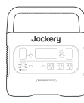

本体

</li><li class="hb-inbox-card" data-item-number="2">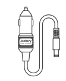

車載用充電シガーアダプター

</li><li class="hb-inbox-card" data-item-number="3">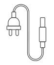

AC充電ケーブル

</li><li class="hb-inbox-card" data-item-number="4">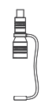

トランスジャック（DC7909→DC8020）x 2

</li><li class="hb-inbox-card" data-item-number="5">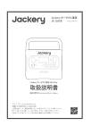

取扱説明書

</li><li class="hb-inbox-card" data-item-number="6">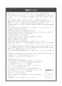

保証書

</li><li class="hb-inbox-card" data-item-number="7">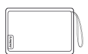

収納ポーチ

</li></ol></figure>

<strong>※付属品を故障、紛失等してしまった場合はカスタマーサポートまでご連絡ください。</strong>

## 9.免責事項

<ul><li>
火災、地震、第三者による行為、その他の事故、お客様の故意または過失誤用・誤動作・その他の異常な条件下での使用により生じた損害に関して、当社は一切責任を負いません。
</li><li>
付属品と本製品が破損した場合は、ご自身で修理を行わないでください。

ご自身で分解・修理したことにより生じた損害に関し、当社は一切責任を負いません。
</li><li>
保証範囲は利用規約に適用され、記載されていない内容は当社の保証範囲外となります。
</li><li>
取扱説明書の記載事項が遵守されないことにより生じた不適合について当社は責任を負いかねます。
</li><li>
本製品の使用、または使用不能から発生する付随的な損害(事業利益損失含む)、当社が関与しない接続機器との組み合わせによる誤動作などから生じた損害に関して、当社は一切の責任を負いません。
</li><li>
本製品は個人の安全に関係する製品、消費電力の大きな設備に給電できません。例えば、医療機器、核施設設備、CPAP（シーパップ）、スペースシャトルの製造などです。

上記の設備、用途で使用した結果、火災、機器故障など個人の安全を脅かす事故が生じた場合、当社は一切責任を負いません。
</li></ul>
