

<strong>Model: JE-1500B</strong>

Congratulations on your new Jackery Explorer 1500 Pro. Please read this manual carefully before using the product, particularly the relevant precautions to ensure proper use. Keep this manual in an accessible place for frequent reference.

In compliance with laws and regulations, the right of final interpretation of this document and all related documents of this product resides with the Company.

Please kindly notice that no further notifications will be given in case of any update, revision or termination.

## TECHNICAL SPECIFICATIONS

## GENERAL INFO

<figure aria-label="GENERAL INFO" class="hb-spec-table-composition"><table class="manual-table manual-spec-table hb-spec-table"><colgroup><col class="hb-spec-col-label"/><col class="hb-spec-col-value"/></colgroup><tbody><tr><th class="manual-spec-label hb-spec-label" scope="row">Product Name</th><td class="manual-spec-value hb-spec-value">Jackery Explorer 1500 Pro</td></tr><tr><th class="manual-spec-label hb-spec-label" scope="row">Model No.</th><td class="manual-spec-value hb-spec-value">JE-1500B</td></tr><tr><th class="manual-spec-label hb-spec-label" scope="row">Capacity</th><td class="manual-spec-value hb-spec-value">Lithium-ion 35Ah/43.2V DC (1512Wh)</td></tr><tr><th class="manual-spec-label hb-spec-label" scope="row">Weight</th><td class="manual-spec-value hb-spec-value">About 37.48 lbs/About 17 kg</td></tr><tr><th class="manual-spec-label hb-spec-label" scope="row">Dimensions</th><td class="manual-spec-value hb-spec-value">15.12x10.59x12.11 in/38.4x26.9x30.75 cm</td></tr><tr><th class="manual-spec-label hb-spec-label" scope="row">Cycle Life</th><td class="manual-spec-value hb-spec-value">2000 cycles to 70%+ capacity</td></tr></tbody></table></figure>

## OUTPUT PORTS

<figure aria-label="OUTPUT PORTS" class="hb-spec-table-composition"><table class="manual-table manual-spec-table hb-spec-table"><colgroup><col class="hb-spec-col-label"/><col class="hb-spec-col-value"/></colgroup><tbody><tr><th class="manual-spec-label hb-spec-label" scope="row">3 x AC Output</th><td class="manual-spec-value hb-spec-value">AC 120V, 60Hz, 15A, 1800W Rated, 3600W Surge peak</td></tr><tr><th class="manual-spec-label hb-spec-label" scope="row">2 x USB-A Output</th><td class="manual-spec-value hb-spec-value">Quick Charge 3.0, 18W Max 5-6V⎓3A, 6-9V⎓2A, 9-12V⎓1.5A</td></tr><tr><th class="manual-spec-label hb-spec-label" scope="row">2 x USB-C Output</th><td class="manual-spec-value hb-spec-value">100W Max 5V⎓3A, 9V⎓3A, 12V⎓3A, 15V⎓3A, 20V⎓5A</td></tr><tr><th class="manual-spec-label hb-spec-label" scope="row">Car Port</th><td class="manual-spec-value hb-spec-value">12V⎓10A</td></tr></tbody></table></figure>

## INPUT PORTS

<figure aria-label="INPUT PORTS" class="hb-spec-table-composition"><table class="manual-table manual-spec-table hb-spec-table"><colgroup><col class="hb-spec-col-label"/><col class="hb-spec-col-value"/></colgroup><tbody><tr><th class="manual-spec-label hb-spec-label" scope="row">AC Input</th><td class="manual-spec-value hb-spec-value">AC 120V~ 60Hz, 15A max</td></tr><tr><th class="manual-spec-label hb-spec-label" rowspan="2" scope="row">DC Input</th><td class="manual-spec-value hb-spec-value">11-17.5V (Working Voltage) ⎓8A max, double to 8A max;</td></tr><tr><td class="manual-spec-value hb-spec-value">17.5-60V (Working Voltage) ⎓12A, double to 24A/1400W max</td></tr></tbody></table></figure>

## ENVIRONMENTAL OPERATING TEMPERATURE

<figure aria-label="ENVIRONMENTAL OPERATING TEMPERATURE" class="hb-spec-table-composition"><table class="manual-table manual-spec-table hb-spec-table"><colgroup><col class="hb-spec-col-label"/><col class="hb-spec-col-value"/></colgroup><tbody><tr><th class="manual-spec-label hb-spec-label" scope="row">Charge Temperature</th><td class="manual-spec-value hb-spec-value">32°F~104°F (0°C~40°C)</td></tr><tr><th class="manual-spec-label hb-spec-label" scope="row">Discharge Temperature</th><td class="manual-spec-value hb-spec-value">-4°F~104°F (-20°C~40°C)</td></tr></tbody></table></figure>

### CERTIFICATIONS

<figure class="hb-reference-figure" data-component-id="HB-SPECIAL-REFERENCE-FIGURE" data-reference-id="certifications" data-source-fragment-sha256="0c381fb34719b81aa9fade9c8aa32645356a9863c14c744c0aa1cb6ecf43b5e5" data-step-captions="embedded">

</figure>

※ USB Type-C®and USB-C®are registered trademarks of USB Implementers Forum.

※ Qualcomm Quick Charge is a product of Qualcomm Technologles,Inc. and/or its subsidiaries.

Qualcomm and Quick Charge are trademarks or registered trademarks of  Qualcomm Incorporated.

<strong>MODIFICATION</strong>: Any changes or modifications not expressly approved by the grantee of this device could void the user’s authority to operate the device.

## PACKAGE LIST

<figure aria-label="PACKAGE LIST" class="hb-inbox-composition" data-card-count="5" data-component-id="HB-SPECIAL-INBOX" data-inbox-variant="responsive-card-grid"><ol class="hb-inbox-grid"><li class="hb-inbox-card" data-item-number="1">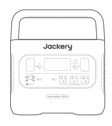

Jackery Explorer 1500 Pro

</li><li class="hb-inbox-card" data-item-number="2">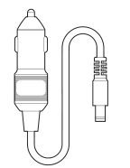

Car Charge Cable

</li><li class="hb-inbox-card" data-item-number="3">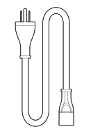

AC Charge Cable

</li><li class="hb-inbox-card" data-item-number="4">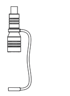

DC7909 to DC8020 Adaptor x 2

</li><li class="hb-inbox-card" data-item-number="5">

Quick Start Guide

</li></ol></figure>

## GET TO KNOW YOUR GEAR

### Product Appearance

<figure class="hb-reference-figure" data-component-id="HB-SPECIAL-REFERENCE-FIGURE" data-reference-id="overview" data-source-fragment-sha256="41c3482ef695e8494ba2a5d4b9ff3b28969c142fd49d70357775b6f69d157959" data-step-captions="embedded">
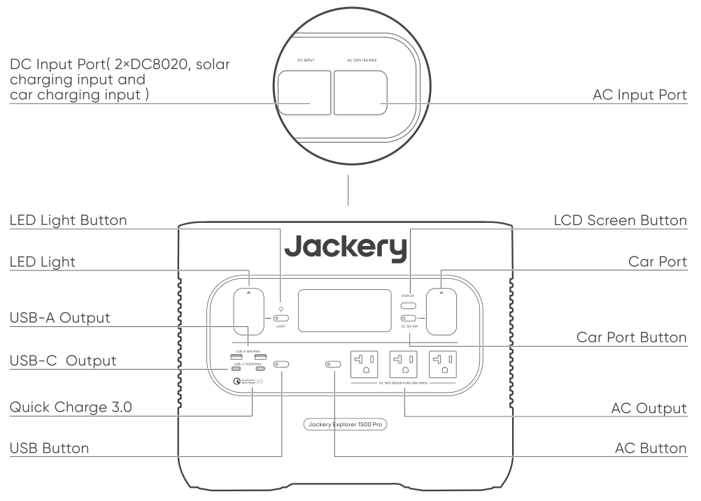
</figure>

## LCD DISPLAY

<figure class="hb-reference-figure" data-component-id="HB-SPECIAL-REFERENCE-FIGURE" data-reference-id="lcd-map" data-source-fragment-sha256="a25f42291a3413b4760c64566a59c112b3d0229d4763b1cb81a59c86b6d5830e" data-step-captions="embedded">
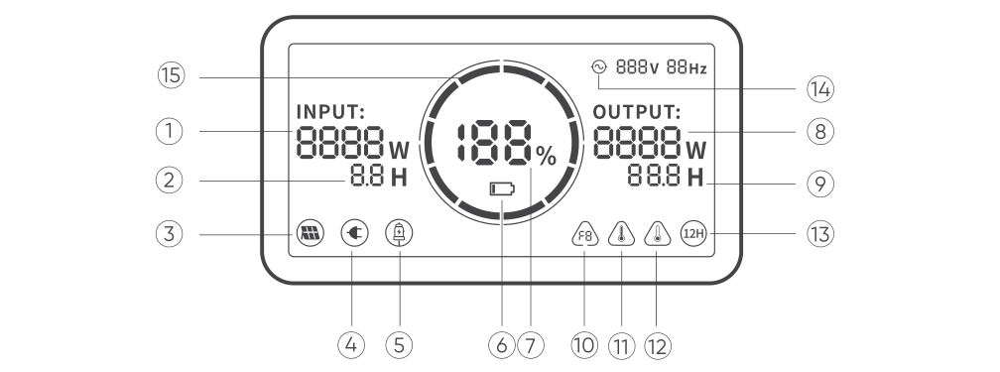
</figure>

<figure aria-label="LCD DISPLAY" class="hb-reference-composition hb-reference-lcd-descriptions" data-component-id="HB-TABLE-REFERENCE" data-component-variant="lcd-descriptions" tabindex="0"><table class="hb-reference-table"><tbody><tr><td>①</td><td>Input Power</td></tr><tr><td>②</td><td>Remaining Charge Time</td></tr><tr><td>③</td><td>Solar Charging Indicator</td></tr><tr><td>④</td><td>AC Wall Charging Indicator</td></tr><tr><td>⑤</td><td>Car Charging Indicator</td></tr><tr><td>⑥</td><td>Low Battery Indicator</td></tr><tr><td>⑦</td><td>Remaining Battery Percentage</td></tr><tr><td>⑧</td><td>Output Power</td></tr><tr><td>⑨</td><td>Remaining Discharge Time</td></tr><tr><td>10</td><td>Fault code</td></tr><tr><td>⑪</td><td>High Temperature Warning</td></tr><tr><td>⑫</td><td>Low Temperature Warning</td></tr><tr><td>⑬</td><td>Low Power Mode</td></tr><tr><td>⑭</td><td>AC Power Indicator</td></tr><tr><td>⑮</td><td>Battery Power Indicator</td></tr></tbody></table></figure>

<figure aria-label="Battery Power Indicator" class="hb-lcd-table-composition" data-component-id="HB-TABLE-LCD-ICON" tabindex="0"><table class="hb-lcd-icon-table"><colgroup><col class="hb-lcd-col-icon"/><col class="hb-lcd-col-name"/><col class="hb-lcd-col-description"/></colgroup><tbody><tr><td class="hb-lcd-icon"></td><td class="hb-lcd-name">Battery Power Indicator</td><td class="hb-lcd-description">When the product is being charged, the orange circle around the battery percentage will light up in sequence. When charging other devices, the orange circle will stay on.</td></tr><tr><td class="hb-lcd-icon"></td><td class="hb-lcd-name">Low Battery Indicator</td><td class="hb-lcd-description">When the battery is less than 20%, the Low Battery Indicator will stay on. When less than 5%, the Low Battery Indicator will flash. When it is being charged, the Indicator will be off.</td></tr><tr><td class="hb-lcd-icon"></td><td class="hb-lcd-name">Low Power Mode</td><td class="hb-lcd-description">To avoid forgetting to turn off the output during use that results in battery consumption, the product turns the Low Power Mode off by default. This occurs when no device is connected or the connected device is less than or equal to a certain value. (Refer to the table below for more details), the device will automatically shut down after 12 hours.</td></tr></tbody></table></figure>

<table class="manual-table"><thead><tr><th>Output</th><th>Output Power</th><th>Defaults</th></tr></thead><tbody><tr><td>AC Output</td><td>≤25W</td><td rowspan="3">The device will automatically shut down after 12 hours</td></tr><tr><td>USB Output</td><td>≤2W</td></tr><tr><td>Car Output</td><td>≤2W</td></tr></tbody></table>

<strong>To turn on the Low Power Mode</strong>

Long press the AC Button and DISPLAY Button until the Low Power Mode icon lights up. In Low Power Mode, please remember to turn off the output to avoid battery consumption.

<strong>To turn off the Low Power Mode</strong>

Long press the AC Button and DISPLAY Button until the Low Power Mode icon disappears on the screen.

<figure aria-label="Fault code" class="hb-lcd-table-composition" data-component-id="HB-TABLE-LCD-ICON" tabindex="0"><table class="hb-lcd-icon-table"><colgroup><col class="hb-lcd-col-icon"/><col class="hb-lcd-col-name"/><col class="hb-lcd-col-description"/></colgroup><tbody><tr><td class="hb-lcd-icon"></td><td class="hb-lcd-name">Fault code</td><td class="hb-lcd-description">In order to quickly solve the user’s feedback, we set up common fault codes F0-F9 in the system: if you find any fault code of F0、F1、F2、F3、F4、F5、F6、F7 on the display screen, please contact us for after-sales treatment; If F6 code appears, please remove the load or unplug the charging plug, the product can restore by itself, if not, please contact after-sales treatment; If F9 fault code appears, please remove the load and the product can recover by itself, if not, please contact after-sales service.</td></tr><tr><td class="hb-lcd-icon"></td><td class="hb-lcd-name">High-temperature warning</td><td class="hb-lcd-description">If it appears on the screen, do not worry, the battery will restore automatically after cooling.</td></tr><tr><td class="hb-lcd-icon"></td><td class="hb-lcd-name">Low-temperature Warning</td><td class="hb-lcd-description">If it is displayed on the screen, do not worry. It will automatically restore after the ambient temperature is restored.</td></tr></tbody></table></figure>

## BASIC OPERATIONS

### Power On/Off

<strong>AC Output On/Off:</strong> Press the AC Button, the AC Output operation indicator lights up. Then you can connect the equipment that needs AC charging. Press the AC Button again to turn off the AC Output.

<strong>USB Output On/Off:</strong> Press the USB Button, the USB Output operation indicator lights up. Then USB-A and USB-C Output Ports can be connected to external load devices. Press the USB Button again to turn off the USB Output.

<strong>Car Port On/Off:</strong> Press the Car Port Button, the Car Port operation indicator lights up. Then the Car Port can be connected to the external load devices. Press the Car Port Button again to turn off the output.

### LCD Screen On/Off

To Turn On, press the DISPLAY Button, any Output Power Button, or LED Light Button. Or, when there’s a charging input, the screen display will light up automatically.

To Turn Off, press the DISPLAY Button again and the screen display will turn off. Or,  if there is no operation in 30 seconds, the product will enter a sleep state and the screen display will automatically turn off.

To get the screen always-on (under charging or discharging state), follow these steps: After the display screen lights up, double-click the DISPLAY Button and the mode of Always-On Display will be on.

To turn off Always-On Display, follow these steps: Press the DISPLAY Button and the screen will be turned off in 30 seconds.

<table class="manual-callout-table manual-callout-table"><tbody><tr><td class="manual-callout-label">Tip</td><td class="manual-callout-body">
During Always-On mode, the screen automatically turns off after 2 hours without charging or discharging.
</td></tr></tbody></table>

### LED Light On/Off

<strong>There are three modes of LED Light:</strong> Low Light mode, Bright Light mode, and SOS mode.

<strong>The operations are as follows:</strong> Press the LED Light Button, the LED will be turned on. The light will always turn on in Low Light mode and the output power on the screen is 1W. Press again to enter the Bright Light mode and the output power on the screen is 3W. Press the third time to enter the SOS mode and the output power on the screen is 3W. Then, press again to turn off the LED Light. In any of these modes, the light can be turned off by a long press.

## CHARGING YOUR JACKERY EXPLORER 1500 PRO

Green energy first: We advocate to use the green energy first. This product supports two modes of charging at the same time: solar charging and AC wall charging.

When AC wall charging and solar charging are turned on at the same time, the product will give priority to solar charging and both methods will be used to charge the battery at the maximum permissible power.

## CHARGING FROM THE WALL

Please use the AC cable included in the package.

<figure class="hb-reference-figure" data-component-id="HB-SPECIAL-REFERENCE-FIGURE" data-reference-id="ac-charge" data-source-fragment-sha256="d71fbc8126829d509645581ca2bc0b6b940af7fe357e144457dbe0691903a804" data-step-captions="embedded">
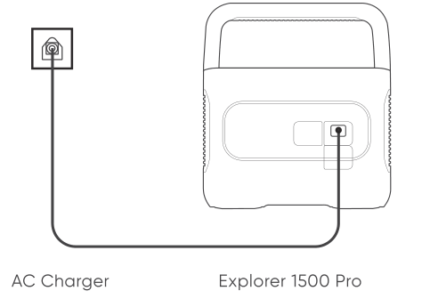
</figure>

## SOLAR ENERGY CHARGING

### Jackery SolarSaga 200 or 100 or 60 Solar Panel Connection Guide

If one or two solar panels are connected, you can directly connect the DC8020 port of the solar panel to theDC8020 port of Jackery Explorer 1500 Pro for charging. If three or four solar panels are connected,

please refer to the method shown in the following figure to charge through the solar series connector (Note: The solar series connector is not in standard configuration, so you need to purchase it separately. Please refer to the detailed operation instructions of the solar series connector before using it.)

<figure class="hb-reference-figure" data-component-id="HB-SPECIAL-REFERENCE-FIGURE" data-reference-id="solar-three" data-source-fragment-sha256="067bfdacefbaae29e3142d6268797b7a864e7f8a588704b1d178f68d10188136" data-step-captions="embedded">
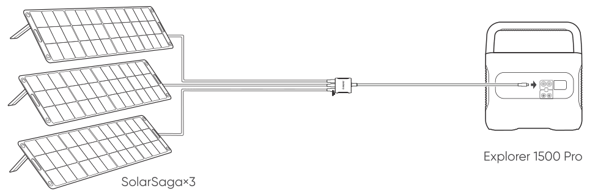
</figure>

<figure class="hb-reference-figure" data-component-id="HB-SPECIAL-REFERENCE-FIGURE" data-reference-id="solar-two-two" data-source-fragment-sha256="2c9390024ecf4f3c80d0a9a59113b8d204aeb13f66dc0c5e6ea29ba77d10a72b" data-step-captions="embedded">
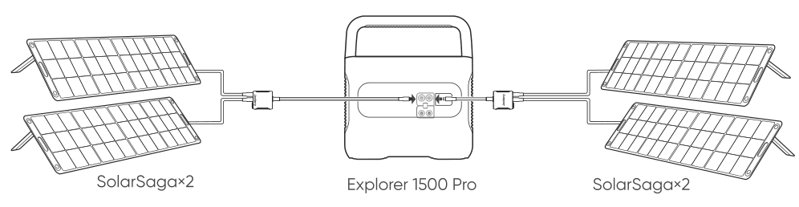
</figure>

<figure class="hb-reference-figure" data-component-id="HB-SPECIAL-REFERENCE-FIGURE" data-reference-id="solar-three-three" data-source-fragment-sha256="0f3028f88dfbad95fcb42b294af2ed18438c66bd5be0bb4b473e15f265564c48" data-step-captions="embedded">
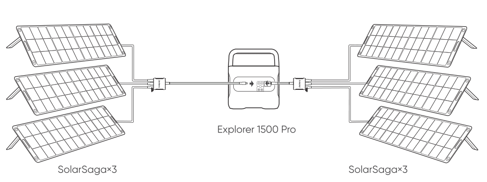
</figure>

<table class="manual-callout-table manual-callout-table"><tbody><tr><td class="manual-callout-label">Caution</td><td class="manual-callout-body">
When the two inputs are used at the same time, please make sure to use the same type of solar panel and the number of solar panels in the two inputs must be the same to avoid damage or charging problems of the equipment due to inconsistent voltages of the two channels.
</td></tr></tbody></table>

The following way of connections are prohibited to charge this product:

<figure class="hb-reference-figure" data-component-id="HB-SPECIAL-REFERENCE-FIGURE" data-reference-id="solar-prohibited" data-source-fragment-sha256="95634302e3c785cf482cf0aaf1ad1d9f3589ba2117e7a2b83d50a98e1ce6a69d" data-step-captions="embedded">
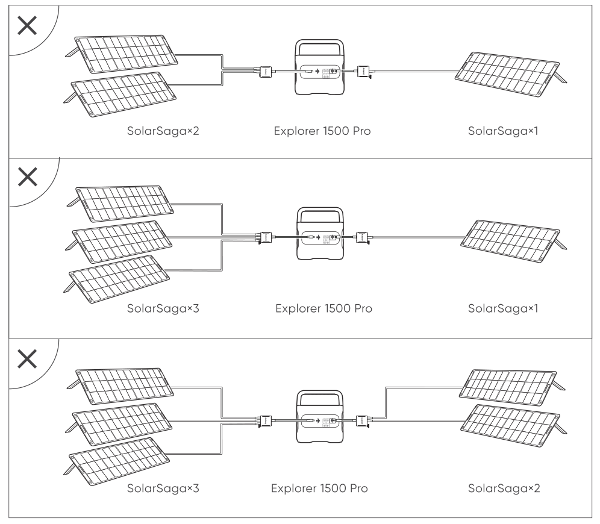
</figure>

### Jackery SolarSaga 80 Solar Panel Connection Guide

Users who have purchased Jackery SolarSaga 80  can charge the product by referring to the connection mode shown below. The Jackery SolarSaga 80  supports the parallel connection or the parallel and then series connections to charge the product. The single input port of the Jackery Explorer 1500 Pro supports the input of up to six pieces of SolarSaga 80 solar panels, and two input ports support the input to up to 12 pieces of SolarSaga 80 solar panels. (When the power is connected with six solar panels in a single input port, the solar panels shall be divided into two groups, and each group of three solar panels shall be self-connected in parallel and then connected to Jackery Explorer 1500 Pro through the solar series connector. The solar series connector needs to be purchased separately.)

For detailed operation instructions on the self-parallel connection of the Jackery SolarSaga 80 solar panel, please refer to the user manual.

<figure class="hb-reference-figure" data-component-id="HB-SPECIAL-REFERENCE-FIGURE" data-reference-id="solar-saga80" data-source-fragment-sha256="fdf3e61037b880afd0915402fa3888bfc9507d9a94f4ba594a637ef145027862" data-step-captions="embedded">
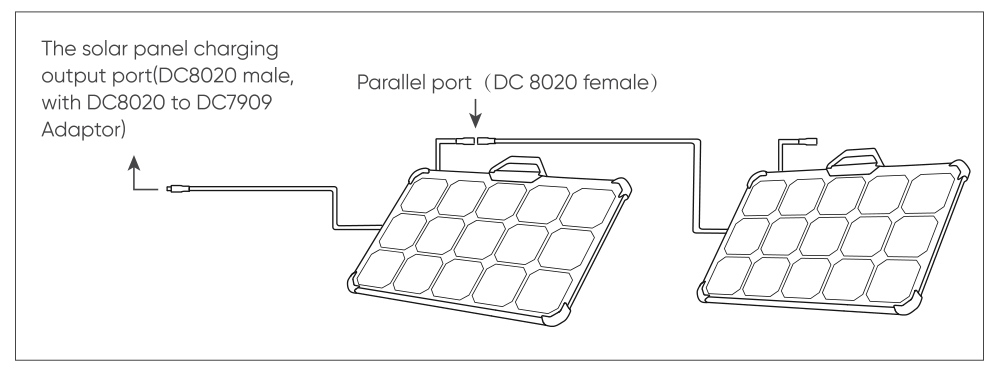
</figure>

<table class="manual-callout-table manual-callout-table"><tbody><tr><td class="manual-callout-label">Warm Tip</td><td class="manual-callout-body">
Users can enter the number of solar panels in their own combination according to the number of solar panels they purchased. Currently, the product supports charging with 1, 2, 3, 4, 6, 8, and 12 80W solar panels in combination.
</td></tr></tbody></table>

### DC7909 to DC8020 Adaptor Operation Guide

All of our solar panels on sale have been upgraded to include a DC7909 to DC8020 adapter. If you have purchased a Jackery solar panel without a DC7909 to DC8020 adapter, you can charge your Jackery Explorer 1500 Pro by following the connection instructions below.

<figure class="hb-reference-figure" data-component-id="HB-SPECIAL-REFERENCE-FIGURE" data-reference-id="adaptor" data-source-fragment-sha256="7611d0eb23e03755fc39af6eb15619101560172c143b919c2bcafbaa33b84252" data-step-captions="embedded">
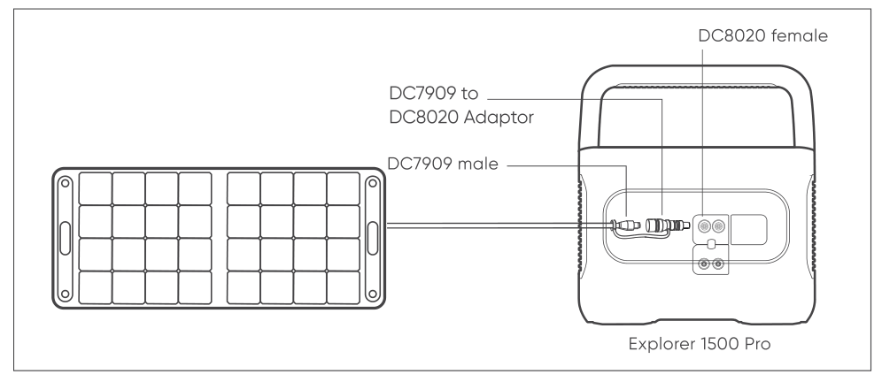
</figure>

## CHARGING IN THE CAR

This product can be charged with a 12V car charger. Please start the vehicle before charging to prevent draining the car battery and prevent your vehicle from being unable to start.

Meanwhile, please ensure that the car charger and the car cigarette lighter provide a good connection, and ensure that the car charger is fully inserted. In addition, if the vehicle is running on bumpy roads, it is forbidden to use the car charger in case it burns due to a poor connection. The Company will not be responsible for any loss caused by non-standard operation.

<figure class="hb-reference-figure" data-component-id="HB-SPECIAL-REFERENCE-FIGURE" data-reference-id="car-charge" data-source-fragment-sha256="02bc1251121e1471d7a2ef8f6a33aae76862f443f4455273d2fa621f3f6bbe75" data-step-captions="embedded">
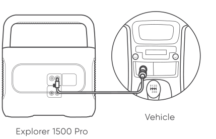
</figure>

### Safety Precautions When Charging

1) Vehicle charging is only applicable in 12V vehicles, not in 24V ones. Please do not charge this product in 24V vehicle to avoid personal injury and property loss.

2) It is recommended to use Jackery accessories - solar panels for solar charging. We will not be responsible for the losses caused by using other brands’ solar panels.

## SAFETY PRECAUTIONS WHEN USING

<strong>The basic safety precautions should be followed when using this product, including:</strong>

a. Please read all instructions before using this product.

b. Close supervision is required when using this product near children to reduce the risk.

c. Risk of electric shock may occur if using accessories recommended or sold by non-professional product manufacturers.

d. When the product is not in use, please unplug the power plug from the product's socket.

e. Do not dismantle the product, which may lead to unpredictable risks such as fire, explosion or electric shock.

f. Do not use the product through damaged cords or plugs, or damaged output cables, which may cause electric shock.

g. Charge the product in a well ventilated area and do not restrict ventilation in any way.

h. Please put the product in a ventilated and dry place to avoid rain and water to cause electric shock.

i. Do not expose the product to fire or high temperature (under direct sunlight or in vehicle under high heat), which may cause accidents such as fire and explosion.

j.Do not disassemble the power pack, take it to a qualified service person when service or repair is required. Incorrect reassembly may result in a risk of fire or electric shock.

k.Have servicing performed by a qualified repair person using only identical replacement parts. This will ensure that the safety of the product is maintained.

<figure class="hb-reference-figure" data-component-id="HB-SPECIAL-REFERENCE-FIGURE" data-reference-id="fcc-mark" data-source-fragment-sha256="72d65b32fc9d0b2257d2db785a36823122890d7a9460a35ec14a85939ce8ad5e" data-step-captions="embedded">

</figure>

NOTE: This equipment has been tested and found to comply with the limits for a Class B digital device, pursuant to part 15 of the FCC Rules. These limits are designed to provide reasonable protection against harmful interference in a residential installation. This equipment generates, uses and can radiate radio frequency energy and, if not installed and used in accordance with the instructions, may cause harmful interference to radio communications. However, there is no guarantee that interference will not occur in a particular installation. If this equipment does cause harmful interference to radio or television reception, which can be determined by turning the equipment off and on, the user is encouraged to try to correct the interference by one or more of the following measures:

--Reorient or relocate the receiving antenna.

--Increase the separation between the equipment and receiver.

--Connect the equipment into an outlet on a circuit different from that to which the receiver is connected.

--Consult the dealer or an experienced radio/TV technician for help.

## WARRANTY

<strong>Note: We only provide our warranty for the buyer who purchased on Amazon (Jackery Inc.), Jackery website or local authorized dealers.</strong>

### Limited Warranty

Jackery Inc. warrants to the original consumer purchaser that the Jackery product will be free from defects in workmanship and material under normal consumer use during the applicable warranty period identified in the 'Warranty Period' section below, subject to the exclusions set forth below.

This warranty statement sets forth Jackery's total and exclusive warranty obligation. We will not assume, nor authorize any person to assume for us, any other liability in connection with the sale of our products.

### Warranty Period

3 Years Standard Warranty: The standard warranty period for Jackery Explorer 1500 Pro is 36 months. In each case, the warranty period is measured starting on the date of purchase by the original consumer purchaser. The sales receipt from the first consumer purchase, or other reasonable documentary proof, is required in order to establish the start date of the warranty period.

2 Years Extended Warranty: To activate the Warranty Extension, you must register your product online  or contact our customer service team at hello@jackery.com to extend the standard warranty runtime.

### Exchange

Jackery will replace (at Jackery's expense) any Jackery product that fails to operate during the applicable warranty period due to defect in workmanship or material. A replacement product assumes the remaining warranty of the original product.

### Limited to Original Consumer Buyer

The warranty on Jackery's product is limited to the original consumer purchaser and is not transfer-able to any subsequent owner.

### Exclusions

Jackery's warranty does not apply to:

Misused, abused, modified, damaged by accident, or used for anything other than normal consumer use as authorized in Jackery's current product literature.

Attempted repair by anyone other than an authorized facility.

Any product purchased through an online auction house.

Jackery's warranty does not apply to the battery cell unless the battery cell is fully charged by you within seven days after you purchase the product and at least once every 6 months thereafter.

