

## IMPORTANT

Congratulations on your new Jackery Explorer 1500 Ultra. Please read this manual carefully before using the product, particularly the relevant precautions to ensure proper use. Keep this manual in an accessible place for frequent reference.

In compliance with laws and regulations, the right of final interpretation of this document and all related documents of this product resides with the Company.

Please kindly notice that no further notifications will be given in case of any update, revision or termination.

## IMPORTANT SAFETY INFORMATION

<table class="manual-callout-table manual-callout-table"><tbody><tr><td class="manual-callout-label">WARNING</td><td class="manual-callout-body">
<strong>INSTRUCTIONS PERTAINING TO RISK OF FIRE, ELECTRIC SHOCK, OR INJURY TO PERSONS</strong>
</td></tr></tbody></table>

<table class="manual-callout-table manual-callout-table"><tbody><tr><td class="manual-callout-label">WARNING</td><td class="manual-callout-body">
<strong>Always follow these basic precautions when using this product.</strong>
</td></tr></tbody></table>

<ul><li>Read all the instructions before using the product.</li><li>Please ensure that this device maintains a distance of at least 20cm from the human body during use.</li><li>Do not allow children to play on the product. Close supervision of children is necessary when the product is used near children.</li><li>Avoid placing hands or fingers inside the product.</li><li>Stop using the product immediately if it has been physically damaged or modified. Improper use of the product may cause unpredictable behavior, leading to fire, explosion, or injury.</li><li>If any of the following are observed, including but not limited to overheats, emits unusual odors or smoking, leaks, or burns, stop using the product immediately and contact the dealer or our Customer Support.</li><li>Never attempt to open, repair, or modify the product. Any tampering, reassembly, or modification of the product can result in electric shock, fire, or battery damage.</li><li>Be aware that liquid ejected from the product may cause irritation or burns. Inappropriate or abusive use may lead to battery leakage. Avoid direct contact with leaking liquid. If the liquid contacts your eyes, seek medical help immediately. If it contacts other body parts, flush with running water and consult a medical professional without delay.</li><li>Do not expose the product to fire or excessive temperatures. Doing so may result in an explosion if the temperature exceeds 130°C (265°F).</li><li>Any use of unrecommended or non-supplied materials or parts with the product may result in a risk of fire, electric shock, or personal injury.</li><li>Do not leave the battery charging unattended for long periods. Always monitor the charging process to ensure safe operation.</li><li>To reduce the risk of electric shock, unplug the product from any power source before attempting any technical service or troubleshooting.</li></ul>

### OPERATING INSTRUCTIONS

#### SAVE THESE INSTRUCTIONS

<ul><li>Stop using the product immediately if it shows signs of damage. Discontinue use and contact customer support for assistance.</li><li>Do not charge the battery in extremely hot or cold environments and strictly adhere to the product's specified operating temperature ranges :<ul><li>Charging temperature: 32°F to 113°F (0°C to 45°C )</li><li>Discharging temperature: 5°F to 113°F (-15°C to 45°C )</li></ul></li><li>To ensure proper air circulation, keep the product vents uncovered. The area where the product is used must have adequate airflow in a cool, dry environment to prevent overheating.<ul><li>Charging in damp or poorly ventilated spaces may cause safety hazards.</li><li>Water can cause short circuits or damage to the charger, leading to safety risks.</li></ul></li><li>Unplug the power cord from a power outlet during a storm.</li><li>Immediately turn off the product by pressing the power button if it has fallen, been dropped, or exposed to vibrations.</li><li>Ensure the device(s) are powered off before connecting it to the product.</li><li>Do not charge the product using a damaged or broken charging cord or plug.</li><li>Do not use the product to charge any device with a damaged or broken cable or plug.</li><li>Always unplug the charging cord by pulling the plug, not the cord, to reduce the risk of damage.</li><li>Ensure the product is properly secured when transporting it in a moving vehicle.</li><li>DO NOT place the unit upside down or on its side during use or storage.</li><li>DO NOT place the product on the floor or at a height less than 18 inches (457 mm) above the floor during operation in a workshop or repair facility.</li><li>DO NOT use the product's accessories with other devices or equipment.</li><li>Solar charge time depends on weather conditions, place your solar panel where it will get as much direct sunlight as possible.</li></ul>

<table class="manual-callout-table manual-callout-table"><tbody><tr><td class="manual-callout-label">DANGER</td><td class="manual-callout-body">
<strong>This device is intended for indoor use only (Please place this device in a similar indoor environment when using it outdoors, e.g. Home RVs, tents, cabins, etc.). ※ This device is not waterproof or dustproof. Keep away from rain and humid environments during use.</strong>
</td></tr></tbody></table>

### USER MAINTENANCE INSTRUCTIONS

During the lifecycle of energy storage products, a certain degree of capacity and energy degradation is expected. As the number of charge and discharge cycles increases and storage time extends, this degradation will gradually intensify, which is a normal phenomenon consistent with the natural aging of battery cells.

## MEANING OF SYMBOLS

<figure aria-label="Signal words" class="hb-symbol-signal-composition" data-component-id="HB-TABLE-SYMBOL-SIGNAL"><table class="hb-symbol-signal-table"><colgroup><col class="hb-symbol-signal-col-label"/><col class="hb-symbol-signal-col-meaning"/></colgroup><thead><tr><th class="hb-symbol-signal-label-heading" scope="col">Symbol</th><th class="hb-symbol-signal-meaning-heading" scope="col">Meaning</th></tr></thead><tbody><tr><td class="hb-symbol-signal-label-cell">⚠WARNING</td><td class="hb-symbol-signal-meaning-cell">Hazardous practices that may result in severe injury, death, and/or property damage.</td></tr><tr><td class="hb-symbol-signal-label-cell">⚠CAUTION</td><td class="hb-symbol-signal-meaning-cell">Hazardous practices that may result in personal injury and/or property damage.</td></tr><tr><td class="hb-symbol-signal-label-cell">⚠NOTE</td><td class="hb-symbol-signal-meaning-cell">Hazardous practices that may result in equipment damage, data loss, performance deterioration, or unanticipated results.</td></tr><tr><td class="hb-symbol-signal-label-cell">⚠TIP</td><td class="hb-symbol-signal-meaning-cell">Supplements the important information or operation tips in the text.</td></tr></tbody></table></figure>

<figure aria-label="MEANING OF SYMBOLS" class="hb-symbol-pair-composition" data-component-id="HB-TABLE-SYMBOL-ICON">

<table class="hb-symbol-panel-table"><colgroup><col class="hb-symbol-col-icon"/><col class="hb-symbol-col-meaning"/></colgroup><thead><tr><th class="hb-symbol-icon-heading" scope="col">Symbol</th><th class="hb-symbol-meaning-heading" scope="col">Meaning</th></tr></thead><tbody><tr><td class="hb-symbol-icon"></td><td class="hb-symbol-meaning">Warning and Caution Symbols. Must read to alert individuals to potential hazards or risks.</td></tr><tr><td class="hb-symbol-icon"></td><td class="hb-symbol-meaning">Read the user manual before operation.</td></tr><tr><td class="hb-symbol-icon"></td><td class="hb-symbol-meaning">Risk of electric shock</td></tr><tr><td class="hb-symbol-icon"></td><td class="hb-symbol-meaning">Battery charging</td></tr><tr><td class="hb-symbol-icon"></td><td class="hb-symbol-meaning">Explosive material</td></tr><tr><td class="hb-symbol-icon"></td><td class="hb-symbol-meaning">Heavy object</td></tr></tbody></table>

<table class="hb-symbol-panel-table"><colgroup><col class="hb-symbol-col-icon"/><col class="hb-symbol-col-meaning"/></colgroup><thead><tr><th class="hb-symbol-icon-heading" scope="col">Symbol</th><th class="hb-symbol-meaning-heading" scope="col">Meaning</th></tr></thead><tbody><tr><td class="hb-symbol-icon"></td><td class="hb-symbol-meaning">Do not dismantle the product.</td></tr><tr><td class="hb-symbol-icon"></td><td class="hb-symbol-meaning">Keep the product away from fire.</td></tr><tr><td class="hb-symbol-icon"></td><td class="hb-symbol-meaning">Keep away from children.</td></tr><tr><td class="hb-symbol-icon"></td><td class="hb-symbol-meaning">This symbol indicates that a lithium-ion (Li-ion) battery is inside the product and should be disposed of or recycled properly.</td></tr><tr><td class="hb-symbol-icon"></td><td class="hb-symbol-meaning">This symbol indicates that the product shall not be disposed of as household waste, and should be delivered to a designated collection facility for recycling. Proper disposal and recycling can help protect the environment. For more information about the disposal and recycling of this product, contact your local community, disposal service, or dealer.</td></tr></tbody></table>

</figure>

<figure aria-label="FCC" class="hb-fcc-composition" data-component-id="HB-SPECIAL-FCC">

This device complies with part 15 of the FCC Rules. Operation is subject to the following two conditions: (1) This device may not cause harmful interference, and (2) this device must accept any interference received, including interference that may cause undesired operation.

<strong>NOTE:</strong> This equipment has been tested and found to comply with the limits for a Class B digital device, pursuant to part 15 of the FCC Rules. These limits are designed to provide reasonable protection against harmful interference in a residential installation. This equipment generates, uses and can radiate radio frequency energy and, if not installed and used in accordance with the instructions, may cause harmful interference to communications. However, there is no guarantee that radio interference will not occur in a particular installation.

If this equipment does cause harmful interference to radio or television reception, which can be determined by turning the equipment off and on, the user is encouraged to try to correct the interference by one or more of the following measures:
<ul class="simple"><li>
Reorient or relocate the receiving antenna.
</li><li>
Increase the separation between the equipment and receiver.
</li><li>
Connect the equipment into an outlet on a circuit different from that to which the receiver is connected.
</li><li>
Consult the dealer or an experienced radio/TV technician for help.
</li></ul>
<strong>MODIFICATION:</strong> Any changes or modifications not expressly approved by the grantee of this device could void the user’s authority to operate the device.

</figure>

## WHAT'S IN THE BOX

<figure aria-label="WHAT'S IN THE BOX" class="hb-inbox-composition" data-card-count="3" data-component-id="HB-SPECIAL-INBOX" data-inbox-variant="three-card-responsive"><ol class="hb-inbox-grid"><li class="hb-inbox-card" data-item-number="1">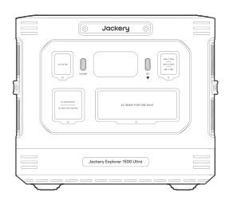

Jackery Explorer 1500 Ultra

</li><li class="hb-inbox-card" data-item-number="2">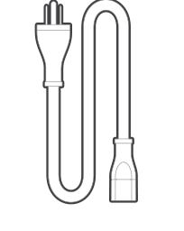

AC Charging Cable

</li><li class="hb-inbox-card" data-item-number="3">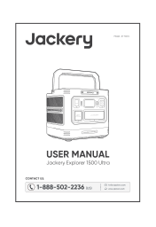

User Manual

</li></ol>

TIP

The car charging cable is not included but is available for purchase separately on our website. For assistance, please contact Jackery Customer Support.

</figure>

## PRODUCT OVERVIEW

### FRONT VIEW

<figure class="hb-reference-figure" data-component-id="HB-SPECIAL-REFERENCE-FIGURE" data-reference-id="overview-front" data-source-fragment-sha256="9f15d9a83a7b2a1fd9dcebbc041066fa354787bce4bf5c62a5a5a1b16489533b" data-step-captions="embedded">

</figure>

<figure class="hb-reference-figure" data-component-id="HB-SPECIAL-REFERENCE-FIGURE" data-reference-id="overview-ac-total" data-source-fragment-sha256="b1b37a0686fa28c2b1c7acc3ce3ff67f70ba609e5513de8b18fcb1d3932774f1" data-step-captions="embedded">
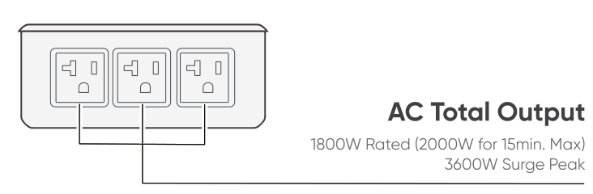
</figure>

## LCD DISPLAY

<figure class="hb-reference-figure" data-component-id="HB-SPECIAL-REFERENCE-FIGURE" data-reference-id="lcd-map" data-source-fragment-sha256="a8359a759a513f6435fcaaf1e512662f774c0a2ea9ee42b778b50d1442118729" data-step-captions="embedded">
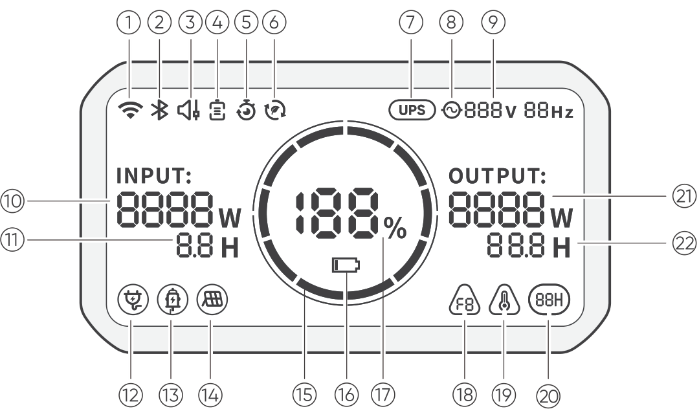
</figure>

<figure aria-label="LCD DISPLAY" class="hb-lcd-table-composition" data-component-id="HB-TABLE-LCD-ICON" tabindex="0"><table class="hb-lcd-icon-table"><colgroup><col class="hb-lcd-col-number"/><col class="hb-lcd-col-icon"/><col class="hb-lcd-col-name"/><col class="hb-lcd-col-description"/></colgroup><tbody><tr><td class="hb-lcd-number">①</td><td class="hb-lcd-icon"></td><td class="hb-lcd-name">Wi-Fi</td><td class="hb-lcd-description"><strong>On:</strong> Wi-Fi connected. <strong>Blink:</strong> Ready to connect to Wi-Fi. <strong>Off:</strong> Wi-Fi disconnected.</td></tr><tr><td class="hb-lcd-number">②</td><td class="hb-lcd-icon"></td><td class="hb-lcd-name">Bluetooth</td><td class="hb-lcd-description"><strong>On:</strong> Bluetooth connected. <strong>Blink:</strong> Ready to connect to Bluetooth. <strong>Off:</strong> Bluetooth disconnected.</td></tr><tr><td class="hb-lcd-number">③</td><td class="hb-lcd-icon"></td><td class="hb-lcd-name">Quiet Charging Mode</td><td class="hb-lcd-description"><strong>On:</strong> The noise during charging is significantly minimized, while the charging power is reduced and the charging speed slows down. <strong>Off:</strong> Quiet Charging Mode is disabled. Enable/disable this feature in the Jackery App.</td></tr><tr><td class="hb-lcd-number">④</td><td class="hb-lcd-icon"></td><td class="hb-lcd-name">Battery Saving Mode</td><td class="hb-lcd-description"><strong>On:</strong> Limits the maximum usable battery capacity to extend battery life. <strong>Off:</strong> Battery Saving Mode is disabled. Enable/disable this feature in the Jackery App.</td></tr><tr><td class="hb-lcd-number">⑤</td><td class="hb-lcd-icon"></td><td class="hb-lcd-name">Charging Plan</td><td class="hb-lcd-description">Customize the charging time of the Jackery Explorer 1500 Ultra. Suitable for situations with fluctuating electricity prices, it allows for charging plans based on peak and off-peak electricity times, reducing electricity costs (Please set in the Jackery App).</td></tr><tr><td class="hb-lcd-number">⑥</td><td class="hb-lcd-icon"></td><td class="hb-lcd-name">Self-powered Mode</td><td class="hb-lcd-description">Maximizes the use of solar energy and reduces reliance on grid electricity by prioritizing stored solar energy, reducing electricity costs (please enable/disable this feature in the app). The power station must be connected to both solar panels and the grid simultaneously, with load power limited by bypass power.</td></tr><tr><td class="hb-lcd-number">⑦</td><td class="hb-lcd-icon"></td><td class="hb-lcd-name">UPS</td><td class="hb-lcd-description"><strong>On:</strong> The product is in bypass mode, and the switchover time from grid power to the internal battery is 20 ms. <strong>Off:</strong> The product is not in bypass mode.</td></tr><tr><td class="hb-lcd-number">⑧</td><td class="hb-lcd-icon"></td><td class="hb-lcd-name">AC Power Indicator</td><td class="hb-lcd-description">The AC output (pure sine wave) is on.</td></tr><tr><td class="hb-lcd-number">⑨</td><td class="hb-lcd-icon"></td><td class="hb-lcd-name">Output Voltage and Frequency</td><td class="hb-lcd-description">Displays the output voltage and frequency.</td></tr><tr><td class="hb-lcd-number">⑩</td><td class="hb-lcd-icon"></td><td class="hb-lcd-name">Input Power</td><td class="hb-lcd-description">Displays the input power in watts.</td></tr><tr><td class="hb-lcd-number">⑪</td><td class="hb-lcd-icon"></td><td class="hb-lcd-name">Remaining Charge Time</td><td class="hb-lcd-description">Displays the remaining charging time.</td></tr><tr><td class="hb-lcd-number">⑫</td><td class="hb-lcd-icon"></td><td class="hb-lcd-name">AC Wall Charging Indicator</td><td class="hb-lcd-description">The product is charged via the AC Input using grid power.</td></tr><tr><td class="hb-lcd-number">⑬</td><td class="hb-lcd-icon"></td><td class="hb-lcd-name">Car Charging Indicator</td><td class="hb-lcd-description">The product is charged via the DC Input (DC8020) using DC 12V (car charging).</td></tr><tr><td class="hb-lcd-number">⑭</td><td class="hb-lcd-icon"></td><td class="hb-lcd-name">Solar Charging Indicator</td><td class="hb-lcd-description">The product is charged via the DC Input (DC8020) using solar panel(s).</td></tr><tr><td class="hb-lcd-number">⑮</td><td class="hb-lcd-icon"></td><td class="hb-lcd-name">Battery Power Indicator</td><td class="hb-lcd-description">When the product is being charged, the orange circle around the battery percentage will light up in sequence. When charging other devices, the orange circle will stay on.</td></tr><tr><td class="hb-lcd-number">⑯</td><td class="hb-lcd-icon"></td><td class="hb-lcd-name">Low Battery Indicator</td><td class="hb-lcd-description"><strong>On:</strong> The battery level is below 20%. <strong>Blink:</strong> The battery level is below 5%. <strong>Off:</strong> The battery level is above 20% or the product is charging.</td></tr><tr><td class="hb-lcd-number">⑰</td><td class="hb-lcd-icon"></td><td class="hb-lcd-name">Remaining Battery Percentage</td><td class="hb-lcd-description">Displays the remaining battery percentage.</td></tr><tr><td class="hb-lcd-number">⑱</td><td class="hb-lcd-icon"></td><td class="hb-lcd-name">Fault Code</td><td class="hb-lcd-description">A product error has occurred. Please refer to the Troubleshooting section for details.</td></tr><tr><td class="hb-lcd-number">⑲</td><td class="hb-lcd-icon"></td><td class="hb-lcd-name">High Temperature Indicator</td><td class="hb-lcd-description">High temperature protection is triggered. The product may stop functioning until its temperature returns to the normal operating range.</td></tr><tr><td class="hb-lcd-number">⑲</td><td class="hb-lcd-icon"></td><td class="hb-lcd-name">Low Temperature Indicator</td><td class="hb-lcd-description">Low temperature protection is triggered. The product may stop functioning until its temperature returns to the normal operating range.</td></tr><tr><td class="hb-lcd-number">⑳</td><td class="hb-lcd-icon"></td><td class="hb-lcd-name">Energy Saving Mode</td><td class="hb-lcd-description"><strong>On:</strong> Energy Saving Mode is enabled. <strong>Off:</strong> Energy Saving Mode is disabled.</td></tr><tr><td class="hb-lcd-number">㉑</td><td class="hb-lcd-icon"></td><td class="hb-lcd-name">Output Power</td><td class="hb-lcd-description">Displays the output power in watts.</td></tr><tr><td class="hb-lcd-number">㉒</td><td class="hb-lcd-icon"></td><td class="hb-lcd-name">Remaining Discharge Time</td><td class="hb-lcd-description">Displays the remaining discharging time.</td></tr></tbody></table></figure>

## OPERATIONS

### POWER ON/OFF

<figure class="hb-reference-figure" data-component-id="HB-SPECIAL-REFERENCE-FIGURE" data-reference-id="power-on-off" data-source-fragment-sha256="75eeab2391a17f77dea589410d584475a50fb7470ef0f06f02cf72115e71d7b3" data-step-captions="embedded">
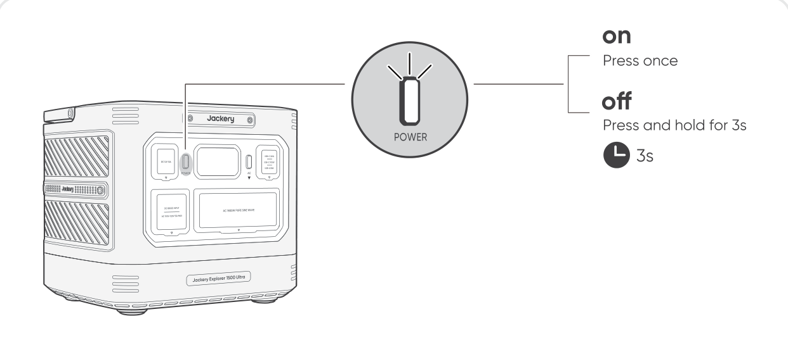
</figure>

<strong>Default standby time:</strong> 2 hours

The product will automatically shut down after 2 hours if there is no charging, no AC output, and the combined output of the DC 12V port and USB ports is less than 3W. *The standby time can be set in the Jackery App.

<table class="manual-callout-table manual-callout-table"><tbody><tr><td class="manual-callout-label">NOTE</td><td class="manual-callout-body">
When Energy Saving Mode is enabled, the product will automatically shut down after 12 hours if both the Main Power Button and the AC Power Button are turned on, but the product is neither charging nor discharging. The shutdown time can be set in the Jackery App.
</td></tr></tbody></table>

### AC OUTPUT ON/OFF

<strong>Prerequisite:</strong> The product is turned on.

<figure class="hb-reference-figure" data-component-id="HB-SPECIAL-REFERENCE-FIGURE" data-reference-id="ac-output" data-source-fragment-sha256="975a54bcf1c00d3997f22b390ae7d676d7689e654717be22abca02b05e2d540c" data-step-captions="embedded">
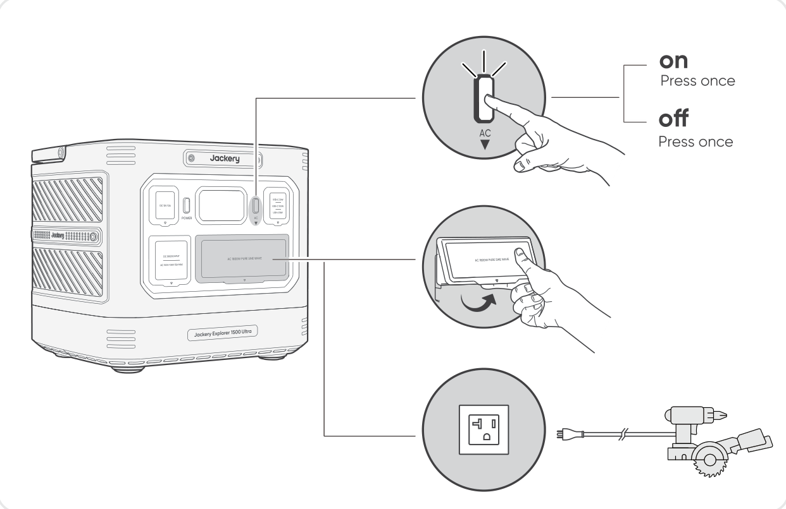
</figure>

### DC 12V/USB OUTPUT

<strong>Prerequisite:</strong>  The product is turned on.

<figure class="hb-reference-figure" data-component-id="HB-SPECIAL-REFERENCE-FIGURE" data-reference-id="dc-usb-output" data-source-fragment-sha256="9173ab9e313b5b46842255e8f9843bfeb5bb38a435443a778570363ad9660e7d">
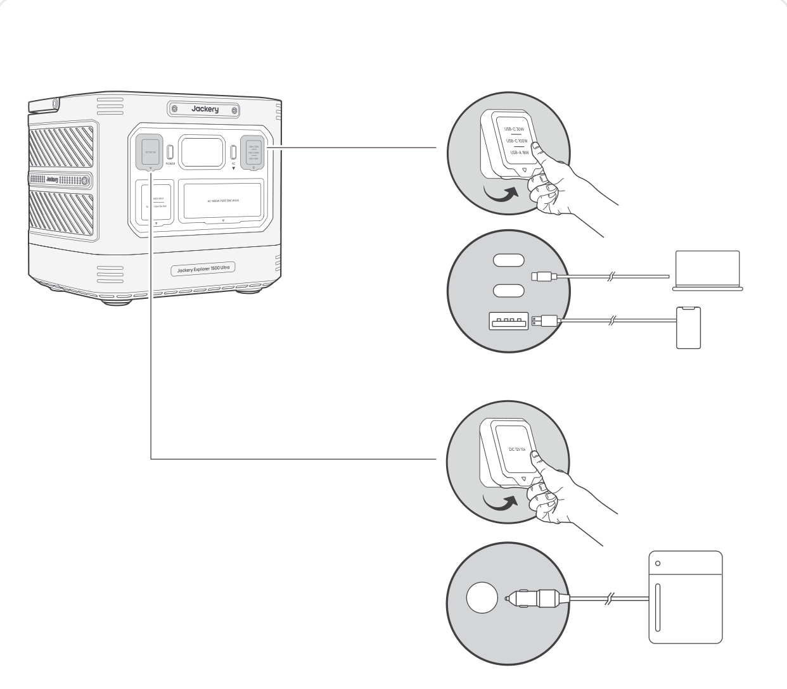
</figure>

The product can charge your car battery using the Jackery 12V automobile battery charging cable, which is sold separately and available on our website.

<table class="manual-callout-table manual-callout-table"><tbody><tr><td class="manual-callout-label">CAUTION</td><td class="manual-callout-body"><ul><li>The DC 12V port is only compatible with 12V car batteries and not suitable for 24V systems.</li><li>Do not start the car while the product is charging the car battery through the 12V DC output port, as this may damage the product.</li><li>This feature is intended for emergency use only and cannot charge a dead or damaged car battery.</li></ul></td></tr></tbody></table>

### ENERGY SAVING MODE

To prevent unnecessary battery consumption from forgetting to turn off the output, the product enables Energy Saving Mode by default. When AC Power Button is turned on, the Energy Saving Mode icon will be displayed on the LCD screen.  If no device is connected or the connected device's power consumption is below a certain threshold (AC Output ≤ 25W), the device will automatically turn off all outputs after 12 hours.

<strong>On/Off:</strong> Press and hold both the AC Power Button and Main Power Button for more than 3 seconds.

Please set the Energy Saving Mode duration in the Jackery App.

<figure class="hb-reference-figure" data-component-id="HB-SPECIAL-REFERENCE-FIGURE" data-reference-id="energy-saving" data-source-fragment-sha256="938052382a19d1e5ab028087ddafb0170e46cc7aaee3787a40961550ce7dfcc8" data-step-captions="embedded">
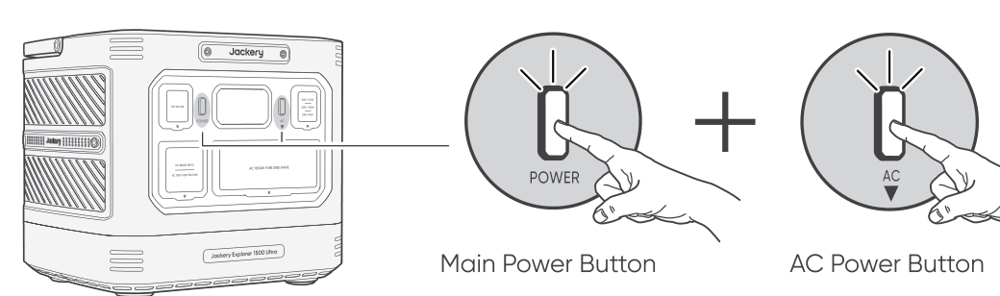
</figure>

<table class="manual-callout-table manual-callout-table"><tbody><tr><td class="manual-callout-label">NOTE</td><td class="manual-callout-body"><ul><li>When Energy Saving Mode is disabled, the product will not automatically turn off the AC or DC output.</li><li>Energy Saving Mode resumes previous state after power-on. Manual switching is required for mode changes.</li></ul></td></tr></tbody></table>

<table class="manual-callout-table manual-callout-table"><tbody><tr><td class="manual-callout-label">WARNING</td><td class="manual-callout-body">
When Energy Saving Mode is enabled, the product automatically turns off the AC output if the connected device’s power consumption remains low for the configured period. When powering devices that require continuous power, such as refrigerators, routers, security cameras, or aquarium air pumps, we recommend turning off Energy Saving Mode to prevent unexpected power loss from interrupting their operation.
</td></tr></tbody></table>

### LCD SCREEN ON/OFF

<figure aria-label="LCD SCREEN ON/OFF" class="hb-lcd-mode-composition" data-component-id="HB-TABLE-LCD-MODE">
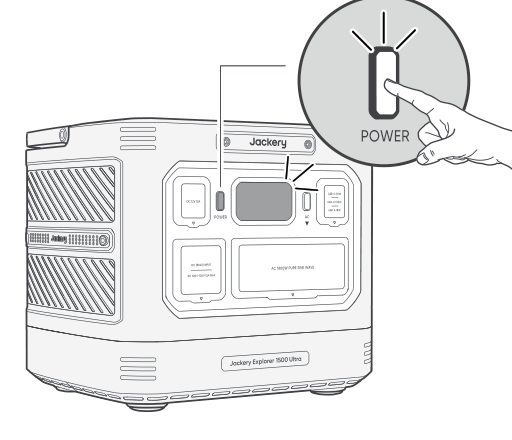

<table class="hb-lcd-mode-table"><colgroup><col class="hb-lcd-mode-col-state"/><col class="hb-lcd-mode-col-action"/><col class="hb-lcd-mode-col-copy"/></colgroup><tbody><tr><td class="hb-lcd-mode-state" rowspan="3">Screen stays on for 2 minutes</td><td class="hb-lcd-mode-action">Turn on</td><td class="hb-lcd-mode-copy">Press the Main Power Button or when the product is charging.</td></tr><tr><td class="hb-lcd-mode-action">Turn off</td><td class="hb-lcd-mode-copy">Press the Main Power Button.</td></tr><tr><td class="hb-lcd-mode-action">Auto-off</td><td class="hb-lcd-mode-copy">The LCD turns off automatically and enters sleep mode after 2 minutes.</td></tr><tr><td class="hb-lcd-mode-state" rowspan="3">Always-on Display Mode  (under charging or discharging state)</td><td class="hb-lcd-mode-action">Turn on</td><td class="hb-lcd-mode-copy">Double-press the Main Power Button when the LCD screen is ON.</td></tr><tr><td class="hb-lcd-mode-action">Turn off</td><td class="hb-lcd-mode-copy">Press the Main Power Button.</td></tr><tr><td class="hb-lcd-mode-action">Auto-off</td><td class="hb-lcd-mode-copy">In Always-on Display Mode, the LCD screen will automatically turn off after 2 hours if there is no charging, no AC output, and the combined output of the DC 12V port and USB ports is less than 3W.</td></tr></tbody></table>
</figure>

### BUTTON OPERATIONS

<figure aria-label="BUTTON OPERATIONS" class="hb-reference-composition hb-reference-lcd-actions" data-component-id="HB-TABLE-REFERENCE" data-component-variant="lcd-actions" tabindex="0"><table class="hb-reference-table"><thead><tr><th scope="col"><strong>Buttons</strong></th><th scope="col"><strong>Operation</strong></th><th scope="col"><strong>Function</strong></th></tr></thead><tbody><tr><td>Main Power Button + AC Power Button</td><td>3s Press and hold both for 3s</td><td>Turn on/off the Energy Saving Mode</td></tr><tr><td>Main Power Button</td><td>Press and hold for 3s to turn off the product, then keep holding for 10s.</td><td>Reset the product</td></tr></tbody></table></figure>

## UNINTERRUPTIBLE POWER SUPPLY (UPS)

Connect the product to a wall outlet with the AC charging cable, then press the AC output button and power your appliances at the same time. An uninterruptible power supply (UPS) is a type of continual power system that provides automated backup electric power to a load when the mains grid power fails. In the event of a sudden loss of grid power, the Explorer 1500 Ultra will automatically switch to stored power within 20 ms to keep your appliances running. In UPS mode, the unit's peak output reaches 1440W before power outages. As simultaneous charging/discharging is enabled in Bypass Mode, the actual output power is lower than the rated output power in this mode but returns to rated output power during outages.

<strong>Prerequisite:</strong> The product is turned on.

<figure class="hb-reference-figure" data-component-id="HB-SPECIAL-REFERENCE-FIGURE" data-reference-id="ups" data-source-fragment-sha256="9d3ade1a1b542474ff817aed9fb30a4946bc23884906ef04af2828b048e276a6">
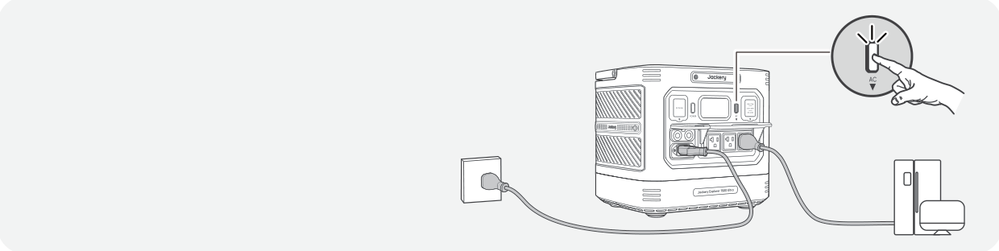
</figure>

<table class="manual-callout-table manual-callout-table"><tbody><tr><td class="manual-callout-label">WARNING</td><td class="manual-callout-body">
Do not use this product for applications such as data servers or medical devices, where a malfunction could endanger life or cause significant property damage. For the following equipment, a loss of power supply during use could cause serious harm to personal safety or property:
<ul><li>Medical devices and other equipment closely related to life safety.</li><li>Critical equipment such as social infrastructure and public services.</li><li>Business-critical enterprise equipment, etc.</li></ul>
Individuals who wear a cardiac pacemaker (pacemaker implant recipients) must not use this product.
</td></tr></tbody></table>

<table class="manual-callout-table manual-callout-table"><tbody><tr><td class="manual-callout-label">CAUTION</td><td class="manual-callout-body"><ul><li>This product does not support 0 ms switching. Do not connect it to equipment that requires an uninterrupted power supply, such as data servers or workstations.</li><li>Before use, please test compatibility with your device multiple times.</li><li>It is recommended to connect one device at a time. Do not use multiple devices simultaneously, as this may trigger overload protection.</li><li>The UPS function works only when a single unit is connected directly to a wall outlet.Do not connect multiple portable power stations in series (cascade connection). In a cascaded setup, the UPS function will not operate: the unit may fail to switch over during a power outage, causing connected devices to shut down.</li></ul></td></tr></tbody></table>

## CHARGING

<strong>Green energy first:</strong> We advocate to use the green energy first. This product supports two modes of charging at the same time: solar charging and AC wall charging. When AC wall charging and solar charging are turned on at the same time, the product will give priority to solar charging and both methods will be used to charge the battery at the maximum permissible power.

<strong>Fully charge the product before its first use.</strong>

<table class="manual-callout-table manual-callout-table"><tbody><tr><td class="manual-callout-label">NOTE</td><td class="manual-callout-body"><ul><li>The recommended charging temperature for the product ranges from 32°F to 113°F (0°C to 45°C ), and the discharging temperature ranges from 5°F to 113°F (-15°C to 45°C ). Operating the product beyond this temperature range may restrict its charging and discharging capabilities, or even prevent it from charging or discharging.</li><li>The charging power and battery capacity of the product may vary due to temperature fluctuations. When the ambient temperature ranges from 5°F to 14°F (-15°C to -10°C), the maximum output power decreases to 1000W.</li></ul></td></tr></tbody></table>

### CHARGING VIA AC WALL OUTLET

Connect the AC charging cable to the AC input port of the product and a wall outlet.

<figure class="hb-reference-figure" data-component-id="HB-SPECIAL-REFERENCE-FIGURE" data-reference-id="charging-ac" data-source-fragment-sha256="2f7b88656f221351846157bd1acc6c249d7dfca4ba01fb2040392780dd2fddef">
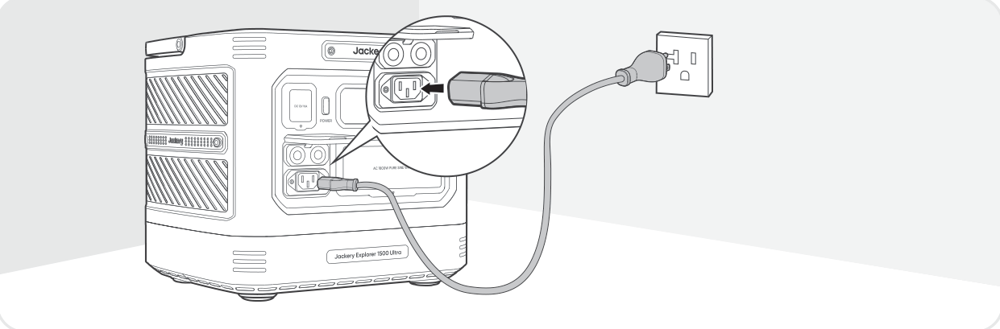
</figure>

<table class="manual-callout-table manual-callout-table"><tbody><tr><td class="manual-callout-label">CAUTION</td><td class="manual-callout-body">
Make sure the AC charging cable is fully and securely plugged into the AC input port. An incomplete connection may cause unstable current, overheating, poor contact, or device malfunction.
</td></tr></tbody></table>

### CHARGING VIA SOLAR PANELS

Jackery Explorer 1500 Ultra has two DC8020 input ports and is compatible with the Jackery solar panels. If one DC8020 input port needs to connect two solar panels simultaneously, please refer to the figure below for charging through the solar panel connector (sold separately, not included as standard).

<figure class="hb-reference-figure" data-component-id="HB-SPECIAL-REFERENCE-FIGURE" data-reference-id="charging-solar" data-source-fragment-sha256="0d827356ff87cafbbc5486997b5d64e9c16faa11ba874ee5cda6aa1d0f35e3f0">
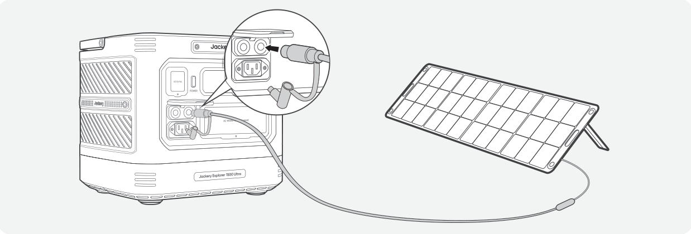
</figure>

<figure class="hb-reference-figure" data-component-id="HB-SPECIAL-REFERENCE-FIGURE" data-reference-id="charging-solar-connector" data-source-fragment-sha256="f8ca50187f43e11295c3b9f4c156e1cb6c324b49a93f386c61ef9402b213d9e7">
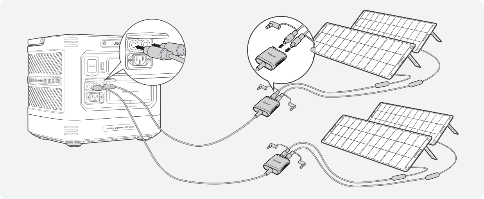
</figure>

It is recommended to use the Jackery Solar Panel to charge the Explorer 1500 Ultra. Ensure that the open-circuit voltage (Voc) of the solar panel falls within the Jackery Explorer 1500 Ultra's DC input voltage range (16V–60V). Jackery is not responsible for any losses caused by using solar panels from other brands.

<table class="manual-callout-table manual-callout-table"><tbody><tr><td class="manual-callout-label">CAUTION</td><td class="manual-callout-body">
One DC8020 input port can be connected to at most two solar panels.
</td></tr></tbody></table>

<table class="manual-callout-table manual-callout-table"><tbody><tr><td class="manual-callout-label">CAUTION</td><td class="manual-callout-body">
Ensure that the input voltage for both DC input ports is the same. Failure to do so may damage the product. For example:
<ul><li>It is recommended to use the same model of Jackery solar panels and the same number of panels when connecting solar panels to both DC8020 Input ports.</li><li>Do not charge the product using both a car charger and a solar panel simultaneously. Doing so may blow the car fuse or result in charging failure.</li></ul></td></tr></tbody></table>

### CHARGING WITH A CAR CHARGER

This product can be charged using a 12V car charger. Ensure that the car charger and the 12V car power outlet provide a good connection.

<figure class="hb-reference-figure" data-component-id="HB-SPECIAL-REFERENCE-FIGURE" data-reference-id="charging-car" data-source-fragment-sha256="68ba10a74eca29f6b44baff96963f3a3ed4279eee2f39269294f93f47d85840d" data-step-captions="embedded">
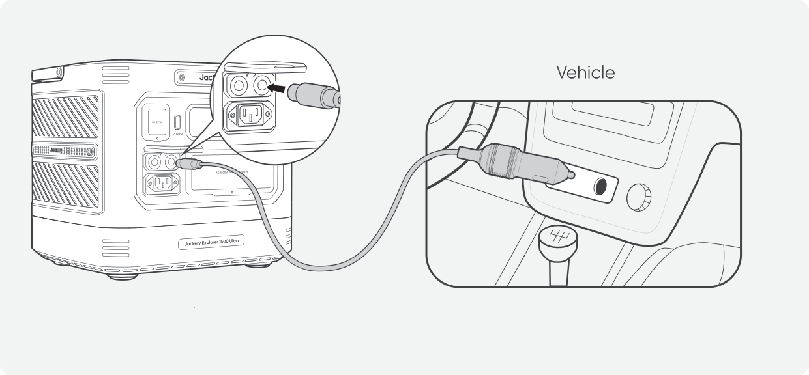
</figure>

*The car charging cable is sold separately.

<table class="manual-callout-table manual-callout-table"><tbody><tr><td class="manual-callout-label">CAUTION</td><td class="manual-callout-body"><ul><li>Please start the vehicle before charging your power station.</li><li>If the vehicle is running on bumpy roads, it is forbidden to use the car charger in case it causes non-standard operation. The Company will not be responsible for any loss caused by non-standard operation.</li><li>Vehicle charging is only applicable to vehicles with 12V DC, not 24V DC. Please do not charge this product in 24V vehicle to avoid personal injury and property loss.</li></ul></td></tr></tbody></table>

## BOTTOM CLEANING

<ol><li>Ensure all protective covers on the product are securely closed to prevent water ingress during rinsing.</li></ol>

<figure class="hb-reference-figure" data-component-id="HB-SPECIAL-REFERENCE-FIGURE" data-reference-id="cleaning-1" data-source-fragment-sha256="aa4ba69b930eee98e1eaddf896b64cfe8ed16d5a2cad6847472eb21cc34ecdae">
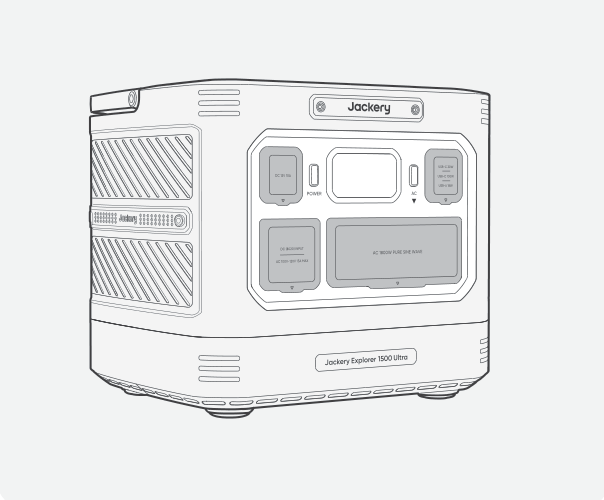
</figure>

<ol start="2"><li>Lay a dry towel on the floor and place the product upside down on the towel as shown in the illustration to protect the surface.</li></ol>

<figure class="hb-reference-figure" data-component-id="HB-SPECIAL-REFERENCE-FIGURE" data-reference-id="cleaning-2" data-source-fragment-sha256="cc2dc69385011eef74c252d8979166a1a89c05426bdd8dc5df0fef68368e5a47">
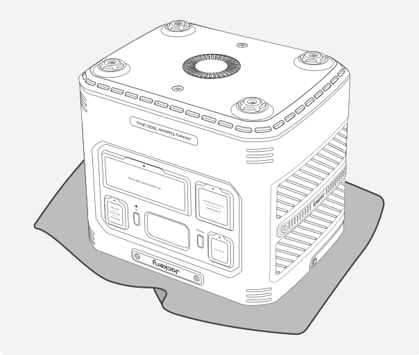
</figure>

<ol start="3"><li>Follow the illustrated order to remove the screws at the bottom and take off the bottom panel to expose the internal cooling fins.</li></ol>

<figure class="hb-reference-figure" data-component-id="HB-SPECIAL-REFERENCE-FIGURE" data-reference-id="cleaning-3" data-source-fragment-sha256="122aea5d7c719c15249555b44bfa037a768e3a72ae26aae67272a9cc4361aa85" data-step-captions="embedded">
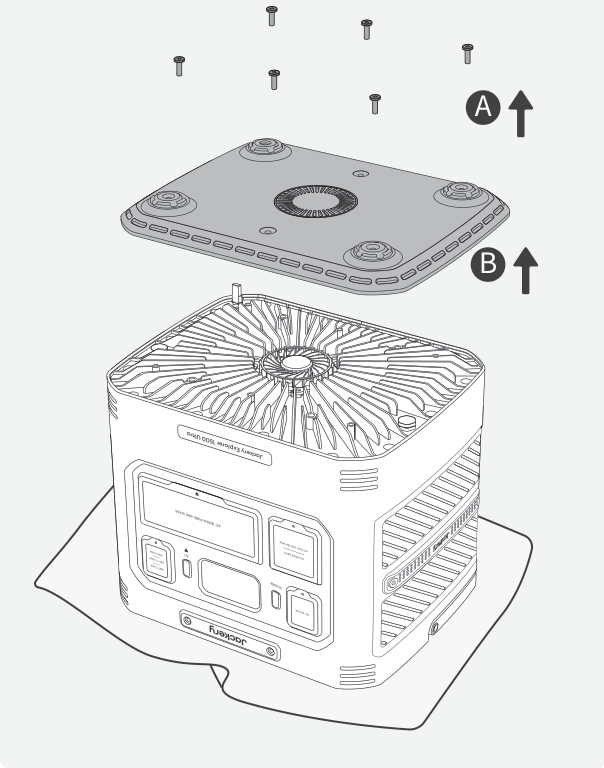
</figure>

<ol start="4"><li>Rinse the cooling fins with clean water. You may use a long-bristle brush or a damp cloth to help clean surface dirt. After cleaning, dry thoroughly with a towel and air dry in a shaded area. Ensure no moisture remains before reinstalling the bottom panel.</li></ol>

<figure class="hb-reference-figure" data-component-id="HB-SPECIAL-REFERENCE-FIGURE" data-reference-id="cleaning-4" data-source-fragment-sha256="ba7ed1f550fede2e63fae0496fb2afbcf71d62c62cdf662907fbfff55adb859a">
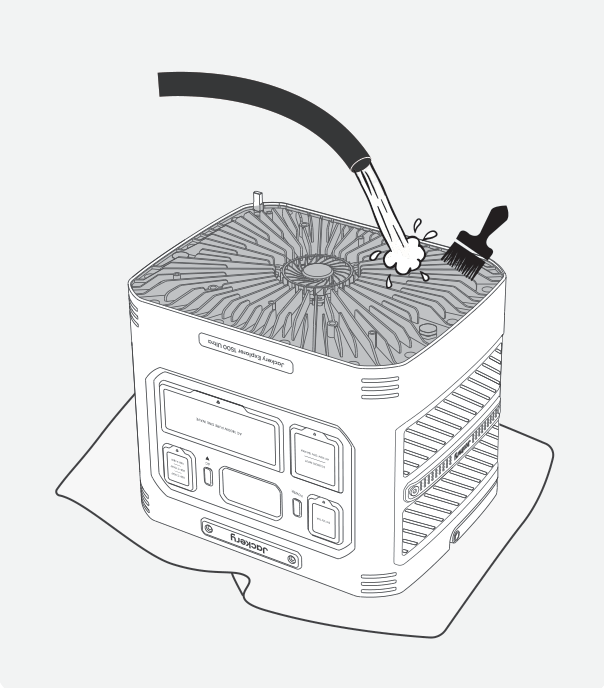
</figure>

## STORAGE

Store the product in a dry clean place with proper ventilation. Storage temperature and humidity:

<ul><li>1 month: -20°C to 45°C (0-60%RH)</li><li>3 months: 0°C to 45°C (0-60%RH)</li><li>12 months: 0°C to 25°C (0-60%RH)</li></ul>

If this product is stored for a long period of time (3 months - 6 months) with the power depleted, it may become unchargeable. To prevent this and maintain battery health, it is recommended to check and recharge the product every three months and perform a full charge and discharge cycle at least once every 6 to 12 months.

## TROUBLESHOOTING

If any of the following fault codes appear, follow the listed corrective actions to resolve the issue. If fault persists, please contact Jackery Customer Support.

<figure aria-label="Error Code / Corrective Measures" class="hb-troubleshooting-composition" data-component-id="HB-TABLE-TROUBLESHOOTING" tabindex="0"><table class="hb-troubleshooting-table"><colgroup><col class="hb-troubleshooting-col-code"/><col class="hb-troubleshooting-col-measures"/></colgroup><thead><tr><th class="hb-troubleshooting-code" scope="col">Error Code</th><th class="hb-troubleshooting-measures" scope="col">Corrective Measures</th></tr></thead><tbody><tr><td class="hb-troubleshooting-code">F0</td><td class="hb-troubleshooting-measures">Restart the product.</td></tr><tr><td class="hb-troubleshooting-code">F1</td><td class="hb-troubleshooting-measures">Restart the product.</td></tr><tr><td class="hb-troubleshooting-code">F2</td><td class="hb-troubleshooting-measures">Restart the product.</td></tr><tr><td class="hb-troubleshooting-code">F3</td><td class="hb-troubleshooting-measures">Restart the product.</td></tr><tr><td class="hb-troubleshooting-code">F4</td><td class="hb-troubleshooting-measures">Connect the product to loads to discharge its battery until the fault disappears.</td></tr><tr><td class="hb-troubleshooting-code">F5</td><td class="hb-troubleshooting-measures">Charge the product via solar panels or AC wall outlet until the fault disappears.</td></tr><tr><td class="hb-troubleshooting-code">F6</td><td class="hb-troubleshooting-measures">1. Wait for the grid to normalize before charging the product via AC wall outlet. 2. Check whether the air intake and exhaust vents are blocked; ensure 30 cm clearance on both side of the product. 3. Place the product in a shaded, well-ventilated area where the ambient temperature is below 45°C. 4. Disconnect all loads from the product, keep it idle and wait until the fault disappears. 5. Restart the product.</td></tr><tr><td class="hb-troubleshooting-code">F7</td><td class="hb-troubleshooting-measures">1. Remove all DC inputs from the product. 2. If you charge the product via a solar panel, check the open-circuit voltage (Voc) of the connected solar panel. The product allows a maximum DC input voltage of 60V. 3. Restart the product and keep it idle. Wait until the fault disappears.</td></tr><tr><td class="hb-troubleshooting-code">F8</td><td class="hb-troubleshooting-measures">Contact Jackery Customer Support.</td></tr><tr><td class="hb-troubleshooting-code">F9</td><td class="hb-troubleshooting-measures">Remove the load connected to the DC12V/USB ports of the product. Wait until the fault disappears.</td></tr></tbody></table></figure>

## SPECIFICATIONS

<h2 class="hb-spec-group">GENERAL INFO</h2>

<figure aria-label="GENERAL INFO" class="hb-spec-table-composition"><table class="manual-table manual-spec-table hb-spec-table"><colgroup><col class="hb-spec-col-label"/><col class="hb-spec-col-value"/></colgroup><tbody><tr><th class="manual-spec-label hb-spec-label" scope="row">Product Name</th><td class="manual-spec-value hb-spec-value">Jackery Explorer 1500 Ultra</td></tr><tr><th class="manual-spec-label hb-spec-label" scope="row">Model No.</th><td class="manual-spec-value hb-spec-value">JE-1500C</td></tr><tr><th class="manual-spec-label hb-spec-label" scope="row">Capacity</th><td class="manual-spec-value hb-spec-value">30Ah/51.2V DC (1536Wh)</td></tr><tr><th class="manual-spec-label hb-spec-label" scope="row">Cell Chemistry</th><td class="manual-spec-value hb-spec-value">LiFePO₄</td></tr><tr><th class="manual-spec-label hb-spec-label" scope="row">Weight</th><td class="manual-spec-value hb-spec-value">Around 38.6 lbs / 17.5 kg</td></tr><tr><th class="manual-spec-label hb-spec-label" scope="row">Dimension</th><td class="manual-spec-value hb-spec-value">13.2×10.4×11.6 in / 33.6×26.4×29.5 cm</td></tr><tr><th class="manual-spec-label hb-spec-label" scope="row">Cycle Life</th><td class="manual-spec-value hb-spec-value">4000 cycles to 70%+ capacity</td></tr><tr><th class="manual-spec-label hb-spec-label" scope="row">IP Rating</th><td class="manual-spec-value hb-spec-value">IP65 (All lids closed)</td></tr></tbody></table></figure>

<h2 class="hb-spec-group">INPUT PORTS</h2>

<figure aria-label="INPUT PORTS" class="hb-spec-table-composition"><table class="manual-table manual-spec-table hb-spec-table"><colgroup><col class="hb-spec-col-label"/><col class="hb-spec-col-value"/></colgroup><tbody><tr><th class="manual-spec-label hb-spec-label" scope="row">Charge Mode AC Input</th><td class="manual-spec-value hb-spec-value">100-120V ~ 60Hz, 15A Max</td></tr><tr><th class="manual-spec-label hb-spec-label" scope="row">Bypass Mode AC Input</th><td class="manual-spec-value hb-spec-value">100-120V ~ 60Hz, 12A Max</td></tr><tr><th class="manual-spec-label hb-spec-label" rowspan="2" scope="row">2 × DC8020 Ports</th><td class="manual-spec-value hb-spec-value">Car: 12-16V⎓8A Max, Double to 8A Max</td></tr><tr><td class="manual-spec-value hb-spec-value">PV: 16-60V⎓12A, Double to 24A / 800W Max</td></tr></tbody></table></figure>

<h2 class="hb-spec-group">OUTPUT PORTS</h2>

<figure aria-label="OUTPUT PORTS" class="hb-spec-table-composition"><table class="manual-table manual-spec-table hb-spec-table"><colgroup><col class="hb-spec-col-label"/><col class="hb-spec-col-value"/></colgroup><tbody><tr><th class="manual-spec-label hb-spec-label" scope="row">3 × AC Output</th><td class="manual-spec-value hb-spec-value">120V ~ 60Hz, 1800W</td></tr><tr><th class="manual-spec-label hb-spec-label" scope="row">AC Output in Bypass Mode¹</th><td class="manual-spec-value hb-spec-value">100-120V ~ 60Hz, 12A Max</td></tr><tr><th class="manual-spec-label hb-spec-label" scope="row">AC Total Output</th><td class="manual-spec-value hb-spec-value">1800W Rated (2000W for 15min. Max) 3600W Surge Peak</td></tr><tr><th class="manual-spec-label hb-spec-label" scope="row">1 × USB-A Output</th><td class="manual-spec-value hb-spec-value">18W Max, 5-6V⎓3A, 6-9V⎓2A, 9-12V⎓1.5A</td></tr><tr><th class="manual-spec-label hb-spec-label" scope="row">1 × USB-C1 Output</th><td class="manual-spec-value hb-spec-value">30W Max, 5V⎓3A, 9V⎓3A, 12V⎓2.5A, 15V⎓2A, 20V⎓1.5A</td></tr><tr><th class="manual-spec-label hb-spec-label" scope="row">1 × USB-C2 Output</th><td class="manual-spec-value hb-spec-value">100W Max, 5V⎓3A, 9V⎓3A, 12V⎓3A, 15V⎓3A, 20V⎓5A</td></tr><tr><th class="manual-spec-label hb-spec-label" scope="row">DC 12V Port</th><td class="manual-spec-value hb-spec-value">12V⎓10A Max</td></tr></tbody></table></figure>

<h2 class="hb-spec-group">ENVIRONMENTAL OPERATING TEMPERATURE</h2>

<figure aria-label="ENVIRONMENTAL OPERATING TEMPERATURE" class="hb-spec-table-composition"><table class="manual-table manual-spec-table hb-spec-table"><colgroup><col class="hb-spec-col-label"/><col class="hb-spec-col-value"/></colgroup><tbody><tr><th class="manual-spec-label hb-spec-label" scope="row">Charge Temperature</th><td class="manual-spec-value hb-spec-value">32°F to 113°F / 0°C to 45°C</td></tr><tr><th class="manual-spec-label hb-spec-label" rowspan="2" scope="row">Discharge Temperature</th><td class="manual-spec-value hb-spec-value">5°F to 113°F / -15°C to 45°C</td></tr><tr><td class="manual-spec-value hb-spec-value">5°F to 14°F / -15°C to -10°C  Output Power: 1000W</td></tr></tbody></table></figure>

1 The product can charge the battery from the AC wall outlet while delivering power through the AC output ports.

※ USB Type-C® and USB-C® are registered trademarks of USB Implementers Forum.

## WARRANTY

<figure aria-label="WARRANTY" class="hb-warranty-intro-composition" data-component-id="HB-WARRANTY-LEAD">
<strong>We only provide our warranty to customers who purchase from the official Jackery website, Jackery-branded third-party platforms, or local authorized dealers.</strong>

*Warranty period and details may vary according to local laws, regulations, and authorized dealers.
</figure>

### Limited Warranty

<figure aria-label="Limited Warranty" class="hb-warranty-card" data-component-id="HB-WARRANTY-SECTION" data-warranty-card-index="1">
Jackery Inc. warrants to the original consumer purchaser that the Jackery product will be free from defects in workmanship and material under normal consumer use during the applicable warranty period identified in the 'Warranty Period' section below, subject to the exclusions set forth below.

This warranty statement sets forth Jackery's total and exclusive warranty obligation. We will not assume, nor authorize any person to assume for us, any other liability in connection with the sale of our products.
</figure>

### Warranty Period

<figure aria-label="Warranty Period" class="hb-warranty-period-card" data-component-id="HB-WARRANTY-YEARS">

3
<strong class="hb-warranty-years-unit">YEARS</strong><strong class="hb-warranty-period-label">Standard Warranty</strong>

The standard warranty period for Jackery Explorer 1500 Ultra is 36 months. In each case, the warranty period is measured starting on the date of purchase by the original consumer purchaser. The sales receipt from the first consumer purchase, or other reasonable documentary proof, is required in order to establish the start date of the warranty period.

2
<strong class="hb-warranty-years-unit">YEARS</strong><strong class="hb-warranty-period-label">Extended Warranty</strong>

To activate the Warranty Extension, you must register your product online  or contact our customer service team at hello@jackery.com to extend the standard warranty runtime.

</figure>

### Repair or Replacement

<figure aria-label="Repair or Replacement" class="hb-warranty-card" data-component-id="HB-WARRANTY-SECTION" data-warranty-card-index="3">
Jackery will repair or replace (at Jackery's expense) any Jackery product that fails to operate during the applicable warranty period due to a defect in workmanship or material. The repaired/replaced product assumes the remaining warranty of the original date of purchase.
</figure>

### Limited to Original Consumer Buyer

<figure aria-label="Limited to Original Consumer Buyer" class="hb-warranty-card" data-component-id="HB-WARRANTY-SECTION" data-warranty-card-index="4">
The warranty on Jackery's product is limited to the original consumer purchaser and is not transferable to any subsequent owner.
</figure>

### Exclusions

<figure aria-label="Exclusions" class="hb-warranty-card" data-component-id="HB-WARRANTY-SECTION" data-warranty-card-index="5">
Jackery's warranty does not apply to:
<ul><li>Misused, abused, modified, damaged by accident, or used for anything other than normal consumer use as authorized in Jackery's current product literature.</li><li>Attempted repair by anyone other than an authorized facility.</li><li>Any product purchased through an online auction house.</li><li>Jackery's warranty does not apply to the battery cell unless the battery cell is fully charged by you within seven days after you purchase the product and at least once every 6 months thereafter.</li></ul></figure>

### Interpretation Rights

<figure aria-label="Interpretation Rights" class="hb-warranty-card" data-component-id="HB-WARRANTY-SECTION" data-warranty-card-index="6">
Jackery reserves the right to final interpretation of the above customer after-sales policy.
</figure>

## APP SETUP

### 1. To download the App and log in

<figure aria-label="Jackery App" class="hb-app-download-composition" data-component-id="HB-SPECIAL-APP">

Search for "Jackery" in Google Play or App Store to install the App. After that, you can register and log in.

Alternatively, scan the QR code below to download and install the App.

</figure>

### 2. To add device

2.1 Click the button + to add your device.

2.2 Long press the “POWER” button on the device to turn on, the Wi-Fi and Bluetooth icons on the device flash to indicate that the device has entered the network configuring mode, tap the “Icon Flashed” button and allow the App to connect to nearby devices and open Bluetooth permissions.

<figure class="hb-reference-figure" data-component-id="HB-SPECIAL-REFERENCE-FIGURE" data-reference-id="app-add" data-source-fragment-sha256="598c6f200645be24ed4a66e8be7c98ffb7a4e2678c75f0e292a504e1206f6ac0" data-step-captions="embedded">
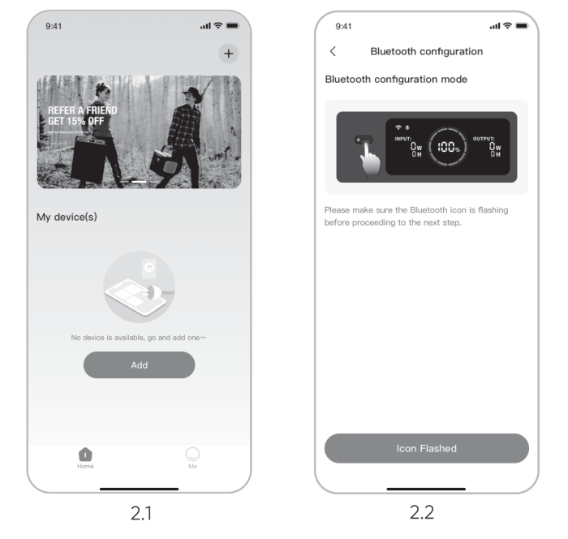
</figure>

<figure class="hb-reference-figure" data-component-id="HB-SPECIAL-REFERENCE-FIGURE" data-reference-id="app-control" data-source-fragment-sha256="a48d2e344afc62787c332a3658af2ce759e76f1fc354daa2147b90fc8481c6f8" data-step-captions="embedded">
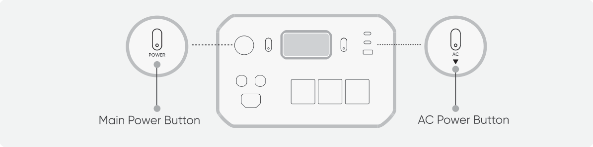
</figure>

<table class="manual-callout-table manual-callout-table"><tbody><tr><td class="manual-callout-label">NOTE</td><td class="manual-callout-body">
If the device is not connected to the App within 2 hours after being turned on, it will automatically turn off Wi-Fi and Bluetooth.
</td></tr></tbody></table>

2.3 After tapping the searched device icon, the App automatically connects the device via Bluetooth.

<table class="manual-callout-table manual-callout-table"><tbody><tr><td class="manual-callout-label">NOTE</td><td class="manual-callout-body">
If "the device has been bound" is prompted during the binding process, the following two ways can be used for connection:
<ul><li>The device owner will share this device with other users through the App.</li><li>Turn off the product, then press and hold the POWER button for 10 seconds to reset the device and rebind it to the App.</li></ul></td></tr></tbody></table>

2.4 After the device is successfully connected, enter your Wi-Fi password and tap the OK button.

<table class="manual-callout-table manual-callout-table"><tbody><tr><td class="manual-callout-label">NOTE</td><td class="manual-callout-body">
Please select a Wi-Fi network in 2.4GHz band. The device does not support a Wi-Fi network in 5GHz band.
</td></tr></tbody></table>

2.5 After the device is successfully added on the App, the Wi-Fi icon on the device will be always on.

<figure class="hb-reference-figure" data-component-id="HB-SPECIAL-REFERENCE-FIGURE" data-reference-id="app-results" data-source-fragment-sha256="c30bcba7039f9dc10e36bc491874bea4257db7614748b0d56bf78916991b0fa6" data-step-captions="embedded">
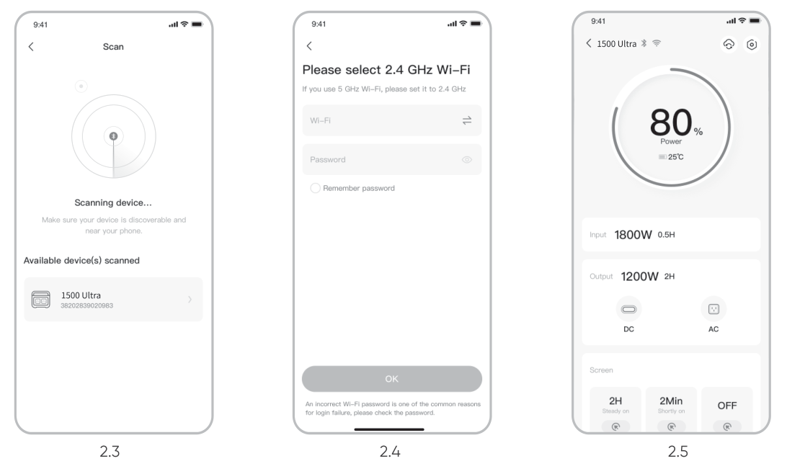
</figure>

The above screenshots are for reference only.

### 3. To unbind the device

Click the Settings icon in the upper right corner of the main interface of the device to enter the settings page, and click the Unbind button at the bottom of the page to unbind the device.

### 4. Notes

#### 4.1 To turn on Wi-Fi and Bluetooth:

<ul><li>Wi-Fi and Bluetooth are automatically turned on after the device is on, and the Wi-Fi and Bluetooth icons on the screen light up.</li></ul>

#### 4.2 To turn off Wi-Fi and Bluetooth:

<ul><li>Wi-Fi and Bluetooth will be automatically turned off if no device is connected within 2 hours.</li></ul>

#### 4.3 To reset Wi-Fi and Bluetooth:

<ul><li>Turn off the product, then press and hold the POWER button for 10 seconds to reset Wi-Fi and Bluetooth to factory settings and reboot the system.</li></ul>

## JACKERY INC.

5310 Bunche Dr., Fremont, CA 94538-8301

1-888-502-2236 (US) hello@jackery.com www.jackery.com

<figure class="hb-reference-figure" data-component-id="HB-SPECIAL-REFERENCE-FIGURE" data-reference-id="contact-qr" data-source-fragment-sha256="2d4e138e988721bb4008f7b0ce675a8aef68ceedf5683b40fd96444daaf962f1">

</figure>
