

Congratulations on your new Jackery Explorer 2000 Plus. Please read this manual carefully before using the product, particularly the relevant precautions to ensure proper use. Keep this manual in an accessible place for frequent reference.

In compliance with laws and regulations, the right of final interpretation of this document and all related documents of this product resides with the Company.

Please kindly notice that no further notifications will be given in case of any update, revision or termination.

## TECHNICAL SPECIFICATIONS

## GENERAL INFO

<figure aria-label="GENERAL INFO" class="hb-spec-table-composition"><table class="manual-table manual-spec-table hb-spec-table"><colgroup><col class="hb-spec-col-label"/><col class="hb-spec-col-value"/></colgroup><tbody><tr><th class="manual-spec-label hb-spec-label" scope="row">Product Name</th><td class="manual-spec-value hb-spec-value">Jackery Explorer 2000 Plus</td></tr><tr><th class="manual-spec-label hb-spec-label" scope="row">Model No.</th><td class="manual-spec-value hb-spec-value">JE-2000C</td></tr><tr><th class="manual-spec-label hb-spec-label" scope="row">Capacity</th><td class="manual-spec-value hb-spec-value">Lithium-ion 45.6Ah/ 44.8V DC (2042.8Wh)</td></tr><tr><th class="manual-spec-label hb-spec-label" scope="row">Weight</th><td class="manual-spec-value hb-spec-value">About 61.5 lbs/ 27.9 kg</td></tr><tr><th class="manual-spec-label hb-spec-label" scope="row">Dimensions</th><td class="manual-spec-value hb-spec-value">18.6 x 14.1 x 14.7 in/ 47.3 x 35.94 x 37.36 cm</td></tr><tr><th class="manual-spec-label hb-spec-label" scope="row">Cycle Life</th><td class="manual-spec-value hb-spec-value">4000 cycles to 70%+ capacity</td></tr></tbody></table></figure>

## OUTPUT PORTS

<figure aria-label="OUTPUT PORTS" class="hb-spec-table-composition"><table class="manual-table manual-spec-table hb-spec-table"><colgroup><col class="hb-spec-col-label"/><col class="hb-spec-col-value"/></colgroup><tbody><tr><th class="manual-spec-label hb-spec-label" scope="row">4x AC Output</th><td class="manual-spec-value hb-spec-value">120V~ 60Hz, 20A Max</td></tr><tr><th class="manual-spec-label hb-spec-label" scope="row">1x AC Output</th><td class="manual-spec-value hb-spec-value">120V~ 60Hz, 25A Max</td></tr><tr><th class="manual-spec-label hb-spec-label" scope="row">AC Total Output</th><td class="manual-spec-value hb-spec-value">3000W Max, 6000W surge peak</td></tr><tr><th class="manual-spec-label hb-spec-label" scope="row">1x AC Expansion Port</th><td class="manual-spec-value hb-spec-value">120V~ 60Hz, 25A Max</td></tr><tr><th class="manual-spec-label hb-spec-label" scope="row">1x DC Expansion Port</th><td class="manual-spec-value hb-spec-value">32.2V-50.4V⎓97A Max</td></tr><tr><th class="manual-spec-label hb-spec-label" scope="row">2x USB-C Output</th><td class="manual-spec-value hb-spec-value">100W Max, 5V⎓3A, 9V⎓3A, 12V⎓3A, 15V⎓3A, 20V⎓5A</td></tr><tr><th class="manual-spec-label hb-spec-label" scope="row">2x USB-A Output</th><td class="manual-spec-value hb-spec-value">Quick Charge 3.0, 18W Max, 5-6V⎓3A, 6-9V⎓2A, 9-12V⎓1.5A</td></tr><tr><th class="manual-spec-label hb-spec-label" scope="row">1x Car Port</th><td class="manual-spec-value hb-spec-value">12V⎓10A Max</td></tr></tbody></table></figure>

## INPUT PORTS

<figure aria-label="INPUT PORTS" class="hb-spec-table-composition"><table class="manual-table manual-spec-table hb-spec-table"><colgroup><col class="hb-spec-col-label"/><col class="hb-spec-col-value"/></colgroup><tbody><tr><th class="manual-spec-label hb-spec-label" scope="row">Charge mode AC input</th><td class="manual-spec-value hb-spec-value">120V~ 60Hz, 15A Max</td></tr><tr><th class="manual-spec-label hb-spec-label" scope="row">Bypass mode AC input/output</th><td class="manual-spec-value hb-spec-value">120V~ 60Hz, 12A Max</td></tr><tr><th class="manual-spec-label hb-spec-label" rowspan="3" scope="row">DC Input</th><td class="manual-spec-value hb-spec-value">2x DC 8mm Ports: 11-17.5V (Working Voltage)⎓8A Max,</td></tr><tr><td class="manual-spec-value hb-spec-value">Double to 8A Max;</td></tr><tr><td class="manual-spec-value hb-spec-value">17.5-60V (Working Voltage)⎓12A Max, Double to 24A/1400W Max</td></tr></tbody></table></figure>

## ENVIRONMENTAL OPERATING TEMPERATURE

<figure aria-label="ENVIRONMENTAL OPERATING TEMPERATURE" class="hb-spec-table-composition"><table class="manual-table manual-spec-table hb-spec-table"><colgroup><col class="hb-spec-col-label"/><col class="hb-spec-col-value"/></colgroup><tbody><tr><th class="manual-spec-label hb-spec-label" scope="row">Charge Temperature</th><td class="manual-spec-value hb-spec-value">0~45°C (32~113 °F)</td></tr><tr><th class="manual-spec-label hb-spec-label" scope="row">Discharge Temperature</th><td class="manual-spec-value hb-spec-value">-10~45°C (14~113°F)</td></tr></tbody></table></figure>

### CERTIFICATIONS

<figure class="hb-reference-figure" data-component-id="HB-SPECIAL-REFERENCE-FIGURE" data-reference-id="certifications" data-source-fragment-sha256="0b12c21cd6c5632e3f2c52dea51b1b144e266d2db06fc09e88c31652cbeaec32" data-step-captions="embedded">

</figure>

※ USB Type-C® and USB-C® are registered trademarks of USB Implementers Forum.

※ Qualcomm Quick Charge is a product of Qualcomm Technologles,Inc. and/or its subsidiaries. Qualcomm and Quick Charge are trademarks or registered trademarks of Qualcomm Incorporated.

<strong>MODIFICATION</strong>: Any changes or modifications not expressly approved by the grantee of this device could void the user’s authority to operate the device.

## PACKAGE LIST

<figure aria-label="PACKAGE LIST" class="hb-inbox-composition" data-card-count="6" data-component-id="HB-SPECIAL-INBOX" data-inbox-variant="responsive-card-grid"><ol class="hb-inbox-grid"><li class="hb-inbox-card" data-item-number="1">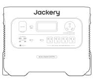

Jackery Explorer 2000 Plus

</li><li class="hb-inbox-card" data-item-number="2">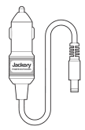

Car Charge Cable

</li><li class="hb-inbox-card" data-item-number="3">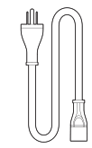

AC Charge Cable

</li><li class="hb-inbox-card" data-item-number="4">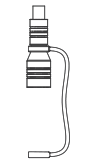

DC7909 to DC8020 Adaptor x 2

</li><li class="hb-inbox-card" data-item-number="5">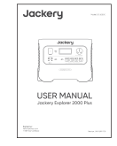

User Manual

</li><li class="hb-inbox-card" data-item-number="6">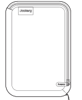

Accessories Bag

</li></ol></figure>

## GET TO KNOW YOUR GEAR

### Product Appearance

<figure class="hb-reference-figure" data-component-id="HB-SPECIAL-REFERENCE-FIGURE" data-reference-id="overview-front" data-source-fragment-sha256="a936d19489d9731ac8af75c80cbb53283021ac05bc34ca2d9f208dec40d670d5" data-step-captions="embedded">
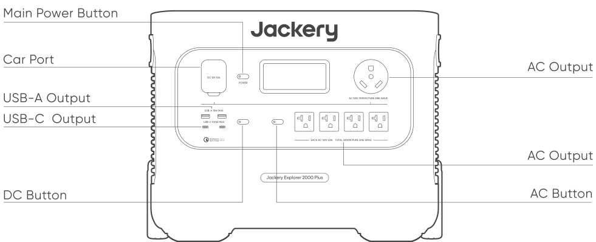
</figure>

<figure class="hb-reference-figure" data-component-id="HB-SPECIAL-REFERENCE-FIGURE" data-reference-id="overview-rear" data-source-fragment-sha256="e6d33f3525b49007d20b3a4a70a66a0aff6fb47c9b5022e26b7f0fb877a630ee" data-step-captions="embedded">
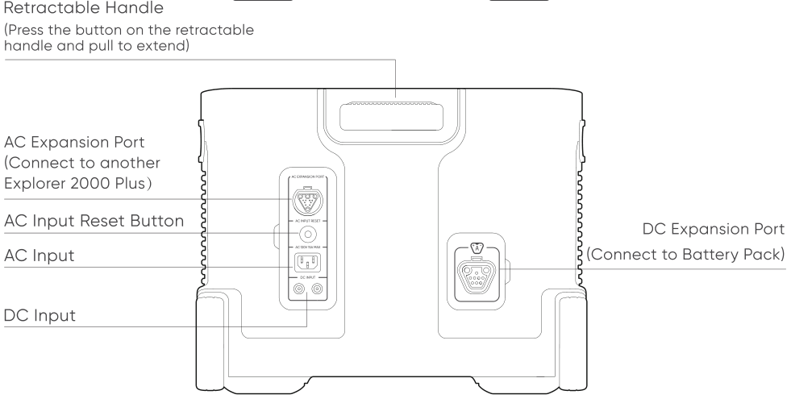
</figure>

## LCD DISPLAY

<figure class="hb-reference-figure" data-component-id="HB-SPECIAL-REFERENCE-FIGURE" data-reference-id="lcd-map" data-source-fragment-sha256="a25f42291a3413b4760c64566a59c112b3d0229d4763b1cb81a59c86b6d5830e" data-step-captions="embedded">
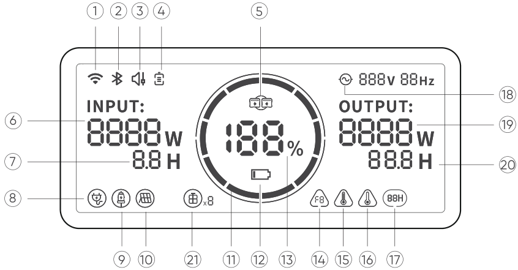
</figure>

<figure aria-label="LCD DISPLAY" class="hb-reference-composition hb-reference-lcd-descriptions" data-component-id="HB-TABLE-REFERENCE" data-component-variant="lcd-descriptions" tabindex="0"><table class="hb-reference-table"><tbody><tr><td>①</td><td>WiFi</td></tr><tr><td>②</td><td>Bluetooth</td></tr><tr><td>③</td><td>Quiet Charging Mode</td></tr><tr><td>④</td><td>Battery Saving Mode</td></tr><tr><td>⑤</td><td>AC Expansion Indicator</td></tr><tr><td>⑥</td><td>Input Power</td></tr><tr><td>⑦</td><td>Remaining Charge Time</td></tr><tr><td>⑧</td><td>AC Wall Charging Indicator</td></tr><tr><td>⑨</td><td>Car Charging Indicator</td></tr><tr><td>⑩</td><td>Solar Charging Indicator</td></tr><tr><td>⑪</td><td>Battery Power Indicator</td></tr><tr><td>⑫</td><td>Low Battery Indicator</td></tr><tr><td>⑬</td><td>Remaining Battery Percentage</td></tr><tr><td>⑭</td><td>Error Code</td></tr><tr><td>⑮</td><td>High Temperature Warning</td></tr><tr><td>⑯</td><td>Low Temperature Warning</td></tr><tr><td>⑰</td><td>Energy Saving Mode</td></tr><tr><td>⑱</td><td>AC Power Indicator</td></tr><tr><td>⑲</td><td>Output Power</td></tr><tr><td>⑳</td><td>Remaining Discharge Time</td></tr><tr><td>㉑</td><td>Battery Pack Indicator and Connected Quantity</td></tr></tbody></table></figure>

<strong>Battery Saving Mode:</strong> When this feature is enabled, it limits the battery charging capacity to 85% and the discharging capacity to 15%, and the battery will only be charged when the capacity is below 80% to extend the battery life. Use the Jackery App for settings of this function.

<strong>Quiet Charging Mode:</strong> noise ≤ 30dB in this charging mode, you can set this function in Jackery App.

<figure aria-label="Battery Power Indicator" class="hb-lcd-table-composition" data-component-id="HB-TABLE-LCD-ICON" tabindex="0"><table class="hb-lcd-icon-table"><colgroup><col class="hb-lcd-col-icon"/><col class="hb-lcd-col-name"/><col class="hb-lcd-col-description"/></colgroup><tbody><tr><td class="hb-lcd-icon"></td><td class="hb-lcd-name">Battery Power Indicator</td><td class="hb-lcd-description">When the product is being charged, the orange circle around the battery percentage will light up in sequence. When charging other devices, the indicator will show the battery level.</td></tr><tr><td class="hb-lcd-icon"></td><td class="hb-lcd-name">Low Battery Indicator</td><td class="hb-lcd-description">When the battery is less than 20%, the Low Battery Indicator will stay on. When less than 5%, the Low Battery Indicator will flash. When it is being charged, the Indicator will be off.</td></tr><tr><td class="hb-lcd-icon"></td><td class="hb-lcd-name">Energy Saving Mode</td><td class="hb-lcd-description">To avoid forgetting to turn off the output which results in battery consumption, the product turns the Energy Saving Mode on by default. This occurs when no device is connected or the connected device is less than or equal to a certain value. (Refer to the table below for more details), the device will automatically turn off all outputs after 12 hours.</td></tr></tbody></table></figure>

<table class="manual-table"><thead><tr><th>Output</th><th>Output Power</th><th>Defaults</th></tr></thead><tbody><tr><td>AC Output</td><td>≤25W</td><td rowspan="3">All outputs turned off automatically after 12 hours</td></tr><tr><td>USB Output</td><td>≤2W</td></tr><tr><td>Car Output</td><td>≤2W</td></tr></tbody></table>

<strong>To turn off the Energy Saving Mode</strong>

Long press the AC Button and Main Power Button until the Energy Saving Mode icon disappears. In Non-Energy Saving Mode, please remember to turn off the products to avoid battery consumption.

<strong>To turn on the Energy Saving Mode</strong>

Long press the AC Button and Main Power Button until the Low Power Mode icon lights up on the screen.

<figure aria-label="Fault code" class="hb-lcd-table-composition" data-component-id="HB-TABLE-LCD-ICON" tabindex="0"><table class="hb-lcd-icon-table"><colgroup><col class="hb-lcd-col-icon"/><col class="hb-lcd-col-name"/><col class="hb-lcd-col-description"/></colgroup><tbody><tr><td class="hb-lcd-icon"></td><td class="hb-lcd-name">Fault code</td><td class="hb-lcd-description">In order to respond to the feedback quickly, we set up common fault codes F0-FE in the system: If the F8 code appears, please remove the load or unplug the charging plug, the product can restore by itself, if not, please contact after-sales service; If the F9 code appears, please remove the load and the product can recover by itself, if not, please contact after-sales service. In case of any other code appears, please contact our after-sales service.</td></tr><tr><td class="hb-lcd-icon"></td><td class="hb-lcd-name">High-temperature warning</td><td class="hb-lcd-description">If it appears on the screen, do not worry, the battery will restore automatically after cooling.</td></tr><tr><td class="hb-lcd-icon"></td><td class="hb-lcd-name">Low-temperature Warning</td><td class="hb-lcd-description">If it is displayed on the screen, do not worry. It will automatically restore after the ambient temperature is restored.</td></tr><tr><td class="hb-lcd-icon"></td><td class="hb-lcd-name">AC Expansion Indicator</td><td class="hb-lcd-description">Double the power by connecting another Jackery Explorer 2000 Plus through the Jackery Connector (sold separately). Please refer to the Jackery Connector manual for details</td></tr></tbody></table></figure>

## BASIC OPERATIONS

### Output On/Off

<strong>Main power on/off:</strong> Press the "Main Power Button" and the working indicator lights up and the LCD display is illuminated. When this product does not have any operation for 2 minutes, the product will enter the hibernation state and the display will turn off automatically. If you need to turn off the main power, please press and hold the "Main Power Button" until the working indicator turns off. The default standby time of this product is 2 hours. If the other power output switch is not turned on, and the product does not have any load input, the product will automatically shut down after 2 hours. The automatic shutdown time can be set on the Jackery App.

<strong>AC Output On/Off:</strong> Ensure that the main power supply is turned on. Press the AC Button, the AC Output operation indicator lights up. Then you can connect the equipment that needs AC charging. Press the AC Button again to turn off the AC Output.

<strong>USB/Car Port Output On/Off:</strong> Ensure that the main power supply is turned on. Press the DC Button, the DC Output operation indicator lights up. Then USB/Car Port Output Ports can be connected to external load devices. Press the DC Button again to turn off the USB/ Car Port Output.

### LCD Screen On/Off

To turn on, press the Main Power Button or when there’s a charging input, the screen display will light up automatically. To turn off, press the Main Power Button again and the screen display will turn off. Or, if there is no operation in 2 minutes, the product will enter a sleep state and the screen display will automatically turn off.

<strong>To get the screen always-on (under charging or discharging state), follow these steps:</strong> After the display screen lights up, double-click the Main Power Button and the mode of Always-On Display will be on.

<strong>To turn off Always-On Display, follow these steps:</strong> Press the Main Power Button and the screen will be turned off in 2 minutes.

<strong>Tip:</strong> During Always-On mode, the screen automatically turns off after 2 hours without charging or discharging.

<strong>AC Output Reset Button:</strong> When the Reset Button pops up, you need to remove the load and press the Reset Button to reset.

<strong>AC Input Reset Button:</strong> When the Reset Button pops up, you need to remove AC charge cable and press the Reset Button to reset.

<strong>EPS: Emergency Power System.</strong>

Once you have connected the mains and the AC input port of the EPS via the AC charger cable, you can use the AC output port of the EPS to power your unit (at this point the AC power comes from the mains, not the EPS battery). In the event of a sudden loss of mains power, the EPS can automatically switch to battery mode within 20ms. Since this is a non-professional UPS function, it does not support 0ms switching. Do not connect to equipment with high uninterruptible power requirements such as data servers and workstations. Please test several times to confirm compatibility before use and it is recommended to connect to only one device. Do not use more than one unit at a time to avoid triggering the overload protection. Failure to follow these instructions may result in equipment failure or loss of data for which we cannot be held responsible.

## USE WITH BATTERY PACK (SOLD SEPARATELY)

This product can support up to 5 battery packs to meet the need for large power capacity. For details on how to use it, please refer to the Jackery Battery Pack 2000 Plus User Manual.

### SAFETY PRECAUTIONS WHEN USING

When using the retractable handle to move the Jackery Explorer 2000 Plus, please do not stack or place other objects on top of it to prevent falling off and causing injury.

When using the battery pack, please do not stack more than two battery packs on top of the Jackery Explorer 2000 Plus to prevent it from falling off and causing injury.

## APP CONNECTION

This product supports the connection of Jackery App for intelligent control and operation. Users can download the Jackery App through App Store or Android application markets. Please refer to the User Manual for Jackery App for detailed connection instructions.

## CHARGING YOUR JACKERY EXPLORER 2000 PLUS

Green energy first: We advocate to use the green energy first. This product supports two modes of charging at the same time: solar charging and AC wall charging.

When AC wall charging and solar charging are turned on at the same time, the product will give priority to solar charging and both methods will be used to charge the battery at the maximum permissible power.

### CHARGING FROM THE WALL

Please use the AC cable included in the package.

<figure class="hb-reference-figure" data-component-id="HB-SPECIAL-REFERENCE-FIGURE" data-reference-id="wall-charge" data-source-fragment-sha256="f5fb2c34ef290f652c63391cb43b5f6270fd25cda37778336982ca02b6458561" data-step-captions="embedded">
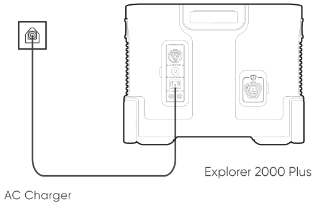
</figure>

### SOLAR CHARGING

#### Jackery SolarSaga 200 or 100 or 60 Solar Panel Connection Guide

If one or two solar panels are connected, you can directly connect the DC8020 port of the solar panel to the DC8020 port of Jackery Explorer 2000 Plus for charging. If three or four solar panels are connected, please refer to the method shown in the following figure to charge through the solar series connector. (Note: The solar series connector is not in standard configuration, so you need to purchase it separately. Please refer to the detailed operation instructions of the solar series connector before using it.)

<figure class="hb-reference-figure" data-component-id="HB-SPECIAL-REFERENCE-FIGURE" data-reference-id="solar-3" data-source-fragment-sha256="d88138a5bf8ed2b804d58958201eedf557c85b1d150d541ae479db08c8a377c6" data-step-captions="embedded">
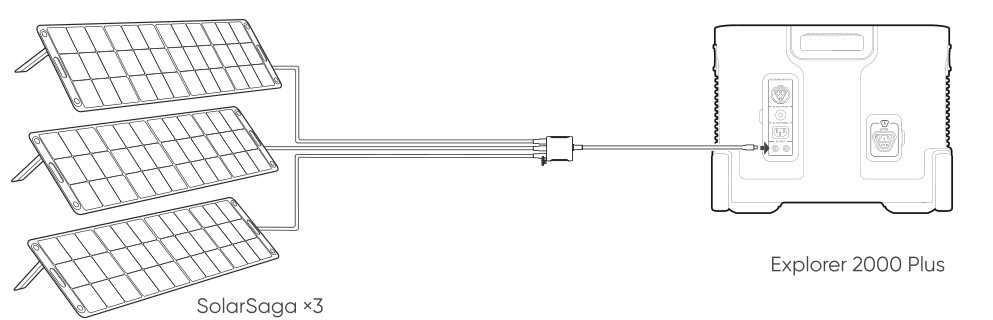
</figure>

<figure class="hb-reference-figure" data-component-id="HB-SPECIAL-REFERENCE-FIGURE" data-reference-id="solar-2-2" data-source-fragment-sha256="c646bdea41f10faf0c2d7f422462b8a61351810d0710eaedb0ed0bef257dbd09" data-step-captions="embedded">
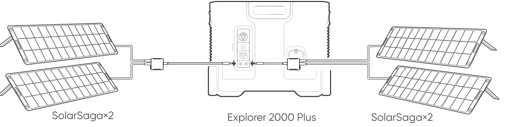
</figure>

<figure class="hb-reference-figure" data-component-id="HB-SPECIAL-REFERENCE-FIGURE" data-reference-id="solar-3-3" data-source-fragment-sha256="14865a8a44af17381af059ce4eb382ec9d45bda7ad6bcb4e714c4f44b8c365dc" data-step-captions="embedded">
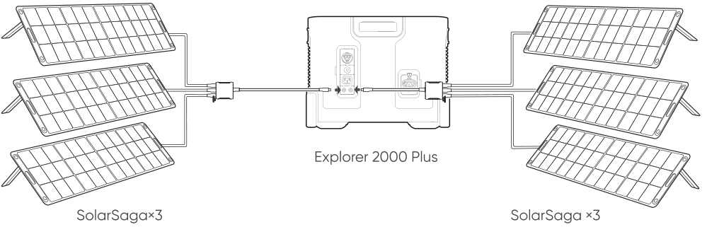
</figure>

Caution: When the two inputs are used at the same time, please make sure to use the same type of solar panel and the number of solar panels in the two inputs must be the same to avoid damage or charging problems of the equipment due to inconsistent voltages of the two channels.

The following way of connections are prohibited to charge this product:

<figure class="hb-reference-figure" data-component-id="HB-SPECIAL-REFERENCE-FIGURE" data-reference-id="solar-prohibited" data-source-fragment-sha256="57352d91e811265f81fd93ab113d25f53737a2244b217885af6225d04eee2073" data-step-captions="embedded">
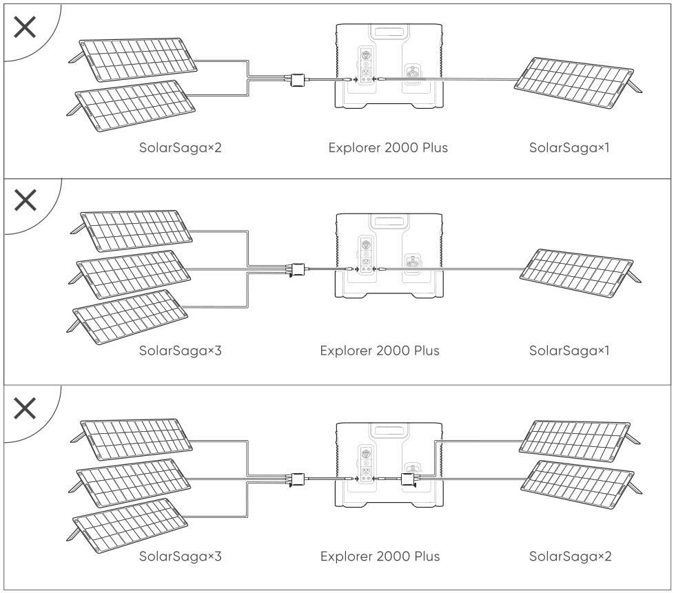
</figure>

#### Jackery SolarSaga 80 Solar Panel Connection Guide

Users who have purchased Jackery SolarSaga 80 can charge the product by referring to the connection mode shown below. The Jackery SolarSaga 80 supports the parallel connection or the parallel and then series connections to charge the product. The single input port of the Jackery Explorer 2000 Plus supports the input of up to six pieces of SolarSaga 80 solar panels, and two input ports support the input to up to 12 pieces of SolarSaga 80 solar panels. (When the power is connected with six solar panels in a single input port, the solar panels shall be divided into two groups, and each group of three solar panels shall be self-connected in parallel and then connected to Jackery Explorer 2000 Plus through the solar series connector. The solar series connector needs to be purchased separately.)

For detailed operation instructions on the self-parallel connection of the Jackery SolarSaga 80 solar panel, please refer to the user manual.

<figure class="hb-reference-figure" data-component-id="HB-SPECIAL-REFERENCE-FIGURE" data-reference-id="solar-80" data-source-fragment-sha256="f9bc2811806ac66383fa027187cd811f4aad11974688ba69818b54634b14b6f0" data-step-captions="embedded">
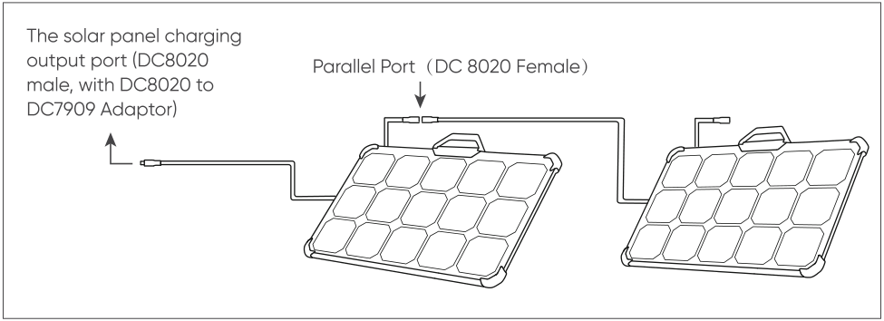
</figure>

Tip: Users can enter the number of solar panels in their own combination according to the number of solar panels they purchased. Currently, the product supports charging with 1, 2, 3, 4, 5, 6, 8, and 12 80W solar panels in combination.

#### DC7909 to DC8020 Adaptor Operation Guide

All of our solar panels on sale have been upgraded to include a DC7909 to DC8020 adapter. If you have purchased a Jackery solar panel without a DC7909 to DC8020 adapter, you can charge your Jackery Explorer 2000 Plus by following the connection instructions below.

<figure class="hb-reference-figure" data-component-id="HB-SPECIAL-REFERENCE-FIGURE" data-reference-id="solar-adaptor" data-source-fragment-sha256="ee7382ff8e570f7fcd3a5bc86ebda643b41ed3ab367fa0e69920f87895e93809" data-step-captions="embedded">
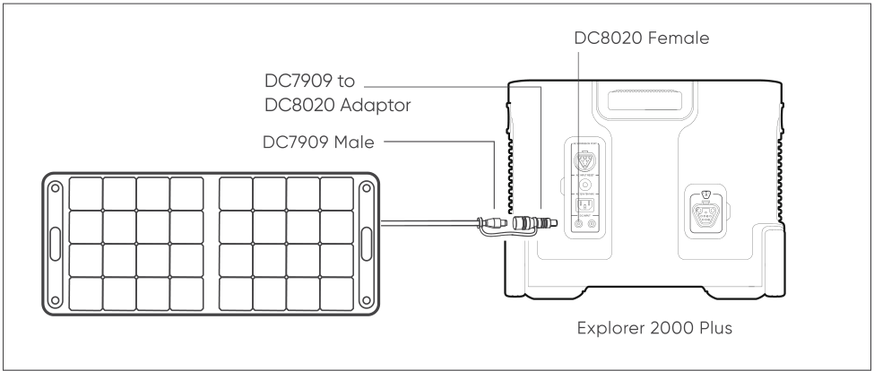
</figure>

### CHARGING IN THE CAR

This product can be charged with a 12 V car charger. Please start the vehicle before charging to prevent draining the car battery and prevent your vehicle from being unable to start.

Please also ensure that the car charger and the car cigarette lighter provide a good connection, and ensure that the car charger is fully inserted. In addition, if the vehicle is running on bumpy roads, it is forbidden to use the car charger in case it burns due to a poor connection. The Company will not be responsible for any loss caused by non-standard operation.

<figure class="hb-reference-figure" data-component-id="HB-SPECIAL-REFERENCE-FIGURE" data-reference-id="car-charge" data-source-fragment-sha256="79f61a4f98a23b38e98e8544bba2506c587f11f6b934a7c63111387b1fdf136b" data-step-captions="embedded">
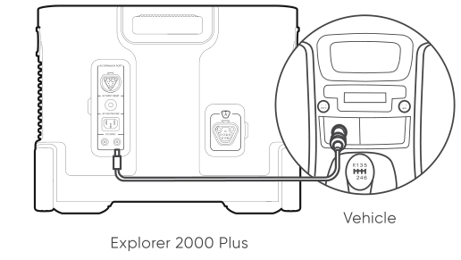
</figure>

### SAFETY PRECAUTIONS WHEN CHARGING

❶ When the two DC inputs of this product are used at the same time, please ensure that the number of solar panels connected in series is the same, and try to use the same type of solar panel.

❷ Do not charge from car charger and solar panel at the same time, otherwise, it will damage the car fuse.

<figure class="hb-reference-figure" data-component-id="HB-SPECIAL-REFERENCE-FIGURE" data-reference-id="car-solar-prohibited" data-source-fragment-sha256="d813f805ca8f1f033ed53df96b1a1a276f32f06f85678dd4e70d10de547db815" data-step-captions="embedded">
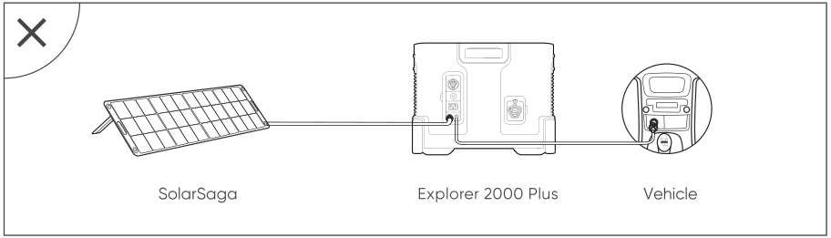
</figure>

❸ Vehicle charging is only applicable in 12V vehicles, not in 24V ones. Please do not charge this product in 24V vehicle to avoid personal injury and property loss.

❹ It is recommended to use Jackery accessories - solar panels for solar charging. We will not be responsible for the losses caused by using other brands’ solar panels.

## INSTRUCTIONS PERTAINING TO RISK OF FIRE, ELECTRIC SHOCK, OR INJURY TO PERSONS

### IMPORTANT SAFETY INSTRUCTIONS

WARNING–When using this product, basic precautions should always be followed, including the following:

a) Read all the instructions before using the product.

b) To reduce the risk of injury, close supervision is necessary when the product is used near children.

c) Do not put fingers or hands into the product.

d) Use of an attachment not recommended or sold by power pack manufacturer may result in a risk of fire, electric shock, or injury to persons.

e) To reduce risk of damage to the electric plug and cord, pull the plug rather than the cord when disconnecting the power pack.

f) Do not use a battery pack or appliance that is damaged or modified. Damaged or modified batteries may exhibit unpredictable behavior resulting in fire, explosion or risk of injury.

g) Do not operate the power pack with a damaged cord or plug, or a damaged output cable.

h) Do not disassemble the power pack, take it to a qualified service person when service or repair is required. Incorrect reassembly may result in a risk of fire or electric shock.

i) To reduce the risk of electric shock, unplug the power pack form the outlet before attempting any instructed servicing.

j) PERSONAL PRECAUTIONS

1)Have plenty of fresh water and soap nearby in case battery acid contacts skin,clothing, or eyes.

2)Wear complete eye protection and clothing protection. Avoid touching eyes while working near battery.

3)If battery acid contacts skin or clothing, wash immediately with soap and water. If acid enters eye, immediately flood eye with running cold water for at least 10 minutes and get medical attention immediately.

4)NEVER smoke or allow a spark or flame in vicinity of battery or engine.

5)Be extra cautious to reduce risk of dropping a metal tool onto battery. It might spark or short-circuit battery or other electrical part that may cause explosion.

k) When charging the internal battery, work in a well ventilated area and do not restrict ventilation in any way.

l) Under abusive conditions, liquid may be ejected from the battery; avoid contact. If contact accidentally occurs, flush with water. If liquid contacts eyes, additionally seek medical help. Liquid ejected from the battery may cause irritation or burns.

m) Do not expose a power pack to fire or excessive temperature. Exposure to fire or temperature above 130°C may cause explosion. The temperature of 130°C can be replaced by the temperature of 265°F.

n) Have servicing performed by a qualified repair person using only identical replacement parts. This will ensure that the safety of the product is maintained.

### SAVE THESE INSTRUCTIONS OPERATING INSTRUCTIONS

<ul><li>
Use and store the unit only in a clean and dry environment. DO NOT use and store in dusty and wet environment.
</li><li>
Check the unit prior to every use. DO NOT use the unit if it is damaged, broken.
</li><li>
If rust, peculiar odors, overheating or other abnormal circumstances are observed, stop using the unit immediately and contact the dealer or our customer service center.
</li><li>
Make sure that the unit is properly secured when transporting it in a motor vehicle.
</li><li>
Only charge the Explorer 2000 Plus within a ambient temperature 0-45°C (32-113°F),discharge temperature is -10-45°C (14~113°F) and Storage temperature is 1 year: 0~40°C (32~104°F).
</li><li>
Switch the unit off immediately if it has accidentally fallen, was dropped or was exposed to vibrations.
</li><li>
DO NOT use the unit if the power cord is damaged or broken.
</li><li>
Keep the unit away from children. DO NOT let children use the power supply unit. Keep this product away from pets.
</li><li>
DO NOT use the unit in an area or environment with high temperature.
</li><li>
Should fluid from inside of the unit come in contact with your skin or clothing, wash the affected areas with tap water.
</li><li>
In a storm, unplug the power cord from the socket.
</li><li>
DO NOT place the unit on its side or upside down while in use or storage.
</li><li>
DO NOT use accessories for other usage.
</li><li>
Make sure that the device you are connecting is switched off before you connect it.
</li><li>
DO NOT expose a power pack to fire or excessive temperature. Exposure to fire or temperature above 130°C may cause explosion.
</li><li>
Solar charge times depend on weather conditions, place your solar panel where it will get as much direct sunlight as possible.
</li><li>
DO NOT place the power pack on the floor, or at a height less than 457 mm (18 inches) above the floor, during use in a repair facility.
</li></ul>

<table class="manual-callout-table manual-callout-table"><tbody><tr><td class="manual-callout-label">Warning</td><td class="manual-callout-body">
Do not remove the battery pack without permission,If you need to repair the battery pack, contact your local manufacturer as soon as possible
</td></tr></tbody></table>

<table class="manual-callout-table manual-callout-table"><tbody><tr><td class="manual-callout-label">DANGER</td><td class="manual-callout-body">
This device is for indoor use only (e.g. RV/tent/off-grid cabin, etc.). Do not use outdoors under any circumstances (e.g. where exposed to rain or snow or use it in wet environments by the sea or waterways).
</td></tr></tbody></table>

### MOVING AND STORAGE INSTRUCTIONS

<ul><li>
DO NOT move the unit if it is recharging or in use.
</li><li>
DO NOT dispose the unit together with household waste.
</li><li>
DO NOT place the unit close to or in a fire or expose it to heat. Keep out of direct sunlight.
</li><li>
DO NOT store the unit in a bathroom or in an area exposed to rain or moisture.
</li><li>
DO NOT disassemble the power pack, take it to a qualified service person when service or repair is required. Incorrect reassembly may result in a risk of fire or electric shock.
</li><li>
DO NOT store the unit in an area or environment with high temperature.
</li></ul>

### USER MAINTENANCE INSTRUCTIONS

When using it for the first time, please fully charge the device before use. If this product is stored for a long period of time (3 months - 6 months) with the power depleted, its performance will deteriorate and may even become unchargeable. If this device is stored for a long time, please check the power regularly and charge it to about 60% to 80%.

<figure aria-label="FCC" class="hb-fcc-composition" data-component-id="HB-SPECIAL-FCC">

<strong>NOTE:</strong> This equipment has been tested and found to comply with the limits for a Class B digital device, pursuant to part 15 of the FCC Rules. These limits are designed to provide reasonable protection against harmful interference in a residential installation. This equipment generates, uses and can radiate radio frequency energy and, if not installed and used in accordance with the instructions, may cause harmful interference to radio communications. However, there is no guarantee that interference will not occur in a particular installation. If this equipment does cause harmful interference to radio or television reception, which can be determined by turning the equipment off and on, the user is encouraged to try to correct the interference by one or more of the following measures:

<ul class="simple"><li>
Reorient or relocate the receiving antenna.
</li><li>
Increase the separation between the equipment and receiver.
</li><li>
Connect the equipment into an outlet on a circuit different from that to which the receiver is connected.
</li><li>
Consult the dealer or an experienced radio/TV technician for help.
</li></ul>

</figure>

## WARRANTY

Note: We only provide our warranty for the buyer who purchased on Amazon (Jackery Inc), Jackery website or local authorized dealers.

### Limited Warranty

<figure aria-label="Limited Warranty" class="hb-warranty-card" data-component-id="HB-WARRANTY-SECTION" data-warranty-card-index="1">
Jackery Inc. warrants to the original consumer purchaser that the Jackery product will be free from defects in workmanship and material under normal consumer use during the applicable warranty period identified in the 'Warranty Period' section below, subject to the exclusions set forth below.

This warranty statement sets forth Jackery's total and exclusive warranty obligation. We will not assume, nor authorize any person to assume for us, any other liability in connection with the sale of our products.
</figure>

### Warranty Period

<figure aria-label="Warranty Period" class="hb-warranty-card" data-component-id="HB-WARRANTY-SECTION" data-warranty-card-index="2">
3 Years Standard Warranty: The standard warranty period for Jackery Explorer 2000 Plus is 36 months. In each case, the warranty period is measured starting on the date of purchase by the original consumer purchaser. The sales receipt from the first consumer purchase, or other reasonable documentary proof, is required in order to establish the start date of the warranty period.

2 Years Extended Warranty: To activate the Warranty Extension, you must register your product online or contact our customer service team at hello@jackery.com to extend the standard warranty runtime.
</figure>

### Exchange

<figure aria-label="Exchange" class="hb-warranty-card" data-component-id="HB-WARRANTY-SECTION" data-warranty-card-index="3">
Jackery will replace (at Jackery's expense) any Jackery product that fails to operate during the applicable warranty period due to defect in workmanship or material. A replacement product assumes the remaining warranty of the original product.
</figure>

### Limited to Original Consumer Buyer

<figure aria-label="Limited to Original Consumer Buyer" class="hb-warranty-card" data-component-id="HB-WARRANTY-SECTION" data-warranty-card-index="4">
The warranty on Jackery's product is limited to the original consumer purchaser and is not transferable to any subsequent owner.
</figure>

### Exclusions

<figure aria-label="Exclusions" class="hb-warranty-card" data-component-id="HB-WARRANTY-SECTION" data-warranty-card-index="5">
Jackery's warranty does not apply to:

Misused, abused, modified, damaged by accident, or used for anything other than normal consumer use as authorized in Jackery's current product literature.

Attempted repair by anyone other than an authorized facility.

Any product purchased through an online auction house.

Jackery's warranty does not apply to the battery cell unless the battery cell is fully charged by you within seven days after you purchase the product and at least once every 6 months thereafter.
</figure>

### Download the Jackery Mobile App

<figure class="hb-reference-figure" data-component-id="HB-SPECIAL-REFERENCE-FIGURE" data-reference-id="app-store" data-source-fragment-sha256="bd07e34882b832f4a88beee8e0fff1f77973569182d2987abfbaa9e37c515095" data-step-captions="embedded">

</figure>
