

## IMPORTANT:

Congratulations on your new Jackery Explorer 240D. Please read this manual carefully before using the product, particularly the relevant precautions to ensure proper use. Keep this manual in an accessible place for frequent reference.

In compliance with laws and regulations, the right of final interpretation of this document and all related documents of this product resides with the Company.

Please kindly notice that no further notifications will be given in case of any update, revision or termination.

## IMPORTANT SAFETY INFORMATION

### INSTRUCTIONS PERTAINING TO RISK OF FIRE, ELECTRIC SHOCK, OR INJURY TO PERSONS

<table class="manual-callout-table manual-callout-table"><tbody><tr><td class="manual-callout-label">WARNING</td><td class="manual-callout-body">
Always follow these basic precautions when using this product.
</td></tr></tbody></table>

<ul><li>
Read all the instructions before using the product.
</li><li>
Do not allow children play on or in the product. Close supervision of children is necessary when the product is used near children.
</li><li>
Avoid placing hands or fingers inside the product.
</li><li>
Stop using the product immediately if it has been physically damaged or modified. Improper use of the product may cause unpredictable behavior, leading to fire, explosion, or injury.
</li><li>
If any of the following are observed, including but not limited to overheats, emits unusual odors or smoking, leaks, or burns, stop using the product immediately and contact the dealer or our Customer Support.
</li><li>
Never attempt to open, repair, or modify the product. Any tampering, reassembly, or modification of the product can result in electric shock, fire, or battery damage.
</li><li>
Be aware that liquid ejected from the product may cause irritation or burns. Inappropriate or abusive use may lead to battery leakage. Avoid direct contact with leaking liquid. If the liquid contacts your eyes, seek medical help immediately. If it contacts other body parts, flush with running water and consult a medical professional without delay.
</li><li>
Do not expose the product to fire or excessive temperatures. Doing so may result in an explosion if the temperature exceeds 130°C (265°F).
</li><li>
Any use of unrecommended or non-supplied materials or parts with the product may result in a risk of fire, electric shock, or personal injury.
</li><li>
Do not leave the battery charging unattended for long periods. Always monitor the charging process to ensure safe operation.
</li><li>
To reduce the risk of electric shock, unplug the product from any power source before attempting any technical service or troubleshooting.
</li></ul>

### OPERATING INSTRUCTIONS

<strong>SAVE THESE INSTRUCTIONS</strong>

<ul><li>
Stop using the product immediately if it shows signs of damage. Discontinue use and contact customer support for assistance.
</li><li>
Do not charge the battery in extremely hot or cold environments and strictly adhere to the product's specified operating temperature ranges:
<ul><li>
Charging temperature: -4°F to 113°F (-20°C to 45°C)
</li><li>
Discharging temperature: -4°F to 113°F (-20°C to 45°C)
</li></ul></li><li>
To ensure proper air circulation, keep the product vents uncovered. The area where the product is used must have adequate airflow in a cool, dry environment to prevent overheating.
<ul><li>
Charging in damp or poorly ventilated spaces may cause safety hazards.
</li><li>
Water can cause short circuits or damage to the charger, leading to safety risks.
</li></ul></li><li>
Unplug the power cord from a power outlet during a storm.
</li><li>
Immediately turn off the product by pressing the power button if it has fallen, been dropped, or exposed to vibrations.
</li><li>
Do not charge the product using a damaged or broken charging cord or plug.
</li><li>
Do not use the product to charge any device with a damaged or broken cable or plug.
</li><li>
Always unplug the charging cord by pulling the plug, not the cord, to reduce the risk of damage.
</li><li>
Ensure the product is properly secured when transporting it in a moving vehicle.
</li><li>
DO NOT place the product on the floor or at a height less than 18 inches (457 mm) above the floor during operation in a workshop or repair facility.
</li><li>
DO NOT use the product's accessories with other devices or equipment.
</li><li>
Solar charge times depend on weather conditions, place your solar panel where it will get as much direct sunlight as possible.
</li></ul>

<table class="manual-callout-table manual-callout-table"><tbody><tr><td class="manual-callout-label">DANGER</td><td class="manual-callout-body">
This device is intended for indoor use only (Please place this device in a similar indoor environment when using it outdoors, e.g. Home RVs, tents, cabins, etc.).

※ This device is not waterproof or dustproof. Keep away from rain and humid environments during use.
</td></tr></tbody></table>

### USER MAINTENANCE INSTRUCTIONS

During the lifecycle of energy storage products, a certain degree of capacity and energy degradation is expected. As the number of charge and discharge cycles increases and storage time extends, this degradation will gradually intensify, which is a normal phenomenon consistent with the natural aging of battery cells.

## MEANING OF SYMBOLS

<figure aria-label="MEANING OF SYMBOLS" class="hb-symbol-signal-composition" data-component-id="HB-TABLE-SYMBOL-SIGNAL"><table class="hb-symbol-signal-table"><colgroup><col class="hb-symbol-signal-col-label"/><col class="hb-symbol-signal-col-meaning"/></colgroup><thead><tr><th class="hb-symbol-signal-label-heading" scope="col">Symbol</th><th class="hb-symbol-signal-meaning-heading" scope="col">Meaning</th></tr></thead><tbody><tr><td class="hb-symbol-signal-label-cell">⚠WARNING</td><td class="hb-symbol-signal-meaning-cell">Hazardous practices that may result in severe injury, death, and/or property damage.</td></tr><tr><td class="hb-symbol-signal-label-cell">⚠CAUTION</td><td class="hb-symbol-signal-meaning-cell">Hazardous practices that may result in personal injury and/or property damage.</td></tr><tr><td class="hb-symbol-signal-label-cell">NOTE</td><td class="hb-symbol-signal-meaning-cell">Hazardous practices that may result in equipment damage, data loss, performance deterioration, or unanticipated results.</td></tr><tr><td class="hb-symbol-signal-label-cell">TIP</td><td class="hb-symbol-signal-meaning-cell">Supplements the important information or operation tips in the text.</td></tr></tbody></table></figure>

<figure aria-label="MEANING OF SYMBOLS" class="hb-symbol-pair-composition" data-component-id="HB-TABLE-SYMBOL-ICON">

<table class="hb-symbol-panel-table"><colgroup><col class="hb-symbol-col-icon"/><col class="hb-symbol-col-meaning"/></colgroup><thead><tr><th class="hb-symbol-icon-heading" scope="col">Symbol</th><th class="hb-symbol-meaning-heading" scope="col">Meaning</th></tr></thead><tbody><tr><td class="hb-symbol-icon"></td><td class="hb-symbol-meaning">Warning and Caution Symbols. Must read to alert individuals to potential hazards or risks.</td></tr><tr><td class="hb-symbol-icon"></td><td class="hb-symbol-meaning">Read the user manual before operation.</td></tr><tr><td class="hb-symbol-icon"></td><td class="hb-symbol-meaning">This symbol indicates that the product shall not be disposed of as household waste, and should be delivered to a designated collection facility for recycling. Proper disposal and recycling can help protect the environment. For more information about the disposal and recycling of this product, contact your local community, disposal service, or dealer.</td></tr><tr><td class="hb-symbol-icon"></td><td class="hb-symbol-meaning">Risk of electric shock</td></tr></tbody></table>

<table class="hb-symbol-panel-table"><colgroup><col class="hb-symbol-col-icon"/><col class="hb-symbol-col-meaning"/></colgroup><thead><tr><th class="hb-symbol-icon-heading" scope="col">Symbol</th><th class="hb-symbol-meaning-heading" scope="col">Meaning</th></tr></thead><tbody><tr><td class="hb-symbol-icon"></td><td class="hb-symbol-meaning">Do not dismantle the product.</td></tr><tr><td class="hb-symbol-icon"></td><td class="hb-symbol-meaning">Keep the product away from fire.</td></tr><tr><td class="hb-symbol-icon"></td><td class="hb-symbol-meaning">Keep away from children.</td></tr><tr><td class="hb-symbol-icon"></td><td class="hb-symbol-meaning">This symbol indicates that a lithium-ion (Li-ion) battery is inside the product and should be disposed of or recycled properly.</td></tr><tr><td class="hb-symbol-icon"></td><td class="hb-symbol-meaning">Battery charging</td></tr><tr><td class="hb-symbol-icon"></td><td class="hb-symbol-meaning">Explosive material</td></tr></tbody></table>

</figure>

<figure aria-label="FCC" class="hb-fcc-composition" data-component-id="HB-SPECIAL-FCC">

This device complies with part 15 of the FCC Rules. Operation is subject to the following two conditions: (1) This device may not cause harmful interference, and (2) this device must accept any interference received, including interference that may cause undesired operation.

<strong>NOTE:</strong> This equipment has been tested and found to comply with the limits for a Class B digital device, pursuant to part 15 of the FCC Rules. These limits are designed to provide reasonable protection against harmful interference in a residential installation. This equipment generates, uses and can radiate radio frequency energy and, if not installed and used in accordance with the instructions, may cause harmful interference to communications. However, there is no guarantee that radio interference will not occur in a particular installation.

If this equipment does cause harmful interference to radio or television reception, which can be determined by turning the equipment off and on, the user is encouraged to try to correct the interference by one or more of the following measures:
<ul class="simple"><li>
Reorient or relocate the receiving antenna.
</li><li>
Increase the separation between the equipment and receiver.
</li><li>
Connect the equipment into an outlet on a circuit different from that to which the receiver is connected.
</li><li>
Consult the dealer or an experienced radio/TV technician for help.
</li></ul>
<strong>MODIFICATION:</strong> Any changes or modifications not expressly approved by the grantee of this device could void the user’s authority to operate the device.

</figure>

## WHAT'S IN THE BOX

<figure aria-label="WHAT'S IN THE BOX" class="hb-inbox-composition" data-card-count="3" data-component-id="HB-SPECIAL-INBOX" data-inbox-variant="responsive-card-grid"><ol class="hb-inbox-grid"><li class="hb-inbox-card" data-item-number="1">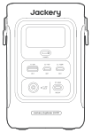

Jackery Explorer 240D

</li><li class="hb-inbox-card" data-item-number="2">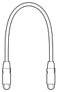

140W USB-C to USB-C Charging Cable

</li><li class="hb-inbox-card" data-item-number="3">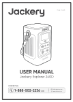

User Manual

</li></ol>

TIP

The car charging cable is not included but is available for purchase separately on our website. For assistance, please contact Jackery Customer Support.

</figure>

## PRODUCT OVERVIEW

### FRONT VIEW

<figure class="hb-reference-figure" data-component-id="HB-SPECIAL-REFERENCE-FIGURE" data-reference-id="overview" data-source-fragment-sha256="d33c7d87da128eb2dc3e3159f4e713e77cb8db9163cc92789d0120c8a35eabe2" data-step-captions="embedded">
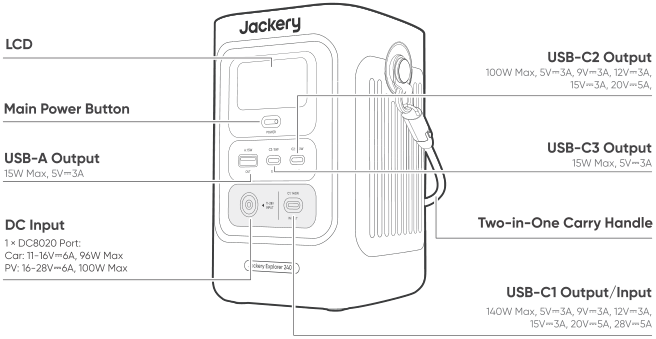
</figure>

<strong>The handle attachments can also be used for adjustable straps (sold separately).</strong>

<figure class="hb-reference-figure" data-component-id="HB-SPECIAL-REFERENCE-FIGURE" data-reference-id="strap" data-source-fragment-sha256="26c9419aa1e9cac284c920cb99da8f7fcaf05a4cdc4ad20eb0a196f96f1aac8d" data-step-captions="embedded">
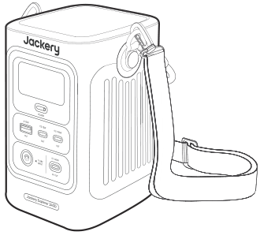
</figure>

## LCD DISPLAY

<figure class="hb-reference-figure" data-component-id="HB-SPECIAL-REFERENCE-FIGURE" data-reference-id="lcd-map" data-source-fragment-sha256="a25f42291a3413b4760c64566a59c112b3d0229d4763b1cb81a59c86b6d5830e" data-step-captions="embedded">
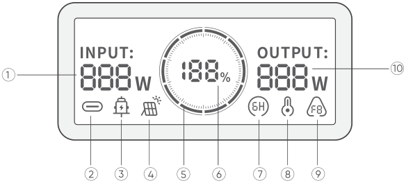
</figure>

<figure aria-label="LCD DISPLAY" class="hb-lcd-table-composition" data-component-id="HB-TABLE-LCD-ICON" tabindex="0"><table class="hb-lcd-icon-table"><colgroup><col class="hb-lcd-col-number"/><col class="hb-lcd-col-icon"/><col class="hb-lcd-col-name"/><col class="hb-lcd-col-description"/></colgroup><tbody><tr><td class="hb-lcd-number">1</td><td class="hb-lcd-icon"></td><td class="hb-lcd-name">Input Power</td><td class="hb-lcd-description">Displays the input power in watts.</td></tr><tr><td class="hb-lcd-number">2</td><td class="hb-lcd-icon"></td><td class="hb-lcd-name">USB-C Charging Indicator</td><td class="hb-lcd-description">The product is charged via the USB-C port.</td></tr><tr><td class="hb-lcd-number">3</td><td class="hb-lcd-icon"></td><td class="hb-lcd-name">Car Charging Indicator</td><td class="hb-lcd-description">The product is charged via the DC Input (DC8020) using DC 12V (car charging).</td></tr><tr><td class="hb-lcd-number">4</td><td class="hb-lcd-icon"></td><td class="hb-lcd-name">Solar Charging Indicator</td><td class="hb-lcd-description">The product is charged via the DC Input (DC8020) using solar panel(s).</td></tr><tr><td class="hb-lcd-number">5</td><td class="hb-lcd-icon"></td><td class="hb-lcd-name">Battery Power Indicator</td><td class="hb-lcd-description">When the product is being charged, the orange circle around the battery percentage will light up in sequence. When charging other devices, the orange circle will stay on.</td></tr><tr><td class="hb-lcd-number">6</td><td class="hb-lcd-icon"></td><td class="hb-lcd-name">Remaining Battery Percentage</td><td class="hb-lcd-description">Displays the remaining battery percentage.</td></tr><tr><td class="hb-lcd-number">7</td><td class="hb-lcd-icon"></td><td class="hb-lcd-name">Energy Saving Mode</td><td class="hb-lcd-description">On: Energy Saving Mode is enabled. Off: Energy Saving Mode is disabled.</td></tr><tr><td class="hb-lcd-number">8</td><td class="hb-lcd-icon"></td><td class="hb-lcd-name">High Temperature Indicator</td><td class="hb-lcd-description">High temperature protection is triggered. The product may stop functioning until its temperature returns to the normal operating range.</td></tr><tr><td class="hb-lcd-number">8</td><td class="hb-lcd-icon"></td><td class="hb-lcd-name">Low Temperature Indicator</td><td class="hb-lcd-description">Low temperature protection is triggered. The product may stop functioning until its temperature returns to the normal operating range.</td></tr><tr><td class="hb-lcd-number">9</td><td class="hb-lcd-icon"></td><td class="hb-lcd-name">Fault Code</td><td class="hb-lcd-description">A product error has occurred. Please refer to the Troubleshooting section for details.</td></tr><tr><td class="hb-lcd-number">10</td><td class="hb-lcd-icon"></td><td class="hb-lcd-name">Output Power</td><td class="hb-lcd-description">Displays the output power in watts.</td></tr></tbody></table></figure>

## OPERATIONS

### POWER ON/OFF

<figure class="hb-reference-figure" data-component-id="HB-SPECIAL-REFERENCE-FIGURE" data-reference-id="power-on-off" data-source-fragment-sha256="32a28f9104fbd8742f38f89f4209df6e149760a0cf5eeb6850c0fda3030885e7" data-step-captions="embedded">
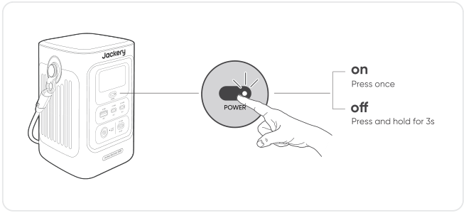
</figure>

### USB OUTPUT ON/OFF

Once the product is turned on, the USB output is enabled by default, allowing you to charge your devices.

<figure class="hb-reference-figure" data-component-id="HB-SPECIAL-REFERENCE-FIGURE" data-reference-id="usb-output" data-source-fragment-sha256="64d57ccd3374dc3b588ac00561d4b3d6e5ec5b59e65fc2af5f9d81f7fa1c041c" data-step-captions="embedded">
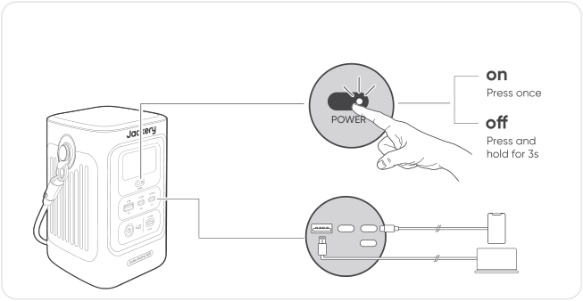
</figure>

USB-C1 and USB-C2 are USB-PD Power Source 3 (PS3) high-power output ports. If the connected user device or accessory does not meet safety requirements, there may be a fire risk. Before using these ports, ensure that the connected device or accessory has fire safety protection.

Only connect the Jackery Explorer 240D to devices or accessories that comply with clauses 6.3, 6.4, and 6.5 of IEC/EN/UL 62368-1 (or other equivalent standards).

To obtain maximum output power, use the official Jackery USB-C to USB-C 5A cable (20V DC/5A, 100W; 28V DC/5A, 140W).

#### Energy Saving Mode

To prevent unnecessary battery consumption from forgetting to turn off the output, the product enables Energy Saving Mode by default. If no device is connected, or if the combined output of the USB-A and USB-C ports is 2W or less, the product will automatically turn off the output after 6 hours.

<strong>On/Off:</strong> press the Main Power Button three times in a row.

<table class="manual-callout-table manual-callout-table"><tbody><tr><td class="manual-callout-label">NOTE</td><td class="manual-callout-body"><ul><li>If the Energy Saving Mode is disabled, the product will not automatically turn off the USB output.</li><li>Energy Saving Mode resumes previous state after power-on. Manual switching is required for mode changes.</li></ul></td></tr></tbody></table>

### LCD SCREEN ON/OFF

<figure aria-label="LCD SCREEN ON/OFF" class="hb-lcd-mode-composition" data-component-id="HB-TABLE-LCD-MODE">
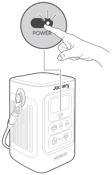

<table class="hb-lcd-mode-table"><colgroup><col class="hb-lcd-mode-col-state"/><col class="hb-lcd-mode-col-action"/><col class="hb-lcd-mode-col-copy"/></colgroup><tbody><tr><td class="hb-lcd-mode-state" rowspan="3">LCD Screen</td><td class="hb-lcd-mode-action">Turn on</td><td class="hb-lcd-mode-copy">Press the Main Power Button or when the product is charging.</td></tr><tr><td class="hb-lcd-mode-action">Turn off</td><td class="hb-lcd-mode-copy">Press the Main Power Button.</td></tr><tr><td class="hb-lcd-mode-action">Auto-off</td><td class="hb-lcd-mode-copy">The LCD turns off automatically after 2 minutes of inactivity.</td></tr><tr><td class="hb-lcd-mode-state" rowspan="3">Always-on Display Mode (under charging or discharging state)</td><td class="hb-lcd-mode-action">Turn on</td><td class="hb-lcd-mode-copy">Double-press the Main Power Button when the LCD screen is ON.</td></tr><tr><td class="hb-lcd-mode-action">Turn off</td><td class="hb-lcd-mode-copy">Press the Main Power Button.</td></tr><tr><td class="hb-lcd-mode-action">Auto-off</td><td class="hb-lcd-mode-copy">The Always-on Display Mode turns off automatically after 2 hours of inactivity.</td></tr></tbody></table>
</figure>

## TROUBLESHOOTING

If any of the following fault codes appear, follow the listed corrective actions to resolve the issue. If fault persists, please contact Jackery Customer Support.

<figure aria-label="Error Code / Corrective Measures" class="hb-troubleshooting-composition" data-component-id="HB-TABLE-TROUBLESHOOTING" tabindex="0"><table class="hb-troubleshooting-table"><colgroup><col class="hb-troubleshooting-col-code"/><col class="hb-troubleshooting-col-measures"/></colgroup><thead><tr><th class="hb-troubleshooting-code" scope="col">Error Code</th><th class="hb-troubleshooting-measures" scope="col">Corrective Measures</th></tr></thead><tbody><tr><td class="hb-troubleshooting-code">F0</td><td class="hb-troubleshooting-measures">Restart the product.</td></tr><tr><td class="hb-troubleshooting-code">F1</td><td class="hb-troubleshooting-measures">Contact Jackery Customer Support.</td></tr><tr><td class="hb-troubleshooting-code">F2</td><td class="hb-troubleshooting-measures">Contact Jackery Customer Support.</td></tr><tr><td class="hb-troubleshooting-code">F3</td><td class="hb-troubleshooting-measures">Restart the product.</td></tr><tr><td class="hb-troubleshooting-code">F4</td><td class="hb-troubleshooting-measures">Connect the product to loads to discharge its battery until the fault disappears.</td></tr><tr><td class="hb-troubleshooting-code">F5</td><td class="hb-troubleshooting-measures">Charge the product via USB-C port or solar panel until the fault disappears.</td></tr><tr><td class="hb-troubleshooting-code">F6</td><td class="hb-troubleshooting-measures">Contact Jackery Customer Support.</td></tr><tr><td class="hb-troubleshooting-code">F7</td><td class="hb-troubleshooting-measures">1. Remove all DC inputs from the product. 2. If you charge the product via a solar panel, check the open-circuited voltage (Voc) of the connected solar panel.The product allows a maximum DC input voltage of 28V. 3. Restart the product and keep it idle. Wait until the fault disappears.</td></tr><tr><td class="hb-troubleshooting-code">F8</td><td class="hb-troubleshooting-measures">Contact Jackery Customer Support.</td></tr><tr><td class="hb-troubleshooting-code">F9</td><td class="hb-troubleshooting-measures">Remove the load connected to the USB ports of the product. Wait until the fault disappears.</td></tr></tbody></table></figure>

## CHARGING

<strong>Green energy first:</strong> We advocate to use the green energy first. This product supports two modes of charging at the same time: solar charging and USB-C charging. When USB-C charging and solar charging are turned on at the same time, the product will give priority to solar charging and both methods will be used to charge the battery at the maximum permissible power.

<strong>Fully charge the product before its first use.</strong>

<table class="manual-callout-table manual-callout-table"><tbody><tr><td class="manual-callout-label">NOTE</td><td class="manual-callout-body"><ul><li>The recommended charging temperature for the product ranges from -4°F to 113°F (-20°C to 45°C), and the discharging temperature ranges from -4°F to 113°F (-20°C to 45°C). Operating the product beyond this temperature range may restrict its charging and discharging capabilities, or even prevent it from charging or discharging.</li><li>The charging power and battery capacity of the product may vary due to temperature fluctuations.</li></ul></td></tr></tbody></table>

### USB-C CHARGING (140W MAX)

<strong>Prepare a wall charger. Use the 140W USB-C to USB-C charging cable in the package to connect the USB-C1 port of the product and a wall outlet.</strong>

<figure class="hb-reference-figure" data-component-id="HB-SPECIAL-REFERENCE-FIGURE" data-reference-id="charging-usbc" data-source-fragment-sha256="2381460773dc38f3e1f271c6c8ada0d8938cce35c3932ffe2a8e8d2360bc44bc" data-step-captions="embedded">
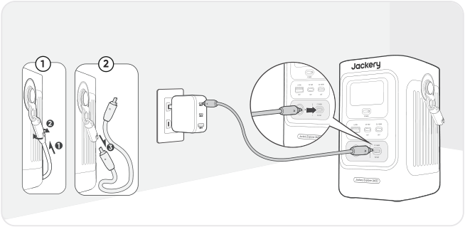
</figure>

When charging through the USB-C port, this product supports up to 140W, which requires a PD charger and cable that both support 140W.

### SOLAR CHARGING (100W MAX)

The Jackery Explorer 240D has one DC8020 input port that supports direct connection to a single solar panel.

<figure class="hb-reference-figure" data-component-id="HB-SPECIAL-REFERENCE-FIGURE" data-reference-id="charging-solar" data-source-fragment-sha256="d510086e67b337b70e0ece699d5fb7b627b07a6fa3955c842a492cc5fb31d1eb" data-step-captions="embedded">
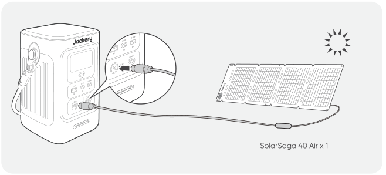
</figure>

It is recommended to use a Jackery solar panel to charge the product. Ensure that the open-circuit voltage (Voc) of the solar panel falls within the Jackery Explorer 240D's DC input voltage range (16V–28V). Jackery is not responsible for any damage or loss resulting from the use of third-party solar panels.

### CAR CHARGING (96W MAX)

This product can be charged using a 12V car charger. Ensure that the car charger and the 12V car power outlet provide a good connection.

<figure class="hb-reference-figure" data-component-id="HB-SPECIAL-REFERENCE-FIGURE" data-reference-id="charging-car" data-source-fragment-sha256="b69a4ea255a5587b351ffa28e8df907c9a84bc7744436897b1ae2c79f490197c" data-step-captions="embedded">
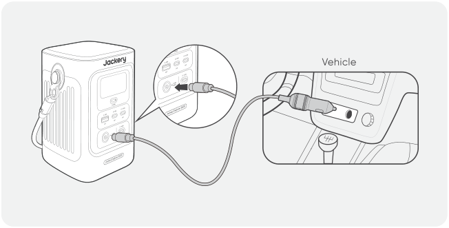
</figure>

* The car charging cable is sold separately.

<table class="manual-callout-table manual-callout-table"><tbody><tr><td class="manual-callout-label">CAUTION</td><td class="manual-callout-body"><ul><li>Please start the vehicle before charging your power station.</li><li>If the vehicle is running on bumpy roads, it is forbidden to use the car charger in case it causes non-standard operation. The Company will not be responsible for any loss caused by non-standard operation.</li><li>Vehicle charging is only applicable to vehicles with 12V DC, not 24V DC. Please do not charge this product in 24V vehicle to avoid personal injury and property loss.</li></ul></td></tr></tbody></table>

## STORAGE

Store the product in a dry clean place with proper ventilation. Storage temperature and humidity:

<ul><li>
1 month: -4°F to 113°F / -20°C to 45°C (0-60%RH)
</li><li>
3 months: 32°F to 113°F / 0°C to 45°C (0-60%RH)
</li><li>
12 months: 32°F to 77°F / 0°C to 25°C (0-60%RH)
</li></ul>

If this product is stored for a long period of time (3 months - 6 months) with the power depleted, it may become unchargeable. To prevent this and maintain battery health, it is recommended to check and recharge the product every three months and perform a full charge and discharge cycle at least once every 6 to 12 months.

## SPECIFICATIONS

<h2 class="hb-spec-group">GENERAL INFO</h2>

<figure aria-label="GENERAL INFO" class="hb-spec-table-composition"><table class="manual-table manual-spec-table hb-spec-table"><colgroup><col class="hb-spec-col-label"/><col class="hb-spec-col-value"/></colgroup><tbody><tr><th class="manual-spec-label hb-spec-label" scope="row">Product Name</th><td class="manual-spec-value hb-spec-value">Jackery Explorer 240D</td></tr><tr><th class="manual-spec-label hb-spec-label" scope="row">Model No.</th><td class="manual-spec-value hb-spec-value">JE-240B</td></tr><tr><th class="manual-spec-label hb-spec-label" scope="row">Capacity</th><td class="manual-spec-value hb-spec-value">20Ah / 12.8V DC (256 Wh)</td></tr><tr><th class="manual-spec-label hb-spec-label" scope="row">Cell Chemistry</th><td class="manual-spec-value hb-spec-value">LiFePO4</td></tr><tr><th class="manual-spec-label hb-spec-label" scope="row">Weight</th><td class="manual-spec-value hb-spec-value">About 4.85 lbs / 2.2kg</td></tr><tr><th class="manual-spec-label hb-spec-label" scope="row">Dimensions</th><td class="manual-spec-value hb-spec-value">4.7×4.2×6.7 in / 12×10.65×17cm</td></tr><tr><th class="manual-spec-label hb-spec-label" scope="row">Cycle Life</th><td class="manual-spec-value hb-spec-value">6000 cycles to 70%+ capacity</td></tr></tbody></table></figure>

<h2 class="hb-spec-group">INPUT PORTS</h2>

<figure aria-label="INPUT PORTS" class="hb-spec-table-composition"><table class="manual-table manual-spec-table hb-spec-table"><colgroup><col class="hb-spec-col-label"/><col class="hb-spec-col-value"/></colgroup><tbody><tr><th class="manual-spec-label hb-spec-label" scope="row">1 × USB-C1 Input</th><td class="manual-spec-value hb-spec-value">140W Max, 5V⎓3A, 9V⎓3A, 12V⎓3A, 15V⎓3A, 20V⎓5A, 28V⎓5A</td></tr><tr><th class="manual-spec-label hb-spec-label" rowspan="2" scope="row">1 × DC8020 Input</th><td class="manual-spec-value hb-spec-value">Car: 11-16V⎓6A, 96W Max</td></tr><tr><td class="manual-spec-value hb-spec-value">PV: 16-28V⎓6A, 100W Max</td></tr></tbody></table></figure>

<h2 class="hb-spec-group">OUTPUT PORTS</h2>

<figure aria-label="OUTPUT PORTS" class="hb-spec-table-composition"><table class="manual-table manual-spec-table hb-spec-table"><colgroup><col class="hb-spec-col-label"/><col class="hb-spec-col-value"/></colgroup><tbody><tr><th class="manual-spec-label hb-spec-label" scope="row">1 × USB-C1 Output</th><td class="manual-spec-value hb-spec-value">140W Max, 5V⎓3A, 9V⎓3A, 12V⎓3A, 15V⎓3A, 20V⎓5A, 28V⎓5A</td></tr><tr><th class="manual-spec-label hb-spec-label" scope="row">1 × USB-C2 Output</th><td class="manual-spec-value hb-spec-value">100W Max, 5V⎓3A, 9V⎓3A, 12V⎓3A, 15V⎓3A, 20V⎓5A</td></tr><tr><th class="manual-spec-label hb-spec-label" scope="row">1 × USB-C3 Output</th><td class="manual-spec-value hb-spec-value">15W Max, 5V⎓3A</td></tr><tr><th class="manual-spec-label hb-spec-label" scope="row">1 × USB-A Output</th><td class="manual-spec-value hb-spec-value">15W Max, 5V⎓3A</td></tr><tr><th class="manual-spec-label hb-spec-label" rowspan="6" scope="row">Dual-port Output Mode</th><td class="manual-spec-value hb-spec-value">USB-C1 + USB-C2: 100W Max + 100W Max</td></tr><tr><td class="manual-spec-value hb-spec-value">USB-C1 + USB-C3: 140W Max + 15W Max</td></tr><tr><td class="manual-spec-value hb-spec-value">USB-C1 + USB-A: 140W Max + 15W Max</td></tr><tr><td class="manual-spec-value hb-spec-value">USB-C2 + USB-A: 100W Max + 15W Max</td></tr><tr><td class="manual-spec-value hb-spec-value">USB-C3 + USB-A: 15W Max + 15W Max</td></tr><tr><td class="manual-spec-value hb-spec-value">USB-C2 + USB-C3: 100W Max + 15W Max</td></tr><tr><th class="manual-spec-label hb-spec-label" rowspan="4" scope="row">Triple-port Output Mode</th><td class="manual-spec-value hb-spec-value">USB-C1 + USB-C2 + USB-C3: 100W Max + 60W Max + 15W Max</td></tr><tr><td class="manual-spec-value hb-spec-value">USB-C1 + USB-C2 + USB-A: 100W Max + 60W Max + 15W Max</td></tr><tr><td class="manual-spec-value hb-spec-value">USB-C2 + USB-C3 + USB-A: 100W Max + 15W Max + 15W Max</td></tr><tr><td class="manual-spec-value hb-spec-value">USB-C1 + USB-C3 + USB-A: 140W Max + 15W Max + 15W Max</td></tr><tr><th class="manual-spec-label hb-spec-label" scope="row">Quadruple-port Output Mode</th><td class="manual-spec-value hb-spec-value">USB-C1 + USB-C2 + USB-C3 + USB-A: 100W Max + 60W Max + 15W Max + 15W Max</td></tr></tbody></table></figure>

<h2 class="hb-spec-group">OPERATING TEMPERATURE</h2>

<figure aria-label="OPERATING TEMPERATURE" class="hb-spec-table-composition"><table class="manual-table manual-spec-table hb-spec-table"><colgroup><col class="hb-spec-col-label"/><col class="hb-spec-col-value"/></colgroup><tbody><tr><th class="manual-spec-label hb-spec-label" scope="row">Charge Temperature</th><td class="manual-spec-value hb-spec-value">-4°F to 113°F / -20°C to 45°C</td></tr><tr><th class="manual-spec-label hb-spec-label" scope="row">Discharge Temperature</th><td class="manual-spec-value hb-spec-value">-4°F to 113°F / -20°C to 45°C</td></tr></tbody></table></figure>

※ USB Type-C® and USB-C® are registered trademarks of USB Implementers Forum.

When devices are connected to the high-power ports, the output power may be automatically adjusted by the product's temperature protection mechanism. This is normal operation and does not indicate a malfunction. There is no need for concern.

## WARRANTY

<figure aria-label="WARRANTY" class="hb-warranty-intro-composition" data-component-id="HB-WARRANTY-LEAD">
<strong>We only provide our warranty to customers who purchase from the official Jackery website, Jackery-branded third-party platforms, or local authorized dealers.</strong>

*Warranty period and details may vary according to local laws, regulations, and authorized dealers.
</figure>

### Limited Warranty

<figure aria-label="Limited Warranty" class="hb-warranty-card" data-component-id="HB-WARRANTY-SECTION" data-warranty-card-index="1">
Jackery Inc. warrants to the original consumer purchaser that the Jackery product will be free from defects in workmanship and material under normal consumer use during the applicable warranty period identified in the 'Warranty Period' section below, subject to the exclusions set forth below.

This warranty statement sets forth Jackery's total and exclusive warranty obligation. We will not assume, nor authorize any person to assume for us, any other liability in connection with the sale of our products.
</figure>

### Warranty Period

<figure aria-label="Warranty Period" class="hb-warranty-period-card" data-component-id="HB-WARRANTY-YEARS">

3
<strong class="hb-warranty-years-unit">YEARS</strong><strong class="hb-warranty-period-label">Standard Warranty</strong>

The standard warranty period for Jackery Explorer 240D is 36 months. In each case, the warranty period is measured starting on the date of purchase by the original consumer purchaser. The sales receipt from the first consumer purchaser, or other reasonable documentary proof, is required in order to establish the start date of the warranty period.

2
<strong class="hb-warranty-years-unit">YEARS</strong><strong class="hb-warranty-period-label">Extended Warranty</strong>

To activate the Warranty Extension, you must register your product online or contact our customer service team at hello@jackery.com to extend the standard warranty runtime.

</figure>

### Repair or replacement

<figure aria-label="Repair or replacement" class="hb-warranty-card" data-component-id="HB-WARRANTY-SECTION" data-warranty-card-index="3">
Jackery will repair or replace (at Jackery's expense) any Jackery product that fails to operate during the applicable warranty period due to a defect in workmanship or material. The repaired/replaced product assumes the remaining warranty of the original date of purchase.
</figure>

### Limited to Original Consumer Buyer

<figure aria-label="Limited to Original Consumer Buyer" class="hb-warranty-card" data-component-id="HB-WARRANTY-SECTION" data-warranty-card-index="4">
The warranty on Jackery's product is limited to the original consumer purchaser and is not transferable to any subsequent owner.
</figure>

### Exclusions

<figure aria-label="Exclusions" class="hb-warranty-card" data-component-id="HB-WARRANTY-SECTION" data-warranty-card-index="5">
Jackery's warranty does not apply to:
<ul><li>Misused, abused, modified, damaged by accident, or used for anything other than normal consumer use as authorized in Jackery's current product literature.</li><li>Attempted repair by anyone other than an authorized facility.</li><li>Any product purchased through an online auction house.</li><li>Jackery's warranty does not apply to the battery cell unless the battery cell is fully charged by you within seven days after you purchase the product and at least once every 6 months thereafter.</li></ul></figure>

### Interpretation Rights

<figure aria-label="Interpretation Rights" class="hb-warranty-card" data-component-id="HB-WARRANTY-SECTION" data-warranty-card-index="6">
Jackery reserves the right to final interpretation of the above customer after-sales policy.
</figure>

<strong>JACKERY INC.</strong>

5310 Bunche Dr., Fremont, CA 94538-8301

1-888-502-2236 (US)

hello@jackery.com

www.jackery.com

