

Congratulations on your new Jackery Explorer 3000. Please read this manual carefully before using the product, particularly the relevant precautions to ensure proper use. Keep this manual in an accessible place for frequent reference.

In compliance with laws and regulations, the right of final interpretation of this document and all related documents of this product resides with the Company.

Please kindly notice that no further notifications will be given in case of any update, revision or termination.

## IMPORTANT SAFETY INFORMATION

### INSTRUCTIONS PERTAINING TO RISK OF FIRE, ELECTRIC SHOCK, OR INJURY TO PERSONS

<table class="manual-callout-table manual-callout-table"><tbody><tr><td class="manual-callout-label">WARNING</td><td class="manual-callout-body">
<strong>Always follow these basic precautions when using this product.</strong>

<strong>Risk of Electric Shock. Never use power pack to supply power tools to cut or access to live parts or live wirings, or materials that may contain live parts or live wirings inside, such as building walls, etc.</strong>
<ul><li>Read all the instructions before using the product.</li><li>To reduce the risk of injury, close supervision is necessary when the product is used near  children.</li><li>Do not put fingers or hands into the product.</li><li>Use of an attachment not recommended or sold by power pack manufacturer may result in a risk of fire, electric shock, or injury to persons.</li><li>To reduce risk of damage to the electric plug and cord, pull the plug rather than the cord  when disconnecting the power pack.</li><li>Do not use a battery pack or appliance that is damaged or modified. Damaged or modified batteries may exhibit unpredictable behavior resulting in fire, explosion or risk of injury.</li><li>Do not operate the power pack with a damaged cord or plug, or a damaged output cable.</li><li>Do not disassemble the power pack, take it to a qualified service person when service or repair is required. Incorrect reassembly may result in a risk of fire or electric shock.</li><li>To reduce the risk of electric shock, unplug the power pack form the outlet before attempting any instructed servicing.</li><li>When charging the internal battery, work in a well ventilated area and do not restrict ventilationin any way.) Under abusive conditions, liquid may be ejected from the battery; avoid contact. If contact accidentally occurs, flush with water. If liquid contacts eyes, additionally seek medical help. Liquid ejected from the battery may cause irritation or burns.</li><li>Under abusive conditions, liquid may be ejected from the battery; avoid contact. If contact accidentally occurs, flush with water. If liquid contacts eyes, additionally seek medical help. Liquid ejected from the battery may cause irritation or burns.</li><li>Do not expose a power pack to fire or excessive temperature. Exposure to fire or temperature above 130°C may cause explosion. The temperature of 130°C can be replaced by the temperature of 265°F.</li><li>Have servicing performed by a qualified repair person using only identical replacement parts. This will ensure that the safety of the product is maintained.</li></ul></td></tr></tbody></table>

### GROUNDING INSTRUCTIONS

This product must be grounded. If it should malfunction or break down, grounding provides a path of least resistance for electric current to reduce the risk of electric shock. This product is equipped with a cord having an equipment grounding conductor and a grounding plug. The plug must be plugged into an outlet that is properly installed and grounded in accordance with all local codes and ordinances.

<table class="manual-callout-table manual-callout-table"><tbody><tr><td class="manual-callout-label">WARNING</td><td class="manual-callout-body">
<strong>Improper connection of the equipment grounding conductor is able to result in a risk of electric shock. Check with a qualified electrician if you are in doubt as to whether the product is properly grounded. Do not modify the plug provided with the product – if it will not fit the outlet, have a proper outlet installed by a qualified electrician.</strong>
</td></tr></tbody></table>

### USER MAINTENANCE INSTRUCTIONS

When using it for the first time, please fully charge the device before use. If this product is stored for a long period of time (3 months - 6 months) with the power depleted, its performance will deteriorate and may even become unchargeable.

### SAVE THESE INSTRUCTIONS OPERATING INSTRUCTIONS

<ul><li>
Use and store the unit only in a clean and dry environment. DO NOT use and store in dusty and wet environment.
</li><li>
Check the unit prior to every use. DO NOT use the unit if it is damaged, broken.
</li><li>
If rust, peculiar odors, overheating or other abnormal circumstances are observed, stop using the unit immediately and contact the dealer or our customer service center.
</li><li>
Make sure that the unit is properly secured when transporting it in a motor vehicle.
</li><li>
Only charge the Explorer 3000 within an ambient temperature 0°C~45°C (32°F~113°F), discharge temperature is -15°C~45°C (5°F~113°F) and Storage temperature is 1 year: 0°C~25°C (32°F~77°F).
</li><li>
Switch the unit off immediately if it has accidentally fallen, was dropped or was exposed to vibrations.
</li><li>
DO NOT use the unit if the power cord is damaged or broken.
</li><li>
Keep the unit away from children. DO NOT let children use the power supply unit. Keep this product away from pets.
</li><li>
DO NOT use  the unit in an area or environment with high temperature.
</li><li>
Should fluid from inside of the unit come in contact with your skin or clothing, wash the affected areas with tap water.
</li><li>
In a storm, unplug the power cord from the socket.
</li><li>
DO NOT place the unit on its side or upside down while in use or storage.
</li><li>
DO NOT use accessories for other usage.
</li><li>
Make sure that the device you are connecting is switched off before you connect it.
</li><li>
DO NOT expose a power pack to fire or excessive temperature. Exposure to fire or temperature  above 130°C may cause explosion.
</li><li>
Solar charge times depend on weather conditions, place your solar panel where it will get as much direct sunlight as possible.
</li><li>
DO NOT place the power pack on the floor, or at a height less than 457 mm (18 inches) above the floor, during use in a repair facility.
</li></ul>

<table class="manual-callout-table manual-callout-table"><tbody><tr><td class="manual-callout-label">WARNING</td><td class="manual-callout-body">
<strong>Do not remove the battery pack without permission,If you need to repair the battery pack, contact your local manufacturer as soon as possible.</strong>
</td></tr></tbody></table>

<table class="manual-callout-table manual-callout-table"><tbody><tr><td class="manual-callout-label">DANGER</td><td class="manual-callout-body">
<strong>This device is intended for indoor use only (Please place this device in a similar indoor environment when using it outdoors，e.g. Home RVs, tents, cabins, etc.).</strong>

<strong>※ This device is not waterproof or dustproof. Keep away from rain and humid environments during use.</strong>
</td></tr></tbody></table>

### MOVING AND STORAGE INSTRUCTIONS

<ul><li>
DO NOT move the unit if it is recharging or in use.
</li><li>
DO NOT dispose the unit together with household waste.
</li><li>
DO NOT place the unit close to or in a fire or expose it to heat. Keep out of direct sunlight.
</li><li>
DO NOT store the unit in a bathroom or in an area exposed to rain or moisture.
</li><li>
DO NOT disassemble the power pack, take it to a qualified service person when service or repair is required. Incorrect reassembly may result in a risk of fire or electric shock.
</li><li>
DO NOT store the unit in an area or environment with high temperature.
</li></ul>

<figure aria-label="FCC" class="hb-fcc-composition" data-component-id="HB-SPECIAL-FCC">

<strong>NOTE:</strong> This equipment has been tested and found to comply with the limits for a Class B digital device, pursuant to part 15 of the FCC Rules. These limits are designed to provide reasonable protection against harmful interference in a residential installation. This equipment generates, uses and can radiate radio frequency energy and, if not installed and used in accordance with the instructions, may cause harmful interference to radio communications. However, there is no guarantee that interference will not occur in a particular installation. If this equipment does cause harmful interference to radio or television reception, which can be determined by turning the equipment off and on, the user is encouraged to try to correct the interference by one or more of the following measures:

<ul class="simple"><li>
Reorient or relocate the receiving antenna.
</li><li>
Increase the separation between the equipment and receiver.
</li><li>
Connect the equipment into an outlet on a circuit different from that to which the receiver is connected.
</li><li>
Consult the dealer or an experienced radio/TV technician for help.
</li></ul>
<strong>MODIFICATION:</strong> Any changes or modifications not expressly approved by the grantee of this device could void the user’s authority to operate the device.

</figure>

## WHAT'S IN THE BOX

<figure aria-label="WHAT'S IN THE BOX" class="hb-inbox-composition" data-card-count="3" data-component-id="HB-SPECIAL-INBOX" data-inbox-variant="three-card-responsive"><ol class="hb-inbox-grid"><li class="hb-inbox-card" data-item-number="1">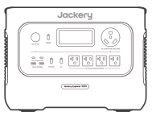

Jackery Explorer 3000

</li><li class="hb-inbox-card" data-item-number="2">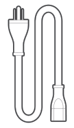

AC Charging Cable

</li><li class="hb-inbox-card" data-item-number="3">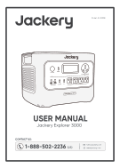

User Manual

</li></ol>

Important

The car charging cable is not included but is available for purchase separately on our website. For assistance, please contact Jackery customer service.

</figure>

## PRODUCT OVERVIEW

### FRONT VIEW

<figure class="hb-reference-figure" data-component-id="HB-SPECIAL-REFERENCE-FIGURE" data-reference-id="overview-front" data-source-fragment-sha256="4375a216f6b6b4c7b8679c47e809c72583fbdc7f49fde69a815a8240db185b03" data-step-captions="embedded">
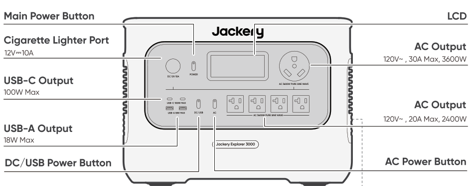
</figure>

### RIGHT SIDE VIEW

<figure class="hb-reference-figure" data-component-id="HB-SPECIAL-REFERENCE-FIGURE" data-reference-id="overview-right" data-source-fragment-sha256="3c149296327752c944bdbbd35c57a4a3c47338f45d8795fd3ceba8215bee849f" data-step-captions="embedded">
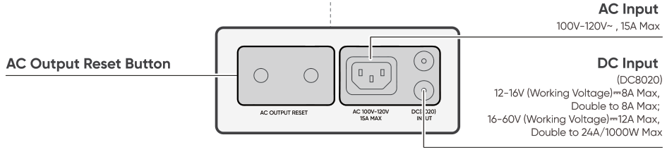
</figure>

## LCD DISPLAY

<figure class="hb-reference-figure" data-component-id="HB-SPECIAL-REFERENCE-FIGURE" data-reference-id="lcd-map" data-source-fragment-sha256="a25f42291a3413b4760c64566a59c112b3d0229d4763b1cb81a59c86b6d5830e" data-step-captions="embedded">
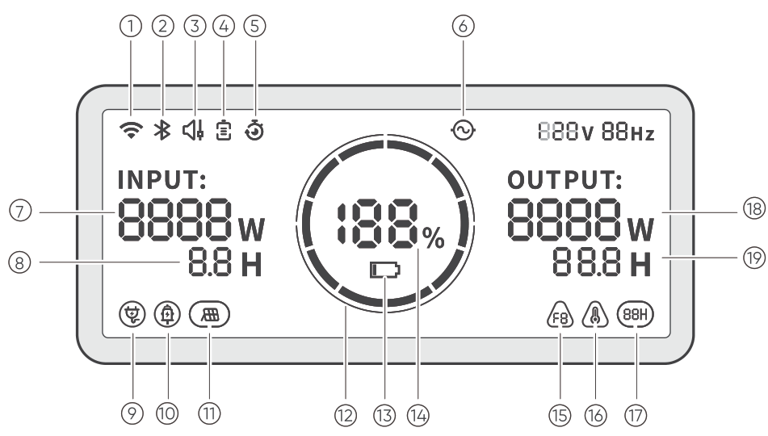
</figure>

<figure aria-label="LCD DISPLAY" class="hb-lcd-table-composition" data-component-id="HB-TABLE-LCD-ICON" tabindex="0"><table class="hb-lcd-icon-table"><colgroup><col class="hb-lcd-col-number"/><col class="hb-lcd-col-icon"/><col class="hb-lcd-col-name"/><col class="hb-lcd-col-description"/></colgroup><tbody><tr><td class="hb-lcd-number">①</td><td class="hb-lcd-icon"></td><td class="hb-lcd-name">Wi-Fi</td><td class="hb-lcd-description"><strong>On:</strong> Wi-Fi connected. <strong>Blinking:</strong> Ready to connect to Wi-Fi. <strong>Off:</strong> Wi-Fi disconnected.</td></tr><tr><td class="hb-lcd-number">②</td><td class="hb-lcd-icon"></td><td class="hb-lcd-name">Bluetooth</td><td class="hb-lcd-description"><strong>On:</strong> Bluetooth connected. <strong>Blinking:</strong> Ready to connect to Bluetooth. <strong>Off:</strong> Bluetooth disconnected.</td></tr><tr><td class="hb-lcd-number">③</td><td class="hb-lcd-icon"></td><td class="hb-lcd-name">Quiet Charging Mode can be enabled / disabled in the Jackery APP</td><td class="hb-lcd-description"><strong>On:</strong> The noise during charging is significantly minimized, while the charging power is reduced and the charging speed slows down. <strong>Off:</strong> Quiet Charging Mode is disabled.</td></tr><tr><td class="hb-lcd-number">④</td><td class="hb-lcd-icon"></td><td class="hb-lcd-name">Battery Saving Mode can be enabled / disabled in the Jackery APP</td><td class="hb-lcd-description">On: Limits the usable battery capacity to extend battery life. Off: Battery Saving Mode is disabled.</td></tr><tr><td class="hb-lcd-number">④</td><td class="hb-lcd-icon"></td><td class="hb-lcd-name">Self-powered Mode can be enabled / disabled in the Jackery APP</td><td class="hb-lcd-description">On: Maximizes the use of solar energy and reduces reliance on grid electricity by prioritizing stored solar energy, reducing electricity costs. The power station must be connected to both solar panels and the grid simultaneously, with load power limited by bypass power. Off: Self-powered Mode is disabled.</td></tr><tr><td class="hb-lcd-number">⑤</td><td class="hb-lcd-icon"></td><td class="hb-lcd-name">Charging Plan can be set in the Jackery APP</td><td class="hb-lcd-description">Customize the charging time of the Jackery Explorer 3000. Suitable for situations with fluctuating electricity prices, it allows for charging plans based on peak and off-peak electricity times, reducing electricity costs.</td></tr><tr><td class="hb-lcd-number">⑥</td><td class="hb-lcd-icon"></td><td class="hb-lcd-name">AC Power Indicator</td><td class="hb-lcd-description">The AC output (pure sine wave) is on.</td></tr><tr><td class="hb-lcd-number">⑦</td><td class="hb-lcd-icon"></td><td class="hb-lcd-name">Input Power</td><td class="hb-lcd-description">Displays the input power in watts.</td></tr><tr><td class="hb-lcd-number">⑧</td><td class="hb-lcd-icon"></td><td class="hb-lcd-name">Remaining Charge Time</td><td class="hb-lcd-description">Displays the remaining charging time.</td></tr><tr><td class="hb-lcd-number">⑨</td><td class="hb-lcd-icon"></td><td class="hb-lcd-name">AC Wall Charging Indicator</td><td class="hb-lcd-description">The product is charged via the AC Input using grid power.</td></tr><tr><td class="hb-lcd-number">⑩</td><td class="hb-lcd-icon"></td><td class="hb-lcd-name">Car Charging Indicator</td><td class="hb-lcd-description">The product is charged via the DC Input (8020) using DC12V (car charging).</td></tr><tr><td class="hb-lcd-number">⑪</td><td class="hb-lcd-icon"></td><td class="hb-lcd-name">Solar Charging Indicator</td><td class="hb-lcd-description">The product is charged via the DC Input (8020) using solar panel(s).</td></tr><tr><td class="hb-lcd-number">⑫</td><td class="hb-lcd-icon"></td><td class="hb-lcd-name">Battery Power Indicator</td><td class="hb-lcd-description">When the product is being charged, the orange circle around the battery percentage will light up in sequence. When charging other devices, the orange circle will stay on.</td></tr><tr><td class="hb-lcd-number">⑬</td><td class="hb-lcd-icon"></td><td class="hb-lcd-name">Low Battery Indicator</td><td class="hb-lcd-description"><strong>On:</strong> The battery level is below 20%. <strong>Blinking:</strong> The battery level is below 5%. <strong>Off:</strong> The product is charging.</td></tr><tr><td class="hb-lcd-number">⑭</td><td class="hb-lcd-icon"></td><td class="hb-lcd-name">Remaining Battery Percentage</td><td class="hb-lcd-description">Displays the remaining battery percentage.</td></tr><tr><td class="hb-lcd-number">⑮</td><td class="hb-lcd-icon"></td><td class="hb-lcd-name">Fault code</td><td class="hb-lcd-description">A product error has occurred. Please refer to the Troubleshooting section for details.</td></tr><tr><td class="hb-lcd-number">⑯</td><td class="hb-lcd-icon"></td><td class="hb-lcd-name">High temperature Indicator</td><td class="hb-lcd-description">High temperature protection is triggered. The product may stop functioning until its temperature returns to the normal operating range.</td></tr><tr><td class="hb-lcd-number">⑯</td><td class="hb-lcd-icon"></td><td class="hb-lcd-name">Low temperature Indicator</td><td class="hb-lcd-description">Low temperature protection is triggered. The product may stop functioning until its temperature returns to the normal operating range.</td></tr><tr><td class="hb-lcd-number">⑰</td><td class="hb-lcd-icon"></td><td class="hb-lcd-name">Energy Saving Mode</td><td class="hb-lcd-description">To prevent unnecessary battery consumption from forgetting to turn off the output, the product enables Energy Saving Mode by default. If no device is connected or the connected device's power consumption is below a certain threshold (AC output≤25W; USB output≤2W; Car output≤2W), the device will automatically turn off all outputs after 12 hours. <strong>On/Off:</strong> Press and hold both the AC Power Button and Main Power Button</td></tr><tr><td class="hb-lcd-number">⑱</td><td class="hb-lcd-icon"></td><td class="hb-lcd-name">Output Power</td><td class="hb-lcd-description">Displays the output power in watts.</td></tr><tr><td class="hb-lcd-number">⑲</td><td class="hb-lcd-icon"></td><td class="hb-lcd-name">Remaining Discharge Time</td><td class="hb-lcd-description">Displays the remaining discharging time.</td></tr></tbody></table></figure>

## BASIC OPERATIONS

<table class="manual-callout-table manual-callout-table"><tbody><tr><td class="manual-callout-label">Important</td><td class="manual-callout-body">
When Energy Saving Mode is on, if the DC Output or AC Output Power Button is ON but the product is not charging or discharging, the product will automatically turn off all outputs after 12 hours. The shutdown time can be customized in the Jackery App.
</td></tr></tbody></table>

### POWER ON/OFF

<figure class="hb-reference-figure" data-component-id="HB-SPECIAL-REFERENCE-FIGURE" data-reference-id="power" data-source-fragment-sha256="3d2e781eb5fb76b162608c20531189b60cfa0d721feb28cb5131aa86bc9b82e5" data-step-captions="embedded">
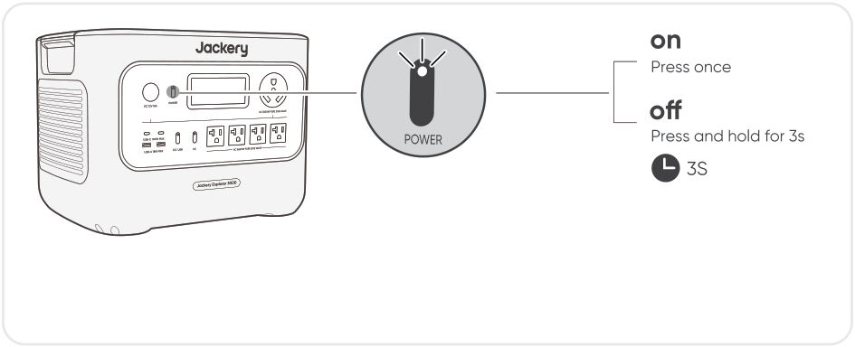
</figure>

<strong>Default standby time:</strong> 2 hours

the product will automatically shut down after 2 hours of inactivity, without charging or discharging.

*The standby time can be set in the Jackery App.

### AC OUTPUT ON/OFF

<strong>Premise:</strong> Ensure the Main Power Button is on.

<figure class="hb-reference-figure" data-component-id="HB-SPECIAL-REFERENCE-FIGURE" data-reference-id="ac-output" data-source-fragment-sha256="3da5f7e7434bec66211d8b26a80bcbf2541daaa58e34bccbe22d9baacba47fe3" data-step-captions="embedded">
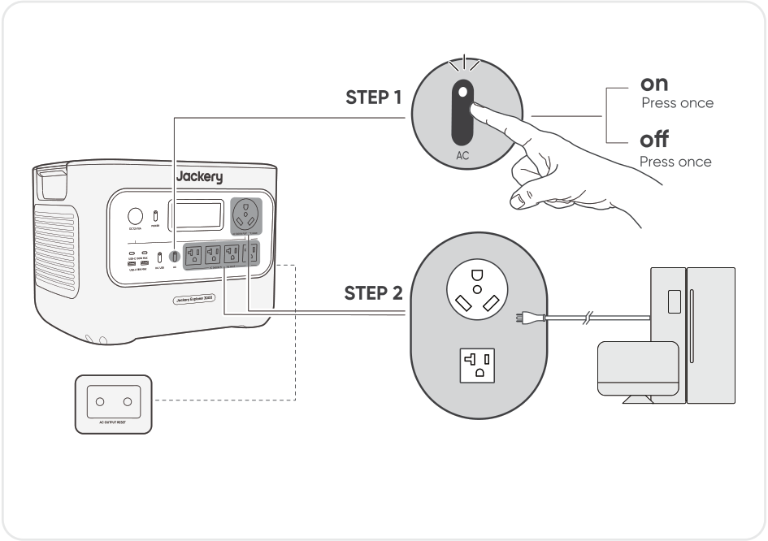
</figure>

<strong>AC Output Reset Button:</strong>

When the Reset Button pops up, you need to remove the load  and press the Reset Button to reset.

### DC/USB OUTPUT ON/OFF

<strong>Premise:</strong> Ensure the Main Power Button is on.

<figure class="hb-reference-figure" data-component-id="HB-SPECIAL-REFERENCE-FIGURE" data-reference-id="dc-usb" data-source-fragment-sha256="087dd86f8af43ae82316e8e1cc577483c09169bfc6d6b90eb7c142ec7ee348d4" data-step-captions="embedded">
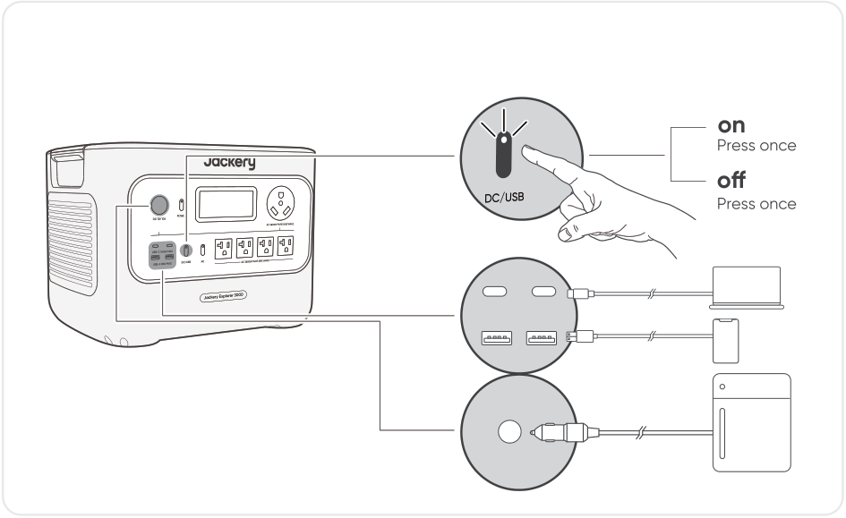
</figure>

### LCD SCREEN

<figure aria-label="LCD SCREEN" class="hb-lcd-mode-composition" data-component-id="HB-TABLE-LCD-MODE">
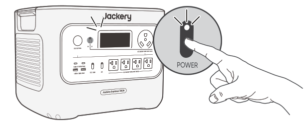

<table class="hb-lcd-mode-table"><colgroup><col class="hb-lcd-mode-col-state"/><col class="hb-lcd-mode-col-action"/><col class="hb-lcd-mode-col-copy"/></colgroup><tbody><tr><td class="hb-lcd-mode-state" rowspan="3">LCD Screen</td><td class="hb-lcd-mode-action">Turn on</td><td class="hb-lcd-mode-copy">Press the Main Power Button or when the product is charging.</td></tr><tr><td class="hb-lcd-mode-action">Turn off</td><td class="hb-lcd-mode-copy">Press the Main Power Button.</td></tr><tr><td class="hb-lcd-mode-action">Auto-off</td><td class="hb-lcd-mode-copy">The LCD turns off automatically and enters sleep mode after 2 minutes of inactivity.</td></tr><tr><td class="hb-lcd-mode-state" rowspan="3">Always-on Display Mode (under charging or discharging state)</td><td class="hb-lcd-mode-action">Turn on</td><td class="hb-lcd-mode-copy">Double-click the Main Power Button when the LCD screen is ON.</td></tr><tr><td class="hb-lcd-mode-action">Turn off</td><td class="hb-lcd-mode-copy">Press the Main Power Button.</td></tr><tr><td class="hb-lcd-mode-action">Auto-off</td><td class="hb-lcd-mode-copy">The Always-on Display Mode turns off automatically after 2 hours of inactivity.</td></tr></tbody></table>
</figure>

### KEY COMBINATIONS

<figure aria-label="Buttons / Operation / Function" class="hb-key-combination-composition" data-component-id="HB-TABLE-KEY-COMBINATIONS" tabindex="0"><table class="hb-key-combination-table"><colgroup><col class="hb-key-col-buttons"/><col class="hb-key-col-operation"/><col class="hb-key-col-function"/></colgroup><thead><tr><th class="hb-key-buttons" scope="col">Buttons</th><th class="hb-key-operation" scope="col">Operation</th><th class="hb-key-function" scope="col">Function</th></tr></thead><tbody><tr><td class="hb-key-buttons">

<strong>Main Power Button</strong>
+
<strong>DC/USB Power Button</strong>

</td><td class="hb-key-operation">
3s

Press and hold both for 3s
</td><td class="hb-key-function">Reset Wi-Fi &amp; Bluetooth</td></tr><tr><td class="hb-key-buttons">

<strong>Main Power Button</strong>
+
<strong>AC Power Button</strong>

</td><td class="hb-key-operation">
3s

Press and hold both for 3s
</td><td class="hb-key-function">Turn on/off the Energy Saving Mode</td></tr><tr><td class="hb-key-buttons">

<strong>DC/USB Power Button</strong>
+
<strong>AC Power Button</strong>

</td><td class="hb-key-operation">
1s

Press and hold both for 1s
</td><td class="hb-key-function">Turn on Wi-Fi &amp; Bluetooth</td></tr></tbody></table></figure>

## TROUBLESHOOTING

<table class="manual-table"><thead><tr><th>Error Code</th><th>Name</th><th>Description (For Internal Fault Maintenance Only)</th></tr></thead><tbody><tr><td>
<strong>F0</strong>
</td><td>
<strong>BMS Data Communication Error</strong>
</td><td>
Data communication fault between the BMS and mainboard
</td></tr><tr><td>
<strong>F1</strong>
</td><td>
<strong>Inverter Data Communication Error</strong>
</td><td>
Data communication fault between the inverter and mainboard
</td></tr><tr><td>
<strong>F2</strong>
</td><td>
<strong>DC Input Data Communication Error</strong>
</td><td>
Data communication fault between the DC charging module and BMS
</td></tr><tr><td>
<strong>F3</strong>
</td><td>
<strong>BMS or Battery Failure</strong>
</td><td>
BMS or battery failuare
</td></tr><tr><td>
<strong>F4</strong>
</td><td>
<strong>Battery Overvoltage</strong>
</td><td>
Battery overvoltage
</td></tr><tr><td>
<strong>F5</strong>
</td><td>
<strong>Battery Undervoltage</strong>
</td><td>
Battery undervoltage
</td></tr><tr><td>
<strong>F6</strong>
</td><td>
<strong>Inverter Failure</strong>
</td><td>
AC output overcurrent / overload / short circuit;

Grid input overvoltage / undervoltage / overfrequency / underfrequency;

Inverter over-temperature protection on (triggered)

Insulation detection failure
</td></tr><tr><td>
<strong>F7</strong>
</td><td>
<strong>DC Input Failure</strong>
</td><td>
PV input overvoltage;

DC charging module overtemperature protection on/triggered;

Output overcurrent protection of the DC charging module on/triggered
</td></tr><tr><td>
<strong>F8</strong>
</td><td>
<strong>Battery Charging / Discharging Overcurrent / Short Circuit</strong>
</td><td>
BMS overcurrent / short circuit protection on/triggered
</td></tr><tr><td>
<strong>F9</strong>
</td><td>
<strong>DC Output Overcurrent / Short Circuit</strong>
</td><td>
USB short circuit protection on/triggered
</td></tr></tbody></table>

## UPS

An uninterruptible power supply (UPS) is a type of continual power system that provides automated backup electric power to a load when the mains grid power fails.

In the event of a sudden loss of grid power, the Jackery Explorer 3000 will automatically switch to stored power within 20 ms to keep your appliances running.

In UPS mode, the unit's peak output reaches 1440W before power outages. As simultaneous charging/discharging is enabled in Bypass Mode, the actual output power is lower than the rated output power in this mode but returns to rated output power during outages.

<strong>Premise:</strong> Ensure the Main Power Button is on.

<figure class="hb-reference-figure" data-component-id="HB-SPECIAL-REFERENCE-FIGURE" data-reference-id="ups" data-source-fragment-sha256="c0a066002febae47149c0e8baf3c3a34f2ab93a4538c0ccff28c360e7a93a335" data-step-captions="embedded">
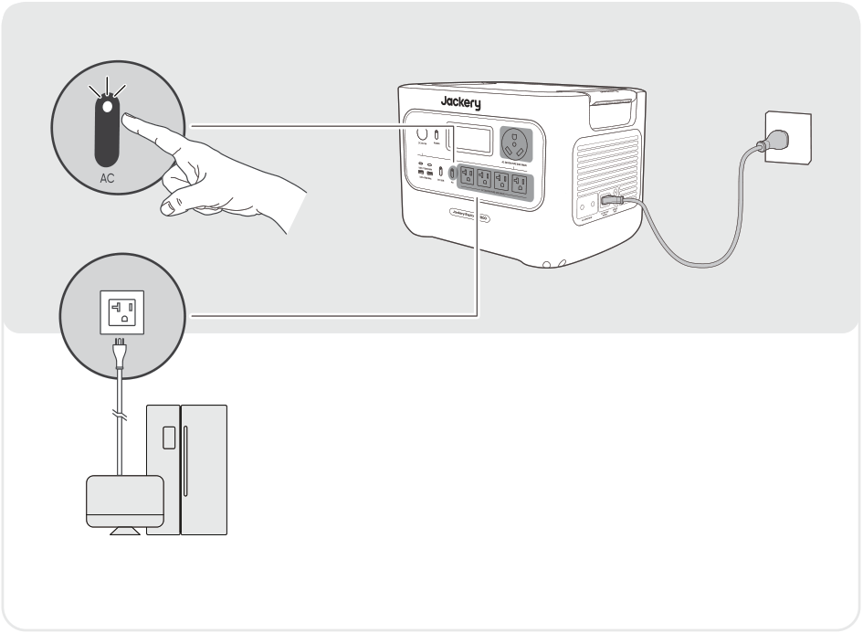
</figure>

Connect the product to a wall outlet with the AC charging cable, then press the AC output button and power your appliances at the same time.

<table class="manual-callout-table manual-callout-table"><tbody><tr><td class="manual-callout-label">Important</td><td class="manual-callout-body">
1. This product does not support 0 ms switching. Do not connect it to equipment that requires an uninterrupted power supply, such as data servers or workstations.

2. Before use, please test compatibility with your device multiple times.

3. It is recommended to connect one device at a time. Do not use multiple devices simultaneously, as this may trigger overload protection.
</td></tr></tbody></table>

## CHARGING

Green energy first: We advocate to use the green energy first. This product supports two modes of charging at the same time: solar charging and AC wall charging.

When AC wall charging and solar charging are turned on at the same time, the product will give priority to solar charging and both methods will be used to charge the battery at the maximum permissible power.

<strong>Fully charge the product  before its first use.</strong>

<table class="manual-callout-table manual-callout-table"><tbody><tr><td class="manual-callout-label">Note</td><td class="manual-callout-body">
1. The recommended charging temperature for the product is between 0°C to 45°C (32°F to 113°F), and the discharging temperature is between -15°C to 45°C (5°F to 113°F). Operating the product outside this temperature range may restrict its charging and discharging capabilities, or even render it unable to charge or discharge.

2. The charging power and battery capacity of the product may vary due to temperature fluctuations.

3. This product can function in low-temperature environments ranging from -15℃ to -10℃(5°F to 14°F), with a maximum output power of 2000W under these conditions.
</td></tr></tbody></table>

### CHARGING VIA AC WALL OUTLET

<figure class="hb-reference-figure" data-component-id="HB-SPECIAL-REFERENCE-FIGURE" data-reference-id="ac-charge" data-source-fragment-sha256="855b44fc4b9d400beb10f7080d36c21fe57098106bbd5c18cfc811243caf4911" data-step-captions="embedded">
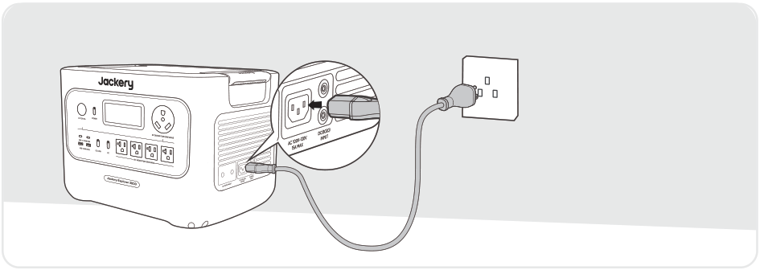
</figure>

Connect the AC charging cable to the AC input port of the power station and plug it into the wall outlet.

### CHARGING VIA SOLAR PANELS

The Jackery Explorer 3000 has two DC8020 input ports, each one supports direct connection of one 500W or two 200W solar panels at most. If one DC8020 input port needs to connect two solar panels simultaneously, please refer to the figure below for charging through the solar panel connector (sold separately, not included as standard).

<figure class="hb-reference-figure" data-component-id="HB-SPECIAL-REFERENCE-FIGURE" data-reference-id="solar-two" data-source-fragment-sha256="5d27ad69d31fb6773f0f008be3afa7d1acab2ba8e3d359ff8ca7a650a6ce711c" data-step-captions="embedded">
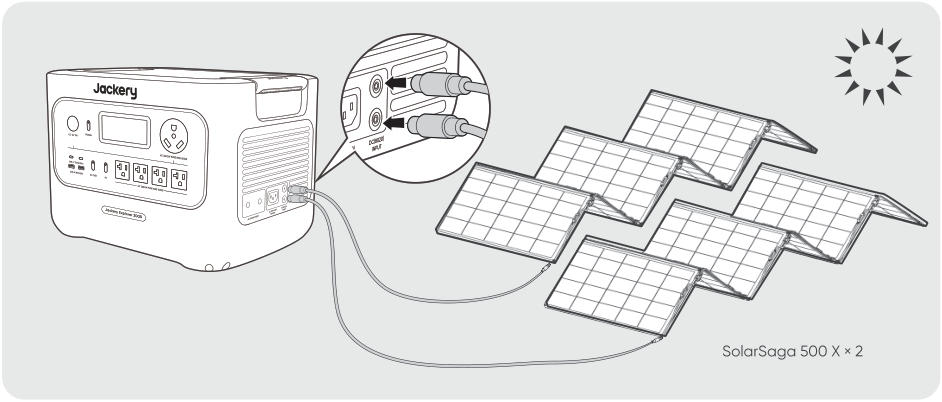
</figure>

<figure class="hb-reference-figure" data-component-id="HB-SPECIAL-REFERENCE-FIGURE" data-reference-id="solar-connector" data-source-fragment-sha256="f9b064e035dda374ced57497dc3b10d713bf4c496de98afe63e90bff45487b7e" data-step-captions="embedded">
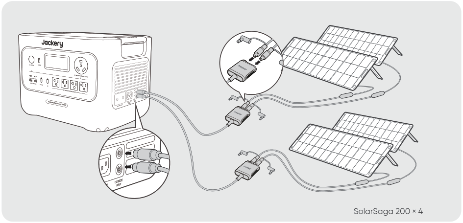
</figure>

<table class="manual-callout-table manual-callout-table"><tbody><tr><td class="manual-callout-label">Important</td><td class="manual-callout-body">
It is required to use the same Jackery solar panel models and the same number of panels connected via solar panel connectors when connecting solar panels to both DC8020 Input ports. Failure to do so may damage the product due to voltage inconsistencies caused by different models or mismatched panel quantities.
</td></tr></tbody></table>

### CHARGING VIA CAR CHARGE

This product can be charged using a 12V car charger. Ensure that the car charger and the car cigarette lighter provide a good connection.

*The car charging cable is sold separately.

<figure class="hb-reference-figure" data-component-id="HB-SPECIAL-REFERENCE-FIGURE" data-reference-id="car-charge" data-source-fragment-sha256="0621b9fbe73d908c108a72b44ec1a91cc6d324c8bb983e2c29c9ab52138800a7" data-step-captions="embedded">
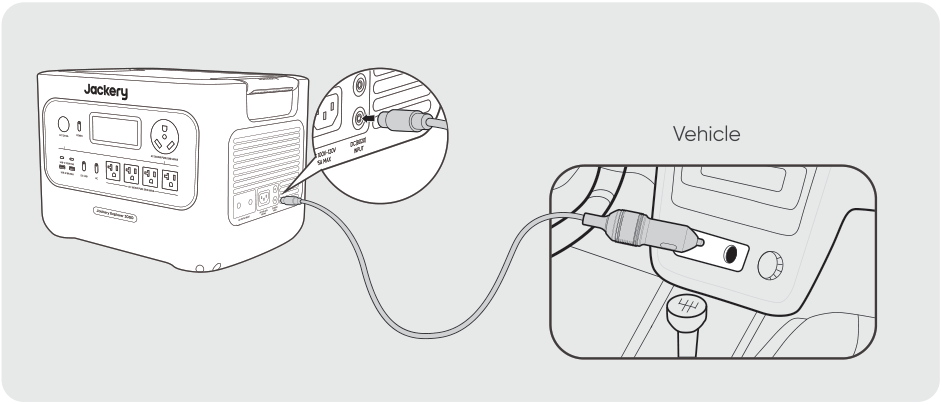
</figure>

<table class="manual-callout-table manual-callout-table"><tbody><tr><td class="manual-callout-label">Important</td><td class="manual-callout-body">
1. Please start the vehicle before charging your power station.

2. If the vehicle is running on bumpy roads, it is forbidden to use the car charger in case it burns due to a poor connection. The Company will not be responsible for any loss caused by non-standard operation.

3. Vehicle charging is only applicable to vehicles with 12V DC, not 24V DC. Please do not charge this product in 24V vehicle to avoid personal injury and property loss.

4. It is recommended to use the Jackery Solar Panel to charge the product. Jackery is not responsible for any losses caused by using solar panels from other brands.
</td></tr></tbody></table>

## WARRANTY

<figure aria-label="WARRANTY" class="hb-warranty-intro-composition" data-component-id="HB-WARRANTY-LEAD">
<strong>We only provide our warranty to customers who purchase from the official Jackery website, Jackery-branded third-party platforms, or local authorized dealers.</strong>

*Warranty period and details may vary according to local laws, regulations, and authorized dealers.
</figure>

### Limited Warranty

<figure aria-label="Limited Warranty" class="hb-warranty-card" data-component-id="HB-WARRANTY-SECTION" data-warranty-card-index="1">
Jackery Inc. warrants to the original consumer purchaser that the Jackery product will be free from defects in workmanship and material under normal consumer use during the applicable warranty period identified in the 'Warranty Period' section below, subject to the exclusions set forth below.

This warranty statement sets forth Jackery's total and exclusive warranty obligation. We will not assume, nor authorize any person to assume for us, any other liability in connection with the sale of our products.
</figure>

### Warranty Period

<figure aria-label="Warranty Period" class="hb-warranty-period-card" data-component-id="HB-WARRANTY-YEARS">

3
<strong class="hb-warranty-years-unit">YEARS</strong><strong class="hb-warranty-period-label">Standard Warranty</strong>

The standard warranty period for Jackery Explorer 3000 is 36 months. In each case, the warranty period is measured starting on the date of purchase by the original consumer purchaser. The sales receipt from the first consumer purchase, or other reasonable documentary proof, is required in order to establish the start date of the warranty period.

2
<strong class="hb-warranty-years-unit">YEARS</strong><strong class="hb-warranty-period-label">Extended Warranty</strong>

To activate the Warranty Extension, you must register your product online  or contact our customer service team at hello@jackery.com to extend the standard warranty runtime.

</figure>

### Exchange

<figure aria-label="Exchange" class="hb-warranty-card" data-component-id="HB-WARRANTY-SECTION" data-warranty-card-index="2">
Jackery will replace (at Jackery's expense) any Jackery product that fails to operate during the applicable warranty period due to defect in workmanship or material. A replacement product assumes the remaining warranty of the original product.
</figure>

### Limited to Original Consumer Buyer

<figure aria-label="Limited to Original Consumer Buyer" class="hb-warranty-card" data-component-id="HB-WARRANTY-SECTION" data-warranty-card-index="3">
The warranty on Jackery's product is limited to the original consumer purchaser and is not transferable to any subsequent owner.
</figure>

### Exclusions

<figure aria-label="Exclusions" class="hb-warranty-card" data-component-id="HB-WARRANTY-SECTION" data-warranty-card-index="4">
Jackery's warranty does not apply to:

Misused, abused, modified, damaged by accident, or used for anything other than normal consumer use as authorized in Jackery's current product literature.

Attempted repair by anyone other than an authorized facility.

Any product purchased through an online auction house.

Jackery's warranty does not apply to the battery cell unless the battery cell is fully charged by you within seven days after you purchase the product and at least once every 6 months thereafter.
</figure>

### Interpretation Rights

<figure aria-label="Interpretation Rights" class="hb-warranty-card" data-component-id="HB-WARRANTY-SECTION" data-warranty-card-index="5">
Jackery Inc. reserves the right to final interpretation of the above customers' after-sales policy.
</figure>

## APP SETUP

### 1. To download the App and log in

<figure aria-label="Jackery App" class="hb-app-download-composition" data-component-id="HB-SPECIAL-APP">

Search for "Jackery" in Google Play or App Store to install the App. After that, you can register and log in.

Alternatively, scan the QR code below to download and install the App.

</figure>

### 2. To add device

2.1 Click the button + to add your device;

2.2 Long press the “POWER” button on the device to turn on, the Wi-Fi and Bluetooth icons on the device flash to indicate that the device has entered the network configuring mode, click the “Icon Flashed” button and allow the App to connect to nearby devices and open Bluetooth permissions;

<figure class="hb-reference-figure" data-component-id="HB-SPECIAL-REFERENCE-FIGURE" data-reference-id="app-add" data-source-fragment-sha256="fc9a8ec1c41a893e5ea613e9ee6f459ca7796785ed4cbdb2064c8846b6d2578e" data-step-captions="embedded">
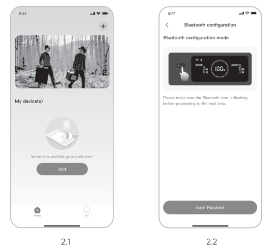
</figure>

<figure class="hb-reference-figure" data-component-id="HB-SPECIAL-REFERENCE-FIGURE" data-reference-id="app-control" data-source-fragment-sha256="3883842c2e406287c51c0e7cd13627bc1c6df7e50b41b98ea502ac31e0a8d437" data-step-captions="embedded">
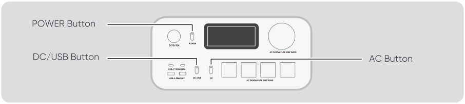
</figure>

<table class="manual-callout-table manual-callout-table"><tbody><tr><td class="manual-callout-label">Remarks</td><td class="manual-callout-body">
After being turned on, if the APP is not connected within 2 hours, the device will automatically turn off Wi-Fi and Bluetooth. Now, it is required to press and hold “DC/USB Button” and “AC Button” to turn on Wi-Fi and Bluetooth again.
</td></tr></tbody></table>

2.3 After clicking the searched device icon, the App automatically connects the device via Bluetooth.

<table class="manual-callout-table manual-callout-table"><tbody><tr><td class="manual-callout-label">Remarks</td><td class="manual-callout-body">
If “the device has been bound” is prompted during the binding process, the following two ways can be used for connection:
</td></tr></tbody></table>

<ul><li>
The device owner will share this device with other users through the App.
</li><li>
Press and hold the “POWER Button” and “DC/USB Button” for 3 seconds to reset the device, and then re-bind the device.
</li></ul>

2.4 After the device is successfully connected, it is necessary to enter your Wi-Fi password and tap the OK button;

<table class="manual-callout-table manual-callout-table"><tbody><tr><td class="manual-callout-label">Remarks</td><td class="manual-callout-body">
Please select a Wi-Fi network in 2.4GHz band. The device does not support a Wi-Fi network in 5GHz band.
</td></tr></tbody></table>

2.5 After the device is successfully added on the home page of the device, the Wi-Fi icon on the device will be always on;

<figure class="hb-reference-figure" data-component-id="HB-SPECIAL-REFERENCE-FIGURE" data-reference-id="app-results" data-source-fragment-sha256="4f2bb27855c86e943cf90e140f630ebe15469a57d97108e29ac9c6ddf4e2c3fd" data-step-captions="embedded">
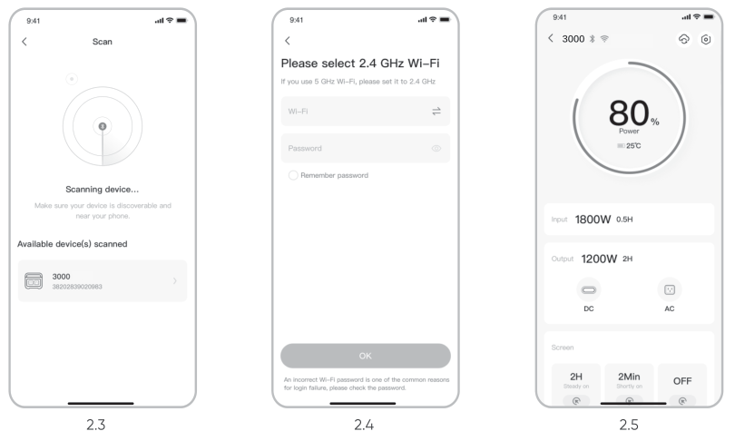
</figure>

The above screenshots are for reference only.

### 3. To unbind the device

Click the Settings button in the upper right corner of the main interface of the device to enter the settings page, and click the Unbind button at the bottom of the page to unbind the device.

### 4. Notes

#### 4.1 To turn on Wi-Fi & Bluetooth:

<ul><li>
Wi-Fi &amp; Bluetooth are automatically turned on after the device is on, and the Wi-Fi &amp; Bluetooth icons on the screen light up;
</li><li>
Press the DC/USB button and the AC button at the same time until the Wi-Fi &amp; Bluetooth icons on the screen light up;
</li></ul>

#### 4.2 To turn off Wi-Fi & Bluetooth:

<ul><li>
Press the DC/USB button and AC button at the same time until the Wi-Fi &amp; Bluetooth icons on the screen are off;
</li><li>
Wi-Fi &amp; Bluetooth will be automatically turned off if no device is connected within 2 hours;
</li></ul>

#### 4.3 To reset Wi-Fi & Bluetooth：

<ul><li>
Press the POWER button and DC/USB button at the same time for 3 seconds to reset Wi-Fi &amp; Bluetooth to factory settings and reboot the system. The connected App account will be unbound.
</li></ul>

## SPECIFICATIONS

<strong>Jackery Explorer 3000</strong>

<strong>Model: JE-3000B</strong>

## GENERAL INFO

<figure aria-label="GENERAL INFO" class="hb-spec-table-composition"><table class="manual-table manual-spec-table hb-spec-table"><colgroup><col class="hb-spec-col-label"/><col class="hb-spec-col-value"/></colgroup><tbody><tr><th class="manual-spec-label hb-spec-label" scope="row">Product Name</th><td class="manual-spec-value hb-spec-value">Jackery Explorer 3000</td></tr><tr><th class="manual-spec-label hb-spec-label" scope="row">Model No.</th><td class="manual-spec-value hb-spec-value">JE-3000B</td></tr><tr><th class="manual-spec-label hb-spec-label" scope="row">Capacity</th><td class="manual-spec-value hb-spec-value">60Ah / 51.2Vdc (3072Wh)</td></tr><tr><th class="manual-spec-label hb-spec-label" scope="row">Cell Chemistry</th><td class="manual-spec-value hb-spec-value">LiFePO₄ (Lithium Iron Phosphate)</td></tr><tr><th class="manual-spec-label hb-spec-label" scope="row">Weight</th><td class="manual-spec-value hb-spec-value">About 59.52lbs / 27kg</td></tr><tr><th class="manual-spec-label hb-spec-label" scope="row">Dimension</th><td class="manual-spec-value hb-spec-value">16.4×12.8×12in / 41.6×32.5×30.5cm</td></tr><tr><th class="manual-spec-label hb-spec-label" scope="row">Cycle Life</th><td class="manual-spec-value hb-spec-value">4000 cycles to 70%+ capacity</td></tr></tbody></table></figure>

## INPUT PORTS

<figure aria-label="INPUT PORTS" class="hb-spec-table-composition"><table class="manual-table manual-spec-table hb-spec-table"><colgroup><col class="hb-spec-col-label"/><col class="hb-spec-col-value"/></colgroup><tbody><tr><th class="manual-spec-label hb-spec-label" scope="row">Charge Mode AC Input</th><td class="manual-spec-value hb-spec-value">100V-120V~ 60Hz, 15A Max</td></tr><tr><th class="manual-spec-label hb-spec-label" scope="row">Bypass Mode AC Input/Output</th><td class="manual-spec-value hb-spec-value">120V~ 60Hz, 12A Max, 1440W</td></tr><tr><th class="manual-spec-label hb-spec-label" scope="row">DC Input</th><td class="manual-spec-value hb-spec-value">2 x DC 8mm Ports: 12-16V (Working Voltage)⎓8A Max, Double to 8A Max; 16-60V (Working Voltage)⎓12A Max,  Double to 24A/1000W Max</td></tr></tbody></table></figure>

## OUTPUT PORTS

<figure aria-label="OUTPUT PORTS" class="hb-spec-table-composition"><table class="manual-table manual-spec-table hb-spec-table"><colgroup><col class="hb-spec-col-label"/><col class="hb-spec-col-value"/></colgroup><tbody><tr><th class="manual-spec-label hb-spec-label" scope="row">4 x AC Output</th><td class="manual-spec-value hb-spec-value">120V~ 60Hz, 20A Max, 2400W</td></tr><tr><th class="manual-spec-label hb-spec-label" scope="row">1 x AC Output</th><td class="manual-spec-value hb-spec-value">120V~ 60Hz, 30A Max, 3600W</td></tr><tr><th class="manual-spec-label hb-spec-label" scope="row">AC Total Output</th><td class="manual-spec-value hb-spec-value">3600W Max, 7200W surge peak</td></tr><tr><th class="manual-spec-label hb-spec-label" scope="row">2 x USB-C Output</th><td class="manual-spec-value hb-spec-value">100W Max, 5V⎓3A, 9V⎓3A, 12V⎓3A, 15V⎓3A, 20V⎓5A</td></tr><tr><th class="manual-spec-label hb-spec-label" scope="row">2 x USB-A Output</th><td class="manual-spec-value hb-spec-value">18W Max, 5-6V⎓3A, 6-9V⎓2A, 9-12V⎓1.5A</td></tr><tr><th class="manual-spec-label hb-spec-label" scope="row">Cigarette Lighter Port</th><td class="manual-spec-value hb-spec-value">12V⎓10A Max</td></tr></tbody></table></figure>

## ENVIRONMENTAL OPERATING TEMPERATURE

<figure aria-label="ENVIRONMENTAL OPERATING TEMPERATURE" class="hb-spec-table-composition"><table class="manual-table manual-spec-table hb-spec-table"><colgroup><col class="hb-spec-col-label"/><col class="hb-spec-col-value"/></colgroup><tbody><tr><th class="manual-spec-label hb-spec-label" scope="row">Charging Temperature</th><td class="manual-spec-value hb-spec-value">0°C~45°C (32°F~113°F)</td></tr><tr><th class="manual-spec-label hb-spec-label" rowspan="2" scope="row">Discharging Temperature</th><td class="manual-spec-value hb-spec-value">-15°C~45°C (5°F~113°F)</td></tr><tr><td class="manual-spec-value hb-spec-value">-15°C~-10°C  (5°F~14°F)  Output Power: 2000W</td></tr></tbody></table></figure>

※ USB Type-C® and USB-C® are registered trademarks of USB Implementers Forum.

