

<strong>중요</strong>

새로운 Jackery Explorer 3000 직류전원장치(리튬이차전지시스템 겸용)(이하 "본 제품")을 구매해 주셔서 감사합니다. 제품을 사용하기 전에 본 사용자 설명서를 주의 깊게 읽고, 특히 관련 주의사항을 확인하여 올바르게 사용하십시오. 향후 참고를 위해 본 사용자 설명서를 접근하기 쉬운 장소에 보관하십시오.

관련 법규에 따라, 본 문서 및 본 제품과 관련된 모든 문서에 대한 최종 해석권은 Jackery에 있습니다. 본 사용자 설명서의 정확성을 보장하기 위해 최선을 다했으나, Jackery는 발생할 수 있는 오류에 대해 어떠한 책임도 지지 않습니다.

업데이트, 개정 또는 종료 시 별도의 통지가 제공되지 않음을 유의하십시오. 최신 버전의 제품 사용자 설명서는 support.jackery.com을 방문해 주십시오.

* 이미지는 참고용입니다. 실제 제품을 참고하십시오.

# 중요 안전 정보

<table class="manual-callout-table manual-callout-table"><tbody><tr><td class="manual-callout-label">경고</td><td class="manual-callout-body">
화재, 감전 또는 인명 피해 위험과 관련된 지침
</td></tr></tbody></table>

본 제품을 사용할 때는 항상 다음의 기본적인 주의 사항을 따르시기 바랍니다.

<ul><li>제품 사용 전 모든 지침을 읽어야 합니다.</li><li>어린이가 제품을 가지고 놀지 않도록 하십시오. 제품을 어린이 근처에서 사용할 때에는 어린이를 면밀히 감독해야 합니다.</li><li>전문 제조업체에서 권장하거나 판매하지 않은 액세서리를 사용할 경우 감전 위험이 발생할 수 있습니다.</li><li>제품을 사용하지 않을 때는 제품의 콘센트에서 전원 플러그를 분리하십시오.</li><li>제품을 분해하지 마십시오. 화재, 폭발, 감전 등 예기치 못한 위험이 발생할 수 있습니다.</li><li>코드, 플러그 또는 출력 케이블이 손상된 제품을 사용하지 마십시오. 감전의 위험이 있습니다.</li><li>적절한 공기 순환을 위해 제품 통풍구를 막지 마십시오.제품을 사용하는 공간은 과열을 방지하기 위해 서늘하고 건조한 환경이어야 하며, 충분히 통풍이 되어야 합니다.</li><li>습하거나 환기가 잘 되지 않는 공간에서 충전하면 안전에 위험이 발생할 수 있습니다.</li><li>물은 충전기에 합선이나 손상을 일으켜 안전 위험을 초래할 수 있습니다.</li><li>제품을 화기, 고온, 직사광선 또는 주차된 차량 내부와 같은 고온 환경에 노출시키지 마십시오. 이러한 노출은 화재나 폭발을 초래할 수 있습니다.</li></ul>

# 사용자 유지 관리 지침

에너지 저장 제품의 수명 주기 동안 일정 수준의 용량 및 에너지 저하가 예상됩니다. 충전 및 방전 사이클 수가 증가하고 보관 기간이 길어짐에 따라 이러한 저하는 점진적으로 심화되며, 이는 배터리 셀의 자연스러운 노화에 따른 정상적인 현상입니다.

# 기호의 의미

<figure aria-label="기호의 의미" class="hb-symbol-signal-composition" data-component-id="HB-TABLE-SYMBOL-SIGNAL"><table class="hb-symbol-signal-table"><colgroup><col class="hb-symbol-signal-col-label"/><col class="hb-symbol-signal-col-meaning"/></colgroup><thead><tr><th class="hb-symbol-signal-label-heading" scope="col">기호</th><th class="hb-symbol-signal-meaning-heading" scope="col">의미</th></tr></thead><tbody><tr><td class="hb-symbol-signal-label-cell">⚠경고</td><td class="hb-symbol-signal-meaning-cell">심각한 부상이나 사망 및/또는 재산 피해를 초래할 수 있는 위험한 행위.</td></tr><tr><td class="hb-symbol-signal-label-cell">⚠주의</td><td class="hb-symbol-signal-meaning-cell">부상 및/또는 재산 피해를 초래할 수 있는 위험한 행위.</td></tr><tr><td class="hb-symbol-signal-label-cell">참고</td><td class="hb-symbol-signal-meaning-cell">장비 손상, 데이터 손실, 성능 저하 또는 예상치 못한 결과를 초래할 수 있는 위험한 관행.</td></tr><tr><td class="hb-symbol-signal-label-cell">팁</td><td class="hb-symbol-signal-meaning-cell">본문의 중요한 정보 또는 작동 팁을 보충합니다.</td></tr></tbody></table></figure>

<figure aria-label="기호의 의미" class="hb-symbol-pair-composition" data-component-id="HB-TABLE-SYMBOL-ICON">

<table class="hb-symbol-panel-table"><colgroup><col class="hb-symbol-col-icon"/><col class="hb-symbol-col-meaning"/></colgroup><thead><tr><th class="hb-symbol-icon-heading" scope="col">기호</th><th class="hb-symbol-meaning-heading" scope="col">의미</th></tr></thead><tbody><tr><td class="hb-symbol-icon"></td><td class="hb-symbol-meaning">경고 및 주의 기호. 잠재적 위험이나 위험을 알리기 위해 반드시 숙지해야 합니다.</td></tr><tr><td class="hb-symbol-icon"></td><td class="hb-symbol-meaning">사용 전에 사용자 설명서를 읽으십시오.</td></tr><tr><td class="hb-symbol-icon"></td><td class="hb-symbol-meaning">제품을 화기로부터 멀리 두십시오.</td></tr><tr><td class="hb-symbol-icon"></td><td class="hb-symbol-meaning">어린이의 손이 닿지 않는 곳에 보관하십시오.</td></tr><tr><td class="hb-symbol-icon"></td><td class="hb-symbol-meaning">제품을 분해하지 마십시오.</td></tr></tbody></table>

<table class="hb-symbol-panel-table"><colgroup><col class="hb-symbol-col-icon"/><col class="hb-symbol-col-meaning"/></colgroup><thead><tr><th class="hb-symbol-icon-heading" scope="col">기호</th><th class="hb-symbol-meaning-heading" scope="col">의미</th></tr></thead><tbody><tr><td class="hb-symbol-icon"></td><td class="hb-symbol-meaning">이 기호는 제품 내부에 리튬이온(Li-ion) 배터리가 포함되어 있음을 나타내며, 적절히 폐기 또는 재활용해야 합니다.</td></tr><tr><td class="hb-symbol-icon"></td><td class="hb-symbol-meaning">이 기호는 제품을 생활 폐기물로 처리해서는 안 되며, 재활용을 위해 지정된 수거 시설에 전달해야 함을 나타냅니다. 적절한 폐기 및 재활용은 환경 보호에 도움이 될 수 있습니다. 이 제품의 폐기 및 재활용에 대한 자세한 내용은 지역 커뮤니티, 폐기물 처리 서비스 또는 판매점에 문의하십시오.</td></tr></tbody></table>

</figure>

# 박스 구성품

<figure aria-label="박스 구성품" class="hb-inbox-composition" data-card-count="3" data-component-id="HB-SPECIAL-INBOX" data-inbox-variant="three-card-responsive"><ol class="hb-inbox-grid"><li class="hb-inbox-card" data-item-number="1">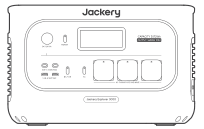
Jackery Explorer 3000 직류전원장치(리튬이차전지시스템 겸용)
</li><li class="hb-inbox-card" data-item-number="2">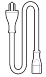
AC 충전 케이블
</li><li class="hb-inbox-card" data-item-number="3">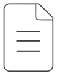
사용자 설명서
</li></ol>

팁

차량용 충전 케이블은 포함되어 있지 않으며 당사 웹사이트에서 별도로 구매할 수 있습니다. 도움이 필요하시면 Jackery 고객 지원팀으로 문의하십시오.

</figure>

# 제품 개요

<figure class="hb-reference-figure hb-has-composite-art" data-component-id="HB-SPECIAL-REFERENCE-FIGURE" data-reference-id="front_product" data-source-fragment-sha256="9bb0d96fd39152b6b886a1be939ea59164cfe0058dafe96792ddce66444fe62b" data-step-captions="embedded" data-web-composite-asset-key="frozen-source/front_product" data-web-composite-locale="ko" data-web-composite-sha256="bb19e5218d527116028b0343a66e1266ac9017a0ba2da4c9a97744252b1d68db" data-web-replace-key="reference.front_product">
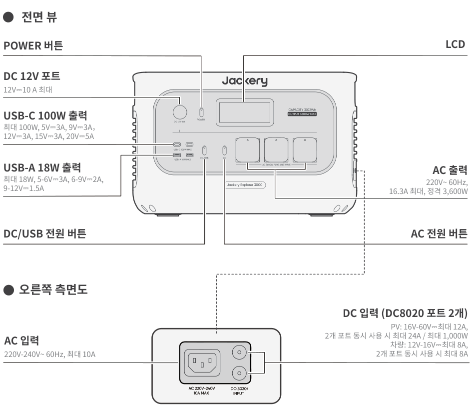

</figure>

# LCD 디스플레이

<figure class="hb-reference-figure hb-has-composite-art" data-component-id="HB-SPECIAL-REFERENCE-FIGURE" data-reference-id="lcd-map" data-source-fragment-sha256="35a4aaa4063aa3d01b65ced70b8e4ab3649c689e375b50bdbe1a93adfa9a13b6" data-step-captions="embedded" data-web-composite-asset-key="frozen-source/lcd-map" data-web-composite-locale="ko" data-web-composite-sha256="9d86fb7fac57ea2d372542d38c1e8e9fa52b8b052d3394e9f7a8e22a7d2411bd" data-web-replace-key="reference.lcd-map">
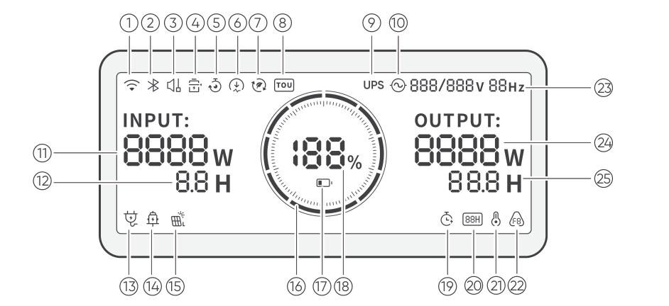

</figure>

<figure aria-label="LCD 디스플레이" class="hb-lcd-table-composition" data-component-id="HB-TABLE-LCD-ICON" tabindex="0"><table class="hb-lcd-icon-table"><colgroup><col class="hb-lcd-col-number"/><col class="hb-lcd-col-icon"/><col class="hb-lcd-col-name"/><col class="hb-lcd-col-description"/></colgroup><tbody><tr><td class="hb-lcd-number">1</td><td class="hb-lcd-icon"></td><td class="hb-lcd-name">Wi-Fi</td><td class="hb-lcd-description"><strong>켜짐:</strong> Wi-Fi에 연결되었습니다. <strong>점멸:</strong> Wi-Fi에 연결할 준비가 되었습니다. <strong>꺼짐:</strong> Wi-Fi 연결이 해제되었습니다.</td></tr><tr><td class="hb-lcd-number">2</td><td class="hb-lcd-icon"></td><td class="hb-lcd-name">블루투스</td><td class="hb-lcd-description"><strong>켜짐:</strong> 블루투스가 연결되었습니다. <strong>점멸:</strong> 블루투스에 연결할 준비가 되었습니다. <strong>꺼짐:</strong> 블루투스 연결이 해제되었습니다.</td></tr><tr><td class="hb-lcd-number">3</td><td class="hb-lcd-icon"></td><td class="hb-lcd-name">조용한 충전 모드</td><td class="hb-lcd-description"><strong>켜짐:</strong> 충전 중 소음이 크게 줄어들지만, 충전 전력이 낮아지고 충전 속도가 느려집니다. <strong>꺼짐:</strong> 조용한 충전 모드가 비활성화됩니다. 이 기능은 Jackery App에서 설정/해제할 수 있습니다. 이 설정은 장치 전원이 꺼져도 유지됩니다.</td></tr><tr><td class="hb-lcd-number">4</td><td class="hb-lcd-icon"></td><td class="hb-lcd-name">배터리 절약 모드</td><td class="hb-lcd-description"><strong>켜짐:</strong> 배터리 절약 모드가 활성화되어 있습니다. 배터리 수명 연장을 위해 충전 및 방전 제한이 적용됩니다. <strong>꺼짐:</strong> 배터리 절약 모드가 비활성화되어 있습니다. 이 기능은 Jackery App에서 설정/해제할 수 있습니다. 장치 전원이 꺼져도 이 설정은 유지됩니다. 이 기능이 활성화되면 제품은 SOC를 보정하기 위해 가끔 완전 충전 및 방전 주기를 수행합니다.</td></tr><tr><td class="hb-lcd-number">5</td><td class="hb-lcd-icon"></td><td class="hb-lcd-name">충전 계획</td><td class="hb-lcd-description">본 제품의 충전 시간을 사용자 지정합니다. 전기 요금이 변동하는 상황에 적합하며, 피크 시간과 오프피크 시간에 따라 충전 계획을 세워 전기 요금을 절약할 수 있습니다. 이 기능은 Jackery App에서 설정/해제할 수 있습니다. 이 설정은 장치 전원이 꺼져도 유지됩니다.</td></tr><tr><td class="hb-lcd-number">6</td><td class="hb-lcd-icon"></td><td class="hb-lcd-name">충전 전력 제한</td><td class="hb-lcd-description"><strong>켜짐:</strong> Jackery App에서 충전 전력 제한이 활성화되어 있습니다. <strong>꺼짐:</strong> Jackery App에서 충전 전력 제한이 비활성화되어 있습니다. 이 설정은 장치 전원이 꺼져도 유지됩니다.</td></tr><tr><td class="hb-lcd-number">7</td><td class="hb-lcd-icon"></td><td class="hb-lcd-name">자가 발전 모드</td><td class="hb-lcd-description">저장된 태양광 에너지를 우선 사용하여 태양광 에너지 활용을 극대화하고 전력망 의존도를 낮춰 전기 요금을 절감합니다. 파워 스테이션은 태양광 패널과 전력망에 동시에 연결되어야 하며, 부하 전력은 바이패스 전력 한도로 제한됩니다. 이 기능은 Jackery App에서 설정/해제할 수 있습니다. 이 설정은 장치 전원이 꺼져도 유지됩니다.</td></tr><tr><td class="hb-lcd-number">8</td><td class="hb-lcd-icon"></td><td class="hb-lcd-name">TOU 모드</td><td class="hb-lcd-description"><strong>켜짐:</strong> TOU 모드가 활성화되었습니다(기본 백업 SOC: 60%). 피크 시간대에는 저장된 에너지가 백업 SOC를 초과할 경우 배터리 방전을 우선하여 피크 전기 요금을 줄입니다. 비피크 시간대에는 전력망에서 배터리를 충전하여 피크 절감 및 부하 평준화를 달성합니다. <strong>꺼짐:</strong> TOU 모드가 비활성화되었습니다. 제품은 TOU(시간대별 요금제) 전략을 따르지 않으며, 기본 전원 공급 및 충전 로직에 따라 작동합니다. 이 기능은 Jackery App에서 설정/해제할 수 있습니다. 이 설정은 장치 전원이 꺼져도 유지됩니다.</td></tr><tr><td class="hb-lcd-number">9</td><td class="hb-lcd-icon"></td><td class="hb-lcd-name">UPS</td><td class="hb-lcd-description"><strong>켜짐:</strong> 제품이 바이패스 모드로 작동 중입니다. AC 출력 포트에 연결된 부하는 파워 스테이션이 아닌 전력망에서 전력을 소비합니다. 전력망 전원이 갑자기 중단되면 제품은 10ms 이내에 자동으로 배터리 전력으로 전환됩니다. <strong>꺼짐:</strong> 제품은 바이패스 모드에서 작동하지 않습니다. AC 출력 포트에 연결된 부하는 파워 스테이션의 내부 배터리에서 전원을 공급받습니다.</td></tr><tr><td class="hb-lcd-number">10</td><td class="hb-lcd-icon"></td><td class="hb-lcd-name">AC 전원 표시기</td><td class="hb-lcd-description">AC 출력(순수 정현파)이 켜져 있습니다.</td></tr><tr><td class="hb-lcd-number">11</td><td class="hb-lcd-icon"></td><td class="hb-lcd-name">입력 전력</td><td class="hb-lcd-description">입력 전력을 와트(W) 단위로 표시합니다.</td></tr><tr><td class="hb-lcd-number">12</td><td class="hb-lcd-icon"></td><td class="hb-lcd-name">남은 충전 시간</td><td class="hb-lcd-description">남은 충전 시간을 표시합니다.</td></tr><tr><td class="hb-lcd-number">13</td><td class="hb-lcd-icon"></td><td class="hb-lcd-name">AC 벽면 충전 표시기</td><td class="hb-lcd-description">제품은 전력망 전원을 사용하여 AC 입력 포트를 통해 충전됩니다.</td></tr><tr><td class="hb-lcd-number">14</td><td class="hb-lcd-icon"></td><td class="hb-lcd-name">차량 충전 표시기</td><td class="hb-lcd-description">제품은 DC 12V(차량 충전) 전원을 사용해 DC 입력(DC8020)으로 충전됩니다.</td></tr><tr><td class="hb-lcd-number">15</td><td class="hb-lcd-icon"></td><td class="hb-lcd-name">태양광 충전 표시기</td><td class="hb-lcd-description">제품은 태양광 패널을 사용해 DC 입력(DC8020)으로 충전됩니다.</td></tr><tr><td class="hb-lcd-number">16</td><td class="hb-lcd-icon"></td><td class="hb-lcd-name">배터리 전력 표시기</td><td class="hb-lcd-description">제품이 충전 중일 때 배터리 백분율 주위의 주황색 원이 순차적으로 점등됩니다. 다른 기기를 충전할 때는 주황색 원이 계속 켜져 있습니다.</td></tr><tr><td class="hb-lcd-number">17</td><td class="hb-lcd-icon"></td><td class="hb-lcd-name">배터리 부족 표시기</td><td class="hb-lcd-description"><strong>켜짐:</strong> 배터리 잔량이 20% 미만입니다. <strong>점멸:</strong> 배터리 잔량이 5% 미만입니다. <strong>꺼짐:</strong> 배터리 잔량이 20% 이상이거나 제품이 충전 중입니다.</td></tr><tr><td class="hb-lcd-number">18</td><td class="hb-lcd-icon"></td><td class="hb-lcd-name">남은 배터리 백분율</td><td class="hb-lcd-description">남은 배터리 백분율을 표시합니다.</td></tr><tr><td class="hb-lcd-number">19</td><td class="hb-lcd-icon"></td><td class="hb-lcd-name">방전 타이머</td><td class="hb-lcd-description"><strong>켜짐:</strong> 방전 타이머가 설정되어 있습니다. <strong>꺼짐:</strong> 방전 타이머가 설정되어 있지 않습니다. 이 기능은 Jackery App에서 설정/해제할 수 있습니다. 장치 전원이 꺼지면 이 설정은 유지되지 않습니다.</td></tr><tr><td class="hb-lcd-number">20</td><td class="hb-lcd-icon"></td><td class="hb-lcd-name">에너지 절약 모드</td><td class="hb-lcd-description"><strong>켜짐:</strong> 에너지 절약 모드가 활성화됩니다. <strong>꺼짐:</strong> 에너지 절약 모드가 비활성화됩니다.</td></tr><tr><td class="hb-lcd-number">21</td><td class="hb-lcd-icon"></td><td class="hb-lcd-name">고온 표시기</td><td class="hb-lcd-description">고온 보호가 작동됩니다. 온도가 정상 작동 범위로 돌아올 때까지 제품이 작동을 중지할 수 있습니다.</td></tr><tr><td class="hb-lcd-number">21</td><td class="hb-lcd-icon"></td><td class="hb-lcd-name">저온 표시기</td><td class="hb-lcd-description">저온 보호가 작동됩니다. 온도가 정상 작동 범위로 돌아올 때까지 제품의 작동이 중지될 수 있습니다.</td></tr><tr><td class="hb-lcd-number">22</td><td class="hb-lcd-icon">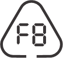</td><td class="hb-lcd-name">오류 코드</td><td class="hb-lcd-description">제품에 오류가 발생했습니다. 자세한 내용은 문제 해결 섹션을 참조하십시오.</td></tr><tr><td class="hb-lcd-number">23</td><td class="hb-lcd-icon"></td><td class="hb-lcd-name">출력 전압 및 주파수</td><td class="hb-lcd-description">AC 출력이 켜져 있을 때 출력 전압과 주파수를 표시합니다.</td></tr><tr><td class="hb-lcd-number">24</td><td class="hb-lcd-icon"></td><td class="hb-lcd-name">출력 전력</td><td class="hb-lcd-description">출력 전력을 와트(W) 단위로 표시합니다.</td></tr><tr><td class="hb-lcd-number">25</td><td class="hb-lcd-icon"></td><td class="hb-lcd-name">남은 방전 시간</td><td class="hb-lcd-description">남은 방전 시간을 표시합니다.</td></tr></tbody></table></figure>

# 조작

## 전원 켜기/끄기

<figure class="hb-reference-figure hb-has-composite-art" data-component-id="HB-SPECIAL-REFERENCE-FIGURE" data-reference-id="op_main_power" data-source-fragment-sha256="90661ac879621fbea9a40664f8b4e02a3fec95204d5c17561aaff1fdf60e5559" data-step-captions="embedded" data-web-composite-asset-key="frozen-source/op_main_power" data-web-composite-locale="ko" data-web-composite-sha256="44f463d3f80a66f645e20a391042e3e1d8eefc690c8ae827ec44a13fe97ed768" data-web-replace-key="reference.op_main_power">
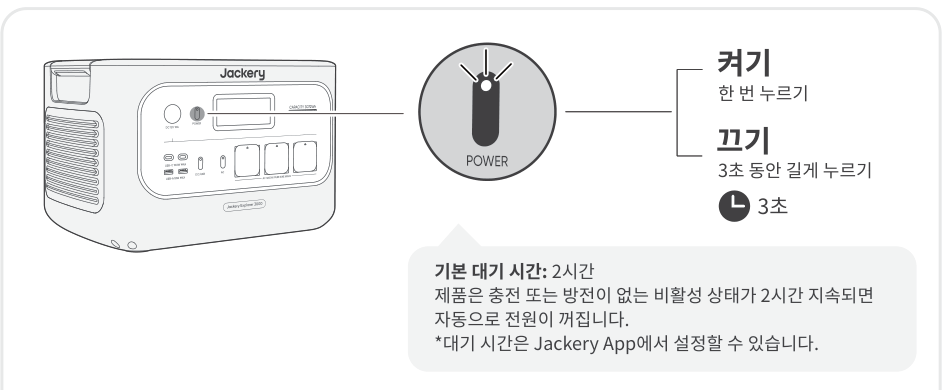

</figure>

에너지 절약 모드가 활성화된 경우, AC 전원 버튼 또는 DC/USB 전원 버튼이 켜져 있지만 제품이 충전 또는 방전 중이 아니면 12시간 후 자동으로 전원이 꺼집니다.

## AC 출력 켜기/끄기

<figure class="hb-reference-figure hb-has-composite-art" data-component-id="HB-SPECIAL-REFERENCE-FIGURE" data-reference-id="op_ac_output" data-source-fragment-sha256="95b22c4831a1aa601e6d2a3a149c671de76951fee0fb761ead9d4afae2432569" data-step-captions="embedded" data-web-composite-asset-key="frozen-source/op_ac_output" data-web-composite-locale="ko" data-web-composite-sha256="1c0e13438d4b47fbd57547f4a0bdc5494d3cd9b99432afdff2d906bb0e017257" data-web-replace-key="reference.op_ac_output">
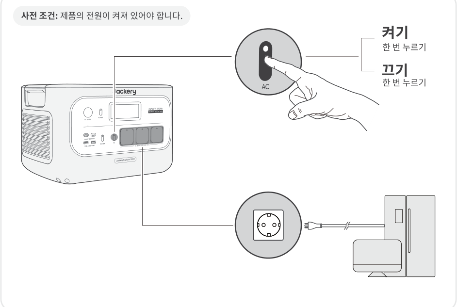

</figure>

## DC/USB 출력 켜기/끄기

<figure class="hb-reference-figure hb-has-composite-art" data-component-id="HB-SPECIAL-REFERENCE-FIGURE" data-reference-id="op_dc_usb_output" data-source-fragment-sha256="3752bacec459848dffc4b7c5f861f35832fed898029a1f6e3e627bee337526f7" data-step-captions="embedded" data-web-composite-asset-key="frozen-source/op_dc_usb_output" data-web-composite-locale="ko" data-web-composite-sha256="447d6c79216f4732f031b2bdfade579d53841d398f8ecec4444e20d9880b7795" data-web-replace-key="reference.op_dc_usb_output">
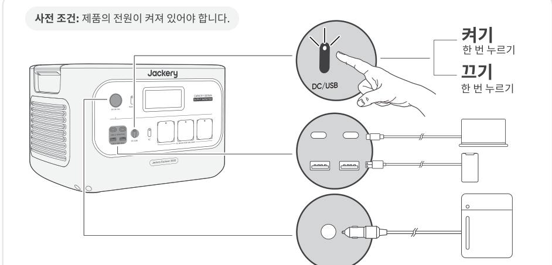

</figure>

<table class="manual-callout-table manual-callout-table"><tbody><tr><td class="manual-callout-label">주의</td><td class="manual-callout-body">
USB-C 100W는 USB-PD Power Source 3 (PS3) 고출력 포트입니다. 연결된 기기 또는 액세서리가 안전 요구 사항을 충족하지 않으면 화재 위험이 있을 수 있습니다. 이러한 포트를 사용하기 전에 연결된 기기 또는 액세서리에 화재 안전 보호 기능이 있는지 확인하십시오. 

본 제품은 IEC/EN/UL 62368-1(또는 기타 동등한 표준)의 6.3, 6.4 및 6.5항을 준수하는 기기 또는 액세서리에만 연결하십시오.

최대 출력 전력을 얻으려면 USB-C to USB-C 5A 케이블(20V DC/5A, 100W)을 사용하십시오.
</td></tr></tbody></table>

본 제품은 별도로 판매되며 당사 웹사이트에서 구매 가능한 Jackery 12V 차량 배터리 충전 케이블을 사용하여 차량 배터리를 충전할 수 있습니다.

<table class="manual-callout-table manual-callout-table"><tbody><tr><td class="manual-callout-label">주의</td><td class="manual-callout-body">
DC 12V 포트는 12V 차량 배터리에만 호환되며 24V 시스템에는 적합하지 않습니다.

제품이 12V DC 출력 포트를 통해 차량 배터리를 충전하는 동안에는 시동을 걸지 마십시오. 제품이 손상될 수 있습니다.

이 기능은 비상용으로만 사용하도록 설계되었으며, 방전되었거나 손상된 차량 배터리는 충전할 수 없습니다.
</td></tr></tbody></table>

## 에너지 절약 모드

출력을 끄는 것을 잊어 발생하는 불필요한 배터리 소모를 방지하기 위해 본 제품은 기본적으로 에너지 절약 모드가 활성화되어 있습니다. AC 출력 또는 DC/USB 출력이 켜지면 LCD 화면에 에너지 절약 모드 아이콘이 표시됩니다. 이 모드에서는 연결된 기기가 없거나 연결된 기기의 소비 전력이 특정 임계값(AC 출력 25W 또는 DC/USB 출력 2W) 미만인 경우 설정된 시간이 지나면 해당 출력이 자동으로 꺼집니다. 기본 설정은 12시간입니다. 에너지 절약 모드 지속 시간은 Jackery App에서 1H, 2H, 8H, 12H 또는 24H로 설정할 수 있습니다. Never Off로 설정하면 에너지 절약 모드는 비활성화됩니다.

에너지 절약 모드를 비활성화하려면 AC 전원 버튼과 POWER 버튼을 동시에 3초 넘게 길게 누르십시오. 에너지 절약 모드가 비활성화되면 LCD 화면에 아이콘이 더 이상 표시되지 않으며, 제품은 AC 또는 USB 출력을 자동으로 끄지 않습니다.

저전력 기기(AC ≤ 25W 또는 DC/USB ≤ 2W)에 전원을 공급할 때는 출력이 자동으로 꺼지는 것을 방지하려면 에너지 절약 모드를 비활성화하십시오.

<figure class="hb-reference-figure hb-has-composite-art" data-component-id="HB-SPECIAL-REFERENCE-FIGURE" data-reference-id="energy_saving" data-source-fragment-sha256="5060f8919f43bb596ba6187e31893c005caf72bc61d4f2d8e589b1baa96dfdff" data-step-captions="embedded" data-web-composite-asset-key="frozen-source/energy_saving" data-web-composite-locale="ko" data-web-composite-sha256="d94484e3bb477a18d1239a42dd961d47848395fe51a9a4c616008bb0dae6e5ee" data-web-replace-key="reference.energy_saving">
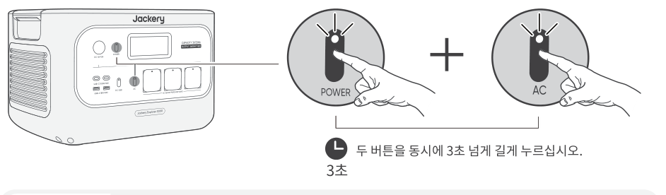

</figure>

<table class="manual-callout-table manual-callout-table"><tbody><tr><td class="manual-callout-label">참고</td><td class="manual-callout-body">
전원을 켠 후 에너지 절약 모드는 이전 상태로 복원됩니다. 모드는 수동으로 전환해야 합니다.
</td></tr></tbody></table>

## LCD 화면

<figure aria-label="LCD 화면" class="hb-lcd-mode-composition" data-component-id="HB-TABLE-LCD-MODE">
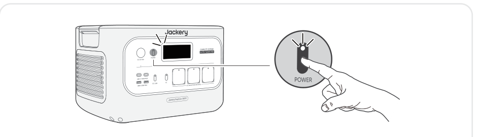

<table class="hb-lcd-mode-table"><colgroup><col class="hb-lcd-mode-col-state"/><col class="hb-lcd-mode-col-action"/><col class="hb-lcd-mode-col-copy"/></colgroup><tbody><tr><td class="hb-lcd-mode-state" rowspan="3">잠시 켜짐</td><td class="hb-lcd-mode-action">켜기</td><td class="hb-lcd-mode-copy">POWER 버튼을 누르거나 제품이 충전 중일 때 켜집니다.</td></tr><tr><td class="hb-lcd-mode-action">끄기</td><td class="hb-lcd-mode-copy">POWER 버튼을 누르십시오.</td></tr><tr><td class="hb-lcd-mode-action">자동으로 끄기</td><td class="hb-lcd-mode-copy">2분 동안 조작이 없으면 LCD 화면이 자동으로 꺼지고 절전 모드로 전환됩니다.</td></tr><tr><td class="hb-lcd-mode-state" rowspan="3">상시 켜짐(충전 또는 방전 상태에서)</td><td class="hb-lcd-mode-action">켜기</td><td class="hb-lcd-mode-copy">제품 전원이 켜진 상태에서 POWER 버튼을 두 번 누르십시오.</td></tr><tr><td class="hb-lcd-mode-action">끄기</td><td class="hb-lcd-mode-copy">POWER 버튼을 누르십시오.</td></tr><tr><td class="hb-lcd-mode-action">자동으로 끄기</td><td class="hb-lcd-mode-copy">2시간 동안 조작이 없으면 LCD 화면이 자동으로 꺼집니다.</td></tr></tbody></table>
</figure>

Jackery App에서 화면 표시 모드를 설정할 수도 있습니다.

## 버튼 조합

<figure aria-label="버튼 / 조작 / 기능" class="hb-key-combination-composition" data-component-id="HB-TABLE-KEY-COMBINATIONS" tabindex="0"><table class="hb-key-combination-table"><colgroup><col class="hb-key-col-buttons"/><col class="hb-key-col-operation"/><col class="hb-key-col-function"/></colgroup><thead><tr><th class="hb-key-buttons" scope="col">버튼</th><th class="hb-key-operation" scope="col">조작</th><th class="hb-key-function" scope="col">기능</th></tr></thead><tbody><tr><td class="hb-key-buttons">POWER 버튼 + AC 전원 버튼</td><td class="hb-key-operation">3초 동안 동시에 길게 누르기</td><td class="hb-key-function">에너지 절약 모드 켜기/끄기</td></tr><tr><td class="hb-key-buttons">POWER 버튼 + DC/USB 전원 버튼</td><td class="hb-key-operation">3초 동안 동시에 길게 누르기</td><td class="hb-key-function">Wi‑Fi 및 블루투스 재설정</td></tr><tr><td class="hb-key-buttons">DC/USB 전원 버튼 + AC 전원 버튼</td><td class="hb-key-operation">1초 동안 동시에 길게 누르기</td><td class="hb-key-function">Wi‑Fi 및 블루투스 켜기/끄기</td></tr></tbody></table></figure>

# 무정전 전원 공급 장치(UPS)

AC 충전 케이블로 제품을 벽면 콘센트에 연결한 다음, AC 전원 버튼을 눌러 가전제품에 동시에 전원을 공급하십시오.

무정전 전원 공급 장치(UPS)는 상용 전원(그리드 전력)이 중단될 때 부하에 자동으로 백업 전력을 제공하는 연속 전원 시스템의 한 유형입니다.

전력망 전원이 갑자기 중단되는 경우, 본 제품은 10ms 이내에 저장된 전원으로 자동 전환되어 가전제품의 작동을 유지합니다.

UPS 모드에서는 정전 발생 전 장치의 최대 출력이 10A에 도달합니다. 바이패스 모드에서는 동시 충전/방전이 가능하므로, 이 모드에서 실제 출력 전력은 정격 출력 전력보다 낮지만 정전 시에는 정격 출력 전력으로 복귀합니다.

<figure class="hb-reference-figure hb-has-composite-art" data-component-id="HB-SPECIAL-REFERENCE-FIGURE" data-reference-id="ups" data-source-fragment-sha256="16dee978bfe15c9a7ac9e4a73b45c648c3861e7e37da208eb8cd3219b7705b4f" data-step-captions="embedded" data-web-composite-asset-key="frozen-source/ups" data-web-composite-locale="ko" data-web-composite-sha256="899801760f19da504ba8c41bdd958b2e68f9e7735e1f022113e77d73ff5ad159" data-web-replace-key="reference.ups">
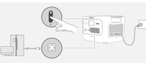

</figure>

<table class="manual-callout-table manual-callout-table"><tbody><tr><td class="manual-callout-label">주의</td><td class="manual-callout-body">
이 제품은 0ms 스위칭을 지원하지 않습니다. 데이터 서버나 워크스테이션과 같이 0ms 전환 전원 공급이 필요한 장비에는 연결하지 마십시오.

사용 전에 기기와의 호환성을 여러 번 테스트하십시오.

제품의 최대 출력 전력을 초과하는 부하를 연결하지 마십시오. 그렇지 않으면 과부하 보호 기능이 작동할 수 있습니다.
</td></tr></tbody></table>

# 충전

그린 에너지 우선: 그린 에너지 사용을 우선 권장합니다. 이 제품은 두 가지 충전 방식을 동시에 지원합니다: 태양광 충전 및 AC 벽면 충전입니다. AC 벽면 충전과 태양광 충전을 동시에 사용할 경우, 제품은 태양광 충전을 우선하며 두 방식을 모두 사용해 허용 가능한 최대 전력으로 배터리를 충전합니다.

<table class="manual-callout-table manual-callout-table"><tbody><tr><td class="manual-callout-label">참고</td><td class="manual-callout-body">
처음 사용하기 전에 제품을 완전히 충전하십시오.
</td></tr></tbody></table>

<table class="manual-callout-table manual-callout-table"><tbody><tr><td class="manual-callout-label">참고</td><td class="manual-callout-body">
제품의 권장 충전 온도 범위는 0°C~45°C이며, 방전 온도 범위는 -10°C~45°C입니다.

이 온도 범위를 벗어나 제품을 작동할 경우 충전 및 방전 성능이 제한되거나, 충전 또는 방전이 불가능해질 수 있습니다.

온도 변화로 인해 제품의 충전 전력과 배터리 용량이 달라질 수 있습니다.
</td></tr></tbody></table>

## AC 벽면 콘센트를 통한 충전

AC 충전 케이블을 제품의 AC 입력 포트와 벽면 콘센트에 연결하십시오.

<figure class="hb-reference-figure hb-has-composite-art" data-component-id="HB-SPECIAL-REFERENCE-FIGURE" data-reference-id="ac_wall" data-source-fragment-sha256="b073765d6220ec3dd0ae8eb0ced2395453ee8e07a0afa141b02de59433436b1d" data-step-captions="embedded" data-web-composite-asset-key="frozen-source/ac_wall" data-web-composite-locale="ko" data-web-composite-sha256="abfdee922641b333e15b643d10cbed34efe6adb0239a42e4caa278459b49bf8a" data-web-replace-key="reference.ac_wall">
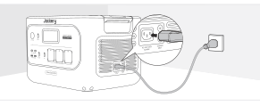

</figure>

<table class="manual-callout-table manual-callout-table"><tbody><tr><td class="manual-callout-label">주의</td><td class="manual-callout-body">
AC 충전 케이블이 AC 입력 포트에 완전히 단단히 연결되었는지 확인하십시오. 불완전한 연결은 전류 불안정, 과열, 접촉 불량 또는 장치 오작동을 유발할 수 있습니다.
</td></tr></tbody></table>

## 태양광 패널을 통한 충전(별도 판매)

본 제품은 두 개의 DC8020 입력 포트를 갖추고 있으며 Jackery 태양광 패널과 호환됩니다.

하나의 DC8020 입력 포트에 두 개의 태양광 패널을 동시에 연결해야 하는 경우, 아래 그림을 참조하여 태양광 패널 커넥터(별도 판매, 기본 구성품 아님)를 통해 충전하십시오.

<table class="manual-callout-table manual-callout-table"><tbody><tr><td class="manual-callout-label">주의</td><td class="manual-callout-body">
하나의 DC8020 입력 포트에는 최대 두 개의 태양광 패널만 연결할 수 있습니다.
</td></tr></tbody></table>

<table class="manual-callout-table manual-callout-table"><tbody><tr><td class="manual-callout-label">주의</td><td class="manual-callout-body">
두 DC 입력 포트의 입력 전압이 동일한지 확인하십시오. 이를 준수하지 않을 경우 제품이 손상될 수 있습니다. 예를 들어:

두 개의 DC8020 입력 포트에 태양광 패널을 연결할 때에는 동일한 모델의 Jackery 태양광 패널을 동일한 개수로 사용하십시오.

차량용 충전기와 태양광 패널을 동시에 사용하여 제품을 충전하지 마십시오. 이렇게 할 경우 차량 퓨즈가 끊어지거나 충전에 실패할 수 있습니다.
</td></tr></tbody></table>

<figure class="hb-reference-figure hb-has-composite-art" data-component-id="HB-SPECIAL-REFERENCE-FIGURE" data-reference-id="solar_adapter" data-source-fragment-sha256="fcf90e361940e72411d5e99985a5b4d1dac590d26c05e25d473461e79f020c83" data-step-captions="embedded" data-web-composite-asset-key="frozen-source/solar_adapter" data-web-composite-locale="ko" data-web-composite-sha256="f06ecb25a8daa575f460d447524f33fa96b70f53445f9ae65ba4df2c0bab68e5" data-web-replace-key="reference.solar_adapter">
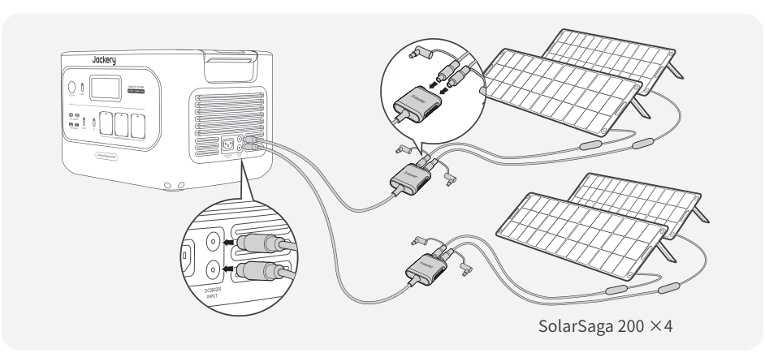

</figure>

제품 충전에는 Jackery 태양광 패널 사용을 권장합니다. 사용 중인 태양광 패널의 개방 회로 전압(Voc)이 본 제품의 DC 입력 범위(16V~60V) 내에 있는지 확인하십시오. 타사 태양광 패널 사용으로 인해 발생한 손상 또는 손실에 대해 Jackery는 책임을 지지 않습니다.

## 차량용 충전기를 통한 충전(별도 판매)

본 제품은 12V 차량용 충전기를 사용하여 충전할 수 있습니다. 차량용 충전기와 12V 차량용 전원 콘센트(시거잭)가 확실하게 연결되었는지 확인하십시오.

<figure class="hb-reference-figure hb-has-composite-art" data-component-id="HB-SPECIAL-REFERENCE-FIGURE" data-reference-id="car_charge" data-source-fragment-sha256="f9c3162d1a7189b08c6ef5af7f8c9a264dbf7146a9e9e6bf2e1413ce9c4869f0" data-step-captions="embedded" data-web-composite-asset-key="frozen-source/car_charge" data-web-composite-locale="ko" data-web-composite-sha256="cbb5d7fa78de39b81eab5a25b5d1c03ca20dd4e659463e6eee3f0f08ace89ef9" data-web-replace-key="reference.car_charge">
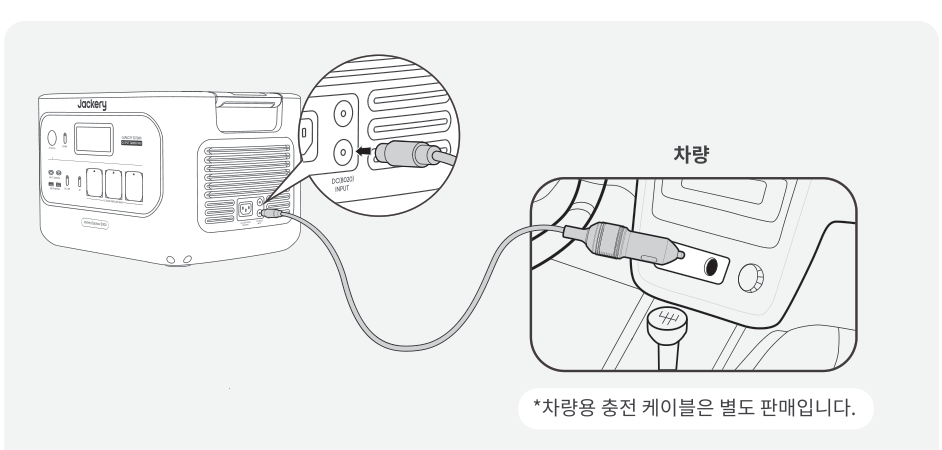

</figure>

<table class="manual-callout-table manual-callout-table"><tbody><tr><td class="manual-callout-label">주의</td><td class="manual-callout-body">
본 제품을 충전하기 전에 먼저 차량의 시동을 거십시오.

차량이 험로를 주행 중인 경우 비정상 작동이 발생할 수 있으므로 차량용 충전기를 사용하지 마십시오. 비정상적인 작동으로 인해 발생한 어떠한 손실에 대해서도 회사는 책임을 지지 않습니다.

차량 충전은 12V DC 차량에만 적용되며 24V DC 차량에는 적용되지 않습니다. 인명 피해 및 재산 손실을 방지하기 위해 24V 차량에서는 본 제품을 충전하지 마십시오.
</td></tr></tbody></table>

# 보관

제품을 건조하고 깨끗하며 통풍이 잘 되는 장소에 보관하십시오. 보관 온도 및 습도:

<ul><li>1개월: -20°C ~ 45°C (0~60% RH)</li><li>3개월: 0°C ~ 45°C (0~60% RH)</li><li>12개월: 0°C ~ 25°C (0~60% RH)</li></ul>

이 제품을 전원이 완전히 방전된 상태로 장기간(3~6개월) 보관하면 충전이 불가능해질 수 있습니다. 이를 방지하고 배터리 상태를 유지하기 위해 3개월마다 제품을 점검 및 충전하고, 6~12개월마다 최소 한 번 완전 충전 및 방전 주기를 수행할 것을 권장합니다.

# 문제 해결

다음 오류 코드 중 하나가 표시되면, 나열된 조치 방법을 따라 문제를 해결하십시오. 오류가 지속되면 Jackery 고객 지원팀에 문의하십시오.

<figure aria-label="오류 코드 / 조치 방법" class="hb-troubleshooting-composition" data-component-id="HB-TABLE-TROUBLESHOOTING" tabindex="0"><table class="hb-troubleshooting-table"><colgroup><col class="hb-troubleshooting-col-code"/><col class="hb-troubleshooting-col-measures"/></colgroup><thead><tr><th class="hb-troubleshooting-code" scope="col">오류 코드</th><th class="hb-troubleshooting-measures" scope="col">조치 방법</th></tr></thead><tbody><tr><td class="hb-troubleshooting-code">F0</td><td class="hb-troubleshooting-measures">제품을 다시 시작하십시오.</td></tr><tr><td class="hb-troubleshooting-code">F1</td><td class="hb-troubleshooting-measures">제품을 다시 시작하십시오.</td></tr><tr><td class="hb-troubleshooting-code">F2</td><td class="hb-troubleshooting-measures">제품을 다시 시작하십시오.</td></tr><tr><td class="hb-troubleshooting-code">F3</td><td class="hb-troubleshooting-measures">제품을 다시 시작하십시오.</td></tr><tr><td class="hb-troubleshooting-code">F4</td><td class="hb-troubleshooting-measures">제품을 부하에 연결하여 오류가 사라질 때까지 배터리를 방전하십시오.</td></tr><tr><td class="hb-troubleshooting-code">F5</td><td class="hb-troubleshooting-measures">오류가 사라질 때까지 태양광 패널 또는 AC 벽면 콘센트를 통해 제품을 충전하십시오.</td></tr><tr><td class="hb-troubleshooting-code">F6</td><td class="hb-troubleshooting-measures">1. AC 벽면 콘센트를 통해 제품을 충전하기 전에 전력망이 정상 상태로 돌아올 때까지 기다리십시오. 2. 공기 흡입 및 배기구가 막혀 있는지 확인하고, 제품 양쪽에 20cm의 간격을 확보하십시오. 3. 제품을 직사광선이나 고온 환경에 노출되지 않는 장소에 두십시오. 4. 제품에 연결된 모든 부하를 분리하십시오. 제품을 사용하지 않은 상태로 두고 오류가 사라질 때까지 기다리십시오. 5. 제품을 다시 시작하십시오.</td></tr><tr><td class="hb-troubleshooting-code">F7</td><td class="hb-troubleshooting-measures">1. 제품에서 모든 DC 입력을 제거하십시오. 2. 연결된 태양광 패널의 개방회로 전압(Voc)을 확인하십시오. 제품의 최대 DC 입력 전압은 60V입니다. 3. 제품을 다시 시작하고 유휴 상태로 유지하십시오. 오류가 사라질 때까지 기다리십시오.</td></tr><tr><td class="hb-troubleshooting-code">F8</td><td class="hb-troubleshooting-measures">Jackery 고객 지원팀에 문의하십시오.</td></tr><tr><td class="hb-troubleshooting-code">F9</td><td class="hb-troubleshooting-measures">제품의 USB 포트에 연결된 부하를 분리하십시오. 오류가 사라질 때까지 기다리십시오.</td></tr><tr><td class="hb-troubleshooting-code">FE</td><td class="hb-troubleshooting-measures">Jackery 고객 지원팀에 문의하십시오.</td></tr></tbody></table></figure>

# 사양

## 일반 정보

<figure aria-label="일반 정보" class="hb-spec-table-composition"><table class="manual-table manual-spec-table hb-spec-table"><colgroup><col class="hb-spec-col-label"/><col class="hb-spec-col-value"/></colgroup><tbody><tr><th class="manual-spec-label hb-spec-label" scope="row">제품명</th><td class="manual-spec-value hb-spec-value">Jackery Explorer 3000 직류전원장치(리튬이차전지시스템 겸용)</td></tr><tr><th class="manual-spec-label hb-spec-label" scope="row">모델명</th><td class="manual-spec-value hb-spec-value">JE-3000C</td></tr><tr><th class="manual-spec-label hb-spec-label" scope="row">용량</th><td class="manual-spec-value hb-spec-value">3,072Wh (60Ah/51.2V⎓)</td></tr><tr><th class="manual-spec-label hb-spec-label" scope="row">전지 화학</th><td class="manual-spec-value hb-spec-value">LiFePO₄</td></tr><tr><th class="manual-spec-label hb-spec-label" scope="row">무게</th><td class="manual-spec-value hb-spec-value">약 27kg</td></tr><tr><th class="manual-spec-label hb-spec-label" scope="row">크기</th><td class="manual-spec-value hb-spec-value">43.5 × 32.6 × 28.1cm</td></tr><tr><th class="manual-spec-label hb-spec-label" scope="row">충전, 방전 주기</th><td class="manual-spec-value hb-spec-value">4,000회, 초기 용량의 70% 이상 유지</td></tr></tbody></table></figure>

## 입력 포트

<figure aria-label="입력 포트" class="hb-spec-table-composition"><table class="manual-table manual-spec-table hb-spec-table"><colgroup><col class="hb-spec-col-label"/><col class="hb-spec-col-value"/></colgroup><tbody><tr><th class="manual-spec-label hb-spec-label" scope="row">1 × AC 입력</th><td class="manual-spec-value hb-spec-value">충전 모드: 220-240V~ 60Hz, 최대 10A</td></tr><tr><th class="manual-spec-label hb-spec-label" rowspan="2" scope="row">2 × DC8020 입력</th><td class="manual-spec-value hb-spec-value">차량: 12V-16V⎓ 최대 8A, 2개 포트 동시 사용 시 최대 8A</td></tr><tr><td class="manual-spec-value hb-spec-value">PV: 16V-60V⎓12A, 2개 포트 동시 사용 시 최대 24A / 최대 1,000W</td></tr></tbody></table></figure>

## 출력 포트

<figure aria-label="출력 포트" class="hb-spec-table-composition"><table class="manual-table manual-spec-table hb-spec-table"><colgroup><col class="hb-spec-col-label"/><col class="hb-spec-col-value"/></colgroup><tbody><tr><th class="manual-spec-label hb-spec-label" scope="row">3 × AC 출력</th><td class="manual-spec-value hb-spec-value">220V~ 60Hz, 최대 16.3A, 총 정격 3,600W, 피크 서지 7,200W</td></tr><tr><th class="manual-spec-label hb-spec-label" scope="row">AC 총 출력②</th><td class="manual-spec-value hb-spec-value">정격 3,600W, 피크 서지 7,200W</td></tr><tr><th class="manual-spec-label hb-spec-label" scope="row">바이패스 모드에서의 AC 출력①</th><td class="manual-spec-value hb-spec-value">220V-240V~ 60Hz, 최대 10A</td></tr><tr><th class="manual-spec-label hb-spec-label" scope="row">2 × USB-C</th><td class="manual-spec-value hb-spec-value">최대 100W, 5V⎓3A, 9V⎓3A, 12V⎓3A, 15V⎓3A, 20V⎓5A</td></tr><tr><th class="manual-spec-label hb-spec-label" scope="row">2 × USB-A</th><td class="manual-spec-value hb-spec-value">최대 18W, 5-6V⎓3A, 6-9V⎓2A, 9-12V⎓1.5A</td></tr><tr><th class="manual-spec-label hb-spec-label" scope="row">1 × DC 12V 포트</th><td class="manual-spec-value hb-spec-value">12V⎓10A 최대</td></tr></tbody></table></figure>

## 환경 작동 온도

<figure aria-label="환경 작동 온도" class="hb-spec-table-composition"><table class="manual-table manual-spec-table hb-spec-table"><colgroup><col class="hb-spec-col-label"/><col class="hb-spec-col-value"/></colgroup><tbody><tr><th class="manual-spec-label hb-spec-label" scope="row">충전 온도</th><td class="manual-spec-value hb-spec-value">0°C ～ 45°C</td></tr><tr><th class="manual-spec-label hb-spec-label" scope="row">방전 온도</th><td class="manual-spec-value hb-spec-value">-10°C ～45°C</td></tr></tbody></table></figure>

① 본 제품은 AC 출력 포트를 통해 전원을 공급하면서 AC 벽면 콘센트에서 배터리를 충전할 수 있습니다.

② 두 개 이상의 AC 출력 포트가 함께 작동함을 나타냅니다.

※ USB Type-C® 및 USB-C®는 USB Implementers Forum의 등록 상표입니다.

# 보증

<figure aria-label="보증" class="hb-warranty-intro-composition" data-component-id="HB-WARRANTY-LEAD">

본 보증은 Jackery 공식 웹사이트, Jackery 브랜드의 제3자 판매 플랫폼 또는 지역 공인 대리점에서 구매한 고객에게만 적용됩니다.

*보증 기간 및 세부 사항은 현지 법률, 규정 및 공인 대리점에 따라 달라질 수 있습니다.

</figure>

## 제한 보증

<figure aria-label="제한 보증" class="hb-warranty-card" data-component-id="HB-WARRANTY-SECTION" data-warranty-card-index="1">
Jackery는 아래 "보증 기간" 섹션에 명시된 해당 보증 기간 동안, 아래에 명시된 제외 사항을 조건으로 정상적인 소비자 사용 환경에서 Jackery 제품에 제조상 또는 재료상의 결함이 없음을 최초 소비자 구매자에게 보증합니다.

본 보증서는 Jackery의 전적이며 배타적인 보증 의무를 규정합니다. 당사는 제품 판매와 관련하여 그 밖의 어떠한 책임도 부담하지 않으며, 제3자가 당사를 대신하여 어떠한 추가 책임을 부담하도록 승인하지 않습니다.
</figure>

## 보증 기간

<figure aria-label="보증 기간" class="hb-warranty-period-card" data-component-id="HB-WARRANTY-YEARS">

3
<strong class="hb-warranty-years-unit">년</strong><strong class="hb-warranty-period-label">표준 보증</strong>

본 제품의 표준 보증 기간은 36개월입니다. 각 경우, 보증 기간은 최초 구매자의 구매일을 기준으로 산정됩니다. 보증 기간의 시작일을 확인하려면 최초 구매자의 구매 영수증 또는 기타 합리적인 증빙 서류가 필요합니다.

2
<strong class="hb-warranty-years-unit">년</strong><strong class="hb-warranty-period-label">연장 보증</strong>

보증 연장을 활성화하려면 제품을 온라인으로 등록하거나 고객 서비스 팀(hello.kr@jackery.com)에 문의하여 표준 보증 기간을 연장해야 합니다.

</figure>

## 교환

<figure aria-label="교환" class="hb-warranty-card" data-component-id="HB-WARRANTY-SECTION" data-warranty-card-index="2">
Jackery는 해당 보증 기간 내에 제조상 또는 재료상의 결함으로 작동하지 않는 모든 Jackery 제품을 Jackery의 비용으로 교체합니다. 교체 제품은 원래 제품의 남은 보증 기간을 승계합니다.
</figure>

## 최초 소비자 구매자에 한정

<figure aria-label="최초 소비자 구매자에 한정" class="hb-warranty-card" data-component-id="HB-WARRANTY-SECTION" data-warranty-card-index="3">
Jackery 제품의 보증은 최초 소비자 구매자에게만 적용되며 이후 소유자에게 양도할 수 없습니다.
</figure>

## 제외 사항

<figure aria-label="제외 사항" class="hb-warranty-card" data-component-id="HB-WARRANTY-SECTION" data-warranty-card-index="4">
다음의 경우 Jackery의 보증은 적용되지 않습니다:

오용, 남용, 개조, 사고로 인한 손상 또는 Jackery의 최신 제품 문서에서 허용한 정상적인 소비자 사용 범위를 벗어난 용도로 사용된 제품.

공인된 서비스 기관이 아닌 곳에서 수리를 시도한 경우.

온라인 경매를 통해 구매한 제품.

제품 구매 후 7일 이내에 배터리 셀을 완전히 충전하고, 이후에도 최소 6개월마다 한 번 이상 완전 충전을 수행해야 합니다. 이 조건을 충족하지 않을 경우 배터리 셀에는 Jackery의 보증이 적용되지 않습니다.
</figure>

## 해석 권한

<figure aria-label="해석 권한" class="hb-warranty-card" data-component-id="HB-WARRANTY-SECTION" data-warranty-card-index="5">
Jackery는 상기 애프터서비스 정책에 대한 최종 해석 권한을 보유합니다.
</figure>

# APP 설정

## 1. App을 다운로드하고 로그인하십시오

<figure aria-label="App 다운로드" class="hb-app-download-composition" data-component-id="HB-SPECIAL-APP">

Google Play 또는 App Store에서 "Jackery"를 검색하여 App을 설치하십시오. 설치 후 회원가입하고 로그인하십시오.

또는 아래 QR 코드를 스캔하여 App을 다운로드하고 설치하십시오.

</figure>

## 2. 장치 추가

2.1 + 버튼을 눌러 장치를 추가하십시오.

2.2 장치의 POWER 버튼을 눌러 전원을 켜십시오. 장치의 Wi-Fi 및 블루투스 아이콘이 깜박이면 네트워크 설정 모드에 진입했음을 의미합니다. "Icon Flashed" 버튼을 탭한 후, App이 주변 기기에 연결할 수 있도록 블루투스 권한을 허용하십시오.

<figure class="hb-reference-figure hb-has-reference-captions" data-component-id="HB-SPECIAL-REFERENCE-FIGURE" data-reference-id="app-add-phones" data-source-fragment-sha256="9567d02c73c659cb3926e46a62cae2c477a94d0ced14a87e82b52f9e68f81699">
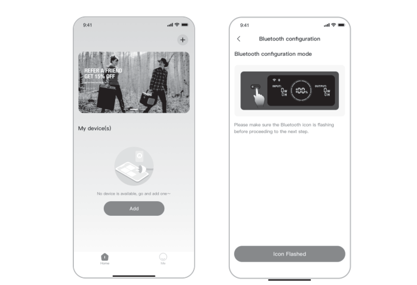
<figcaption class="hb-reference-caption-grid" data-caption-count="2" data-caption-layout="equal" style="--hb-caption-count:2">2.12.2</figcaption></figure>

<figure class="hb-reference-figure hb-has-composite-art" data-component-id="HB-SPECIAL-REFERENCE-FIGURE" data-reference-id="app-control" data-source-fragment-sha256="2f095ee25f22939dc34b0f12503962e175d0581d1ccbab29dfa5c4924de9cc67" data-step-captions="embedded" data-web-composite-asset-key="frozen-source/app-control" data-web-composite-locale="ko" data-web-composite-sha256="cf68d9db7a634c603a80a4cd644a3db67d2be2680d5650190d412b6053634d66" data-web-replace-key="reference.app-control">
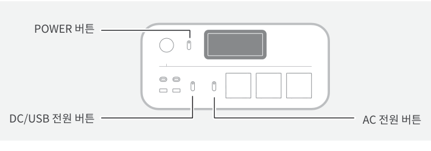

</figure>

2.3 검색된 장치 아이콘을 탭하면 App이 블루투스를 통해 자동으로 장치에 연결됩니다.

<table class="manual-callout-table manual-callout-table"><tbody><tr><td class="manual-callout-label">참고</td><td class="manual-callout-body">
바인딩 과정에서 "이 기기가 연결되었습니다" 메시지가 표시되면 다음 두 가지 방법으로 연결할 수 있습니다:

장치 소유자는 App을 통해 해당 장치를 다른 사용자와 공유할 수 있습니다.

POWER 버튼 + DC/USB 전원 버튼을 3초 동안 길게 눌러 장치의 Wi-Fi 및 블루투스를 재설정한 후 장치를 다시 바인딩하십시오.
</td></tr></tbody></table>

2.4 장치가 성공적으로 연결되면 Wi-Fi 비밀번호를 입력하고 OK 버튼을 탭하십시오.

<table class="manual-callout-table manual-callout-table"><tbody><tr><td class="manual-callout-label">참고</td><td class="manual-callout-body">
2.4GHz 대역의 Wi-Fi 네트워크를 선택하십시오. 이 장치는 5GHz 대역의 Wi-Fi 네트워크를 지원하지 않습니다.
</td></tr></tbody></table>

2.5 장치가 App에 성공적으로 추가되면, 장치의 Wi-Fi 아이콘이 항상 켜진 상태로 유지됩니다.

<figure class="hb-reference-figure hb-has-reference-captions" data-component-id="HB-SPECIAL-REFERENCE-FIGURE" data-reference-id="app-connect" data-source-fragment-sha256="09e432ff427817d36c715bec23d174ae4e72b1b4c3272dc7757a600ce64adbb2">
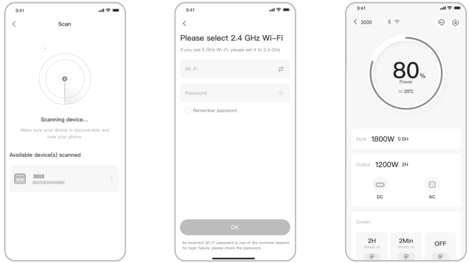
<figcaption class="hb-reference-caption-grid" data-caption-count="3" data-caption-layout="equal" style="--hb-caption-count:3">2.32.42.5</figcaption></figure>

위의 스크린샷은 참고용입니다.

<table class="manual-callout-table manual-callout-table"><tbody><tr><td class="manual-callout-label">주의</td><td class="manual-callout-body">
Jackery App은 한 번에 하나의 파워 스테이션에만 블루투스로 연결할 수 있습니다. 장치 목록으로 돌아가면 블루투스 연결이 자동으로 해제됩니다. 목록에서 파워 스테이션을 다시 탭하면 자동으로 재연결됩니다.
</td></tr></tbody></table>

## 3. 장치 바인딩 해제

장치의 메인 인터페이스 오른쪽 상단에 있는 Settings 아이콘을 눌러 설정 페이지로 이동한 후, 페이지 하단의 Unbind 버튼을 눌러 장치 바인딩을 해제하십시오.

## 4. 참고

4.1 Wi-Fi 및 블루투스 켜기

장치 전원이 켜지면 Wi-Fi 및 블루투스가 자동으로 켜지며, 화면의 Wi-Fi 및 블루투스 아이콘이 켜집니다.

화면의 Wi-Fi 및 블루투스 아이콘이 켜질 때까지 DC/USB 전원 버튼 + AC 전원 버튼을 동시에 길게 누르십시오.

4.2 Wi-Fi 및 블루투스 끄기

화면의 Wi-Fi 및 블루투스 아이콘이 꺼질 때까지 DC/USB 전원 버튼 + AC 전원 버튼을 동시에 길게 누르십시오.

4.3 Wi-Fi 및 블루투스 재설정

POWER 버튼 + DC/USB 전원 버튼을 동시에 3초 동안 길게 눌러 Wi-Fi 및 블루투스를 공장 설정으로 재설정하십시오. 연결된 App 계정이 해제됩니다.

