

## 1.主な仕様

<h2 class="hb-spec-group">【Jackery ポータブル電源 300 Plus】</h2>

<figure aria-label="【Jackery ポータブル電源 300 Plus】" class="hb-spec-table-composition"><table class="manual-table manual-spec-table hb-spec-table"><colgroup><col class="hb-spec-col-label"/><col class="hb-spec-col-value"/></colgroup><tbody><tr><th class="manual-spec-label hb-spec-label" scope="row">製品の名称 :</th><td class="manual-spec-value hb-spec-value">Jackery ポータブル電源 300 Plus</td></tr><tr><th class="manual-spec-label hb-spec-label" scope="row">型番 :</th><td class="manual-spec-value hb-spec-value">JE-300B</td></tr><tr><th class="manual-spec-label hb-spec-label" scope="row">バッテリータイプ :</th><td class="manual-spec-value hb-spec-value">LiFePO4（リン酸鉄リチウム）</td></tr><tr><th class="manual-spec-label hb-spec-label" scope="row">サイズ＆重量 :</th><td class="manual-spec-value hb-spec-value">約230x155x167mm (約3.75kg)</td></tr><tr><th class="manual-spec-label hb-spec-label" scope="row">定格容量 :</th><td class="manual-spec-value hb-spec-value">リチウムイオン電池22.5Ah/12.8V DC (288Wh)</td></tr><tr><th class="manual-spec-label hb-spec-label" scope="row">AC入力 :</th><td class="manual-spec-value hb-spec-value">100V-120V~ 50Hz/60Hz, 最大10A</td></tr><tr><th class="manual-spec-label hb-spec-label" scope="row">DC入力ポート(USB-C):</th><td class="manual-spec-value hb-spec-value">12-27V⎓5A Max, 100W Max</td></tr><tr><th class="manual-spec-label hb-spec-label" scope="row">総出力 :</th><td class="manual-spec-value hb-spec-value">300W</td></tr><tr><th class="manual-spec-label hb-spec-label" scope="row">AC出力 :</th><td class="manual-spec-value hb-spec-value">100V~ 50Hz/60Hz, 3A, 300W (瞬間最大600W)</td></tr><tr><th class="manual-spec-label hb-spec-label" scope="row">USB-A出力 :</th><td class="manual-spec-value hb-spec-value">5V⎓3A, 最大15W</td></tr><tr><th class="manual-spec-label hb-spec-label" scope="row">USB-C(OUT)出力 :</th><td class="manual-spec-value hb-spec-value">5V⎓3A, 最大15W</td></tr><tr><th class="manual-spec-label hb-spec-label" scope="row">USB-C(IN/OUT)出力 :</th><td class="manual-spec-value hb-spec-value">5V⎓3A, 9V⎓3A, 12V⎓3A, 15V⎓3A, 20V⎓5A, 最大100W</td></tr><tr><th class="manual-spec-label hb-spec-label" scope="row">USB総出力 :</th><td class="manual-spec-value hb-spec-value">USB-C(IN/OUT): 100W Max, USB-C(OUT)+USB-A: 24W Max</td></tr><tr><th class="manual-spec-label hb-spec-label" scope="row">シガーソケット出力 :</th><td class="manual-spec-value hb-spec-value">12V⎓10A</td></tr><tr><th class="manual-spec-label hb-spec-label" scope="row">充電温度 :</th><td class="manual-spec-value hb-spec-value">0~45 °C (32~113 °F)</td></tr><tr><th class="manual-spec-label hb-spec-label" scope="row">動作温度 :</th><td class="manual-spec-value hb-spec-value">-10~45 °C (14~113 °F)</td></tr><tr><th class="manual-spec-label hb-spec-label" rowspan="2" scope="row">保存温度 :</th><td class="manual-spec-value hb-spec-value">3ヶ月の場合: -20~45°C (4~113°F)</td></tr><tr><td class="manual-spec-value hb-spec-value">6ヶ月の場合: -10~25°C (14~77°F)</td></tr><tr><th class="manual-spec-label hb-spec-label" scope="row">認証：</th><td class="manual-spec-value hb-spec-value">UN38.3</td></tr></tbody></table></figure>

※USB Type-C® and USB-C® are registered trademarks of USB Implementers Forum.

<strong>■本機の仕様および外観は、改善のため予告なく変更することがあります。</strong>

<strong>充電式電池のリサイクルについて</strong>

本機はリサイクル可能な充電池を内蔵しています。

この商品を廃棄する場合は、当社のカスタマーサポートにご連絡ください。

充電池の取りはずしはお客様自身では行わないでください。

## 2.各部の名称

<figure class="hb-reference-figure" data-component-id="HB-SPECIAL-REFERENCE-FIGURE" data-reference-id="overview" data-source-fragment-sha256="dfa51d96c04ee1d92d7d510e04d222c4e099cd839b70a233f73b6bfdebe4949e" data-step-captions="embedded">
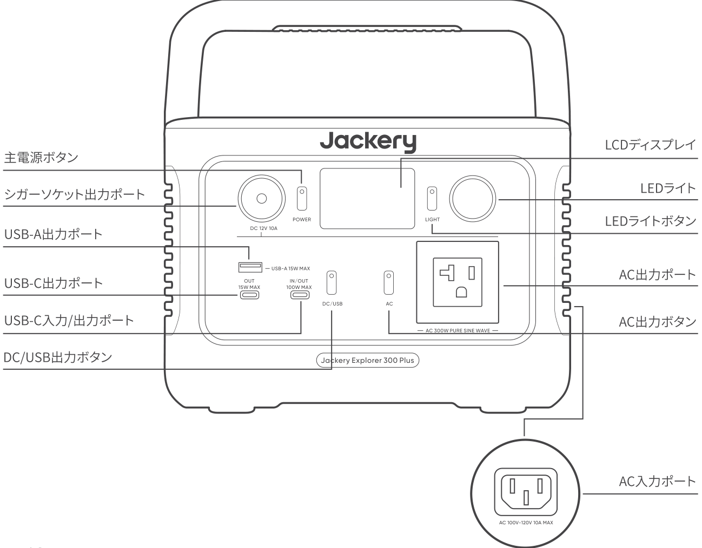
</figure>

## 3.使用について

### 出力オン/オフ

<strong>主電源オン/オフ:</strong>「主電源ボタン」を押すと、作動インジケータが点灯し、LCD ディスプレイの明かりがつきます。 本製品は 2 分間操作しない場合、休止状態に入り、ディスプレイが自動的にオフになります。主電源を切る必要がある場合は、作動インジケータが消灯するまで「主電源ボタン」を長押ししてください。この製品の初期設定の待機時間は2時間です。他の出力スイッチがオンになっておらず、製品に負荷入力がない場合、本製品は 2 時間後に自動的にシャットダウンします。 自動シャットダウン時間の長さは、Jackery アプリで設定できます。

<strong>AC出力のON/OFF:</strong>

AC出力ボタンを短く押すと、AC出力インジケーターが点灯し、AC電源が必要な機器に給電ができます。AC出力電源ボタンをもう一度短く押すと、AC出力がOFFになります。

<strong>USB/カーポート出力オン/オフ:</strong>

主電源がオンになっていることを確認します。DCボタンを押すと、DC出力作動インジケータが点灯します。この後、USB/カーポート出力ポートを外部負荷デバイスに接続できます。再度DC ボタンを押すと、USB/カーポート出力がオフになります。

<strong>LEDライトのON/OFF</strong>

LEDライトには、照明モード、SOSモードの二つのモードがあります。操作手順は次のとおりです: LEDライトボタンを短く押すと、LEDライトがオンになります。画面には1Wの出力電力が表示されます。もう一度押すと、SOSモードになり、画面に出力電力1Wが表示され、もう一度押すと、LEDライトがオフになります。

<strong>アプリの接続:</strong>

本製品は、Jackeryアプリの接続に対応し、アプリを使用した制御と操作を実現します。ユーザーは、App Storeまたは Google play からJackeryアプリをダウンロードできます。接続手順の詳細については、Jackery アプリのユーザー マニュアルをご参照ください。

## 4.液晶画面

<figure class="hb-reference-figure" data-component-id="HB-SPECIAL-REFERENCE-FIGURE" data-reference-id="lcd-map" data-source-fragment-sha256="885a3a9feb91ad8e5f5c99495ce3f116b0d3cfe2493f431c34e8198ebd55cd02" data-step-captions="embedded">
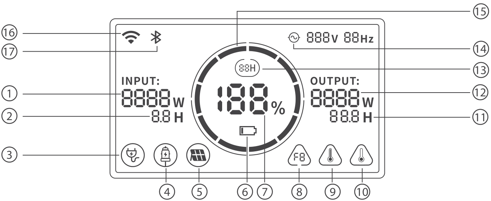
</figure>

<figure aria-label="4.液晶画面" class="hb-reference-composition hb-reference-lcd-descriptions" data-component-id="HB-TABLE-REFERENCE" data-component-variant="lcd-descriptions" tabindex="0"><table class="hb-reference-table"><tbody><tr><td>①</td><td>入力電力表示</td></tr><tr><td>②</td><td>充電残り時間</td></tr><tr><td>③</td><td>AC入力電力表示</td></tr><tr><td>④</td><td>シガーソケット入力電力表示</td></tr><tr><td>⑤</td><td>ソーラー(グリーンエネルギー)充電接続</td></tr><tr><td>⑥</td><td>バッテリー残量警告灯</td></tr><tr><td>⑦</td><td>バッテリーレベルパーセントタグ</td></tr><tr><td>⑧</td><td>エラーコード</td></tr><tr><td>⑨</td><td>高温インジケーター</td></tr><tr><td>⑩</td><td>低温インジケーター</td></tr><tr><td>⑪</td><td>バッテリー使用可能時間</td></tr><tr><td>⑫</td><td>消費電力パワー</td></tr><tr><td>⑬</td><td>省エネモード</td></tr><tr><td>⑭</td><td>交流電源による出力マーク</td></tr><tr><td>⑮</td><td>バッテリーアイコン</td></tr><tr><td>⑯</td><td>Wi-Fi</td></tr><tr><td>⑰</td><td>Bluetooth</td></tr></tbody></table></figure>

<strong>EPS：</strong>電気製品のコンセントをポータブル電源のAC出力ポートに接続し、ポータブル電源のAC入力ポートを家庭のコンセントにつなぐことで、停電時などにポータブル電源を予備電源として活用できます。電気系統の電気が突然切れた場合、本製品は20ms以内に自動的にバッテリー給電モードに切り替わります。この機能は非専門レベルのUPS機能であり、0msで切り替えることができないため、データサーバーまたはワークステーションのような無停止充電が必要な要求の高い設備に接続しないようにしてください。あるいは、複数回のテストを実施し、コンパチビリティを確認してから使用してください。ただし、複数の設備への同時接続によって過負荷保護になる可能性があるため、使用時に一台だけの設備に接続することをお勧めします。指示通りに操作しなかったことにより、設備が正常に作動できなかったり、データが消失した場合も当社は責任を負いかねます。

<figure aria-label="バッテリーアイコン" class="hb-lcd-table-composition" data-component-id="HB-TABLE-LCD-ICON" tabindex="0"><table class="hb-lcd-icon-table"><colgroup><col class="hb-lcd-col-icon"/><col class="hb-lcd-col-name"/><col class="hb-lcd-col-description"/></colgroup><tbody><tr><td class="hb-lcd-icon"></td><td class="hb-lcd-name">バッテリーアイコン</td><td class="hb-lcd-description">本製品の充電時、アイコンは時計回りに回転します。本製品の放電時、アイコンは現在の電力を表示します。</td></tr><tr><td class="hb-lcd-icon"></td><td class="hb-lcd-name">バッテリー残量警告灯</td><td class="hb-lcd-description">バッテリー残量が20%未満の場合は、ローバッテリーランプが表示されます。バッテリー残量が5%未満の場合は、ローバッテリーランプが点滅します。バッテリー充電中は、ランプは表示されません。</td></tr><tr><td class="hb-lcd-icon"></td><td class="hb-lcd-name">省エネモード</td><td class="hb-lcd-description">電池の消耗につながる出力の切り忘れを防ぐため、省エネモードを搭載しております。省エネモードONにすることで、出力のワット数が電力設定値以下の場合、12時間経つと本電源は自動的に出力をオフにします。</td></tr></tbody></table></figure>

<table class="manual-table"><tbody><tr><th>出力ポートタイプ</th><th>電力設定値</th><th>デフォルト設定</th></tr><tr><td>AC出力ポート</td><td>≤25W</td><td>12時間経つとすべての出力は自動的にオフになります</td></tr><tr><td>USB出力ポート</td><td>≤2W</td><td>12時間経つとすべての出力は自動的にオフになります</td></tr><tr><td>シガーソケット出力ポート</td><td>≤2W</td><td>12時間経つとすべての出力は自動的にオフになります</td></tr></tbody></table>

<table class="manual-table"><tbody><tr><th>省エネモード機能</th><th>省エネモードのアイコン</th><th>出力のワット数が電力設定値以下の場合</th><th>利用想定シーン</th></tr><tr><td>OFF</td><td>アイコン無表示</td><td>12時間経っても出力変更なし</td><td>消費電力が電力設定値以下のデバイスを利用する場合</td></tr><tr><td>ON</td><td>アイコン表示</td><td>12時間経つと出力自動OFF</td><td>上の欄以外の場合</td></tr></tbody></table>

<strong>省エネモードONとOFFを切り替える方法：</strong>

<strong>◆ON：</strong>任意出力ボタンONの状態で、省エネモードアイコンが点灯するまで、【AC出力ボタン+主電源ボタン】を長押しすれば、ONになります。

<strong>◆OFF：</strong>任意出力ボタンONの状態で、省エネモードアイコンが消えるまで、【AC出力ボタン+主電源ボタン】を長押しすれば、OFFになります。

<strong>50Hz/60Hz周波数の切り替え:</strong>

<strong>自動識別：</strong>お客様のお住まいの地域に応じて周波数を自動的に識別し、対応する出力に自動調整されます。

<strong>手動調整：</strong>AC出力ボタンを長押しすることで周波数を切り替えることができ、対応する周波数が画面に表示されます。なお、工場出荷時のデフォルト設定は60Hzに設定されています。

<figure aria-label="故障コード" class="hb-lcd-table-composition" data-component-id="HB-TABLE-LCD-ICON" tabindex="0"><table class="hb-lcd-icon-table"><colgroup><col class="hb-lcd-col-icon"/><col class="hb-lcd-col-name"/><col class="hb-lcd-col-description"/></colgroup><tbody><tr><td class="hb-lcd-icon"></td><td class="hb-lcd-name">故障コード</td><td class="hb-lcd-description">フィードバックに迅速に対応するため、システムに一般的な障害コード F0-FE を設定しています。F8コードが表示された場合は、給電を停止するか、充電プラグを抜いてください。本製品は自動的に回復します。回復しない場合は、アフターサービスにご連絡ください。F9障害コードが表示された場合は、給電を停止してください。製品は自然に回復します。そうならない場合は、カスタマーサービスにご連絡ください。その他のコードが表示された場合は、カスタマーサービスにご連絡ください。</td></tr><tr><td class="hb-lcd-icon"></td><td class="hb-lcd-name">高温警告</td><td class="hb-lcd-description">環境温度が高温時に表示されます。直射日光などが当たっている場合は移動してください。電池が冷めたら、自動的に表示がオフになります。</td></tr><tr><td class="hb-lcd-icon"></td><td class="hb-lcd-name">低温警告</td><td class="hb-lcd-description">環境温度が低い場合に表示されます。温度が通常になれば自動的に回復します。</td></tr></tbody></table></figure>

## 5.充電方法

グリーンエネルギー優先モード:本製品はグリーンエネルギー優先モードを搭載していますが、ソーラーパネルとACアダプターを使って同時に充電できます。同時に充電すると、ソーラーが優先されますが、バッテリーの最大許容電力で同時に充電されます。

<table class="manual-callout-table manual-callout-table"><tbody><tr><td class="manual-callout-label">ご注意</td><td class="manual-callout-body"><ul><li>はじめてお使いになるときは、本製品をフル充電してからご使用ください。</li><li>充電池は空の状態で長期保管(3カ月～6カ月）すると、性能が劣化したり、充電できなくなる場合があります。</li><li>本機を長期保管する場合には、３ヵ月に１度を目安に本体にACアダプターやソーラーパネルを通して蓄電が可能か、他製品に給電可能か、などの動作確認をお願い致します。</li><li>保管時の電池残量は60%～80%ほどを目安に保管することを推奨します。</li></ul></td></tr></tbody></table>

### AC充電ケーブル

付属のAC充電ケーブルをご使用ください。

<figure class="hb-reference-figure" data-component-id="HB-SPECIAL-REFERENCE-FIGURE" data-reference-id="charging-ac" data-source-fragment-sha256="38eab7141baab3b602b179ede7ddfa87405b0c6710c0e874efa8787e86e675fc" data-step-captions="embedded">
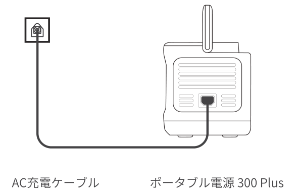
</figure>

### ソーラー充電

#### Jackery SolarSaga 40 Mini 接続説明

ソーラーパネル40Wの接続ケーブルのDC8020⇒ケーブル (DC8020-USB-C)⇒ポータブル電源 300 PlusのUSB-Cポートの順で接続ください。

<figure class="hb-reference-figure" data-component-id="HB-SPECIAL-REFERENCE-FIGURE" data-reference-id="charging-solar" data-source-fragment-sha256="d5492ae1466a0f65988983a4ecc78141f3b9132c19ae5423926904343220004f" data-step-captions="embedded">
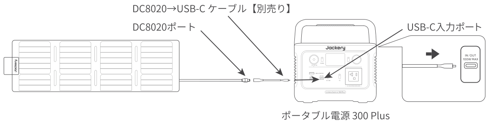
</figure>

### シガーソケット充電

本製品は12Vの車のシガーソケットに対応し、充電ができます。車のバッテリーが上がってしまわないように、エンジンを始動してから、シガーソケットを使用してください。使用の際は車の充電ポートと入力ケーブルのシガーライターの接触に問題がないことを確認し、シガーソケットの所定の場所に差し込めることを確認してください。道路状況が悪くて、車の振動が多い場合は、充電が接触不良になりますので、接触部分が焼損するのを防ぐために、シガーソケット充電を中止してください。本製品の誤った取り扱いによる損害が発生しましても当社は一切の責任を負いかねます。

<figure class="hb-reference-figure" data-component-id="HB-SPECIAL-REFERENCE-FIGURE" data-reference-id="charging-car" data-source-fragment-sha256="8eb9305ddeffae54813511c2988f17e4ae77328795c48c3a02bc7aec41dd00ea" data-step-captions="embedded">
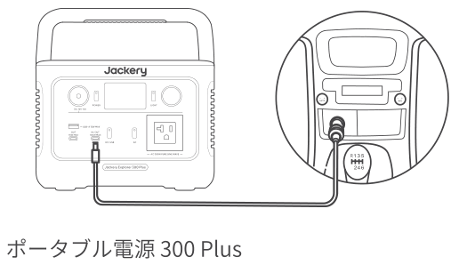
</figure>

#### 充電に関する安全上のご注意

1) シガーソケット充電は12Vの車専用であり、24Vの車では充電できません。人身傷害や物的損害を避けるため、本製品の充電に24Vを使用しないでください。

2) Jackery 製品以外の付属品を使用して充電しないでください。特に、ソーラーパネルで充電する際は、Jackeryのソーラーパネルを使用することをお勧めします。他社ソーラーパネルで充電することによる損失について、当社は一切の責任を負いません。

## 6.安全上のご注意

<strong>ご使用の前にこの「安全上のご注意」をよくお読みのうえ、正しくお使いください。</strong>

### 絵表示について

製品を安全に正しくお使いいただき、お客様や他の方々への危害や財産への損害を未然に防止するための表示です。

内容をよく理解してから本機をご使用ください。

<figure aria-label="絵表示について" class="hb-symbol-signal-composition" data-component-id="HB-TABLE-SYMBOL-SIGNAL"><table class="hb-symbol-signal-table"><colgroup><col class="hb-symbol-signal-col-label"/><col class="hb-symbol-signal-col-meaning"/></colgroup><thead><tr><th class="hb-symbol-signal-label-heading" scope="col">表示</th><th class="hb-symbol-signal-meaning-heading" scope="col">意味</th></tr></thead><tbody><tr><td class="hb-symbol-signal-label-cell">⚠警告</td><td class="hb-symbol-signal-meaning-cell">この表示を無視して、誤った取り扱いをすると、人が死亡または重傷を負う可能性が想定される内容を示しています。</td></tr><tr><td class="hb-symbol-signal-label-cell">⚠注意</td><td class="hb-symbol-signal-meaning-cell">この表示を無視して、誤った取り扱いをすると、人が傷害を負う可能性が想定される内容または物的損害の発生が想定される内容を示しています。</td></tr></tbody></table></figure>

### 絵表示の説明

<figure aria-label="絵表示の説明" class="hb-symbol-pair-composition" data-component-id="HB-TABLE-SYMBOL-ICON">

<table class="hb-symbol-panel-table"><colgroup><col class="hb-symbol-col-icon"/><col class="hb-symbol-col-meaning"/></colgroup><thead><tr><th class="hb-symbol-icon-heading" scope="col">記号</th><th class="hb-symbol-meaning-heading" scope="col">意味</th></tr></thead><tbody><tr><td class="hb-symbol-icon"></td><td class="hb-symbol-meaning">コンセントから電源プラグを抜く記号</td></tr><tr><td class="hb-symbol-icon"></td><td class="hb-symbol-meaning">製品を分解、改造を禁止する記号</td></tr><tr><td class="hb-symbol-icon"></td><td class="hb-symbol-meaning">製品に濡れた手で触れることを禁止する記号</td></tr></tbody></table>

<table class="hb-symbol-panel-table"><colgroup><col class="hb-symbol-col-icon"/><col class="hb-symbol-col-meaning"/></colgroup><thead><tr><th class="hb-symbol-icon-heading" scope="col">記号</th><th class="hb-symbol-meaning-heading" scope="col">意味</th></tr></thead><tbody><tr><td class="hb-symbol-icon"></td><td class="hb-symbol-meaning">行為を指示する記号</td></tr><tr><td class="hb-symbol-icon"></td><td class="hb-symbol-meaning">製品を濡らすことを禁止する記号</td></tr><tr><td class="hb-symbol-icon"></td><td class="hb-symbol-meaning">行為を禁止する記号</td></tr></tbody></table>

</figure>

<table class="manual-callout-table manual-callout-table"><tbody><tr><td class="manual-callout-label">警告</td><td class="manual-callout-body">
<strong>万が一、次のような異常が発生したときはすぐに使用をやめる</strong>
<ul><li>煙が出ている、異臭がする</li><li>落としたり、破損したとき</li><li>異音がする</li><li>内部に水や異物が入ったとき</li><li>電源コード (ACアダプター) が傷んだとき</li></ul>
このような異常が発生したまま使用していると、火災や感電の原因になります。

すぐにACアダプターをコンセントから抜いてください。また、本製品に接続されている機器もすべて外してください。

<strong>万が一発煙や発火したら、大量の水で消火して煙が見えなくなるまで本製品を水浸しにしてください。</strong>

煙が出なくなることを確認してからカスタマーサポートにご連絡ください。

お客様による修理は危険ですので絶対におやめください。
</td></tr></tbody></table>

<table class="manual-callout-table manual-callout-table"><tbody><tr><td class="manual-callout-label">警告</td><td class="manual-callout-body">
<strong>分解、改造しない</strong>

故障、発熱、火災･感電の原因になります。
</td></tr></tbody></table>

<table class="manual-callout-table manual-callout-table"><tbody><tr><td class="manual-callout-label">警告</td><td class="manual-callout-body">
<strong>表示された電源電圧以外で使用しない</strong>

故障、発熱、火災･感電の原因になります。また、本製品を使用できるのは日本国内のみです。
</td></tr></tbody></table>

<table class="manual-callout-table manual-callout-table"><tbody><tr><td class="manual-callout-label">警告</td><td class="manual-callout-body">
<strong>付属品と本製品が破損した場合は、ご自身で修理をしない</strong>
</td></tr></tbody></table>

<table class="manual-callout-table manual-callout-table"><tbody><tr><td class="manual-callout-label">警告</td><td class="manual-callout-body">
<strong>火のそばや炎天下の車内、熱器具の周辺など高温（40°C以上）になる場所で使用したり、放置しない</strong>

発熱や発火、破裂する原因になります。
</td></tr></tbody></table>

<table class="manual-callout-table manual-callout-table"><tbody><tr><td class="manual-callout-label">警告</td><td class="manual-callout-body">
<strong>強い衝撃を与えたり、投げつけたりしない</strong>

発熱や発火、破裂する原因になります。
</td></tr></tbody></table>

<table class="manual-callout-table manual-callout-table"><tbody><tr><td class="manual-callout-label">警告</td><td class="manual-callout-body">
<strong>水など、液体を入れたり、濡らしたりしない</strong>

発熱や発火の原因になります。
</td></tr></tbody></table>

<table class="manual-callout-table manual-callout-table"><tbody><tr><td class="manual-callout-label">警告</td><td class="manual-callout-body">
<strong>濡れた手で本体や接続するケーブルを触らない</strong>

火災や感電の原因になります。
</td></tr></tbody></table>

<table class="manual-callout-table manual-callout-table"><tbody><tr><td class="manual-callout-label">警告</td><td class="manual-callout-body">
<strong>端子部にケーブル以外の金属類を差し込まない</strong>

発熱や発火の原因になります。
</td></tr></tbody></table>

<table class="manual-callout-table manual-callout-table"><tbody><tr><td class="manual-callout-label">警告</td><td class="manual-callout-body">
<strong>雷が鳴りだしたら、電源プラグにふれない (充電をしない)</strong>

感電の原因になります。
</td></tr></tbody></table>

<table class="manual-callout-table manual-callout-table"><tbody><tr><td class="manual-callout-label">警告</td><td class="manual-callout-body">
<strong>各接続端子には確実に差し込む</strong>

差し込みが不十分だと、発熱したりほこりが付着して火災や感電の原因になります。
</td></tr></tbody></table>

<table class="manual-callout-table manual-callout-table"><tbody><tr><td class="manual-callout-label">注意</td><td class="manual-callout-body">
<strong>本製品の上に物を載せたり、不安定な場所に置かない</strong>

倒れたり、落ちたりしてけがの原因になります。
</td></tr></tbody></table>

<table class="manual-callout-table manual-callout-table"><tbody><tr><td class="manual-callout-label">注意</td><td class="manual-callout-body">
<strong>次のような機器では、絶対に使用しないでください。万が一使用中に給電ができなくなった場合、命にかかわる被害が想定されます。</strong>
<ul><li>医療機器や使用上、生命に関わるような機器</li><li>社会的、公共的に重要な機器など</li><li>重要な事業用機器など</li></ul></td></tr></tbody></table>

<table class="manual-callout-table manual-callout-table"><tbody><tr><td class="manual-callout-label">注意</td><td class="manual-callout-body">
<strong>心臓にペースメーカーを装着している方は使用しない</strong>

ペースメーカーが、本製品の影響を受ける恐れがあります。
</td></tr></tbody></table>

## 7.使用上のご注意

Jackeryポータブル電源 300 Plusは、最大電力300Wまでの機器に給電可能です。最大出力300Wは、一定の電力で動く機器への出力可能範囲を指しています。300Wの出力を超えた場合は、電気回路が自動的に調整され、電力が低減、または保護機能が作動し自動で遮断することがあります。始動電力が300Wの出力上限値を超える場合、ご利用できませんのでご了承ください。

ご注意：

<ul><li>電気モーターを搭載している製品については、例(掃除機、ポンプ、冷蔵庫、電動丸ノコ、エアコン、洗濯機、電子レンジ、ドライヤーなど)起動時に「誘導負荷」が発生し、公称電力の3～7倍の電力が必要となります。</li><li>始動電力が出力上限値(定格出力)を大幅に超える可能性のある製品のご利用や、定格出力を超え給電がストップした製品を繰り返し利用することはポータブル電源が損傷するリスクがありますのでお控えください。</li><li>本製品は防塵･防水仕様ではありませんので、ほこりや水、海水などがかからないように注意してください。</li><li>ほこりが多い場所や高温多湿の場所での充電および使用、放置をしないでください。</li><li>本製品を不安定な場所に置かないでください。必ず、平坦で安定した場所に置いて使用してください。</li><li>本製品の通風孔は、安全上絶対にふさがないでください。また、本製品の各面から5cm以上スペースを空けてください。</li><li>充電または給電中は本製品が温かくなります(故障ではありません)、周囲には物を置かないでください。</li><li>本製品接続機器のケーブルを差すときは、真っすぐな向きに差してください。</li><li>接続機器のケーブルを抜くときは、必ずプラグ部分を持って抜いてください。ケーブルを引っ張ったり折り曲げると、断線などの原因となります。</li><li>給電する機器の充電制御や充電状況、環境などにより給電できない、または急速充電にならない場合があります。</li><li>充電または給電中はラジオやチューナー、テレビなどに雑音が入る場合があります。雑音が入る場合には、それらの製品から離れた場所でお使いください。</li><li>本体が汚れたらコンセントから電源プラグを抜き、柔らかい布で乾拭きしてください。汚れがひどいときは、水または薄めた中性洗剤でふきとってください。シンナーやベンジンなどは絶対に使わないでください。</li><li>付属のACアダプターは、電源コードの抜き差しで電源が入ったり切れたりするため、異常時に電源コードを容易に抜き差しできるスペースを空けておいてください。</li><li>入出力の電力(W) 接続機器の入力仕様が本製品の出力値の上限を超えている場合、電源を自動的に遮断します。消費電力が仕様以下であることを確認してから出力ボタンを押してください。</li><li>低/高温警報 本製品は、-10 ~ 45°C (14 ~ 113°F)の温度範囲でお使いの機器に電力を供給できます。 動作温度が上記範囲外にある場合、本製品が動作しないことがあります。 この製品は、0 ~ 45°C (32 ~113°F) の温度範囲内で充電してください。 充電温度が上記範囲を超えると、正常に充電できない場合があります。 過低温および過高温の表示があれば保護装置が動作し充電又は出力が停止します。 復旧は本機が規定温度になれば自然復旧します。</li><li>容量表示に関しては、あくまで参考値となり、電圧により電力が算出され、表示数値にズレが発生することがあります。</li><li>保存温度：-10~25°C (14~77°F)で6ヶ月；-20~45°C (-4~113°F)で3ヶ月 ご確認：-10~25°C (14~77°F)で長期保管する場合、6ヶ月に１度を目安に、 -20~45°C (-4~113°F) で長期保管をする場合、3ヵ月に１度を目安に、本体にACアダプターやソーラーパネルを通して蓄電が可能か、他製品に給電可能かなど動作確認をお願い致します。また長期保管の場合、電池残量は60-80%程度で保管を行ってください。</li></ul>

## 8.同梱品

<figure aria-label="8.同梱品" class="hb-inbox-composition" data-card-count="4" data-component-id="HB-SPECIAL-INBOX" data-inbox-variant="responsive-card-grid"><ol class="hb-inbox-grid"><li class="hb-inbox-card" data-item-number="1">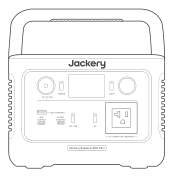

① 本体

</li><li class="hb-inbox-card" data-item-number="2">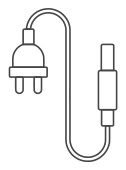

② AC充電ケーブル

</li><li class="hb-inbox-card" data-item-number="3">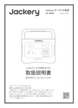

③ 取扱説明書

</li><li class="hb-inbox-card" data-item-number="4">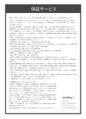

④ 保証案内書

</li></ol></figure>

※付属品を故障、紛失等してしまった場合はカスタマーサポートまでご連絡ください。

## 9.免責事項

<ul><li>火災、地震、第三者による行為、その他の事故、お客様の故意または過失 誤用・誤動作・その他の異常な条件下での使用により生じた損害に関して、当社は一切責任を負いません。</li><li>付属品と本製品が破損した場合は、ご自身で修理を行わないでください。 ご自身で分解・修理したことにより生じた損害に関し、当社は一切責任を負いません。</li><li>保証範囲は利用規約に適用され、記載されていない内容は当社の保証範囲外となります。</li><li>取扱説明書の記載事項が遵守されないことにより生じた不適合について当社は責任を負いかねます。</li><li>本製品の使用、または使用不能から発生する付随的な損害(事業利益損失含む)、当社が関与しない接続機器との組み合わせによる誤動作などから生じた損害に関して、当社は一切の責任を負いません。</li><li>本製品は個人の安全に関係する製品、消費電力の大きな設備に給電できません。例えば、医療機器、核施設設備、CPAP（シーパップ） 、スペースシャトルの製造などです。 上記の設備、用途で使用した結果、火災、機器故障など個人の安全を脅かす事故が生じた場合、当社は一切責任を負いません。</li></ul>

## Jackeryアプリ ユーザーマニュアル

<figure aria-label="App Store / Google Play" class="hb-app-download-composition hb-app-download-qr-only" data-component-id="HB-SPECIAL-APP">
本製品はJackeryアプリケーションによるスマートコントロールに対応しています。ご利用いただくには、下記のアプリストアより「Jackery」で検索して「Jackery APP」をダウンロードしてください。
</figure>

### 1. アプリをダウンロードしてログインするには

Google  PlayまたはApp  Storeで「Jackery」と検索し、アプリをインストールしてください。その後、登録とログインを行ってください。

### 2. デバイスを追加するには

2.1  APPの右上にあるデバイス追加ボタン + をクリックします。

2.2　デバイスの主電源ボタンを長押しして電源をいれると、ディスプレー画面にWi-FiとBluetoothのアイコンが点滅し、デバイスがネットワーク設定モードに入ったことを示します。アイコン点滅中ボタンをクリックし、アプリが近くのデバイスに接続し、Bluetoothのアクセス許可を開くことを許可します。

<figure class="hb-reference-figure" data-component-id="HB-SPECIAL-REFERENCE-FIGURE" data-reference-id="app-add" data-source-fragment-sha256="d52ed550e1fcee9469613447126f2ee15b2f535ba307cf7a34291bf20ef0090c" data-step-captions="embedded">
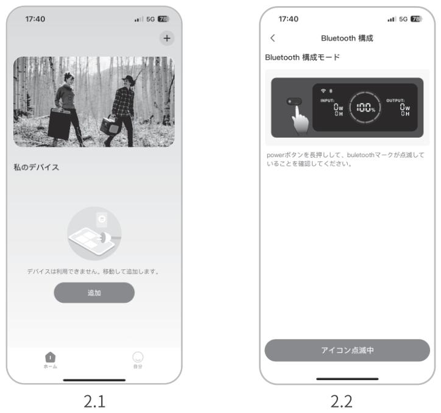
</figure>

<table class="manual-callout-table manual-callout-table"><tbody><tr><td class="manual-callout-label">備考</td><td class="manual-callout-body">
電源を入れた後、アプリが5分以内接続されていないと、デバイスは自動的にWi-FiとBluetoothをオフにします。再度Wi-FiとBluetoothをオンにするには、「DC/USBボタン」と「ACボタン」を同時長押しする必要があります。
</td></tr></tbody></table>

<figure class="hb-reference-figure" data-component-id="HB-SPECIAL-REFERENCE-FIGURE" data-reference-id="app-control" data-source-fragment-sha256="11b376fe62a32ed098dc4cb95d6c2853f91cad354dcccad4caf0b0092a05f2fc" data-step-captions="embedded">
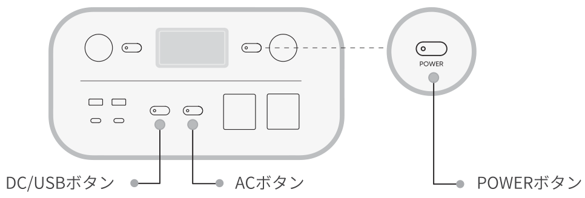
</figure>

2.3 検出されたデバイスアイコンをクリックすると、アプリは自動的にBluetoothでデバイスを接続します。

<table class="manual-callout-table manual-callout-table"><tbody><tr><td class="manual-callout-label">備考</td><td class="manual-callout-body">
バインド処理中に「デバイスがバインドされました」と表示された場合は、以下の2つの方法で接続できます：
<ul><li>デバイス所有者は、アプリを通じてこのデバイスを他のユーザーと共有します。詳細は、「機器共有」をご参照ください。</li><li>「POWERボタン」と「DC/USBボタン」を3秒間長押ししてデバイスをリセットし、再度バインドしてくだい。</li></ul></td></tr></tbody></table>

2.4  デバイスが正常に接続されると、デバイスが接続するWi-Fiの名前とパスワードを入力する必要があり、デバイスは自動的にWi-Fiネットワークに接続します。

<table class="manual-callout-table manual-callout-table"><tbody><tr><td class="manual-callout-label">備考</td><td class="manual-callout-body">
2.4GHz帯のWi-Fiネットワークを選択してください。デバイスは、5GHz帯のWi-Fiネットワークには対応していません。
</td></tr></tbody></table>

2.5 デバイスのホーム画面でデバイスが正常に追加されると、デバイスのWi-Fi アイコンは常にオンになります。

<figure class="hb-reference-figure" data-component-id="HB-SPECIAL-REFERENCE-FIGURE" data-reference-id="app-results" data-source-fragment-sha256="7a94d63755f1263990418284eb8a7bd3e35c764e9612d1cdd7cfe5b430fc4487" data-step-captions="embedded">
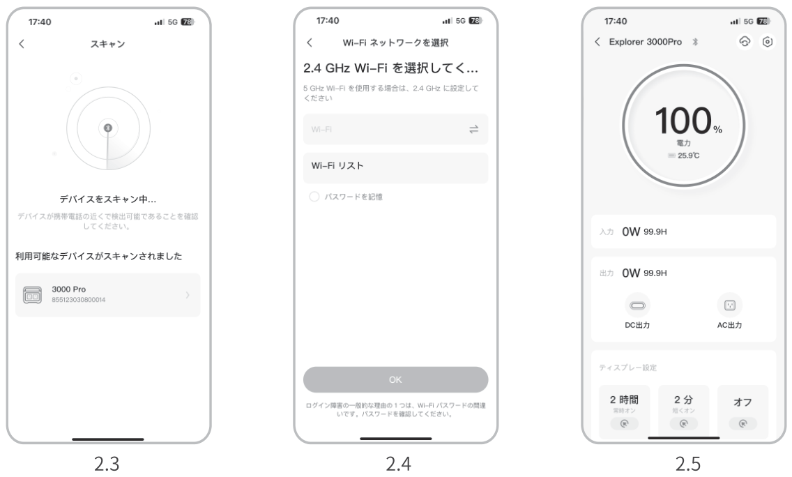
</figure>

上記のスクリーンショットはご参考まで。

### 3. デバイスのバインドを解除するには

デバイスのメインインターフェースの右上隅にある「設定」ボタンをクリックして設定ページに入り、ページの下部にある「バインド解除」ボタンをクリックしてデバイスのバインドを解除します。

### 4. ご確認

4.1 Wi-FiとBluetoothをオンにするには（ディスプレーにWi-FiとBluetoothのアイコンが点灯）：

<ul><li>デバイスがオンになれば自動的にオンになり、ディスプレーにWi-FiとBluetoothのアイコンが点灯します。</li><li>上記アイコンが点灯しない場合、ディスプレーにWi-FiとBluetoothのアイコンが点灯するまで、DC/USB出力ボタンとAC出力ボタンを同時長押しします。</li></ul>

4.2 Wi-FiとBluetoothをオフにするには（ディスプレーにWi-FiとBluetoothのアイコンが消える）：

<ul><li>ディスプレーにWi-FiとBluetoothのアイコンが消えるまで、DC/USB出力ボタンとAC出力ボタンを同時長押しします。</li><li>5分以内にデバイスが接続されない場合、Wi-FiとBluetooth は自動的にオフになります。</li></ul>

4.3 Wi-FiとBluetoothをリセットするには：

<ul><li>主電源ボタンとDC/USBボタンを同時に3秒間押すと、Wi-FiとBluetoothが初期化され、システムが再起動します。接続されているアプリアカウントはバインド解除されます。</li></ul>
