

## 安全上のご注意

<strong>ご使用の前にこの「安全上のご注意」をよくお読みのうえ、正しくお使いください。</strong>

### 絵表示について

製品を安全に正しくお使いいただき、お客様や他の方々への危害や財産への損害を未然に防止するための表示です。 内容をよく理解してから本文をお読みください。

<figure aria-label="絵表示について" class="hb-symbol-signal-composition" data-component-id="HB-TABLE-SYMBOL-SIGNAL"><table class="hb-symbol-signal-table"><colgroup><col class="hb-symbol-signal-col-label"/><col class="hb-symbol-signal-col-meaning"/></colgroup><thead><tr><th class="hb-symbol-signal-label-heading" scope="col">表示</th><th class="hb-symbol-signal-meaning-heading" scope="col">意味</th></tr></thead><tbody><tr><td class="hb-symbol-signal-label-cell">⚠警告</td><td class="hb-symbol-signal-meaning-cell">この表示を無視して、誤った取り扱いをすると、人が死亡または重傷を負う可能性が想定される内容を示しています。</td></tr><tr><td class="hb-symbol-signal-label-cell">⚠ご注意</td><td class="hb-symbol-signal-meaning-cell">この表示を無視して、誤った取り扱いをすると、人が傷害を負う可能性が想定される内容または物的損害の発生が想定される内容を示しています。</td></tr><tr><td class="hb-symbol-signal-label-cell">⚠説明</td><td class="hb-symbol-signal-meaning-cell">この表示を無視して誤った取り扱いをすると、機器の損傷、データの消失、性能の低下、または予期しない動作が発生する可能性があることを示しています。</td></tr><tr><td class="hb-symbol-signal-label-cell">⚠ヒント</td><td class="hb-symbol-signal-meaning-cell">文章内の重要な情報や操作のヒントを補足する内容を示しています。</td></tr></tbody></table></figure>

### 絵表示の説明

<figure aria-label="絵表示の説明" class="hb-symbol-pair-composition" data-component-id="HB-TABLE-SYMBOL-ICON">

<table class="hb-symbol-panel-table"><colgroup><col class="hb-symbol-col-icon"/><col class="hb-symbol-col-meaning"/></colgroup><thead><tr><th class="hb-symbol-icon-heading" scope="col">記号</th><th class="hb-symbol-meaning-heading" scope="col">意味</th></tr></thead><tbody><tr><td class="hb-symbol-icon"></td><td class="hb-symbol-meaning">潜在的な危険やリスクについて注意喚起するために、必ずお読みください。</td></tr><tr><td class="hb-symbol-icon"></td><td class="hb-symbol-meaning">操作の前に取扱説明書をお読みください。</td></tr><tr><td class="hb-symbol-icon"></td><td class="hb-symbol-meaning">本製品を火気の近くに置かないでください。</td></tr><tr><td class="hb-symbol-icon"></td><td class="hb-symbol-meaning">小さなお子様の手の届かない場所に保管してください。</td></tr><tr><td class="hb-symbol-icon"></td><td class="hb-symbol-meaning">コンセントから電源プラグを抜く記号</td></tr><tr><td class="hb-symbol-icon"></td><td class="hb-symbol-meaning">製品を分解、改造を禁止する記号</td></tr><tr><td class="hb-symbol-icon"></td><td class="hb-symbol-meaning">製品に濡れた手で触れることを禁止する記号</td></tr><tr><td class="hb-symbol-icon"></td><td class="hb-symbol-meaning">行為を指示する記号</td></tr></tbody></table>

<table class="hb-symbol-panel-table"><colgroup><col class="hb-symbol-col-icon"/><col class="hb-symbol-col-meaning"/></colgroup><thead><tr><th class="hb-symbol-icon-heading" scope="col">記号</th><th class="hb-symbol-meaning-heading" scope="col">意味</th></tr></thead><tbody><tr><td class="hb-symbol-icon"></td><td class="hb-symbol-meaning">充電式電池のリサイクルについて 本機はリサイクル可能な充電池を内蔵しています。 この商品を廃棄する場合は、当社のカスタマーサポートにご連絡ください。 充電池の取りはずしはお客様自身では行わないでください。</td></tr><tr><td class="hb-symbol-icon">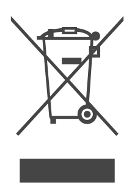</td><td class="hb-symbol-meaning">このシンボルは、本製品を一般家庭ごみとして廃棄せず、リサイクルのために指定の回収施設に持ち込む必要があることを示しています。 適切な廃棄およびリサイクルは、環境保護に役立ちます。 本製品の廃棄やリサイクルについての詳細は、お住まいの自治体、廃棄物処理業者、または販売店にお問い合わせください。</td></tr><tr><td class="hb-symbol-icon"></td><td class="hb-symbol-meaning">製品を濡らすことを禁止する記号</td></tr><tr><td class="hb-symbol-icon"></td><td class="hb-symbol-meaning">行為を禁止する記号</td></tr></tbody></table>

</figure>

<table class="manual-callout-table manual-callout-table"><tbody><tr><td class="manual-callout-label">警告</td><td class="manual-callout-body">
<strong>火のそばや炎天下の車内、熱器具の周辺など高温（45°C以上）になる場所で使用したり、放置しない</strong>

発熱や発火、破裂する原因になります。
</td></tr></tbody></table>

<table class="manual-callout-table manual-callout-table"><tbody><tr><td class="manual-callout-label">警告</td><td class="manual-callout-body">
<strong>強い衝撃を与えたり、投げつけたりしない</strong>

発熱や発火、破裂する原因になります。
</td></tr></tbody></table>

<table class="manual-callout-table manual-callout-table"><tbody><tr><td class="manual-callout-label">警告</td><td class="manual-callout-body">
<strong>各接続端子には確実に差し込む</strong>

差し込みが不十分だと、発熱したりほこりが付着して火災や感電の原因になります。
</td></tr></tbody></table>

<table class="manual-callout-table manual-callout-table"><tbody><tr><td class="manual-callout-label">警告</td><td class="manual-callout-body">
<strong>端子部にケーブル以外の金属類を差し込まない</strong>

発熱や発火の原因になります。
</td></tr></tbody></table>

<table class="manual-callout-table manual-callout-table"><tbody><tr><td class="manual-callout-label">警告</td><td class="manual-callout-body">
<strong>雷が鳴りだしたら、電源プラグにふれない (充電をしない)</strong>

感電の原因になります。
</td></tr></tbody></table>

<table class="manual-callout-table manual-callout-table"><tbody><tr><td class="manual-callout-label">警告</td><td class="manual-callout-body">
<strong>水など、液体を入れたり、濡らしたりしない</strong>

発熱や発火の原因になります。
</td></tr></tbody></table>

<table class="manual-callout-table manual-callout-table"><tbody><tr><td class="manual-callout-label">警告</td><td class="manual-callout-body">
<strong>濡れた手で本体や接続するケーブルを触らない</strong>

火災や感電の原因になります。
</td></tr></tbody></table>

<table class="manual-callout-table manual-callout-table"><tbody><tr><td class="manual-callout-label">警告</td><td class="manual-callout-body">
万が一、次のような異常が発生したときはすぐに使用をやめる
<ul><li>煙が出ている、異臭がする</li><li>落としたり、破損したとき</li><li>異音がする</li><li>内部に水や異物が入ったとき</li><li>電源コードが傷んだとき</li></ul>
このような異常が発生したまま使用していると、火災や感電の原因になります。 すぐにアダプターをコンセントから抜いてください。また、本製品に接続されている機器もすべて外してください。

<strong>万が一発煙や発火したら、大量の水で消火して煙が見えなくなるまで本製品を水浸しにしてください。</strong>

煙が出なくなることを確認してからカスタマーサポートにご連絡ください。 お客様による修理は危険ですので絶対におやめください。
</td></tr></tbody></table>

<table class="manual-callout-table manual-callout-table"><tbody><tr><td class="manual-callout-label">警告</td><td class="manual-callout-body">
<strong>分解、改造しない</strong>

故障、発熱、火災·感電の原因になります。
</td></tr></tbody></table>

<table class="manual-callout-table manual-callout-table"><tbody><tr><td class="manual-callout-label">警告</td><td class="manual-callout-body">
<strong>表示された電源電圧以外で使用しない</strong>

故障、発熱、火災·感電の原因になります。また、本製品を使用できるのは日本国内のみです。
</td></tr></tbody></table>

<table class="manual-callout-table manual-callout-table"><tbody><tr><td class="manual-callout-label">警告</td><td class="manual-callout-body">
<strong>付属品と本製品が破損した場合は、ご自身で修理をしない</strong>
</td></tr></tbody></table>

<table class="manual-callout-table manual-callout-table"><tbody><tr><td class="manual-callout-label">注意</td><td class="manual-callout-body">
<strong>本製品の上に物を載せたり、不安定な場所に置かない</strong>

倒れたり、落ちたりしてけがの原因になります。
</td></tr></tbody></table>

<table class="manual-callout-table manual-callout-table"><tbody><tr><td class="manual-callout-label">注意</td><td class="manual-callout-body">
<strong>データサーバや医療機器など、非常時に不具合が起こると人命 / 財産に重大な危険を及ぼしうる用途でのご使用はお控えください。次のようなような機器では、万が一使用中に給電ができなくなった場合、人命 / 財産にかかわる被害が想定されます。</strong>
<ul><li>医療機器や使用上、生命に関わるような機器</li><li>社会的、公共的に重要な機器など</li><li>重要な事業用機器など</li></ul></td></tr></tbody></table>

<table class="manual-callout-table manual-callout-table"><tbody><tr><td class="manual-callout-label">注意</td><td class="manual-callout-body">
<strong>心臓にペースメーカーを装着している方は使用しない</strong>

ペースメーカーが、本製品の影響を受ける恐れがあります。
</td></tr></tbody></table>

## 使用上のご注意

### 給電に関する注意事項

出力上限値を超える電化製品は使用しないでください。

<ul><li>特に、始動電力が公称電力の 3~7 倍になる誘導負荷（ポンプ、ヒーター、掃除機、冷蔵庫、エアコン、電気丸ノコなどの電動道具、洗濯機、電子レンジなど）の使用にはご注意ください。</li><li>接続機器の消費電力が本製品の出力範囲内であることをご確認の上、出力ボタンを押してください。</li><li>給電中、機器の制御や環境により、急速充電にならない・給電できない場合があります。</li><li>充電または給電中、ラジオ・チューナー・テレビなどに雑音が入る場合があります。その際は、それらの機器から離してご使用ください。</li></ul>

### 使用環境について

<ul><li>本製品は防塵・防水仕様ではありません。ほこり、水、海水などがかからないようご注意ください。</li><li>ほこりの多い場所や高温多湿の場所での充電・使用・放置は避けてください。</li><li>平坦で安定した場所に設置し、不安定な場所に置かないでください。</li><li>本製品の通風孔は、安全上絶対にふさがないでください。各面から 5cm 以上スペースを確保してください。</li><li>充電・給電中は本体が温かくなります。周囲に物を置かないでください。</li></ul>

### 接続時の注意事項

<ul><li>ケーブルを接続する際は、まっすぐに差し込んでください。</li><li>抜く際は必ずプラグ部分を持って抜いてください。ケーブルを引っ張ったり折り曲げたりしないでください。</li></ul>

### お手入れについて

<ul><li>本体が汚れた場合は、電源プラグを抜いた状態で、柔らかい布で乾拭きしてください。</li><li>汚れがひどい場合は、水または薄めた中性洗剤で拭き取ってください。</li><li>シンナーやベンジンなどの使用は絶対に使わないでください。</li></ul>

### 入出力・温度・表示に関するご注意

<ul><li>
接続機器の入力が本製品の出力上限を超えている場合、自動で電源が遮断されます。
</li><li>
本機は -15°C~45°C の温度範囲でお使いの機器に電力供給が可能となり、本機の蓄電は 0°C~45°C で行えます。

動作温度が上記範囲外にある場合、本製品が温度異常マークが表示され、動作しない可能性があります。

温度異常マークが表示された場合は、本製品を 2 時間以上、動作温度範囲内の環境に置いてください。
</li><li>
容量表示は参考値であり、電圧により表示数値と実際の容量に差異が出る場合があります。
</li></ul>

## 免責事項

<ul><li>火災、地震、第三者による行為、その他の事故、お客様の故意または過失誤用・誤動作・その他の異常な条件下での使用により生じた損害に関して、当社は一切責任を負いません。</li><li>付属品と本製品が破損した場合は、ご自身で修理を行わないでください。ご自身で分解・修理したことにより生じた損害に関し、当社は一切責任を負いません。</li><li>保証範囲は利用規約に適用され、記載されていない内容は当社の保証範囲外となります。</li><li>取扱説明書の記載事項が遵守されないことにより生じた不適合について当社は責任を負いかねます。</li><li>本製品の使用、または使用不能から発生する付随的な損害 ( 事業利益損失含む )、当社が関与しない接続機器との組み合わせによる誤動作などから生じた損害に関して、当社は一切の責任を負いません。</li></ul>

## 同梱品

<figure aria-label="同梱品" class="hb-inbox-composition" data-card-count="3" data-component-id="HB-SPECIAL-INBOX" data-inbox-variant="three-card-responsive"><ol class="hb-inbox-grid"><li class="hb-inbox-card" data-item-number="1">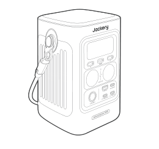

本体

</li><li class="hb-inbox-card" data-item-number="2">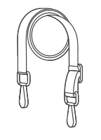

ショルダーベルト

</li><li class="hb-inbox-card" data-item-number="3">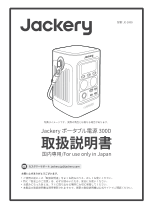

取扱説明書

</li></ol></figure>

※ 付属品を故障、紛失等してしまった場合はカスタマーサポートまでご連絡ください。 ※ 本充電ケーブルユニットは、同梱されている電気機器以外には使用しないでください。 ※ シガーソケット充電ケーブルは別売りです。Jackery公式サイトよりご購入いただけます。 サポートが必要な場合は、Jackeryカスタマーサポートまでお問い合わせください。

<strong>■本機の仕様および外観は、改善のため予告なく変更することがあります。</strong>

## 各部の名称

### 製品の外観

<figure class="hb-reference-figure" data-component-id="HB-SPECIAL-REFERENCE-FIGURE" data-reference-id="overview-front" data-source-fragment-sha256="cbc388a591c44a4d77ac61c0a302467ea002b5541d526185f12d3c6e33441ced" data-step-captions="embedded">
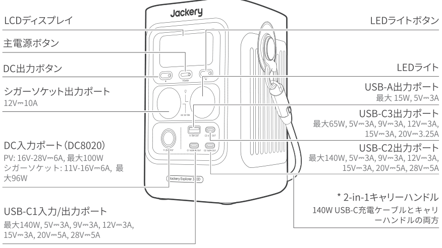
</figure>

※本製品にはACポートは搭載されていません。

*リングはショルダーストラップにも使用できます。

<figure class="hb-reference-figure" data-component-id="HB-SPECIAL-REFERENCE-FIGURE" data-reference-id="shoulder-strap" data-source-fragment-sha256="a08466ba74e59a94b3a45ddd511876ab36adafa6fb5ecdfe367630089c4a63e7">
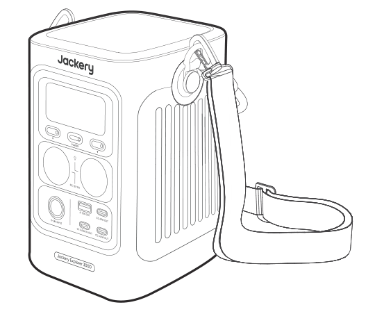
</figure>

## 液晶画面

<figure class="hb-reference-figure" data-component-id="HB-SPECIAL-REFERENCE-FIGURE" data-reference-id="lcd-display" data-source-fragment-sha256="5cf4e6cba57628d15f91847be11714ed399037037b725a11c461f0c5ed3bb342" data-step-captions="embedded">
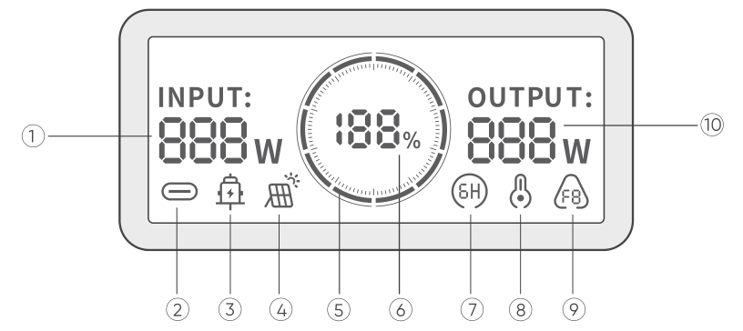
</figure>

<figure aria-label="液晶画面" class="hb-lcd-table-composition" data-component-id="HB-TABLE-LCD-ICON" tabindex="0"><table class="hb-lcd-icon-table"><colgroup><col class="hb-lcd-col-number"/><col class="hb-lcd-col-icon"/><col class="hb-lcd-col-name"/><col class="hb-lcd-col-description"/></colgroup><tbody><tr><td class="hb-lcd-number">①</td><td class="hb-lcd-icon"></td><td class="hb-lcd-name">入力電力表示</td><td class="hb-lcd-description">入力電力をワットで表示します。</td></tr><tr><td class="hb-lcd-number">②</td><td class="hb-lcd-icon"></td><td class="hb-lcd-name">USB-C充電インジケーター</td><td class="hb-lcd-description">本製品はUSB-C1ポート経由で充電されます。</td></tr><tr><td class="hb-lcd-number">③</td><td class="hb-lcd-icon"></td><td class="hb-lcd-name">シガーソケット入力電力表示</td><td class="hb-lcd-description">製品は、DC 12V（カーチャージ）を使用し、8020入力ポートを介して充電されています。</td></tr><tr><td class="hb-lcd-number">④</td><td class="hb-lcd-icon"></td><td class="hb-lcd-name">ソーラー(グリーンエネルギー)充電接続</td><td class="hb-lcd-description">製品は、ソーラーパネルを使用し、8020入力ポートを介して充電されています。</td></tr><tr><td class="hb-lcd-number">⑤</td><td class="hb-lcd-icon"></td><td class="hb-lcd-name">バッテリーレベルパーセントタグ</td><td class="hb-lcd-description">製品の充電中は、バッテリーのパーセンテージを囲むオレンジ色の円が順番に点灯します。他のデバイスの充電時には、オレンジ色の円は点灯したままになります。</td></tr><tr><td class="hb-lcd-number">⑥</td><td class="hb-lcd-icon"></td><td class="hb-lcd-name">バッテリーレベルパーセントタグ</td><td class="hb-lcd-description">バッテリー残量を表示します。</td></tr><tr><td class="hb-lcd-number">⑦</td><td class="hb-lcd-icon"></td><td class="hb-lcd-name">省エネモード</td><td class="hb-lcd-description">オン：省エネモードが有効になります。 オフ：省エネモードが無効になります</td></tr><tr><td class="hb-lcd-number">⑧</td><td class="hb-lcd-icon"></td><td class="hb-lcd-name">高温インジケーター</td><td class="hb-lcd-description">高温保護が作動しました。製品の温度が通常の動作範囲に戻るまで、製品の機能が停止する場合があります。</td></tr><tr><td class="hb-lcd-number">⑧</td><td class="hb-lcd-icon"></td><td class="hb-lcd-name">低温インジケーター</td><td class="hb-lcd-description">低温保護が作動しました。製品の温度が通常の動作範囲に戻るまで、製品の機能が停止する場合があります。</td></tr><tr><td class="hb-lcd-number">⑨</td><td class="hb-lcd-icon"></td><td class="hb-lcd-name">エラーコード</td><td class="hb-lcd-description">製品エラーが発生しました。詳細については、トラブルシューティングのセクションを参照してください。</td></tr><tr><td class="hb-lcd-number">⑩</td><td class="hb-lcd-icon"></td><td class="hb-lcd-name">消費電力</td><td class="hb-lcd-description">出力電力をワットで表示します。</td></tr></tbody></table></figure>

## 使い方

### 主電源ボタン/オフ

<figure class="hb-reference-figure" data-component-id="HB-SPECIAL-REFERENCE-FIGURE" data-reference-id="power-on-off" data-source-fragment-sha256="db7b6a57e94fe814e1f7876eea27643b9d7cd4f834e6055b75a5e88dab094f0c" data-step-captions="embedded">
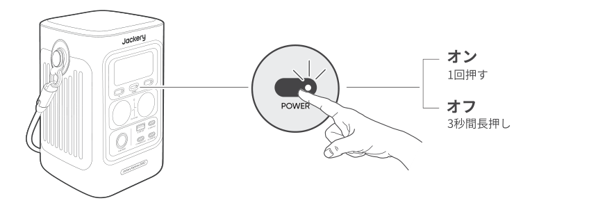
</figure>

本製品は、バッテリーが完全に消耗した場合、自動的に電源が切れる仕様となっております。

### USB出力オン/オフ

本製品の電源を入れると、USBポートが自動的に有効となり、接続した機器の充電が可能になります。

<figure class="hb-reference-figure" data-component-id="HB-SPECIAL-REFERENCE-FIGURE" data-reference-id="usb-output" data-source-fragment-sha256="6361841d8cbdca6910ec47b63e308218f91b3df3962939f9b9ca3cb0930c349b">
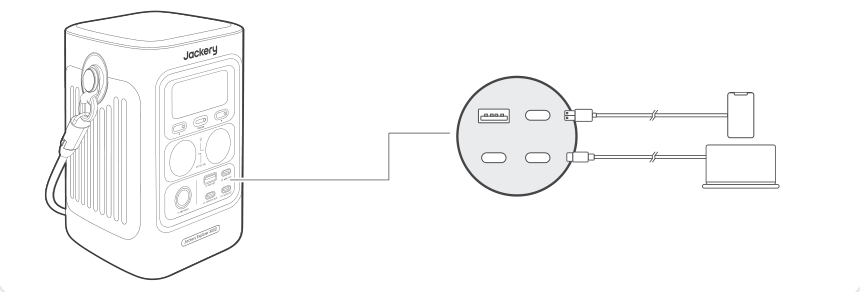
</figure>

<table class="manual-callout-table manual-callout-table"><tbody><tr><td class="manual-callout-label">ご注意</td><td class="manual-callout-body"><ul><li>USB-C1およびUSB-C2は、USB-PD Power Source 3 (PS3) の高出力ポートです。接続されたユーザーデバイスまたはアクセサリーが安全基準を満たしていない場合、火災の危険性があります。これらのポートを使用する前に、接続するデバイスまたはアクセサリーに耐火安全保護が備わっていることを確認してください。</li><li>Jackery ポータブル電源 300Dは、IEC/EN/UL 62368-1（または同等の規格）の6.3、6.4、6.5条に準拠したデバイスまたはアクセサリーのみに接続してください。</li><li>最大出力を得るためには、公式のJackery USB-C to USB-C 5Aケーブル（20V DC/5A、100W；28V DC/5A、140W）を使用してください。</li></ul></td></tr></tbody></table>

### カーポート出力オン/オフ

<strong>前提：</strong>主電源ボタンがオンになっていることを確認してください。

<figure class="hb-reference-figure" data-component-id="HB-SPECIAL-REFERENCE-FIGURE" data-reference-id="dc-output" data-source-fragment-sha256="1cbab1bbe475ccd78035f2de6f94d15c668fc2b2ea5dd00bca996be17dcd93bd" data-step-captions="embedded">
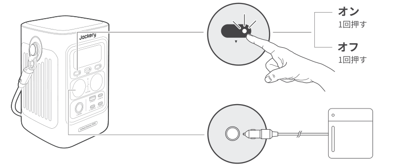
</figure>

本製品は、別売のJackery 12V 自動車用バッテリー充電ケーブルを使用することで、車のバッテリーへの充電が可能です。

※Jackery 12V 自動車用バッテリー充電ケーブルは付属しておりません。Jackery公式サイトよりお求めいただけます。

<table class="manual-callout-table manual-callout-table"><tbody><tr><td class="manual-callout-label">ご注意</td><td class="manual-callout-body"><ul><li>12V車専用であり、24V車には対応しておりません。</li><li>本製品の12V DC出力（シガーソケット）から車のバッテリーへ充電中は、エンジンを始動しないでください。製品の故障につながる恐れがあります。</li><li>この機能はあくまで車のバッテリーの緊急補助用であり、深刻なバッテリー上がりや故障したバッテリーには対応しておりません。</li></ul></td></tr></tbody></table>

### 省エネモード

省エネモードは、出力ボタンの消し忘れによる無駄なバッテリー消耗を防ぐための機能で、初期設定ではオン（画面に省エネアイコン「6H」表示）になっています。 この状態では、DC 12V/USB 出力が2W以下のまま6時間経過すると、本製品はすべての出力を自動でオフにした後、電源もオフになります。

※低消費電力機器（DC/USB接続時は2W以下）をご使用の場合、途中で出力が自動オフにならないよう、省エネモードをオフにしてください。 省エネモードをオフにすると、画面上の「6H」アイコンは表示されなくなります。

<figure class="hb-reference-figure" data-component-id="HB-SPECIAL-REFERENCE-FIGURE" data-reference-id="energy-saving" data-source-fragment-sha256="91bf722fde13d7bc5d16eb23f29714edc587a710eea01acb97f24320c78c5c81" data-step-captions="embedded">
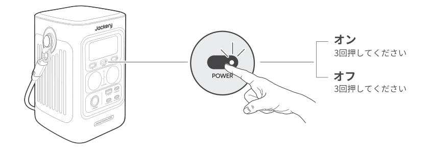
</figure>

<table class="manual-callout-table manual-callout-table"><tbody><tr><td class="manual-callout-label">説明</td><td class="manual-callout-body">
省エネモードは電源投入後に前回の状態を維持します。モード変更には手動での切り替えが必要です。
</td></tr></tbody></table>

### LEDライトオン/オフ

LEDライトには、照明モードとSOSモードの2つのモードがあります。いずれのモードでも、LEDスイッチを長押しすることでLEDライトを消灯できます。

<figure class="hb-reference-figure" data-component-id="HB-SPECIAL-REFERENCE-FIGURE" data-reference-id="led-light" data-source-fragment-sha256="75d61447616b68c7929096c8bdadb591161a07b3eb228198d0e9df3a9caef03e" data-step-captions="embedded">
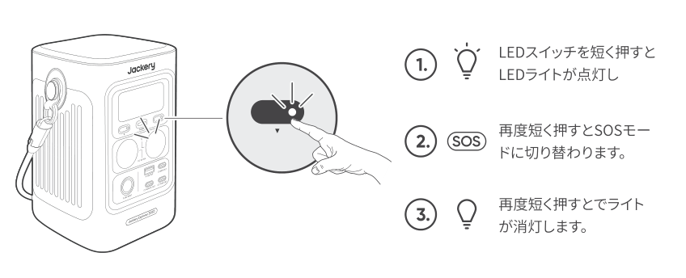
</figure>

### LCDスクリーン オン/オフ

<figure aria-label="LCDスクリーン オン/オフ" class="hb-lcd-mode-composition" data-component-id="HB-TABLE-LCD-MODE">
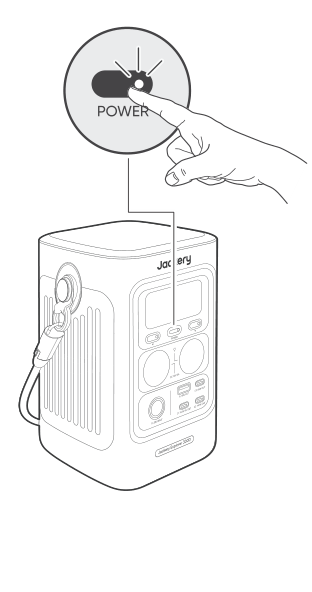

<table class="hb-lcd-mode-table"><colgroup><col class="hb-lcd-mode-col-state"/><col class="hb-lcd-mode-col-action"/><col class="hb-lcd-mode-col-copy"/></colgroup><tbody><tr><td class="hb-lcd-mode-state" rowspan="3">画面は2分間点灯し続けます</td><td class="hb-lcd-mode-action">オンにする</td><td class="hb-lcd-mode-copy">主電源ボタンを押すか、充電入力がある場合。</td></tr><tr><td class="hb-lcd-mode-action">オフにする</td><td class="hb-lcd-mode-copy">主電源ボタンを押します。</td></tr><tr><td class="hb-lcd-mode-action">自動オフ</td><td class="hb-lcd-mode-copy">2分後にLCDは自動的に消灯し、スリープモードになります。</td></tr><tr><td class="hb-lcd-mode-state" rowspan="3">常時点灯表示モード</td><td class="hb-lcd-mode-action">オンにする</td><td class="hb-lcd-mode-copy">LCD画面がオンのときに主電源ボタンを2回押します。</td></tr><tr><td class="hb-lcd-mode-action">オフにする</td><td class="hb-lcd-mode-copy">主電源ボタンを押します。</td></tr><tr><td class="hb-lcd-mode-action">自動オフ</td><td class="hb-lcd-mode-copy">常時点灯ディスプレイモードは、2時間操作がないと自動的に消灯します。</td></tr></tbody></table>
</figure>

## 充電方法

<strong>グリーンエネルギー優先モード</strong> 本製品はグリーンエネルギー優先モードを搭載していますが、ソーラーパネルとUSB-C充電ケーブルを使って同時に充電できます。同時に充電すると、ソーラーが優先されますが、バッテリーの最大許容電力で同時に充電されます。

<table class="manual-callout-table manual-callout-table"><tbody><tr><td class="manual-callout-label">ご注意</td><td class="manual-callout-body"><ul><li>製品の充電動作温度範囲は-0°C~45°C、放電動作温度範囲は-15°C~45°Cです。上限・下限温度を超えた場合、充放電が制限され、または充放電不可の可能性があります。</li><li>温度によって、製品の充電効率と実際の容量は異なります。</li></ul></td></tr></tbody></table>

<table class="manual-callout-table manual-callout-table"><tbody><tr><td class="manual-callout-label">ご注意</td><td class="manual-callout-body"><ul><li>はじめてお使いになるときは、本製品をフル充電してからご使用ください。</li><li>充電池は空の状態で長期保管(3カ月~6カ月）すると、性能が劣化したり、充電できなくなる場合があります。</li><li>長期保管中は、電池残量が0%にならないよう、3か月に一度の充電をおすすめします。</li></ul></td></tr></tbody></table>

### USB-C充電ケーブル（最大140W）

USB-Cケーブルとしても使える2-in-1キャリーハンドルを取り外してください。製品のUSB-C1ポートと電源コンセントに接続してください。

<figure class="hb-reference-figure" data-component-id="HB-SPECIAL-REFERENCE-FIGURE" data-reference-id="charging-usbc" data-source-fragment-sha256="9684fd68309e800f5a79e5cdf31304266b6fd838696ae7c82addafee189150ad" data-step-captions="embedded">
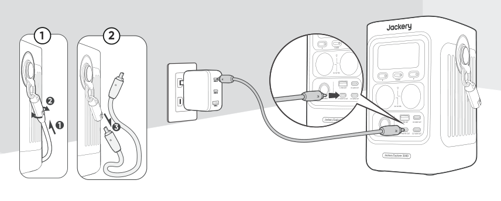
</figure>

<table class="manual-callout-table manual-callout-table"><tbody><tr><td class="manual-callout-label">ご注意</td><td class="manual-callout-body">
USB-Cポートから充電する場合、本製品は最大140Wに対応しています。そのためには、140Wに対応したPD充電器とケーブルの両方が必要です。
</td></tr></tbody></table>

### ソーラー充電（最大100W）

ソーラーパネル接続用のDC入力ポート（8020メス）×1を備え、最大1枚のパネル（最大入力電力100W）まで接続可能です。 ※ Jackery SolarSaga アダプターを使って2枚接続はできません（電圧が許容範囲を超え、故障のリスクがあります）。

直接接続可能です。追加のアクセサリーは不要です。 本製品のDC入力ポートは「8020メス」です。ソーラーパネル側の「8020オス」と接続してください。

<figure class="hb-reference-figure" data-component-id="HB-SPECIAL-REFERENCE-FIGURE" data-reference-id="charging-solar" data-source-fragment-sha256="4a44851aab01545138008e0ffeb24571a11e7c7df55f49569267efb88347e425" data-step-captions="embedded">
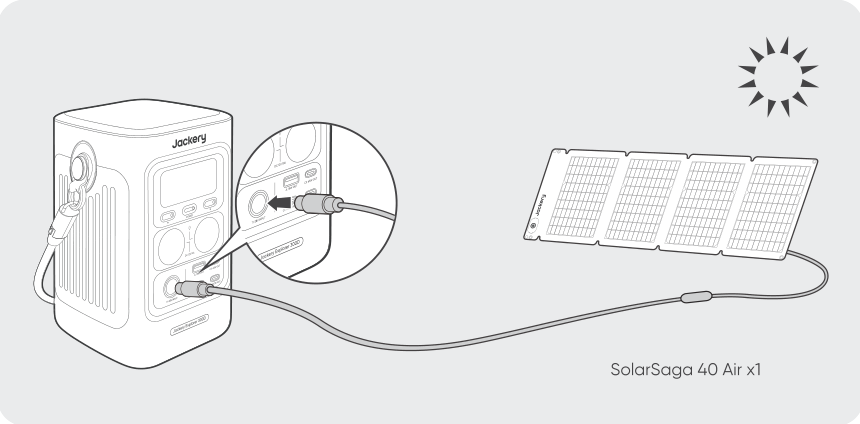
</figure>

Jackeryブランド以外の付属品を使用して充電しないでください。特に、ソーラーパネルで充電する際は、Jackeryのソーラーパネルを使用することをお勧めします。ソーラーパネルの開放電圧（Voc）が、Jackery ポータブル電源 300DのDC入力電圧範囲（16V〜28V）内に収まっていることを確認してください。他社ソーラーパネルで充電することによる損失について、当社は一切の責任を負いません。

### シガーソケット充電（最大96W）

■本製品は、12V/10A出力の車載シガーソケットからの充電に対応しています。

ご使用の際は、以下にご注意ください：

<ul><li>必ず車のエンジンを始動させてから接続してください。エンジン停止状態で使用すると、車両のバッテリーが上がる恐れがあります。</li><li>車の充電ポートとシガーソケット充電ケーブルの接触状態をご確認ください。</li><li>ケーブルが確実に奥まで差し込まれていることをご確認ください。</li></ul>

<figure class="hb-reference-figure" data-component-id="HB-SPECIAL-REFERENCE-FIGURE" data-reference-id="charging-car" data-source-fragment-sha256="e85cd3f4486c3903cf2fb93a9d3dcc155f0003c1981d7cd9e26c5b8ebc819b62" data-step-captions="embedded">
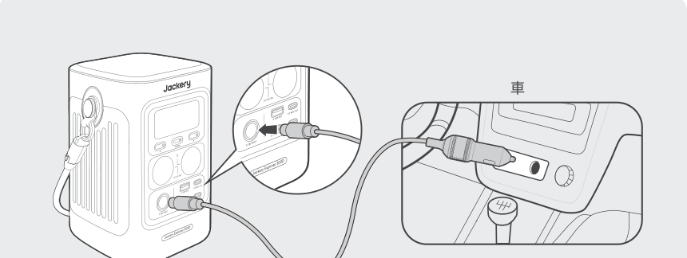
</figure>

※ シガーソケット充電ケーブルは別売りです。

<table class="manual-callout-table manual-callout-table"><tbody><tr><td class="manual-callout-label">ご注意</td><td class="manual-callout-body"><ul><li>悪路などで車両の振動が激しい場合は、接触不良や発熱·焼損の恐れがあるため、充電を中止してください。</li><li>誤使用による故障·損傷については、弊社では責任を負いかねます。あらかじめご了承ください。</li><li>シガーソケット充電は 12V, 10A 車専用で、24V 車は充電できません。人身傷害や物的損害を避けるため、本製品の充電に 24V 車を使用しないでください。</li></ul></td></tr></tbody></table>

## トラブルシューティング

次のいずれかのエラーコードが表示された場合は、記載されている対処方法に従って問題を解決してください。問題が解決しない場合は、Jackeryカスタマーサポートまでご連絡ください。

<figure aria-label="エラーコード / 対処方法" class="hb-troubleshooting-composition" data-component-id="HB-TABLE-TROUBLESHOOTING" tabindex="0"><table class="hb-troubleshooting-table"><colgroup><col class="hb-troubleshooting-col-code"/><col class="hb-troubleshooting-col-measures"/></colgroup><thead><tr><th class="hb-troubleshooting-code" scope="col">エラーコード</th><th class="hb-troubleshooting-measures" scope="col">対処方法</th></tr></thead><tbody><tr><td class="hb-troubleshooting-code">F0</td><td class="hb-troubleshooting-measures">製品を再起動してください。</td></tr><tr><td class="hb-troubleshooting-code">F1</td><td class="hb-troubleshooting-measures">販売店またはJackeryカスタマーサポートにお問い合わせください。</td></tr><tr><td class="hb-troubleshooting-code">F2</td><td class="hb-troubleshooting-measures">販売店またはJackeryカスタマーサポートにお問い合わせください。</td></tr><tr><td class="hb-troubleshooting-code">F3</td><td class="hb-troubleshooting-measures">製品を再起動してください。</td></tr><tr><td class="hb-troubleshooting-code">F4</td><td class="hb-troubleshooting-measures">製品に負荷を接続してバッテリーを放電し、エラーが消えるまで続けてください。</td></tr><tr><td class="hb-troubleshooting-code">F5</td><td class="hb-troubleshooting-measures">ソーラーパネルまたはUSB-C電源コンセントを使用して、エラーが消えるまで製品を充電してください。</td></tr><tr><td class="hb-troubleshooting-code">F6</td><td class="hb-troubleshooting-measures">販売店またはJackeryカスタマーサポートにお問い合わせください。</td></tr><tr><td class="hb-troubleshooting-code">F7</td><td class="hb-troubleshooting-measures">1. 製品からすべてのDC入力を取り外してください。 2. ソーラーパネルで充電する場合は、接続されたソーラーパネルの開放電圧（Voc）を確認してください。本製品の最大DC入力電圧は28Vです。 3. 製品を再起動し、アイドル状態を保ってください。エラーが消えるまで待ってください。</td></tr><tr><td class="hb-troubleshooting-code">F8</td><td class="hb-troubleshooting-measures">販売店またはJackeryカスタマーサポートにお問い合わせください。</td></tr><tr><td class="hb-troubleshooting-code">F9</td><td class="hb-troubleshooting-measures">製品のDC 12V/USBポートに接続されている負荷を取り外してください。故障が消えるまで待機してください。</td></tr></tbody></table></figure>

## 主な仕様

<h2 class="hb-spec-group">基本情報</h2>

<figure aria-label="基本情報" class="hb-spec-table-composition"><table class="manual-table manual-spec-table hb-spec-table"><colgroup><col class="hb-spec-col-label"/><col class="hb-spec-col-value"/></colgroup><tbody><tr><th class="manual-spec-label hb-spec-label" scope="row">製品の名称</th><td class="manual-spec-value hb-spec-value">Jackery ポータブル電源 300D</td></tr><tr><th class="manual-spec-label hb-spec-label" scope="row">型番</th><td class="manual-spec-value hb-spec-value">JE-300D</td></tr><tr><th class="manual-spec-label hb-spec-label" scope="row">バッテリータイプ</th><td class="manual-spec-value hb-spec-value">LiFePO₄ （リン酸鉄リチウムイオン電池）</td></tr><tr><th class="manual-spec-label hb-spec-label" scope="row">定格容量</th><td class="manual-spec-value hb-spec-value">15Ah / 19.2V DC (288 Wh)</td></tr><tr><th class="manual-spec-label hb-spec-label" scope="row">サイクル寿命</th><td class="manual-spec-value hb-spec-value">4,000回の充放電後も容量の70%以上を維持</td></tr><tr><th class="manual-spec-label hb-spec-label" scope="row">サイズ＆重量</th><td class="manual-spec-value hb-spec-value">約118.6×120.2×183 mm(約2.5 kg）</td></tr></tbody></table></figure>

<h2 class="hb-spec-group">入力ポート</h2>

<figure aria-label="入力ポート" class="hb-spec-table-composition"><table class="manual-table manual-spec-table hb-spec-table"><colgroup><col class="hb-spec-col-label"/><col class="hb-spec-col-value"/></colgroup><tbody><tr><th class="manual-spec-label hb-spec-label" scope="row">1×USB-C入力ポート</th><td class="manual-spec-value hb-spec-value">C1: 5V⎓3A, 9V⎓3A, 12V⎓3A, 15V⎓3A, 20V⎓5A, 28V⎓5A, 最大140W</td></tr><tr><th class="manual-spec-label hb-spec-label" rowspan="2" scope="row">1×DC8020入力ポート</th><td class="manual-spec-value hb-spec-value">PV: 16V-28V⎓6A，最大100W</td></tr><tr><td class="manual-spec-value hb-spec-value">ｼｶﾞｰｿｹｯﾄ: 11V-16V⎓6A，最大96W</td></tr></tbody></table></figure>

<h2 class="hb-spec-group">出力ポート</h2>

<figure aria-label="出力ポート" class="hb-spec-table-composition"><table class="manual-table manual-spec-table hb-spec-table"><colgroup><col class="hb-spec-col-label"/><col class="hb-spec-col-value"/></colgroup><tbody><tr><th class="manual-spec-label hb-spec-label" rowspan="3" scope="row">3×USB-C出力</th><td class="manual-spec-value hb-spec-value">C1: 最大140W, 5V⎓3A, 9V⎓3A, 12V⎓3A, 15V⎓3A, 20V⎓5A, 28V⎓5A</td></tr><tr><td class="manual-spec-value hb-spec-value">C2: 最大140W, 5V⎓3A, 9V⎓3A, 12V⎓3A, 15V⎓3A, 20V⎓5A, 28V⎓5A</td></tr><tr><td class="manual-spec-value hb-spec-value">C3: 最大65W, 5V⎓3A, 9V⎓3A, 12V⎓3A, 15V⎓3A, 20V⎓3.25A</td></tr><tr><th class="manual-spec-label hb-spec-label" scope="row">1×USB-A出力</th><td class="manual-spec-value hb-spec-value">最大15W, 5V⎓3A</td></tr><tr><th class="manual-spec-label hb-spec-label" scope="row">シガーソケット出力</th><td class="manual-spec-value hb-spec-value">12V⎓電流制限10A</td></tr></tbody></table></figure>

<h2 class="hb-spec-group">温度範囲</h2>

<figure aria-label="温度範囲" class="hb-spec-table-composition"><table class="manual-table manual-spec-table hb-spec-table"><colgroup><col class="hb-spec-col-label"/><col class="hb-spec-col-value"/></colgroup><tbody><tr><th class="manual-spec-label hb-spec-label" scope="row">充電温度</th><td class="manual-spec-value hb-spec-value">0°C~45°C</td></tr><tr><th class="manual-spec-label hb-spec-label" scope="row">動作温度</th><td class="manual-spec-value hb-spec-value">-15°C~45°C</td></tr><tr><th class="manual-spec-label hb-spec-label" scope="row">保存温度</th><td class="manual-spec-value hb-spec-value">1ヶ月 -20°C~45°C; 3ヶ月 0°C~45°C; 1年 0°C~25°C</td></tr></tbody></table></figure>

### マルチポート出力の組み合わせ

#### 1ポート出力

<figure aria-label="1ポート出力" class="hb-reference-composition hb-reference-lcd-actions-compact" data-component-id="HB-TABLE-REFERENCE" data-component-variant="lcd-actions-compact" tabindex="0"><table class="hb-reference-table"><thead><tr><th scope="col">使用ポート</th><th scope="col">最大出力</th></tr></thead><tbody><tr><td>USB-C1</td><td>140W</td></tr><tr><td>USB-C2</td><td>140W</td></tr><tr><td>USB-C3</td><td>65W</td></tr><tr><td>USB-A</td><td>15W</td></tr><tr><td>シガーソケット出力ポート</td><td>120W</td></tr></tbody></table></figure>

* 組み合わせによっては、メインポートの優先順位によりUSB-C1/2/3の出力が制限される場合があります。

#### 2ポート出力

<figure aria-label="2ポート出力" class="hb-reference-composition hb-reference-lcd-actions-compact" data-component-id="HB-TABLE-REFERENCE" data-component-variant="lcd-actions-compact" tabindex="0"><table class="hb-reference-table"><thead><tr><th scope="col">組み合わせ</th><th scope="col">最大出力</th></tr></thead><tbody><tr><td>USB-C1 + USB-C2</td><td>140W + 140W</td></tr><tr><td>USB-C1 + USB-C3</td><td>140W + 65W</td></tr><tr><td>USB-C1 + USB-A</td><td>140W + 15W</td></tr><tr><td>USB-C1 + シガーソケット出力ポート</td><td>140W + 120W</td></tr><tr><td>USB-C2 + USB-C3</td><td>140W + 65W</td></tr><tr><td>USB-C2 + USB-A</td><td>140W + 15W</td></tr><tr><td>USB-C2 + シガーソケット出力ポート</td><td>140W + 120W</td></tr><tr><td>USB-C3 + USB-A</td><td>65W + 15W</td></tr><tr><td>USB-C3 + シガーソケット出力ポート</td><td>65W + 120W</td></tr><tr><td>USB-A + シガーソケット出力ポート</td><td>15W + 120W</td></tr></tbody></table></figure>

#### 3ポート出力

<figure aria-label="3ポート出力" class="hb-reference-composition hb-reference-lcd-actions-compact" data-component-id="HB-TABLE-REFERENCE" data-component-variant="lcd-actions-compact" tabindex="0"><table class="hb-reference-table"><thead><tr><th scope="col">組み合わせ</th><th scope="col">最大出力</th></tr></thead><tbody><tr><td>USB-C1 + USB-C2 + USB-C3</td><td>140W + 140W + 65W</td></tr><tr><td>USB-C1 + USB-C2 + USB-A</td><td>140W + 140W + 15W</td></tr><tr><td>USB-C1 + USB-C2 + シガーソケット出力ポート</td><td>100W + 100W + 120W</td></tr><tr><td>USB-C1 + USB-C3 + USB-A</td><td>140W + 65W + 15W</td></tr><tr><td>USB-C1 + USB-C3 + シガーソケット出力ポート</td><td>140W + 65W + 120W</td></tr><tr><td>USB-C1 + USB-A + シガーソケット出力ポート</td><td>140W + 15W + 120W</td></tr><tr><td>USB-C2 + USB-C3 + USB-A</td><td>140W + 65W + 15W</td></tr><tr><td>USB-C2 + USB-C3 + シガーソケット出力ポート</td><td>140W + 65W + 120W</td></tr><tr><td>USB-C2 + USB-A + シガーソケット出力ポート</td><td>140W + 15W + 120W</td></tr><tr><td>USB-C3 + USB-A + シガーソケット出力ポート</td><td>65W + 15W + 120W</td></tr></tbody></table></figure>

#### 4ポート出力

<figure aria-label="4ポート出力" class="hb-reference-composition hb-reference-lcd-actions-compact" data-component-id="HB-TABLE-REFERENCE" data-component-variant="lcd-actions-compact" tabindex="0"><table class="hb-reference-table"><thead><tr><th scope="col">組み合わせ</th><th scope="col">最大出力</th></tr></thead><tbody><tr><td>USB-C1 + USB-C2 + USB-C3 + USB-A</td><td>140W + 65W + 65W + 15W</td></tr><tr><td>USB-C1 + USB-C2 + USB-C3 + シガーソケット出力ポート</td><td>100W + 65W + 30W + 120W</td></tr><tr><td>USB-C1 + USB-C2 + USB-A + シガーソケット出力ポート</td><td>100W + 65W + 15W + 120W</td></tr><tr><td>USB-C1 + USB-C3 + USB-A + シガーソケット出力ポート</td><td>100W + 65W + 15W + 120W</td></tr><tr><td>USB-C2 + USB-C3 + USB-A + シガーソケット出力ポート</td><td>100W + 65W + 15W + 120W</td></tr></tbody></table></figure>

#### 5ポート出力

<figure aria-label="5ポート出力" class="hb-reference-composition hb-reference-lcd-actions-compact" data-component-id="HB-TABLE-REFERENCE" data-component-variant="lcd-actions-compact" tabindex="0"><table class="hb-reference-table"><thead><tr><th scope="col">全てのポートがアクティブ</th><th scope="col">最大出力</th></tr></thead><tbody><tr><td>USB-C1 + USB-C2 + USB-C3 + USB-A + シガーソケット出力ポート</td><td>65W + 65W + 30W + 15W + 120W</td></tr></tbody></table></figure>

※USB Type-C® and USB-C® are registered trademarks of USB Implementers Forum.

デバイスが高出力ポートに接続されると、製品の温度保護機構により出力電力が自動調整される場合があります。 これは正常動作であり、故障を示すものではありません。 心配には及びません。

## 保証について

このたびは Jackery 製品をご購入いただき、誠にありがとうございます。 本保証書は、Jackery ポータブル電源製品に関する保証内容を明確にご案内するものです。 ご使用前に必ずご確認のうえ、大切に保管してください。

### 保証期間

<figure aria-label="保証期間" class="hb-warranty-card" data-component-id="HB-WARRANTY-SECTION" data-warranty-card-index="1">
1. 保証期間はご購入日から 3 年間です。 2. また、延長保証にご登録いただくと、さらに 2 年間の保証が追加されます。詳しくは Jackery 公式サイトをご確認ください。

※ Jackery 公式オンラインストアまたは正規代理店以外での購入品は保証対象外となります。
</figure>

### 保証の適用範囲

<figure aria-label="保証の適用範囲" class="hb-warranty-card" data-component-id="HB-WARRANTY-SECTION" data-warranty-card-index="2">
1. 購入チャネルについて 本保証は、Jackery公式オンラインストアまたは正規代理店で購入された製品に限り有効です。

2. 保証提供地域 保証は、日本国内に在住の方が、日本国内で使用する場合に限り有効です。
</figure>

### 保証の適用条件

<figure aria-label="保証の適用条件" class="hb-warranty-card" data-component-id="HB-WARRANTY-SECTION" data-warranty-card-index="3">
以下のすべての条件を満たす場合に、保証の適用対象となります： ・Jackery公式オンラインストアまたは正規代理店にてご購入されたこと ・保証期間内であること ・下記の「保証対象外」に該当しないこと
</figure>

### 保証対象外となる場合

<figure aria-label="保証対象外となる場合" class="hb-warranty-card" data-component-id="HB-WARRANTY-SECTION" data-warranty-card-index="4">
以下のいずれかに該当する場合、保証期間内であっても保証の対象外となります： 1.故障・損傷が保証期間内に発生していても、保証期間終了後に申請された場合 2.使用上の誤り（取扱説明書や本体ラベルに記載の注意事項に従わなかった使用）による故障・損傷 3.他機器からの影響、不適切な修理または改造による故障・損傷 4.移設・輸送・落下などに起因する故障・損傷 5.火災・地震・風水害・落雷などの天災、または公害・塩害・異常電圧などによる故障・損傷 6.消耗部品の劣化や摩耗、または外観の汚損など
</figure>

### 購入証明について

<figure aria-label="購入証明について" class="hb-warranty-card" data-component-id="HB-WARRANTY-SECTION" data-warranty-card-index="5">
保証をご利用の際には、以下いずれかの購入証明書類をご提示いただく必要があります： ・Jackery公式オンラインストアでの購入：注文番号（注文履歴画面または確認メール） ・正規代理店での購入：購入日・販売店名の記載された領収書または納品書

※ ご提示がない場合、保証対応いたしかねます。
</figure>

### 保証内容

<figure aria-label="保証内容" class="hb-warranty-card" data-component-id="HB-WARRANTY-SECTION" data-warranty-card-index="6">
<strong>1. 初期不良による交換</strong>（ご購入日から30日以内） ・取扱説明書に従った正常な使用中に不具合が発生した場合、同一製品の新品と交換いたします。 ・在庫切れや販売終了の場合は、同等品への交換または返金にて対応いたします。

<strong>2. 無償修理</strong>（ご購入日から30日以上〜保証期間内） ・保証条件を満たす自然故障については、無料で修理対応いたします。 ・修理が困難な場合は、同等品（同モデルまたは同等スペック品）への交換にて対応いたします。

<strong>3. 有償修理</strong> 以下に該当する場合は、有償での修理対応となります： ・保証期間を超えた製品 ・保証対象外と判断された場合 ・Jackery公式オンラインストアまたは正規代理店以外で購入された製品 有償修理後の保証期間は、修理完了日より90日間です。

*無償修理の場合、残りの保証期間が90日未満であれば「90日間」、90日以上であれば「元の保証期間に準じます」。
</figure>

### 免責事項

1. 弊社では、いかなる場合においても、間接的損害または付随的損害（データの損失・逸失利益など）に対して責任を負いません。

2. 本保証書は、お客様が法律上有する権利を制限するものではありません。

3. 保証内容は、予告なく変更される場合がございます。あらかじめご了承ください。

Jackery 製品を安心してご使用いただくために、本保証書の内容をご確認のうえ、ご活用くださいますようお願いいたします。

ご不明点がございましたら、Jackery カスタマーサービスまでお問い合わせください。

公式サイト: http://www.jackery.jp カスタマーサポート: jackery.jp@jackery.com お問い合わせ電話番号: 050-3198-9007

