

## 安全上のご注意

<strong>ご使用の前にこの「安全上のご注意」をよくお読みのうえ、正しくお使いください。</strong>

### 絵表示について

製品を安全に正しくお使いいただき、お客様や他の方々への危害や財産への損害を未然に防止するための表示です。 内容をよく理解してから本文をお読みください。

<figure aria-label="絵表示について" class="hb-symbol-signal-composition" data-component-id="HB-TABLE-SYMBOL-SIGNAL"><table class="hb-symbol-signal-table"><colgroup><col class="hb-symbol-signal-col-label"/><col class="hb-symbol-signal-col-meaning"/></colgroup><thead><tr><th class="hb-symbol-signal-label-heading" scope="col">表示</th><th class="hb-symbol-signal-meaning-heading" scope="col">意味</th></tr></thead><tbody><tr><td class="hb-symbol-signal-label-cell">⚠警告</td><td class="hb-symbol-signal-meaning-cell">この表示を無視して、誤った取り扱いをすると、人が死亡または重傷を負う可能性が想定される内容を示しています。</td></tr><tr><td class="hb-symbol-signal-label-cell">⚠注意</td><td class="hb-symbol-signal-meaning-cell">この表示を無視して、誤った取り扱いをすると、人が傷害を負う可能性が想定される内容または物的損害の発生が想定される内容を示しています。</td></tr></tbody></table></figure>

### 絵表示の説明

<figure aria-label="絵表示の説明" class="hb-symbol-pair-composition" data-component-id="HB-TABLE-SYMBOL-ICON">

<table class="hb-symbol-panel-table"><colgroup><col class="hb-symbol-col-icon"/><col class="hb-symbol-col-meaning"/></colgroup><thead><tr><th class="hb-symbol-icon-heading" scope="col">記号</th><th class="hb-symbol-meaning-heading" scope="col">意味</th></tr></thead><tbody><tr><td class="hb-symbol-icon"></td><td class="hb-symbol-meaning">コンセントから電源プラグを抜く記号</td></tr><tr><td class="hb-symbol-icon"></td><td class="hb-symbol-meaning">製品を分解、改造を禁止する記号</td></tr><tr><td class="hb-symbol-icon"></td><td class="hb-symbol-meaning">製品に濡れた手で触れることを禁止する記号</td></tr></tbody></table>

<table class="hb-symbol-panel-table"><colgroup><col class="hb-symbol-col-icon"/><col class="hb-symbol-col-meaning"/></colgroup><thead><tr><th class="hb-symbol-icon-heading" scope="col">記号</th><th class="hb-symbol-meaning-heading" scope="col">意味</th></tr></thead><tbody><tr><td class="hb-symbol-icon"></td><td class="hb-symbol-meaning">行為を指示する記号</td></tr><tr><td class="hb-symbol-icon"></td><td class="hb-symbol-meaning">製品を濡らすことを禁止する記号</td></tr><tr><td class="hb-symbol-icon"></td><td class="hb-symbol-meaning">行為を禁止する記号</td></tr></tbody></table>

</figure>

<table class="manual-callout-table manual-callout-table"><tbody><tr><td class="manual-callout-label">警告</td><td class="manual-callout-body">
<strong>火のそばや炎天下の車内、熱器具の周辺など高温（45°C以上）になる場所で使用したり、放置しない</strong>

発熱や発火、破裂する原因になります。
</td></tr></tbody></table>

<table class="manual-callout-table manual-callout-table"><tbody><tr><td class="manual-callout-label">警告</td><td class="manual-callout-body">
<strong>強い衝撃を与えたり、投げつけたりしない</strong>

発熱や発火、破裂する原因になります。
</td></tr></tbody></table>

<table class="manual-callout-table manual-callout-table"><tbody><tr><td class="manual-callout-label">警告</td><td class="manual-callout-body">
<strong>水など、液体を入れたり、濡らしたりしない</strong>

発熱や発火の原因になります。
</td></tr></tbody></table>

<table class="manual-callout-table manual-callout-table"><tbody><tr><td class="manual-callout-label">警告</td><td class="manual-callout-body">
<strong>濡れた手で本体や接続するケーブルを触らない</strong>

火災や感電の原因になります。
</td></tr></tbody></table>

<table class="manual-callout-table manual-callout-table"><tbody><tr><td class="manual-callout-label">警告</td><td class="manual-callout-body">
<strong>端子部にケーブル以外の金属類を差し込まない</strong>

発熱や発火の原因になります。
</td></tr></tbody></table>

<table class="manual-callout-table manual-callout-table"><tbody><tr><td class="manual-callout-label">警告</td><td class="manual-callout-body">
<strong>雷が鳴りだしたら、電源プラグにふれない (充電をしない)</strong>

感電の原因になります。
</td></tr></tbody></table>

<table class="manual-callout-table manual-callout-table"><tbody><tr><td class="manual-callout-label">警告</td><td class="manual-callout-body">
<strong>各接続端子には確実に差し込む</strong>

差し込みが不十分だと、発熱したりほこりが付着して火災や感電の原因になります。
</td></tr></tbody></table>

<table class="manual-callout-table manual-callout-table"><tbody><tr><td class="manual-callout-label">警告</td><td class="manual-callout-body">
<strong>接地接続は必ず、電源プラグを電源につなぐ前に行って下さい</strong>

また、接地接続を外す場合は、必ず電源プラグを切り離してから行って下さい。
</td></tr></tbody></table>

<table class="manual-callout-table manual-callout-table"><tbody><tr><td class="manual-callout-label">警告</td><td class="manual-callout-body">
<strong>万が一、次のような異常が発生したときはすぐに使用をやめる</strong>
<ul><li>煙が出ている、異臭がする</li><li>落としたり、破損したとき</li><li>異音がする</li><li>内部に水や異物が入ったとき</li><li>電源コード (ACアダプター) が傷んだとき</li></ul>
このような異常が発生したまま使用していると、火災や感電の原因になります。 すぐにACアダプターをコンセントから抜いてください。また、本製品に接続されている機器もすべて外してください。

<strong>万が一発煙や発火したら、大量の水で消火して煙が見えなくなるまで本製品を水浸しにしてください。</strong> 煙が出なくなることを確認してからカスタマーサポートにご連絡ください。 お客様による修理は危険ですので絶対におやめください。
</td></tr></tbody></table>

<table class="manual-callout-table manual-callout-table"><tbody><tr><td class="manual-callout-label">警告</td><td class="manual-callout-body">
<strong>分解、改造しない</strong>

故障、発熱、火災·感電の原因になります。
</td></tr></tbody></table>

<table class="manual-callout-table manual-callout-table"><tbody><tr><td class="manual-callout-label">警告</td><td class="manual-callout-body">
<strong>表示された電源電圧以外で使用しない</strong>

故障、発熱、火災·感電の原因になります。また、本製品を使用できるのは日本国内のみです。
</td></tr></tbody></table>

<table class="manual-callout-table manual-callout-table"><tbody><tr><td class="manual-callout-label">警告</td><td class="manual-callout-body">
<strong>付属品と本製品が破損した場合は、ご自身で修理をしない</strong>
</td></tr></tbody></table>

<table class="manual-callout-table manual-callout-table"><tbody><tr><td class="manual-callout-label">注意</td><td class="manual-callout-body">
<strong>本製品の上に物を載せたり、不安定な場所に置かない</strong>

倒れたり、落ちたりしてけがの原因になります。
</td></tr></tbody></table>

<table class="manual-callout-table manual-callout-table"><tbody><tr><td class="manual-callout-label">注意</td><td class="manual-callout-body">
<strong>データサーバや医療機器など、非常時に不具合が起こると人命 / 財産に重大な危険を及ぼしうる用途でのご使用はお控えください。次のようなような機器では、万が一使用中に給電ができなくなった場合、人命 / 財産にかかわる被害が想定されます。</strong>
<ul><li>医療機器や使用上、生命に関わるような機器</li><li>社会的、公共的に重要な機器など</li><li>重要な事業用機器など</li></ul></td></tr></tbody></table>

<table class="manual-callout-table manual-callout-table"><tbody><tr><td class="manual-callout-label">注意</td><td class="manual-callout-body">
<strong>心臓にペースメーカーを装着している方は使用しない</strong>

ペースメーカーが、本製品の影響を受ける恐れがあります。
</td></tr></tbody></table>

<table class="manual-callout-table manual-callout-table"><tbody><tr><td class="manual-callout-label">注意</td><td class="manual-callout-body">
<strong>格納式ハンドルを使用してJackery ポータブル電源 600 New を移動するときは、積み重ねたり、上に他の物を置いたりしないでください。落下して怪我をする場合があります。</strong>
</td></tr></tbody></table>

## 使用上のご注意

Jackery ポータブル電源 600 New は、定格出力 500W です。通常時で消費電力が 500W までの機器に給電ができるため、多くの電化製品や端末に対応可能です。ただし、電気モーターを搭載している製品については、例 ( 掃除機、ポンプ、冷蔵庫、電動丸ノコ、エアコン、洗濯機、電子レンジ、ドライヤーなど ) 起動時に「誘導負荷」が発生し、公称電力の 3〜7 倍の電力が必要となります。 定格出力 500W は、一定の電力で動く機器への出力可能範囲を指しています。 500W の出力を超えた場合は、電気回路が自動的に調整され、電力が低減、または保護機能が作動し自動で遮断することがあります。 また AC 出力ポート 2 つ搭載されておりますが、2 つ同時にご利用頂く場合、合計して 500W 以内であることをご確認の上ご利用ください。

<table class="manual-callout-table manual-callout-table"><tbody><tr><td class="manual-callout-label">ご注意</td><td class="manual-callout-body">
始動電力が出力上限値 ( 定格出力 ) を大幅に超える可能性のある製品のご利用や、定格出力を超え給電がストップした製品を繰り返し利用することはポータブル電源のバッテリーが損傷するリスクがありますのでお控えください。
</td></tr></tbody></table>

<strong>■ 給電に関する注意事項</strong>

<ul><li>出力上限値を超える電化製品は使用しないでください。</li><li>特に、始動電力が公称電力の 3〜7 倍になる誘導負荷（ポンプ、ヒーター、掃除機、冷蔵庫、エアコン、電気丸ノコなどの電動道具、洗濯機、電子レンジなど）の使用にはご注意ください。</li><li>接続機器の消費電力が本製品の出力範囲内であることをご確認の上、出力ボタンを押してください。</li><li>給電中、機器の制御や環境により、急速充電にならない・給電できない場合があります。</li><li>充電または給電中、ラジオ・チューナー・テレビなどに雑音が入る場合があります。その際は、それらの機器から離してご使用ください。</li></ul>

<strong>■ 使用環境について</strong>

<ul><li>本製品は防塵・防水仕様ではありません。ほこり、水、海水などがかからないようご注意ください。</li><li>ほこりの多い場所や高温多湿の場所での充電・使用・放置は避けてください。</li><li>平坦で安定した場所に設置し、不安定な場所に置かないでください。</li><li>本製品の通風孔は、安全上絶対にふさがないでください。各面から 5cm 以上スペースを確保してください。</li><li>充電・給電中は本体が温かくなります。周囲に物を置かないでください。</li></ul>

<strong>■ 接続時の注意事項</strong>

<ul><li>ケーブルを接続する際は、まっすぐに差し込んでください。</li><li>抜く際は必ずプラグ部分を持って抜いてください。ケーブルを引っ張ったり折り曲げたりしないでください。</li></ul>

<strong>■ お手入れについて</strong>

<ul><li>本体が汚れた場合は、電源プラグを抜いた状態で、柔らかい布で乾拭きしてください。</li><li>汚れがひどい場合は、水または薄めた中性洗剤で拭き取ってください。</li><li>シンナーやベンジンなどの使用は絶対に使わないでください。</li></ul>

<strong>■ 入出力・温度・表示に関するご注意</strong>

<ul><li>接続機器の入力が本製品の出力上限を超えている場合、自動で電源が遮断されます。</li><li>本機は -20°C~45°C (-4°F~113°F) の温度範囲でお使いの機器に電力供給が可能となり、本機の蓄電は -20°C~45°C (-4°F~113°F) で行えます。</li><li>動作温度が上記範囲外にある場合、本製品が温度異常マークが表示され、動作しない可能性があります。</li><li>温度異常マークが表示された場合は、本製品を 2 時間以上、動作温度範囲内の環境に置いてください。</li><li>容量表示は参考値であり、電圧により表示数値と実際の容量に差異が出る場合があります。</li></ul>

## 免責事項

<ul><li> 火災、地震、第三者による行為、その他の事故、お客様の故意または過失誤用・誤動作・その他の異常な条件下での使用により生じた損害に関して、当社は一切責任を負いません。</li><li>付属品と本製品が破損した場合は、ご自身で修理を行わないでください。ご自身で分解・修理したことにより生じた損害に関し、当社は一切責任を負いません。</li><li>保証範囲は利用規約に適用され、記載されていない内容は当社の保証範囲外となります。</li><li>取扱説明書の記載事項が遵守されないことにより生じた不適合について当社は責任を負いかねます。</li><li>本製品の使用、または使用不能から発生する付随的な損害 ( 事業利益損失含む )、当社が関与しない接続機器との組み合わせによる誤動作などから生じた損害に関して、当社は一切の責任を負いません。</li><li>本製品は病院仕様のシーバップ（CPAP）、エクモ（ECMO）、ペースメーカなど、身の安全に関わる医療救急機械の電源としての使用、または、消費電力の大きいな設備、例えば核施設設備、スペースシャトル製造などの使用は推薦されません。上記設備の使用後、火災、機器故障など個人安全を脅かす事故の責任を取りません。</li></ul>

## 同梱品

<figure aria-label="同梱品" class="hb-inbox-composition" data-card-count="3" data-component-id="HB-SPECIAL-INBOX" data-inbox-variant="responsive-card-grid"><ol class="hb-inbox-grid"><li class="hb-inbox-card" data-item-number="1">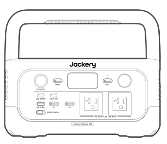

本体

</li><li class="hb-inbox-card" data-item-number="2">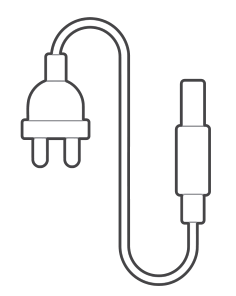

AC充電ケーブル

</li><li class="hb-inbox-card" data-item-number="3">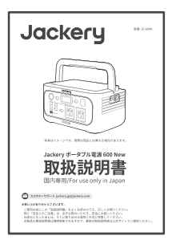

取扱説明書

</li></ol></figure>

※ 付属品を故障、紛失等してしまった場合はカスタマーサポートまでご連絡ください。

※ シガーソケット充電ケーブルは別売りです。Jackery公式サイトよりご購入いただけます。 サポートが必要な場合は、Jackeryカスタマーサポートまでお問い合わせください。

<strong>■本機の仕様および外観は、改善のため予告なく変更することがあります。</strong>

<table class="manual-table"><tbody><tr><td></td><td>
<strong>充電式電池のリサイクルについて</strong>

本機はリサイクル可能な充電池を内蔵しています。 この商品を廃棄する場合は、当社のカスタマーサポートにご連絡ください。 充電池の取りはずしはお客様自身では行わないでください。
</td></tr></tbody></table>

## 各部の名称

### 正面

<figure class="hb-reference-figure" data-component-id="HB-SPECIAL-REFERENCE-FIGURE" data-reference-id="parts-front" data-source-fragment-sha256="c36f2b96db2cb74bc99da7cf19612914eb05f13d297bb716b48137d49426e36e" data-step-captions="embedded">
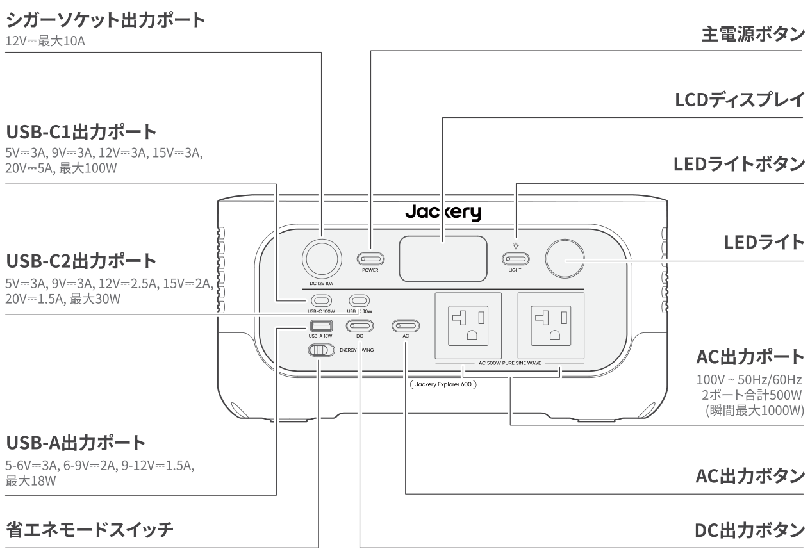
</figure>

### 右側面

<figure class="hb-reference-figure" data-component-id="HB-SPECIAL-REFERENCE-FIGURE" data-reference-id="parts-right-side" data-source-fragment-sha256="1315dfec1a421b825f9a67d36486b0f0a302ec07ed2907b0a0e75b7642b22e89" data-step-captions="embedded">
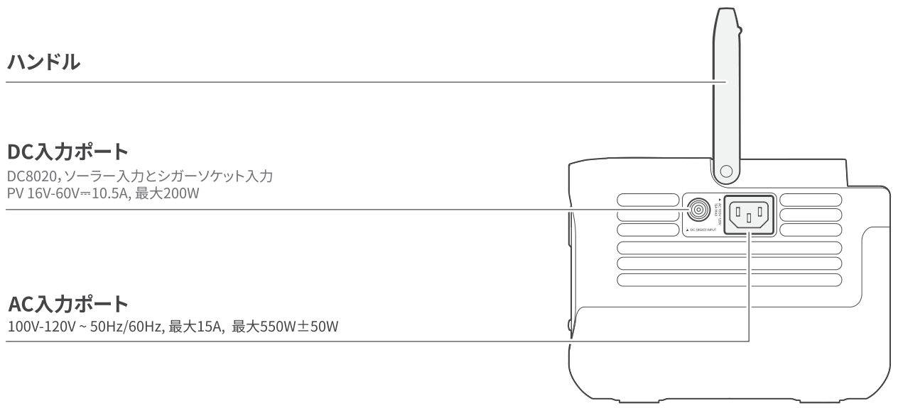
</figure>

## 液晶画面

<figure class="hb-reference-figure" data-component-id="HB-SPECIAL-REFERENCE-FIGURE" data-reference-id="lcd-overview" data-source-fragment-sha256="0560df73d5bb4d97fe2354f2b672964947adb84f2e1c113cf2ffc271ef37f2a0" data-step-captions="embedded">
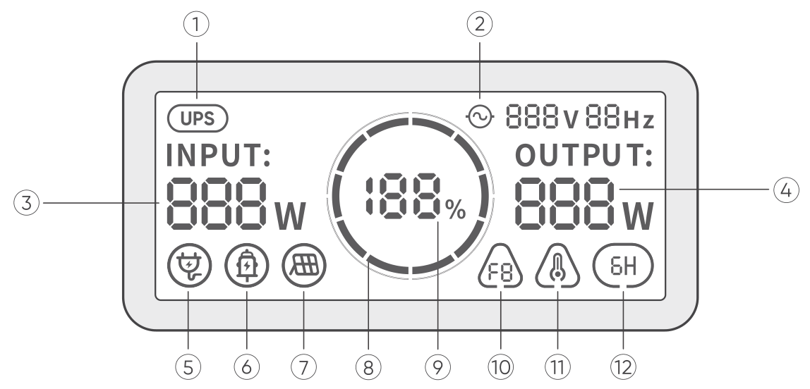
</figure>

<figure aria-label="液晶画面" class="hb-lcd-table-composition" data-component-id="HB-TABLE-LCD-ICON" tabindex="0"><table class="hb-lcd-icon-table"><colgroup><col class="hb-lcd-col-number"/><col class="hb-lcd-col-icon"/><col class="hb-lcd-col-name"/><col class="hb-lcd-col-description"/></colgroup><tbody><tr><td class="hb-lcd-number">①</td><td class="hb-lcd-icon"></td><td class="hb-lcd-name">UPS機能</td><td class="hb-lcd-description">点灯時：製品が給電と充電を同時に行う「パススルー充電」状態にあります。停電時には家庭用電源からポータブル電源の切り替え時間が10ミリ秒で行われます。 消灯時：製品がパススルー充電状態ではありません。</td></tr><tr><td class="hb-lcd-number">②</td><td class="hb-lcd-icon"></td><td class="hb-lcd-name">交流電源による出力マーク(正弦波)</td><td class="hb-lcd-description">AC出力（純正弦波）がオンになっています。</td></tr><tr><td class="hb-lcd-number">③</td><td class="hb-lcd-icon"></td><td class="hb-lcd-name">入力電力表示</td><td class="hb-lcd-description">入力電力をワットで表示します。</td></tr><tr><td class="hb-lcd-number">④</td><td class="hb-lcd-icon"></td><td class="hb-lcd-name">消費電力パワー</td><td class="hb-lcd-description">出力電力をワットで表示します。</td></tr><tr><td class="hb-lcd-number">⑤</td><td class="hb-lcd-icon"></td><td class="hb-lcd-name">AC入力電力表示</td><td class="hb-lcd-description">本製品は、家庭用のコンセント（系統電力）を使用し、AC入力を通じて充電されます。</td></tr><tr><td class="hb-lcd-number">⑥</td><td class="hb-lcd-icon"></td><td class="hb-lcd-name">シガーソケット入力電力表示</td><td class="hb-lcd-description">製品は、DC 12V（カーチャージ）を使用し、低PV入力（8020）を介して充電されています。</td></tr><tr><td class="hb-lcd-number">⑦</td><td class="hb-lcd-icon"></td><td class="hb-lcd-name">ソーラー(グリーンエネルギー)充電接続</td><td class="hb-lcd-description">製品は、ソーラーパネルを使用し、8020入力ポートを介して充電されています。</td></tr><tr><td class="hb-lcd-number">⑧</td><td class="hb-lcd-icon"></td><td class="hb-lcd-name">バッテリーアイコン</td><td class="hb-lcd-description">製品の充電中は、バッテリーのパーセンテージを囲むオレンジ色の円が順番に点灯します。他のデバイスの充電時には、オレンジ色の円は点灯したままになります。</td></tr><tr><td class="hb-lcd-number">⑨</td><td class="hb-lcd-icon"></td><td class="hb-lcd-name">バッテリーレベルパーセントタグ</td><td class="hb-lcd-description">バッテリー残量を表示します。</td></tr><tr><td class="hb-lcd-number">⑩</td><td class="hb-lcd-icon"></td><td class="hb-lcd-name">エラーコード</td><td class="hb-lcd-description">製品エラーが発生しました。詳細については、トラブルシューティングのセクションを参照してください。</td></tr><tr><td class="hb-lcd-number">⑪</td><td class="hb-lcd-icon"></td><td class="hb-lcd-name">高温インジケーター</td><td class="hb-lcd-description">高温保護が作動しました。製品の温度が通常の動作範囲に戻るまで、製品の機能が停止する場合があります。</td></tr><tr><td class="hb-lcd-number">⑪</td><td class="hb-lcd-icon"></td><td class="hb-lcd-name">低温インジケーター</td><td class="hb-lcd-description">低温保護が作動しました。製品の温度が通常の動作範囲に戻るまで、製品の機能が停止する場合があります。</td></tr><tr><td class="hb-lcd-number">⑫</td><td class="hb-lcd-icon"></td><td class="hb-lcd-name">省エネモード</td><td class="hb-lcd-description"><strong>アイコン表示：</strong>省エネモードがオンになっています。 <strong>アイコン消える：</strong>省エネモードがオフになっています。</td></tr></tbody></table></figure>

## トラブルシューティング

<figure aria-label="エラーコード / 対処方法" class="hb-troubleshooting-composition" data-component-id="HB-TABLE-TROUBLESHOOTING" tabindex="0"><table class="hb-troubleshooting-table"><colgroup><col class="hb-troubleshooting-col-code"/><col class="hb-troubleshooting-col-measures"/></colgroup><thead><tr><th class="hb-troubleshooting-code" scope="col">エラーコード</th><th class="hb-troubleshooting-measures" scope="col">対処方法</th></tr></thead><tbody><tr><td class="hb-troubleshooting-code">F0 / F1 F2 / F3</td><td class="hb-troubleshooting-measures">製品の電源を切り、再起動してください。</td></tr><tr><td class="hb-troubleshooting-code">F4</td><td class="hb-troubleshooting-measures">製品に負荷を接続してバッテリーを放電し、エラーが消えるまで続けてください。</td></tr><tr><td class="hb-troubleshooting-code">F5</td><td class="hb-troubleshooting-measures">ソーラーパネルまたはAC電源コンセントを使用して、エラーが消えるまで製品を充電してください。</td></tr><tr><td class="hb-troubleshooting-code">F6</td><td class="hb-troubleshooting-measures">1. AC 電源コンセントから充電する前に、電力グリッドが安定するのを待ってください。 2. 吸気口および排気口が塞がれていないか確認し、製品の両側に 30cm のスペースを確保してください。 3. 製品は日陰で通気の良い場所に設置し、周囲温度が 45°C未満であることを確認してください。 4. 製品からすべての負荷を取り外し、アイドル状態にして、エラーが消えるまで待ってください。ご使用の機器の起動時消費電力が本製品の出力範囲を超えていないかをご確認ください。 5. 製品を再起動してください。</td></tr><tr><td class="hb-troubleshooting-code">F7</td><td class="hb-troubleshooting-measures">1. 製品からすべてのDC入力を取り外してください。 2. ソーラーパネルで充電する場合は、接続されたソーラーパネルの開放電圧（Voc）を確認してください。本製品の最大DC入力電圧は60Vです。 3. 製品を再起動し、アイドル状態を保ってください。エラーが消えるまで待ってください。</td></tr><tr><td class="hb-troubleshooting-code">F8</td><td class="hb-troubleshooting-measures">販売店またはJackeryカスタマーサポートにお問い合わせください。</td></tr><tr><td class="hb-troubleshooting-code">F9</td><td class="hb-troubleshooting-measures">製品のDC 12V出力ポート/USBポートに接続されている負荷を取り外してください。故障が消えるまで待機してください。</td></tr></tbody></table></figure>

## 使い方

### 主電源ボタン/オフ

<figure class="hb-reference-figure" data-component-id="HB-SPECIAL-REFERENCE-FIGURE" data-reference-id="howto-power-button" data-source-fragment-sha256="7de1eca86400146fbec9864e1cf8b0a9f6b1ed66cd28608e9c35c45215f43a2f" data-step-captions="embedded">
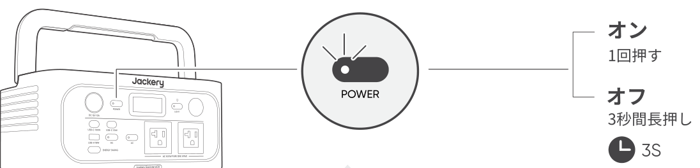
</figure>

省エネモードはオンの状態で、下記機能果たします：
<ul><li>ACまたはDCボタンがONの場合 6時間以内に充電・放電がない、または低出力状態が続くと、すべての出力が自動OFFになり、電源が切れる。（低出力状態の定義については、「省エネモードの項目をご参照ください。）</li><li>AC/DC出力ボタンOFF、かつLEDライトOFFの場合 デフォルトの待機時間は2時間であり、2時間以内に充電・放電がないと、自動的に電源がOFFになる。</li></ul>

### USB/カーポート出力オン/オフ

* 主電源がオンになっていることを確認します。

<figure class="hb-reference-figure" data-component-id="HB-SPECIAL-REFERENCE-FIGURE" data-reference-id="howto-usb-car-output" data-source-fragment-sha256="0329238cb55d24577ab3d42850ac60e9b54ac212e62688db08b292243351a86c" data-step-captions="embedded">
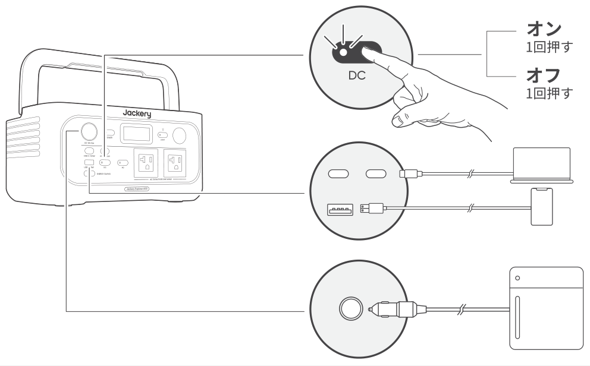
</figure>

<table class="manual-callout-table manual-callout-table"><tbody><tr><td class="manual-callout-label">ご注意</td><td class="manual-callout-body"><ul><li>本製品は、Jackery 12Vカーバッテリー充電ケーブルを使用することで、車のバッテリーへの充電が可能です。12V車専用であり、24V車には対応しておりません。※充電ケーブルは別売りとなります。Jackery公式サイトにてお求めいただけます。</li><li>本製品の12V DC出力（シガーソケット）から車のバッテリーへ充電中は、エンジンを始動しないでください。製品の故障につながる恐れがあります。</li><li>この機能はあくまで車のバッテリーの緊急補助用であり、深刻なバッテリー上がりや故障したバッテリーには対応しておりません。</li></ul></td></tr></tbody></table>

### AC出力のオン/オフ

* 主電源ボタンがオンになっていることを確認してください。

<figure class="hb-reference-figure" data-component-id="HB-SPECIAL-REFERENCE-FIGURE" data-reference-id="howto-ac-output" data-source-fragment-sha256="10742ecfa50337dd54f066c71589053bdda9f3c84aaee0d70341f7bef8dedcc9" data-step-captions="embedded">
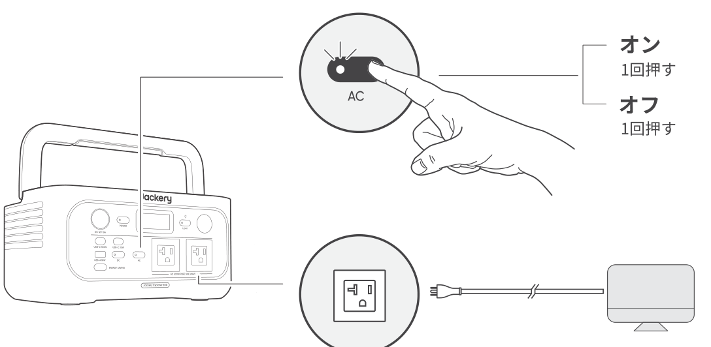
</figure>

### LEDライト

LEDライトには、照明モードとSOSモードの<strong>2</strong>つのモードがあります。 LEDスイッチを短く押すとLEDライトが点灯し、再度短く押すとSOSモードに切り替わります。いずれのモードでも、LEDスイッチを長押しすることでLEDライトを消灯できます。

<figure class="hb-reference-figure" data-component-id="HB-SPECIAL-REFERENCE-FIGURE" data-reference-id="howto-led-light" data-source-fragment-sha256="fdce046f1c422470d5857cf317b602bf008e296880ee22c35c412a264a9c6f52" data-step-captions="embedded">
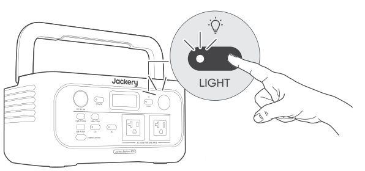
</figure>

### LCDディスプレイ

<table class="manual-table"><tbody><tr><td rowspan="3">LCD画面</td><td>オンにする</td><td>主電源ボタンを押すか、充電入力がある場合。</td></tr><tr><td>オフにする</td><td>主電源ボタンを押します。</td></tr><tr><td>自動オフ</td><td>2分間操作がないとLCDは自動的に消灯し、スリープモードになります。</td></tr><tr><td rowspan="3">常時点灯ディスプレイモード （充電または放電状態）</td><td>オンにする</td><td>LCD画面がオンのときに主電源ボタンをダブルクリックします。</td></tr><tr><td>オフにする</td><td>主電源ボタンを押します。</td></tr><tr><td>自動オフ</td><td>常時点灯ディスプレイモードは、2時間操作がないと自動的に消灯します。</td></tr></tbody></table>

### 省エネモード

【動作条件】 ●省エネモードON設定時： ・低出力状態継続6時間→全出力自動OFF ・ACまたはDC出力ボタがオンのままで、充放電なしで6時間→本体電源自動OFF ●省エネモードOFF設定時： ・自動OFF機能無効 ●オンとオフの設定方法： ・手動設定は下記画像にてご参照

【機能目的】 バッテリーの無駄な消耗を防ぐ自動電源OFF機能 ※本機能をご利用になる場合は、省エネモードを手動でONに設定してください

※ 低出力状態の定義： ・AC出力が25W以下 ・DC出力（USB＋シガーソケット出力）が2W以下

<figure class="hb-reference-figure" data-component-id="HB-SPECIAL-REFERENCE-FIGURE" data-reference-id="howto-energy-saving" data-source-fragment-sha256="c35cee538fc9c2ea3f61650555c1aa638b1289beb6a04c8771a786b3bbac8b19" data-step-captions="embedded">
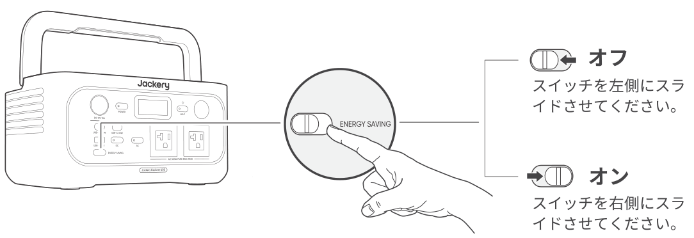
</figure>

<table class="manual-callout-table manual-callout-table"><tbody><tr><td class="manual-callout-label">ご注意</td><td class="manual-callout-body"><ul><li>はじめてお使いになるときは、本製品をフル充電してからご使用ください。</li><li>低消費電力の機器をご使用の場合は、出力が途中で切れないよう、省エネモードを「オフ」にしてください。</li></ul></td></tr></tbody></table>

50Hz/60Hz周波数の切り替え:

※ 工場出荷時のデフォルト設定は60Hzに設定されています。 自動識別: お客様のお住まいの地域に応じて周波数を自動的に識別し、対応する出力に自動調整されます。 手動調整: AC出力ボタンを長押しすることで周波数を切り替えることができ、対応する周波数が画面に表示されます。

<figure class="hb-reference-figure" data-component-id="HB-SPECIAL-REFERENCE-FIGURE" data-reference-id="lcd-50-60hz" data-source-fragment-sha256="40018020669bacc0b417befc8ce86217d66400a4222a2d37deaa5fb991810f49" data-step-captions="embedded">
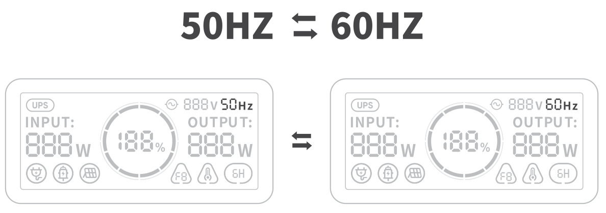
</figure>

## UPS 機能

<figure class="hb-reference-figure" data-component-id="HB-SPECIAL-REFERENCE-FIGURE" data-reference-id="ups-connection" data-source-fragment-sha256="974dbd9554cbe06160326cf12dfa4ff9ddd15ed2292f7287ac2a8fccca051b33" data-step-captions="embedded">
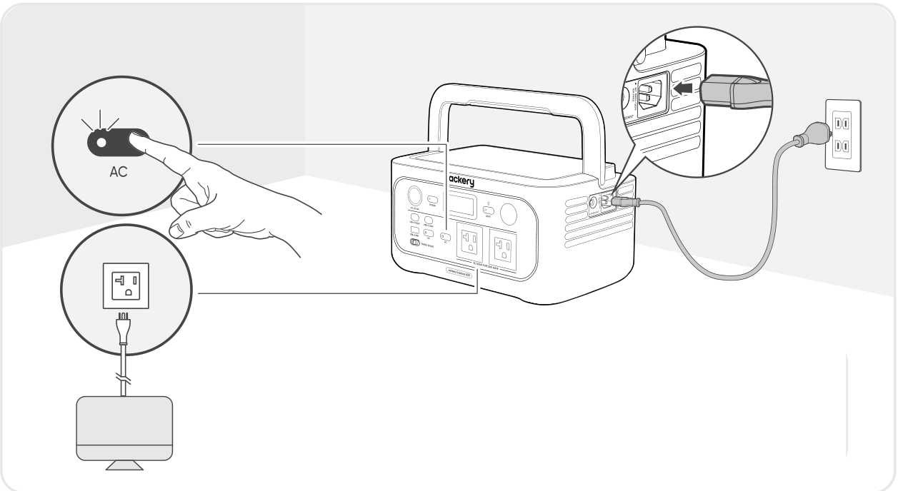
</figure>

電気製品のコンセントをポータブル電源の  AC  出力ポートに接続し、ポータブル電源の AC 入力ポートを家庭のコンセントにつなぐことで、停電時などにポータブル電源を予備電源として活用できます。

本製品は、電気系統（家庭内の電源など）が突然停止した場合、自動的にバッテリー給電モードに切り替わる UPS（無停電電源装置）機能を備えています。切替時間は約 10 ミリ秒（0.010 秒）以内です。 ただし、本機能は 0ms での完全な無停止給電には対応しておりません。そのため、以下のような高精度な連続電源供給を必要とする機器への接続はお控えください：
<ul><li>データサーバー</li><li>ワークステーション</li><li>医療機器など</li></ul>
これらの機器でご使用を希望される場合は、事前に複数回の動作テストを実施し、機器との互換性をご確認の上でご使用ください。 また、複数の高負荷機器を同時に接続した場合、過負荷保護が作動し電源が遮断される可能性があります。使用時はできるだけ一台の機器のみを接続することを推奨します。 ※記載の手順に従わずに機器が正常に動作しなかったり、データ消失などの損害が発生した場合、弊社では責任を負いかねます。あらかじめご了承ください。

## 充電方法

<strong>グリーンエネルギー優先モード:</strong>

本製品はグリーンエネルギー優先モードを搭載していますが、ソーラーパネルとAC充電ケーブルを使って同時に充電できます。同時に充電すると、ソーラーが優先されますが、バッテリーの最大許容電力で同時に充電されます。

<table class="manual-callout-table manual-callout-table"><tbody><tr><td class="manual-callout-label">ご注意</td><td class="manual-callout-body">
1.製品の充電動作温度範囲は-20°C~45°C、放電動作温度範囲は-20°C〜45°Cです。上限・下限温度を超えた場合、充放電が制限され、または充放電不可の可能性があります。 2.温度によって、製品の充電効率と実際の容量は異なります。
</td></tr></tbody></table>

<table class="manual-callout-table manual-callout-table"><tbody><tr><td class="manual-callout-label">ご注意</td><td class="manual-callout-body"><ul><li>はじめてお使いになるときは、本製品をフル充電してからご使用ください。</li><li>充電池は空の状態で長期保管 (3 カ月〜 6 カ月）すると、性能が劣化したり、充電できなくなる場合があります。</li><li>長期保管中は、電池残量が 0%にならないよう、3 か月に一度の充電をおすすめします。</li></ul></td></tr></tbody></table>

### AC充電ケーブル

付属のAC充電ケーブルをご使用ください。 コンセントよりJackery ポータブル電源 600 New 本体に充電する場合、電流容量が大きいため、他機器と併用したり途中接続をすると、コンセントの電流上限値を超え充電停止したり、配線やコンセント・接続部が発熱し、火災の原因となる恐れがあります。必ず電源タップなどを介して他の電気製品と併用しないでください。

<table class="manual-callout-table manual-callout-table"><tbody><tr><td class="manual-callout-label">ご注意</td><td class="manual-callout-body">
AC 充電ケーブルのプラグが製品の AC 入力ポートにしっかりと、かつ完全に差し込まれていることを確認してください。差し込みが不完全な場合、電流の不安定、発熱、接触不良などが発生し、機器の正常な動作に支障をきたす恐れがあります。
</td></tr></tbody></table>

<figure class="hb-reference-figure" data-component-id="HB-SPECIAL-REFERENCE-FIGURE" data-reference-id="charge-ac" data-source-fragment-sha256="2fd3b9a79bcaba1279429b1067896415b11c57df745dac6183ba83a9e5da1ae8" data-step-captions="embedded">
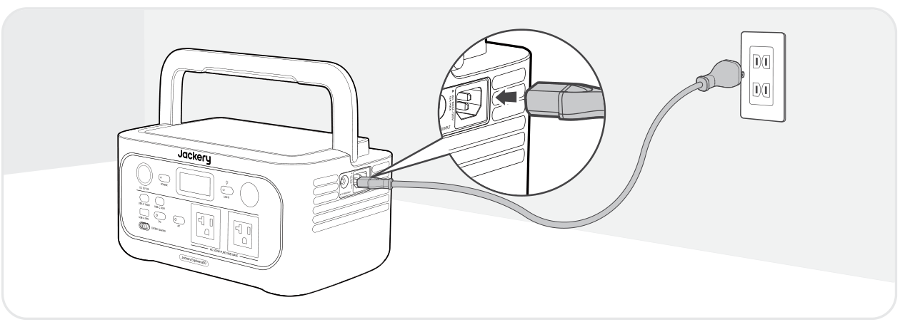
</figure>

### ソーラー充電

Jackery ポータブル電源 600 New は、DC8020 入力ポートを 1 つ搭載しており、DC 入力の最大電力は 200W です。Jackery ソーラーパネルと組み合わせて使用できます。

<table class="manual-callout-table manual-callout-table"><tbody><tr><td class="manual-callout-label">ご注意</td><td class="manual-callout-body">
ソーラーパネルを接続する際は、パネルの開放電圧 (Voc) がポータブル電源の DC 入力電圧範囲（16 〜 60V）内であることをご確認ください。過電圧による製品の損傷を防ぐためです。
</td></tr></tbody></table>

ソーラーパネル1枚を接続する場合は、DC入力ポート（8020メス）にソーラーパネルの8020オスを直接接続してください。追加アクセサリーは不要です。

<figure class="hb-reference-figure" data-component-id="HB-SPECIAL-REFERENCE-FIGURE" data-reference-id="charge-solar-single" data-source-fragment-sha256="c9cd821b6b598cdfebc0fdc2b2c03f4fd28c3384a571849b2c0746b5cf76a5f6" data-step-captions="embedded">
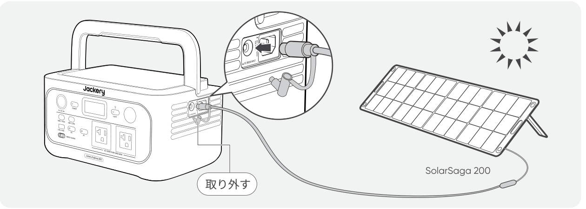
</figure>

1 つの DC8020 ポートに 2 枚のソーラーパネルを同時に接続する場合は、別売りのJackery SolarSaga アダプター（Pro/Plus/New専用）を使用してください。接続イメージは以下をご参照ください。

<figure class="hb-reference-figure" data-component-id="HB-SPECIAL-REFERENCE-FIGURE" data-reference-id="charge-solar-dual" data-source-fragment-sha256="87349024a2891b783ce4d4f7e02046caa6836321b4b241a77b818b840060fc6e" data-step-captions="embedded">
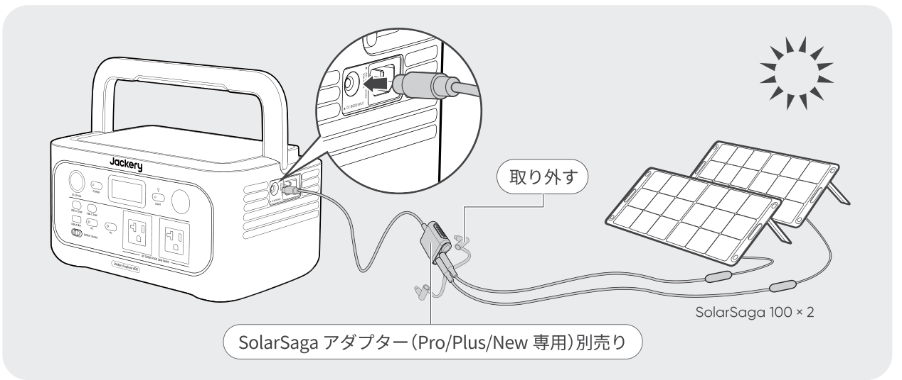
</figure>

<table class="manual-callout-table manual-callout-table"><tbody><tr><td class="manual-callout-label">充電に関する安全上のご注意</td><td class="manual-callout-body">
※ 2  枚のソーラーパネルを同時にご使用になる場合は、必ず同一型番のパネルをご使用ください。本製品は最大 200W までのソーラー入力に対応しています。

※ Jackery ブランド以外の付属品を使用して充電しないでください。特に、ソーラーパネルで充電する際は、Jackery  のソーラーパネルを使用することをお勧めします。他社ソーラーパネルで充電することによる損失について、当社は一切の責任を負いません。
</td></tr></tbody></table>

### シガーソケット充電

本製品は、12V/10A 出力の車載シガーソケットからの充電に対応しています。 ご使用の際は、以下にご注意ください：

<ul><li>必ず車のエンジンを始動させてから接続してください。エンジン停止状態で使用すると、車両のバッテリーが上がる恐れがあります。</li><li>車の充電ポートとシガーソケット充電ケーブルの接触状態をご確認ください。</li><li>ケーブルが確実に奥まで差し込まれていることをご確認ください。</li><li>悪路などで車両の振動が激しい場合は、接触不良や発熱・焼損の恐れがあるため、充電を中止してください。</li><li>誤使用による故障・損傷については、弊社では責任を負いかねます。あらかじめご了承ください。</li></ul>

<figure class="hb-reference-figure" data-component-id="HB-SPECIAL-REFERENCE-FIGURE" data-reference-id="charge-car" data-source-fragment-sha256="e111b018f04adcd1fd778c21dcf7d0df7e6c285dc08c8ff1c7c1f2589b273d59" data-step-captions="embedded">
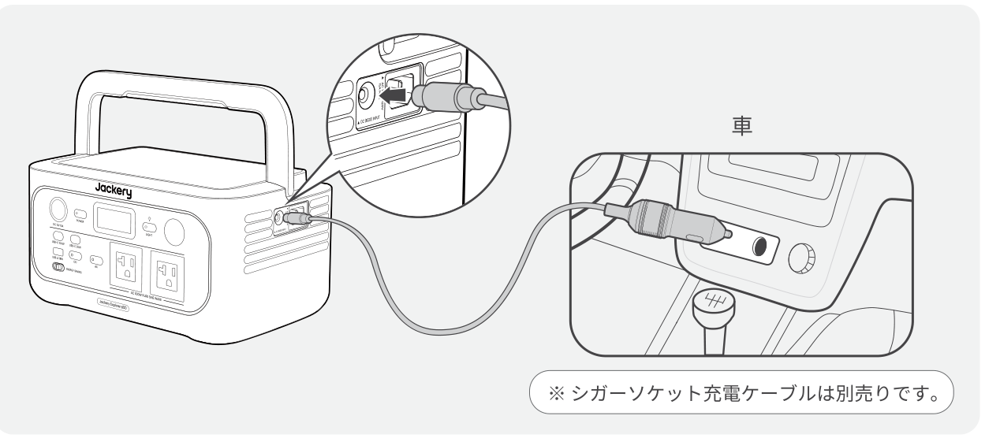
</figure>

<table class="manual-callout-table manual-callout-table"><tbody><tr><td class="manual-callout-label">充電に関する安全上のご注意</td><td class="manual-callout-body">
1)  シガーソケット充電とソーラー充電を同時に使用しないでください。同時に使用すると、車のヒューズが損傷する可能性があります。

2) シガーソケット充電は  12V, 10A  車専用で、24V  車は充電できません。人身傷害や物的損害を避けるため、本製品の充電に 24V 車を使用しないでください。
</td></tr></tbody></table>

## 主な仕様

<h2 class="hb-spec-group">基本情報</h2>

<figure aria-label="基本情報" class="hb-spec-table-composition"><table class="manual-table manual-spec-table hb-spec-table"><colgroup><col class="hb-spec-col-label"/><col class="hb-spec-col-value"/></colgroup><tbody><tr><th class="manual-spec-label hb-spec-label" scope="row">製品の名称</th><td class="manual-spec-value hb-spec-value">Jackery ポータブル電源 600 New</td></tr><tr><th class="manual-spec-label hb-spec-label" scope="row">型番</th><td class="manual-spec-value hb-spec-value">JE-600A</td></tr><tr><th class="manual-spec-label hb-spec-label" scope="row">バッテリータイプ</th><td class="manual-spec-value hb-spec-value">LiFePO4（リン酸鉄リチウムイオン電池）</td></tr><tr><th class="manual-spec-label hb-spec-label" scope="row">定格容量</th><td class="manual-spec-value hb-spec-value">20Ah/32V DC (640Wh)</td></tr><tr><th class="manual-spec-label hb-spec-label" scope="row">サイズ＆重量</th><td class="manual-spec-value hb-spec-value">約311x205x157 mm (約6.4 kg）</td></tr><tr><th class="manual-spec-label hb-spec-label" scope="row">サイクル寿命</th><td class="manual-spec-value hb-spec-value">6,000回の充放電後も容量の70%以上を維持</td></tr></tbody></table></figure>

<h2 class="hb-spec-group">入力ポート</h2>

<figure aria-label="入力ポート" class="hb-spec-table-composition"><table class="manual-table manual-spec-table hb-spec-table"><colgroup><col class="hb-spec-col-label"/><col class="hb-spec-col-value"/></colgroup><tbody><tr><th class="manual-spec-label hb-spec-label" scope="row">AC入力</th><td class="manual-spec-value hb-spec-value">100V-120V ~ 50Hz/60Hz, 最大15A,  最大550W±50W①</td></tr><tr><th class="manual-spec-label hb-spec-label" scope="row">DC入力ポート</th><td class="manual-spec-value hb-spec-value">PV 16V-60V⎓10.5A, 最大200W</td></tr><tr><th class="manual-spec-label hb-spec-label" scope="row">ｼｶﾞｰｿｹｯﾄ</th><td class="manual-spec-value hb-spec-value">11V-16V⎓電流制限8A</td></tr></tbody></table></figure>

<h2 class="hb-spec-group">出力ポート</h2>

<figure aria-label="出力ポート" class="hb-spec-table-composition"><table class="manual-table manual-spec-table hb-spec-table"><colgroup><col class="hb-spec-col-label"/><col class="hb-spec-col-value"/></colgroup><tbody><tr><th class="manual-spec-label hb-spec-label" scope="row">2×AC出力</th><td class="manual-spec-value hb-spec-value">100V ~ 50Hz/60Hz, 2ポート合計500W (瞬間最大1000W)</td></tr><tr><th class="manual-spec-label hb-spec-label" scope="row">USB-A出力</th><td class="manual-spec-value hb-spec-value">5-6V⎓3A, 6-9V⎓2A, 9-12V⎓1.5A, 最大18W</td></tr><tr><th class="manual-spec-label hb-spec-label" scope="row">USB-C1出力</th><td class="manual-spec-value hb-spec-value">5V⎓3A, 9V⎓3A, 12V⎓3A, 15V⎓3A, 20V⎓5A, 最大100W</td></tr><tr><th class="manual-spec-label hb-spec-label" scope="row">USB-C2出力</th><td class="manual-spec-value hb-spec-value">5V⎓3A, 9V⎓3A, 12V⎓2.5A, 15V⎓2A, 20V⎓1.5A, 最大30W</td></tr><tr><th class="manual-spec-label hb-spec-label" scope="row">シガーソケット出力</th><td class="manual-spec-value hb-spec-value">12V⎓最大10A</td></tr><tr><th class="manual-spec-label hb-spec-label" scope="row">パススルー充電AC出力</th><td class="manual-spec-value hb-spec-value">100V-120V ~ 50Hz/60Hz, 最大500W</td></tr></tbody></table></figure>

<h2 class="hb-spec-group">温度範囲</h2>

<figure aria-label="温度範囲" class="hb-spec-table-composition"><table class="manual-table manual-spec-table hb-spec-table"><colgroup><col class="hb-spec-col-label"/><col class="hb-spec-col-value"/></colgroup><tbody><tr><th class="manual-spec-label hb-spec-label" scope="row">充電温度</th><td class="manual-spec-value hb-spec-value">-20°C~45°C (-4°F~113°F)</td></tr><tr><th class="manual-spec-label hb-spec-label" scope="row">動作温度</th><td class="manual-spec-value hb-spec-value">-20°C~45°C (-4°F~113°F)</td></tr><tr><th class="manual-spec-label hb-spec-label" scope="row">保存温度</th><td class="manual-spec-value hb-spec-value">1ヶ月 -20°C~45°C (-4°F~113°F); 3ヶ月 0°C~45°C (32°F~113°F); 1年 0°C~25°C (32°F~77°F)</td></tr></tbody></table></figure>

認証：　UN38.3

①この数値は最大充電電力のみを示しています。実際の充電電力は、温度、バッテリー残量（SOC）、アプリの設定により変動する場合があります。

※USB Type-C® and USB-C® are registered trademarks of USB Implementers Forum.

## 保証について

このたびは Jackery 製品をご購入いただき、誠にありがとうございます。 本保証書は、Jackery ポータブル電源製品に関する保証内容を明確にご案内するものです。 ご使用前に必ずご確認のうえ、大切に保管してください。

### 保証期間

<figure aria-label="保証期間" class="hb-warranty-card" data-component-id="HB-WARRANTY-SECTION" data-warranty-card-index="1">
1. 保証期間はご購入日から 3 年間です。

2. また、延長保証にご登録いただくと、さらに 2 年間の保証が追加されます。詳しくは Jackery 公式サイトをご確認ください。

※ Jackery 公式オンラインストアまたは正規代理店以外での購入品は保証対象外となります。
</figure>

### 保証の適用範囲

<figure aria-label="保証の適用範囲" class="hb-warranty-card" data-component-id="HB-WARRANTY-SECTION" data-warranty-card-index="2">
1. 購入チャネルについて 本保証は、Jackery公式オンラインストアまたは正規代理店で購入された製品に限り有効です。

※ Jackery 公式オンラインストアまたは正規代理店以外での購入品は保証対象外となります。

2. 保証提供地域 保証は、日本国内に在住の方が、日本国内で使用する場合に限り有効です。
</figure>

### 保証の適用条件

<figure aria-label="保証の適用条件" class="hb-warranty-card" data-component-id="HB-WARRANTY-SECTION" data-warranty-card-index="3">
以下のすべての条件を満たす場合に、保証の適用対象となります：
<ul><li>Jackery公式オンラインストアまたは正規代理店にてご購入されたこと</li><li>保証期間内であること</li><li>下記の「保証対象外」に該当しないこと</li></ul></figure>

### 保証対象外となる場合

<figure aria-label="保証対象外となる場合" class="hb-warranty-card" data-component-id="HB-WARRANTY-SECTION" data-warranty-card-index="4">
以下のいずれかに該当する場合、保証期間内であっても保証の対象外となります： 1.故障・損傷が保証期間内に発生していても、保証期間終了後に申請された場合 2.使用上の誤り（取扱説明書や本体ラベルに記載の注意事項に従わなかった使用）による故障・損傷 3.他機器からの影響、不適切な修理または改造による故障・損傷 4.移設・輸送・落下などに起因する故障・損傷 5.火災・地震・風水害・落雷などの天災、または公害・塩害・異常電圧などによる故障・損傷 6.消耗部品の劣化や摩耗、または外観の汚損など
</figure>

### 購入証明について

<figure aria-label="購入証明について" class="hb-warranty-card" data-component-id="HB-WARRANTY-SECTION" data-warranty-card-index="5">
保証をご利用の際には、以下いずれかの購入証明書類をご提示いただく必要があります：
<ul><li>Jackery公式オンラインストアでの購入：注文番号（注文履歴画面または確認メール）</li><li>正規代理店での購入：購入日・販売店名の記載された領収書または納品書</li></ul>
※  ご提示がない場合、保証対応いたしかねます。
</figure>

### 保証内容

<figure aria-label="保証内容" class="hb-warranty-card" data-component-id="HB-WARRANTY-SECTION" data-warranty-card-index="6">
<strong>1. 初期不良による交換</strong>（ご購入日から30日以内）
<ul><li>取扱説明書に従った正常な使用中に不具合が発生した場合、同一製品の新品と交換いたします。</li><li>在庫切れや販売終了の場合は、同等品への交換または返金にて対応いたします。</li></ul>
<strong>2. 無償修理</strong>（ご購入日から30日以上〜保証期間内）
<ul><li>保証条件を満たす自然故障については、無料で修理対応いたします。</li><li>修理が困難な場合は、同等品（同モデルまたは同等スペック品）への交換にて対応いたします。</li></ul>
<strong>3. 有償修理</strong> 以下に該当する場合は、有償での修理対応となります：
<ul><li>保証期間を超えた製品</li><li>保証対象外と判断された場合</li><li>Jackery公式オンラインストアまたは正規代理店以外で購入された製品</li></ul>
有償修理後の保証期間は、修理完了日より90日間です。

※ 無償修理の場合、残りの保証期間が90日未満であれば「90日間」、90日以上であれば「元の保証期間に準じます」。
</figure>

### 免責事項

1. 弊社では、いかなる場合においても、間接的損害または付随的損害（データの損失・逸失利益など）に対して責任を負いません。

2. 本保証書は、お客様が法律上有する権利を制限するものではありません。

3. 保証内容は、予告なく変更される場合がございます。あらかじめご了承ください。

Jackery 製品を安心してご使用いただくために、本保証書の内容をご確認のうえ、ご活用くださいますようお願いいたします。

ご不明点がございましたら、Jackery カスタマーサービスまでお問い合わせください。

公式サイト: http://www.jackery.jp

カスタマーサポート: jackery.jp@jackery.com

お問い合わせ電話番号: 050-3198-9007

