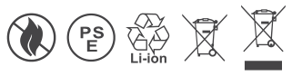
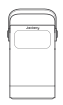
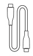
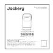
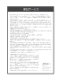
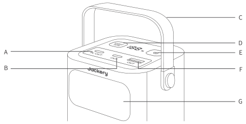
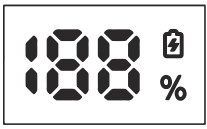
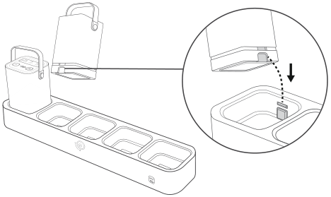
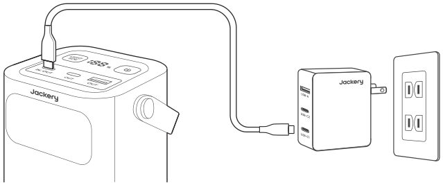
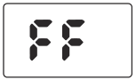

## 1.主な仕様

<figure aria-label="1.主な仕様" class="hb-spec-table-composition"><table class="manual-table manual-spec-table hb-spec-table"><colgroup><col class="hb-spec-col-label"/><col class="hb-spec-col-value"/></colgroup><tbody><tr><th class="manual-spec-label hb-spec-label" scope="row">製品名 :</th><td class="manual-spec-value hb-spec-value">Jackery Power Bank</td></tr><tr><th class="manual-spec-label hb-spec-label" scope="row">色/型番 :</th><td class="manual-spec-value hb-spec-value">ブラック + オレンジ : JE-76A ホワイト : JE-76A-WH</td></tr><tr><th class="manual-spec-label hb-spec-label" scope="row">充電温度 :</th><td class="manual-spec-value hb-spec-value">0°C~45 °C (32°F~113 °F)</td></tr><tr><th class="manual-spec-label hb-spec-label" scope="row">作動温度 :</th><td class="manual-spec-value hb-spec-value">-10°C~45 °C (14°F~113 °F)</td></tr><tr><th class="manual-spec-label hb-spec-label" scope="row">保存温度 :</th><td class="manual-spec-value hb-spec-value">1ヶ月 -20°C~45°C (-4°F~113°F); 3ヶ月 0°C~45°C (32°F~113°F); 12ヶ月 0°C~25°C (32°F~77°F)</td></tr><tr><th class="manual-spec-label hb-spec-label" scope="row">材質 :</th><td class="manual-spec-value hb-spec-value">PC+ABS</td></tr><tr><th class="manual-spec-label hb-spec-label" scope="row">バッテリータイプ :</th><td class="manual-spec-value hb-spec-value">LiFePO4 (リン酸鉄リチウムイオン電池)</td></tr><tr><th class="manual-spec-label hb-spec-label" scope="row">定格容量 :</th><td class="manual-spec-value hb-spec-value">76.8Wh</td></tr><tr><th class="manual-spec-label hb-spec-label" scope="row">入力 :</th><td class="manual-spec-value hb-spec-value">接点充電, USB-C1</td></tr><tr><th class="manual-spec-label hb-spec-label" scope="row">USB-C1 入力 :</th><td class="manual-spec-value hb-spec-value">最大 60W, 5V⎓3A, 9V⎓3A, 12V⎓3A, 15V⎓3A, 20V⎓3A</td></tr><tr><th class="manual-spec-label hb-spec-label" scope="row">出力 :</th><td class="manual-spec-value hb-spec-value"></td></tr><tr><th class="manual-spec-label hb-spec-label" scope="row">USB-C1 出力 :</th><td class="manual-spec-value hb-spec-value">最大 100W, 5V⎓3A, 9V⎓3A, 12V⎓3A, 15V⎓3A, 20V⎓5A</td></tr><tr><th class="manual-spec-label hb-spec-label" scope="row">USB-C2 出力 :</th><td class="manual-spec-value hb-spec-value">最大 65W, 5V⎓3A, 9V⎓3A, 12V⎓3A, 15V⎓3A, 20V⎓3.25A</td></tr><tr><th class="manual-spec-label hb-spec-label" scope="row">USB-A 出力 :</th><td class="manual-spec-value hb-spec-value">最大 18W, 5-6V⎓3A, 6-9V⎓2A, 9-12V⎓1.5A</td></tr><tr><th class="manual-spec-label hb-spec-label" scope="row">同時出力(最大) :</th><td class="manual-spec-value hb-spec-value"></td></tr><tr><th class="manual-spec-label hb-spec-label" scope="row">USB-C1+USB-C2 出力 :</th><td class="manual-spec-value hb-spec-value">65W+35W</td></tr><tr><th class="manual-spec-label hb-spec-label" scope="row">USB-C1+USB-A 出力 :</th><td class="manual-spec-value hb-spec-value">100W+18W</td></tr><tr><th class="manual-spec-label hb-spec-label" scope="row">USB-C2+USB-A 出力 :</th><td class="manual-spec-value hb-spec-value">65W+18W</td></tr><tr><th class="manual-spec-label hb-spec-label" scope="row">USB-C1+USB-C2+USB-A 出力 :</th><td class="manual-spec-value hb-spec-value">65W+35W+18W</td></tr><tr><th class="manual-spec-label hb-spec-label" scope="row">サイズ＆重量 :</th><td class="manual-spec-value hb-spec-value">約80 x 80 x 131 mm (約860g)</td></tr><tr><th class="manual-spec-label hb-spec-label" scope="row">サイクル数 :</th><td class="manual-spec-value hb-spec-value">3000 サイクル（3000サイクル使用後も工場出荷時の80%の電池残量を保持）</td></tr></tbody></table></figure>

(@0.5C/0.5C&amp;90%DOD &amp; Ta=25°C)

認証：

<figure class="hb-reference-figure" data-component-id="HB-SPECIAL-REFERENCE-FIGURE" data-reference-id="certifications" data-source-fragment-sha256="14479b2fa4c42478a5449c9ec50c0cbc1ff1bf4c565123391533e09c478be785" data-step-captions="embedded">

</figure>

※USB Type-C® and USB-C® are registered trademarks of USB Implementers Forum.

## 2.同梱品

<figure aria-label="2.同梱品" class="hb-inbox-composition" data-card-count="4" data-component-id="HB-SPECIAL-INBOX" data-inbox-variant="responsive-card-grid"><ol class="hb-inbox-grid"><li class="hb-inbox-card" data-item-number="1">

Power Bank

</li><li class="hb-inbox-card" data-item-number="2">

1m USB-C to USB-C 電源ケーブル

</li><li class="hb-inbox-card" data-item-number="3">

取扱説明書

</li><li class="hb-inbox-card" data-item-number="4">

保証案内書

</li></ol></figure>

※付属品を故障、紛失等してしまった場合はカスタマーサポートまでご連絡ください。

<strong>本機の仕様および外観は、改善のため予告なく変更することがあります。</strong>

<table class="manual-table"><tbody><tr><td></td><td>
<strong>充電式電池のリサイクルについて</strong>

本機はリサイクル可能な充電池を内蔵しています。

この商品を廃棄する場合は、当社のカスタマーサポートにご連絡ください。

充電池の取りはずしはお客様自身では行わないでください。
</td></tr></tbody></table>

## 3.使用製品

### 【Jackery Power Bank】

<figure class="hb-reference-figure" data-component-id="HB-SPECIAL-REFERENCE-FIGURE" data-reference-id="overview" data-source-fragment-sha256="2a8783cb09b5b98839f354226a27381f34b26fedfd89764cb2c63970ce3da0ab" data-step-captions="embedded">

</figure>

A. USB-C1 入出力ポート 最大入力60W /最大出力100W

B. USB-C2 出力ポート 最大出力65W

C. ハンドル

D. ランプボタン（電源オンの状態で短く押すとLEDランプが点灯し、クリックしたらSOSモードに切り替わり、再度クリックするとLEDランプが消灯します。また、ランプボタンを長押しすることでもLEDランプ消灯となります。

E. メイン電源ボタン

短く押すと電源オンとなります。

電源オンの状態で３秒長押しすると電源オフとなります。

電源オンの状態でメイン電源ボタンをダブルクリックすると常時点灯となります。

電源オンの状態でバッテリー残量が0%以上の場合は、充放電しなければ２時間後に自動電源オフとなります。

バッテリー残量が 0% の場合、充放電しなければ 10 秒後に自動的に電源オフとなります。

F. USB-A 出力ポート 最大出力18W

G. LEDランプ

## 4.LCD表示画面

<figure class="hb-reference-figure" data-component-id="HB-SPECIAL-REFERENCE-FIGURE" data-reference-id="lcd-map" data-source-fragment-sha256="517114960014938d84dcd9d15552de6742f4d3bfe3b2044382a9e3cab0f0ddaa" data-step-captions="embedded">

</figure>

<figure aria-label="4.LCD表示画面" class="hb-lcd-table-composition" data-component-id="HB-TABLE-LCD-ICON" tabindex="0"><table class="hb-lcd-icon-table"><colgroup><col class="hb-lcd-col-icon"/><col class="hb-lcd-col-name"/><col class="hb-lcd-col-description"/></colgroup><tbody><tr><td class="hb-lcd-icon"></td><td class="hb-lcd-name">バッテリー残量（%）</td><td class="hb-lcd-description">*システムにエラーが発生した場合、バッテリー残量表示の後ろの二桁が該当するエラーコード（F0/F1等）を表示します。</td></tr><tr><td class="hb-lcd-icon"></td><td class="hb-lcd-name">充電表示ランプ</td><td class="hb-lcd-description">（充電中はランプが点灯し、満充電になると消灯する）</td></tr></tbody></table></figure>

### LCD表示画面の立ち上げ

<table class="manual-table"><thead><tr><th>状態</th><th>操作</th><th>結果</th></tr></thead><tbody><tr><td rowspan="2">オフ状態</td><td>接続し、充電する</td><td>画面が点灯し、充電アイコンが表示される</td></tr><tr><td>オンにする</td><td>画面が点灯する</td></tr><tr><td rowspan="3">オン状態</td><td>メイン電源/ランプボタンを短く押す</td><td>画面が点灯する</td></tr><tr><td>接続し、充電する</td><td>画面が点灯し、充電アイコンが表示される</td></tr><tr><td>メイン電源ボタンをダブルクリックする</td><td>画面が常時点灯する</td></tr></tbody></table>

### LCD表示画面のシャットダウン

<table class="manual-table"><thead><tr><th>状態</th><th>操作</th><th>結果</th></tr></thead><tbody><tr><td rowspan="3">画面が点灯状態</td><td>メイン電源ボタンを短く押す</td><td>画面が消灯する</td></tr><tr><td>2分以上の充放電無し状態</td><td>自動消灯する</td></tr><tr><td>オフにする</td><td>画面が点灯する</td></tr></tbody></table>

## 5.充電の方法

### Power Bank を充電する

Power Bank を充電ステーションに置くと自動的に充電が開始します。挿し込む時には溝にしっかりと挿さるように入れてください。なお、Power Bank の電池残量が 0%から 100%に満充電する時間は約 1.6 時間です

<figure class="hb-reference-figure" data-component-id="HB-SPECIAL-REFERENCE-FIGURE" data-reference-id="charging-station" data-source-fragment-sha256="b4524600f9d539b875a0b08f031691b91f15d1249d766cf0b13290e5259d7631" data-step-captions="embedded">

</figure>

### ご注意

<ul><li>
Power Bank と充電ステーションを同時に充電すると、充電ステーションのみが充電され、Power Bank は充電されません。
</li><li>
Power Bank の充電中、USB-A と USB-C を使ってデバイスを充電することはできますが、バッテリーの寿命に影響を与えるリスクがあるため、長時間の使用はご遠慮ください。
</li></ul>

### Power Bank をUSB-Cで充電する

Power Bank は PD 充電プラグを使うことで USB-C で直接充電することができます。充電する際は USB-C1 に接続してください。

<figure class="hb-reference-figure" data-component-id="HB-SPECIAL-REFERENCE-FIGURE" data-reference-id="charging-usb-c" data-source-fragment-sha256="65f855137bdd9b15e4c154938163c26ce5ba90d1f1f85a01544858f8fa0e7344" data-step-captions="embedded">

</figure>

## 6.温度保護機能

充電中、Power Bank の内蔵バッテリーが 0°C以下または 53°C以上の場合は温度保護起動が働き、充電停止となります。一方、放電中に Power Bank の内蔵バッテリーが-12°C以下または 58°C以上の場合は温度保護機能が働き、放電停止となります。

* 上記の温度はいずれも +/-2°Cの誤差を許容します。

<strong>温度保護機能が働くとLCD表示画面にFFが表示されます。</strong>

<figure class="hb-reference-figure" data-component-id="HB-SPECIAL-REFERENCE-FIGURE" data-reference-id="lcd-ff" data-source-fragment-sha256="3c88331a15baf4d054911ab91404eaf3bb4a0ff6896c9b641db34f43aa84cec2" data-step-captions="embedded">

</figure>

## 7.エラーコード

<table class="manual-table"><thead><tr><th>番号</th><th>エラーの名前</th><th>説明(下記は内部故障メンテナンス用のみ)</th></tr></thead><tbody><tr><td>F0</td><td>BMS 通信エラー</td><td>
BMSとメインバード間の通信エラー
</td></tr><tr><td>F3</td><td>バッテリーエラー</td><td>
BMS内部エラーまたはバッテリーエラー
</td></tr><tr><td>F4</td><td>バッテリー過電圧</td><td>
バッテリー単体または全体の過電圧
</td></tr><tr><td>F5</td><td>バッテリー低電圧</td><td>
バッテリー単体または全体の低電圧

(充電表示がある場合は除外する)
</td></tr><tr><td>F8</td><td>過電流/ショート</td><td>
BMS 過電流/ショート保護
</td></tr><tr><td>F9</td><td>DC 出力過電流/ショート</td><td>
DC出力過電流またはショート
</td></tr><tr><td>FF</td><td>温度保護エラー</td><td>
セルは温度が高い/低い場合に保護機能が働く
</td></tr></tbody></table>

<table class="manual-callout-table manual-callout-table"><tbody><tr><td class="manual-callout-label">警告</td><td class="manual-callout-body">
<strong>万が一、次のような異常が発生したときはすぐに使用をやめる</strong>
<ul><li>煙が出ている、異臭がする</li><li>落としたり、破損したとき</li><li>異音がする</li><li>内部に水や異物が入ったとき</li><li>電源コード (ACアダプター) が傷んだとき</li></ul>
このような異常が発生したまま使用していると、火災や感電の原因になります。

すぐにACアダプターをコンセントから抜いてください。また、本製品に接続されている機器もすべて外してください。

<strong>万が一発煙や発火したら、大量の水で消火して煙が見えなくなるまで本製品を水浸しにしてください。</strong>

煙が出なくなることを確認してからカスタマーサポートにご連絡ください。

お客様による修理は危険ですので絶対におやめください。
</td></tr></tbody></table>

<table class="manual-callout-table manual-callout-table"><tbody><tr><td class="manual-callout-label">警告</td><td class="manual-callout-body">
<strong>分解、改造しない</strong>

故障、発熱、火災･感電の原因になります。
</td></tr></tbody></table>

<table class="manual-callout-table manual-callout-table"><tbody><tr><td class="manual-callout-label">警告</td><td class="manual-callout-body">
<strong>表示された電源電圧以外で使用しない</strong>

故障、発熱、火災･感電の原因になります。また、本製品を使用できるのは日本国内のみです。
</td></tr></tbody></table>

<table class="manual-callout-table manual-callout-table"><tbody><tr><td class="manual-callout-label">警告</td><td class="manual-callout-body">
<strong>付属品と本製品が破損した場合は、ご自身で修理をしない</strong>
</td></tr></tbody></table>

<table class="manual-callout-table manual-callout-table"><tbody><tr><td class="manual-callout-label">警告</td><td class="manual-callout-body">
<strong>火のそばや炎天下の車内、熱器具の周辺など高温（40°C以上）になる場所で使用したり、放置しない</strong>

発熱や発火、破裂する原因になります。
</td></tr></tbody></table>

<table class="manual-callout-table manual-callout-table"><tbody><tr><td class="manual-callout-label">警告</td><td class="manual-callout-body">
<strong>強い衝撃を与えたり、投げつけたりしない</strong>

発熱や発火、破裂する原因になります。
</td></tr></tbody></table>

<table class="manual-callout-table manual-callout-table"><tbody><tr><td class="manual-callout-label">警告</td><td class="manual-callout-body">
<strong>水など、液体を入れたり、濡らしたりしない</strong>

発熱や発火の原因になります。
</td></tr></tbody></table>

<table class="manual-callout-table manual-callout-table"><tbody><tr><td class="manual-callout-label">警告</td><td class="manual-callout-body">
<strong>濡れた手で本体や接続するケーブルを触らない</strong>

火災や感電の原因になります。
</td></tr></tbody></table>

<table class="manual-callout-table manual-callout-table"><tbody><tr><td class="manual-callout-label">警告</td><td class="manual-callout-body">
<strong>端子部にケーブル以外の金属類を差し込まない</strong>

発熱や発火の原因になります。
</td></tr></tbody></table>

<table class="manual-callout-table manual-callout-table"><tbody><tr><td class="manual-callout-label">警告</td><td class="manual-callout-body">
<strong>雷が鳴りだしたら、電源プラグにふれない (充電をしない)</strong>

感電の原因になります。
</td></tr></tbody></table>

<table class="manual-callout-table manual-callout-table"><tbody><tr><td class="manual-callout-label">警告</td><td class="manual-callout-body">
<strong>各接続端子には確実に差し込む</strong>

差し込みが不十分だと、発熱したりほこりが付着して火災や感電の原因になります。
</td></tr></tbody></table>

<table class="manual-callout-table manual-callout-table"><tbody><tr><td class="manual-callout-label">注意</td><td class="manual-callout-body">
<strong>本製品の上に物を載せたり、不安定な場所に置かない</strong>

倒れたり、落ちたりしてけがの原因になります。
</td></tr></tbody></table>

<table class="manual-callout-table manual-callout-table"><tbody><tr><td class="manual-callout-label">注意</td><td class="manual-callout-body">
<strong>次のような機器では、絶対に使用しないでください。万が一使用中に給電ができなくなった場合、命にかかわる被害が想定されます。</strong>
<ul><li>医療機器や使用上、生命に関わるような機器</li><li>社会的、公共的に重要な機器など</li><li>重要な事業用機器など</li></ul></td></tr></tbody></table>

<table class="manual-callout-table manual-callout-table"><tbody><tr><td class="manual-callout-label">注意</td><td class="manual-callout-body">
<strong>心臓にペースメーカーを装着している方は使用しない</strong>

ペースメーカーが、本製品の影響を受ける恐れがあります。
</td></tr></tbody></table>

## 8.免責事項

<ul><li>
火災、地震、第三者による行為、その他の事故、お客様の故意または過失誤用・誤動作・その他の異常な条件下での使用により生じた損害に関して、当社は一切責任を負いません。
</li><li>
付属品と本製品が破損した場合は、ご自身で修理を行わないでください。

ご自身で分解・修理したことにより生じた損害に関し、当社は一切責任を負いません。
</li><li>
保証範囲は利用規約に適用され、記載されていない内容は当社の保証範囲外となります。
</li><li>
取扱説明書の記載事項が遵守されないことにより生じた不適合について当社は責任を負いかねます。
</li><li>
本製品の使用、または使用不能から発生する付随的な損害(事業利益損失含む)、当社が関与しない接続機器との組み合わせによる誤動作などから生じた損害に関して、当社は一切の責任を負いません。
</li><li>
本製品は個人の安全に関係する製品、消費電力の大きな設備に給電できません。

えば、医療機器、核施設設備、CPAP（シーパップ）、スペースシャトルの製造などです。上記の設備、用途で使用した結果、火災、機器故障など個人の安全を脅かす事故が生じた場合、当社は一切責任を負いません。
</li></ul>

## 9.使用上のご注意

<ul><li>
始動電力が出力上限値(定格出力)を大幅に超える可能性のある製品のご利用や、定格出力を超え給電がストップした製品を繰り返し利用することは本製品が損傷するリスクがありますのでお控えください。
</li><li>
本製品は防塵･防水仕様ではありませんので、ほこりや水、海水などがかからないように注意してください。
</li><li>
ほこりが多い場所や高温多湿の場所での充電および使用、放置をしないでください。
</li><li>
充電または給電中は本製品が温かくなります(故障ではありません)、周囲には物を置かないでください。
</li><li>
本体が汚れたらコンセントから電源プラグを抜き、柔らかい布で乾拭きしてください。汚れがひどいときは、水または薄めた中性洗剤でふきとってください。シンナーやベンジンなどは絶対に使わないでください。
</li><li>
異常時に電源コードを容易に抜き差しできるスペースを空けておいてください。
</li><li>
接続機器の入力仕様が本製品の出力値の上限を超えている場合、電源を自動的に遮断します。消費電力が仕様以下であることを確認してから出力ボタンを押してください。
</li><li>
低/高温警報

本製品は、0°C~45 °C (32°F~113 °F)の温度範囲でお使いの機器に電力を供給できます。

動作温度が上記範囲外にある場合、本製品が動作しないことがあります。

この製品は、0°C~45 °C (32°F~113 °F) の温度範囲内で充電してください。

充電温度が上記範囲を超えると、正常に充電できない場合があります。

過低温および過高温の表示があれば保護装置が動作し充電または出力が停止します。

復旧は本機が規定温度になれば自然復旧します。
</li><li>
容量表示に関しては、あくまで参考値となり、電圧により電力が算出され、表示数値にズレが発生することがあります。

保存温度：-20°C ~ 25°C (-4°F ~ 77°F)で6ヶ月；-20°C ~ 45°C (-4°F ~ 113°F)で3ヶ月

ご確認：-20°C ~ 25°C (-4°F ~ 77°F)で長期保管する場合、6ヶ月に１度を目安に。

ご使用の前に以下をよくお読みのうえ、正しくお使いください。

充電器を湿気にさらさないでください。

製品は防水ではないため、水などがついた場合はすばやく拭いてください。

140Wの出力を得るためには、140W対応のケーブルをご使用ください。安全で速やかな充電のために、製品付属の充電ケーブルをお使いください。
</li></ul>
