

## Model: JE-880B

Congratulations on your new Jackery Explorer 880 Pro. Please read this manual carefully before using the product, particularly the relevant precautions to ensure proper use. Keep this manual in an accessible place for frequent reference.

In compliance with laws and regulations, the right of final interpretation of this document and all related documents of this product resides with the Company.

Please note that no further notifications will be given in case of any update, revision or termination.

<h2 class="hb-spec-group">TECHNICAL SPECIFICATIONS</h2>

<figure aria-label="TECHNICAL SPECIFICATIONS" class="hb-spec-table-composition"><table class="manual-table manual-spec-table hb-spec-table"><colgroup><col class="hb-spec-col-label"/><col class="hb-spec-col-value"/></colgroup><tbody><tr><th class="manual-spec-label hb-spec-label" scope="row">Product Name:</th><td class="manual-spec-value hb-spec-value">Jackery Explorer 880 Pro</td></tr><tr><th class="manual-spec-label hb-spec-label" scope="row">Model No.:</th><td class="manual-spec-value hb-spec-value">JE-880B</td></tr><tr><th class="manual-spec-label hb-spec-label" scope="row">Capacity:</th><td class="manual-spec-value hb-spec-value">Lithium-ion 20.4Ah/43.2V DC(881Wh)</td></tr><tr><th class="manual-spec-label hb-spec-label" scope="row">Dimensions:</th><td class="manual-spec-value hb-spec-value">34.0x26.2x25.5cm/13.39x10.32x10.06 in &amp; About 11kg/ About 24.25 lbs</td></tr><tr><th class="manual-spec-label hb-spec-label" scope="row">Cycle Life:</th><td class="manual-spec-value hb-spec-value">1000 cycles to 80%+ capacity</td></tr><tr><th class="manual-spec-label hb-spec-label" scope="row">3 x AC Output:</th><td class="manual-spec-value hb-spec-value">120V~60Hz 8.34A Max, 1000W rated output, 2000W peak surge</td></tr><tr><th class="manual-spec-label hb-spec-label" scope="row">2 x USB-A output:</th><td class="manual-spec-value hb-spec-value">18W Max 5-6V⎓3A, 6-9V⎓2A, 9-12V⎓1.5A</td></tr><tr><th class="manual-spec-label hb-spec-label" scope="row">2 x USB-C Output:</th><td class="manual-spec-value hb-spec-value">100W Max 5V⎓3A, 9V⎓3A, 12V⎓3A, 15V⎓3A, 20V⎓5A</td></tr><tr><th class="manual-spec-label hb-spec-label" scope="row">Car Port:</th><td class="manual-spec-value hb-spec-value">12V⎓10A</td></tr><tr><th class="manual-spec-label hb-spec-label" scope="row">Charge mode AC Input:</th><td class="manual-spec-value hb-spec-value">100V-120V~ 60Hz, 15A Max</td></tr><tr><th class="manual-spec-label hb-spec-label" scope="row">Bypass mode AC Output:</th><td class="manual-spec-value hb-spec-value">100V-120V~ 60Hz, 1000W Max</td></tr><tr><th class="manual-spec-label hb-spec-label" rowspan="2" scope="row">DC Input:</th><td class="manual-spec-value hb-spec-value">17.5-60V⎓11A, double to 11A/400W Max</td></tr><tr><td class="manual-spec-value hb-spec-value">12-17.5V⎓8A, double to 8A Max</td></tr><tr><th class="manual-spec-label hb-spec-label" scope="row">Charge Temperature:</th><td class="manual-spec-value hb-spec-value">0~40 °C (32~104 °F)</td></tr><tr><th class="manual-spec-label hb-spec-label" scope="row">Discharge Temperature:</th><td class="manual-spec-value hb-spec-value">-10~40 °C (14~104 °F)</td></tr></tbody></table></figure>

<strong>CERTIFICATIONS:</strong>

<figure class="hb-reference-figure" data-component-id="HB-SPECIAL-REFERENCE-FIGURE" data-reference-id="certifications" data-source-fragment-sha256="eb927ce3814f8c42d65ffa42fa911b2f8748baa51330526ef606a2a87c9e9b5e" data-step-captions="embedded">

</figure>

※USB Type-C®and USB-C®are registered trademarks of USB Implementers Forum.

NOTE: This equipment has been tested and found to comply with the limits for a Class B digital device, pursuant to part 15 of the FCC Rules. These limits are designed to provide reasonable protection against harmful interference in a residential installation. This equipment generates, uses and can radiate radio frequency energy and, if not installed and used in accordance with the instructions, may cause harmful interference to radio communications. However, there is no guarantee that interference will not occur in a particular installation. If this equipment does cause harmful interference to radio or television reception, which can be determined by turning the equipment off and on, the user is encouraged to try to correct the interference by one or more of the following measures: --Reorient or relocate the receiving antenna. --Increase the separation between the equipment and receiver. --Connect the equipment into an outlet on a circuit different from that to which the receiver is connected. --Consult the dealer or an experienced radio/TV technician for help.

<strong>MODIFICATION:</strong> Any changes or modifications not expressly approved by the grantee of this device could void the user’s authority to operate the device.

## PACKAGE LIST

<figure aria-label="PACKAGE LIST" class="hb-inbox-composition" data-card-count="5" data-component-id="HB-SPECIAL-INBOX" data-inbox-variant="responsive-card-grid"><ol class="hb-inbox-grid"><li class="hb-inbox-card" data-item-number="1">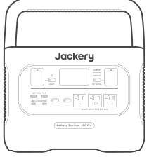

Jackery Explorer 880 Pro

</li><li class="hb-inbox-card" data-item-number="2">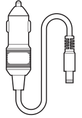

Car Charge Cable

</li><li class="hb-inbox-card" data-item-number="3">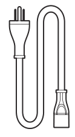

AC Charge Cable

</li><li class="hb-inbox-card" data-item-number="4">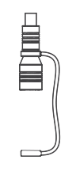

DC7909 to DC8020 Adaptor x 2

</li><li class="hb-inbox-card" data-item-number="5">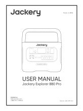

Quick Start Guide

</li></ol></figure>

## GET TO KNOW YOUR GEAR

### Product Appearance

<figure class="hb-reference-figure" data-component-id="HB-SPECIAL-REFERENCE-FIGURE" data-reference-id="product-appearance" data-source-fragment-sha256="368284c8b46e803edeb02f2bf94065c2bb07bbf4ae4e4e86115f1c2dd00071c9" data-step-captions="embedded">
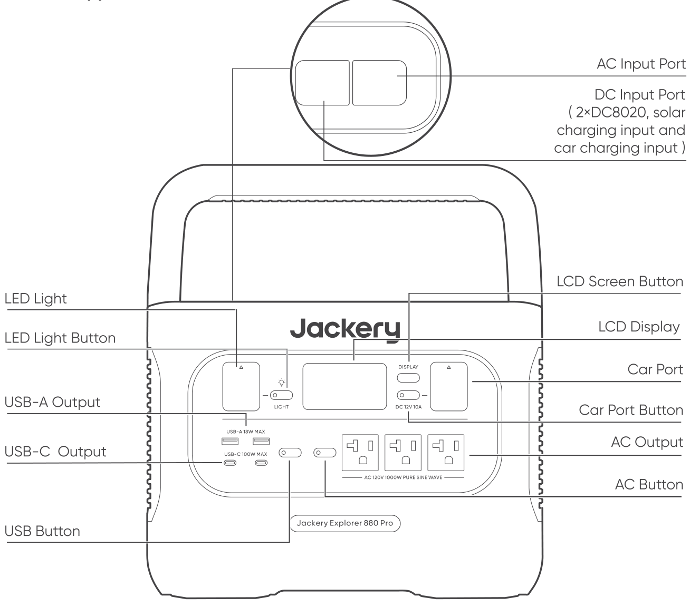
</figure>

## LCD Display

<figure class="hb-reference-figure" data-component-id="HB-SPECIAL-REFERENCE-FIGURE" data-reference-id="lcd-display" data-source-fragment-sha256="d47ec8ac1857056195682d81ab44db940326de897192b4c820480f8a5fbb82b3" data-step-captions="embedded">
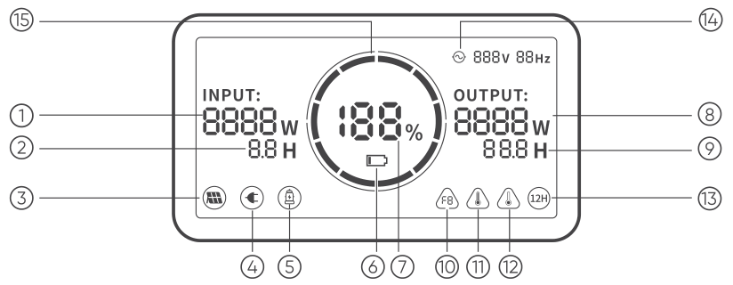
</figure>

<ol><li>Input Power</li><li>Remaining Charge Time</li><li>Solar Charging Indicator</li><li>AC Wall Charging Indicator</li><li>Car Charging Indicator</li><li>Low Battery Indicator</li><li>Remaining Battery Percentage</li><li>Output Power</li><li>Remaining Discharge Time</li><li>Error Code</li><li>High Temperature Warning</li><li>Low Temperature Warning</li><li>Low Power Mode</li><li>AC Power Indicator</li><li>Battery Power Indicator</li></ol>

<strong>Battery Power Indicator (</strong><strong>) :</strong> When the product is being charged, the orange circle around the battery percentage will light up in sequence. When charging other devices, the orange circle will stay on.

<strong>Low Battery Indicator (</strong><strong>) :</strong> When the battery is less than 20%, the Low Battery Indicator will stay on. When less than 5%, the Low Battery Indicator will flash. When it is being charged, the Indicator will be off.

<strong>Low Power Mode (</strong><strong>) :</strong> To avoid forgetting to turn off the output during use that results in battery consumption, the product turns the Low Power Mode off by default. This occurs when no device is connected or the connected device is less than or equal to a certain value. (Refer to the table below for more details), the device will automatically shut down after 12 hours.

<figure aria-label="Low Power Mode" class="hb-reference-composition hb-reference-lcd-actions" data-component-id="HB-TABLE-REFERENCE" data-component-variant="lcd-actions" tabindex="0"><table class="hb-reference-table"><thead><tr><th scope="col">Output</th><th scope="col">Output Power</th><th scope="col">Defaults</th></tr></thead><tbody><tr><td>AC Output</td><td>≤25W</td><td>The device will automatically shut down after 12 hours</td></tr><tr><td>USB Output</td><td>≤2W</td><td>The device will automatically shut down after 12 hours</td></tr><tr><td>Car Output</td><td>≤2W</td><td>The device will automatically shut down after 12 hours</td></tr></tbody></table></figure>

<strong>To turn on the Low Power Mode:</strong> Long press the AC Button and DISPLAY Button until the Low Power Mode icon lights up. In Low Power Mode, please remember to turn off the output to avoid battery consumption. <strong>To turn off the Low Power Mode:</strong> Long press the AC Button and DISPLAY Button until the Low Power Mode icon disappears on the screen.

<strong>Fault code (</strong><strong>) :</strong> In order to quickly solve the user’s feedback, we set up common fault codes F0-F9 in the system: if you find any fault code of F0、F1、F2、F3、F4、F7 on the display screen, please contact us for after-sales treatment; If F6 code appears, please remove the load or unplug the charging plug, the product can restore by itself, if not, please contact after-sales treatment; If F9 fault code appears, please remove the load and the product can recover by itself, if not, please contact after-sales service.

<strong>High-temperature warning (</strong><strong>) :</strong> If it appears on the screen, do not worry, the battery will restore automatically after cooling.

<strong>Low-temperature Warning (</strong><strong>) :</strong> If it is displayed on the screen, do not worry. It will automatically restore after the ambient temperature is restored.

## Basic Operations

### Power On/Off

<strong>AC Output On/Off:</strong> Press the AC Button, the AC Output operation indicator lights up. Then you can connect the equipment that needs AC charging. Press the AC Button again to turn off the AC Output. <strong>USB Output On/Off:</strong> Press the USB Button, the USB Output operation indicator lights up. Then USB-A and USB-C Output Ports can be connected to external load devices. Press the USB Button again to turn off the USB Output. <strong>Car Port On/Off:</strong> Press the Car Port Button, the Car Port operation indicator lights up. Then the Car Port can be connected to the external load devices. Press the Car Port Button again to turn off the output.

### LCD Screen On/Off

To Turn On, press the DISPLAY Button, any Output Power Button, or LED Light Button. Or, when there’s a charging input, the screen display will light up automatically. To Turn Off, press the DISPLAY Button again and the screen display will turn off. Or, if there is no operation in 30 seconds, the product will enter a sleep state and the screen display will automatically turn off. <strong>To get the screen always-on (under charging or discharging state), follow these steps:</strong> After the display screen lights up, double-click the DISPLAY Button and the mode of Always-On Display will be on. <strong>To turn off Always-On Display, follow these steps:</strong> Press the DISPLAY Button and the screen will be turned off in 30 seconds. <strong>Tip:</strong>During Always-On mode, the screen automatically turns off after 2 hours without charging or discharging.

### LED Light On/Off

<strong>There are three modes of LED Light:</strong> Low Light mode, Bright Light mode, and SOS mode. <strong>The operations are as follows:</strong> Press the LED Light Button, the LED will be turned on. The light will always turn on in Low Light mode and the output power on the screen is 1W. Press again to enter the Bright Light mode and the output power on the screen is 3W. Press the third time to enter the SOS mode and the output power on the screen is 3W. Then, press again to turn off the LED Light. In any of these modes, the light can be turned off by a long press.

## CHARGING YOUR JACKERY EXPLORER 880 PRO

<strong>Green energy first:</strong> We advocate to use the green energy first. This product supports two modes of charging at the same time: solar charging and AC wall charging. When AC wall charging and solar charging are turned on at the same time, the product will give priority to solar charging and both methods will be used to charge the battery at the maximum permissible power.

### Charging from the wall

Please use the AC cable included in the package.

<figure class="hb-reference-figure" data-component-id="HB-SPECIAL-REFERENCE-FIGURE" data-reference-id="charging-wall" data-source-fragment-sha256="3230bcccfaf8aa8136bde193d063e4a5a352444aa46a542f189f629204bfa69e" data-step-captions="embedded">
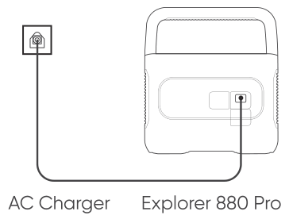
</figure>

### Solar energy charging

#### Jackery SolarSaga 200 or 100 or 80 Solar Panel Connection Guide

If one or two solar panels are connected, you can directly connect the DC8020 port of the solar panel to the DC8020 port of Jackery Explorer 880 Pro for charging. If four solar panels are connected, please refer to the method shown in the following figure to charge through the solar series connector (Note: The solar series connector is not in standard configuration, so you need to purchase it separately. Please refer to the detailed operation instructions of the solar series connector before using it.)

<figure class="hb-reference-figure" data-component-id="HB-SPECIAL-REFERENCE-FIGURE" data-reference-id="solar-two-panels" data-source-fragment-sha256="ab28e61442a3744c78d171c6ab49353f6a2970e56b0316781c2816e0ec3f9e1e" data-step-captions="embedded">
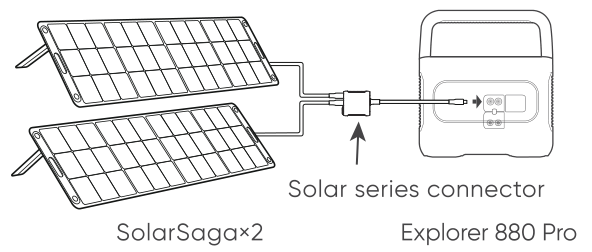
</figure>

<figure class="hb-reference-figure" data-component-id="HB-SPECIAL-REFERENCE-FIGURE" data-reference-id="solar-four-panels" data-source-fragment-sha256="98a72185d60c52800396ca5a73f3b5222a5fda16f8d7ec23f74b17617a939137" data-step-captions="embedded">
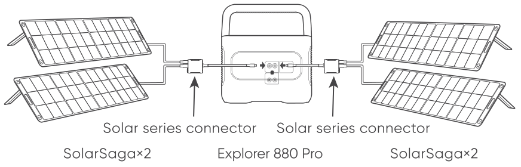
</figure>

<strong>Tip:</strong> Jackery Explorer 880 Pro does not support three Jackery SolarSaga 200 or 100 or 80 solar panels in single input; otherwise, over-voltage protection will be triggered.

#### Jackery SolarSaga 80 Solar Panel Connection Guide

Users who have purchased Jackery SolarSaga 80 can charge the product by referring to the connection mode shown below. The Jackery SolarSaga 80 supports the parallel connection or the parallel and then series connections to charge the product. The single input port of the Jackery Explorer 880 Pro supports the input of up to six pieces of SolarSaga 80 solar panels, and two input ports support the input to up to 6 pieces of SolarSaga 80 solar panels. (When the power is connected with six solar panels in a single input port, the solar panels shall be divided into two groups, and each group of three solar panels shall be self-connected in parallel and then connected to Jackery Explorer 880 Pro through the solar series connector. The solar series connector needs to be purchased separately.) For detailed operation instructions on the self-parallel connection of the Jackery SolarSaga 80 solar panel, please refer to the user manual.

<figure class="hb-reference-figure" data-component-id="HB-SPECIAL-REFERENCE-FIGURE" data-reference-id="solarsaga80-parallel" data-source-fragment-sha256="344a59528c429cb43d194bc32a06f449461fe8fc13c12642b00317bf14f59579" data-step-captions="embedded">
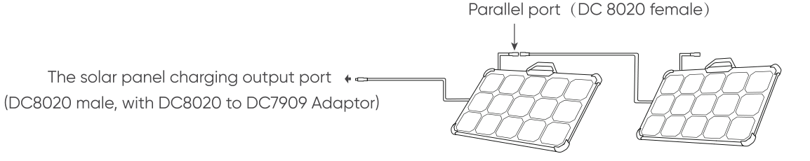
</figure>

<strong>Warm Tip:</strong> Users can enter the number of solar panels in their own combination according to the number of solar panels they purchased. Currently, the product supports charging with 1, 2, 3, 4, 5, 6, 8, and 12 80W solar panels in combination.

#### DC7909 to DC8020 Adaptor Operation Guide

All of our solar panels on sale have been upgraded to include a DC7909 to DC8020 adapter. If you have purchased a Jackery solar panel without a DC7909 to DC8020 adapter, you can charge your Jackery Explorer 880 Pro by following the connection instructions below.

<figure class="hb-reference-figure" data-component-id="HB-SPECIAL-REFERENCE-FIGURE" data-reference-id="dc7909-adaptor" data-source-fragment-sha256="59ee4b6dfee04c8879b8bbbb346e1aacd140d44dbb66933ff9e5a1ae5f355a6d" data-step-captions="embedded">
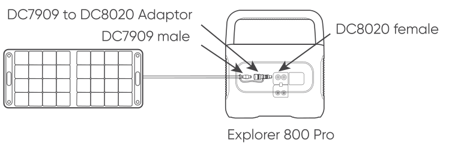
</figure>

### Charging in the Car

This product can be charged with a 12V car charger. Please start the vehicle before charging to prevent draining the car battery and prevent your vehicle from being unable to start. Meanwhile, please ensure that the car charger and the car cigarette lighter provide a good connection, and ensure that the car charger is fully inserted. In addition, if the vehicle is running on bumpy roads, it is forbidden to use the car charger in case it burns due to a poor connection. The Company will not be responsible for any loss caused by non-standard operation.

<figure class="hb-reference-figure" data-component-id="HB-SPECIAL-REFERENCE-FIGURE" data-reference-id="charging-car" data-source-fragment-sha256="62660c1f3ebc11ea4ee6399836a5204958c09034d9a22a1f0edd58579134e4eb" data-step-captions="embedded">
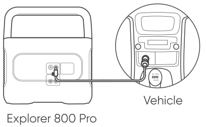
</figure>

### Safety Precautions When Charging

1) Vehicle charging is only applicable in 12V vehicles, not in 24V ones. Please do not charge this product in 24V vehicle to avoid personal injury and property loss. 2) It is recommended to use Jackery accessories - solar panels for solar charging. We will not be responsible for the losses caused by using other brands’ solar panels.

## SAFETY PRECAUTIONS WHEN USING

<strong>The basic safety precautions should be followed when using this product, including:</strong> a. Please read all instructions before using this product. b. Close supervision is required when using this product near children to reduce the risk. c. Risk of electric shock may occur if using accessories recommended or sold by non-professional product manufacturers. d. When the product is not in use, please unplug the power plug from the product's socket. e. Do not dismantle the product, which may lead to unpredictable risks such as fire, explosion or electric shock. f. Do not use the product through damaged cords or plugs, or damaged output cables, which may cause electric shock. g. Charge the product in a well ventilated area and do not restrict ventilation in any way. h. Please put the product in a ventilated and dry place to avoid rain and water to cause electric shock. i. Do not expose the product to fire or high temperature (under direct sunlight or in vehicle under high heat), which may cause accidents such as fire and explosion. j.Do not disassemble the power pack, take it to a qualified service person when service or repair is required. Incorrect reassembly may result in a risk of fire or electric shock. k.Have servicing performed by a qualified repair person using only identical replacement parts. This will ensure that the safety of the product is maintained.

## INSTRUCTIONS PERTAINING TO RISK OF FIRE, ELECTRIC SHOCK, OR INJURY TO PERSONS

### Important Safety Instructions

WARNING–When using this product, basic precautions should always be followed, including the following: a) Read all the instructions before using the product. b) To reduce the risk of injury, close supervision is necessary when the product is used near children. c) Do not put fingers or hands into the product. d) Use of an attachment not recommended or sold by power pack manufacturer may result in a risk of fire, electric shock, or injury to persons. e) To reduce risk of damage to the electric plug and cord, pull the plug rather than the cord when disconnecting the power pack. f) Do not use a battery pack or appliance that is damaged or modified. Damaged or modified batteries may exhibit unpredictable behavior resulting in fire, explosion or risk of injury. g) Do not operate the power pack with a damaged cord or plug, or a damaged output cable. h) Do not disassemble the power pack, take it to a qualified service person when service or repair is required. Incorrect reassembly may result in a risk of fire or electric shock. i) To reduce the risk of electric shock, unplug the power pack form the outlet before attempting any instructed servicing. j) PERSONAL PRECAUTIONS 1)Have plenty of fresh water and soap nearby in case battery acid contacts skin, clothing, or eyes. 2)Wear complete eye protection and clothing protection. Avoid touching eyes while working near battery. 3)If battery acid contacts skin or clothing, wash immediately with soap and water. If acid enters eye, immediately flood eye with running cold water for at least 10 minutes and get medical attention immediately. 4)NEVER smoke or allow a spark or flame in vicinity of battery or engine. 5)Be extra cautious to reduce risk of dropping a metal tool onto battery. It might spark or short-circuit battery or other electrical part that may cause explosion. k) When charging the internal battery, work in a well ventilated area and do not restrict ventilation in any way. l) Under abusive conditions, liquid may be ejected from the battery; avoid contact. If contact accidentally occurs, flush with water. If liquid contacts eyes, additionally seek medical help. Liquid ejected from the battery may cause irritation or burns. m) Do not expose a power pack to fire or excessive temperature. Exposure to fire or temperature above 130°C may cause explosion. The temperature of 130°C can be replaced by the temperature of 265°F. n) Have servicing performed by a qualified repair person using only identical replacement parts. This will ensure that the safety of the product is maintained.

### Operating Instructions

Use and store the unit only in a clean and dry environment. DO NOT use and store in dusty and wet environment. Check the unit prior to every use. DO NOT use the unit if it is damaged, broken. If rust, peculiar odors, overheating or other abnormal circumstances are observed, stop using the unit immediately and contact the dealer or our customer service center. Make sure that the unit is properly secured when transporting it in a motor vehicle. Only charge, use and store the unit within an ambient temperature Switch the unit off immediately if it has accidentally fallen, was dropped or was exposed to vibrations. DO NOT use the unit if the power cord is damaged or broken. Keep the unit away from children. DO NOT let children use the power supply unit. Keep this product away from pets. DO NOT use the unit in an area or environment with high temperature. Should fluid from inside of the unit come in contact with your skin or clothing, wash the affected areas with tap water. In a storm, unplug the power cord from the socket. DO NOT charge the unit via power supply systems that operate outside of input rating. DO NOT place the unit on its side or upside down while in use or storage. DO NOT use accessories for other usage. Make sure that the device you are connecting is switched off before you connect it. DO NOT expose a power pack to fire or excessive temperature. Exposure to fire or temperature above 130°C may cause explosion. Solar charge times depend on weather conditions, place your solar panel where it will get as much direct sunlight as possible. DO NOT place the power pack on the floor, or at a height less than 457 mm (18 inches) above the floor, during use in a repair facility. Warning： Do not remove the battery pack without permission,If you need to repair the battery pack, contact your local manufacturer as soon as possible DANGER: This device is intended to be used indoors only. Do not use outdoors under any conditions.

### Charging instruction

1.The product supports any 1 way or 2 way charging . 2.Charge the Portable Power Station with charger; the LCD will turn on and display Input power 3.Display will show 100% capacity when fully charged .

### Discharging instruction

1.Press the AC button, AC output will be turn on; and press the button again, the AC output will turn off， while the AC LED will turn off within 1~2seconds. 2.Press the any 1or 2 way DC(USB or 12V) button, output will be turn on; and press the button again, the DC output will turn off， while the DC LED will turn off within 1~2seconds. 3. If DC or AC output is on LCD will display “OUPUT” icon and output power unless all DC output is off

## MOVING AND STORAGE INSTRUCTIONS

DO NOT move the unit if it is recharging or in use. DO NOT dispose the unit together with household waste. DO NOT place the unit close to or in a fire or expose it to heat. Keep out of direct sunlight. DO NOT store the unit in a bathroom or in an area exposed to rain or moisture. DO NOT disassemble the power pack, take it to a qualified service person when service or repair is required. Incorrect reassembly may result in a risk of fire or electric shock. DO NOT store the unit in an area or environment with high temperature.

## USER MAINTENANCE INSTRUCTIONS

Before using or storing, plug your Jackery Explorer into the wall until it is fully charged. If you see the LCD battery is low at any point, plug it into a power source, like an AC outlet or a solar panel as soon as possible. To preserve the battery lifespan, please use and recharge at least once every 6 months."

## WARRANTY

<strong>Note: We only provide our warranty for the buyer who purchased on Amazon (Jackery Inc.), Jackery website or local authorized dealers.</strong>

### Limited Warranty

<figure aria-label="Limited Warranty" class="hb-warranty-card" data-component-id="HB-WARRANTY-SECTION" data-warranty-card-index="1">
Jackery Inc. warrants to the original consumer purchaser that the Jackery product will be free from defects in workmanship and material under normal consumer use during the applicable warranty period identified in the 'Warranty Period' section below, subject to the exclusions set forth below.

This warranty statement sets forth Jackery's total and exclusive warranty obligation. We will not assume, nor authorize any person to assume for us, any other liability in connection with the sale of our products.
</figure>

### Warranty Period

<figure aria-label="Warranty Period" class="hb-warranty-card" data-component-id="HB-WARRANTY-SECTION" data-warranty-card-index="2">
3 Years Standard Warranty: The standard warranty period for Jackery Explorer 880 Pro is 36 months. In each case, the warranty period is measured starting on the date of purchase by the original consumer purchaser. The sales receipt from the first consumer purchase, or other reasonable documentary proof, is required in order to establish the start date of the warranty period.

2 Years Extended Warranty: To activate the Warranty Extension, you must register your product online or contact our customer service team at hello@jackery.com to extend the standard warranty runtime.
</figure>

### Exchange

<figure aria-label="Exchange" class="hb-warranty-card" data-component-id="HB-WARRANTY-SECTION" data-warranty-card-index="3">
Jackery will replace (at Jackery's expense) any Jackery product that fails to operate during the applicable warranty period due to defect in workmanship or material. A replacement product assumes the remaining warranty of the original product.
</figure>

### Limited to Original Consumer Buyer

<figure aria-label="Limited to Original Consumer Buyer" class="hb-warranty-card" data-component-id="HB-WARRANTY-SECTION" data-warranty-card-index="4">
The warranty on Jackery's product is limited to the original consumer purchaser and is not transferable to any subsequent owner.
</figure>

### Exclusions

<figure aria-label="Exclusions" class="hb-warranty-card" data-component-id="HB-WARRANTY-SECTION" data-warranty-card-index="5">
Jackery's warranty does not apply to:

Misused, abused, modified, damaged by accident, or used for anything other than normal consumer use as authorized in Jackery's current product literature.

Attempted repair by anyone other than an authorized facility.

Any product purchased through an online auction house.

Jackery's warranty does not apply to the battery cell unless the battery cell is fully charged by you within seven days after you purchase the product and at least once every 6 months thereafter.
</figure>

## JACKERY INC.

5310 Bunche Dr, Fremont, CA 94538 Tel:1-888-502-2236(US) E-mail:hello@jackery.com Website:www.jackery.com

<figure class="hb-reference-figure" data-component-id="HB-SPECIAL-REFERENCE-FIGURE" data-reference-id="contact-qr" data-source-fragment-sha256="2d4e138e988721bb4008f7b0ce675a8aef68ceedf5683b40fd96444daaf962f1">

</figure>
