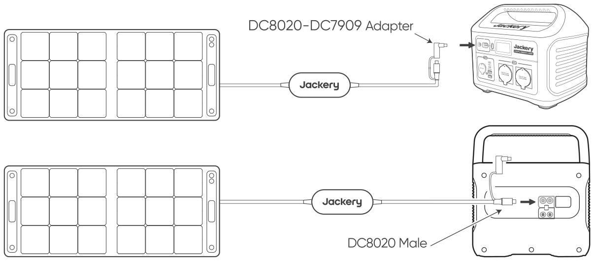
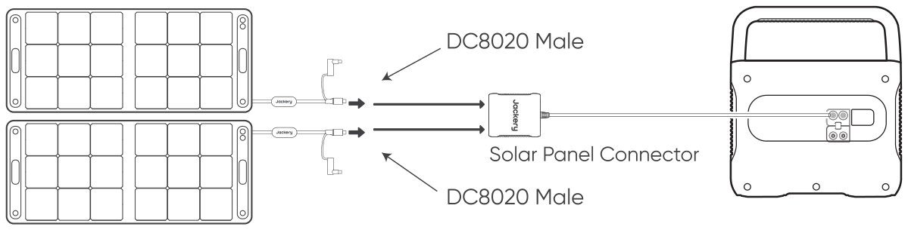
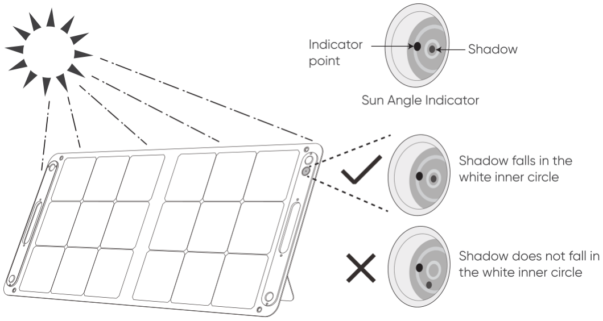
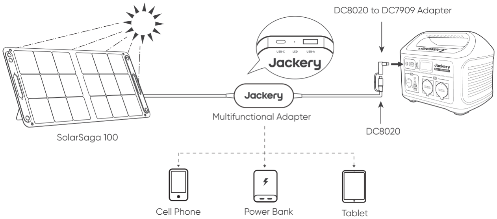

# TECHNICAL PARAMETERS

<table class="manual-table"><tbody><tr><td>Product Name:</td><td colspan="2">SolarSaga 100</td></tr><tr><td>Model No.:</td><td colspan="2">JS-100F</td></tr><tr><th>Electrical Data</th><th>STC</th><th>BNPI</th></tr><tr><td>Peak Power (Pmax)</td><td>100W±5W</td><td>104W±5W</td></tr><tr><td>Open Circuit Voltage (Voc)</td><td>24.8V±5%</td><td>25V±5%</td></tr><tr><td>Short Circuit Current (Isc)</td><td>5.4A±5%</td><td>5.8A±5%</td></tr><tr><td>Power Voltage (Vmp)</td><td>20.0V±5%</td><td>20.1V±5%</td></tr><tr><td>Power Current (Imp)</td><td>5.0A±5%</td><td>5.2A±5%</td></tr><tr><td>Maximum System Voltage</td><td colspan="2">60V</td></tr><tr><td>Maximum Reverse Current</td><td colspan="2">15A</td></tr><tr><td>Protection Class Against Electric Shock</td><td colspan="2">Class II</td></tr><tr><td>Waterproof Level</td><td colspan="2">IP68</td></tr><tr><td>Operating Temperature Range</td><td colspan="2">-20°C~65°C (-4°F~149°F)</td></tr><tr><td>Dimensions (unfolded)</td><td colspan="2">1220x552x20mm</td></tr><tr><td>Dimensions (folded)</td><td colspan="2">610x552x35mm</td></tr><tr><td>Weight</td><td colspan="2">3.6 kg±0.3 kg</td></tr><tr><td>Bifaciality Coefficient (back/front)</td><td colspan="2">Pmax&gt;30%, Voc&gt;95%, Isc&gt;32%</td></tr><tr><td>Voltage Temperature Coefficient</td><td colspan="2">-0.268%/°C</td></tr><tr><td>Power Temperature Coefficient</td><td colspan="2">-0.29%/°C</td></tr><tr><td>Photovoltaic Consumer Products</td><td colspan="2">IEC TS 63163 Consumer Product Category 2</td></tr></tbody></table>

STC (1000W/m², 25°C, AM 1.5). BNPI (Front 1000W/m², Rear 135W/m², 25°C, AM 1.5).

Unfold the bracket and place it on a flat surface. The design load is 1600Pa, and the safety factor is 1.5 times.

## Multifunctional Adapter

<figure aria-label="Multifunctional Adapter" class="hb-spec-table-composition"><table class="manual-table manual-spec-table hb-spec-table"><colgroup><col class="hb-spec-col-label"/><col class="hb-spec-col-value"/></colgroup><tbody><tr><th class="manual-spec-label hb-spec-label" scope="row">USB-A Output</th><td class="manual-spec-value hb-spec-value">5V⎓2.4A</td></tr><tr><th class="manual-spec-label hb-spec-label" scope="row">USB-C Output</th><td class="manual-spec-value hb-spec-value">5V⎓3A</td></tr></tbody></table></figure>

# SAFETY TIPS

<ul><li>
Please read the user guide first before using this product.
</li><li>
Do not bend the folding solar panels.
</li><li>
Do not place the folding solar panels in trees, buildings or other shaded areas for use.
</li><li>
Do not immerse the folding solar panels in water or any other liquid.
</li><li>
Do not put solar panels in water directly, and use a damp cloth to gently wipe them when cleaning.
</li><li>
Do not use or store the folding solar panels near open flames or flammable materials.
</li><li>
Do not scratch the folding solar panels with sharp objects.
</li><li>
Do not put corrosive substances on the folding solar panels.
</li><li>
Do not step on or place heavy objects on the folding solar panels.
</li><li>
Do not disassemble the folding solar panels.
</li><li>
The output circuit of folding solar panel package must be connected to the equipment properly, and reverse connection of positive and negative poles is strictly prohibited.
</li><li>
Check the connection status of various components, wires, and plugs before use.
</li><li>
It is strictly prohibited to drop the products due to the nature of the material. Otherwise, it may cause internal damage to the solar panel, rendering the product unusable.
</li><li>
This product cannot be fixed for installation. Please put away the portable folding solar panels in case of strong winds, hail and other severe weather to avoid product damage or other hazards.
</li><li>
Under normal circumstances, PV modules may be exposed to higher currents or voltages than under standard test conditions. Therefore, when calculating the rated voltage of component, the rated current of conductor, and the size of the control device connected to the PV output, it is required to multiply the short-circuit current (Isc) and open circuit voltage (Voc) values marked on the component by a factor of 1.25.
</li><li>
Any damage to the product may lead to electric shock or fire.
</li><li>
Do not let artificial spotlight shine directly on the solar modules or panels.
</li></ul>

# HOW TO USE

Connect the cable to the solar panel and the DC input port of the portable power station.

<table class="manual-callout-table manual-callout-table"><tbody><tr><td class="manual-callout-label">Tip</td><td class="manual-callout-body">
The cable comes with an adapter that allows it to connect to Jackery portable power station.

1. DC8020 connector: suitable for the DC input port of Jackery portable power station (diameter: 8.1 mm).

2. DC8020-DC7909 adapter: suitable for the DC input port of Jackery portable power station (diameter: 8.0 mm).
</td></tr></tbody></table>

<figure class="hb-reference-figure hb-has-composite-art" data-component-id="HB-SPECIAL-REFERENCE-FIGURE" data-reference-id="connection-adapters" data-source-fragment-sha256="123247deb61803c7c400af980eddbd00629b52d247f751b865701bbafe847bcc" data-step-captions="embedded" data-web-composite-asset-key="frozen-source/connection-adapters" data-web-composite-locale="en" data-web-composite-sha256="f530a0a8aa3404ef0c85047b1071847e235aee94123cddc69da3d182bdb949f9" data-web-replace-key="reference.connection-adapters">

</figure>

This multifunctional solar charging cable is only suitable for charging the Jackery SolarSaga 100 and should not be used with other solar panels.

## When using the Solar Panel Connector

Connect the two solar panels to the solar panel connector respectively and then connect the solar panel connector to the DC input port of the portable power station.

<figure class="hb-reference-figure hb-has-composite-art" data-component-id="HB-SPECIAL-REFERENCE-FIGURE" data-reference-id="solar-panel-connector" data-source-fragment-sha256="d20e0db7ca3a07bf8f7c4783c8dbff3af091e0e4825bb45b18e9adb119ec16ca" data-step-captions="embedded" data-web-composite-asset-key="frozen-source/solar-panel-connector" data-web-composite-locale="en" data-web-composite-sha256="bb384b2a117b9e426c01b70d3e6e8e9223cc8d0401c94573264e568c95168f11" data-web-replace-key="reference.solar-panel-connector">

</figure>

※ To maximize the power generation, adjust the orientation of SolarSaga 100 throughout the day to ensure full exposure of the panel surface to direct sunlight.

## Sun Angle Indicator

The carry handle has a sun angle indicator. When sunlight hits its surface, a shadow will appear at its bottom.

If the shadow falls on the white inner circle at its bottom, it means that the solar panel is facing directly towards sun and you can get optimal power generation; if not, it is suggested to adjust its angle until it does.

<figure class="hb-reference-figure hb-has-composite-art" data-component-id="HB-SPECIAL-REFERENCE-FIGURE" data-reference-id="sun-angle-indicator" data-source-fragment-sha256="adf783a364c69d1d0a096c915e9441529c9d76b7ad177648ffeb971a5a59f4d9" data-step-captions="embedded" data-web-composite-asset-key="frozen-source/sun-angle-indicator" data-web-composite-locale="en" data-web-composite-sha256="28e370c7c095866612fa4200b649bf031959e23148b4a24a784fcc3beb164f47" data-web-replace-key="reference.sun-angle-indicator">

</figure>

# POWER YOUR DEVICE

<figure class="hb-reference-figure hb-has-composite-art" data-component-id="HB-SPECIAL-REFERENCE-FIGURE" data-reference-id="power-device" data-source-fragment-sha256="e6bb82c5f1b7f4a40a7b879033ed1c7b056e7ddb8329029682ea06427d306855" data-step-captions="embedded" data-web-composite-asset-key="frozen-source/power-device" data-web-composite-locale="en" data-web-composite-sha256="9d2020b3bdc3290a5c666674670827b1d81e7bc42a7fa171d73a1dfd78878375" data-web-replace-key="reference.power-device">

</figure>

# CAN ICES-003(B)/NMB-003(B)

NOTE: This equipment has been tested and found to comply with the limits for a Class B digital device, pursuant to part 15 of the FCC Rules. These limits are designed to provide reasonable protection against harmful interference in a residential installation. This equipment generates, uses and can radiate radio frequency energy and, if not installed and used in accordance with the instructions, may cause harmful interference to radio communications. However, there is no guarantee that interference will not occur in a particular installation. If this equipment does cause harmful interference to radio or television reception, which can be determined by turning the equipment off and on, the user is encouraged to try to correct the interference by one or more of the following measures:

<ul><li>
Reorient or relocate the receiving antenna.
</li><li>
Increase the separation between the equipment and receiver.
</li><li>
Connect the equipment into an outlet on a circuit different from that to which the receiver is connected.
</li><li>
Consult the dealer or an experienced radio/TV technician for help.
</li></ul>

MODIFICATION: Any changes or modifications not expressly approved by the grantee of this device could void the user’s authority to operate the device.

# WARRANTY

<figure aria-label="WARRANTY" class="hb-warranty-card" data-component-id="HB-WARRANTY-SECTION" data-warranty-card-index="1">
The product is covered by a limited warranty from Jackery for the original purchaser that covers the product from defects in workmanship and materials for 36 months from the date of purchase ( damages from normal wear and tear, alteration, misuse, neglect, accident, service by anyone other than authorized service center, or act of God are not included ).

During the warranty period and upon verification of defects, this product will be replaced when returned with proper proof of purchase.

2 Years Extended Warranty: To activate the Warranty Extension, you must register your product online or contact our customer service team at hello@jackery.com to extend the standard warranty runtime.
</figure>

## CONTACT US

<figure aria-label="CONTACT US" class="hb-warranty-card" data-component-id="HB-WARRANTY-SECTION" data-warranty-card-index="2">
For any inquiries or comments concerning our products, please send an email to hello@jackery.com, and we will respond to you as soon as possible. If there is any quality-related issue with the product, you may request a replacement or refund by submitting a request form at www.jackery.com.
</figure>

## CUSTOMER SERVICE

<figure aria-label="CUSTOMER SERVICE" class="hb-warranty-card" data-component-id="HB-WARRANTY-SECTION" data-warranty-card-index="3">
3-year limited warranty

Lifetime technical support

hello@jackery.com

hello.mx@jackery.com (For Mexico only)
</figure>

# JACKERY MEXICO S.A. DE C.V.

Calle Poseidón 18 PB, Crédito Constructor, Benito Juárez, C.P. 03940, Ciudad de México, México

# JACKERY INC.

5310 Bunche Dr, Fremont, CA 94538-8301

1-888-502-2236

hello@jackery.com

hello.mx@jackery.com(For Mexico only)

<a href="https://www.jackery.com">www.jackery.com</a>

