# USER MANUAL

Jackery SolarSaga 100 Light

Model: JS-100G

## CONTACT US:

1-888-502-2236 (US)

hello@jackery.com

<a href="https://www.jackery.com">www.jackery.com</a>

# WARNINGS

<ul><li>
Read the user guide before using this product.
</li><li>
Do not place the solar panels under trees, buildings or in other shaded areas for use.
</li><li>
Do not submerge the solar panels in water or any other liquid for extended periods.
</li><li>
Use a damp cloth to gently wipe them clean.
</li><li>
Keep away from open flames or any flammable materials.
</li><li>
Do not scratch the solar panels with sharp objects.
</li><li>
Keep corrosive substances away from the solar panels.
</li><li>
Do not step on or place heavy objects on the solar panels.
</li><li>
Do not disassemble the solar panels.
</li><li>
The output circuit of the solar panel must be connected to the equipment correctly. Reverse connection of the positive and negative poles is strictly prohibited.
</li><li>
Check the connection status of all components, wires, and plugs before use.
</li><li>
Dropping the product is strictly prohibited due to the material's nature, as it may cause internal damage to the solar panel and render the product unusable.
</li><li>
Check and secure the solar panels ahead of strong winds, hail, or extreme weather to prevent damage.
</li><li>
Under normal circumstances, PV modules may be exposed to higher currents or voltages than under standard test conditions. Therefore, when calculating the rated voltage of the component, the rated current of the conductor, and the size of the control device connected to the PV output, it is required to multiply the short-circuit current (Isc) and open circuit voltage (Voc) values marked on the component by a factor of 1.25.
</li><li>
Any damage to the product may lead to electric shock or fire.
</li><li>
Avoid direct exposure of the solar modules or panels to artificial spotlights.
</li><li>
Do not place anything on the solar panel to avoid any residues that may damage or soil the surface.
</li><li>
If the front sheet is broken or the back panel is damaged, contact with any surface or frame of the panel could result in an electric shock.
</li><li>
Protect unconnected connectors before installation. Ensure they are kept free from contamination (e.g., dust, foreign objects, moisture), and do not expose unprotected connectors to the environment.
</li></ul>

# FCC

This device complies with part 15 of the FCC Rules. Operation is subject to the following two conditions:

(1) This device may not cause harmful interference, and (2) this device must accept any interference received, including interference that may cause undesired operation.

NOTE: This equipment has been tested and found to comply with the limits for a Class B digital device, pursuant to part 15 of the FCC Rules.

These limits are designed to provide reasonable protection against harmful interference in a residential installation. This equipment generates, uses and can radiate radio frequency energy and, if not installed and used in accordance with the instructions, may cause harmful interference to radio communications. However, there is no guarantee that interference will not occur in a particular installation.

If this equipment does cause harmful interference to radio or television reception, which can be determined by turning the equipment off and on, the user is encouraged to try to correct the interference by one or more of the following measures:

<ul><li>
Reorient or relocate the receiving antenna.
</li><li>
Increase the separation between the equipment and receiver.
</li><li>
Connect the equipment into an outlet on a circuit different from that to which the receiver is connected.
</li><li>
Consult the dealer or an experienced radio/TV technician for help.
</li></ul>

MODIFICATION: Any changes or modifications not expressly approved by the grantee of this device could void the user’s authority to operate the device.

# WHAT'S IN THE BOX

<figure aria-label="WHAT'S IN THE BOX" class="hb-inbox-composition" data-card-count="4" data-component-id="HB-SPECIAL-INBOX" data-inbox-columns="3" data-inbox-variant="responsive-card-grid"><ol class="hb-inbox-grid"><li class="hb-inbox-card" data-item-number="1">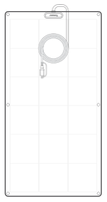

Jackery SolarSaga 100 Light x 1

</li><li class="hb-inbox-card" data-item-number="2">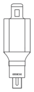

Anderson to DC8020 Adapter x 1

</li><li class="hb-inbox-card" data-item-number="3">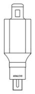

Anderson to DC7909 Adapter x 1

</li><li class="hb-inbox-card" data-item-number="4">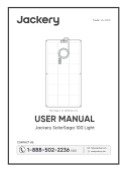

User Manual

</li></ol></figure>

# INSTALLATION

<figure class="hb-reference-figure hb-has-composite-art" data-component-id="HB-SPECIAL-REFERENCE-FIGURE" data-reference-id="front-rear-view" data-source-fragment-sha256="46c8bdba721845616b76412e843e5d9236743720ce262a49d4d454f0180cb34b" data-step-captions="embedded" data-web-composite-asset-key="frozen-source/front-rear-view" data-web-composite-locale="en" data-web-composite-sha256="7d7917be5bc1928914d74026d026344b41d76535b2bc9046edc1bdfdb8fa1ab3" data-web-replace-key="reference.front-rear-view">
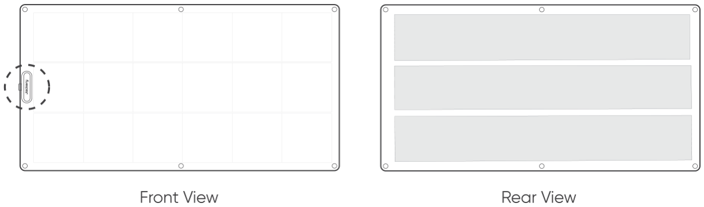

</figure>

The Jackery SolarSaga 100 Light supports both adhesive mounting and suspension mounting.

## Adhesive Mounting

<table class="manual-callout-table manual-callout-table"><tbody><tr><td class="manual-callout-label">Note</td><td class="manual-callout-body">
Adhesive is not included. Please purchase a suitable adhesive separately.
</td></tr></tbody></table>

<table class="manual-callout-table manual-callout-table"><tbody><tr><td class="manual-callout-label">⚠</td><td class="manual-callout-body">
* Do not attach this product to walls using adhesive methods.

* This type of adhesive installation is suitable only for low and smooth surfaces, such as the exterior surfaces of vehicles like cars or yachts. Strictly avoid sticking or mounting this product onto the exterior walls of high-rise buildings, as it may create serious safety risks.
</td></tr></tbody></table>

<table class="manual-callout-table manual-callout-table"><tbody><tr><td class="manual-callout-label">⚠</td><td class="manual-callout-body">
* Ensure both the substrate and the back of the solar panel are clean before applying the adhesive.

* Avoid applying excessive pressure or stepping on the solar panel to prevent damage.

* Clean the solar panel and installation surface immediately after installation.

* Avoid the adhesive covering the front of the solar panel.
</td></tr></tbody></table>

### Step-by-Step Instructions

1. Place the solar panel face down on a flat surface.
<figure class="hb-reference-figure hb-has-composite-art" data-component-id="HB-SPECIAL-REFERENCE-FIGURE" data-reference-id="adhesive-step-1" data-source-fragment-sha256="427ed3eb224dcd5265d04483a7733dadf811e953f80db3584d8f95967bf61b12" data-step-captions="embedded" data-web-composite-asset-key="frozen-source/adhesive-step-1" data-web-composite-locale="en" data-web-composite-sha256="e8ff096e09b639e46f10a838e93c697bdc26c49149c9d1af053095d0d0ade962" data-web-replace-key="reference.adhesive-step-1">
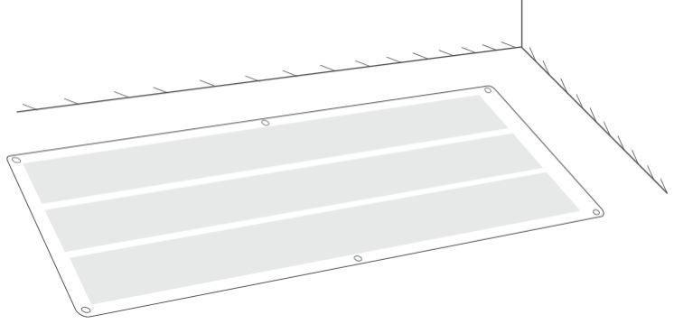

</figure>

2. Mark about every 20 cm (8 inches) on the back of the solar panel.
<figure class="hb-reference-figure hb-has-composite-art" data-component-id="HB-SPECIAL-REFERENCE-FIGURE" data-reference-id="adhesive-step-2" data-source-fragment-sha256="14bb9933eb62c86fe8360103602b4d0d434ce71c1916606c184ae8f360a1d39f" data-step-captions="embedded" data-web-composite-asset-key="frozen-source/adhesive-step-2" data-web-composite-locale="en" data-web-composite-sha256="96acd4d35f092eb35be5bad3b89aed762fb404f20986da373f16f69dc1dedbad" data-web-replace-key="reference.adhesive-step-2">
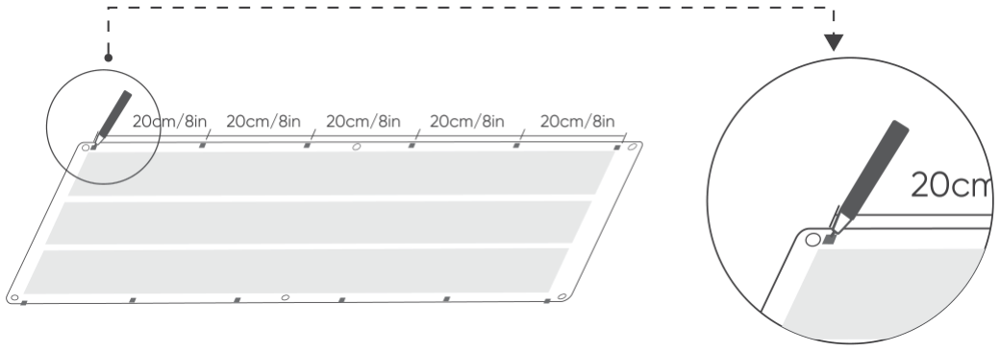

</figure>

3. Apply adhesive evenly along the marked positions.

* It is recommended to use silicone sealant or high-bond double-sided tape to secure the solar panel. Please note that this is a permanent installation method. Removing the tape after installation may cause structural damage to the product and affect its normal operation.
<figure class="hb-reference-figure hb-has-composite-art" data-component-id="HB-SPECIAL-REFERENCE-FIGURE" data-reference-id="adhesive-step-3" data-source-fragment-sha256="1daf22b360d0fb005b899d0d80bd4a9a0e164822c57c8cb2550b3fe5cf326467" data-step-captions="embedded" data-web-composite-asset-key="frozen-source/adhesive-step-3" data-web-composite-locale="en" data-web-composite-sha256="a9667cf766773a5f868cc61cb3b9f78ccb8610b0959505aea7c55911e46d7d78" data-web-replace-key="reference.adhesive-step-3">
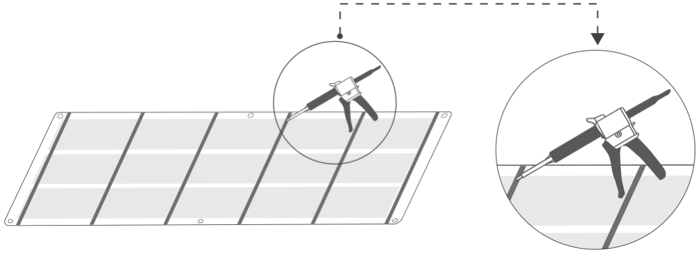

</figure>

4. Carefully flip the solar panel and press it gently onto the installation surface.
<figure class="hb-reference-figure hb-has-composite-art" data-component-id="HB-SPECIAL-REFERENCE-FIGURE" data-reference-id="adhesive-step-4" data-source-fragment-sha256="d85edd4ee069f7d620c3b23e2606dd9683cf51dc1a9adda3ee7d4c4df998504f" data-step-captions="embedded" data-web-composite-asset-key="frozen-source/adhesive-step-4" data-web-composite-locale="en" data-web-composite-sha256="32e431145aaf8a3077e294410b21bfe5bcb8e7813dc3eb220266e50134a230be" data-web-replace-key="reference.adhesive-step-4">
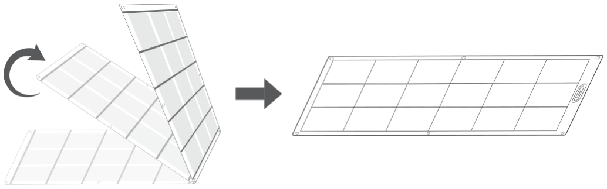

</figure>

5. Add adhesive to the gap between the solar panel and the installation surface.
<figure class="hb-reference-figure hb-has-composite-art" data-component-id="HB-SPECIAL-REFERENCE-FIGURE" data-reference-id="adhesive-step-5" data-source-fragment-sha256="b1daae953273483e4622873d28cbb1e3f26cc58aaa6df3fdd1f233ecc0212e30" data-step-captions="embedded" data-web-composite-asset-key="frozen-source/adhesive-step-5" data-web-composite-locale="en" data-web-composite-sha256="f3dd4dc89d9cb034b6f4a56a7d164b192611af39aa2d72c0d2dad6c6ebedffde" data-web-replace-key="reference.adhesive-step-5">
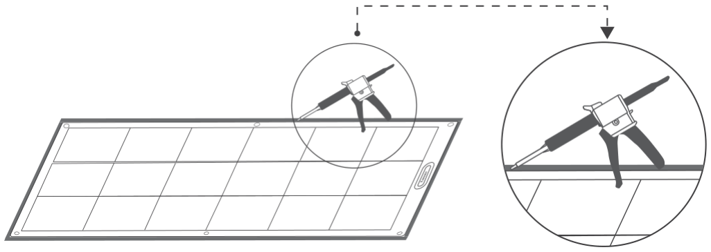

</figure>

6. Let it sit for 24 hours to allow the adhesive to cure.
<figure class="hb-reference-figure hb-has-composite-art" data-component-id="HB-SPECIAL-REFERENCE-FIGURE" data-reference-id="adhesive-step-6" data-source-fragment-sha256="081bb69d006c524bf51b05dbc1f8b59f7fd47203d6822de959a30600544b6f26" data-step-captions="embedded" data-web-composite-asset-key="frozen-source/adhesive-step-6" data-web-composite-locale="en" data-web-composite-sha256="40f6ed6ef4457b33eda286809ca47b82c96ab80dd592f359ea9536b7c9bb9c30" data-web-replace-key="reference.adhesive-step-6">
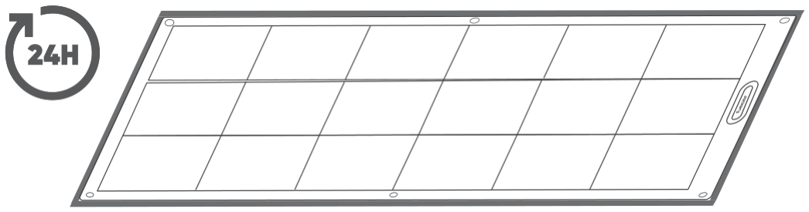

</figure>

# Suspension Mounting

<table class="manual-callout-table manual-callout-table"><tbody><tr><td class="manual-callout-label">Note</td><td class="manual-callout-body">
For suspension mounting, please purchase the Jackery Suspension Wire Kit separately.
</td></tr></tbody></table>

## Jackery Suspension Wire Kit (Sold Separately)

<figure aria-label="Jackery Suspension Wire Kit (Sold Separately)" class="hb-inbox-composition" data-card-count="3" data-component-id="HB-SPECIAL-INBOX" data-inbox-columns="3" data-inbox-variant="three-card-responsive"><ol class="hb-inbox-grid"><li class="hb-inbox-card" data-item-number="1">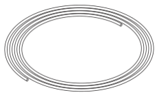

Rope × 2

</li><li class="hb-inbox-card" data-item-number="2">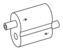

Rope tensioner × 2

</li><li class="hb-inbox-card" data-item-number="3">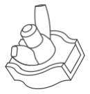

Rope clamp × 2

</li></ol></figure>

## 1. How to Use Rope Clamp

<figure class="hb-reference-figure hb-has-composite-art" data-component-id="HB-SPECIAL-REFERENCE-FIGURE" data-reference-id="rope-clamp-use" data-source-fragment-sha256="8c598d3b32cda0ca7011aad0c66f6cd3f508f2a7a290df6c12ec6c11cbe70867" data-step-captions="embedded" data-web-composite-asset-key="frozen-source/rope-clamp-use" data-web-composite-locale="en" data-web-composite-sha256="0502707d96d41807a2647fccde4881aa1c5d2d559dcfab99a12024e74128efbd" data-web-replace-key="reference.rope-clamp-use">
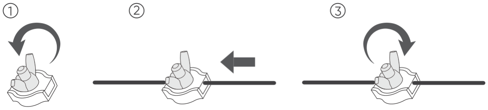

</figure>

## 2. How to Use Rope tensioner

Thread the rope through the rope tensioner.

<figure class="hb-reference-figure hb-has-composite-art" data-component-id="HB-SPECIAL-REFERENCE-FIGURE" data-reference-id="tensioner-thread" data-source-fragment-sha256="d09ffd4bee796478dfb0eadc8ae3c030f3184c663a522a85f5983732ee08b8d5" data-step-captions="embedded" data-web-composite-asset-key="frozen-source/tensioner-thread" data-web-composite-locale="en" data-web-composite-sha256="37c1bc79b22aaca07a6c34408e52136678e09d338ddb555f67504d028137a253" data-web-replace-key="reference.tensioner-thread">
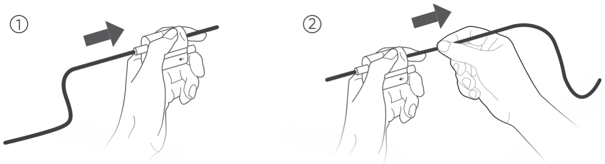

</figure>

Release the rope from the rope tensioner.

<figure class="hb-reference-figure hb-has-composite-art" data-component-id="HB-SPECIAL-REFERENCE-FIGURE" data-reference-id="tensioner-release" data-source-fragment-sha256="80923259a23a0cdbeee6d0072afae5d39442d1c9149848f81dbadb49ffe096ee" data-step-captions="embedded" data-web-composite-asset-key="frozen-source/tensioner-release" data-web-composite-locale="en" data-web-composite-sha256="fccc231c757c947fdd51e60c2fbdc5cc39b0b78cd85723b2eafe22b2fc9f7cc9" data-web-replace-key="reference.tensioner-release">
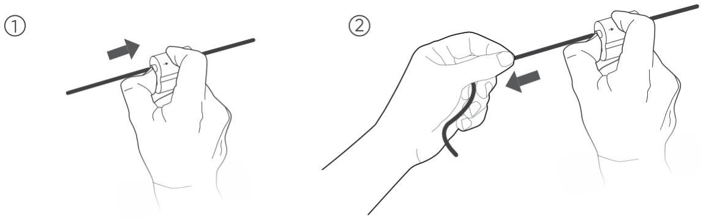

</figure>

## Step-by-Step Instructions

### Step 1: Prepare and Thread the Ropes Through the Solar Panel.

1. Tighten the rope clamp 20 cm to 30 cm from the end of each rope.
<figure class="hb-reference-figure hb-has-composite-art" data-component-id="HB-SPECIAL-REFERENCE-FIGURE" data-reference-id="suspension-1-1" data-source-fragment-sha256="361fbabd20117a4194b0e8955282d33e64f72d78f2abbf634947bf5d5410870c" data-step-captions="embedded" data-web-composite-asset-key="frozen-source/suspension-1-1" data-web-composite-locale="en" data-web-composite-sha256="c287a745c118f3d9f5aa8ea78260124c25bc1f380d0916f92d4e3c634a369da4" data-web-replace-key="reference.suspension-1-1">
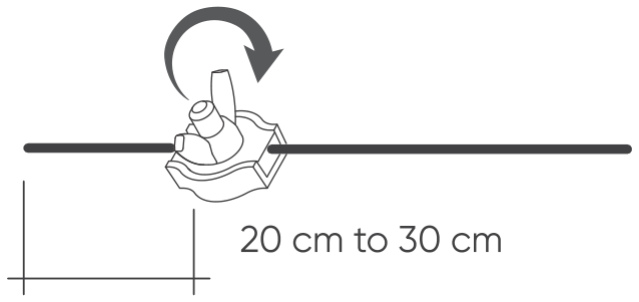

</figure>

2. Thread the rope through the eyelets.
<figure class="hb-reference-figure hb-has-composite-art" data-component-id="HB-SPECIAL-REFERENCE-FIGURE" data-reference-id="suspension-1-2" data-source-fragment-sha256="9d2b24d02824b78e5a7d7ddf4f1934ef74ed11fce6fffdcb77e3baf3ea7c8ca0" data-step-captions="embedded" data-web-composite-asset-key="frozen-source/suspension-1-2" data-web-composite-locale="en" data-web-composite-sha256="097a78ffc72631a515b29cda606303b36a81a7cd51c726fba7d1795fbe0c93df" data-web-replace-key="reference.suspension-1-2">
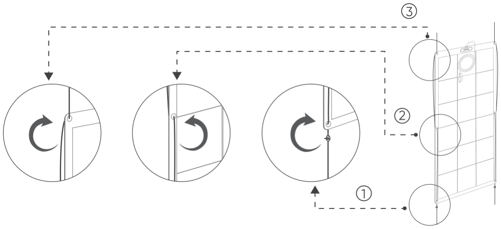

</figure>

3. Thread the rope through one inlet port of the tensioner.

TIP: Ensure that the rope is threaded from the correct side of the tensioner.
<figure class="hb-reference-figure hb-has-composite-art" data-component-id="HB-SPECIAL-REFERENCE-FIGURE" data-reference-id="suspension-1-3" data-source-fragment-sha256="35dd4c9d493440901a4ed4b85f80da7bfe9b7c22649343c8ecdc747cef04487f" data-step-captions="embedded" data-web-composite-asset-key="frozen-source/suspension-1-3" data-web-composite-locale="en" data-web-composite-sha256="5776cb8443ee9af23331cec8fc1ca18100fea790e77d46842773be89c641cfef" data-web-replace-key="reference.suspension-1-3">
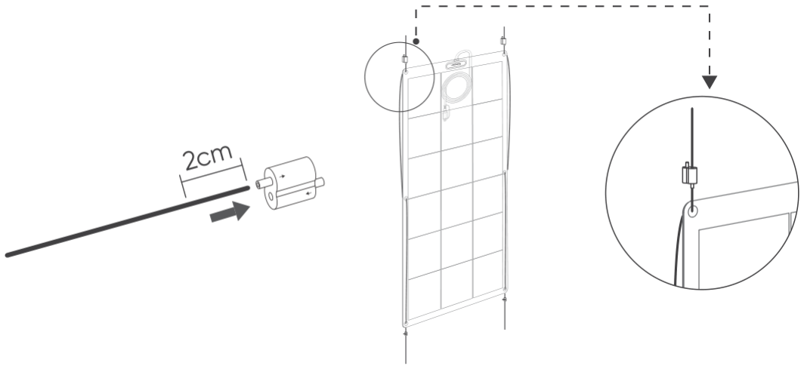

</figure>

### Step 2: Fix the upper ends of the ropes to the railing beam.

1. Pass the upper rope end over the railing beam.
<figure class="hb-reference-figure hb-has-composite-art" data-component-id="HB-SPECIAL-REFERENCE-FIGURE" data-reference-id="suspension-2-1" data-source-fragment-sha256="e39392cb4a188549a8a367033ef27102b451aeee5b3d045acf051a88ca9f9363" data-step-captions="embedded" data-web-composite-asset-key="frozen-source/suspension-2-1" data-web-composite-locale="en" data-web-composite-sha256="68d3ef46634aa76982c45169fc8d61d4ae91b9fbad47d903637fb3c84ffec6ae" data-web-replace-key="reference.suspension-2-1">
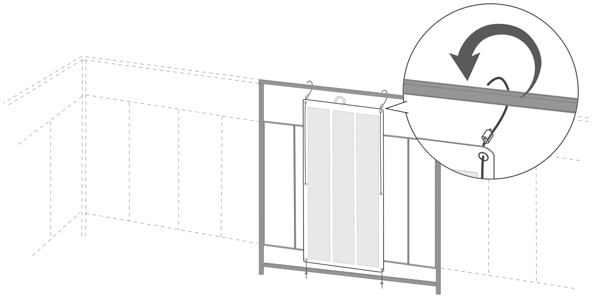

</figure>

2. Pass the rope end through the tensioner's other inlet port.
<figure class="hb-reference-figure hb-has-composite-art" data-component-id="HB-SPECIAL-REFERENCE-FIGURE" data-reference-id="suspension-2-2" data-source-fragment-sha256="a46dfd1e596ab4b469f4534e0ca99194165156048419de67edfe75290bb1c687" data-step-captions="embedded" data-web-composite-asset-key="frozen-source/suspension-2-2" data-web-composite-locale="en" data-web-composite-sha256="02ba7e5cd06efae3a077a3ed3c905a7179df87922b2b2ee1941c71cb97481661" data-web-replace-key="reference.suspension-2-2">
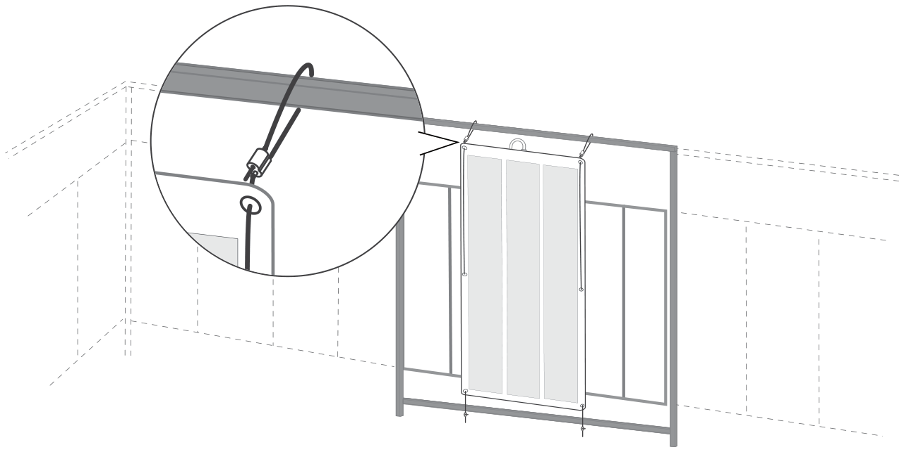

</figure>

3. Turn the solar panel over the hand railing to place it outside the balcony.
<figure class="hb-reference-figure hb-has-composite-art" data-component-id="HB-SPECIAL-REFERENCE-FIGURE" data-reference-id="suspension-2-3" data-source-fragment-sha256="c57919a3261bbcd2ec5dcb80debb73d1203a8aed4e4a4d5cb7e28f47926fda7f" data-step-captions="embedded" data-web-composite-asset-key="frozen-source/suspension-2-3" data-web-composite-locale="en" data-web-composite-sha256="07b87defed3c2354b3340795d392cd41b1194dbaf5b4c271d3e23f7cd77f81a0" data-web-replace-key="reference.suspension-2-3">
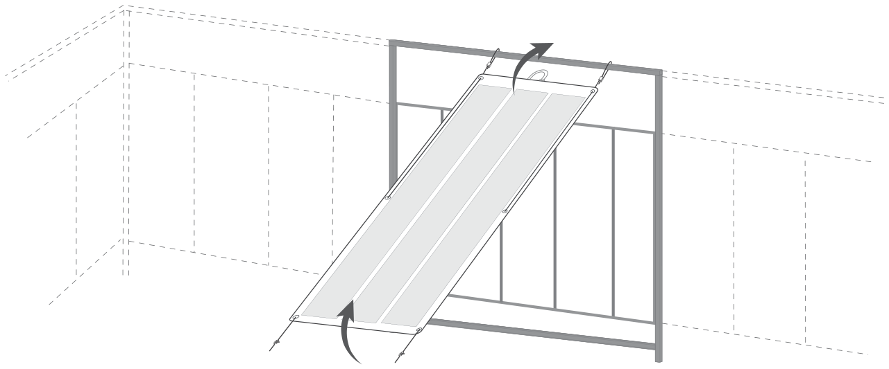

</figure>

### Step 3: Fix the bottom ends of the ropes to the railing beam.

1. Wrap the lower rope end around the railing beam.
<figure class="hb-reference-figure hb-has-composite-art" data-component-id="HB-SPECIAL-REFERENCE-FIGURE" data-reference-id="suspension-3-1" data-source-fragment-sha256="2b69c069136f49bf19e42aa29b02fda456773d03535e631bb13cf3ddabf18f3f" data-step-captions="embedded" data-web-composite-asset-key="frozen-source/suspension-3-1" data-web-composite-locale="en" data-web-composite-sha256="0163c069116bda33111575db741a0289d47730b9ebfcd0fac5e7530b487a4a02" data-web-replace-key="reference.suspension-3-1">
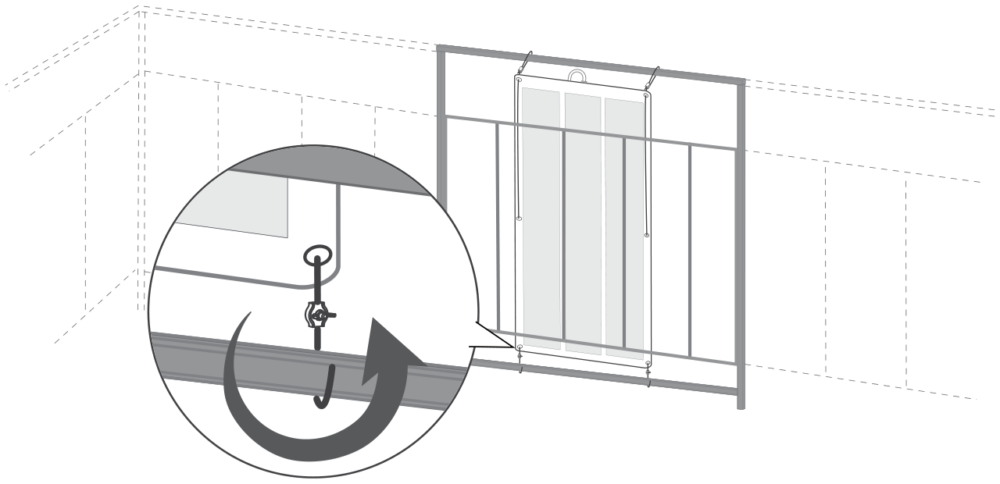

</figure>

2. Loosen the wing nut of the rope clamp, thread the rope through, and then tighten the wing nut.
<figure class="hb-reference-figure hb-has-composite-art" data-component-id="HB-SPECIAL-REFERENCE-FIGURE" data-reference-id="suspension-3-2" data-source-fragment-sha256="c9ccc443a893c58e1e626aae0de961c5f95a8872ee100ba7c323b6b9ac98a3e0" data-step-captions="embedded" data-web-composite-asset-key="frozen-source/suspension-3-2" data-web-composite-locale="en" data-web-composite-sha256="7db6ffeb094cd7032926a35c61fbf3ad86ad9a53801666afb53d7abd3326b8ad" data-web-replace-key="reference.suspension-3-2">
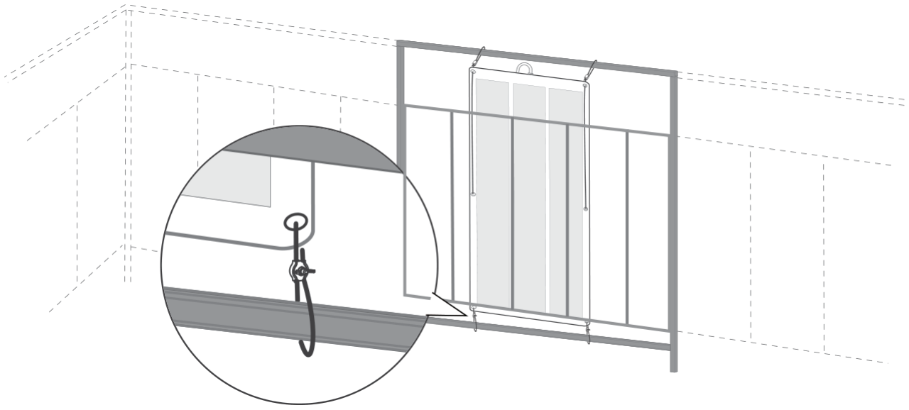

</figure>

<table class="manual-callout-table manual-callout-table"><tbody><tr><td class="manual-callout-label">⚠</td><td class="manual-callout-body">
Do not loosen two wing nuts simultaneously to prevent the solar panel from slipping off.
</td></tr></tbody></table>

3.Pull the upper rope end to tighten it securely.
<figure class="hb-reference-figure hb-has-composite-art" data-component-id="HB-SPECIAL-REFERENCE-FIGURE" data-reference-id="suspension-3-3" data-source-fragment-sha256="267701978df9801eba8d2e107810e08ac20df9d875d348d47feb2d3fb312c8b0" data-step-captions="embedded" data-web-composite-asset-key="frozen-source/suspension-3-3" data-web-composite-locale="en" data-web-composite-sha256="b0123d8cbcacf843b1873c71d5e201856d3778937db720283a72cb609775b4ca" data-web-replace-key="reference.suspension-3-3">
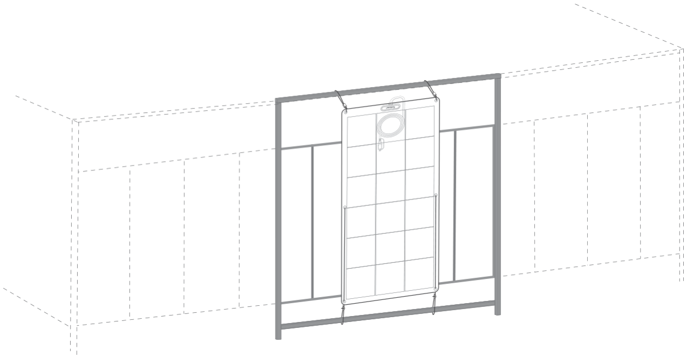

</figure>

# How to Connect Multiple Solar Panels

Multiple Jackery SolarSaga 100 Light panels can be connected in series or parallel using the Jackery Anderson Y Series Connector or Jackery Anderson Y Parallel Connector. The Jackery Anderson Y Parallel Connector and Jackery Anderson Y Series Connector can be purchased on the official Jackery website.

## Important Notes:

* The two solar panels connected to the input ports of the connector must have the same specifications.

* The output voltage in series connection is the sum of the input voltages, while the output current in parallel connection is the sum of the input currents.

For the solar generator connection guide, please visit the Jackery official website or contact Jackery customer service.

* Jackery SolarSaga 100 Light panels can be connected in various series and/or parallel configurations for different models of power generators. Please refer to the Jackery website for details.

<figure class="hb-reference-figure hb-has-composite-art" data-component-id="HB-SPECIAL-REFERENCE-FIGURE" data-reference-id="series-connection" data-source-fragment-sha256="ac00fbefd981995aa7143c5cc9713e14709c53a6efa97c544876a17c0ce19360" data-step-captions="embedded" data-web-composite-asset-key="frozen-source/series-connection" data-web-composite-locale="en" data-web-composite-sha256="738a06953a7df976a505ec8448439137d4bee02d6d636e5e39b2951803a45ba7" data-web-replace-key="reference.series-connection">
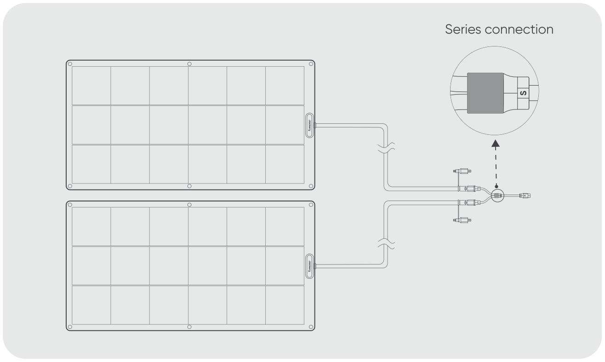

</figure>

<figure class="hb-reference-figure hb-has-composite-art" data-component-id="HB-SPECIAL-REFERENCE-FIGURE" data-reference-id="parallel-connection" data-source-fragment-sha256="8c5bb139157d0b823e2d02a2a112fd3abab054eeeef20d512fd902ceab97a686" data-step-captions="embedded" data-web-composite-asset-key="frozen-source/parallel-connection" data-web-composite-locale="en" data-web-composite-sha256="4590a2f07dc9d9e507890485eb4dfaf4fc5602927959c7699495b76acbc45485" data-web-replace-key="reference.parallel-connection">

</figure>

# TECHNICAL PARAMETERS

<table class="manual-table"><tbody><tr><td>Product Name</td><td colspan="2">Jackery SolarSaga 100 Light</td></tr><tr><td>Model</td><td colspan="2">JS-100G</td></tr><tr><th>Electrical Data</th><th>STC*</th><th>BNPI*</th></tr><tr><td>Maximum Power (Pmax)</td><td>100W±5%</td><td>110W±5%</td></tr><tr><td>Open-Circuit Voltage (Voc)</td><td>24.8V±5%</td><td>27.1V±5%</td></tr><tr><td>Short-Circuit Current (Isc)</td><td>5.15A±5%</td><td>5.91A±5%</td></tr><tr><td>Maximum Power Voltage (Vmp)</td><td>21.1V±5%</td><td>22.7V±5%</td></tr><tr><td>Maximum Power Current (Imp)</td><td>4.85A±5%</td><td>5.47A±5%</td></tr><tr><td>Maximum System Voltage</td><td colspan="2">600V</td></tr><tr><td>Maximum Reverse Current</td><td colspan="2">15A</td></tr><tr><td>Protection Class Against Electric Shock</td><td colspan="2">Class II</td></tr><tr><td>IP Rating</td><td colspan="2">IP68</td></tr><tr><td>Operating Temperature Range</td><td colspan="2">-40°C~85°C（-40°F~185°F）</td></tr><tr><td>Dimensions</td><td colspan="2">1060 x 560 x 16mm</td></tr><tr><td>Weight</td><td colspan="2">2.05 kg±0.5 kg</td></tr><tr><td>Bifaciality Coefficient (back/front)</td><td colspan="2">70%</td></tr><tr><td>Voltage Temperature Coefficient</td><td colspan="2">-0.268%/°C</td></tr><tr><td>Power Temperature Coefficient</td><td colspan="2">-0.3%/°C</td></tr></tbody></table>

* STC (Standard Test Conditions, 1000W/m², 25°C, AM 1.5)

* BNPI (Bifacial Nameplate Irradiance, Front 1000W/m², Rear 135W/m², 25°C, AM 1.5)

# WARRANTY

## Warranty Period

<figure aria-label="Warranty Period" class="hb-warranty-period-card" data-component-id="HB-WARRANTY-YEARS">

5
<strong class="hb-warranty-years-unit">YEARS</strong><strong class="hb-warranty-period-label">Standard Warranty</strong>

The product is covered by a limited warranty from Jackery for the original purchaser that covers the product from defects in workmanship and materials for 5 years from the date of purchase (damages from normal wear and tear, alteration, misuse, neglect, accident, service by anyone other than authorized service center, or act of God are not included).

During the warranty period and upon verification of defects, this product will be replaced when returned with proper proof of purchase.

</figure>

## Interpretation Rights

<figure aria-label="Interpretation Rights" class="hb-warranty-card" data-component-id="HB-WARRANTY-SECTION" data-warranty-card-index="3">
Jackery Inc. reserves the right to final interpretation of the above customers' after-sales policy.
</figure>

## Contact Us

<figure aria-label="Contact Us" class="hb-warranty-card" data-component-id="HB-WARRANTY-SECTION" data-warranty-card-index="4">
For any inquiries or comments concerning our products, please send an email to hello@jackery.com, and we will respond to you as soon as possible. If there is any quality-related issue with the product, you may request a replacement or refund by submitting a request form at www.jackery.com.
</figure>

## Customer Service

<figure aria-label="Customer Service" class="hb-warranty-card" data-component-id="HB-WARRANTY-SECTION" data-warranty-card-index="5">
5 years limited warranty

hello@jackery.com

Lifetime technical support
</figure>

# Jackery Inc.

5310 Bunche Dr, Fremont, CA 94538-8301

Tel:1-888-502-2236(US)

E-mail:hello@jackery.com

Website:<a href="https://www.jackery.com">www.jackery.com</a>

