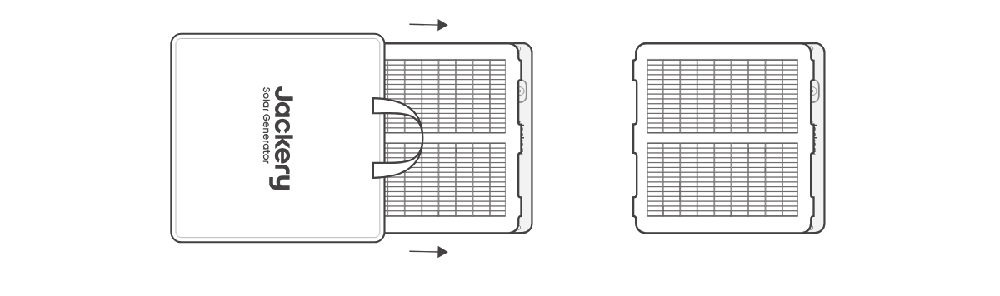
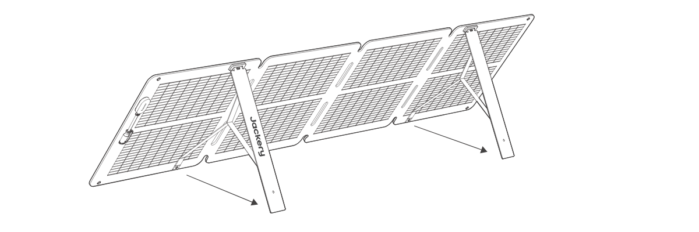
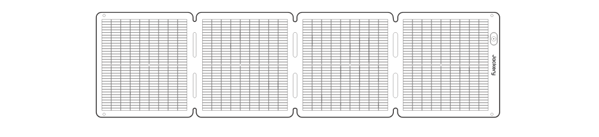
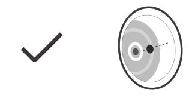

使い方
==============================

Jackeryポータブル電源を充電します
------------------------------

ソーラーパネルをマルチ充電ケーブルでポータブル電源のDC入力ポートに接続します。

.. list-table::
   :header-rows: 0
   :widths: 14 86

   * - **ヒント**
     - | 1. ソーラーパネルの充電ケーブル端子は DC8020 です。
       | 2. ご使用のポータブル電源の入力端子の種類により、変換アダプターの必要有無が異なります。

**本体前面**

.. raw:: html

   

太陽角度インジケーター

**本体背面**

.. raw:: html

   

ペグで固定するためのあらかじめ開けられた穴

アダプターボックス

スタンド

穴の直径：10mm

ソーラーパネルの展開方法
------------------------------

1\. 収納バッグからソーラーパネルを取り出します。

2\. 図のように、折り目に沿って順番に展開します。

.. image:: ../../assets/unfold_2.png
   :alt: 手順2の図

3\. 背面のスタンドを2本とも立てます。

4\. ソーラーパネルを太陽の方向に向け、ポータブル電源に接続します。

.. image:: ../../assets/unfold_4.png
   :alt: 手順4の図

ソーラーパネルの収納方法
------------------------------

1.多機能充電ケーブルを取り外し、スタンドをたたみます。

2\. 図のように、折り目に沿ってソーラーパネルを順番に折りたたみます。

.. image:: ../../assets/fold_2.png
   :alt: 収納手順2の図

3\. ソーラーパネルを収納バッグに戻します。

.. image:: ../../assets/fold_3.png
   :alt: 収納手順3の図

ポータブル電源の入力端子が8020の場合
------------------------------

アダプターDC8020 - DC7909は不要です。ケーブルをそのまま接続してください。

.. raw:: html

   

DC8020

※一般的に、以下のモデルが該当します： 1500PTB / Proシリーズ / NEWシリーズ(240NEWを除く） / Plusシリーズ(300Plus/100Plusを除く)

ポータブル電源の入力端子が7909の場合
------------------------------

別売りの「アダプターDC8020 - DC7909」を使用し、アダプターを接続したうえでポータブル電源に差し込んでください。

.. raw:: html

   

アダプターDC8020 - DC7909

※旧モデルである以下の機種が該当します： 240Wh / 400Wh / 700 / 708Wh / 1000Wh

ポータブル電源の入力端子はUSB-Cの場合
------------------------------

| 別売りの「アダプター DC8020 - USB-C」をご使用ください。
| ケーブル8020端子 → アダプター DC8020 - USB-C → 本体USB-C (in/out)端子へ接続

.. raw:: html

   

アダプター DC8020 - USB-C

※ 一般的に、以下のモデルが該当します： 100Plus、240New、300Plusなど、入力端子が USB-C（in/out）のモデル。

SolarSaga アダプター (Pro/Plus/New専用)使用ガイド
------------------------------

SolarSaga アダプター (Pro/Plus/New専用)を使用すると、2枚または3枚のソーラーパネルをまとめて、本体のDC入力ポートに接続できます。

.. raw:: html

   

DC8020

SolarSaga アダプター (Pro/Plus/New専用)

別売り

.. list-table::
   :header-rows: 0
   :widths: 14 86

   * - **ご注意**
     - | 接続できるソーラーパネルの最大枚数は、ポータブル電源のモデルによって異なります。
       | 必ず各モデルの接続ルールをご確認のうえ、正しく接続してください。
       | SolarSaga アダプター (Pro/Plus/New専用)のメス端子は8020のため、パネル充電ケーブ8020端子を接続してください。

太陽角度インジケーター
------------------------------

| 太陽光パネル正面には太陽角度インジケータが付いています。
| 日光が表面に当たると、その下部に影が表示されます。

.. raw:: html

   

太陽角度インジケーター

インジケーターポイント

シャドウ

影が下部の白い内側の円に落ちる場合は、ソーラーパネルが太陽に直接向いていることを意味し、最適な発電を得ることができます。そうでない場合は、そうなるまで角度を調整することをお勧めします。

影が白いインナーサークルに落ちている

影が白いインナーサークルに入ってない

.. list-table::
   :header-rows: 0
   :widths: 14 86

   * - **ご注意**
     - 発電量を最大化するため、パネル表面が直射日光にしっかり当たるように設置してください。

デバイスへの電力供給
------------------------------

.. raw:: html

   

多機能アダプター

Jackery  SolarSaga 100 Air

携帯電話

電源グループ

タブレット

※ この多機能充電ケーブルは本製品にのみ対応しており、他のモデルのソーラーパネルには使用しないでください。

.. raw:: html

   

   
※ USBポートを使用していないときは、ホコリを防ぐためにゴムプラグを挿入してください。

   

.. image:: ../../assets/dust.png
   :alt: ゴムプラグの図
