

<strong>お買い上げありがとうございます。</strong>

<ul class="simple">
<li>
ご使用の前にこの「取扱説明書」をよくお読みのうえ、正しくお使いください。
</li>
<li>
特に「安全上のご注意」は、必ずお読みいただき、安全にお使いください。
</li>
<li>
お読みになったあとは、すぐに取り出せる場所に大切に保管してください。
</li>
<li>
本製品の取扱説明書は随時更新されますので、最新の取扱説明書は公式サイトでご確認ください。
</li>
</ul>

# 使用ガイド（ご使用前の注意事項）

<table class="manual-callout-table" style="width:100%; border-collapse:collapse; margin:0 0 16px 0;"><tbody><tr><td class="manual-callout-label" style="width:16%; border:1px solid #000; padding:6px 8px; vertical-align:top;">
<strong>警告</strong>
</td><td class="manual-callout-body" style="border:1px solid #000; padding:6px 8px; vertical-align:top;">

本製品をご使用になる前に、必ず『当該取扱説明書』をお読みください。

以下の注意事項を守り、安全かつ正しくお使いください。

</td></tr></tbody></table>

<strong>■ ソーラーパネルの取り扱いについて</strong>

<ul class="simple">
<li>
折りたたみ時に、鋭利な物で傷をつけないようご注意ください。
</li>
<li>
ソーラーパネルを分解・取り外ししないでください。
</li>
<li>
腐食性物質はパネル上に置かないでください。
</li>
<li>
製品の品質保持のため、落下・曲げ・踏みつけ・加重はお控えください。
</li>
</ul>

※内部損傷により、使用不能となるおそれがあります。

<strong>■ 使用環境に関する注意</strong>

<ul class="simple">
<li>
ソーラーパネルは木・建物・その他の影になる場所で使用しないでください。
</li>
<li>
発電効率が大きく低下するため、パネルはガラス越しの場所では使用しないでください。
</li>
<li>
曇り、雨の日や夕方など、日差しが弱いときは充電ケーブルを外してください。接続したままにすると、本体の電力が減る場合があります。
</li>
<li>
水や液体に浸さないでください。
</li>
</ul>

※清掃の際は、湿らせた布で優しく拭いてください。

<ul>
<li>
明火や可燃物の近くでの使用・保管は禁止です。
</li>
<li>
折りたたみ式ソーラーパネルは取り付け用に固定できません。
</li>
<li>
製品の損傷やその他の危険を避けるため、強風・雹悪天候時には必ず収納してください。
</li>
<li>
ソーラーパネル本体（パネル面）は防塵・防水仕様となっておりますが、出力端子および充電ケーブルの端子部分には防水機能がございません。

そのため、雨天時のご使用は故障の原因となる可能性がございます。

誤作動や製品破損を防ぐためにも、雨の日の使用はお控えくださいますようお願い申し上げます。

</li>
</ul>

<strong>■ 接続・安全性について</strong>

<ul class="simple">
<li>
感電防止のため、濡れた手でソーラーパネルや接続機器に触れないでください。
</li>
<li>
パネルとポータブル電源のモデルにより接続方法が異なるため、「使用方法」をご確認のうえ接続してください。
</li>
<li>
破損がある場合は使用しないでください。感電や火災の原因となるおそれがあります。
</li>
<li>
人工的なスポットライトをパネルに当てて使用しないでください。
</li>
<li>
モジュールが破損すると、感電や火災の原因となる可能性があります。
</li>
</ul>

<strong>■ 電気的仕様に関する注意</strong>

<ul class="simple">
<li>
通常の状況下では、PVモジュールは標準的な試験条件よりも高い電流または電圧にさらされることがありますそのため、コンポーネントの定格電圧、導体の定格電流、PV出力に接続された制御デバイスの大きさを計算する際には、コンポーネントにマークされた短絡電流（Isc）と開放電圧（Voc）の値を1.25倍する必要があります。
</li>
</ul>

■ 逆電流および過電圧からの保護が備わっていない限り、本製品を他のPVモジュールや電源に接続しないでください。

# 同梱品

<figure aria-label="同梱品" class="hb-inbox-composition" data-card-count="4" data-component-id="HB-SPECIAL-INBOX" data-inbox-variant="responsive-card-grid"><ol class="hb-inbox-grid"><li class="hb-inbox-card" data-item-number="1">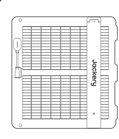

Jackery SolarSaga 100 Air

</li><li class="hb-inbox-card" data-item-number="2">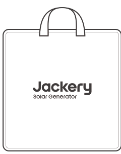

収納バッグ

</li><li class="hb-inbox-card" data-item-number="3">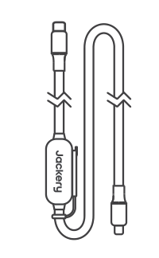

多機能充電ケーブル(3m)

</li><li class="hb-inbox-card" data-item-number="4">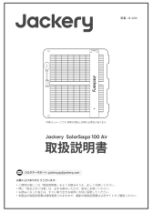

取扱説明書

</li></ol></figure>

※付属品を故障、紛失等してしまった場合はカスタマーサポートまでご連絡ください。

# 使い方

<section id="jackery">
<h2>Jackeryポータブル電源を充電します</h2>

ソーラーパネルをマルチ充電ケーブルでポータブル電源のDC入力ポートに接続します。

<table class="manual-callout-table" style="width:100%; border-collapse:collapse; margin:0 0 16px 0;"><tbody><tr><td class="manual-callout-label" style="width:16%; border:1px solid #000; padding:6px 8px; vertical-align:top;">
<strong>ヒント</strong>
</td><td class="manual-callout-body" style="border:1px solid #000; padding:6px 8px; vertical-align:top;">

1. ソーラーパネルの充電ケーブル端子は DC8020 です。

2. ご使用のポータブル電源の入力端子の種類により、変換アダプターの必要有無が異なります。

</td></tr></tbody></table>
<strong>本体前面</strong>

<figure class="hb-reference-figure hb-base-art-live-copy" data-component-id="HB-SPECIAL-REFERENCE-FIGURE" data-reference-id="front-view" data-source-fragment-sha256="c5c459cc452e8c5beb186ec9eb627c6b835cf891ad1e701aec941346bfbcbf89" data-web-base-art-ref="../../assets/front_view.png" data-web-presentation-mode="base-art-live-copy" data-web-replace-key="reference.front-view">

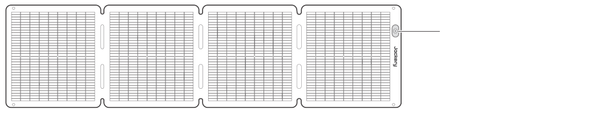太陽角度インジケーター

</figure>
<strong>本体背面</strong>

<figure class="hb-reference-figure hb-base-art-live-copy" data-component-id="HB-SPECIAL-REFERENCE-FIGURE" data-reference-id="rear-view" data-source-fragment-sha256="fb1f218dba83087bfcc2e7ce09c56f71578596d1416790ebc3c36055d26762b0" data-web-base-art-ref="../../assets/rear_view.png" data-web-presentation-mode="base-art-live-copy" data-web-replace-key="reference.rear-view">

ペグで固定するためのあらかじめ開けられた穴アダプターボックススタンド穴の直径：10mm

</figure></section>

<section id="section-2">
<h2>ソーラーパネルの展開方法</h2>

1. 収納バッグからソーラーパネルを取り出します。

2. 図のように、折り目に沿って順番に展開します。

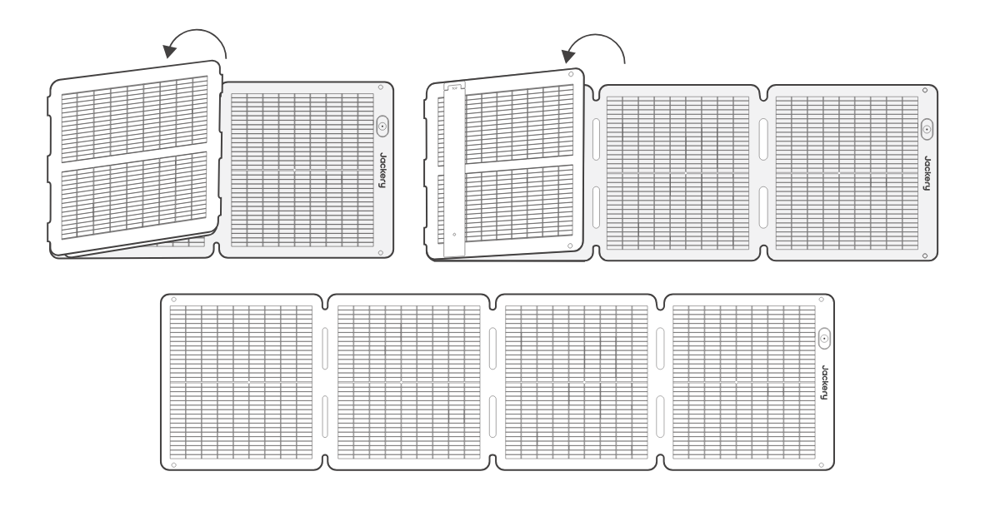

3. 背面のスタンドを2本とも立てます。

4. ソーラーパネルを太陽の方向に向け、ポータブル電源に接続します。

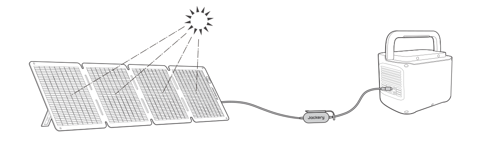
</section>

<section id="section-3">
<h2>ソーラーパネルの収納方法</h2>

1.多機能充電ケーブルを取り外し、スタンドをたたみます。

2. 図のように、折り目に沿ってソーラーパネルを順番に折りたたみます。

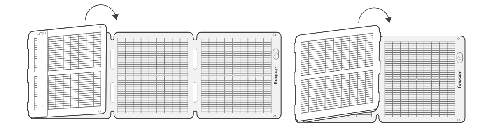

3. ソーラーパネルを収納バッグに戻します。

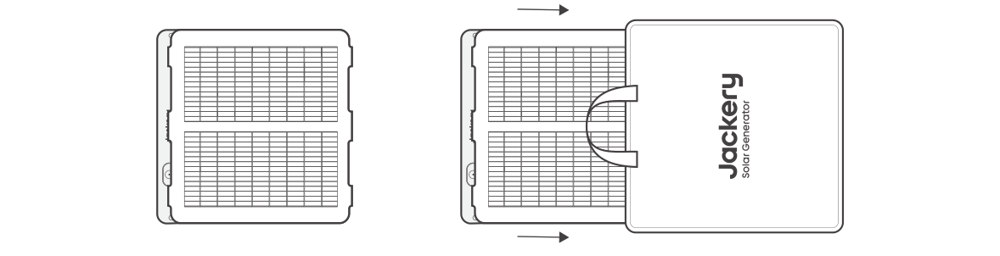
</section>

<section id="section-4">
<h2>ポータブル電源の入力端子が8020の場合</h2>

アダプターDC8020 - DC7909は不要です。ケーブルをそのまま接続してください。

<figure class="hb-reference-figure hb-base-art-live-copy" data-component-id="HB-SPECIAL-REFERENCE-FIGURE" data-reference-id="dc8020" data-source-fragment-sha256="16f1ab2e14b49eabb5ebc7c22f82681cfbdb72f4875920fe301e758e02ad65cb" data-web-base-art-ref="../../assets/dc8020.png" data-web-presentation-mode="base-art-live-copy" data-web-replace-key="reference.dc8020">

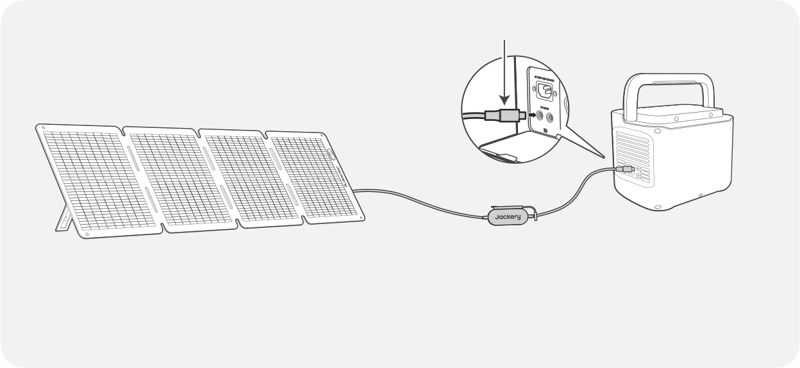DC8020※一般的に、以下のモデルが該当します： 1500PTB / Proシリーズ / NEWシリーズ(240NEWを除く） / Plusシリーズ(300Plus/100Plusを除く)

</figure></section>

<section id="section-5">
<h2>ポータブル電源の入力端子が7909の場合</h2>

別売りの「アダプターDC8020 - DC7909」を使用し、アダプターを接続したうえでポータブル電源に差し込んでください。

<figure class="hb-reference-figure hb-base-art-live-copy" data-component-id="HB-SPECIAL-REFERENCE-FIGURE" data-reference-id="dc7909" data-source-fragment-sha256="b8d61875a8adb6b8b9062484dbefe57611554996fb76d767f4d8679f097dc99e" data-web-base-art-ref="../../assets/dc7909.png" data-web-presentation-mode="base-art-live-copy" data-web-replace-key="reference.dc7909">

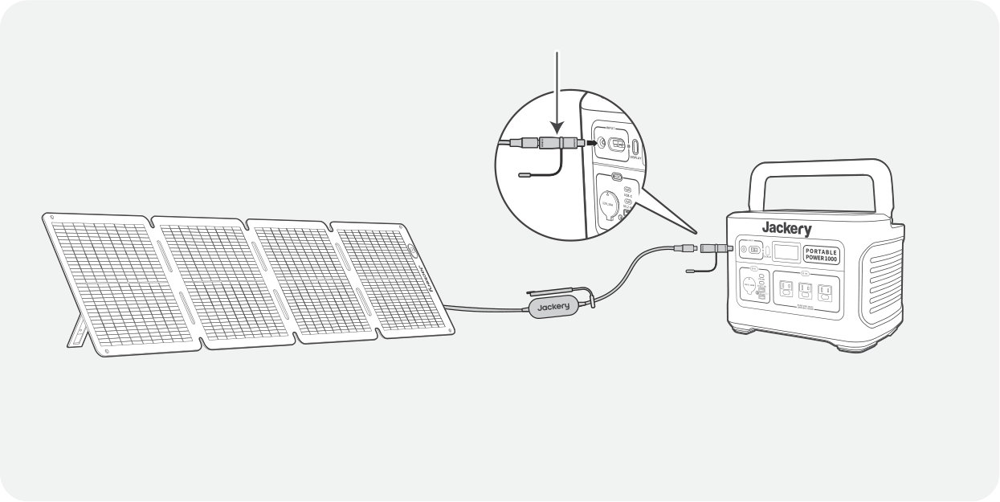アダプターDC8020 - DC7909※旧モデルである以下の機種が該当します： 240Wh / 400Wh / 700 / 708Wh / 1000Wh

</figure></section>

<section id="usb-c">
<h2>ポータブル電源の入力端子はUSB-Cの場合</h2>

別売りの「アダプター DC8020 - USB-C」をご使用ください。

ケーブル8020端子 → アダプター DC8020 - USB-C → 本体USB-C (in/out)端子へ接続

<figure class="hb-reference-figure hb-base-art-live-copy" data-component-id="HB-SPECIAL-REFERENCE-FIGURE" data-reference-id="usbc" data-source-fragment-sha256="6e0fed4e2710a93026c038a8b52fcda5b5fae7209ac5c0e40ad36d7813a4e88e" data-web-base-art-ref="../../assets/usbc.png" data-web-presentation-mode="base-art-live-copy" data-web-replace-key="reference.usbc">

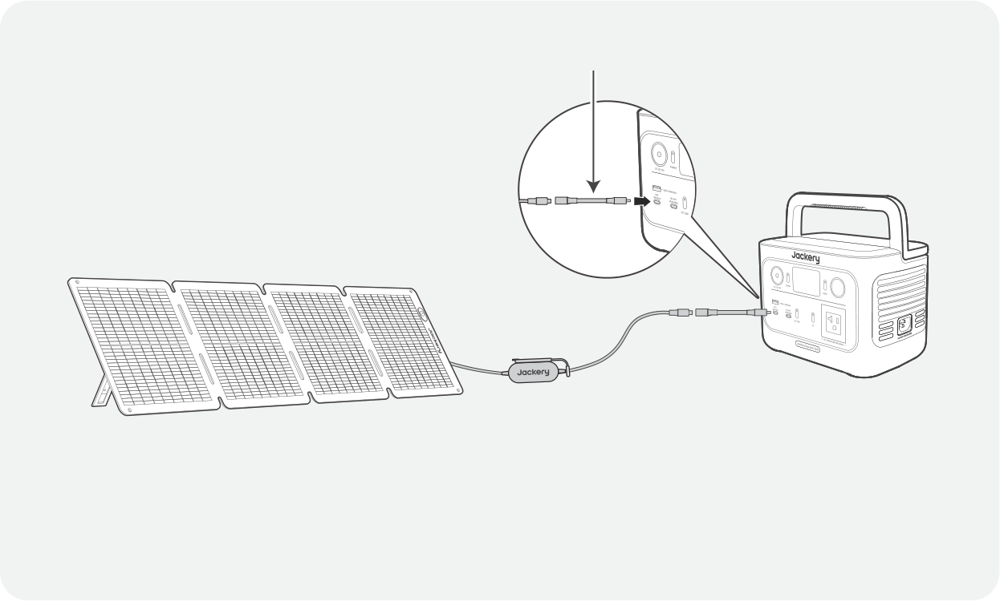アダプター DC8020 - USB-C※ 一般的に、以下のモデルが該当します： 100Plus、240New、300Plusなど、入力端子が USB-C（in/out）のモデル。

</figure></section>

<section id="solarsaga-pro-plus-new">
<h2>SolarSaga アダプター (Pro/Plus/New専用)使用ガイド</h2>

SolarSaga アダプター (Pro/Plus/New専用)を使用すると、2枚または3枚のソーラーパネルをまとめて、本体のDC入力ポートに接続できます。

<figure class="hb-reference-figure hb-base-art-live-copy" data-component-id="HB-SPECIAL-REFERENCE-FIGURE" data-reference-id="parallel" data-source-fragment-sha256="ffa8461da2870375cf863fa9fd63c7ff9d1a6cef90ec28a4afc9ddb4ba632b19" data-web-base-art-ref="../../assets/parallel.png" data-web-presentation-mode="base-art-live-copy" data-web-replace-key="reference.parallel">

DC8020SolarSaga アダプター (Pro/Plus/New専用)別売り

</figure><table class="manual-callout-table" style="width:100%; border-collapse:collapse; margin:0 0 16px 0;"><tbody><tr><td class="manual-callout-label" style="width:16%; border:1px solid #000; padding:6px 8px; vertical-align:top;">
<strong>ご注意</strong>
</td><td class="manual-callout-body" style="border:1px solid #000; padding:6px 8px; vertical-align:top;">

接続できるソーラーパネルの最大枚数は、ポータブル電源のモデルによって異なります。

必ず各モデルの接続ルールをご確認のうえ、正しく接続してください。

SolarSaga アダプター (Pro/Plus/New専用)のメス端子は8020のため、パネル充電ケーブ8020端子を接続してください。

</td></tr></tbody></table></section>

<section id="section-6">
<h2>太陽角度インジケーター</h2>

太陽光パネル正面には太陽角度インジケータが付いています。

日光が表面に当たると、その下部に影が表示されます。

<figure class="hb-reference-figure hb-base-art-live-copy" data-component-id="HB-SPECIAL-REFERENCE-FIGURE" data-reference-id="angle" data-source-fragment-sha256="03ddbef835545048027d38a3ebe2e2ac7a5fd7e156b7944941b208f9c7af55a2" data-web-base-art-ref="../../assets/angle.png" data-web-presentation-mode="base-art-live-copy" data-web-replace-key="reference.angle">

太陽角度インジケーターインジケーターポイントシャドウ

</figure>
影が下部の白い内側の円に落ちる場合は、ソーラーパネルが太陽に直接向いていることを意味し、最適な発電を得ることができます。そうでない場合は、そうなるまで角度を調整することをお勧めします。

影が白いインナーサークルに落ちている

影が白いインナーサークルに入ってない

<table class="manual-callout-table" style="width:100%; border-collapse:collapse; margin:0 0 16px 0;"><tbody><tr><td class="manual-callout-label" style="width:16%; border:1px solid #000; padding:6px 8px; vertical-align:top;">
<strong>ご注意</strong>
</td><td class="manual-callout-body" style="border:1px solid #000; padding:6px 8px; vertical-align:top;">
発電量を最大化するため、パネル表面が直射日光にしっかり当たるように設置してください。
</td></tr></tbody></table></section>

<section id="section-7">
<h2>デバイスへの電力供給</h2>
<figure class="hb-reference-figure hb-base-art-live-copy" data-component-id="HB-SPECIAL-REFERENCE-FIGURE" data-reference-id="device" data-source-fragment-sha256="da4649c4099202da4c972a18c9e53cebcef653aa85b892449125a4970b218e40" data-web-base-art-ref="../../assets/device.png" data-web-presentation-mode="base-art-live-copy" data-web-replace-key="reference.device">

多機能アダプターJackery  SolarSaga 100 Air携帯電話電源グループタブレット※ この多機能充電ケーブルは本製品にのみ対応しており、他のモデルのソーラーパネルには使用しないでください。

</figure>

※ USBポートを使用していないときは、ホコリを防ぐためにゴムプラグを挿入してください。

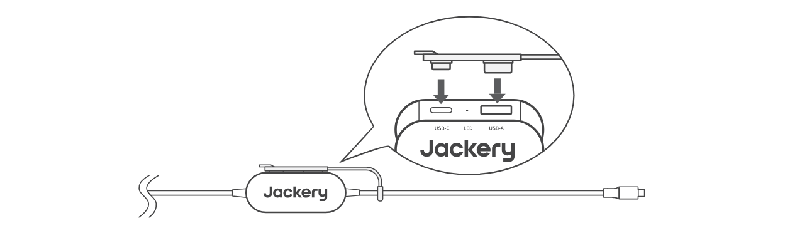
</section>

# 主な仕様

## Jackery SolarSaga 100 Air

## 基本情報

<figure aria-label="基本情報" class="hb-spec-table-composition"><table class="manual-spec-table manual-table hb-spec-table"><colgroup><col class="hb-spec-col-label"/><col class="hb-spec-col-value"/></colgroup><tbody>
<tr><th class="manual-spec-label hb-spec-label" scope="row">製品名称</th><td class="manual-spec-value hb-spec-value">Jackery SolarSaga 100 Air</td></tr>
<tr><th class="manual-spec-label hb-spec-label" scope="row">型番</th><td class="manual-spec-value hb-spec-value">JS-100I</td></tr>
<tr><th class="manual-spec-label hb-spec-label" scope="row">寸法（展開）</th><td class="manual-spec-value hb-spec-value">1630 x 423 x 17mm</td></tr>
<tr><th class="manual-spec-label hb-spec-label" scope="row">寸法（折りたたみ）</th><td class="manual-spec-value hb-spec-value">423.5 x 423 x 47mm</td></tr>
<tr><th class="manual-spec-label hb-spec-label" scope="row">正味重量</th><td class="manual-spec-value hb-spec-value">3.2kg±0.2kg</td></tr>
<tr><th class="manual-spec-label hb-spec-label" scope="row">防塵防水レベル</th><td class="manual-spec-value hb-spec-value">IP68</td></tr>
<tr><th class="manual-spec-label hb-spec-label" scope="row">動作温度範囲</th><td class="manual-spec-value hb-spec-value">-20°C~65°C</td></tr>
</tbody></table></figure>

## 電気データ

<table class="manual-spec-table"><thead>
<tr><th></th><th>STC*</th><th>BNPI*</th></tr>
</thead><tbody>
<tr><th>最大出力 (Pmax)</th><td>100W±5%</td><td>110W±5%</td></tr>
<tr><th>開放電圧 (Voc)</th><td>26.0V±5%</td><td>26.3V±5%</td></tr>
<tr><th>短絡電流 (Isc)</th><td>4.95A±5%</td><td>5.38A±5%</td></tr>
<tr><th>動作電圧 (Vmp)</th><td>21.7V±5%</td><td>22.0V±5%</td></tr>
<tr><th>動作電流 (Imp)</th><td>4.67A±5%</td><td>5.08A±5%</td></tr>
<tr><th>最大システム電圧</th><td colspan="2">80V</td></tr>
<tr><th>最大逆電流</th><td colspan="2">15A</td></tr>
<tr><th>両面係数(背面/前面)</th><td colspan="2">Pmax: &gt;65%, Voc: &gt;97%, Isc: &gt;65%</td></tr>
<tr><th>電圧温度係数</th><td colspan="2">-0.27%/°C</td></tr>
<tr><th>出力温度係数</th><td colspan="2">-0.33%/°C</td></tr>
<tr><th>感電保護クラス</th><td colspan="2">クラスII</td></tr>
<tr><th>消費財カテゴリー</th><td colspan="2">IEC TS 63163、消費財タイプ 2</td></tr>
</tbody></table>

* STC-標準試験条件(1000W/m², 25°C, AM 1.5)

* BNPI-両面公称照度(前面1000W/m²,背面135W/m², 25°C, AM 1.5)

ブラケットを開き、平らな面に置きます。設計荷重は1600 Pa、安全率は1.5倍です。

## 多機能アダプタ

<figure aria-label="多機能アダプタ" class="hb-spec-table-composition"><table class="manual-spec-table manual-table hb-spec-table"><colgroup><col class="hb-spec-col-label"/><col class="hb-spec-col-value"/></colgroup><tbody>
<tr><th class="manual-spec-label hb-spec-label" scope="row">USB-A 出力</th><td class="manual-spec-value hb-spec-value">5V⎓2.4A</td></tr>
<tr><th class="manual-spec-label hb-spec-label" scope="row">USB-C 出力</th><td class="manual-spec-value hb-spec-value">5V⎓3A</td></tr>
</tbody></table></figure>

# 保証について

Jackery 製品をご購入いただき、誠にありがとうございます。本保証書は、Jackery のソーラーパネル製品に関する保証内容を明確にご案内するものです。以下の内容をよくお読みのうえ、大切に保管してください。

<strong>■ 保証期間</strong>

1. 保証期間はご購入日から 1 年間です。

2. また、延長保証にご登録いただくと、さらに 2 年間の保証が追加されます。詳しくは Jackery 公式サイトをご確認ください。

3. Jackery 公式オンラインストアまたは正規代理店以外での購入品は保証対象外となります。

<strong>■ 保証対象</strong>

1. 購入チャネル

本保証は、Jackery 公式オンラインストアおよび正規販売代理店で購入された製品に限り有効です。

2. 保証の提供範囲

日本国内に居住されているお客様を対象とし、日本国内での使用に限り保証を提供します。

3. 保証適用条件

以下すべての条件を満たす場合に限り、本保証が適用されます：

- 取扱説明書および注意書きに従った正常な使用

- 改造・不適切な使用・事故等によらない自然故障

- 保証申請時に購入証明の提示があること

4. 購入証明の提示について

保証対応を受ける際には、以下のいずれかの購入証明が必要です：

- Jackery 公式オンラインストア：注文番号（注文履歴または注文確認メールなど）

- Jackery 正規代理店：領収書、納品書など購入日・店舗名が確認できる書類

- Jackery 公式オンラインストアおよび正規代理店以外でご購入された製品は保証対象外となりますので、らかじめご了承ください。

<strong>■ 保証内容</strong>

保証期間内に自然故障が確認された場合、以下のいずれかの方法で対応いたします：

1. 同一製品または同等品への交換（中古品の可能性を顧慮）

2. 販売終了・在庫切れ等により交換が困難な場合は、（購入年数に応じての一部）返金での対応となることがあります

※ソーラーパネル製品は修理サービス対象外のため、修理対応は行っておりません。

<strong>■ 保証対象外となる場合</strong>

以下の場合、保証期間内であっても保証の対象外となります：

1. 保証期間中に発生した故障であっても、保証期間終了後に請求された場合

2. 使用上の誤り（取扱説明書や本体ラベルなどの注意書きに従わなかった使用）による故障・損傷

3. 他機器からの影響、または不当な修理・改造による故障・損傷

移設・輸送・落下等による物理的な故障・損傷

4. 火災・地震・風水害・落雷等の天災地変、公害・塩害・異常電圧などによる故障・損傷

5. 業務用等、家庭用途以外での使用による故障・損傷

6. 消耗・摩耗部品の交換、または外観の汚損による対応要求

7. ソーラーパネル本体は防水仕様ですが、接続端子およびケーブル部分は防水ではありません。雨水の浸入、濡れた状態での使用などにより発生した故障・腐食は保証対象外となります。

8. 発電効率は天候状況、設置方法、温度に応じて変化するため、合理範囲内での発電が可能な場合

9. Jackery のソーラーパネルは、Jackery 製ポータブル電源に合わせて設計されています。他社製ポータブル電源と組み合わせて使用される場合は、必ずソーラーパネルの電圧・電流が接続先機器の仕様範囲内であることをご確認ください。

互換性の検証は行っておらず、適合しない組み合わせによって生じた製品故障は保証対象外となります。また、それに伴う経済的損失や安全上の問題についても、当社では一切の責任を負いかねますので、あらかじめご了承ください。

<strong>■ 保管に関する注意</strong>

製品は直射日光・高温多湿・雨風・ホコリの多い場所を避けて保管してください。

長期保管時には、重い物を上に置かず、変形や破損が起きないようご注意ください。

定期的に清掃・点検を行うことで、安全に長期間ご使用いただけます。

<strong>■ お問い合わせ</strong>

保証に関するご不明点がございましたら、Jackery カスタマーサービスまでお問い合わせください。

最新の保証条件は Jackery 公式サイトでもご確認いただけます。

<strong>■ ご注意（法的および規約面）</strong>

※ 本書によって保証責任者、及びそれ以外の事業者に対するお客様の法律上の権利を制限するものではありません。

※ 保証内容は都合により予告なく変更する場合がございますのでご了承ください。

<strong>公式サイト: <a href="http://www.jackery.jp">http://www.jackery.jp</a></strong>

<strong>カスタマーサポート: <a href="mailto:jackery.jp@jackery.com">jackery.jp@jackery.com</a></strong>

<strong>お問い合わせ電話番号: <a href="tel:05031989007">050-3198-9007</a></strong>

<strong>株式会社Jackery Japan</strong>

© 株式会社Jackery Japanは全ての権利を留保します。

