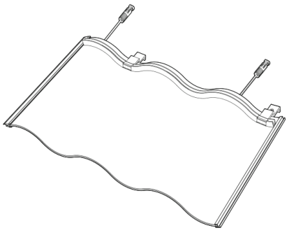
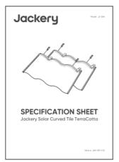

# SPECIFICATION SHEET

Jackery Solar Curved Tile TerraCotta

Model: JS-38A

Version: JAK-UM-V1.0

Congratulations on your new Jackery Solar Curved Tile TerraCotta. Please read this manual carefully before using the product, particularly the relevant precautions to ensure proper use. Keep this manual in an accessible place for frequent reference.

In compliance with laws and regulations, the right to the final interpretation of this document and all related documents of this product reside with the Company.

Please kindly note that no further notifications will be given in case of any update, revision, or termination.

## TECHNICAL PARAMETER

<figure aria-label="TECHNICAL PARAMETER" class="hb-spec-table-composition"><table class="manual-table manual-spec-table hb-spec-table"><colgroup><col class="hb-spec-col-label"/><col class="hb-spec-col-value"/></colgroup><tbody><tr><th class="manual-spec-label hb-spec-label" scope="row">Product Name</th><td class="manual-spec-value hb-spec-value">Jackery Solar Curved Tile TerraCotta</td></tr><tr><th class="manual-spec-label hb-spec-label" scope="row">Model Number</th><td class="manual-spec-value hb-spec-value">JS-38A</td></tr><tr><th class="manual-spec-label hb-spec-label" scope="row">Rated Maximum Power (Pmax)</th><td class="manual-spec-value hb-spec-value">38W±5%</td></tr><tr><th class="manual-spec-label hb-spec-label" scope="row">Rated Operating Current (Imp)</th><td class="manual-spec-value hb-spec-value">8.38A±5%</td></tr><tr><th class="manual-spec-label hb-spec-label" scope="row">Rated Operating Voltage (Vmp)</th><td class="manual-spec-value hb-spec-value">4.53V±5%</td></tr><tr><th class="manual-spec-label hb-spec-label" scope="row">Short Circuit Current (Isc)</th><td class="manual-spec-value hb-spec-value">9.14A±5%</td></tr><tr><th class="manual-spec-label hb-spec-label" scope="row">Open Circuit Voltage (Voc)</th><td class="manual-spec-value hb-spec-value">5.54V±5%</td></tr><tr><th class="manual-spec-label hb-spec-label" scope="row">Nominal Module Operating Temperature (Tnmot)</th><td class="manual-spec-value hb-spec-value">−40°C~85°C</td></tr><tr><th class="manual-spec-label hb-spec-label" scope="row">Weight</th><td class="manual-spec-value hb-spec-value">4.5kg</td></tr><tr><th class="manual-spec-label hb-spec-label" scope="row">Dimensions</th><td class="manual-spec-value hb-spec-value">720mm x 430mm x 35mm</td></tr><tr><th class="manual-spec-label hb-spec-label" scope="row">Maximum System Voltage</th><td class="manual-spec-value hb-spec-value">1000V</td></tr><tr><th class="manual-spec-label hb-spec-label" scope="row">Maximum Series Fuse Rating</th><td class="manual-spec-value hb-spec-value">20A</td></tr><tr><th class="manual-spec-label hb-spec-label" scope="row">Ingress Protection</th><td class="manual-spec-value hb-spec-value">IP68</td></tr><tr><th class="manual-spec-label hb-spec-label" scope="row">Fire Rating</th><td class="manual-spec-value hb-spec-value">Class C</td></tr><tr><th class="manual-spec-label hb-spec-label" scope="row">Impact Resistance Class</th><td class="manual-spec-value hb-spec-value">Class 3</td></tr><tr><th class="manual-spec-label hb-spec-label" scope="row">Cell Technology</th><td class="manual-spec-value hb-spec-value">IBC</td></tr><tr><th class="manual-spec-label hb-spec-label" scope="row">Application Class</th><td class="manual-spec-value hb-spec-value">Class A</td></tr><tr><th class="manual-spec-label hb-spec-label" scope="row">Min.Design Load</th><td class="manual-spec-value hb-spec-value">+3600Pa/−1600Pa</td></tr><tr><th class="manual-spec-label hb-spec-label" scope="row">Module [T98]max</th><td class="manual-spec-value hb-spec-value">70°C</td></tr><tr><th class="manual-spec-label hb-spec-label" scope="row">Connector Manufacturer</th><td class="manual-spec-value hb-spec-value">QC Solar (Suzhou)</td></tr><tr><th class="manual-spec-label hb-spec-label" scope="row">Connector Type</th><td class="manual-spec-value hb-spec-value">QC4.10-cds</td></tr><tr><th class="manual-spec-label hb-spec-label" scope="row">All Technical Data at Standard</th><td class="manual-spec-value hb-spec-value">AM1.5, E=1000W/m², Tc=25°C</td></tr></tbody></table></figure>

# PACKAGE LIST

<figure aria-label="PACKAGE LIST" class="hb-inbox-composition" data-card-count="2" data-component-id="HB-SPECIAL-INBOX" data-inbox-variant="responsive-card-grid"><ol class="hb-inbox-grid"><li class="hb-inbox-card" data-item-number="1">

Jackery Solar Curved Tile TerraCotta

</li><li class="hb-inbox-card" data-item-number="2">

Specification Sheet

</li></ol></figure>

# WARRANTY

## LIMITED PRODUCT WARRANTY

<figure aria-label="LIMITED PRODUCT WARRANTY" class="hb-warranty-card" data-component-id="HB-WARRANTY-SECTION" data-warranty-card-index="1">
Within 10 years from the date of installation, Jackery guarantees that the solar roof system it supplies, under the condition that it is installed, used, and maintained in accordance with the installation manual, will not experience product component failures caused by material or process defects that affect the normal installation or use of the product. (Except as otherwise specified in other clauses)
</figure>

## LIMITED POWER WARRANTY

<figure aria-label="LIMITED POWER WARRANTY" class="hb-warranty-card" data-component-id="HB-WARRANTY-SECTION" data-warranty-card-index="2">
Jackery offers a 25-year power output warranty starting from the date of installation, with the following terms:

Years 1–10: Actual power output shall not be less than 90% of the nameplate rating

Years 11–25: Actual power output shall not be less than 80% of the nameplate rating

Power output must be measured only under Standard Test Conditions (STC: Air Mass 1.5, Irradiance 1000W/m², Module Temperature 25°C).

All measurements must be performed by a third-party measurement institution approved either by the supplier or mutually by both parties.

In accordance with IEC 60904, test uncertainty must be taken into account in all output measurements.
</figure>

# DISCLAIMER

Jackery’s warranty does not apply to:

<ol><li>
Misuse, abuse, modification, accidental damage, or for any purpose other than normal consumer use as authorized by Jackery’s current product literature.
</li><li>
Repaired by anyone other than an authorized agency.
</li><li>
Any product purchased from an unauthorized distributor or other source.
</li><li>
Deformation, cracking, or other failure or movement of the walls or foundation of the roof deck or the building itself for the applicable product.
</li><li>
Shading, staining, or discoloration of the product caused by external sources including, but not limited to, algae, fungi, moss, lichen, or other vegetation, mold, or paint, chemicals, or other similar materials.
</li><li>
Damage caused by installation in an unsuitable location, such as a corrosive environment or a location exposed to damaging chemicals.
</li><li>
Damage caused by acts of God, power surges, lightning strikes, hurricanes, tornadoes, hail, earthquakes, floods, fires, vandalism, tampering, accidental damage, or other circumstances beyond the control of the Company.
</li><li>
Damage due to improper installation, storage, operation, or maintenance, or failure to comply with the product documentation or any local laws, regulations, codes, and requirements.
</li><li>
Any marked modification or removal, reverse engineering or alteration of the original Jackery product or its original identification and serial number.
</li><li>
This product has been proven to be free from any defects in quality after all the corresponding tests have been carried out by Jackery and Jackery’s authorized repair facilities.
</li><li>
Force Majeure: "Force Majeure" means any unforeseen, unavoidable, or insurmountable event beyond the control of the parties to this Agreement that makes the performance of this Limited Liability partially or totally impossible.
</li></ol>

<ul><li>
Such events include, but are not limited to, earthquakes, hurricanes, floods, fires, wars, strikes, epidemics, riots, acts of government, changes in laws and regulations or the application thereof, or any other events that cannot be foreseen, avoided or controlled, including events that are generally regarded as Force Majeure in business practice.
</li><li>
If a Force Majeure Event occurs, the obligations of any party affected by the Force Majeure Event under this Limited Warranty shall be automatically suspended for the duration of the delay caused by the Force Majeure Event and the period of performance shall be automatically extended. The extended period shall be the suspension period, and the other party shall not be liable for breach of contract. The party claiming to be affected by the Force Majeure shall promptly notify the other party in writing and provide the other party with sufficient evidence of the occurrence and duration of the Force Majeure within 15 days after the occurrence of the Force Majeure.
</li><li>
The party claiming to be affected by the Force Majeure shall also make all reasonable efforts to eliminate the Force Majeure, otherwise, the other party shall not compensate for the increased losses caused by the Force Majeure. In the event of Force Majeure, both parties shall immediately negotiate a fair solution and make all reasonable efforts to minimize the impact of Force Majeure.
</li></ul>

12. Other circumstances not covered by this policy but for which Jackery has sufficient evidence to refuse.

## AFTER-SALES WARRANTY

<figure aria-label="AFTER-SALES WARRANTY" class="hb-warranty-card" data-component-id="HB-WARRANTY-SECTION" data-warranty-card-index="1">
If the product does not work properly within the warranty period, you can contact our customer service team at hello@jackery.com for after-sales service. You will need to provide a valid proof of purchase, proof of warranty, product serial number, photographic or video proof of failure, and other information required by our customer support team for after-sales service.

Jackery will be responsible for the repair or replacement (at Jackery’s expense) of any Jackery product that fails to operate during the applicable warranty period due to defective workmanship or materials. The repaired or replaced product will carry the remaining warranty period of the original purchase date.
</figure>

## RIGHT OF INTERPRETATION

<figure aria-label="RIGHT OF INTERPRETATION" class="hb-warranty-card" data-component-id="HB-WARRANTY-SECTION" data-warranty-card-index="2">
Jackery reserves the right of final interpretation of the above Customer After-Sales Policy.
</figure>

## CONTACT US

<figure aria-label="CONTACT US" class="hb-warranty-card" data-component-id="HB-WARRANTY-SECTION" data-warranty-card-index="3">
hello@jackery.com (US)

hello.eu@jackery.com (EU)

jackery.jp@jackery.com (JP)
</figure>

# CONTACT INFORMATION

## JACKERY INC.

5310 Bunche Dr., Fremont, CA 94538-8301

hello@jackery.com · 1-888-502-2236 · www.jackery.com

## JACKERY TECHNOLOGY GMBH.

Address: Bahnstraße 9, 40212 Düsseldorf, Germany

hello.eu@jackery.com · +49 800 028 0208 · www.jackery.com

## JACKERY UK LTD.

Address: Suite B Fairgate House, 205 Kings Road Tyseley Birmingham B11 2AA, GB

hello.eu@jackery.com · +44 808 164 2377 · www.jackery.com

## Shenzhen Hello Tech Energy Co.,Ltd.

Address: F2-3, Bldg. 7, Jiaanda Science and technology industrial park factory, the east side of Huafan Road, Tongsheng Community, Dalang Street, Longhua District, Shenzhen, Guangdong, China

sales@hello-tech.com · +86 400 668 9293 · http://www.hello-tech.com

