

# ソーラーパネル取扱説明書

マグネットバックルを外す
<figure class="hb-reference-figure" data-component-id="HB-SPECIAL-REFERENCE-FIGURE" data-reference-id="unfold-1" data-source-fragment-sha256="b7539144a7d57afcbebe77ffa28d19c5683cc2e6450f2f668018f9b27eb74b97" data-step-captions="embedded">
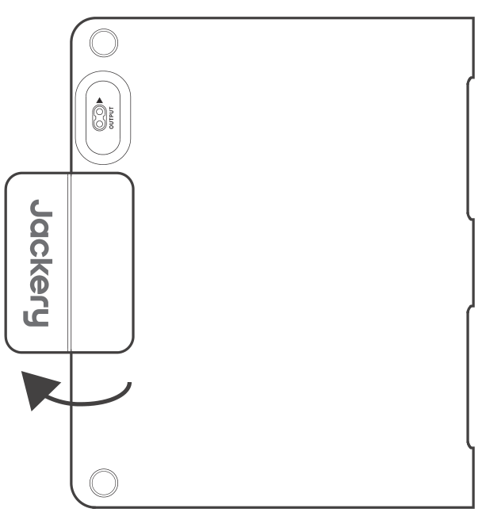
</figure>

両側に広げる
<figure class="hb-reference-figure" data-component-id="HB-SPECIAL-REFERENCE-FIGURE" data-reference-id="unfold-2" data-source-fragment-sha256="3ccbd9d0a7749b37b780efe28ed681447bf05848d07376b125f0f5e4fd359267" data-step-captions="embedded">
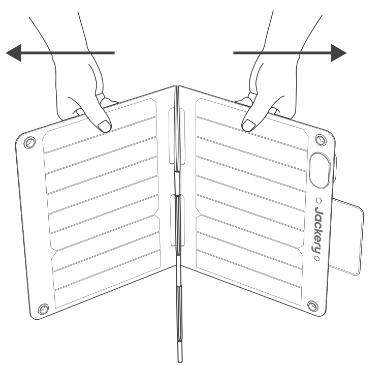
</figure>

真ん中の隠しボタンを外す
<figure class="hb-reference-figure" data-component-id="HB-SPECIAL-REFERENCE-FIGURE" data-reference-id="unfold-3" data-source-fragment-sha256="7c62cfcc2c75143d944d5d58e2209d082e457ad29699f071aad2d7312b99cdc5" data-step-captions="embedded">
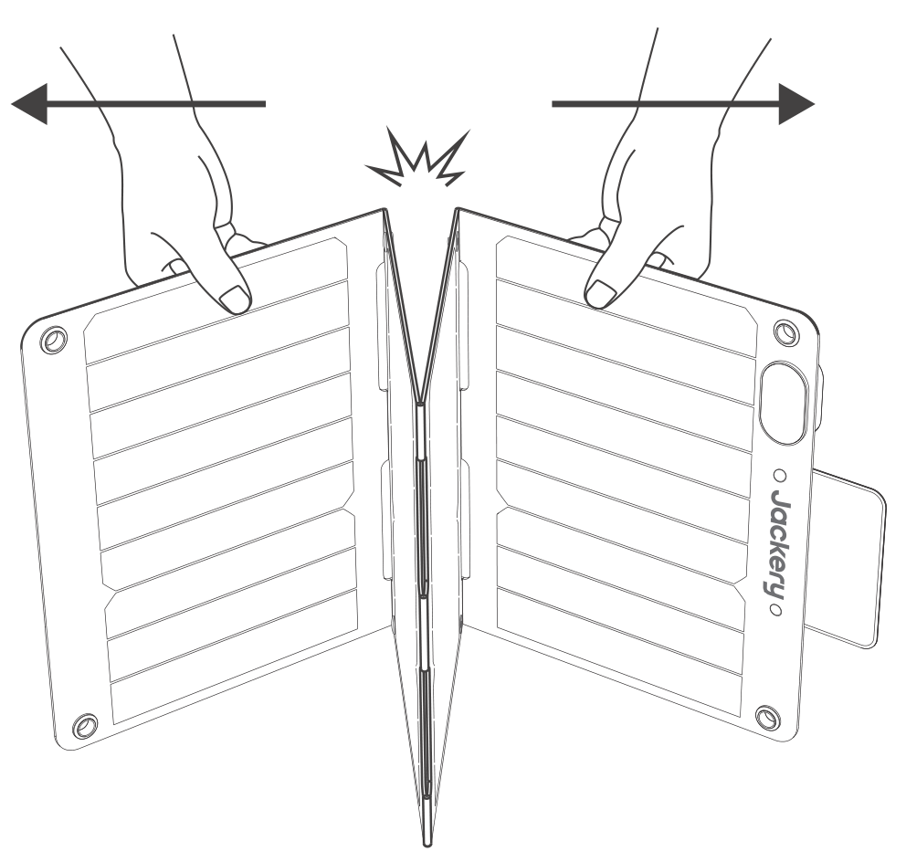
</figure>

広げる
<figure class="hb-reference-figure" data-component-id="HB-SPECIAL-REFERENCE-FIGURE" data-reference-id="unfold-4" data-source-fragment-sha256="3c5316e416038274ba0fd44615dbbccbfd50c79f93398f7fe437155c09039d2f" data-step-captions="embedded">
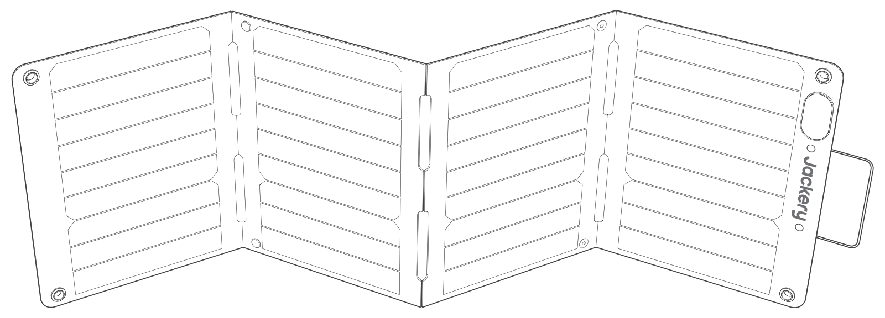
</figure>

太陽に向かい、ポータブル電源に接続する
<figure class="hb-reference-figure" data-component-id="HB-SPECIAL-REFERENCE-FIGURE" data-reference-id="unfold-5" data-source-fragment-sha256="8545970b1c83bb8e423b05309b0dacc64a396a3cff6d7724211d5a36926da011" data-step-captions="embedded">
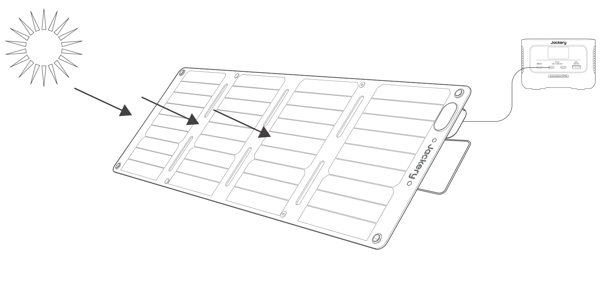
</figure>

# 1.主な仕様

## SolarSaga 40 Mini

<figure aria-label="SolarSaga 40 Mini" class="hb-spec-table-composition"><table class="manual-table manual-spec-table hb-spec-table"><colgroup><col class="hb-spec-col-label"/><col class="hb-spec-col-value"/></colgroup><tbody><tr><th class="manual-spec-label hb-spec-label" scope="row">製品名称:</th><td class="manual-spec-value hb-spec-value">SolarSaga 40 Mini</td></tr><tr><th class="manual-spec-label hb-spec-label" scope="row">型番:</th><td class="manual-spec-value hb-spec-value">JS-40A</td></tr><tr><th class="manual-spec-label hb-spec-label" scope="row">最大出力 (Pmax):</th><td class="manual-spec-value hb-spec-value">40W±5%</td></tr><tr><th class="manual-spec-label hb-spec-label" scope="row">開放電圧 (Voc):</th><td class="manual-spec-value hb-spec-value">25V±5%</td></tr><tr><th class="manual-spec-label hb-spec-label" scope="row">短絡電流 (Isc):</th><td class="manual-spec-value hb-spec-value">2.07A±5%</td></tr><tr><th class="manual-spec-label hb-spec-label" scope="row">動作電圧 (Vmp):</th><td class="manual-spec-value hb-spec-value">20.9V±5%</td></tr><tr><th class="manual-spec-label hb-spec-label" scope="row">動作電流 (Imp) :</th><td class="manual-spec-value hb-spec-value">1.91A±5%</td></tr><tr><th class="manual-spec-label hb-spec-label" scope="row">正味重量:</th><td class="manual-spec-value hb-spec-value">約1.2kg</td></tr><tr><th class="manual-spec-label hb-spec-label" scope="row">収納サイズ:</th><td class="manual-spec-value hb-spec-value">約252*300*30mm</td></tr><tr><th class="manual-spec-label hb-spec-label" scope="row">展開サイズ:</th><td class="manual-spec-value hb-spec-value">約1020*300*18.5mm</td></tr><tr><th class="manual-spec-label hb-spec-label" scope="row">動作温度範囲:</th><td class="manual-spec-value hb-spec-value">-20°C~65°C（-4°F~149°F）</td></tr><tr><th class="manual-spec-label hb-spec-label" scope="row">最大システム電圧:</th><td class="manual-spec-value hb-spec-value">30V</td></tr><tr><th class="manual-spec-label hb-spec-label" scope="row">最大逆電流:</th><td class="manual-spec-value hb-spec-value">6A</td></tr><tr><th class="manual-spec-label hb-spec-label" scope="row">感電保護クラス:</th><td class="manual-spec-value hb-spec-value">クラス III</td></tr><tr><th class="manual-spec-label hb-spec-label" scope="row">防水規格:</th><td class="manual-spec-value hb-spec-value">IP68</td></tr><tr><th class="manual-spec-label hb-spec-label" scope="row">電圧温度係数:</th><td class="manual-spec-value hb-spec-value">-0.3%/°C</td></tr><tr><th class="manual-spec-label hb-spec-label" scope="row">出力温度係数:</th><td class="manual-spec-value hb-spec-value">-0.39%/°C</td></tr><tr><th class="manual-spec-label hb-spec-label" scope="row">最大直列接続数:</th><td class="manual-spec-value hb-spec-value">1</td></tr><tr><th class="manual-spec-label hb-spec-label" scope="row">最大並列接続数:</th><td class="manual-spec-value hb-spec-value">3</td></tr><tr><th class="manual-spec-label hb-spec-label" scope="row">消費財カテゴリー:</th><td class="manual-spec-value hb-spec-value">IEC TS 63163、消費財タイプ I</td></tr></tbody></table></figure>

STC (1000W/m², 25°C, AM 1.5).

## 多機能アダプター

<figure aria-label="多機能アダプター" class="hb-spec-table-composition"><table class="manual-table manual-spec-table hb-spec-table"><colgroup><col class="hb-spec-col-label"/><col class="hb-spec-col-value"/></colgroup><tbody><tr><th class="manual-spec-label hb-spec-label" scope="row">USB-A出力:</th><td class="manual-spec-value hb-spec-value">5V⎓2.4A</td></tr><tr><th class="manual-spec-label hb-spec-label" scope="row">USB-C出力:</th><td class="manual-spec-value hb-spec-value">5V⎓3A</td></tr></tbody></table></figure>

# 2.デバイスに電力を供給する

<figure class="hb-reference-figure hb-base-art-live-copy" data-component-id="HB-SPECIAL-REFERENCE-FIGURE" data-reference-id="power-device" data-source-fragment-sha256="0add634e74dd017e061b1bb281c97fa74111434dfa347b0bab327667c1de452c" data-web-base-art-ref="power-device" data-web-presentation-mode="base-art-live-copy">

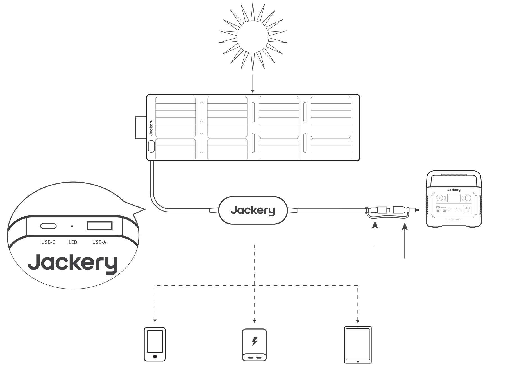SolarSaga 40 Mini多機能アダプターDC8020トランスジャック（DC8020→USB-C）スマートフォンモバイルバッテリータブレット

</figure>

*本アダプターは、Jackeryポータブル電源の充電のみ使用することができます。スマホなど、他のデバイスの充電にはご使用いただけませんので、ご注意ください。

# 3.同梱品

<figure aria-label="3.同梱品" class="hb-inbox-composition" data-card-count="6" data-component-id="HB-SPECIAL-INBOX" data-inbox-columns="3" data-inbox-variant="responsive-card-grid"><ol class="hb-inbox-grid"><li class="hb-inbox-card" data-item-number="1">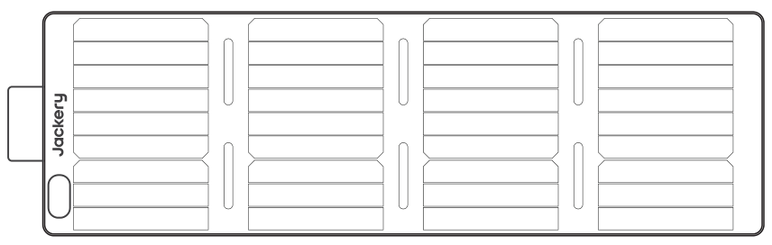

SolarSaga 40 Mini

</li><li class="hb-inbox-card" data-item-number="2">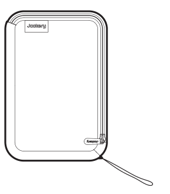

収納ポーチ

</li><li class="hb-inbox-card" data-item-number="3">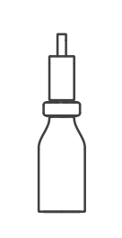

トランスジャック（DC8020→USB-C）

</li><li class="hb-inbox-card" data-item-number="4">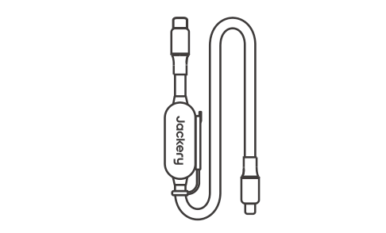

多機能ソーラー充電ケーブル

</li><li class="hb-inbox-card" data-item-number="5">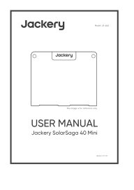

取扱説明書

</li><li class="hb-inbox-card" data-item-number="6">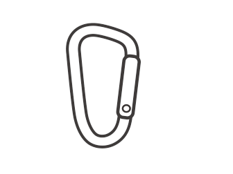

カラビナ X2

</li></ol></figure>

*この多機能充電ケーブルは、SolarSaga 40 Miniにのみ対応しており、他のモデルのソーラーパネルには使用しないでください。

# 4.使用上のご注意

<strong>※ご使用の前に取扱説明書をよくお読みになり正しくお使いください。</strong>

<ul><li>
ソーラーパネルが太陽光発電をしている間は、ポータブル電源を直射日光下に長時間放置することは避け、常に乾いた日陰に置いてください。
</li><li>
破損する恐れがあるため、本製品を曲げないでください。
</li><li>
ケーブルが折れ曲がった状態で使用しないで下さい。
</li><li>
落下や衝撃により破損する恐れがありますので十分ご注意ください。
</li><li>
本製品を釘や他の鋭い物体で突き刺したり、ハンマーで割ったり踏んだりしないでください。
</li><li>
本製品を火気、腐食剤の近くに置かないでください。
</li><li>
水中や常に水につかるような場所に設置しないで下さい。感電や漏電、事故の原因になります。
</li><li>
分解や改造を行わないで下さい。感電や火災、事故の原因になります。
</li><li>
ソーラーパネル充電用ケーブルが確実に接続されている事を確認してください。不完全の場合、感電や漏電、事故の原因になります。
</li><li>
本製品は固定設置しての使用はできません。風、雨、雹などの悪天候の際は、製品の損傷やその他の危険を避けるため、ポータブルソーラーパネルをしまってください。
</li><li>
製品の損傷により感電の危険があります。
</li></ul>

# 5.お問い合わせ

弊社製品に関するご質問やご意見などがございましたら、jackery.jp@jackery.comまで遠慮なくお問い合わせください。

# 6.サービス

正規3年間保証

テクニカルサポート

jackery.jp@jackery.com

www.jackery.jp

# 株式会社Jackery Japan

© 株式会社Jackery Japanは全ての権利を留保します。

<strong>Manufacturer/Factory: Shenzhen Hello Tech Energy Co.,Ltd.</strong>

Jianda Science  and technology industrial park,the east side of Huafan Road, Tongsheng Community, Dalang Street,Longhua District,Shenzhen,Guangdong,China.

<figure class="hb-reference-figure" data-component-id="HB-SPECIAL-REFERENCE-FIGURE" data-reference-id="contact-qr" data-source-fragment-sha256="3801597694f4d62b106a3138620312bcaf6bdded227f73d5c8197b5780212ba7" data-step-captions="embedded">

</figure>
