# USER MANUAL

Jackery SolarSaga 40 Mini

Model: JS-40A

Version: JAK-UM-V2.0

# SOLAR PANEL QUICK START GUIDE

1. Release the magnetic buckle.
<figure class="hb-reference-figure hb-has-composite-art" data-component-id="HB-SPECIAL-REFERENCE-FIGURE" data-reference-id="unfold-1" data-source-fragment-sha256="d2f9e466eed37f0202e7741df11e93e8ae4e29b7d2584c4fdb348f750f4517c0" data-step-captions="embedded" data-web-composite-asset-key="frozen-source/unfold-1" data-web-composite-locale="en" data-web-composite-sha256="d4f192fb0e8b2e6c6fe9f62b4cfc00bc59ad12606ebc48b1b7b55c274b623a1a" data-web-replace-key="reference.unfold-1">
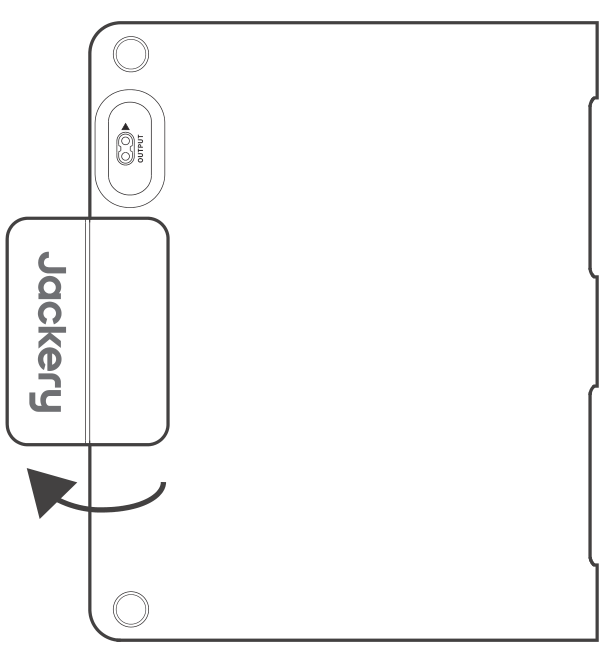

</figure>

2. Extend both sides of the panel.
<figure class="hb-reference-figure hb-has-composite-art" data-component-id="HB-SPECIAL-REFERENCE-FIGURE" data-reference-id="unfold-2" data-source-fragment-sha256="a480e14c79380fd5e2317f1c694bee1f203c70bbe9398deeea81847cf079495e" data-step-captions="embedded" data-web-composite-asset-key="frozen-source/unfold-2" data-web-composite-locale="en" data-web-composite-sha256="a71fb0738c120520516984c3d99cffffcaa1b1ad0f2f65c31771c9ee45404a60" data-web-replace-key="reference.unfold-2">
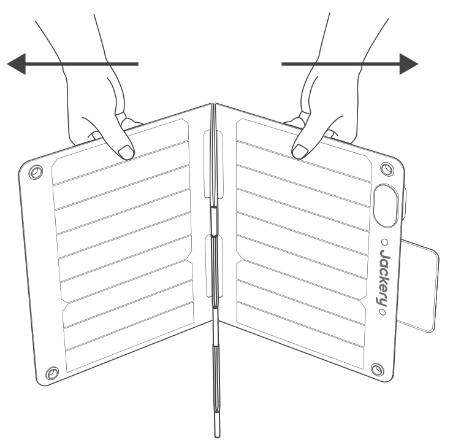

</figure>

3. Pull the concealed latch from the center to release it.
<figure class="hb-reference-figure hb-has-composite-art" data-component-id="HB-SPECIAL-REFERENCE-FIGURE" data-reference-id="unfold-3" data-source-fragment-sha256="b52ae4d8ef0f9815f227793f213cc1c6189942ab98f760b98acc2b321578119c" data-step-captions="embedded" data-web-composite-asset-key="frozen-source/unfold-3" data-web-composite-locale="en" data-web-composite-sha256="cc3bce48031cc93f8bde2651c84aa7052231a26214c2e7de88ee247b1b047331" data-web-replace-key="reference.unfold-3">
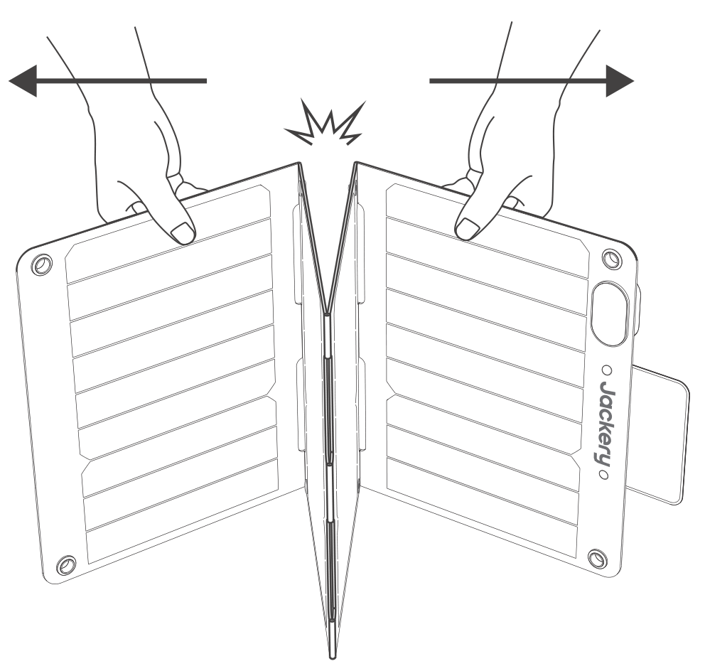

</figure>

4. Unfold the panel completely.
<figure class="hb-reference-figure hb-has-composite-art" data-component-id="HB-SPECIAL-REFERENCE-FIGURE" data-reference-id="unfold-4" data-source-fragment-sha256="f2b001873dac8922a1b574fc22305192843a29f7cf6fb3bc5a5bbc1deb8eda38" data-step-captions="embedded" data-web-composite-asset-key="frozen-source/unfold-4" data-web-composite-locale="en" data-web-composite-sha256="7159f9d8bddb88c5d2a7b4ab3e8e3ec349bf3f86ab7cc53fec58208576911570" data-web-replace-key="reference.unfold-4">
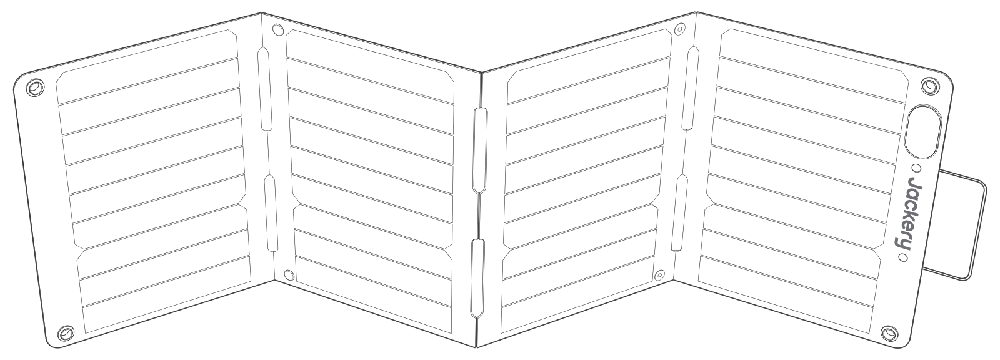

</figure>

5. Position it towards the sun and connect it to a portable power station.
<figure class="hb-reference-figure hb-has-composite-art" data-component-id="HB-SPECIAL-REFERENCE-FIGURE" data-reference-id="unfold-5" data-source-fragment-sha256="365c7659b7dcb1afb2c1953fcd612c8c794768f6e6b19a3d26cb4b66962b9737" data-step-captions="embedded" data-web-composite-asset-key="frozen-source/unfold-5" data-web-composite-locale="en" data-web-composite-sha256="fd032a9605fc5e4e0c48e554410daec72cee1a8bbdfc6bca41439ac286e91266" data-web-replace-key="reference.unfold-5">
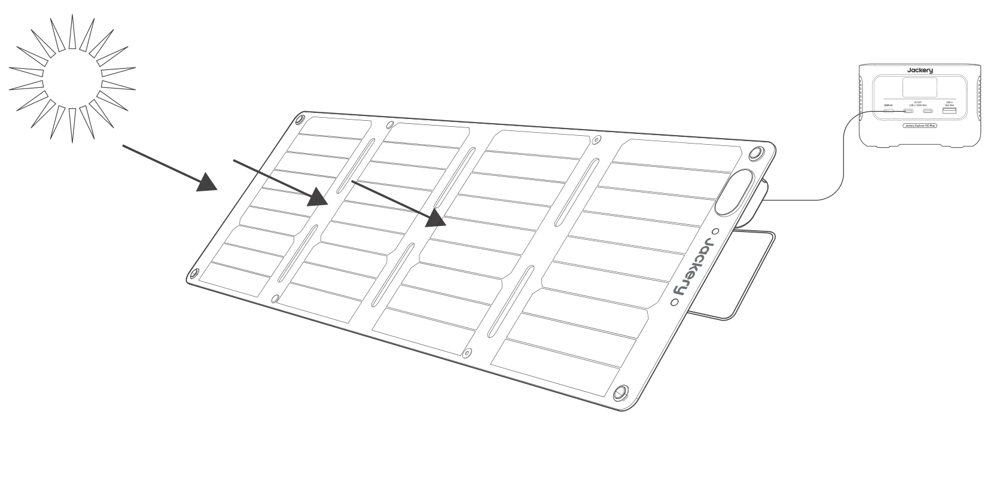

</figure>

# TECHNICAL SPECIFICATIONS

## SolarSaga 40 Mini

<figure aria-label="SolarSaga 40 Mini" class="hb-spec-table-composition"><table class="manual-table manual-spec-table hb-spec-table"><colgroup><col class="hb-spec-col-label"/><col class="hb-spec-col-value"/></colgroup><tbody><tr><th class="manual-spec-label hb-spec-label" scope="row">Product Name</th><td class="manual-spec-value hb-spec-value">SolarSaga 40 Mini</td></tr><tr><th class="manual-spec-label hb-spec-label" scope="row">Model</th><td class="manual-spec-value hb-spec-value">JS-40A</td></tr><tr><th class="manual-spec-label hb-spec-label" scope="row">Maximum Power (Pmax)</th><td class="manual-spec-value hb-spec-value">40W±5%</td></tr><tr><th class="manual-spec-label hb-spec-label" scope="row">Unfolded Size</th><td class="manual-spec-value hb-spec-value">Around 1020×300×18.5mm</td></tr><tr><th class="manual-spec-label hb-spec-label" scope="row">Folded Size</th><td class="manual-spec-value hb-spec-value">Around 252×300×30mm</td></tr><tr><th class="manual-spec-label hb-spec-label" scope="row">Weight</th><td class="manual-spec-value hb-spec-value">Around 2.6 lbs / 1.2 kg</td></tr><tr><th class="manual-spec-label hb-spec-label" scope="row">Open circuit voltage (Voc)</th><td class="manual-spec-value hb-spec-value">25V±5%</td></tr><tr><th class="manual-spec-label hb-spec-label" scope="row">Short circuit current (Isc)</th><td class="manual-spec-value hb-spec-value">2.07A±5%</td></tr><tr><th class="manual-spec-label hb-spec-label" scope="row">Optimum Operating Voltage (Vmp)</th><td class="manual-spec-value hb-spec-value">20.9V±5%</td></tr><tr><th class="manual-spec-label hb-spec-label" scope="row">Optimum Operating Current (Imp)</th><td class="manual-spec-value hb-spec-value">1.91A±5%</td></tr><tr><th class="manual-spec-label hb-spec-label" scope="row">Operating Temperature Range</th><td class="manual-spec-value hb-spec-value">−4°F~149°F (−20°C~65°C)</td></tr><tr><th class="manual-spec-label hb-spec-label" scope="row">Maximum System Voltage</th><td class="manual-spec-value hb-spec-value">30V</td></tr><tr><th class="manual-spec-label hb-spec-label" scope="row">Maximum Reverse Current</th><td class="manual-spec-value hb-spec-value">6A</td></tr><tr><th class="manual-spec-label hb-spec-label" scope="row">Protection Class Against Electric Shock</th><td class="manual-spec-value hb-spec-value">Class III</td></tr><tr><th class="manual-spec-label hb-spec-label" scope="row">Waterproof Level</th><td class="manual-spec-value hb-spec-value">IP68</td></tr><tr><th class="manual-spec-label hb-spec-label" scope="row">Voltage Temperature Coefficient</th><td class="manual-spec-value hb-spec-value">−0.3%/°C</td></tr><tr><th class="manual-spec-label hb-spec-label" scope="row">Power Temperature Coefficient</th><td class="manual-spec-value hb-spec-value">−0.39%/°C</td></tr><tr><th class="manual-spec-label hb-spec-label" scope="row">Maximum Number of Series Connections</th><td class="manual-spec-value hb-spec-value">1</td></tr><tr><th class="manual-spec-label hb-spec-label" scope="row">Maximum Number of Parallel Connections</th><td class="manual-spec-value hb-spec-value">3</td></tr><tr><th class="manual-spec-label hb-spec-label" scope="row">Consumer Goods Category</th><td class="manual-spec-value hb-spec-value">IEC TS 63163 Consumer Product Category 1</td></tr></tbody></table></figure>

STC (1000W/m², 25°C, AM 1.5).

## Multifunctional Adapter

<figure aria-label="Multifunctional Adapter" class="hb-spec-table-composition"><table class="manual-table manual-spec-table hb-spec-table"><colgroup><col class="hb-spec-col-label"/><col class="hb-spec-col-value"/></colgroup><tbody><tr><th class="manual-spec-label hb-spec-label" scope="row">USB-A Output</th><td class="manual-spec-value hb-spec-value">5V⎓2.4A</td></tr><tr><th class="manual-spec-label hb-spec-label" scope="row">USB-C Output</th><td class="manual-spec-value hb-spec-value">5V⎓3A</td></tr></tbody></table></figure>

# POWER YOUR DEVICE

<figure class="hb-reference-figure hb-has-composite-art" data-component-id="HB-SPECIAL-REFERENCE-FIGURE" data-reference-id="power-device" data-source-fragment-sha256="8176205f9b6a8dcb2d6d7641cf3456e7e80f54103492a8c684d28e280f255c07" data-step-captions="embedded" data-web-composite-asset-key="frozen-source/power-device" data-web-composite-locale="en" data-web-composite-sha256="0706ccc6053cf25026edd1aa8264c8b144db8873730ce365aed9359633874e78" data-web-replace-key="reference.power-device">
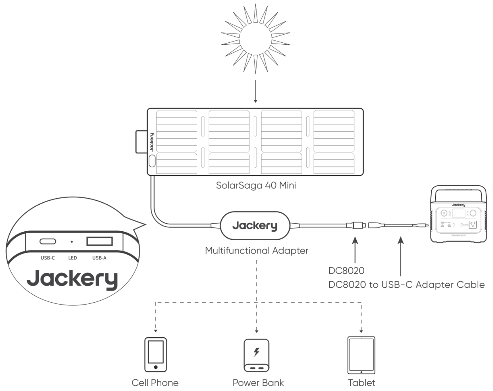

</figure>

<table class="manual-callout-table manual-callout-table"><tbody><tr><td class="manual-callout-label">Note</td><td class="manual-callout-body">
The DC8020 to USB-C adapter is only for charging Jackery power station; please do not use it for charging other devices.
</td></tr></tbody></table>

# PACKAGE LIST

<figure aria-label="PACKAGE LIST" class="hb-inbox-composition" data-card-count="7" data-component-id="HB-SPECIAL-INBOX" data-inbox-columns="3" data-inbox-variant="responsive-card-grid"><ol class="hb-inbox-grid"><li class="hb-inbox-card" data-item-number="1">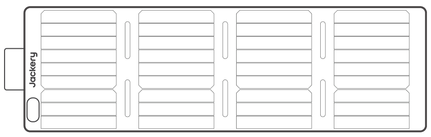

SolarSaga 40 Mini

</li><li class="hb-inbox-card" data-item-number="2">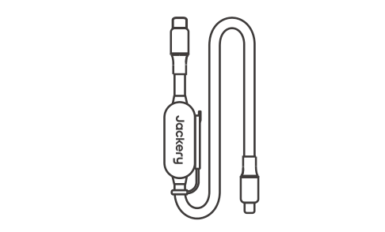

Multifunctional Solar Charging Cable

</li><li class="hb-inbox-card" data-item-number="3">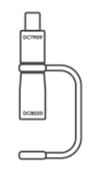

DC8020 to DC7909 Adapter

</li><li class="hb-inbox-card" data-item-number="4">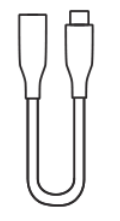

DC8020 to USB-C Adapter Cable

</li><li class="hb-inbox-card" data-item-number="5">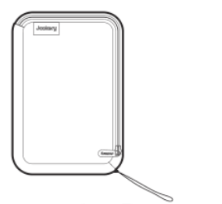

Accessories Bag

</li><li class="hb-inbox-card" data-item-number="6">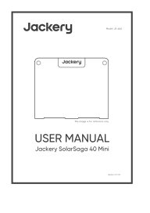

User Manual

</li><li class="hb-inbox-card" data-item-number="7">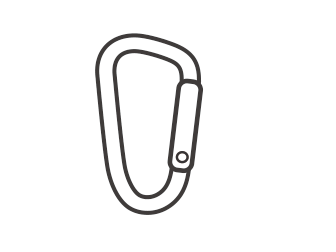

Carabiner X2

</li></ol></figure>

This multifunctional solar charging cable is only suitable for charging the Jackery SolarSaga 40 Mini and should not be used with other solar panels.

As the maximum current of the DC8020 to USB-C Adapter Cable is 5A, please do not use it together with the Jackery SolarSaga 200.

The DC8020 to DC7909 adapter is required if you need to recharge the devices listed below with SolarSaga 40 Mini.

Jackery Explorer 160/240/290/300/400/500/550/600/700/708/880/1000

# SAFETY PRECAUTIONS WHEN USING

## Solar Panel Safety Tips

<ul><li>
Do not flex or bend the folding solar panels.
</li><li>
Do not place folding solar panels in shading places, while tree shades, buildings, and any other obstructions should be minimized.
</li><li>
Do not soak the solar panels in water or other liquid.
</li><li>
Do not clean the solar panel with water, please gently wipe it with a damp cloth.
</li><li>
Do not use or store solar panels near open flames or flammable materials.
</li><li>
Do not scratch the surface of solar panels with sharp objects.
</li><li>
Prevent corrosive substances to damage solar panels.
</li><li>
Do not step on or place heavy objects on the solar panels.
</li><li>
Do not disassemble the solar panels.
</li><li>
The output circuit of the solar panels must be correctly connected to the equipment. Please do not short-circuit the positive and negative poles. Ensure that there is no gap between the connector and the insulated connector. If there is a gap, sparks or electrical shocks will occur.
</li><li>
Check the connection status of each component, including cables, wires and plugs.
</li></ul>

<figure aria-label="WARRANTY" class="hb-warranty-period-card" data-component-id="HB-WARRANTY-YEARS">

36
<strong class="hb-warranty-years-unit">MONTHS</strong><strong class="hb-warranty-period-label">Limited Warranty</strong>

The product is covered by a limited warranty from Jackery for the original purchaser that covers the product from defects in workmanship and materials for 36 months from the date of purchase (damages from normal wear and tear, alteration, misuse, neglect, accident, service by anyone other than authorized service center, or act of God are not included). During the warranty period and upon verification of defects, this product will be replaced when returned with proper proof of purchase.

2
<strong class="hb-warranty-years-unit">YEARS</strong><strong class="hb-warranty-period-label">Extended Warranty</strong>

To activate the Warranty Extension, you must register your product online or contact our customer service team at hello@jackery.com to extend the standard warranty runtime.

</figure>

## CUSTOMER SERVICE

<figure aria-label="CUSTOMER SERVICE" class="hb-warranty-card" data-component-id="HB-WARRANTY-SECTION" data-warranty-card-index="2">
36-month limited warranty

Lifetime technical support

hello@jackery.com
</figure>

## CONTACT US

<figure aria-label="CONTACT US" class="hb-warranty-card" data-component-id="HB-WARRANTY-SECTION" data-warranty-card-index="3">
For any inquiries or comments concerning our products, please send an email to hello@jackery.com, and we will respond to you as soon as possible. If there is any quality-related issue with the product, you may request a replacement or refund by submitting a request form at www.jackery.com.
</figure>

# JACKERY INC.

5310 Bunche Dr, Fremont, CA 94538

Tel: 1-888-502-2236(US)

E-mail: hello@jackery.com

Website: <a href="https://www.jackery.com">https://www.jackery.com</a>

