# USER MANUAL

Jackery SolarSaga 85

Model: JS-85A

Version: JAK-UM-V1.0

<strong>Contact us:</strong> hello@jackery.com 1-888-502-2236(US)

# TECHNICAL PARAMETERS (Jackery SolarSaga 85)

<table class="manual-table"><tbody><tr><td>Product Name</td><td colspan="2">Jackery SolarSaga 85</td></tr><tr><td>Model No.</td><td colspan="2">JS-85A</td></tr><tr><th>Electrical Data</th><th>STC</th><th>BNPI</th></tr><tr><td>Peak Power (Pmax)</td><td>85W±5%</td><td>93W±5%</td></tr><tr><td>Open Circuit Voltage (Voc)</td><td>49.4V±5%</td><td>50.2V±5%</td></tr><tr><td>Short Circuit Current (Isc)</td><td>2.17A±5%</td><td>2.31A±5%</td></tr><tr><td>Power Voltage (Vmp)</td><td>42.5V±5%</td><td>43.3V±5%</td></tr><tr><td>Power Current (Imp)</td><td>2.0A±5%</td><td>2.14A±5%</td></tr><tr><td>Maximum System Voltage</td><td colspan="2">90V DC</td></tr><tr><td>Maximum Reverse Current</td><td colspan="2">15A</td></tr><tr><td>Protection Class Against Electric Shock</td><td colspan="2">Class II</td></tr><tr><td>Waterproof Level</td><td colspan="2">IP68</td></tr><tr><td>Operating Temperature Range</td><td colspan="2">-40°C~85°C (-40°F~185°F)</td></tr><tr><td>Dimensions</td><td colspan="2">977 x 493 x 14mm</td></tr><tr><td>Weight</td><td colspan="2">1.4 kg±0.2 kg</td></tr><tr><td>Bifaciality Coefficient (back/front)</td><td colspan="2">Pmax&gt;80%, Voc&gt;97%, Isc&gt;80%</td></tr><tr><td>Voltage Temperature Coefficient</td><td colspan="2">-0.26%/°C</td></tr><tr><td>Power Temperature Coefficient</td><td colspan="2">-0.32%/°C</td></tr></tbody></table>

STC (1000W/m², 25°C, AM 1.5). BNPI (Front 1000W/m², Rear 135W/m², 25°C, AM 1.5).

The above are the technical specifications for a single solar panel.

# TECHNICAL PARAMETERS (Jackery SolarSaga 500 X)

<table class="manual-table"><tbody><tr><td>Product Name</td><td colspan="2">Jackery SolarSaga 500 X</td></tr><tr><td>Model No.</td><td colspan="2">JS-500A</td></tr><tr><th>Electrical Data</th><th>STC</th><th>BNPI</th></tr><tr><td>Peak Power (Pmax)</td><td>500W±5%</td><td>545W±5%</td></tr><tr><td>Open Circuit Voltage (Voc)</td><td>48.5V±5%</td><td>49.2V±5%</td></tr><tr><td>Short Circuit Current (Isc)</td><td>13.02A±5%</td><td>13.86A±5%</td></tr><tr><td>Power Voltage (Vmp)</td><td>41.7V±5%</td><td>42.5V±5%</td></tr><tr><td>Power Current (Imp)</td><td>12.0A±5%</td><td>12.84A±5%</td></tr><tr><td>Maximum System Voltage</td><td colspan="2">90V DC</td></tr><tr><td>Maximum Reverse Current</td><td colspan="2">15A</td></tr><tr><td>Protection Class Against Electric Shock</td><td colspan="2">Class II</td></tr><tr><td>Waterproof Level</td><td colspan="2">IP68</td></tr><tr><td>Operating Temperature Range</td><td colspan="2">-40°C~85°C (-40°F~185°F)</td></tr><tr><td>Unfolded Size</td><td colspan="2">Around 2493 × 996 × 294mm</td></tr><tr><td>Folded Size</td><td colspan="2">Around 996 × 526 × 97mm</td></tr><tr><td>Weight</td><td colspan="2">9.3 kg±0.5 kg</td></tr><tr><td>Bifaciality Coefficient (back/front)</td><td colspan="2">Pmax&gt;80%, Voc&gt;97%, Isc&gt;80%</td></tr><tr><td>Voltage Temperature Coefficient</td><td colspan="2">-0.26%/°C</td></tr><tr><td>Power Temperature Coefficient</td><td colspan="2">-0.32%/°C</td></tr></tbody></table>

STC (1000W/m², 25°C, AM 1.5). BNPI (Front 1000W/m², Rear 135W/m², 25°C, AM 1.5).

The above are the technical specifications for six solar panels connected in parallel.

# PACKAGE LIST

<figure aria-label="PACKAGE LIST" class="hb-inbox-composition" data-card-count="10" data-component-id="HB-SPECIAL-INBOX" data-inbox-columns="3" data-inbox-variant="responsive-card-grid"><ol class="hb-inbox-grid"><li class="hb-inbox-card" data-item-number="1">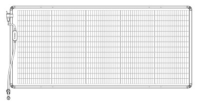

Jackery SolarSaga 85 x 6

</li><li class="hb-inbox-card" data-item-number="2">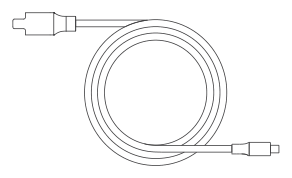

Solar Charging Cable

</li><li class="hb-inbox-card" data-item-number="3">

Storage Bag

</li><li class="hb-inbox-card" data-item-number="4">

User Manual

</li><li class="hb-inbox-card" data-item-number="5">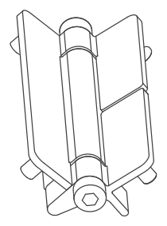

Hinge x 10

</li><li class="hb-inbox-card" data-item-number="6">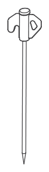

Ground Stakes x 8

</li><li class="hb-inbox-card" data-item-number="7">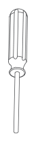

Hex Key

</li><li class="hb-inbox-card" data-item-number="8">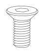

Screw x 40

</li><li class="hb-inbox-card" data-item-number="9">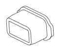

Anderson Rubber Plug x 2

</li><li class="hb-inbox-card" data-item-number="10">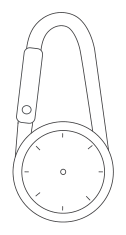

Compass Carabiner

</li></ol></figure>

# HOW TO USE

## Single Solar Panel

<figure class="hb-reference-figure hb-has-composite-art" data-component-id="HB-SPECIAL-REFERENCE-FIGURE" data-reference-id="panel-front-back" data-source-fragment-sha256="1c38419ccf36e1583aabcf828c6843b651b1350718dca69bc4b3baa9f64a57af" data-step-captions="embedded" data-web-composite-asset-key="frozen-source/panel-front-back" data-web-composite-locale="en" data-web-composite-sha256="bb939cf37d52005757181a473c2184ba15dc8f03f48fef926f6ed95afbf9299d" data-web-replace-key="reference.panel-front-back">
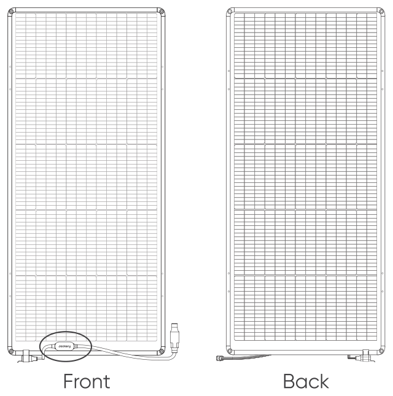

</figure>

The side with the junction box is the front of the solar panel.

As shown in the diagram, a single solar panel uses an Anderson connector as its output port. To connect the solar panel to a power station, use the DC8020 output port on the 5m charging cable.

<figure class="hb-reference-figure hb-has-composite-art" data-component-id="HB-SPECIAL-REFERENCE-FIGURE" data-reference-id="connection" data-source-fragment-sha256="895a01d0d1ec7f247507fdc80995d58352d51d927b94102caccd6a84bb8ca587" data-step-captions="embedded" data-web-composite-asset-key="frozen-source/connection" data-web-composite-locale="en" data-web-composite-sha256="2d53a30547156d395c29bc5e7751ef7d988b502543400d40be91bcaeb578bcde" data-web-replace-key="reference.connection">
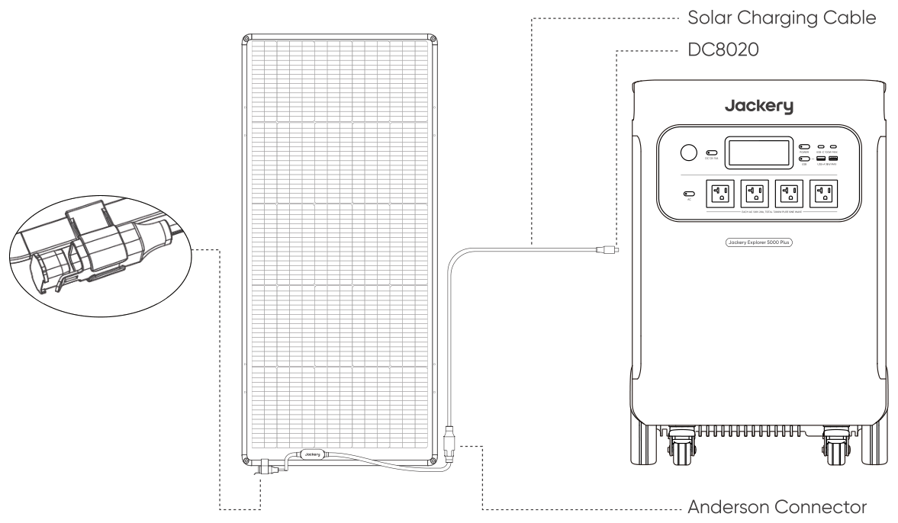

</figure>

When the Anderson connector’s female socket is not in use, be sure to seal it with the rubber plug to ensure it remains waterproof and dustproof.

### Installation and Mounting:

To secure a single solar panel, use the mounting holes located at the four corners.

<figure class="hb-reference-figure hb-has-composite-art" data-component-id="HB-SPECIAL-REFERENCE-FIGURE" data-reference-id="mounting-holes" data-source-fragment-sha256="0b4fcb6a9558339875a263ee679544e012c0892281994b65a6a4c33b56ba67af" data-step-captions="embedded" data-web-composite-asset-key="frozen-source/mounting-holes" data-web-composite-locale="en" data-web-composite-sha256="477e17a04a784c0e03c6b6740fdaa1776be75c8fafd95679119e3a8e845f2e89" data-web-replace-key="reference.mounting-holes">
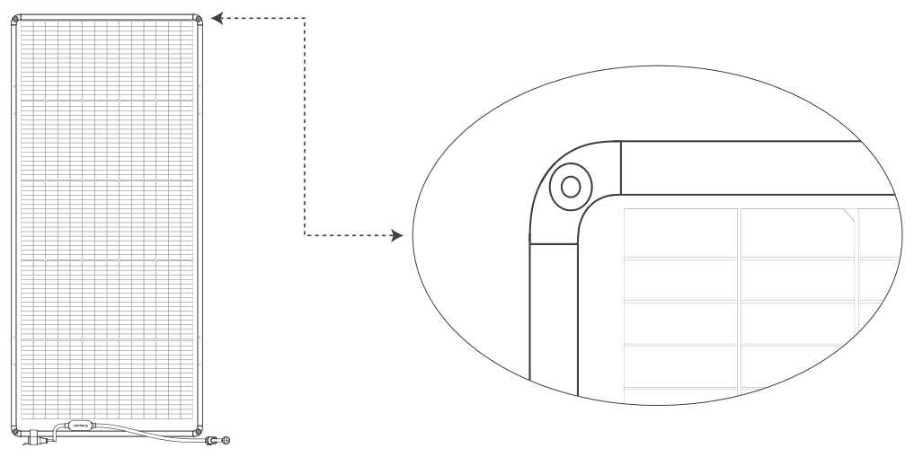

</figure>

The panel can be fastened with straps, screws or ropes in a location that receives ample sunlight, such as a balcony or rooftop.

<table class="manual-callout-table manual-callout-table"><tbody><tr><td class="manual-callout-label">Note</td><td class="manual-callout-body">
1. The panel is not intended for permanent installation.

2. Before installing a rooftop solar system, check your local building codes and obtain all required permits from the appropriate city or county authority.
</td></tr></tbody></table>

The following illustration shows solar panel installation on a balcony railing.

<figure class="hb-reference-figure hb-has-composite-art" data-component-id="HB-SPECIAL-REFERENCE-FIGURE" data-reference-id="balcony-railing" data-source-fragment-sha256="a7bdb5d2fae6ad1916b41c42b76dc3e2aea331fb396ab2b4e35932d67c8c9ceb" data-step-captions="embedded" data-web-composite-asset-key="frozen-source/balcony-railing" data-web-composite-locale="en" data-web-composite-sha256="d46077aefd7df0e0fc9cb759dd834851eeeeeafce9e66f9cc780c150bce720e2" data-web-replace-key="reference.balcony-railing">
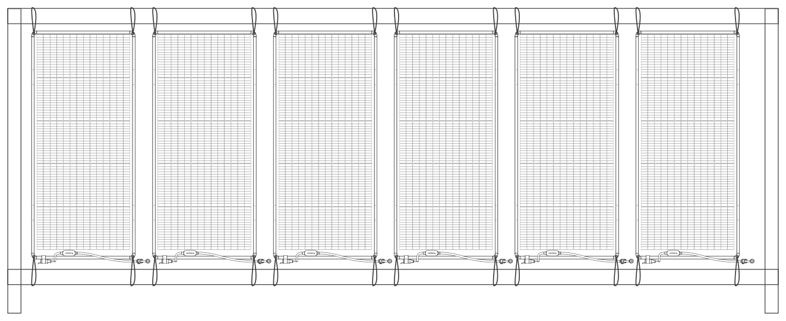

</figure>

The following illustration shows solar panel installation on a carport roof.

<figure class="hb-reference-figure hb-has-composite-art" data-component-id="HB-SPECIAL-REFERENCE-FIGURE" data-reference-id="carport-roof" data-source-fragment-sha256="7b09fb9e997b86bf74cee3caafe269085c1b3d4ae9ed886614a9d95ca5ed29c0" data-step-captions="embedded" data-web-composite-asset-key="frozen-source/carport-roof" data-web-composite-locale="en" data-web-composite-sha256="56259dc4f740080ea7461af855c4a4bfa5a0052605f5dbd67707a1fbff0b457c" data-web-replace-key="reference.carport-roof">
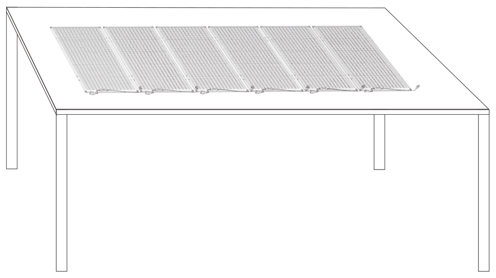

</figure>

## Multiple Solar Panels

### Assembly

Multiple solar panels can be connected using hinges.

Note: The hinges have a specific range of motion. To avoid damaging the product, do not apply excessive force.

<figure class="hb-reference-figure hb-has-composite-art" data-component-id="HB-SPECIAL-REFERENCE-FIGURE" data-reference-id="hinge-pair" data-source-fragment-sha256="e7c266e77da12c58ed12fd6a27d04d80634069486d3ee95488e96909a1a245df" data-step-captions="embedded" data-web-composite-asset-key="frozen-source/hinge-pair" data-web-composite-locale="en" data-web-composite-sha256="2f3c16513853335343c2881125d8dd81ec56a7b56f8b4ef186b8b4c97b7ea358" data-web-replace-key="reference.hinge-pair">
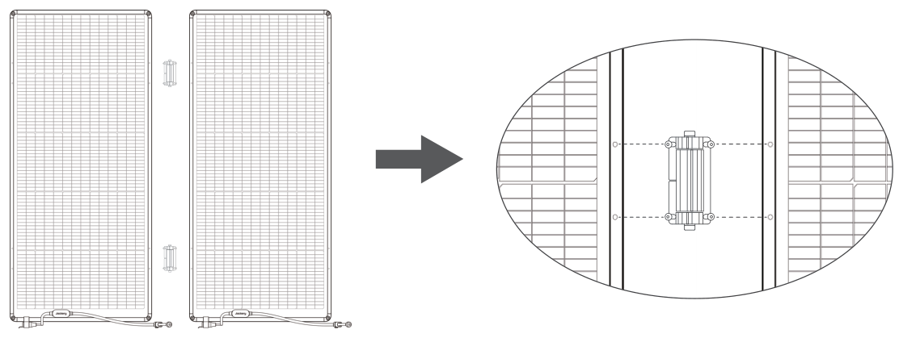

</figure>

As shown in the diagram, two hinges are required to connect each pair of solar panels. Each hinge should be fastened to both sides of the panels using hex screws.

<strong>We recommend standing the solar panel vertically before hinge installation.</strong>

Step 1: When connecting the first and second solar panels, secure the hinge on the back side of the panels, and install the screws on the front side. Refer to the diagram below for detailed instructions.

<figure class="hb-reference-figure hb-has-composite-art" data-component-id="HB-SPECIAL-REFERENCE-FIGURE" data-reference-id="hinge-step1" data-source-fragment-sha256="f636ac5d32878c6aa4923f57c95769a1735ee7283781110b2630e1059660a53e" data-step-captions="embedded" data-web-composite-asset-key="frozen-source/hinge-step1" data-web-composite-locale="en" data-web-composite-sha256="cebbf5db07e61ac617a1f14fc6e597287a6af3b657238602e44716fa4e4bf19d" data-web-replace-key="reference.hinge-step1">
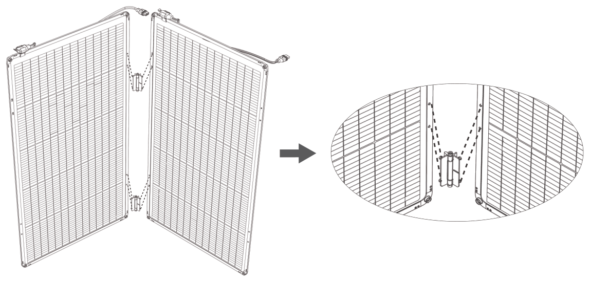

</figure>

Step 2: When connecting the third panel, ensure the hinge is secured on the front side, and install the screws on the back. Refer to the diagram below for detailed instructions.

<figure class="hb-reference-figure hb-has-composite-art" data-component-id="HB-SPECIAL-REFERENCE-FIGURE" data-reference-id="hinge-step2" data-source-fragment-sha256="26721e0a330cee4766dc8612d48f8f04d774b18663fbd7f1cc18fd67cb58f9df" data-step-captions="embedded" data-web-composite-asset-key="frozen-source/hinge-step2" data-web-composite-locale="en" data-web-composite-sha256="ca4c030d729ba1e28b7bd36a59780041015053956afb1b43cf3b15eb7a0748c4" data-web-replace-key="reference.hinge-step2">
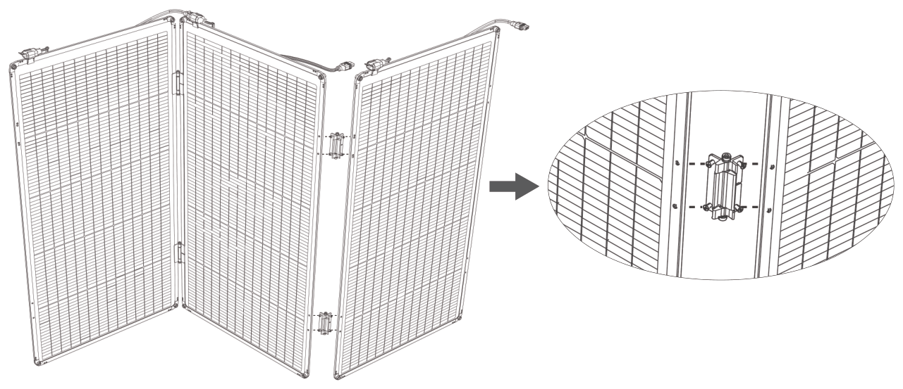

</figure>

Repeat the above steps to complete the installation of all six solar panels. For installations involving six solar panels, refer to the diagram below.

<figure class="hb-reference-figure hb-has-composite-art" data-component-id="HB-SPECIAL-REFERENCE-FIGURE" data-reference-id="six-panels" data-source-fragment-sha256="020888cd5d6ed1d27559b29e6dca68b513504e005f230b64e08acd6c37682472" data-step-captions="embedded" data-web-composite-asset-key="frozen-source/six-panels" data-web-composite-locale="en" data-web-composite-sha256="9cdef5eb70f180f8d3e5d5ad18bb4965ebad437ecfeace44007d9604dd0df8ad" data-web-replace-key="reference.six-panels">
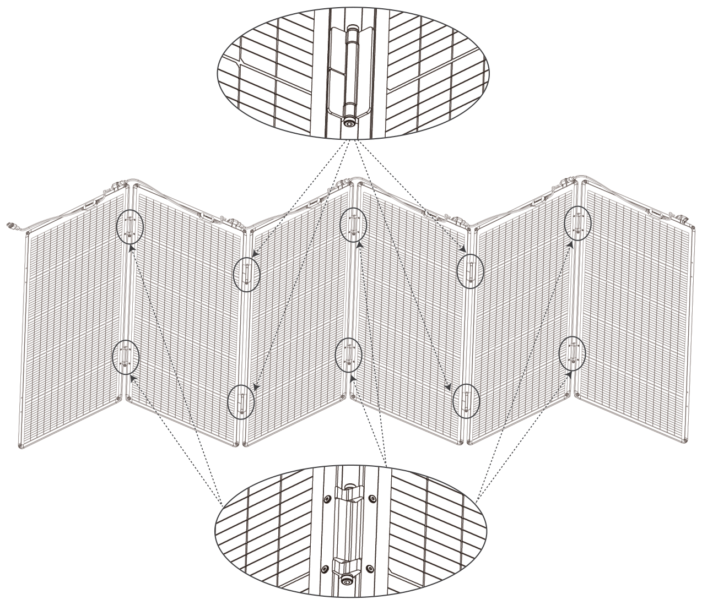

</figure>

### Wiring

The solar panels are connected to each other through Anderson ports.

<figure class="hb-reference-figure hb-has-composite-art" data-component-id="HB-SPECIAL-REFERENCE-FIGURE" data-reference-id="wiring" data-source-fragment-sha256="6c0f15e9c277afef0af7e16d7ebdf45e9521f227a18874b8f34bff8c0f557c51" data-step-captions="embedded" data-web-composite-asset-key="frozen-source/wiring" data-web-composite-locale="en" data-web-composite-sha256="4a6455cb391964a1c2ce4df099569218c86506242560eba67be5c083116c5d79" data-web-replace-key="reference.wiring">
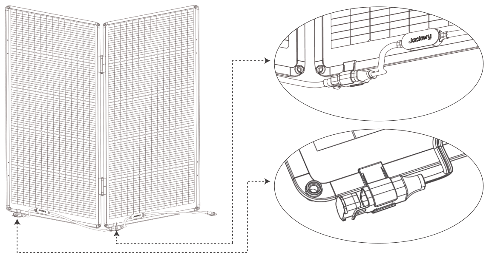

</figure>

The final installation result is displayed in the diagram.

Jackery SolarSaga 85W solar panels are designed for parallel connection only, with a maximum of six panels connected in parallel. Exceeding this limit may pose safety hazards. Jackery will not provide warranty service for incorrect installation or misuse.

<figure class="hb-reference-figure hb-has-composite-art" data-component-id="HB-SPECIAL-REFERENCE-FIGURE" data-reference-id="final-angle" data-source-fragment-sha256="cada24236f9a928701b0e5bec7d2752cb066b511e13a0e8ad4f37fe91694ecee" data-step-captions="embedded" data-web-composite-asset-key="frozen-source/final-angle" data-web-composite-locale="en" data-web-composite-sha256="67e484c25e121fde458749bab09de570ae06d368120e56f76a5fd92252dcb92e" data-web-replace-key="reference.final-angle">
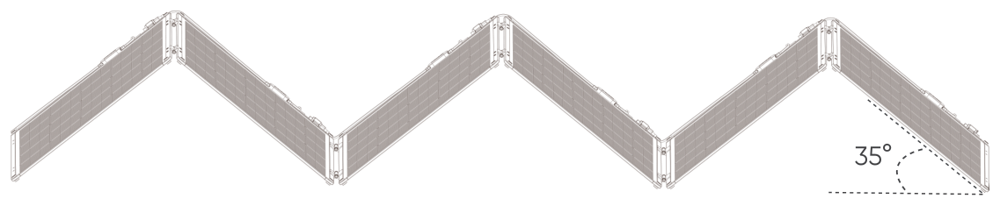

</figure>

Note: When the hinge is fully opened, the angle between the solar panel and the ground is approximately 35°.

Avoid applying pressure to the solar panels after installation, as this may cause damage.

### Securing with Ground Stakes

If you plan to use the SolarSaga 500 X in a fixed location for an extended period, we recommend securing the panels with ground stakes.

Note: When driving in the stakes, it is recommended to insert them at a 90° angle to the solar panel.

<figure class="hb-reference-figure hb-has-composite-art" data-component-id="HB-SPECIAL-REFERENCE-FIGURE" data-reference-id="ground-stake" data-source-fragment-sha256="6d824c78e5569279a5d3586bac934ac4efc125ba9b614c6d0b30ffc3ef6bee91" data-step-captions="embedded" data-web-composite-asset-key="frozen-source/ground-stake" data-web-composite-locale="en" data-web-composite-sha256="dceff5e1abd7e33ff641add2e53c0939b069ea35403140e100b031e6b6849c59" data-web-replace-key="reference.ground-stake">
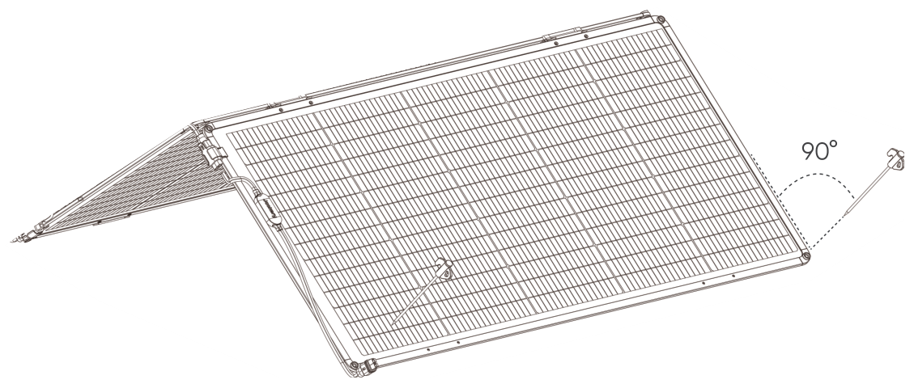

</figure>

It is suggested to secure the solar panels at the eight locations indicated in the diagram.

<figure class="hb-reference-figure hb-has-composite-art" data-component-id="HB-SPECIAL-REFERENCE-FIGURE" data-reference-id="stake-locations" data-source-fragment-sha256="48610d1717ac53c32b528315d7ea0079866deb1eaf1449b26c68df185a351893" data-step-captions="embedded" data-web-composite-asset-key="frozen-source/stake-locations" data-web-composite-locale="en" data-web-composite-sha256="7031f2fcbc75f40f04ed68215cc15c5036c91246dc86c4068d5152da6558c3d9" data-web-replace-key="reference.stake-locations">
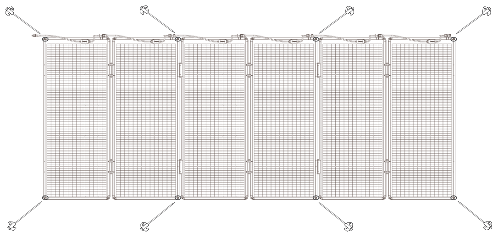

</figure>

To maximize power generation, it is recommended to orient the solar panel array in an east-west direction. In the event of strong winds or adverse weather, we advise retracting the solar panels.

### Storing the Product

You can fold the solar panels and place them in the storage bag, as shown in the illustration below.

<figure class="hb-reference-figure hb-has-composite-art" data-component-id="HB-SPECIAL-REFERENCE-FIGURE" data-reference-id="storage-fold" data-source-fragment-sha256="996efb580825a737e06df1f7bd9c1fce04719754117ab201a5f22b73a36dbe1a" data-step-captions="embedded" data-web-composite-asset-key="frozen-source/storage-fold" data-web-composite-locale="en" data-web-composite-sha256="d5f8844adc9e7a3eda4dca115284422c571286fe707ac4edf887c6d96628d537" data-web-replace-key="reference.storage-fold">
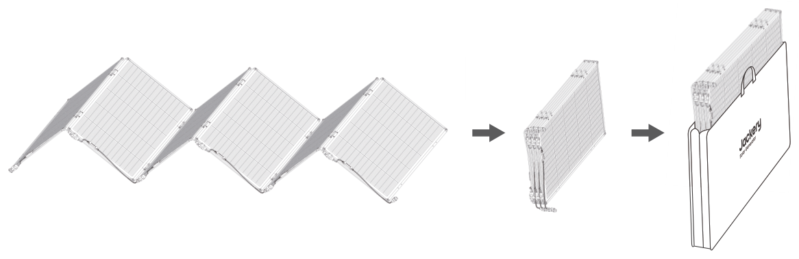

</figure>

The photovoltaic array formed by connecting multiple solar panels can be used to charge the power station via the 5m DC charging cable.

<figure class="hb-reference-figure hb-has-composite-art" data-component-id="HB-SPECIAL-REFERENCE-FIGURE" data-reference-id="array-to-station" data-source-fragment-sha256="3e862c6e5a2a429dcb51eee7882f4767f32a72a49e7b9df63b3c15badd1c2c4c" data-step-captions="embedded" data-web-composite-asset-key="frozen-source/array-to-station" data-web-composite-locale="en" data-web-composite-sha256="f5adde87fe11fefa828e746c43ac6c75a26dbdde27b9015c7abdbacd65617887" data-web-replace-key="reference.array-to-station">
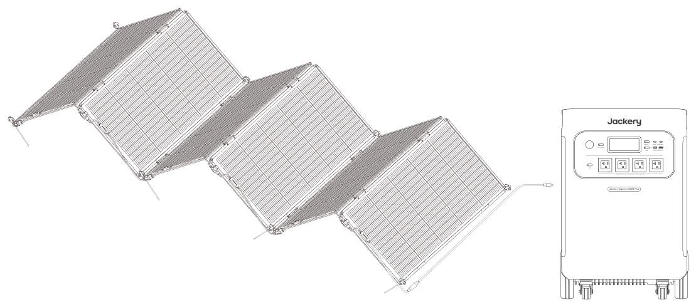

</figure>

# STORAGE AND TRANSPORTATION

<ol><li>
Avoid Contact with Corrosive Substances: Do not expose the product to highly corrosive materials.
</li><li>
Prevent Physical Damage: Avoid impacts and scratches on the surface during use.
</li><li>
Avoid Bending Stress: Do not subject the product to bending stress during transportation and assembly.
</li><li>
Proper Storage Conditions: Store the product within a temperature range of 0°C to 60°C(32°F to 140°F) and a humidity range of 0% to 60%.
</li></ol>

# SAFETY INSTRUCTIONS

<ul><li>
Please read the user manual carefully before using this product.
</li><li>
Do not bend the solar panels during use or transport.
</li><li>
Avoid dropping solar panels from high places. Any damage of product may lead to electric shock or fire.
</li><li>
Do not place the solar panels in trees, buildings or other shaded areas for use.
</li><li>
Do not immerse the solar panels in water or any other liquid.
</li><li>
Do not put solar panels in water directly, and use a damp cloth to gently wipe them when cleaning.
</li><li>
Do not use or store the solar panels near open flames or flammable materials.
</li><li>
Do not scratch the solar panels with sharp objects.
</li><li>
Do not put corrosive substance on the solar panels
</li><li>
Do not step on or place heavy objects on the solar panels.
</li><li>
Do not disassemble the solar panels. Damage to the product may result in a risk of electric shock.
</li><li>
The output circuit of solar panel package must be connected to the equipment properly, and reverse connection of positive and negative poles is strictly prohibited.
</li><li>
Check the connection status of various components, wires, and plugs before use.
</li><li>
Please put away the solar panels in case of strong winds, hail and other severe weather to avoid product damage or other hazards.
</li><li>
Under normal circumstances, PV modules may be exposed to higher currents or voltages than under standard test conditions. Therefore, when calculating the rated voltage of component, the rated current of conductor, and the size of the control device connected to the PV output, it is required to multiply the short-circuit current (Isc) and open circuit voltage (Voc) values marked on the component by a factor of 1.25.
</li></ul>

<figure aria-label="FCC" class="hb-fcc-composition" data-component-id="HB-SPECIAL-FCC">

<strong>NOTE:</strong> This equipment has been tested and found to comply with the limits for a Class B digital device, pursuant to part 15 of the FCC Rules. These limits are designed to provide reasonable protection against harmful interference in a residential installation. This equipment generates, uses and can radiate radio frequency energy and, if not installed and used in accordance with the instructions, may cause harmful interference to radio communications. However, there is no guarantee that interference will not occur in a particular installation. If this equipment does cause harmful interference to radio or television reception, which can be determined by turning the equipment off and on, the user is encouraged to try to correct the interference by one or more of the following measures:

<ul class="simple"><li>
Reorient or relocate the receiving antenna.
</li><li>
Increase the separation between the equipment and receiver.
</li><li>
Connect the equipment into an outlet on a circuit different from that to which the receiver is connected.
</li><li>
Consult the dealer or an experienced radio/TV technician for help.
</li></ul>
<strong>MODIFICATION:</strong> Any changes or modifications not expressly approved by the grantee of this device could void the user’s authority to operate the device.

</figure>

# WARRANTY

<figure aria-label="WARRANTY" class="hb-warranty-card" data-component-id="HB-WARRANTY-SECTION" data-warranty-card-index="1">
The product comes with a limited 5-year warranty from Jackery, valid for the original purchaser. This warranty covers defects in workmanship and materials from the date of purchase.

Since solar panels are outdoor products, sunlight, and ultraviolet rays can affect their appearance, such as causing fabric discoloration, plastic casing discoloration, and surface discoloration of the solar panels. Fabric deterioration can occur after more than one year. These issues are excluded from warranty coverage. The warranty only covers the normal power generation of the solar panel itself (Damages from normal wear and tear, alteration, misuse, neglect, accident, service by anyone other than the authorized service center, or act of God are not included ).

During the warranty period and upon verification of defects, this product will be replaced when returned with proper proof of purchase.
</figure>

# CONTACT US

<figure aria-label="CONTACT US" class="hb-warranty-card" data-component-id="HB-WARRANTY-SECTION" data-warranty-card-index="1">
For any inquiries or comments concerning our products, please send an email to hello@jackery.com, and we will respond to you as soon as possible. If there is any quality-related issue with the product, you may request a replacement or refund by submitting a request form at www.jackery.com.
</figure>

# CUSTOMER SERVICE

<figure aria-label="CUSTOMER SERVICE" class="hb-warranty-card" data-component-id="HB-WARRANTY-SECTION" data-warranty-card-index="1">
5 years limited warranty

Lifetime technical support

hello@jackery.com
</figure>

# Installation Requirements

<ul><li>
Non-permanent installation only
</li><li>
Fasteners: straps, screws, ropes, etc.
</li><li>
Locations: balconies, railings, carports, or other permitted structures with sufficient sunlight
</li></ul>

# Not permitted

<ul><li>
Rooftop installation on residential buildings
</li><li>
Use in grid-connected solar systems
</li><li>
Use in solar systems with a voltage greater than 60 V
</li></ul>

# Compliance

<ul><li>
All installations must follow local laws, regulations, and building codes.
</li><li>
Installation sites must meet applicable requirements.
</li></ul>

# Illustrations

<ul><li>
Balcony railing installation (example)
</li><li>
Carport or similar non-residential structure installation (example)
</li></ul>

# Disclaimer

<ul><li>
Illustrations are for reference only.
</li><li>
Warranty and service apply only when installation and use comply with this manual.
</li><li>
Installations outside these instructions are at the user's own risk and not covered by warranty.
</li></ul>

# Jackery Inc.

5310 Bunche Dr, Fremont, CA 94538-8301

Tel:1-888-502-2236(US)

E-mail:hello@jackery.com

Website:www.jackery.com

