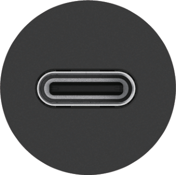
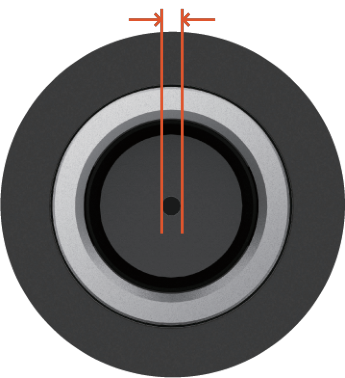
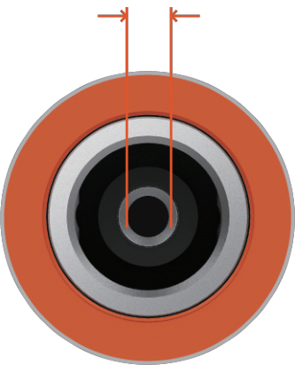

Jackery Solar Genarator 接続ガイド
==================================================

詳細なソーラー発電機接続ガイドについては、公式のJackeryウェブサイトまたはカスタマーサポートをご参照ください。

.. container:: hb-text-panel

   **図に示されている接続の問題については、次の解決策を検討してください:**

   ※ DC7909 のオス・コネクタは DC8020 のメス・ポートに挿入できますが、互換性がないため、電流は流れません。

.. list-table::
   :header-rows: 1

   * - ポータブル電源の型番
     - DC入力
   * - | Jackery ポータブル電源 100 Plus（JE-100A）
       | Jackery ポータブル電源 240 New（JE-240A）
       | Jackery ポータブル電源 300 Plus（JE-300B）
     - |port-usb-c|

       **USB-C**
   * - | Jackeryポータブル電源 240（PTB201）
       | Jackery ポータブル電源 400（PTB041）
       | Jackery ポータブル電源 700
       | Jackery ポータブル電源 708（PTB071）
       | Jackery ポータブル電源 1000（PTB101）
     - 0.9mm

       |port-dc7909|

       **DC7909**
   * - | Jackery ポータブル電源 1500（PTB152）
       | Jackery ポータブル電源 1000 Pro（JE-1000B）
       | Jackery ポータブル電源 1500 Pro（JE-1500B）
       | Jackery ポータブル電源 2000 Pro（JE-2000A）
       | Jackery ポータブル電源 3000 Pro（JE-3000A）
       | Jackery ポータブル電源 600 Plus（JE-600C）
       | Jackery ポータブル電源 1000 Plus（JE-1000C）
       | Jackery ポータブル電源 2000 Plus（JE-2000C）
       | Jackery ポータブル電源 1000 New（JE-1000D）
       | Jackery ポータブル電源 2000 New（JE-2000D）
       | 新製品
     - 2.0mm

       |port-dc8020|

       **DC8020**

.. raw:: html

   

黒のプラスチック

DC7909（メスコネクタ）

.. raw:: html

   

ロック溝

DC8020（メスコネクタ）

