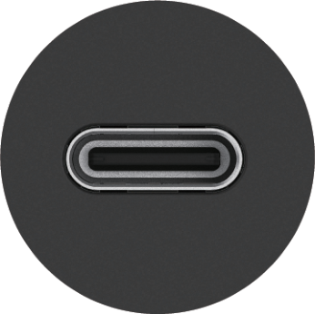
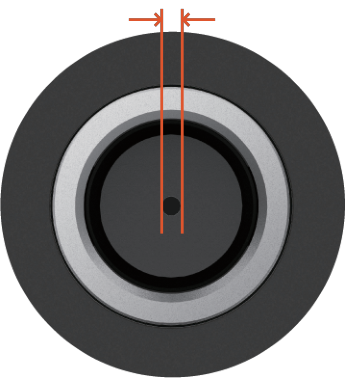
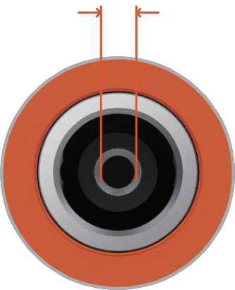
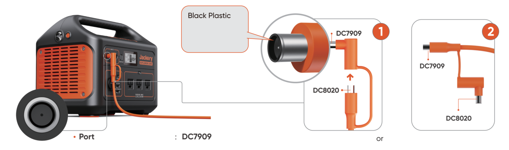
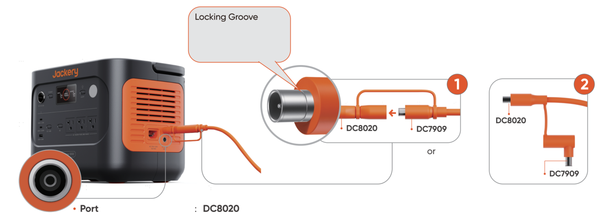

# Jackery Solar Generator Connection Guide

Please refer to the official Jackery website or customer support for the detailed solar generator connection guide.

For the connection issues shown in the diagram, please consider the following solutions. *The DC7909 male connector can be inserted into the DC8020 female port, but it is incompatible and does not allow current to flow.

<table class="manual-table"><tbody><tr><th>Portable Power Station</th><th>DC Input</th></tr><tr><td>Explorer 240 V2 Explorer 100 Plus Explorer 280 Plus Explorer 300 Plus</td><td>
USB-C
</td></tr><tr><td>Explorer 160 Explorer 290 Plus Explorer 1000 Explorer 880 Explorer 550 Explorer 500 Explorer 300 Explorer 290 Explorer 240</td><td>
0.9mm · DC7909
</td></tr><tr><td>Explorer 5000 Plus Explorer 1000 V2 Explorer 2000 V2 Explorer 3000 Pro Explorer 2000 Pro Explorer 1500 Pro Explorer 1000 Pro Explorer 880 Pro Explorer 2000 Plus Explorer 1000 Plus Explorer 700 Plus Explorer 600 Plus Explorer 1500 New Arrivals</td><td>
2.0mm · DC8020
</td></tr></tbody></table>

<figure class="hb-reference-figure hb-has-composite-art" data-component-id="HB-SPECIAL-REFERENCE-FIGURE" data-reference-id="connection-dc7909" data-source-fragment-sha256="2f5a3d04e51bdc160dd89b5be9a81ae9703a2815bcef3527f26c80b326000b55" data-step-captions="embedded" data-web-composite-asset-key="frozen-source/connection-dc7909" data-web-composite-locale="en" data-web-composite-sha256="d09e58e6ebb9c700448940f15430bd52dda03a85a585d4d84290f6ac20910ae5" data-web-replace-key="reference.connection-dc7909">

</figure>

<figure class="hb-reference-figure hb-has-composite-art" data-component-id="HB-SPECIAL-REFERENCE-FIGURE" data-reference-id="connection-dc8020" data-source-fragment-sha256="5b9ef7d2cba1259261505621cc0903c1b4981bf134ebb673b301db85027d5fa7" data-step-captions="embedded" data-web-composite-asset-key="frozen-source/connection-dc8020" data-web-composite-locale="en" data-web-composite-sha256="1a517fea783aefb850acf5ec1b58c52e12f6994fe5f5d513525a431b2104bb4a" data-web-replace-key="reference.connection-dc8020">

</figure>
