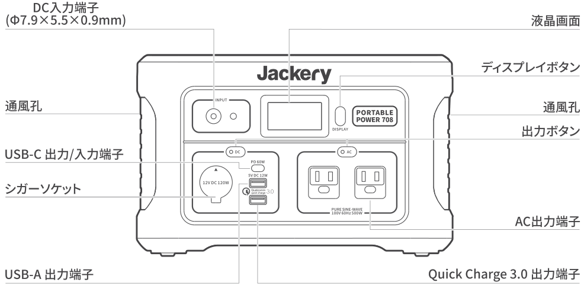
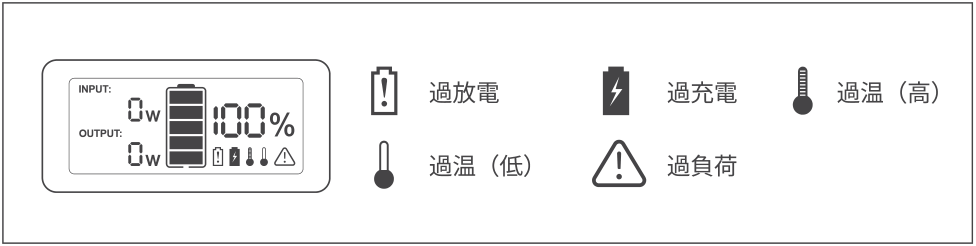
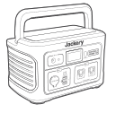
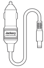
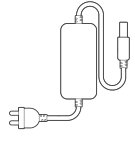
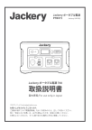
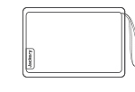
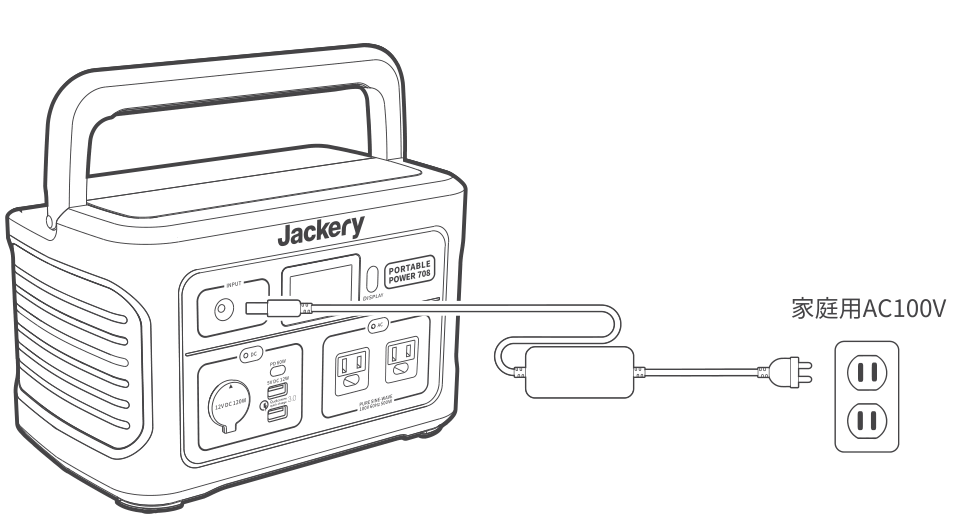

# お買い上げありがとうございます

ご使用の前にこの「取扱説明書」をよくお読みのうえ、正しくお使いください。特に「安全上のご注意」は、必ずお読みいただき、安全にお使いください。お読みになったあとは、すぐに取り出せる場所に大切に保管してください。

国内用 / For use only in Japan

カスタマーサービス：jackery.jp@jackery.com

# 主な仕様

## 【Jackery ポータブル電源 708】

<figure aria-label="【Jackery ポータブル電源 708】" class="hb-spec-table-composition"><table class="manual-table manual-spec-table hb-spec-table"><colgroup><col class="hb-spec-col-label"/><col class="hb-spec-col-value"/></colgroup><tbody><tr><th class="manual-spec-label hb-spec-label" scope="row">製品の名称</th><td class="manual-spec-value hb-spec-value">Jackery ポータブル電源 708</td></tr><tr><th class="manual-spec-label hb-spec-label" scope="row">型番</th><td class="manual-spec-value hb-spec-value">PTB071</td></tr><tr><th class="manual-spec-label hb-spec-label" scope="row">サイズ &amp; 重量</th><td class="manual-spec-value hb-spec-value">約299.7×191.5×190.5mm（約6.8kg）</td></tr><tr><th class="manual-spec-label hb-spec-label" scope="row">定格容量</th><td class="manual-spec-value hb-spec-value">リチウムイオン電池 31.9Ah/22.2V（708.18Wh）</td></tr><tr><th class="manual-spec-label hb-spec-label" scope="row">入力ポート</th><td class="manual-spec-value hb-spec-value">DC入力：24V⎓7.5A Max（12-30V対応） USB-C入力：PD 5V⎓3A, 9V⎓3A, 12V⎓3A, 15V⎓3A, 20V⎓3A ダブル入力：DC + USB-C 240W Max</td></tr><tr><th class="manual-spec-label hb-spec-label" scope="row">出力ポート</th><td class="manual-spec-value hb-spec-value">2×AC出力：100V～60Hz, 5A, 合計500W（瞬間最大1000W） USB-A出力：5V⎓2.4A　シガーソケット：12V⎓10A USB-C出力：5V⎓3A, 9V⎓3A, 12V⎓3A, 15V⎓3A, 20V⎓3A Qualcomm® Quick Charge™ 3.0出力：5V⎓3A, 9V⎓2A, 12V⎓1.5A</td></tr><tr><th class="manual-spec-label hb-spec-label" scope="row">保証期間</th><td class="manual-spec-value hb-spec-value">24ケ月</td></tr><tr><th class="manual-spec-label hb-spec-label" scope="row">付属品</th><td class="manual-spec-value hb-spec-value">ACアダプター、車載用充電シガーアダプター、 取扱説明書、保証書</td></tr><tr><th class="manual-spec-label hb-spec-label" scope="row">認証</th><td class="manual-spec-value hb-spec-value">UN38.3</td></tr></tbody></table></figure>

※USB Type-C® and USB-C are registered trademarks of USB Implementers Forum.

※本機の仕様および外観は、改善のため予告なく変更することがあります。

## 充電式電池のリサイクルについて

本機はリサイクル可能な充電池を内蔵しています。この商品を廃棄する場合は、当社のカスタマサポートにご連絡ください。

充電池の取りはずしはお客様自身では行わないでください。

# 各部の名称

<figure class="hb-reference-figure hb-has-composite-art" data-component-id="HB-SPECIAL-REFERENCE-FIGURE" data-reference-id="overview" data-source-fragment-sha256="71d1388e32bb0fe7243520675ef6d22393280a0c4e08774c5dd0e11c33265e90" data-step-captions="embedded" data-web-composite-asset-key="frozen-source/overview" data-web-composite-locale="ja" data-web-composite-sha256="d8cdf4fe7f6ead97f14cfa9e976045477d94cc5ee08d965754f4b097815a7d7c" data-web-replace-key="reference.overview">

</figure>

# 使用機器への給電の目安

## AC出力

<figure aria-label="AC出力" class="hb-spec-table-composition"><table class="manual-table manual-spec-table hb-spec-table"><colgroup><col class="hb-spec-col-label"/><col class="hb-spec-col-value"/></colgroup><tbody><tr><th class="manual-spec-label hb-spec-label" scope="row">ACライト（5W）</th><td class="manual-spec-value hb-spec-value">約58時間</td></tr><tr><th class="manual-spec-label hb-spec-label" scope="row">ノートパソコン（30W）</th><td class="manual-spec-value hb-spec-value">約9回</td></tr><tr><th class="manual-spec-label hb-spec-label" scope="row">プロジェクター（100W）</th><td class="manual-spec-value hb-spec-value">約5.9時間</td></tr><tr><th class="manual-spec-label hb-spec-label" scope="row">32インチ液晶テレビ（60W）</th><td class="manual-spec-value hb-spec-value">約10時間</td></tr><tr><th class="manual-spec-label hb-spec-label" scope="row">ドローン（60W）</th><td class="manual-spec-value hb-spec-value">約12回</td></tr><tr><th class="manual-spec-label hb-spec-label" scope="row">電気毛布（55W）</th><td class="manual-spec-value hb-spec-value">約10時間</td></tr></tbody></table></figure>

## USB出力

<figure aria-label="USB出力" class="hb-spec-table-composition"><table class="manual-table manual-spec-table hb-spec-table"><colgroup><col class="hb-spec-col-label"/><col class="hb-spec-col-value"/></colgroup><tbody><tr><th class="manual-spec-label hb-spec-label" scope="row">スマートフォン（18W Max）</th><td class="manual-spec-value hb-spec-value">約40回</td></tr><tr><th class="manual-spec-label hb-spec-label" scope="row">タブレット（12W Max）</th><td class="manual-spec-value hb-spec-value">約20回</td></tr></tbody></table></figure>

## シガーソケット

<figure aria-label="シガーソケット" class="hb-spec-table-composition"><table class="manual-table manual-spec-table hb-spec-table"><colgroup><col class="hb-spec-col-label"/><col class="hb-spec-col-value"/></colgroup><tbody><tr><th class="manual-spec-label hb-spec-label" scope="row">車載冷蔵庫（60W）</th><td class="manual-spec-value hb-spec-value">約10時間</td></tr></tbody></table></figure>

※電子機器の充電回数や使用時間は、気温や使用環境、機器の消費電力により異なります。

# 液晶画面

・バッテリー残量

使用する前にディスプレイボタンを押してバッテリー残量を確認してください。バッテリー残量が20%以下になった場合、まずは充電してください。

<figure class="hb-reference-figure hb-has-composite-art" data-component-id="HB-SPECIAL-REFERENCE-FIGURE" data-reference-id="lcd-panel" data-source-fragment-sha256="8b5655d503807171979c051cdcda2ad055f08324796eb365915c18fdb200caf8" data-step-captions="embedded" data-web-composite-asset-key="frozen-source/lcd-panel" data-web-composite-locale="ja" data-web-composite-sha256="f683a8fa3ad533f013bd792c0cfdd43f25d32849f9930b961234f05eec84f227" data-web-replace-key="reference.lcd-panel">

</figure>

INPUT：本機に蓄電を行う際に接続されたソーラーパネル、ACアダプター、シガーソケットから供給されている電力が表示されます。

OUTPUT：本機から電化製品などに接続し給電する場合に、接続側の製品の消費電力が表示されます。

# 同梱品

<figure aria-label="同梱品" class="hb-inbox-composition" data-card-count="5" data-component-id="HB-SPECIAL-INBOX" data-inbox-variant="responsive-card-grid"><ol class="hb-inbox-grid"><li class="hb-inbox-card" data-item-number="1">

本体

</li><li class="hb-inbox-card" data-item-number="2">

車載用充電シガーアダプター

</li><li class="hb-inbox-card" data-item-number="3">

ACアダプター

</li><li class="hb-inbox-card" data-item-number="4">

取扱説明書

</li><li class="hb-inbox-card" data-item-number="5">

収納ポーチ

</li></ol></figure>

※付属品を故障、紛失等してしまった場合はカスタマーサービスまでご連絡ください。

# よくある質問

## Q：Jackery本機にはどのような種類のバッテリーが入っていますか。

本機には、安全性の高い、高エネルギー円筒型リチウムイオン電池（18650）が内蔵されています。

## Q：本機不具合と考えられる事象があった場合、どのようにしたらよろしいでしょうか。（本機の充電ができない、接続機器に給電できない等）

故障診断をさせていただくため、カスタマーサービスへご連絡ください。

## Q：Jackery本機の充電方式はMPPT方式を採用していますか。

Jackery本機は、MPPT（最大電力点追従制御）方式を採用しております。

## Q：充電しながら本機を使用しても問題ないのでしょうか？

充電しながら本機の使用は可能ですが使用できるのは、充電電力よりも出力電力が小さい場合です。もしもデバイスの出力電力が充電電力よりも大きくなると、バッテリーが蓄電できなくなり、電源が切れてしまいます。

電池の寿命を長持ちさせたい場合はパススルー充電（給電を行いながら充電すること）はなるべくお控えください。

## Q：コンセントを差さずにACの出力ボタンを押すと6～7Wと表示されていますが問題ないのでしょうか？

AC起動後の待機時消費電力であり、インバータ起動後は電源を入れなくても電力を消費します。

インバータの電力消費量が10W以内となっておりますので、使用しない時には電源を切ってください。

## Q：使用せずに満充電で長期保管した場合、何か月で残量が0になりますか？

本製品は使用しない場合でも、スイッチがオフであれば非常に自然放電が少なくなる設計となっています。フル充電の状態で長期保管をした場合、3ヶ月経過後も80%以上の電池残量を保持することができます。ただし、長期保管時であっても、2ヶ月に1度動作確認をし（本体への給電、電気機械への充電どちらも）、3-6ヶ月に1度バッテリー残量を確認するようにしてください。

## Q：最大何Wまでの機器に給電できますか？

Jackeryポータブル電源708は、最大電力500Wまでの機器に給電ができるため、多くの電化製品や端末に対応可能です。

ただし、電気モーターを搭載している掃除機、ポンプ、冷蔵庫、電動丸ノコ、エアコン、洗濯機、電子レンジ、ドライヤーなどの製品については、起動時に「誘導負荷」が発生するため、公称電力の3～7倍の電力が必要となります。

最大出力500Wは、一定の電力で動く機器への出力可能範囲を指しています。500Wの出力を超えた場合は、電気回路が自動的に調整され、電力が低減、または保護機能が作動し自動で遮断することがあります。

始動電力が500Wの出力上限値を超える場合、ご利用できませんのでご了承ください。

ご注意：始動電力が出力上限値（定格出力）を大幅に超える可能性のある製品のご利用や、定格出力を超え給電がストップした製品を繰り返し利用することはポータブル電源が損傷するリスクがありますのでお控えください。

## Q：自動車用ジャンプスターターとして使用できますか？

自動車用ジャンプスターターの機能は搭載していないため、ご使用いただけません。

## Q：充電回数の数え方と本体の寿命を伸ばすための注意点を教えてください。

この充電回数とはポータブル電源を充電した回数ではなく、実際に使った（放電した）バッテリー容量の合計が100%になった時点で1回として計算します。

例えば、バッテリー容量が10万mAhのポータブル電源を例とすると、

初めに10万mAhを充電し、1度に残量ゼロになるまで使ったら充電回数は1回となります。1度に5万mAh（50%）を使った後に5万mAhを充電したとします。この場合、累計50%となるので充電回数は1回になりません。

また別途3万mAh（30%使用）を使い、追加で充電したとしてもまだ充電回数は1回になりません。さらに別の機会に2万mAh（20%使用）使うと、ここで初めて充電回数が1回としてカウントされます（50%+30%+20%=100%使用=充電回数1回）。

本製品には、過放電保護や過充電保護の機能を備えておりますので、充電回数や充電タイミングについてはお客様のご都合に合わせてご利用が可能です。

また、本体寿命を少しでも伸ばすための注意点として、下記の項目がございますので、ご確認いただけますと幸いです。

### 本体寿命を少しでも伸ばすための注意点

・出力上限値を超えた電化製品を利用しない（始動電力は公称電力3倍～7倍の誘導負荷の掃除機、冷蔵庫、エアコン、電子レンジ、洗濯機、電動丸、ポンプなどは特にご注意下さい）

・バッテリーを保管する際は60%-80%の状態にして保管するようにしてください。

・長期保管の場合2ヶ月に1度は本体への充電に加えて、家電製品などへの給電ができるかのメンテナンスを行ってください。

・パススルー（充電しながら出力も行う）使用をしない。

## Q：AC出力は純正弦波ですか？

Jackeryポータブル電源のAC 100Vコンセントは、純正弦波を採用しており、家庭用100Vと同じような、滑らかな波形を作り出す交流電源で、パソコンや、スピーカーなどほとんどの精密機器を利用可能です。

# 安全上のご注意

ご使用の前にこの「安全上のご注意」をよくお読みのうえ、正しくお使いください。

## 絵表示について

製品を安全に正しくお使いいただき、お客様や他の人々への危害や財産への損害を未然に防止するための表示です。内容をよく理解してから本文をお読みください。

<figure aria-label="絵表示について" class="hb-symbol-signal-composition" data-component-id="HB-TABLE-SYMBOL-SIGNAL"><table class="hb-symbol-signal-table"><colgroup><col class="hb-symbol-signal-col-label"/><col class="hb-symbol-signal-col-meaning"/></colgroup><thead><tr><th class="hb-symbol-signal-label-heading" scope="col">表示</th><th class="hb-symbol-signal-meaning-heading" scope="col">意味</th></tr></thead><tbody><tr><td class="hb-symbol-signal-label-cell">⚠警告</td><td class="hb-symbol-signal-meaning-cell">この表示を無視して、誤った取り扱いをすると、人が死亡または重傷を負う可能性が想定される内容を示しています。</td></tr><tr><td class="hb-symbol-signal-label-cell">⚠注意</td><td class="hb-symbol-signal-meaning-cell">この表示を無視して、誤った取り扱いをすると、人が傷害を負う可能性が想定される内容または物的損害の発生が想定される内容を示しています。</td></tr></tbody></table></figure>

## 絵表示の説明

<figure aria-label="絵表示の説明" class="hb-symbol-pair-composition" data-component-id="HB-TABLE-SYMBOL-ICON">

<table class="hb-symbol-panel-table"><colgroup><col class="hb-symbol-col-icon"/><col class="hb-symbol-col-meaning"/></colgroup><thead><tr><th class="hb-symbol-icon-heading" scope="col">図記号</th><th class="hb-symbol-meaning-heading" scope="col">説明</th></tr></thead><tbody><tr><td class="hb-symbol-icon"></td><td class="hb-symbol-meaning">コンセントから電源プラグを抜く記号</td></tr><tr><td class="hb-symbol-icon"></td><td class="hb-symbol-meaning">製品を分解、改造をを禁止する記号</td></tr><tr><td class="hb-symbol-icon"></td><td class="hb-symbol-meaning">製品を濡らすことを禁止する記号</td></tr></tbody></table>

<table class="hb-symbol-panel-table"><colgroup><col class="hb-symbol-col-icon"/><col class="hb-symbol-col-meaning"/></colgroup><thead><tr><th class="hb-symbol-icon-heading" scope="col">図記号</th><th class="hb-symbol-meaning-heading" scope="col">説明</th></tr></thead><tbody><tr><td class="hb-symbol-icon"></td><td class="hb-symbol-meaning">行為を指示する記号</td></tr><tr><td class="hb-symbol-icon"></td><td class="hb-symbol-meaning">行為を禁止する記号</td></tr><tr><td class="hb-symbol-icon"></td><td class="hb-symbol-meaning">製品に濡れた手で触れることを禁止する記号</td></tr></tbody></table>

</figure>

<table class="manual-callout-table manual-callout-table"><tbody><tr><td class="manual-callout-label">警告</td><td class="manual-callout-body">
万一、次のような異常が発生したときはすぐに使用をやめる
・煙が出ている、異臭がする　・落としたり、破損したとき　・異音がする
・内部に水や異物が入ったとき　・電源コード（ACアダプター）が傷んだとき

このような異常が発生したまま使用をしていると、火災や感電の原因になります。すぐにACアダプターをコンセントから抜いてください。また、本機に接続されている機器もすべて外してください。

万が一発煙や発火したら、大量の水で消火して煙が見えなくなるまで本機を水浸しにしてください。
煙が出なくなることを確認してからカスタマーサービスにご連絡ください。お客様による修理は危険ですので絶対におやめください。

分解、改造しない
故障、発熱、火災・感電の原因になります。

表示された電源電圧以外で使用しない
故障、発熱、火災・感電の原因になります。本機を使用できるのは日本国内のみです。

付属品と本製品が破損した場合は、ご自身で修理をしない。

火のそばや炎天下の車内、熱器具の周辺など高温（40℃以上）になる場所で使用したり、放置しない
発熱や発火、破裂する原因になります。

強い衝撃を与えたり、投げつけたりしない
発熱や発火、破裂する原因になります。

水など、液体を入れたり、濡らしたりしない
発熱や発火の原因になります。

濡れた手で本体や接続するケーブルを触らない
火災や感電の原因になります。

端子部にケーブル以外の金属類を差し込まない
発熱や発火の原因になります。

雷が鳴りだしたら、電源プラグにふれない（充電をしない）
感電の原因になります。

各接続端子には確実に差し込む
差し込みが不十分な場合だと、発熱したりほこりが付着して火災や感電の原因になります。
</td></tr></tbody></table>

<table class="manual-callout-table manual-callout-table"><tbody><tr><td class="manual-callout-label">注意</td><td class="manual-callout-body">
本機の上に物を載せたり、本機を不安定な場所に置かない
倒れたり、落ちたりしてけがの原因になります。

ACアダプター（電源コード）の取り扱いについて
・ACアダプターは使用中に熱を持ちます。布や毛布でおおったり、包んだりしないでください。発火し、火傷する恐れがあります。
・付属のACアダプター（電源コード）以外は使用しないでください。
また、付属のACアダプター（電源コード）を本機以外の機器には使用しないでください。発火し、火傷する恐れがあります。

次のような機器では、絶対に使用しないでください。万が一使用中に給電ができなくなった場合命にかかわる被害が想定されます。
・医療機器や使用上、生命に関わる機器
・社会的、公共的に重要な機器など
・重要な事業用機器など

心臓にペースメーカーを装着している方は使用しない。
ペースメーカーが、本機の影響を受ける恐れがあります。
</td></tr></tbody></table>

# 使用上のご注意

・本機は防塵・防水仕様ではありませんので、ほこりや水、海水などがかからないように注意してください。

・ほこりが多い場所や高温多湿の場所での充電および使用、放置をしないでください。

・本機を不安定な場所に置かないでください。必ず、平坦で安定した場所に置いて使用してください。

・本機の通風孔は、安全上絶対にふさがないでください。また、本機の各面から5cm以上スペースを空けてください。

・充電または給電中は本機が温かくなります（故障ではありません）ので、周囲には物を置かないでください。

・本機接続機器のケーブルを差すときは、真っすぐな向きに差してください。

・接続機器のケーブルを抜くときは、必ずプラグ部分を持って抜いてください。ケーブルを引っ張ったり折り曲げると、断線などの原因となります。

・給電する機器の充電制御や充電状況、環境などにより給電できない、または急速充電にならない場合があります。

・充電または給電中はラジオやチューナー、テレビなどに雑音が入る場合があります。雑音が入る場合には、それらの製品から離れた場所でお使いください。

・本体が汚れたらコンセントから電源プラグを抜き、柔らかい布で乾拭きしてください。汚れがひどいときは、水または薄めた中性洗剤でふきとってください。シンナーやベンジンなどは絶対に使わないでください。

・付属のACアダプターは、電源コードの抜き差しで電源が入ったり切れたりするため、異常時に電源コードを容易に抜き差しできる空間を設けてください。

・入出力の電力（W）

接続機器の入力仕様が本機の出力値の上限を超えている場合に、電源を自動的に遮断します。消費電力が仕様以下であることを確認してから出力ボタンを押してください。

・低/高温警報

Jackery本機は-10℃～40℃（14～104°F）の温度範囲でお使いの機器に電力供給が可能となり、本機への蓄電は0℃～40℃（32～104°F）で行え、保管温度は-10℃～40℃（14～104°F）となります。

動作温度が上記範囲外にある場合、本製品が温度異常マークが表示され動作しない可能性がございます。

温度異常マークを解除するには、動作温度範囲内の環境に2時間以上置くようにお願い致します。

※容量表示に関しては、あくまで参考値で、電圧により電力が算出され、表示数値にズレが発生することがあります。

# 使いかた

<table class="manual-callout-table manual-callout-table"><tbody><tr><td class="manual-callout-label">ご注意</td><td class="manual-callout-body">
・充電池は空の状態で長期保管（2ヶ月－6ヶ月）すると、性能が劣化したり、充電できなくなる場合があります。

・本機を長期保管する場合には、2ヶ月に1度を目安に本体にACアダプターやソーラーパネルを通して充電が可能か、他の電化製品に給電が可能かなどの動作確認をお願い致します。なお、保管時の電池残量につきましては、60～80%ほどを目安に保管することを推奨します。
</td></tr></tbody></table>

## 本機を充電する

付属のACアダプターまたはシガーアダプターを本機のDC入力端子に接続して充電する。ディスプレイボタンを押すと、液晶画面に充電残量が表示されます。

＊液晶画面は、数秒後に消灯します。再度液晶画面を点灯させる場合は、ディスプレイボタンを押してください。

<figure class="hb-reference-figure hb-has-composite-art" data-component-id="HB-SPECIAL-REFERENCE-FIGURE" data-reference-id="charging" data-source-fragment-sha256="aadc58f0bf5ba190398b032a3e608da79f003ad72ceb8c0d27d8d8ec3f8a2d97" data-step-captions="embedded" data-web-composite-asset-key="frozen-source/charging" data-web-composite-locale="ja" data-web-composite-sha256="2d6fb7ffa3cd0d53d1b658a820db38eadc408efc0d4c704495b2e8dc7de7da45" data-web-replace-key="reference.charging">

</figure>

## 各種充電方法における充電時間の目安

<figure aria-label="各種充電方法における充電時間の目安" class="hb-spec-table-composition"><table class="manual-table manual-spec-table hb-spec-table"><colgroup><col class="hb-spec-col-label"/><col class="hb-spec-col-value"/></colgroup><tbody><tr><th class="manual-spec-label hb-spec-label" scope="row">コンセント</th><td class="manual-spec-value hb-spec-value">約5時間</td></tr><tr><th class="manual-spec-label hb-spec-label" scope="row">シガーアダプター</th><td class="manual-spec-value hb-spec-value">約13時間</td></tr><tr><th class="manual-spec-label hb-spec-label" scope="row">コンセント＋PD60W（入力）</th><td class="manual-spec-value hb-spec-value">約4.5時間</td></tr><tr><th class="manual-spec-label hb-spec-label" scope="row">100Wのソーラーパネル（別売り）</th><td class="manual-spec-value hb-spec-value">約10.5時間（天気次第）（推奨）</td></tr></tbody></table></figure>

本機へ充電する時、容量表示が100%にならず90%以下までしか表示されない場合は製品不備の恐れがあります。その場合、すぐに使用を停止し、カスタマーサービスまでお問合せください。

車載シガーソケットと充電ケーブルに接触不良があったり、内部の金属が錆びている場合、抵抗が大きくなり、熱が上昇して不具合が発生してしまう可能性がありますので、シガーソケットで本体へ充電する場合、充電ケーブルをしっかりと差し込んで、挿し口にゴミなどが入ってないことを確認のうえご使用いただくようお願いします。

## 本機から接続機器に給電する

＊機器を接続した端子の出力ボタンを押すと、給電が開始されます。もう一度出力ボタンを押すと、給電が停止します。

＊バッテリー残量が10%と20%になると、液晶画面が10回点滅します。その場合は接続機器への給電を止めて本機を充電してください。

＊省エネのため、AC出力端子、シガーソケット出力またはDC出力端子が使用される場合、接続機器の電力が10W未満の場合、12時間後に自動的にオフになります。

＊接続機器によっては、起動時の電力が通常時の消費電力より大きい場合があります。本機の定格出力を超えた場合は、本機の保護装置が起動し、電力の調整、もしくは遮断をすることがあります。

＊本機のAC出力は60Hz（固定）となりますので、接続する機器が50Hzのみ対応のものは動作しません。接続するAC機器は、60Hzまたは50/60Hzの表示があるものをご使用ください。

＊接続した機器の消費電力が本機の供給電力を上回った場合、自動的に給電が停止します。

＊接続する機器についての動作確認はしておりません。

＊ポータブル電源へ接続する一部機器は仕様範囲内でも動作しない、もしくは正常に動作しない場合があります。この場合は、その機器のご利用はお控えください。

# 免責事項

・火災、地震、第三者による行為、その他の事故、お客様の故意または過失、誤用・誤動作・その他の異常な条件下での使用により生じた損害に関して、当社は一切責任を負いません。

・付属品と本製品が破損した場合は、ご自身で修理をしないでください。ご自身で分解・修理したことにより生じた損害に関し、当社は一切責任を負いません。

・保証範囲は利用規約に適用され、記載されていない内容は当社の保証範囲外となります。

・取扱説明書の記載事項が遵守されないことにより生じた不適合について当社は責任を負いかねます。

・本製品の使用、または使用不能から発生する付随的な損害（事業利益損失含む）、当社が関与しない接続機器との組み合わせによる誤動作などから生じた損害に関して、当社は一切の責任を負いません。

・本製品は個人の安全に関係する、あるいは消費電力の大きな設備に給電できません。例えば、医療機器、核施設設備、CPAP（シーパップ）、スペースシャトルの製造などです。上記の設備の使用後、火災、機器故障など個人の安全を脅かす事故の責任を取りません。

